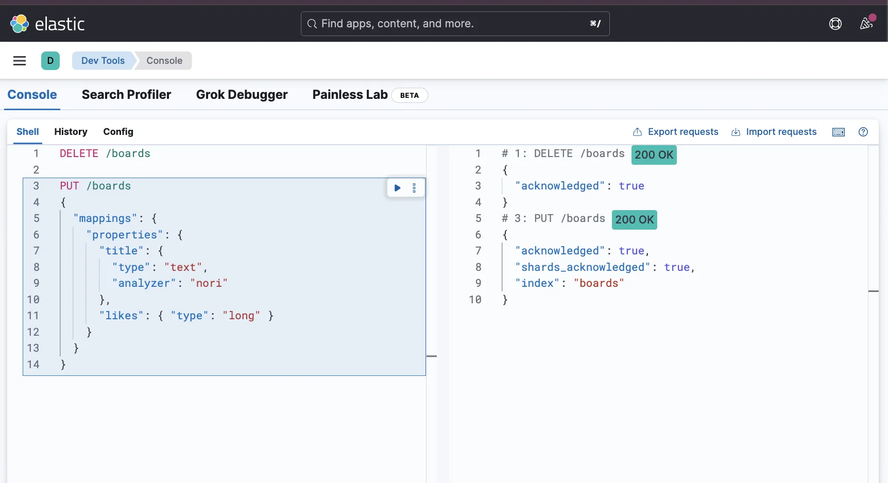
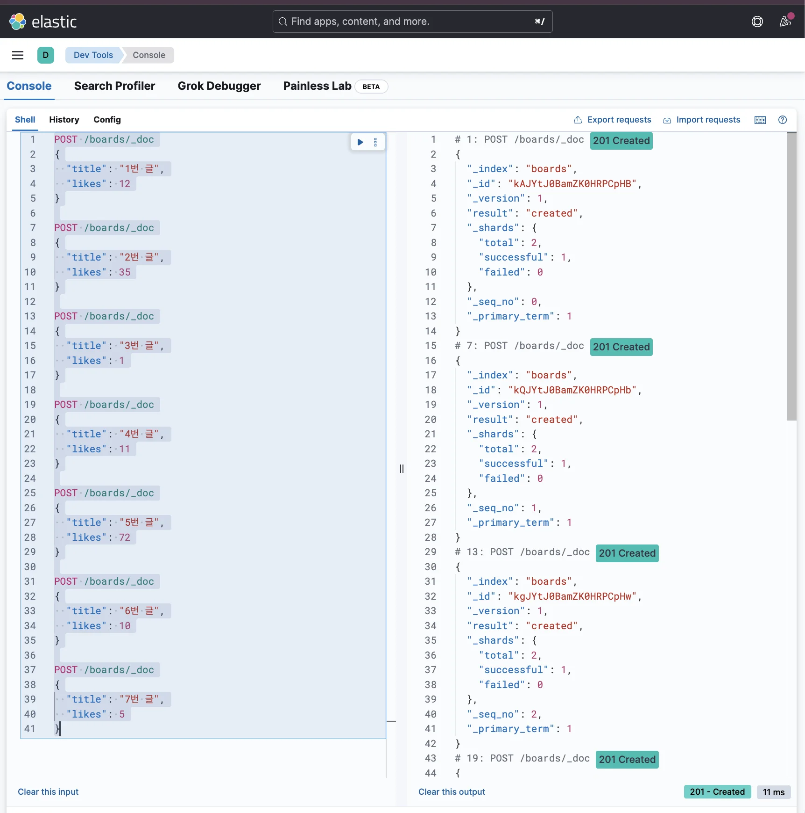
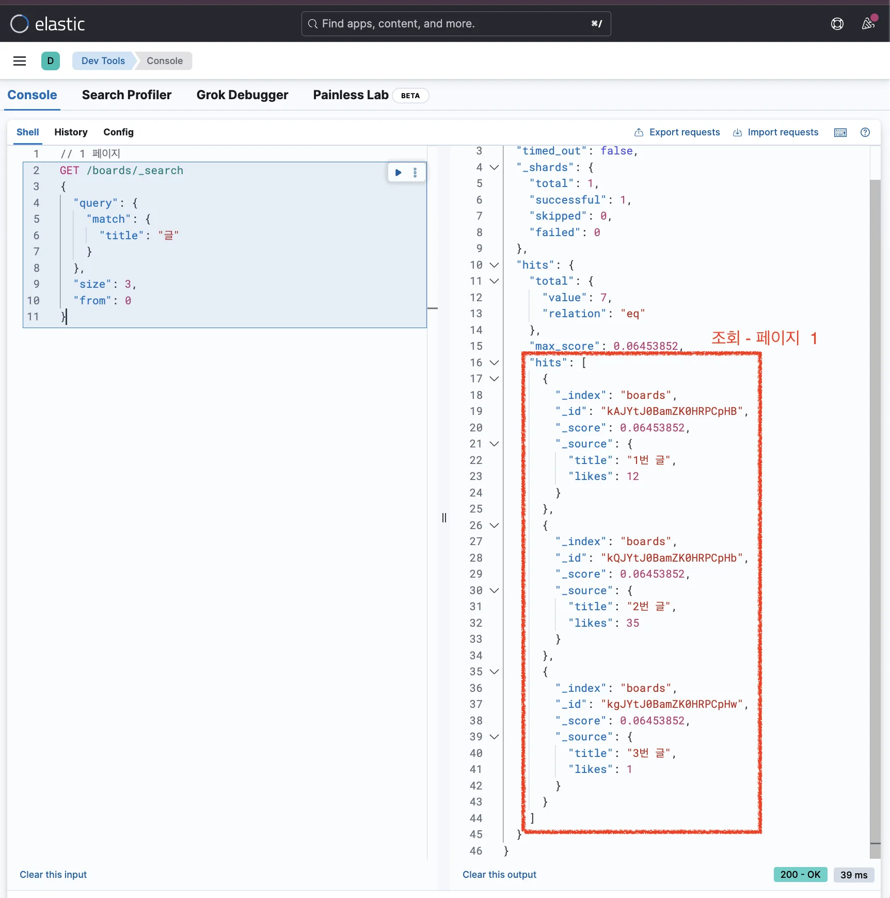
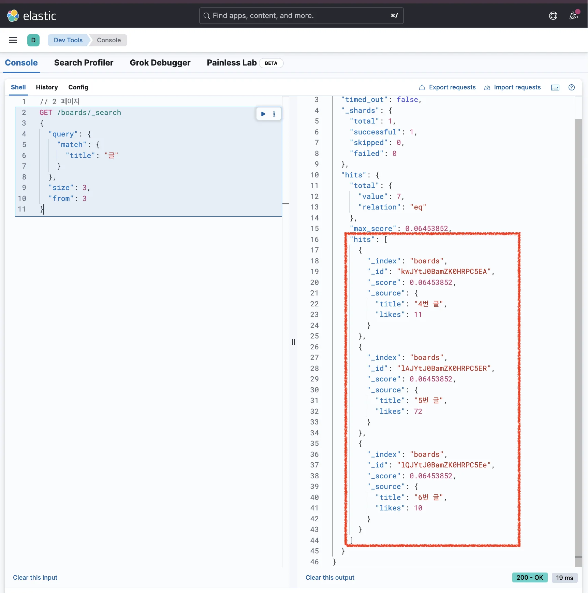
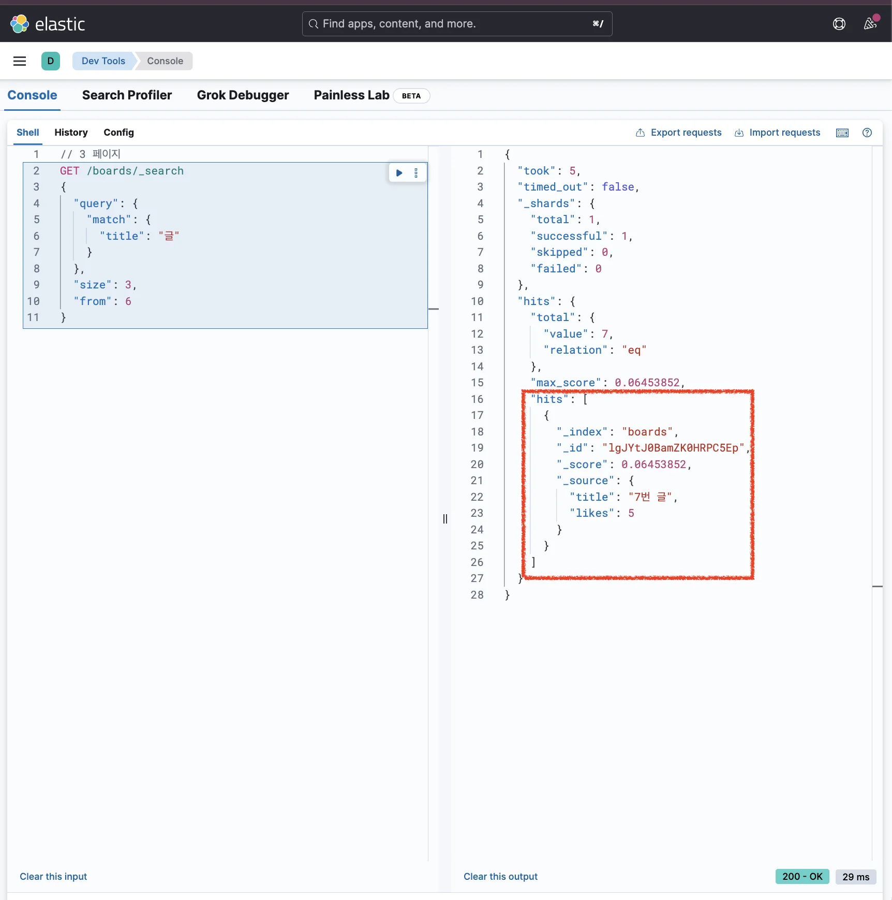
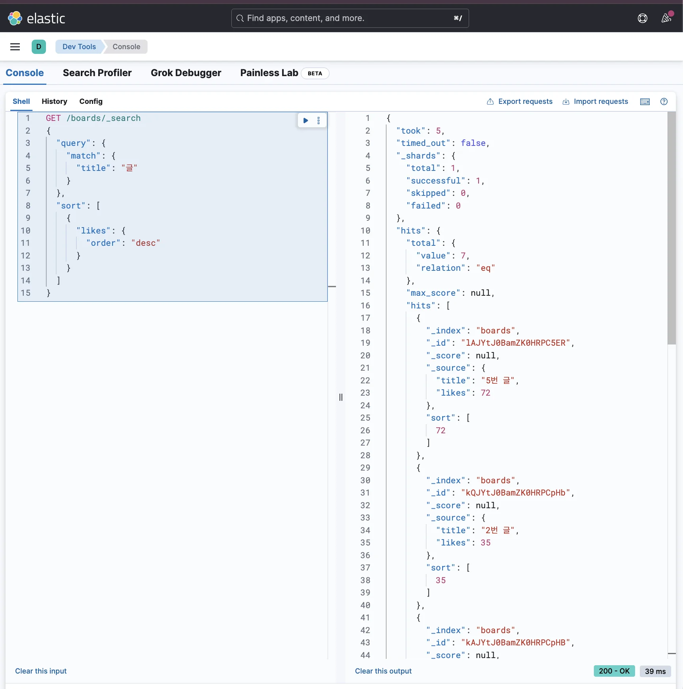

> 
> 
> <a id="34aeda9b0fe1810b91abca62f3fc7f39"></a>
> 
> 목차
> 
> - [페이지네이션 (Pagination), 정렬(Sorting)](#34aeda9b0fe181869ffdd19be6316a8a)
> - [페이지네이션 (Pagination)](#34aeda9b0fe181d2a645c5cb126482dc)
> - [정렬 (Sorting)](#34aeda9b0fe18027a053ca3db450c00a)

<a id="34aeda9b0fe181869ffdd19be6316a8a"></a>

## 페이지네이션 (Pagination), 정렬(Sorting)

---

> 📖 
> 
> <a id="34aeda9b0fe1817da755e82923cf8b13"></a>
> 
> <strong><u>서버의 과부하를 방지</u></strong>하기 위해 데이터 조회 시 필수적으로 적용해야 하는 기능이 <strong><u>페이지네이션(Pagination)</u></strong>이다&#46;
> 
> <a id="34aeda9b0fe18031ab5dc14f3fe711f5"></a>
> 
>  Elasticsearch에서도 <strong><u>페이지네이션(Pagination) 기능을 지원</u></strong>한다&#46; 
> 
> <a id="34aeda9b0fe18025ac6ce3e91582a1d2"></a>
> 
> 또한 <strong><u>정렬(Sorting)</u></strong>도 지원한다&#46; 

<a id="34aeda9b0fe181d2a645c5cb126482dc"></a>

### 페이지네이션 (Pagination)

<details>
<summary><strong>1&#46; 인덱스 생성 및 매핑 정의</strong></summary>

<a id="34aeda9b0fe18148ad14d8aa6585c876"></a>

```json
DELETE /boards

PUT /boards
{
  "mappings": {
    "properties": {
      "title": { 
        "type": "text",
        "analyzer": "nori"
      },
      "likes": { "type": "long" }
    }
  }
}
```



</details>

<details>
<summary><strong>2&#46; 데이터 삽입</strong></summary>

<a id="34aeda9b0fe181daa3d0f560b5fbead4"></a>

```json
POST /boards/_doc
{
  "title": "1번 글",
  "likes": 12
}

POST /boards/_doc
{
  "title": "2번 글",
  "likes": 35
}

POST /boards/_doc
{
  "title": "3번 글",
  "likes": 1
}

POST /boards/_doc
{
  "title": "4번 글",
  "likes": 11
}

POST /boards/_doc
{
  "title": "5번 글",
  "likes": 72
}

POST /boards/_doc
{
  "title": "6번 글",
  "likes": 10
}

POST /boards/_doc
{
  "title": "7번 글",
  "likes": 5
}
```



</details>

<details>
<summary><strong>3&#46; 페이지네이션을 적용한 검색(조회)</strong></summary>

> ✏️ 
> 
> - <code>size</code> &#58; 한 페이지에 불러올 데이터 개수 (SQL문의 <code>LIMIT</code>과 동일)
> 
> - <code>from</code> &#58; 몇 번째 데이터부터 불러올 지 (SQL문의 <code>OFFSET</code>과 동일, <code>0</code>부터 시작)
>     - <code>from</code> = (페이지 수 &#45; 1) x <code>size</code>

<a id="34aeda9b0fe181fdae0dc8d38b0cde4a"></a>

```json
// 1 페이지
GET /boards/_search
{
  "query": {
    "match": {
      "title": "글"
    }
  },
  "size": 3,
  "from": 0
}
```



<a id="34aeda9b0fe18012b9c2ed686795a8db"></a>

```json
// 2 페이지
GET /boards/_search
{
  "query": {
    "match": {
      "title": "글"
    }
  },
  "size": 3,
  "from": 3
}
```



<a id="34aeda9b0fe180c3aa63f5fe51702452"></a>

```json
// 3 페이지
GET /boards/_search
{
  "query": {
    "match": {
      "title": "글"
    }
  },
  "size": 3,
  "from": 6
}
```



</details>

<a id="34aeda9b0fe18027a053ca3db450c00a"></a>

### 정렬 (Sorting)

<details>
<summary>예시) 좋아요 수(likes) 내림차순 정렬</summary>

<a id="34aeda9b0fe18017a772e0c2f5f47788"></a>

```json
GET /boards/_search
{
  "query": {
    "match": {
      "title": "글"
    }
  },
  "sort": [
    {
      "likes": {
        "order": "desc"
      }
    }
  ]
}
```



</details>
