> 
> 
> <a id="34aeda9b0fe180a8854ff24f8982aaf6"></a>
> 
> 목차
> 
> - [검색 키워드를 일부 입력했을 때 검색어 추천: 자동 완성 기능](#34aeda9b0fe180c380a2e73f8cac2a95)
> - [[실습] _2gram, _3gram 구성 확인](#34aeda9b0fe18072bd76fa939ae11cf3)
> - [[ 실습] search_as_you_type타입을 통한 자동 완성 기능 구현](#34aeda9b0fe180d5b610efda1b856e6b)

<a id="34aeda9b0fe180c380a2e73f8cac2a95"></a>

## 검색 키워드를 일부 입력했을 때 검색어 추천&#58; <code>자동 완성 기능</code>

---

> 📖 
> 
> <a id="34aeda9b0fe18091ab40f1321600cee9"></a>
> 
> 쿠팡을 보면 아래와 같이 <strong><u>검색어 자동 완성 기능</u></strong>을 제공한다&#46; 
> 
> 
> 
> <a id="34aeda9b0fe180f3bfc2d9b9867c15bd"></a>
> 
> 자동 완성 기능을 구현하는 방법에는 정말 다양한 방법이 존재하지만, 그 중 가성비가 좋은 <code>search&#95;as&#95;you&#95;type</code>을 활용하여 구현하는 방법을 학습한다&#46; 

> ✏️ 
> 
> <a id="34aeda9b0fe180488cc3dfa2b818ca9c"></a>
> 
> <strong><code>search&#95;as&#95;you&#95;type</code></strong>
> 
> - Elasticsearch에서 <strong><u>자동 완성 기능을 쉽게 구현할 수 있게 설계된 데이터 타입</u></strong>이다&#46; 
> 
> - <code>text</code> 타입처럼 애널라이저(Analyzer)를 거쳐 토큰으로 분리된다&#46; 
> 
> - 해당 타입을 활용하여 필드를 만들면 내부적으로 <code>&#95;2gram</code>, <code>&#95;3gram</code>이라는 멀티 필드(Multi Field)도 같이 생성된다&#46;

> 🤔 
> 
> <a id="34aeda9b0fe180e08a41c67694feac12"></a>
> 
> <strong><code>&#95;2gram</code></strong><strong>, </strong><strong><code>&#95;3gram</code></strong><strong> 이란?</strong>
> 
> <a id="34aeda9b0fe180c292c5d3725d525400"></a>
> 
> <code>&#95;{n}gram</code>은  n개의 단어 묶어서 토큰을 만드는 것을 의미한다&#46; 
> 
> - <strong><code>&#95;2gram</code></strong>&#58; 두 단어씩 묶어 토큰 생성
> 
> - <strong><code>&#95;3gram</code></strong>&#58; 세 단어씩 묶어 토큰 생성

<a id="34aeda9b0fe18072bd76fa939ae11cf3"></a>

### &#91;실습&#93; <code>&#95;2gram</code>, <code>&#95;3gram</code> 구성 확인

<details>
<summary><strong>1&#46; 인덱스 생성 및 매핑 정의</strong></summary>

<a id="34aeda9b0fe180dcb344f2681911a4f5"></a>

```json
DELETE /products

PUT /products
{
  "mappings": {
    "properties": {
      "name": {
        "type": "search_as_you_type",
        "analyzer": "nori"
      }
    }
  }
}
```

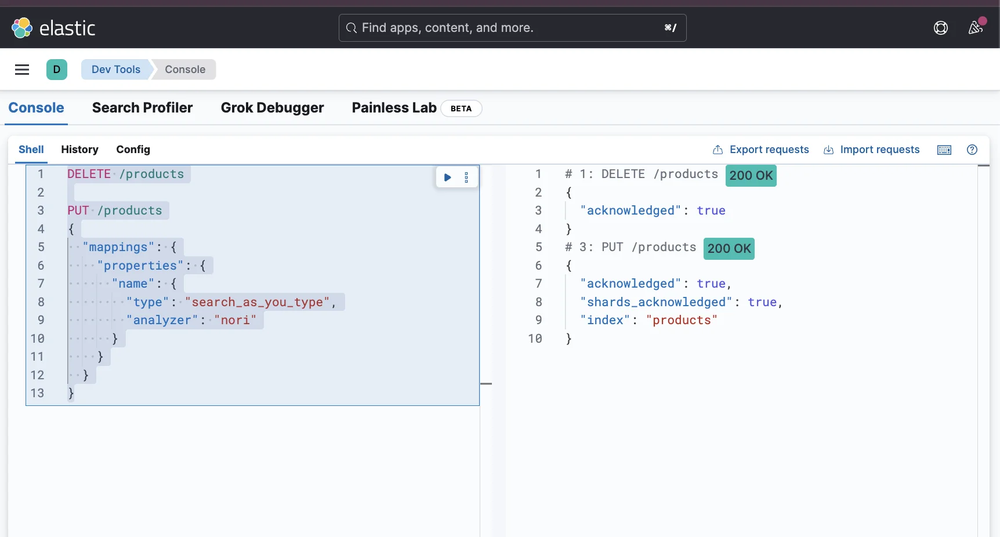

</details>

<details>
<summary>2&#46; <strong>Analyze API로 디버깅</strong></summary>

<details>
<summary><strong>영어 문장</strong></summary>

<a id="34aeda9b0fe180bf8a66d16e437d3813"></a>

```json
GET /products/_analyze
{
  "field": "name",
  "text": "You have the big banana"
}
```

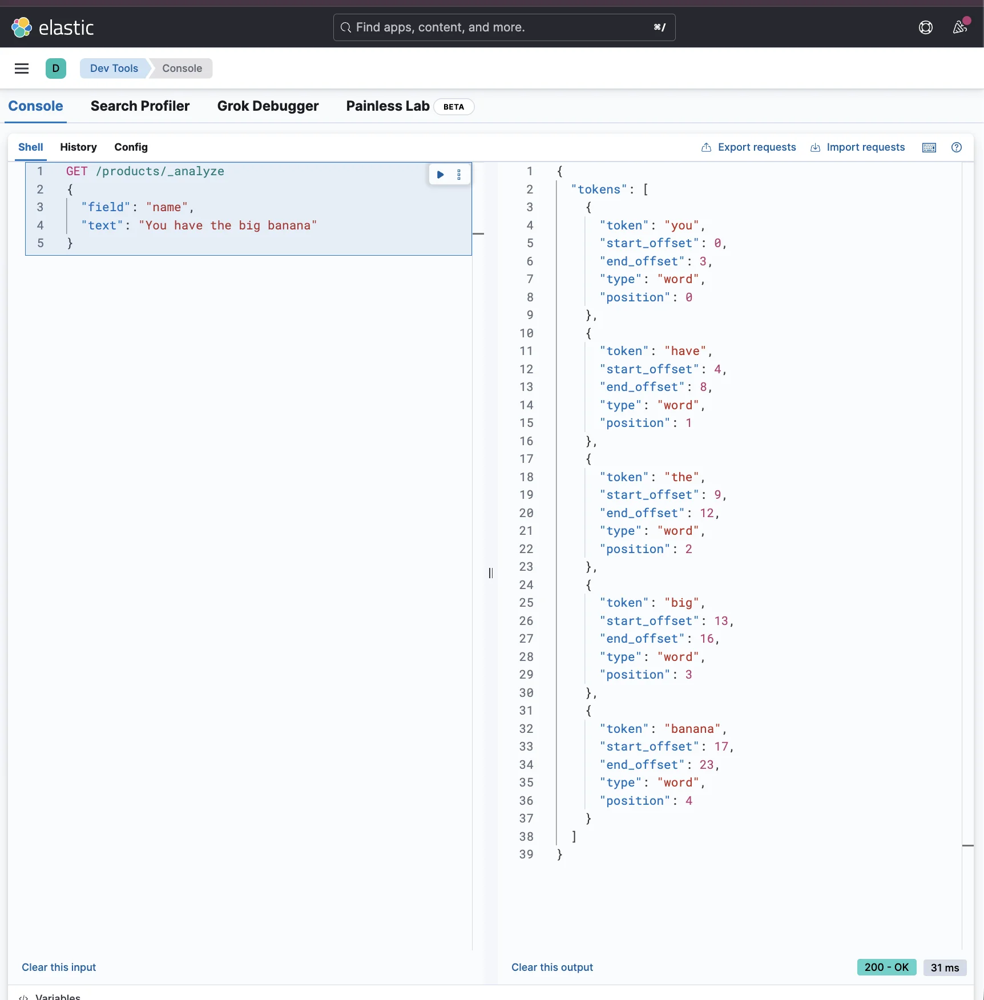

<a id="34aeda9b0fe180079ec0fa820ef99ab4"></a>

<u>하나의 단어로 토큰이 구성</u>되어 저장된 것을 확인할 수 있다&#46; 

<a id="34aeda9b0fe180ee94bef50bccb87571"></a>

```json
GET /products/_analyze
{
  "field": "name._2gram",
  "text": "you have the big banana"
}
```

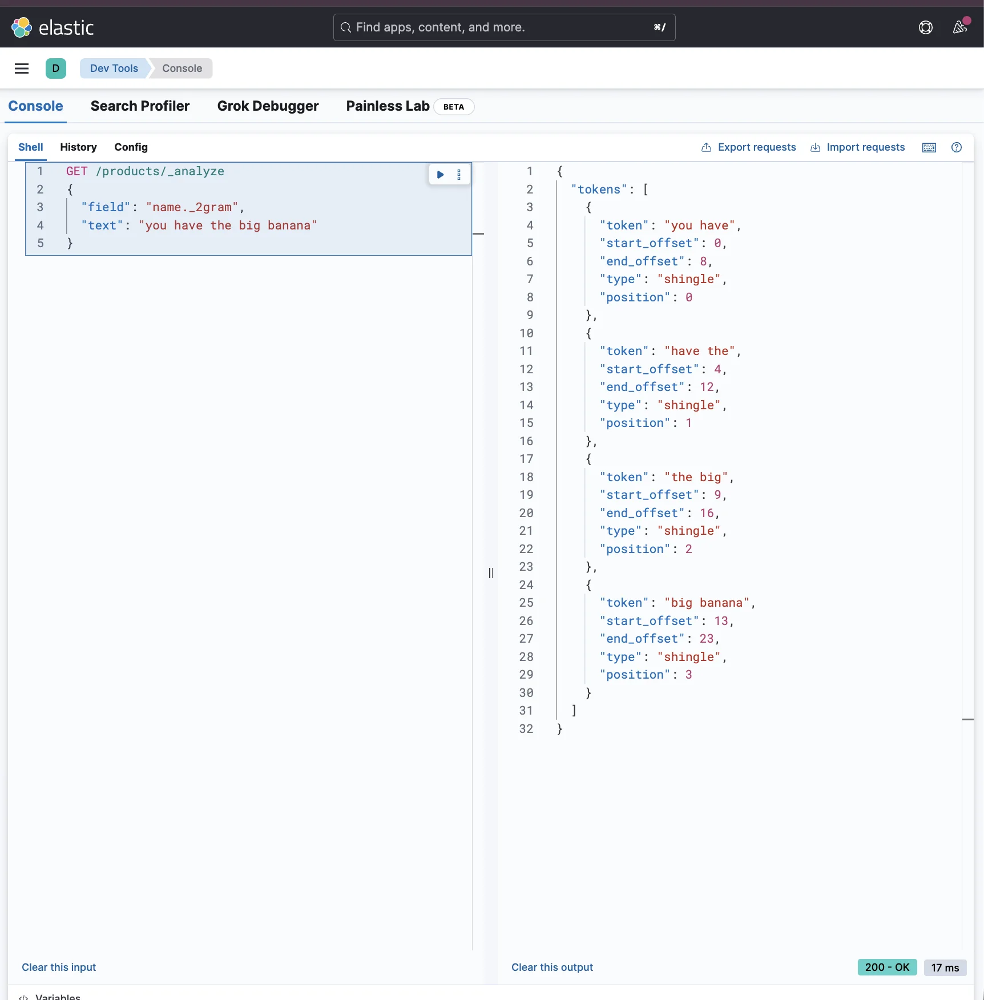

<a id="34aeda9b0fe180b08d93c5ef5540baf8"></a>

<u>token이 2 단어로 묶</u>여서 저장된 것을 확인할 수 있다&#46; 

<a id="34aeda9b0fe180788c32d99242f3f482"></a>

```json
GET /products/_analyze
{
  "field": "name._3gram",
  "text": "you have the big banana"
}
```

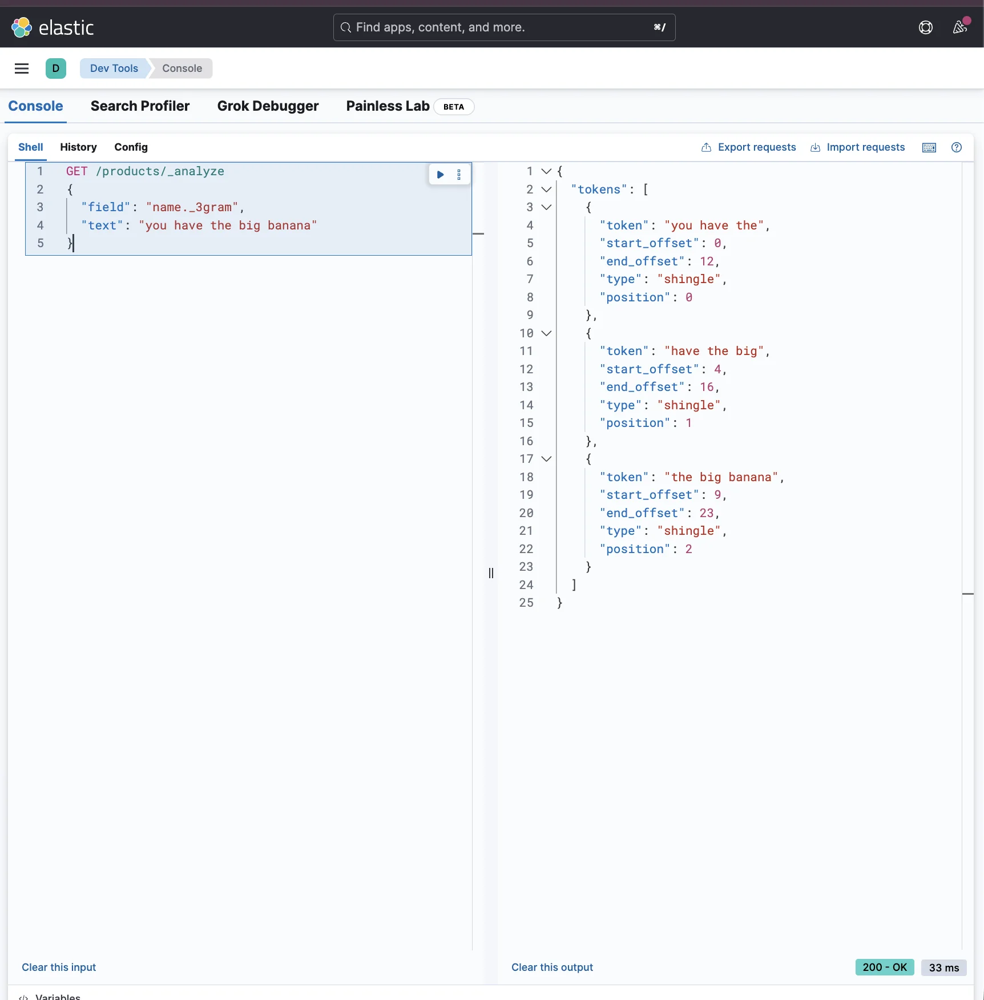

<a id="34aeda9b0fe18086be14f75b1f57dddc"></a>

토큰이 3개의 단어로 묶여 저장된 것을 확인할 수 있다&#46;

</details>

<details>
<summary><strong>한글 문장</strong></summary>

<a id="34aeda9b0fe18090a6b2c311deb5db80"></a>

```json
GET /products/_analyze
{
  "field": "name",
  "text": "프리미엄 감귤 선물세트"
}
```

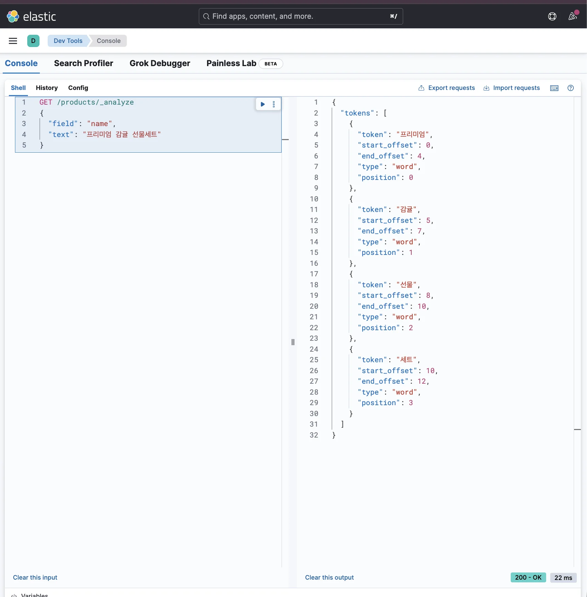

<a id="34beda9b0fe180209301c7b55199db32"></a>

한글도 동일하게 <u>하나의 단어로 토큰이 구성</u>되어 저장된 것을 확인할 수 있다&#46; 

<a id="34aeda9b0fe180b98b79df240efe67a2"></a>

```json
GET /products/_analyze
{
  "field": "name._2gram",
  "text": "프리미엄 감귤 선물세트"
}
```

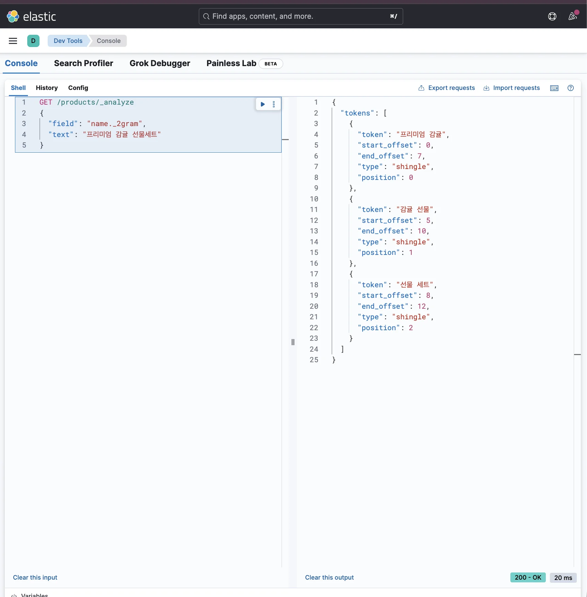

<a id="34beda9b0fe180719506d6ec4dd0f172"></a>

동일하게 <u>token이 2 단어로 묶</u>여서 저장된 것을 확인할 수 있다&#46; 

<a id="34aeda9b0fe18097ba93fffd04601837"></a>

```json
GET /products/_analyze
{
  "field": "name._3gram",
  "text": "프리미엄 감귤 선물세트"
}
```

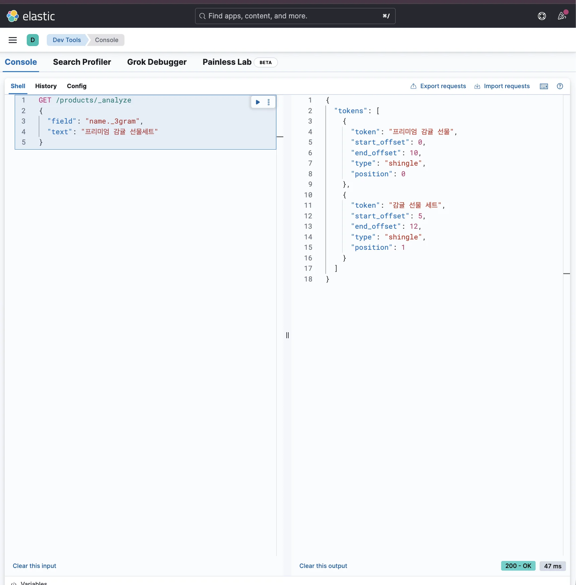

<a id="34aeda9b0fe1802b950cc0cb0fd3368c"></a>

동일하게 3개의 단어로 묶여 토큰이 생성되는 것을 확인할 수 있다&#46;

</details>

</details>

<a id="34aeda9b0fe180d5b610efda1b856e6b"></a>

### &#91; 실습&#93; <strong><code>search&#95;as&#95;you&#95;type</code></strong><strong>타입을 통한 </strong>자동 완성 기능 구현

<details>
<summary><strong>1&#46; 인덱스 생성 및 매핑 정의</strong></summary>

<a id="34aeda9b0fe180ba9673c1c72c338605"></a>

```json
DELETE /products

PUT /products
{
  "mappings": {
    "properties": {
      "name": {
        "type": "search_as_you_type",
        "analyzer": "nori"
      }
    }
  }
}
```

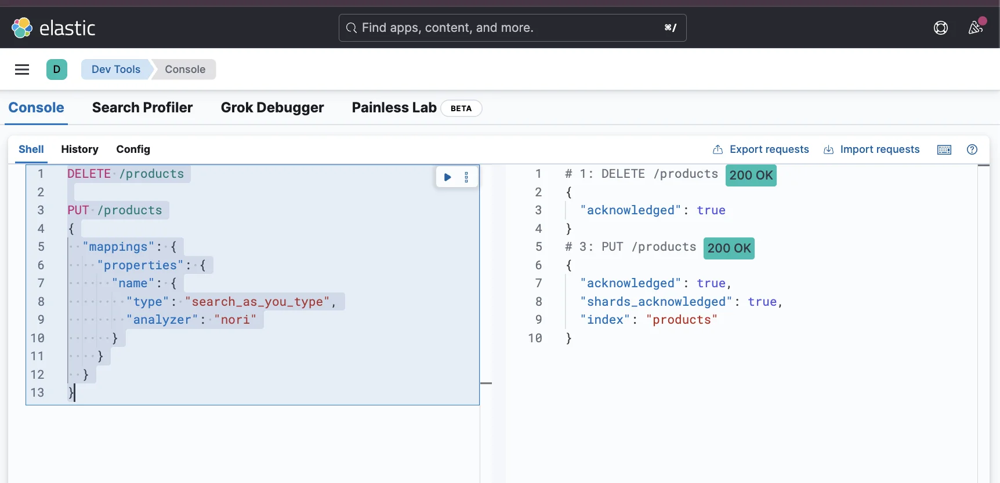

</details>

<details>
<summary><strong>2&#46; 데이터 삽입</strong></summary>

<a id="34aeda9b0fe180cbae61cc4b353f636d"></a>

```json
POST /products/_doc
{
  "name": "곱창 돌김생김"
}

POST /products/_doc
{
  "name": "구운 돌김"
}

POST /products/_doc
{
  "name": "완도 곱창 돌김 100매"
}

POST /products/_doc
{
  "name": "삼성 노트북"
}

POST /products/_doc
{
  "name": "Nike 신발"
}
```

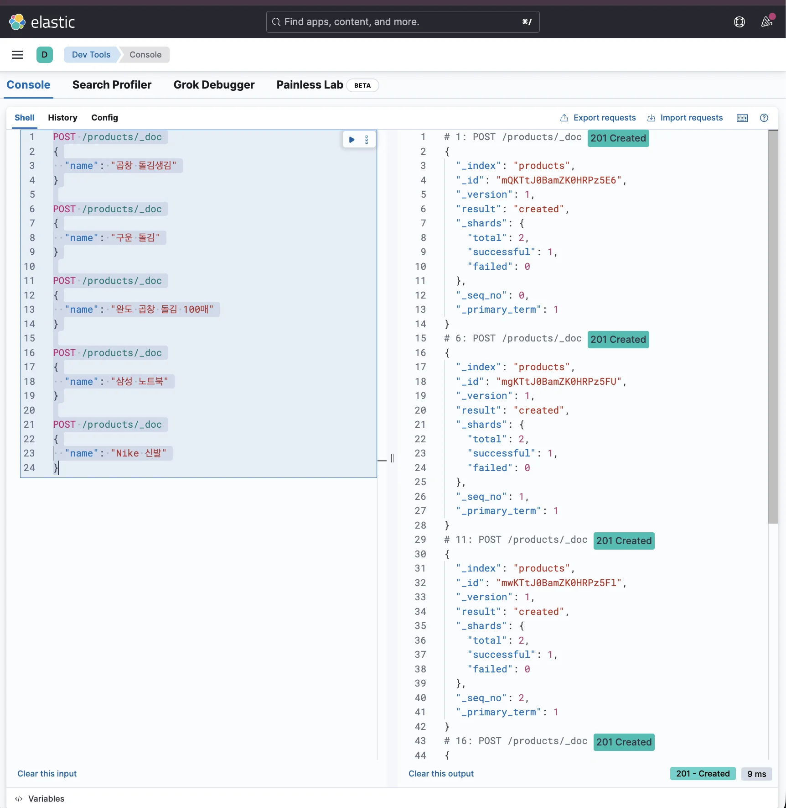

</details>

<details>
<summary><strong>3&#46; 검색</strong></summary>

> ✏️ 
> 
> - <code>multi&#95;match</code> &#58; 여러 필드에 걸쳐서 데이터 검색
> 
> - <code>bool&#95;prefix</code> &#58; 앞쪽 단어는 match, 마지막 단어는 prefix match
>     - <code>you have th</code>라고 검색하면 앞쪽 단어인 <code>you</code>와 <code>have</code>는 역인덱스에 저장된 토큰과 일치하는  데이터를 찾고, 마지막 단어인 <code>th</code>는 역인덱스에 저장된 토큰 중에 <code>th</code>로 시작하는 데이터를 찾는다&#46; 
> 
> - <code>name&#46;&#95;2gram</code>, <code>name&#46;&#95;3gram</code> 필드에서도 검색을 하는 이유는 연속적으로 단어가 일치할수록 score를 더 높게 측정해 상위 노출되도록 만들기 위함이다&#46; 

<a id="34aeda9b0fe18013b232f1c2ca145788"></a>

```json
GET /products/_search
{
  "query": {
    "multi_match": {
      "query": "돌김", 
      "type": "bool_prefix", 
      "fields": [
        "name",
        "name._2gram",
        "name._3gram"
      ]
    }
  }
}
```

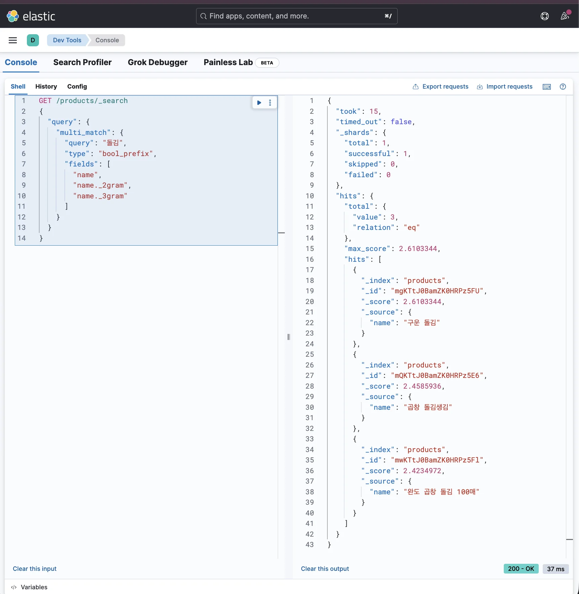

<a id="34aeda9b0fe180bfbc5eccd8b9703383"></a>

```json
// 1글자로 검색해도 정상 검색
GET /products/_search
{
  "query": {
    "multi_match": {
      "query": "돌", 
      "type": "bool_prefix", 
      "fields": [
        "name",
        "name._2gram",
        "name._3gram"
      ]
    }
  }
}
```

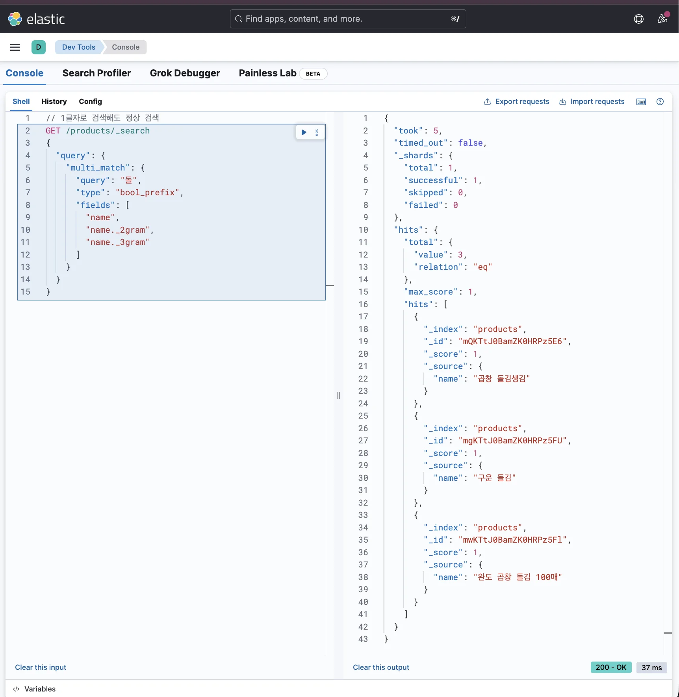

<a id="34aeda9b0fe180a0966dcefd461882b0"></a>

```json
// 순서가 바뀌어도 정상 검색
GET /products/_search
{
  "query": {
    "multi_match": {
      "query": "돌김 구운", 
      "type": "bool_prefix", 
      "fields": [
        "name",
        "name._2gram",
        "name._3gram"
      ]
    }
  }
}
```

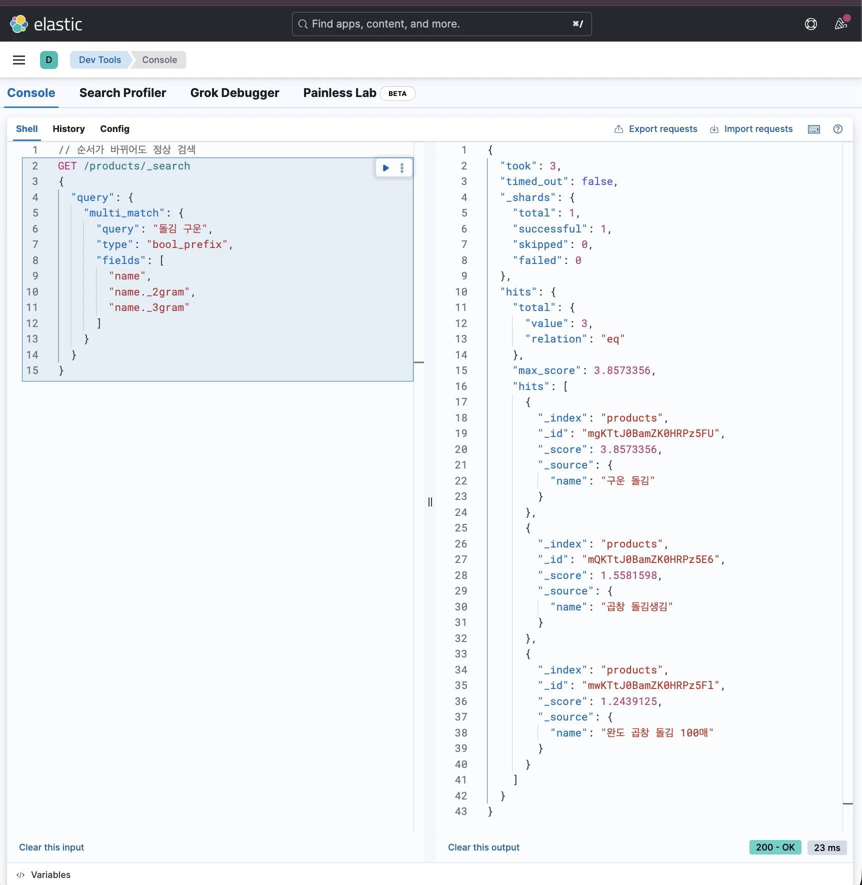

<a id="34aeda9b0fe180f3b170eae1fc5c5072"></a>

```json

// 순서까지 일치 시 더 높은 score로 측정
GET /products/_search
{
  "query": {
    "multi_match": {
      "query": "구운 돌김", 
      "type": "bool_prefix", 
      "fields": [
        "name",
        "name._2gram",
        "name._3gram"
      ]
    }
  }
}
```

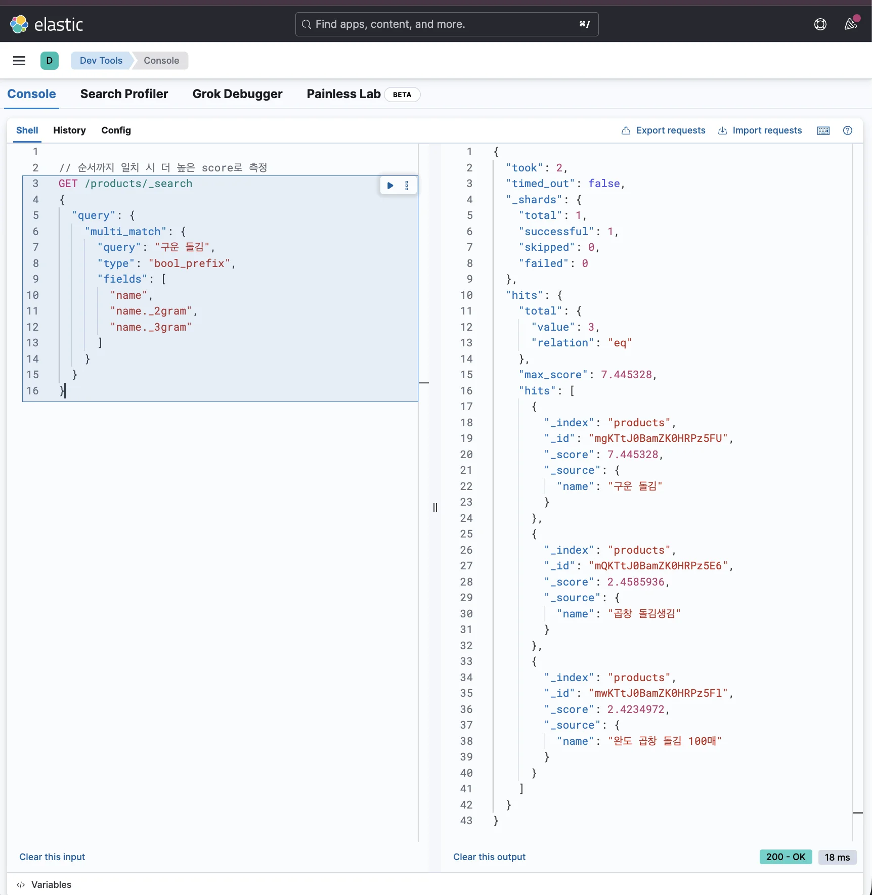

<a id="34aeda9b0fe180f49d77e4c07cd9e155"></a>

단어 순서까지 일치하는 <code>‘구운 돌김’</code>의 score가 <code>7&#46;445328</code>로 가장 높게 나타나는 것을 확인할  수 있다&#46; 

<a id="34aeda9b0fe180bfb3e7d438a3ba260c"></a>

<strong>자동 완성 기능</strong>


<a id="34beda9b0fe180d89511c5757d00f10c"></a>

글자를 타이핑할 때마다 API 서버로 요청을 보내 자동 완성에 보여줄 데이터를 반환시킨다&#46; 

</details>
