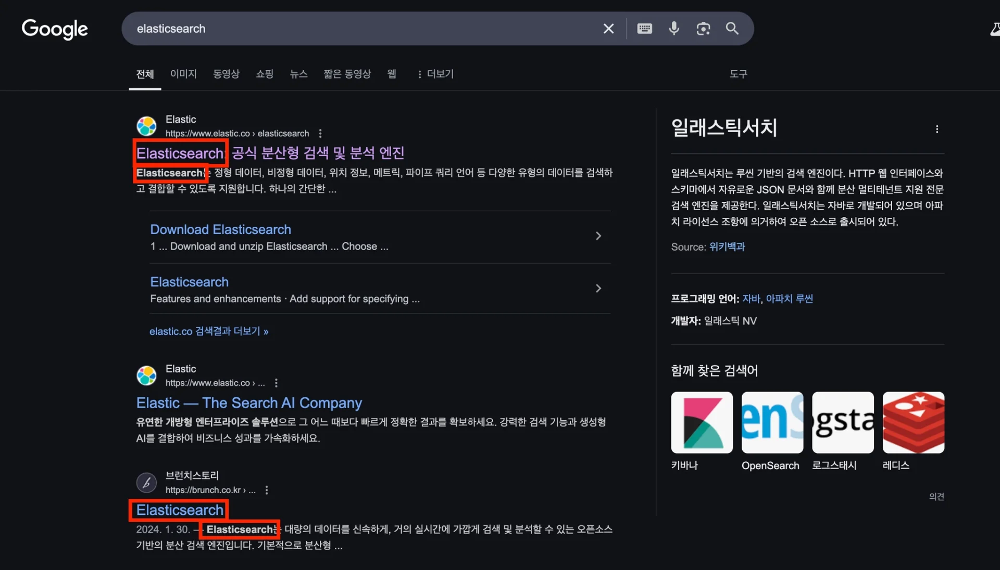
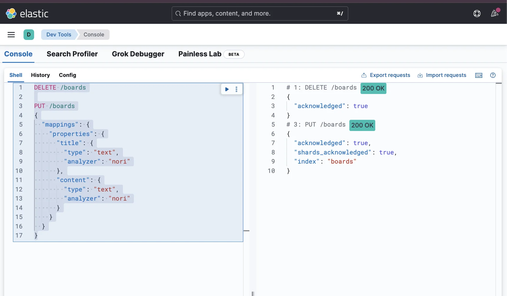
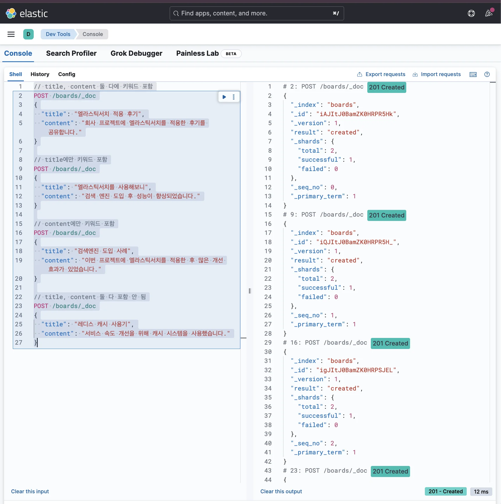
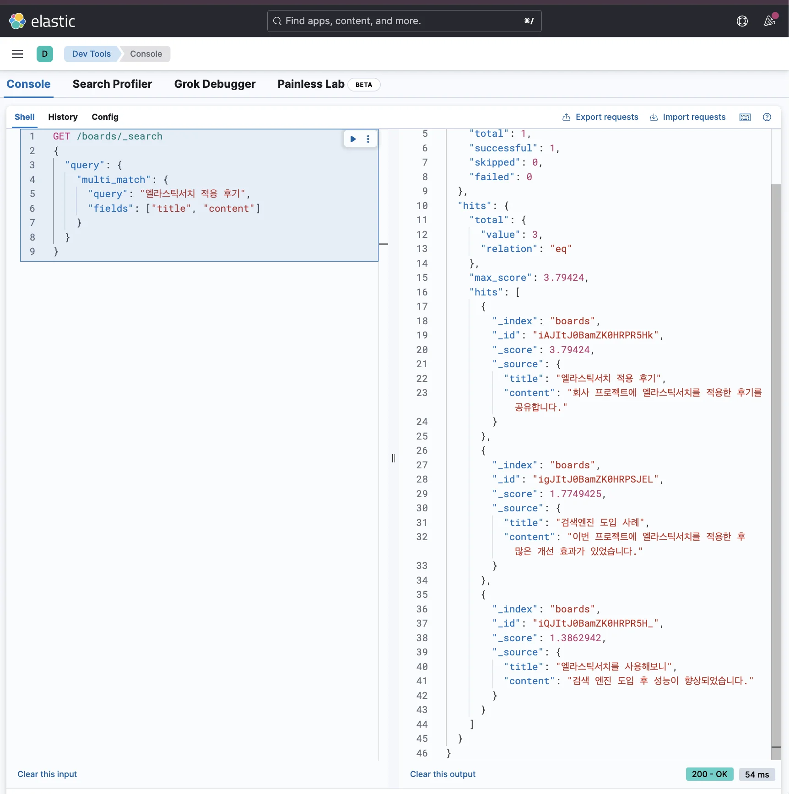
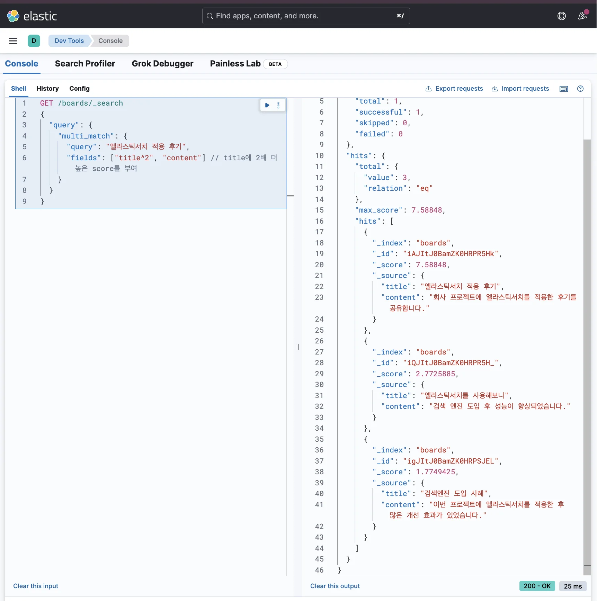

> 
> 
> <a id="34aeda9b0fe18153a20aece720ccdb86"></a>
> 
> 목차
> 
> - [여러 필드(ex. 제목, 내용)에서 검색 키워드가 포함된 데이터 조회: multi_match](#34aeda9b0fe18157bd1bd3c1dfed4bca)
> - [검색 키워드가 포함된 데이터를 조회하고 싶을 때: match](#34aeda9b0fe181df9450e9f21d45cb87)

<a id="34aeda9b0fe18157bd1bd3c1dfed4bca"></a>

## 여러 필드(ex&#46; 제목, 내용)에서 검색 키워드가 포함된 데이터 조회&#58; <code>multi&#95;match</code>

---

> 📖 
> 
> 
> 
> <a id="34aeda9b0fe180ecbb37ebbe1cc3c44d"></a>
> 
> 구글에서 특정 키워드로 검색해보면 사이트의 <code>제목(title)</code> 뿐만 아니라 <code>내용(content)</code>을 포함시켜서 검색한다&#46;
> 
> <a id="34aeda9b0fe180d0b965fe0a6ab0f0c0"></a>
> 
> 이와 같이 여러 필드에서 검색 키워드가 포함된 데이터를 조회하려는 경우, Elasticsearch의 <code>multi&#95;match</code>를 사용하면 가능하다&#46; 

<a id="34aeda9b0fe181df9450e9f21d45cb87"></a>

### 검색 키워드가 포함된 데이터를 조회하고 싶을 때&#58; <code>match</code>

<details>
<summary><strong>1&#46; 인덱스 생성 및 매핑 정의</strong></summary>

<a id="34aeda9b0fe181f98e9ce2b4c036d006"></a>

```json
DELETE /boards

PUT /boards
{
  "mappings": {
    "properties": {
      "title": {
        "type": "text",
        "analyzer": "nori"
      },
      "content": {
        "type": "text",
        "analyzer": "nori"
      }
    }
  }
}
```



</details>

<details>
<summary><strong>2&#46; 데이터 삽입</strong></summary>

<a id="34aeda9b0fe18163b57fe0c1827e9964"></a>

```json
// title, content 둘 다에 키워드 포함
POST /boards/_doc
{
  "title": "엘라스틱서치 적용 후기",
  "content": "회사 프로젝트에 엘라스틱서치를 적용한 후기를 공유합니다."
}

// title에만 키워드 포함
POST /boards/_doc
{
  "title": "엘라스틱서치를 사용해보니",
  "content": "검색 엔진 도입 후 성능이 향상되었습니다."
}

// content에만 키워드 포함
POST /boards/_doc
{
  "title": "검색엔진 도입 사례",
  "content": "이번 프로젝트에 엘라스틱서치를 적용한 후 많은 개선 효과가 있었습니다."
}

// title, content 둘 다 포함 안 됨
POST /boards/_doc
{
  "title": "레디스 캐시 사용기",
  "content": "서비스 속도 개선을 위해 캐시 시스템을 사용했습니다."
}
```



</details>

<details>
<summary><strong>3&#46; 기본 검색</strong></summary>

<a id="34aeda9b0fe18101870fc11f1f9bb688"></a>

```json
GET /boards/_search
{
  "query": {
    "multi_match": {
      "query": "엘라스틱서치 적용 후기",
      "fields": ["title", "content"]
    }
  }
}
```

<a id="34aeda9b0fe18124a8b9e4243f70a2e3"></a>

응답값



<a id="34aeda9b0fe180c087b4d088a01ab97f"></a>

```json
{
  "took": 32,
  "timed_out": false,
  "_shards": {
    "total": 1,
    "successful": 1,
    "skipped": 0,
    "failed": 0
  },
  "hits": {
    "total": {
      "value": 3,
      "relation": "eq"
    },
    "max_score": 3.79424,
    "hits": [
      // title, content 둘 다에 키워드 포함
      {
        "_index": "boards",
        "_id": "2k-SmJYBWhYNXJPWbr6u",
        "_score": 3.79424,
        "_source": {
          "title": "엘라스틱서치 적용 후기",
          "content": "회사 프로젝트에 엘라스틱서치를 적용한 후기를 공유합니다."
        }
      },
      
      // content에만 키워드 포함
      {
        "_index": "boards",
        "_id": "3E-SmJYBWhYNXJPWd740",
        "_score": 1.7749425,
        "_source": {
          "title": "검색엔진 도입 사례",
          "content": "이번 프로젝트에 엘라스틱서치를 적용한 후 많은 개선 효과가 있었습니다."
        }
      },
      
      // title에만 키워드 포함
      {
        "_index": "boards",
        "_id": "20-SmJYBWhYNXJPWc75z",
        "_score": 1.3862942,
        "_source": {
          "title": "엘라스틱서치를 사용해보니",
          "content": "검색 엔진 도입 후 성능이 향상되었습니다."
        }
      }
    ]
  }
}
```

- <code>title</code> 또는 <code>content</code> 필드에 검색 키워드가 포함된 데이터가 조회됨
    - <code>title</code>이랑 <code>content</code> 둘 다에 키워드가 포함되지 않은 데이터는 제외

- 검색 키워드와 데이터의 관련성을 score에 따라 정렬 후 조회
    - 검색 키워드가 <u>문서에서 자주 등장</u>할 수록 점수가 높게 책정

    - 전체 문서 중 <u>검색어가 희귀한 검색어가 일치</u>할 수록 점수가 높게 책정

    - <u>필드 값의 길이가 작은</u>데도 불구하고 <u>키워드가 등장</u>했다면 점수가 높게 책정

</details>

<details>
<summary><strong>4&#46; 가중치를 활용한 검색</strong></summary>

> ✏️ 
> 
> <a id="34aeda9b0fe180ec8c61fa9121d24800"></a>
> 
> <code>내용(content)</code>에만 키워드가 포함된 글보다 <code>제목(title)</code>에만 키워드가 포함된 글을 더 상위노출 시키고 싶을 수 있다&#46;
> 
> <a id="34aeda9b0fe180528b2dcb05f9f68901"></a>
> 
>  즉, <code>제목(title)</code>에 검색 키워드가 등장한다면 더 관련성 높은 데이터라고 판단하고 싶을 수 있다&#46; 그럴 때 가중치를 활용한다&#46; 

<a id="34aeda9b0fe1807d8bf6fddb5b0cffb8"></a>

```json
GET /boards/_search
{
  "query": {
    "multi_match": {
      "query": "엘라스틱서치 적용 후기",
      "fields": ["title^2", "content"] // title에 2배 더 높은 score를 부여
    }
  }
}
```

<a id="34aeda9b0fe1802e84d8f2addf96393c"></a>

<strong>응답값</strong>



<a id="34aeda9b0fe180f0a7c3e9dd44daf1a0"></a>

```json
{
  "took": 10,
  "timed_out": false,
  "_shards": {
    "total": 1,
    "successful": 1,
    "skipped": 0,
    "failed": 0
  },
  "hits": {
    "total": {
      "value": 3,
      "relation": "eq"
    },
    "max_score": 7.58848,
    "hits": [
      // title, content 둘 다에 키워드 포함
      {
        "_index": "boards",
        "_id": "2k-SmJYBWhYNXJPWbr6u",
        "_score": 7.58848,
        "_source": {
          "title": "엘라스틱서치 적용 후기",
          "content": "회사 프로젝트에 엘라스틱서치를 적용한 후기를 공유합니다."
        }
      },
      
      // title에만 키워드 포함
      {
        "_index": "boards",
        "_id": "20-SmJYBWhYNXJPWc75z",
        "_score": 2.7725885,
        "_source": {
          "title": "엘라스틱서치를 사용해보니",
          "content": "검색 엔진 도입 후 성능이 향상되었습니다."
        }
      },
      
      // content에만 키워드 포함
      {
        "_index": "boards",
        "_id": "3E-SmJYBWhYNXJPWd740",
        "_score": 1.7749425,
        "_source": {
          "title": "검색엔진 도입 사례",
          "content": "이번 프로젝트에 엘라스틱서치를 적용한 후 많은 개선 효과가 있었습니다."
        }
      }
    ]
  }
}
```

- 적용시킨 가중치로 score가 수정되어서 조회되는 것을 확인할 수 있다&#46; 

</details>
