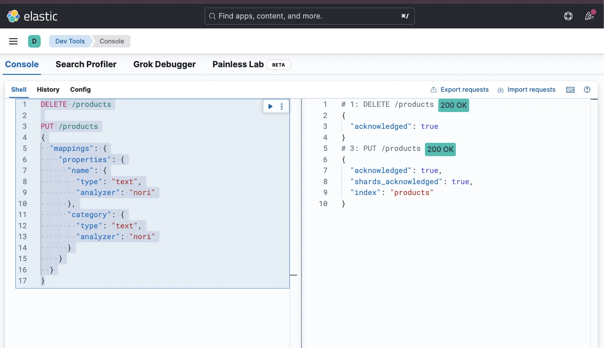
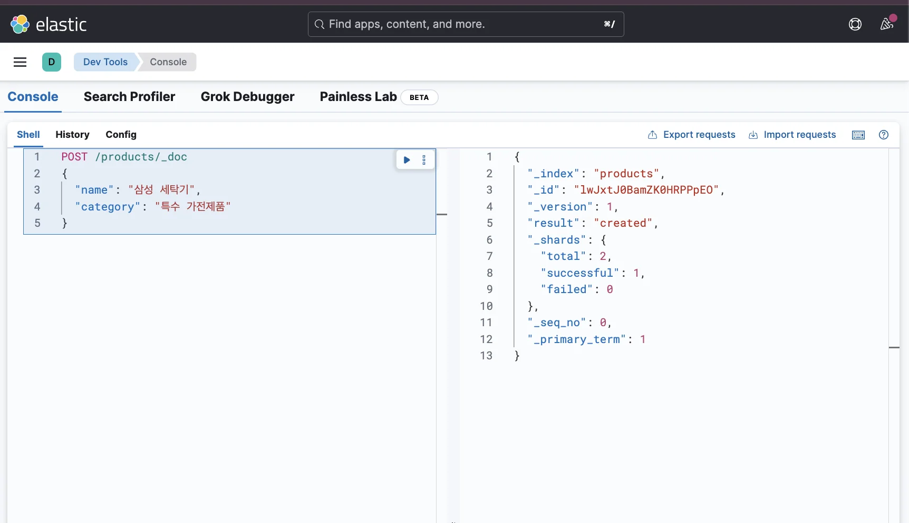
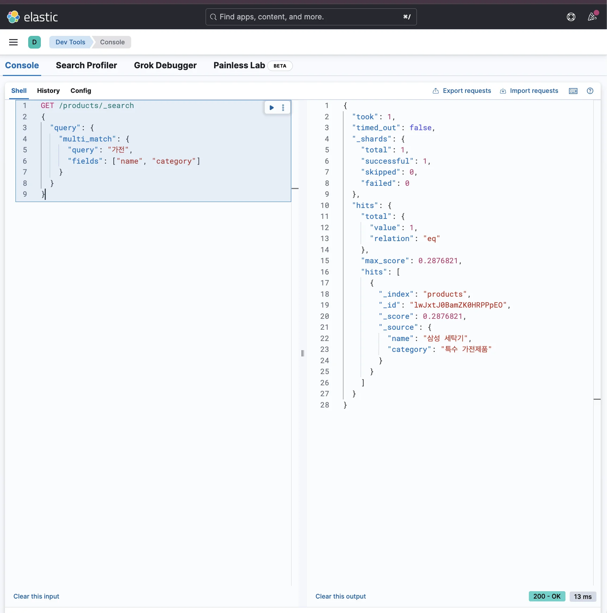
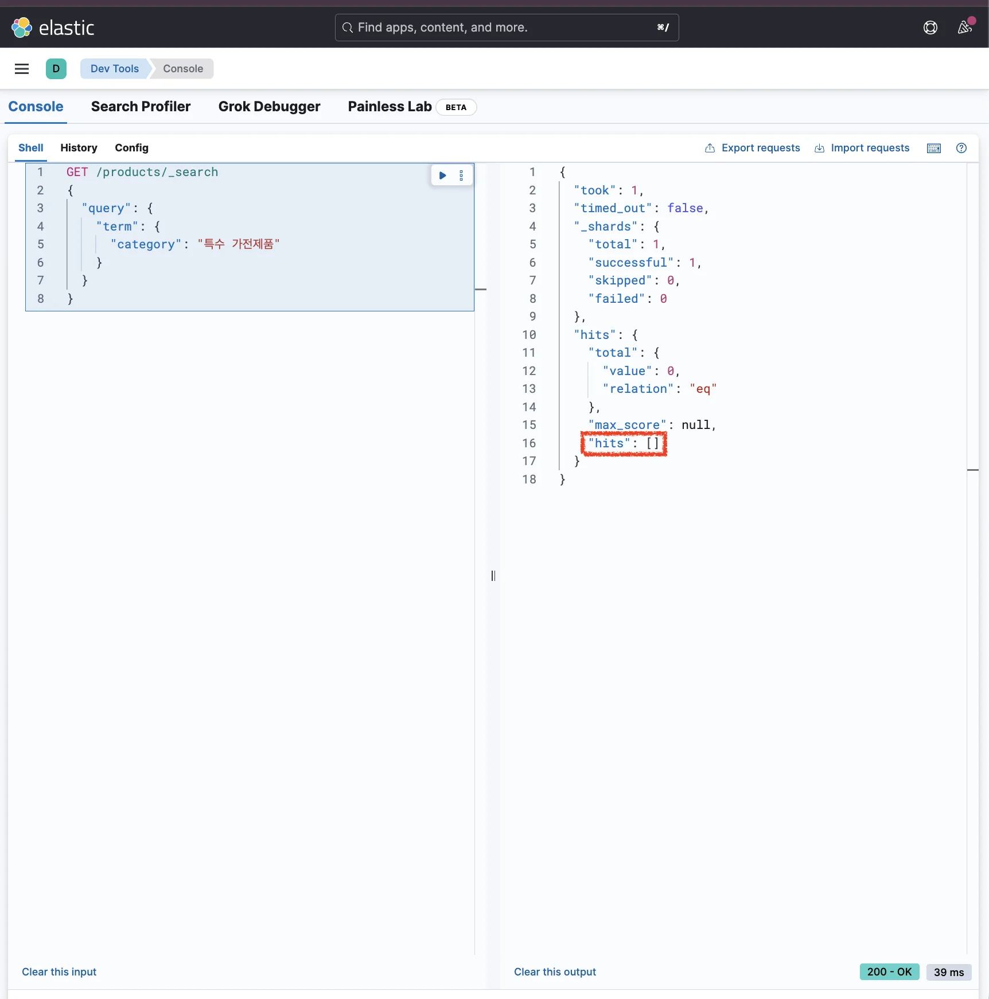
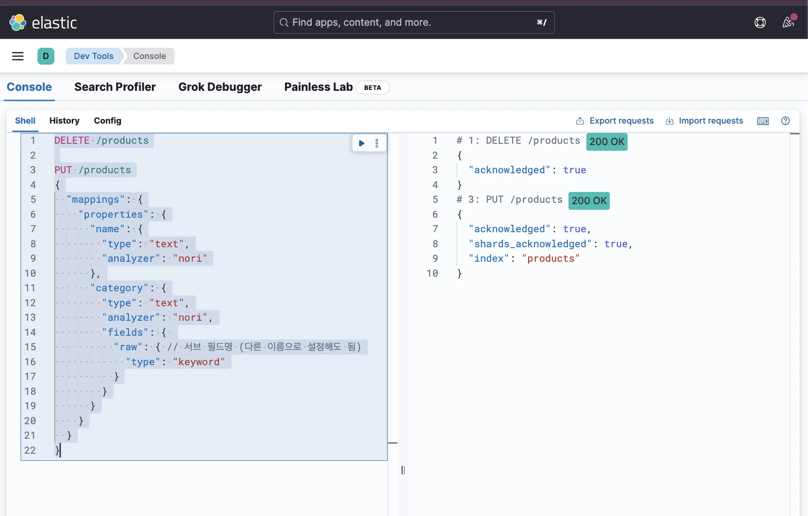
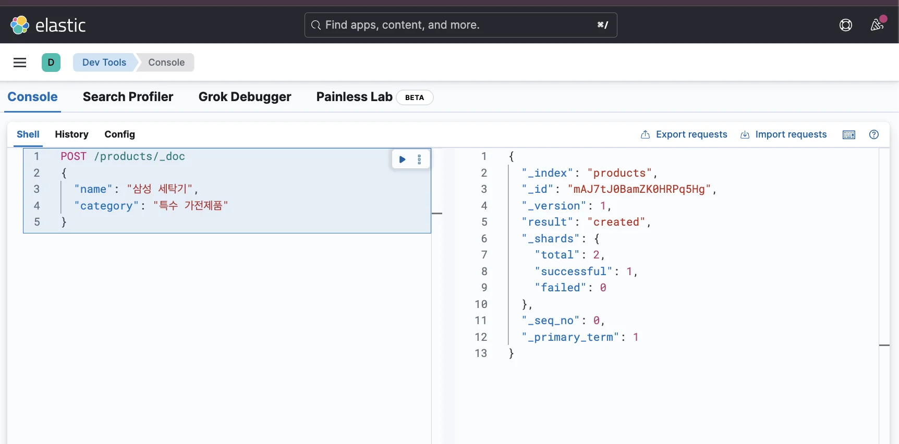
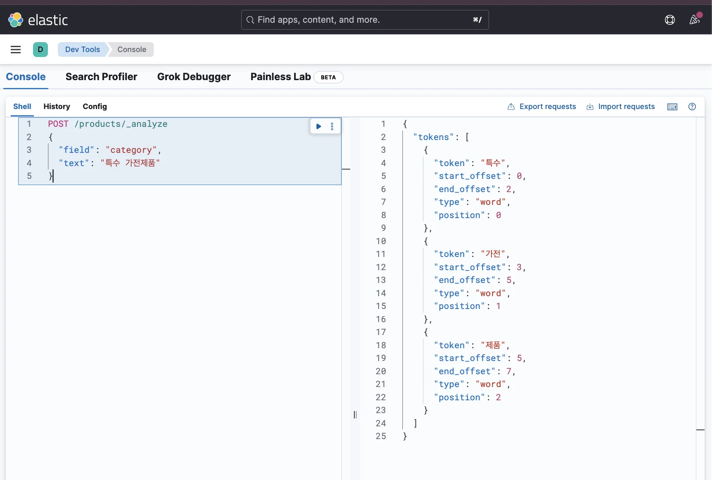
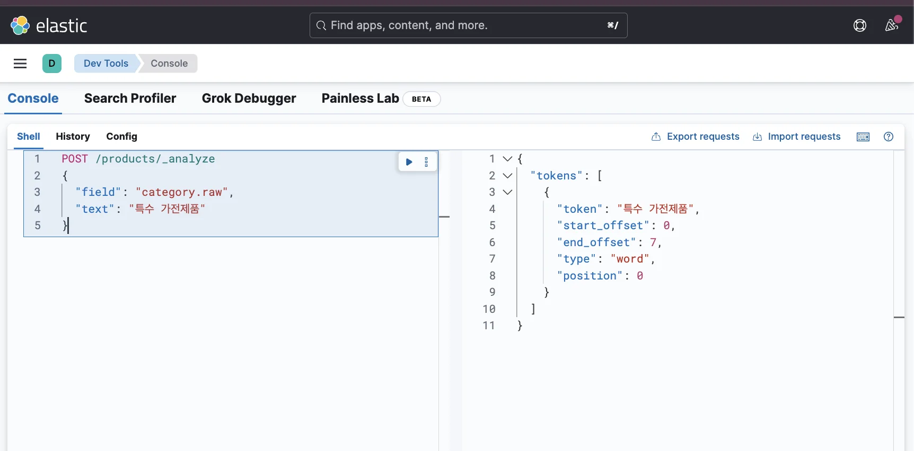
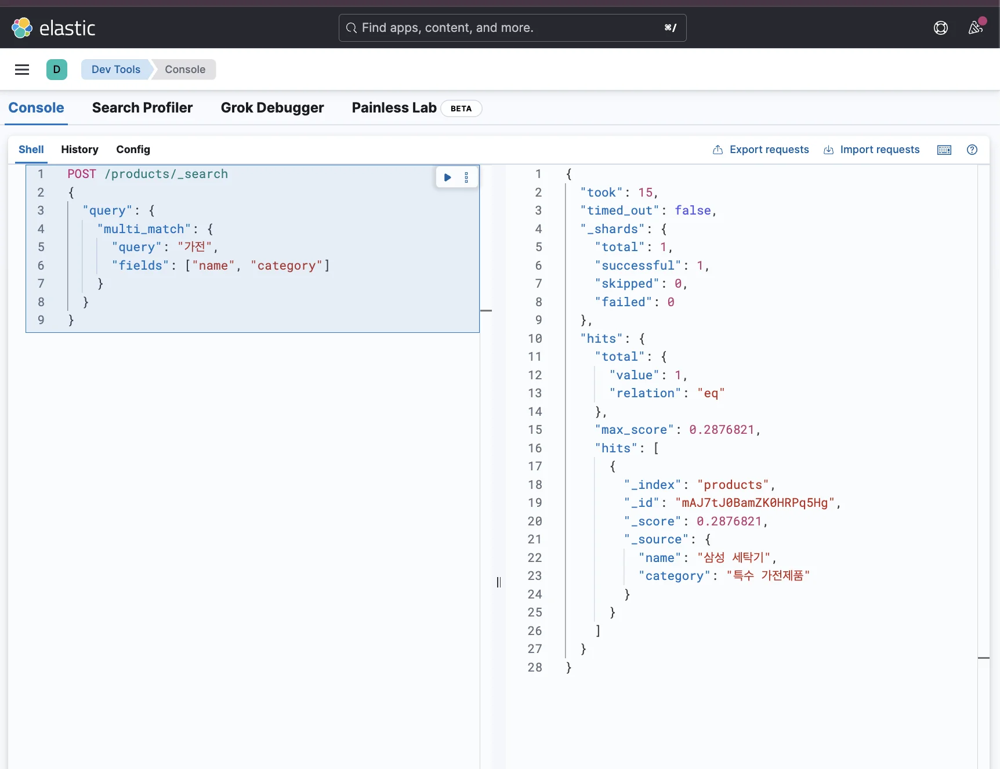
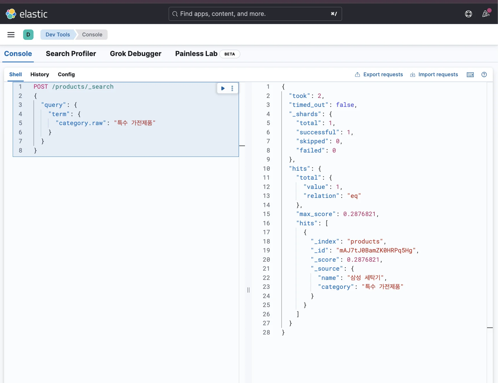

> 
> 
> <a id="34aeda9b0fe18076a4d3cffa5dec547c"></a>
> 
> 목차
> 
> - [하나의 필드에 text와 keyword 타입을 동시에 사용: Multi Field (서브 타입 설정)](#34aeda9b0fe18023bbeedfe454303613)
> - [❌ 오류 발생: 유연한 검색(multi-match) 과 정확한 검색(term) 둘다 사용](#34aeda9b0fe1803cb38cf98f7125e2b5)
> - [✅ 오류 해결: 서브 쿼리 설정](#34aeda9b0fe180978835d24a6b653589)

<a id="34aeda9b0fe18023bbeedfe454303613"></a>

## 하나의 필드에 text와 keyword 타입을 동시에 사용&#58; <code>Multi Field</code> (서브 타입 설정)

---

> 📖 
> 
> <a id="34aeda9b0fe180c98031f3ea85ff6f10"></a>
> 
> <strong>하나의 필드</strong>에서 <strong><u>유연한 검색</u></strong>과 <strong><u>정확한 검색</u></strong> 둘다 필요한 경우 <br>즉, <code>text</code>, <code>keyword</code> 타입 둘다 사용해야할 경우 <strong>멀티(서브) 필드 선언</strong>을  통해서 해결할 수 있다&#46; 
> 
> <details>
> <summary>예시) <strong>멀티(서브) 필드</strong></summary>
> 
> <a id="34aeda9b0fe1807b8fceca0ddad5a794"></a>
> 
> ```json
> DELETE /products
> 
> PUT /products
> {
>   "mappings": {
>     "properties": {
>       "name": {
>         "type": "text",
>         "analyzer": "nori"
>       },
>       "category": {
>         "type": "text",
>         "analyzer": "nori",
>         "fields": {
>           "raw": { // 서브 필드명 (다른 이름으로 설정해도 됨)
>             "type": "keyword"
>           }
>         }
>       }
>     }
>   }
> }
> ```
> 
> </details>

> 🤔 
> 
> - <code>text</code>&#58; 유연한 검색이 필요할 때 사용
> 
> - <code>keyword</code>&#58; 정확한 검색이 필요할 때 사용

<a id="34aeda9b0fe1803cb38cf98f7125e2b5"></a>

### ❌ 오류 발생&#58; <u>유연한 검색(multi&#45;match)</u> 과<u> 정확한 검색(term</u>) 둘다 사용

<details>
<summary><strong>1&#46; 인덱스 생성 및 매핑 정의</strong></summary>

<a id="34aeda9b0fe18022b2e5fe17442a1943"></a>

```json
DELETE /products

PUT /products
{
  "mappings": {
    "properties": {
      "name": {
        "type": "text",
        "analyzer": "nori"
      },
      "category": {
        "type": "text",
        "analyzer": "nori"
      }
    }
  }
}
```



</details>

<details>
<summary><strong>2&#46; 데이터 삽입</strong></summary>

<a id="34aeda9b0fe180a7b937c26a45cb4231"></a>

```json
POST /products/_doc
{
  "name": "삼성 세탁기",
  "category": "특수 가전제품"
}
```



</details>

<details>
<summary><strong>3&#46;  </strong><strong><code>term</code></strong><strong> 쿼리 검색 → 오류 발생</strong></summary>

- ✅ 정상 검색
    <a id="34aeda9b0fe180d3bacbde14443fdfc4"></a>

    ```json
    GET /products/_search
    {
      "query": {
        "multi_match": {
          "query": "가전",
          "fields": ["name", "category"]
        }
      }
    }
    ```

    

- <strong>❌ 오류 </strong>
    <a id="34aeda9b0fe1801681eaf4f9b0d87295"></a>

    ```json
    GET /products/_search
    {
      "query": {
        "term": {
          "category": "특수 가전제품"
        }
      }
    }
    ```

    

    <a id="34aeda9b0fe180d59b2ccbf02cfba842"></a>

    인덱스 생성 시 category 필드에 대한 매핑을 <code>text</code> 타입으로 지정했기 때문에 정확한 키워드 매칭 시 사용하는 <code>term</code> 쿼리 사용 시 문서가 검색되지 않는 오류가 발생된다&#46; 

    <a id="34aeda9b0fe180e3b476d562616a041f"></a>

    ⇒ 따라서 <code>ext</code> 타입과 <code>keyword</code> 타입을 둘 다 선언해야 정상 동작한다&#46; 

</details>

<a id="34aeda9b0fe180978835d24a6b653589"></a>

### ✅ 오류 해결&#58; 서브 쿼리 설정

> ✏️ 
> 
> <a id="34aeda9b0fe18004bd11fe0c4ece192f"></a>
> 
> 하나의 필드에 여러 개의 타입을 선언한다&#46; 
> 
> <a id="34aeda9b0fe180219f8add199cc3e778"></a>
> 
> Elasticsearch에서는 <strong><u><code>multi&#45;fields</code></u></strong>라 부른다&#46; (서브 쿼리가 더 명확한 명칭 인듯?)

<details>
<summary><strong>1&#46; 인덱스 재생성 &#45; </strong><strong><u><code>multi&#45;fields</code></u></strong><strong> 설정</strong></summary>

<a id="34aeda9b0fe1802dbbe6cd81e4fba0bc"></a>

```json
DELETE /products

PUT /products
{
  "mappings": {
    "properties": {
      "name": {
        "type": "text",
        "analyzer": "nori"
      },
      "category": {
        "type": "text",
        "analyzer": "nori",
        "fields": { 
          "raw": { // 서브 필드명 (다른 이름으로 설정해도 됨)
            "type": "keyword"
          }
        }
      }
    }
  }
}
```



- 위와 같이 해당하는 필드에 필요한 <strong><u>서브 타입을 설정</u></strong>하여 해결할 수 있다&#46;

</details>

<details>
<summary><strong>2&#46; 데이터 삽입</strong></summary>

<a id="34aeda9b0fe18083bfdeceee04c30932"></a>

```json
POST /products/_doc
{
  "name": "삼성 세탁기",
  "category": "특수 가전제품"
}
```



<a id="34aeda9b0fe180938c85dcbde8f3ab78"></a>

<code>text</code> 타입은 토큰으로 분리해서 저장하지만, <code>keyword</code> 타입은 값 자체를 통째로 저장한다&#46;

<a id="34aeda9b0fe1808b9bc1d8b3908ad94c"></a>

따라서 <code>category</code>에 <code>특수 가전제품</code>이라는 값을 삽입했을 때 아래와 같이 저장된다&#46; 

| <strong><code>category</code></strong><strong> (text 타입)</strong> | <strong><code>category&#46;raw</code></strong><strong> (keyword 타입)</strong> |
| --- | --- |
| 특수 | 특수 가전제품 |
| 가전 |  |
| 제품 |  |

</details>

<details>
<summary><strong>3&#46; Anaylze API로 디버깅</strong></summary>

<a id="34aeda9b0fe180048150cbc069c3e8aa"></a>

```json
POST /products/_analyze
{
  "field": "category",
  "text": "특수 가전제품"
}

```



<a id="34aeda9b0fe18015b6f9e04b9bc9a9c2"></a>

```json
POST /products/_analyze
{
  "field": "category.raw",
  "text": "특수 가전제품"
}
```



<a id="34aeda9b0fe180939fd4ca1725e03748"></a>

각각 조회 시 타입에 맞게 토큰 저장된 것을 확인할 수 있다&#46; 

</details>

<details>
<summary><strong>4&#46; 검색</strong></summary>

- <strong><code>name</code></strong><strong>, </strong><strong><code>category</code></strong><strong>을 활용해 유연하게 검색하고 싶을 때</strong>
    <a id="34aeda9b0fe180c08497d2a2c5379b10"></a>

    ```json
    POST /products/_search
    {
      "query": {
        "multi_match": {
          "query": "가전",
          "fields": ["name", "category"]
        }
      }
    }
    ```

    

- <strong><code>특수 가전제품</code></strong><strong> 카테고리의 상품만 검색하고 싶을 때</strong>
    <a id="34aeda9b0fe1801fa3a1fd4b0602b30a"></a>

    ```json
    POST /products/_search
    {
      "query": {
        "term": {
          "category.raw": "특수 가전제품"
        }
      }
    }
    ```

    

</details>
