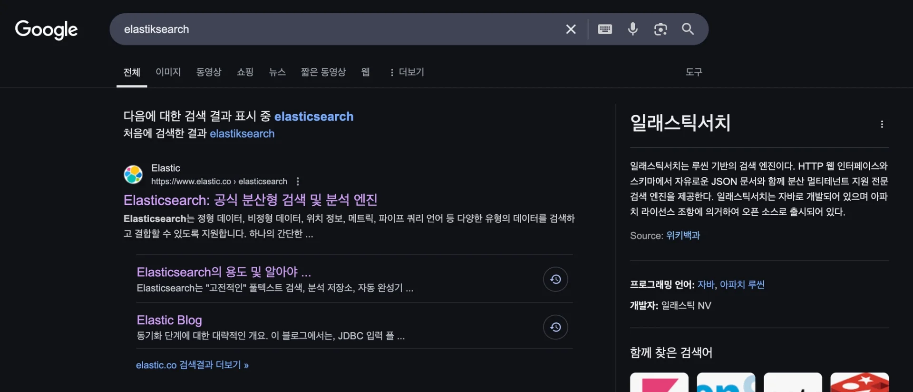
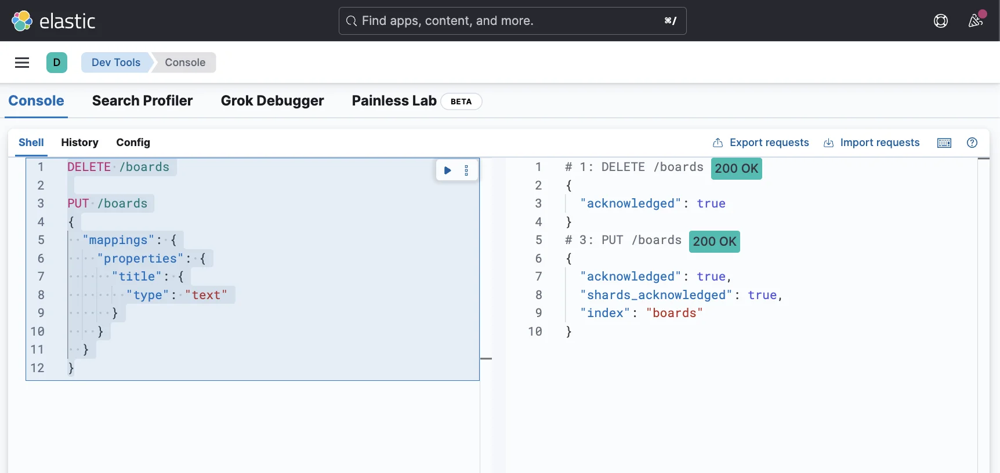
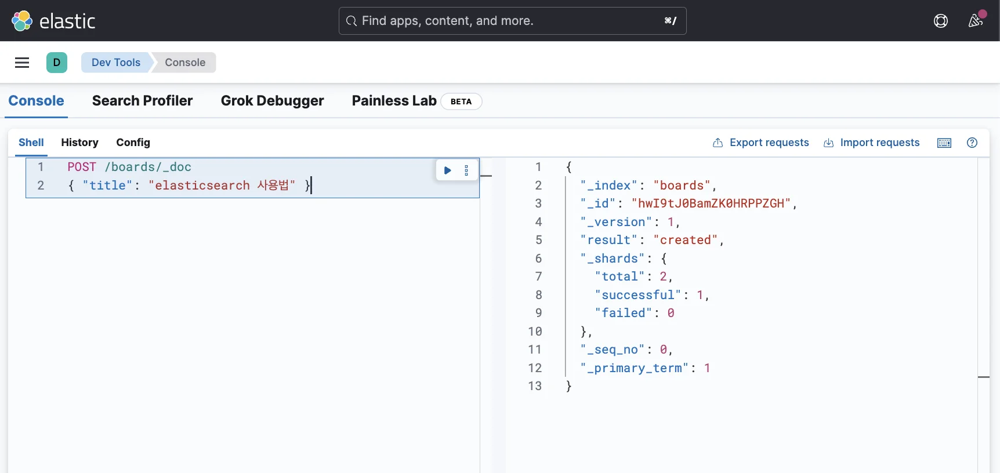
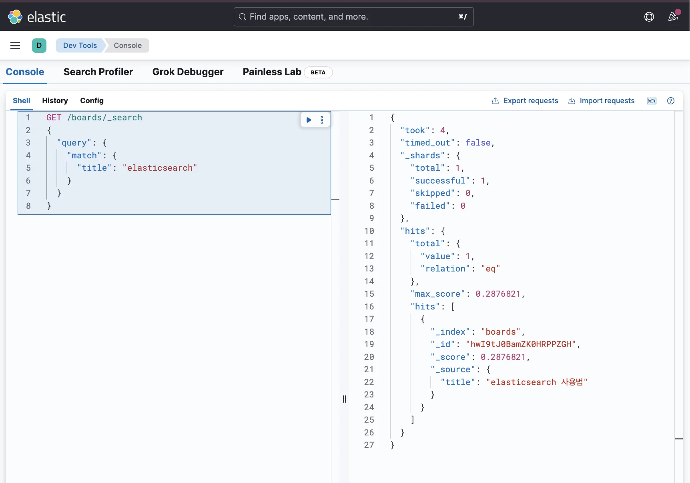
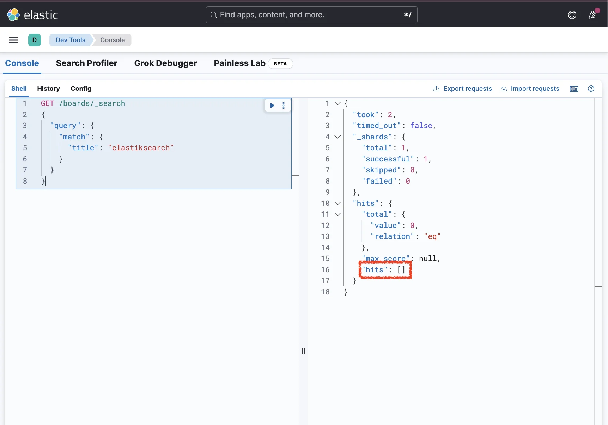
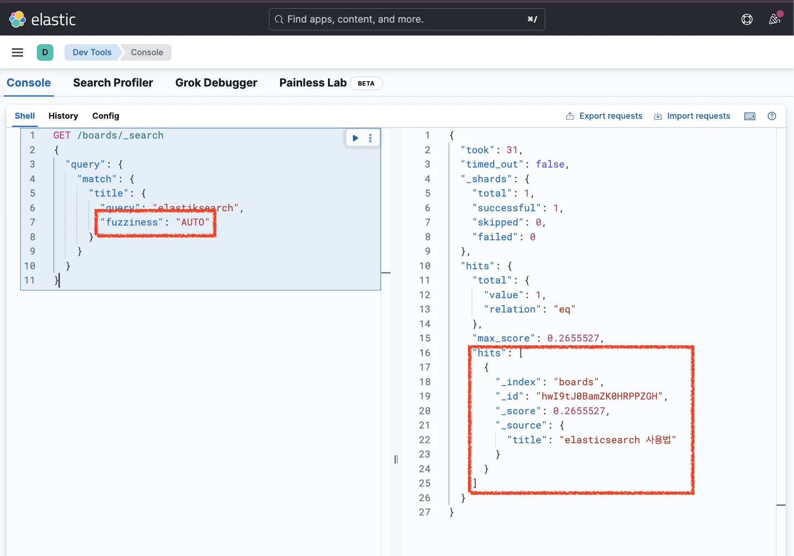

> 
> 
> <a id="34aeda9b0fe1813e9d09c59736d808a4"></a>
> 
> 목차
> 
> - [오타가 있더라도 유사한 단어를 포함한 데이터 조회: fuzziness](#34aeda9b0fe1814089b4ec5f94354200)
> - [오타가 있더라도 유사한 단어를 포함한 데이터를 조회하고 싶을 때](#34aeda9b0fe181438bb1f648fd6d4720)

<a id="34aeda9b0fe1814089b4ec5f94354200"></a>

## 오타가 있더라도 유사한 단어를 포함한 데이터 조회&#58; <code>fuzziness</code>

---

> 📖 
> 
> 
> 
> <a id="34aeda9b0fe180de91e9f599f3176929"></a>
> 
> 구글 검색을 보면 <strong><u>오타가 발생되어도 사용자가 원하는 데이터가 잘 검색</u></strong>된다&#46; 
> 
> <a id="34aeda9b0fe18001bf28e069f6e9a7d2"></a>
> 
> 이와 같이 <strong><u>오타가 발생되어도 올바르게 검색</u></strong>되도록 하는 기능을 Elasticsearch의 <u>fuzziness 옵션을 사용</u>하면 쉽게 구현할 수 있다&#46;

<a id="34aeda9b0fe181438bb1f648fd6d4720"></a>

### 오타가 있더라도 유사한 단어를 포함한 데이터를 조회하고 싶을 때

<details>
<summary><strong>1&#46; 인덱스 생성 및 매핑 정의</strong></summary>

<a id="34aeda9b0fe1817b9c8bd8ff1b87e7c0"></a>

```json
DELETE /boards

PUT /boards
{
  "mappings": {
    "properties": {
      "title": {
        "type": "text"
      }
    }
  }
}
```



</details>

<details>
<summary><strong>2&#46; 데이터 삽입</strong></summary>

<a id="34aeda9b0fe18110a22fcf1566f27312"></a>

```json
POST /boards/_doc
{ "title": "elasticsearch 사용법" }
```



</details>

<details>
<summary><strong>3&#46; 도큐먼트 검색</strong></summary>

- ✅ 오타없이 키워드 검색
    <a id="34aeda9b0fe18182a30dd63ff98ccc17"></a>

    ```json
    GET /boards/_search
    {
      "query": {
        "match": {
          "title": "elasticsearch"
        }
      }
    }
    ```

    

- ❌ 오타를 포함한 키워드 검색
    <a id="34aeda9b0fe180ba8073cc9cf3daf8a2"></a>

    ```json
    GET /boards/_search
    {
      "query": {
        "match": {
          "title": "elastiksearch"
        }
      }
    }
    ```

    

    <a id="34aeda9b0fe180bfb03cf499b05fc5b5"></a>

    위와 같이 오타가 포함된 키워드로 검색하면 아무 데이터도 조회되지 않는다&#46; 

- <strong><code>fuzziness</code></strong><strong> 옵션 적용</strong>
    <a id="34aeda9b0fe1807294dcdf5ced77e98d"></a>

    ```json
    GET /boards/_search
    {
      "query": {
        "match": {
          "title": {
            "query": "elastiksearch",
            "fuzziness": "AUTO"
          }
        }
      }
    }
    ```

    

    - <code>fuzziness &#58; AUTO</code> &#58; 단어 길이에 따라 오타 허용 개수를 자동으로 설정

    <a id="34aeda9b0fe180ebb113d719d068d8fc"></a>

    위와 같이  <code>fuzziness</code> 옵션을 적용하면 오타가 발생 되어도 정상 검색이 된다&#46; 

</details>
