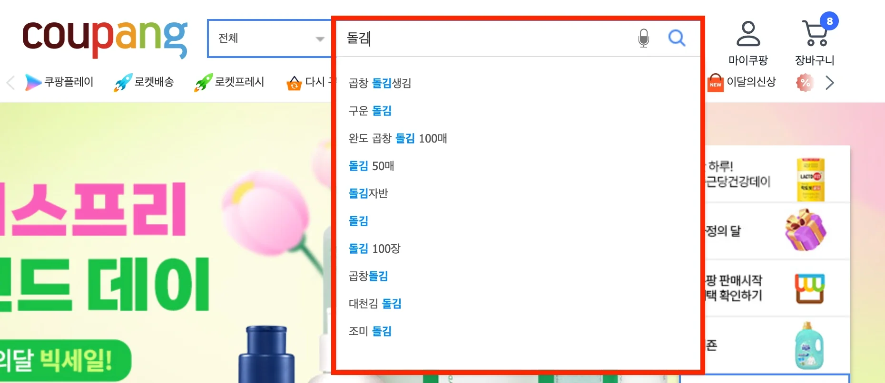
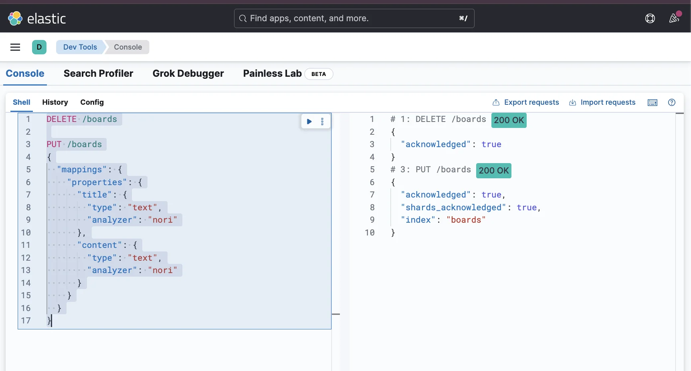
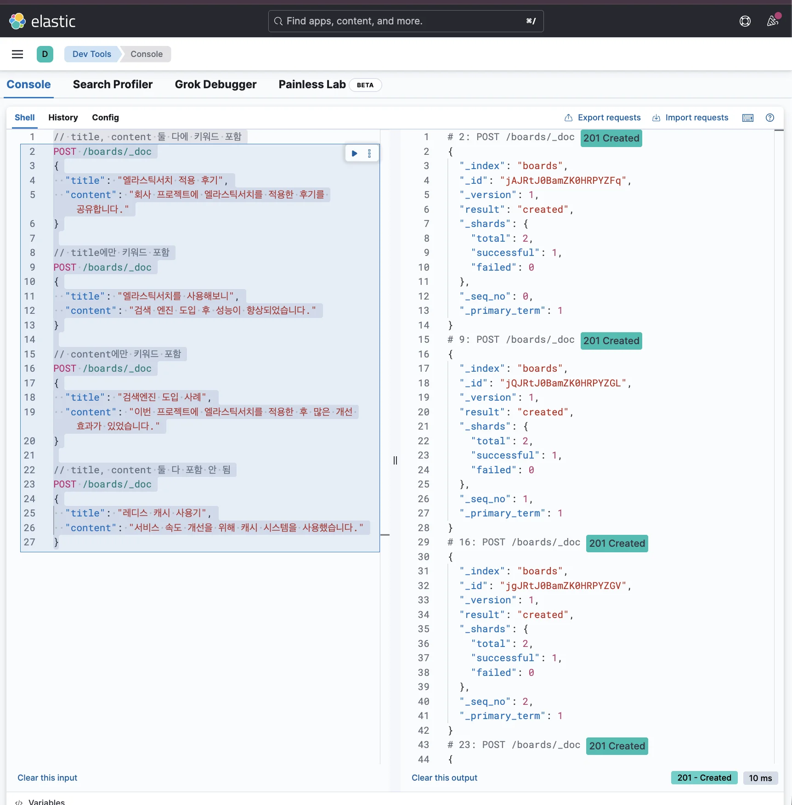
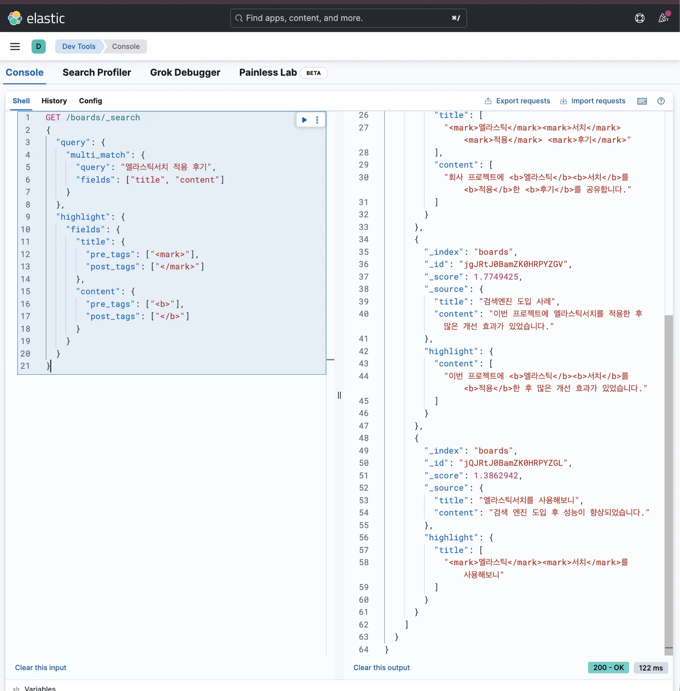

> 
> 
> <a id="34aeda9b0fe181b1ba3aefda55bee76d"></a>
> 
> 목차
> 
> - [검색한 키워드를 하이라이팅 처리: highlight](#34aeda9b0fe1811f8024c21ecf628ab2)
> - [검색한 키워드를 하이라이팅 처리하고 싶을 때](#34aeda9b0fe181a491c6e35e91a0996e)

<a id="34aeda9b0fe1811f8024c21ecf628ab2"></a>

## 검색한 키워드를 하이라이팅 처리&#58; <code>highlight</code>

---

> 📖 
> 
> 
> 
> <a id="34aeda9b0fe180418161c0e6ae721480"></a>
> 
>  쿠팡에서 검색을 해보면 <strong><u>검색한 키워드가 하이라이팅 처리</u></strong>가 되있는 걸 확인할 수 있다&#46; 
> 
> <a id="34aeda9b0fe180ca8667f9dd8e455cd0"></a>
> 
> 이는 Elasticsearch의 <strong><u>highlight를 사용</u></strong>하면 구현 가능하다&#46; 

<a id="34aeda9b0fe181a491c6e35e91a0996e"></a>

### 검색한 키워드를 하이라이팅 처리하고 싶을 때

<details>
<summary><strong>1&#46; 인덱스 생성 및 매핑 정의</strong></summary>

<a id="34aeda9b0fe181c09f64dd441ebf28be"></a>

```json
DELETE /boards

PUT /boards
{
  "mappings": {
    "properties": {
      "title": {
        "type": "text",
        "analyzer": "nori"
      },
      "content": {
        "type": "text",
        "analyzer": "nori"
      }
    }
  }
}
```



</details>

<details>
<summary><strong>2&#46; 데이터 삽입</strong></summary>

<a id="34aeda9b0fe18128bbfefda709869b2d"></a>

```json
// title, content 둘 다에 키워드 포함
POST /boards/_doc
{
  "title": "엘라스틱서치 적용 후기",
  "content": "회사 프로젝트에 엘라스틱서치를 적용한 후기를 공유합니다."
}

// title에만 키워드 포함
POST /boards/_doc
{
  "title": "엘라스틱서치를 사용해보니",
  "content": "검색 엔진 도입 후 성능이 향상되었습니다."
}

// content에만 키워드 포함
POST /boards/_doc
{
  "title": "검색엔진 도입 사례",
  "content": "이번 프로젝트에 엘라스틱서치를 적용한 후 많은 개선 효과가 있었습니다."
}

// title, content 둘 다 포함 안 됨
POST /boards/_doc
{
  "title": "레디스 캐시 사용기",
  "content": "서비스 속도 개선을 위해 캐시 시스템을 사용했습니다."
}
```



</details>

<details>
<summary><strong>3&#46; 검색</strong></summary>

<a id="34aeda9b0fe181d292c8c3a55ad98eb1"></a>

```json
GET /boards/_search
{
  "query": {
    "multi_match": {
      "query": "엘라스틱서치 적용 후기",
      "fields": ["title", "content"]
    }
  },
  "highlight": {
    "fields": {
      "title": {
        "pre_tags": ["<mark>"],
        "post_tags": ["</mark>"]
      },
      "content": {
        "pre_tags": ["<b>"],
        "post_tags": ["</b>"]
      }
    }
  } 
}
```

<a id="34aeda9b0fe181e284bbe0d2ae606f20"></a>

<strong>응답값</strong>



<a id="34aeda9b0fe180918cccf12146a49fb2"></a>

```json
{
  "took": 19,
  "timed_out": false,
  "_shards": {
    "total": 1,
    "successful": 1,
    "skipped": 0,
    "failed": 0
  },
  "hits": {
    "total": {
      "value": 3,
      "relation": "eq"
    },
    "max_score": 3.79424,
    "hits": [
      {
        "_index": "boards",
        "_id": "2k-SmJYBWhYNXJPWbr6u",
        "_score": 3.79424,
        "_source": {
          "title": "엘라스틱서치 적용 후기",
          "content": "회사 프로젝트에 엘라스틱서치를 적용한 후기를 공유합니다."
        },
        "highlight": {
          "title": [
            "<mark>엘라스틱</mark><mark>서치</mark> <mark>적용</mark> <mark>후기</mark>"
          ],
          "content": [
            "회사 프로젝트에 <b>엘라스틱</b><b>서치</b>를 <b>적용</b>한 <b>후기</b>를 공유합니다."
          ]
        }
      },
      {
        "_index": "boards",
        "_id": "3E-SmJYBWhYNXJPWd740",
        "_score": 1.7749425,
        "_source": {
          "title": "검색엔진 도입 사례",
          "content": "이번 프로젝트에 엘라스틱서치를 적용한 후 많은 개선 효과가 있었습니다."
        },
        "highlight": {
          "content": [
            "이번 프로젝트에 <b>엘라스틱</b><b>서치</b>를 <b>적용</b>한 후 많은 개선 효과가 있었습니다."
          ]
        }
      },
      {
        "_index": "boards",
        "_id": "20-SmJYBWhYNXJPWc75z",
        "_score": 1.3862942,
        "_source": {
          "title": "엘라스틱서치를 사용해보니",
          "content": "검색 엔진 도입 후 성능이 향상되었습니다."
        },
        "highlight": {
          "title": [
            "<mark>엘라스틱</mark><mark>서치</mark>를 사용해보니"
          ]
        }
      }
    ]
  }
}
```

<a id="34aeda9b0fe18025a71ffb44236810b6"></a>

응답값을 확인해 보면 <strong><u>검색 결과에 HTML 태그로 감싸져서 반환</u></strong>되는 것을 확인할 수 있다&#46; 

<a id="34aeda9b0fe180008e1aef8400fe7465"></a>

이 결과값을 활용해서 웹 페이지에서 하이라이팅 처리를 하면 쉽게 구현할 수 있다&#46; 

</details>
