> 
> 
> <a id="34ceda9b0fe180a5a8c0e6bfa8be1f3b"></a>
> 
> <strong>목차</strong>
> 
> - [데이터 삽입: INSERT](#34ceda9b0fe180378f67f026608fc52d)
> - [데이터 업데이트: UPDATE](#34ceda9b0fe180eaa8cadac842f90767)
> - [데이터 삭제: DELETE](#34ceda9b0fe180d28e80e3975b3736f9)

> ⚠️ 
> 
> <a id="34ceda9b0fe1807bb159c8356e9d3cee"></a>
> 
> DML(<code>INSERT</code>, <code>UPDATE</code>, <code>DELETE</code>)는 <strong><u><code>COMMIT</code></u></strong><strong><u>을 해야 DB에 반영</u></strong>이 되며, <code>ROLLBACK</code>이 가능하다&#46; 

<a id="34ceda9b0fe180378f67f026608fc52d"></a>

## 데이터 삽입&#58; <code>INSERT</code>

> ✏️ 
> 
> - INSERT 문은 2가지 타입이 있다&#46;
>     - 전체 컬럼에 대한 INSERT
> 
>     - 선택 컬럼에 대한 INSERT
> 
> - 데이터를 ISNERT할 시에는 반드시 해당 컬럼의 데이터 타입과 사이즈에 맞춰야 한다&#46; 
> 
> - ISNER 문 수행 후, <code>COMMIT</code> 해야 모든 작업이 DB에 반영된다&#46; 
> 
> - INSERT 작업을 되돌리고 싶을 때, <code>ROLLBACK</code> 명령어를 실행하면 된다&#46; 

- 예제 테이블 스키마 생성
    <a id="34ceda9b0fe180bc84a5f16835a98e7e"></a>

    ```sql
    # 테이블(스키마) 생성
    create table book_list (
    		book_no   varchar(16) not null,
    		book_name varchar(50),
    		writer    varchar(50),
    		publisher varchar(30),
    		reg_data  data,
    		price     int
    );
    ```

    <a id="34ceda9b0fe180a5a551ffb09d718736"></a>

    ```sql
    # 스키마 확인
    desc book_list;
    ```

- <code>INSERT</code>
    <a id="34ceda9b0fe180ad8d36c0fa97870349"></a>

    ```sql
    INSERT INTO book_list VALUES
    	('9791168473690', '세이노의 가르침', '세이노', '데이원', '20230302', 7200);
    	
    INSERT INTO book_list VALUES 
    	('9791158741952','상처받지 않는 관계의 비밀','최리나','미디어숲','20230730',18800);
    ```

- <strong>명시한 타입이 아닌 경우 오류 발생&#58; </strong><strong><code>INT 타입</code></strong><strong> → </strong><strong><code>글자 타입</code></strong><strong> 값 할당</strong>
    <a id="34ceda9b0fe180429a87ee09192c783a"></a>

    ```sql
    INSERT INTO book_list VALUES 
    	('9788901272580','역행자','자청','웅진지식하우스','20230529','안녕');
    ```

    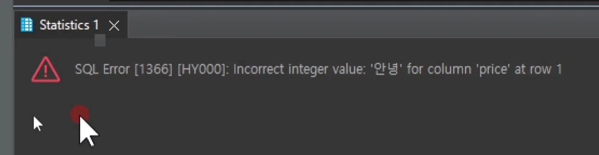

- <code>COMMIT</code>
    > ⚠️ 
    > 
    > <a id="34ceda9b0fe180fea4aef826a4440703"></a>
    > 
    > INSERT를 포함한 모든 DML 명령어는 <strong><u>COMMIT</u></strong><strong><u>까지 해야 DB에 정상 반영</u></strong>된다&#46; 
    > 
    > - COMMIT을 하지 않은 경우, 다른 세션(사용자)에게 반영되지 않는다&#46; 

    <a id="34ceda9b0fe180e3ae76c85d72e20368"></a>

    ```sql
    insert into book_list 
    	('9788901272580','메리골드 마음 세탁소','윤정은','북로망스','20300306', 15000);

    INSERT INTO book_list VALUES
    	('9791168473690', '세이노의 가르침', '세이노', '데이원', '20230302', 7200);
    	
    INSERT INTO book_list VALUES 
    	('9791158741952','상처받지 않는 관계의 비밀','최리나','미디어숲','20230730',18800);


    COMMIT
    ```

- <code>ROLLBACK</code>
    > ✏️ 
    > 
    > <a id="34ceda9b0fe1804695f3ea9abffb0ab1"></a>
    > 
    > ROLLBACK 명령어를 통해 이전에 실행한 명령문을 되돌릴 수 있다&#46;

    <a id="34ceda9b0fe180a6a866f29787aa0c3e"></a>

    ```sql
    insert into book_list ('9788901272580','메리골드 마음 세탁소','윤정은','북로망스','20300306', 15000);

    ROLLBACK
    ```

    - rollback 전
        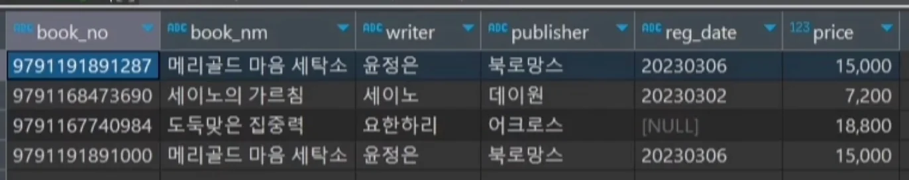

    - rollback 후
        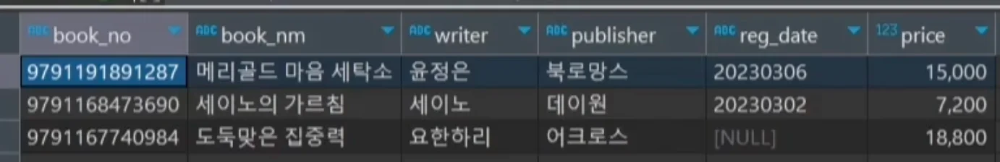

<a id="34ceda9b0fe180eaa8cadac842f90767"></a>

## 데이터 업데이트&#58; <code>UPDATE</code>

> ✏️ 
> 
> - UPDATE 명령어를 작성할 시에는 조건절이 누락되지 않도록 주의해야 한다&#46;
> 
> - 변경할 데이터는 해당 컬럼의 데이터 타입과 사이즈에 맞아야 한다&#46; 
> 
> - UPDATE 문 수행 후에는 COMMIT을 해줘야 모든 작업이 완료가 된다&#46; 
> 
> - UPDATE 작업을 되돌리고 싶은 경우, ROLLBACK을 하면 된다&#46; 

> ⚠️ 
> 
> <a id="34ceda9b0fe1804a8a9edaa284e08540"></a>
> 
> <code>UPDATE</code> 문에는 조건절을 붙여줘야 한다&#46;
> 
> 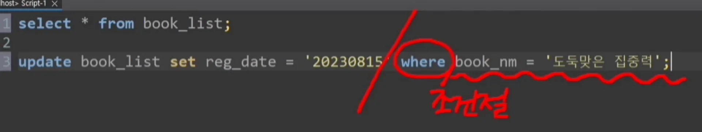
> 
> - 조건절이 붙지 않은 UPDATE 문은 테이블에 존재하는 모든 데이터를 변경해버리기 때문에 의도하지 않았던 데이터까지 바꿀 수 있다&#46;
> 
> - 따라서 조건절을 붙여서 명시적으로 핸들링해야 한다&#46; 

- <code>UPDATE</code>
    <a id="34ceda9b0fe180f39365c6ab4a525219"></a>

    ```sql
    update book_list set reg_date = '20230815' where book_nm = '도둑맞은 집중력';

    ```

- <code>ROLLBACK</code>
    <a id="34ceda9b0fe180acafd2c87110d3c6dd"></a>

    ```sql
    update book_list set writer = '정미나';
    ```

    - rollback 전
        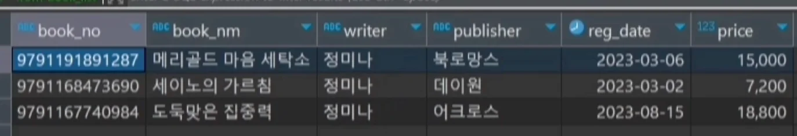

    - rollback 후
        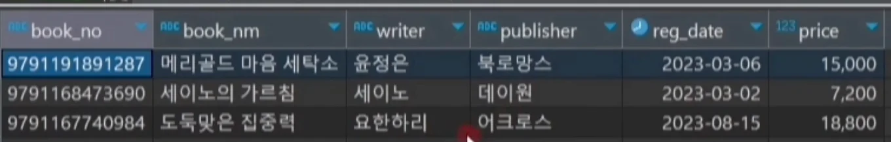

        - 잘못된 sql 작성으로 인해 모두 업데이트된 경우 <code>ROLLBACK</code>으로 되돌릴 수 있다&#46; 

<a id="34ceda9b0fe180d28e80e3975b3736f9"></a>

## 데이터 삭제&#58; <code>DELETE</code>

> ✏️ 
> 
> - DELETE 명령어 작성 시, 조건절이 누락되지 않도록 주의해야 한다&#46; 
> 
> - DELETE 문 수행 후, COMMIT 해줘야 모든 작업이 완료가 된다 &#46;
> 
> - DELETE 작업을 되돌이키고 싶은 경우, ROLLBACK을 해주면 된다&#46; 

> ⚠️ 
> 
> <a id="34ceda9b0fe180afb34ac94dcf0412fb"></a>
> 
> DELETE 문도 UPDATE와 동일하게 조건절이 없으면 해당하는 모든 데이터들을 삭제한다&#46; <br>즉, 의도지 않게 데이터가 전부 삭제될 수 있다&#46; 
> 
> <a id="34ceda9b0fe180beb491ce6146c1fab3"></a>
> 
> 따라서 조건절을 통해 명시적으로 핸들링해야 한다&#46; 

- <code>DELETE</code>
    <a id="34ceda9b0fe180ac9c85ecce33156609"></a>

    ```sql
    delete from book_list where publisher = '북로망스';

    COMMIT
    ```

    - 실행 전
        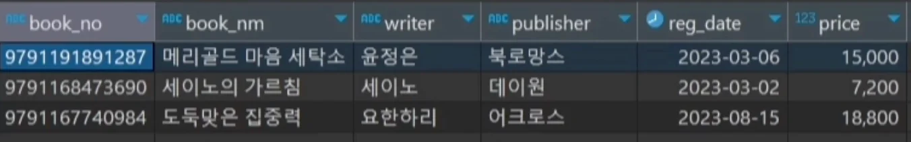

    - 실행 후
        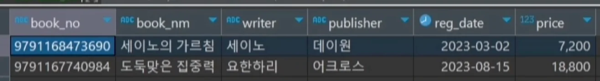

- 특정 컬럼만 삭제 &#45; <code>UPDATE</code>
    <a id="34ceda9b0fe1806cb847d88f59e24541"></a>

    ```sql
    update book_list set writer = null where book-nm = '도둑맞은 집중력';
    ```

    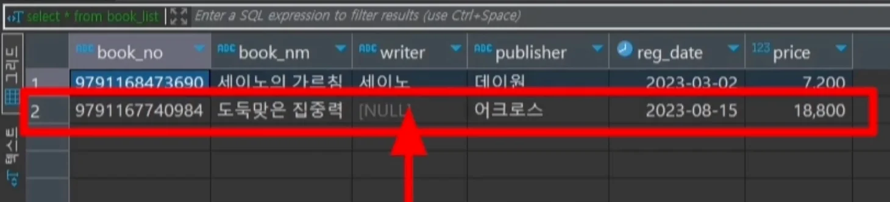

- <code>ROLLBACK</code>
    <a id="34ceda9b0fe1805783d0c187dfe67dd8"></a>

    ```sql
    delete from book_list;

    ROLLBACK
    ```

    - rollback 전
        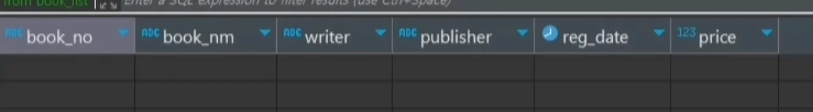

    - rollbakc 후
        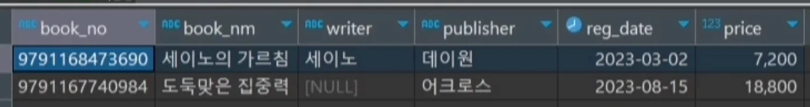

> 🤔 
> 
> <a id="34ceda9b0fe1807e9a4fe98cf5ef5e2e"></a>
> 
> 실제 업무를 중 실수로 전체 delete 후 commit까지 되었다면 어떻게 하는가?
> 
> <a id="34ceda9b0fe18032b2f8f337e7a9e25b"></a>
> 
> DBMS마다 차이가 있을 수 있지만, 대부분은 데이터의 골든타임이 있어 얼마의 시간 동안 데이터베이스 자체 로그를 이용해서 복구 가능한 경우가 많이 있다&#46; 
> 
> <a id="34ceda9b0fe18062b792e607bf9b4398"></a>
> 
> 따라서 바로 선배에게 이실직고 하여, 도움을 청하기…
