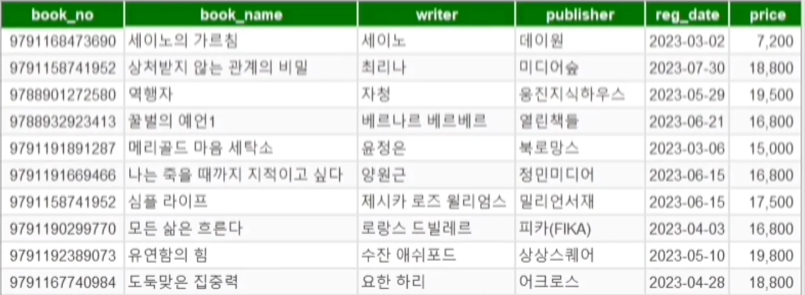
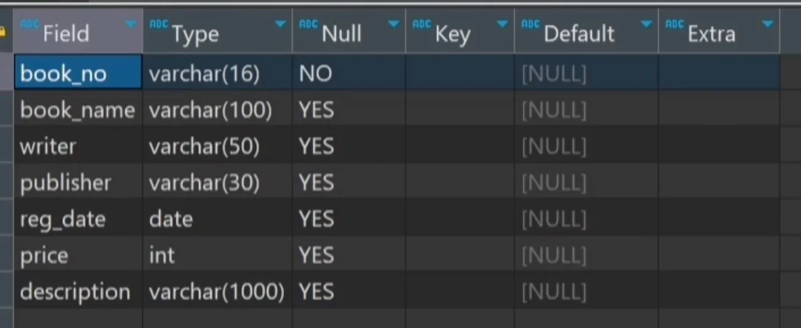
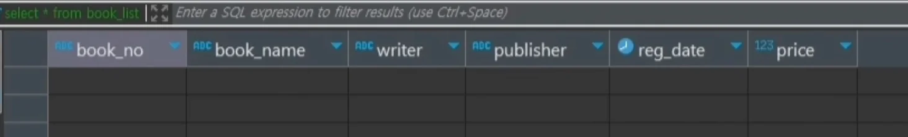
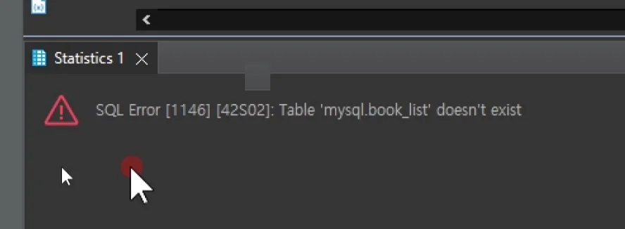

> 
> 
> <a id="34ceda9b0fe1808cab6ffa4e94c8c022"></a>
> 
> <strong>목차</strong>
> 
> - [테이블 생성: CREATE](#34ceda9b0fe180ac85bdc325ca77c2a8)
> - [테이블 변경: ALTER](#34ceda9b0fe180babe72fb2016c92a70)
> - [테이블 삭제: DROP / TRUNCATE](#34ceda9b0fe180ef8b13c8b8e5b7d7be)

<a id="34ceda9b0fe180ac85bdc325ca77c2a8"></a>

## 테이블 생성&#58; <code>CREATE</code>

> ✏️ 
> 
> - <code>CREATE</code> 문으로 데이터베이스에 테이블을 생성할 수 있다&#46; 
> 
> - 테이블을 생성할 시 테이블명, 컬럼명, 컬럼의 데이터타입, 사이즈 필수 여부 등에 대한 정의가 되어야 한다&#46; 
> 
> - 테이블명은 숫자로 시작할 수 없고 ‘&#95;’, ‘&#36;’ 외의 특수 기호는 사용할 수 없다&#46; 
>     - ‘&#36;’ 잘 사용하지 않음



<a id="34ceda9b0fe18040a256cf60be2b455d"></a>

```sql
# 테이블(스키마) 생성
create table book_list (
		book_no   varchar(16) not null,
		book_name varchar(50),
		writer    varchar(50),
		publisher varchar(30),
		reg_data  data,
		price     int
);
```

<a id="34ceda9b0fe1808aa036e7e22e5ed94d"></a>

```sql
insert into book_list values
	('9791168473690', '세이노의 가르침', '세이노', '데이원', '20230302', 7200);
```

<a id="34ceda9b0fe180babe72fb2016c92a70"></a>

## 테이블 변경&#58; <code>ALTER</code>

> ✏️ 
> 
> <a id="34ceda9b0fe180a8a11aef5a22203b96"></a>
> 
> 테이블 스키마 변경
> 
> - <code>CHANGE</code>&#58; 컬럼명 변경
> 
> - <code>MODIFY</code>&#58; 컬럼의 데이터 타입 및 사이즈 변경
> 
> - <code>ADD</code>&#58; 컬럼 추가
> 
> - <code>DROP</code>&#58; 컬럼 삭제
> 
> - <code>RENAME</code>&#58; 테이블명 변경

- <strong>새로운 컬럼 추가</strong>
    <a id="34ceda9b0fe18019ae97ea8496fe0881"></a>

    ```sql
    alter table book_list add column description varchar(1000);
    ```

    <details>
    <summary><strong>테이블 스키마 확인</strong></summary>

    <a id="34ceda9b0fe18082b058ef2447137384"></a>

    ```sql
    desc book_list;
    ```

    

    </details>

- <strong>기존 컬럼 수정 &#45; 컬럼 사이즈 변경&#58; </strong><strong><code>50</code></strong><strong> → </strong><strong><code>100</code></strong>
    <a id="34ceda9b0fe180b38b51ecdc5c9cd073"></a>

    ```sql
    alter table book_list modity column book_name varchar(100);
    ```

    <details>
    <summary><strong>테이블 스키마 확인</strong></summary>

    <a id="34ceda9b0fe180fda6fdefb2d5bee9df"></a>

    ```sql
    desc book_list;
    ```

    

    </details>

- <strong>기존 컬럼 수정 &#45; </strong>컬럼명 변경&#58; <code>description</code> → <code>book&#95;desc</code>
    <a id="34ceda9b0fe18040b65ef0cc1fc6dfbf"></a>

    ```sql
    alter table book_list change column description book_desc varchar(1000);
    ```

    <details>
    <summary><strong>테이블 스키마 확인</strong></summary>

    <a id="34ceda9b0fe1803c8199dd9c42112f9d"></a>

    ```sql
    desc book_list;
    ```

    

    </details>

- <strong>컬럼 삭제</strong>
    <a id="34ceda9b0fe18094b17ace54a1f4960a"></a>

    ```sql
    alter table book_list drop column book_desc;
    ```

    <details>
    <summary><strong>테이블 스키마 확인</strong></summary>

    <a id="34ceda9b0fe1808d815ac1bf231eeafe"></a>

    ```sql
    desc book_list;
    ```

    

    </details>

- <strong>테이블명 변경</strong>
    <a id="34ceda9b0fe1803ead73fe11593cc0d8"></a>

    ```sql
    alter table book_list rename book_info;
    ```

    <details>
    <summary><strong>테이블 스키마 확인</strong></summary>

    <a id="34ceda9b0fe180b18901c89846ede397"></a>

    ```sql
    desc book_list;
    ```

    

    </details>

<a id="34ceda9b0fe180ef8b13c8b8e5b7d7be"></a>

## 테이블 삭제&#58; <code>DROP</code> / <code>TRUNCATE</code>

> ✏️ 
> 
> - <strong><code>DROP</code></strong>
>     - <strong>테이블, 데이터 모두 삭제</strong>
> 
> - <strong><code>TRUNCATE</code></strong>
>     - <strong>데이터만 삭제 (테이블 스키마 유지)</strong>
> 
>     - <strong>특정 행만 삭제 불가능 즉, 모든 행을 통째로 삭제</strong>
> 
> - Rollback이 가능한 DELETE 명령어보다 훨씬 빠르게 삭제할 수 있어 대용량 데이터를 삭제할 때 유용하다&#46; 
> 
> - <strong><code>DROP</code></strong><strong>, </strong><strong><code>TRUNCATE</code></strong><strong> 모두 한번 실행하면 돌이킬 수 없으므로 매우 신중하게 사용해야 한다&#46; </strong>

<a id="34ceda9b0fe18075b148ca17588ea300"></a>

<strong>데이터 생성</strong>

<a id="34ceda9b0fe180caba81cb857dbc8a81"></a>

```sql
select * from book_list;

INSERT INTO book_list VALUES ('9791168473690','세이노의 가르침','세이노','데이원','20230302',7200);
INSERT INTO book_list VALUES ('9791158741952','상처받지 않는 관계의 비밀','최리나','미디어숲','20230730',18800);
INSERT INTO book_list VALUES ('9788901272580','역행자','자청','웅진지식하우스','20230529',19500);
INSERT INTO book_list VALUES ('9788932923413','꿀벌의 예언','베르나르 베르베르','열린책들','20230621',16800);
INSERT INTO book_list VALUES ('9791191891287','메리골드 마음 세탁소','윤정은','북로망스','20230306',15000);
INSERT INTO book_list VALUES ('9791191669466','나는 죽을 때까지 지적이고 싶다','양원근','정민미디어','20230615',16800);
INSERT INTO book_list VALUES ('9791158741952','심플 라이프','제시카 로즈 윌리엄스','밀리언서재','20230615',17500);
INSERT INTO book_list VALUES ('9791190299770','모든 삶은 흐른다','로랑스 드빌르','피카(FIKA)','20230403',16800);
INSERT INTO book_list VALUES ('9791192389073','유연함의 힘','수잔 애쉬포드','상상스퀘어','20230510',19800);
INSERT INTO book_list VALUES ('9791167740984','도둑맞은 집중력','요한 하리','어크로스','20230428',18800);
```

<a id="34ceda9b0fe18028af40cc4c5e4fb69a"></a>

<code>TRUNCATE</code>

<a id="34ceda9b0fe180fabf11cae051667713"></a>

```sql
truncate table book_list;

select * from book_list;
```



<a id="34ceda9b0fe18066a1effc28da01fbfd"></a>

<code>TRUNCATE</code>는 데이터만 삭제하기 때문에 조회 시 위와 같이 스키마가 나오는 것을 확인할 수 있다&#46; 

<a id="34ceda9b0fe1806391d6ceb875412401"></a>

<code>DROP</code>

<a id="34ceda9b0fe18063928dd4bdaa327d14"></a>

```sql
drop table book_list;

select * from book_list;
```


<a id="34ceda9b0fe18048987ef3d553ec5d0a"></a>

<code>DROP</code>는 데이터만 삭제하기 때문에 조회 시 위와 같이 스키마가 나오는 것을 확인할 수 있다&#46; 



- 테이블 조회 시 위와 같이 존재하지 않는다고 나오는 것을 확인할 수 있다&#46;
