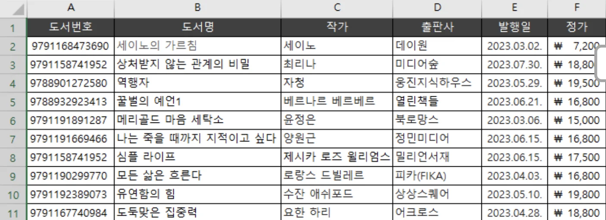
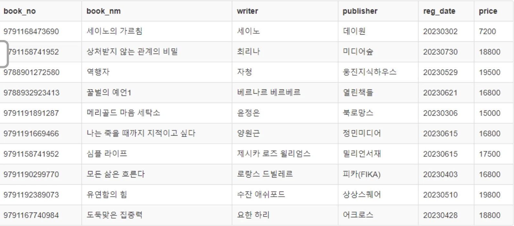
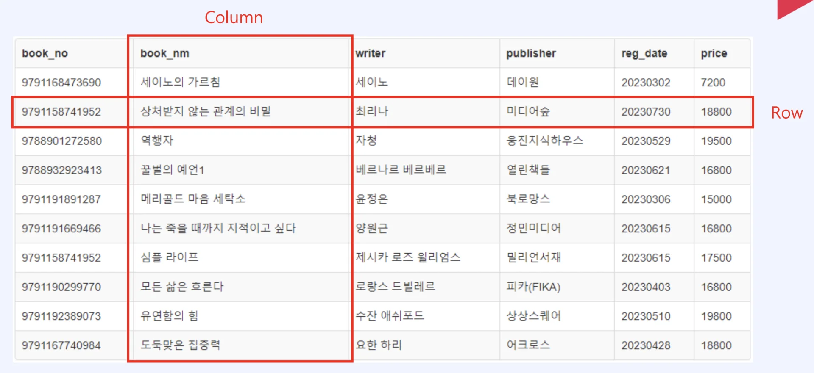
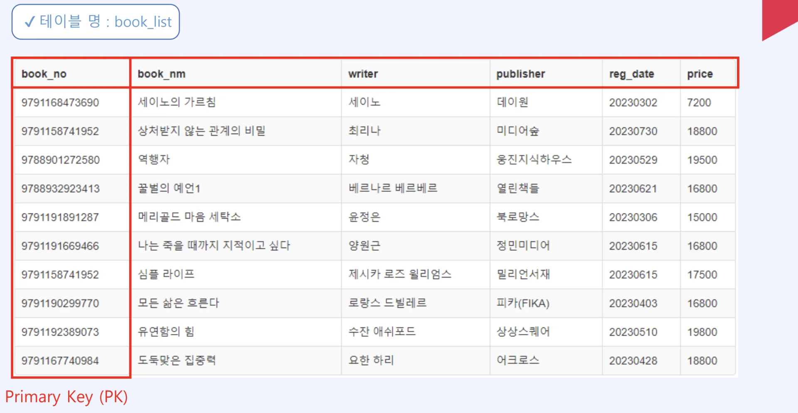
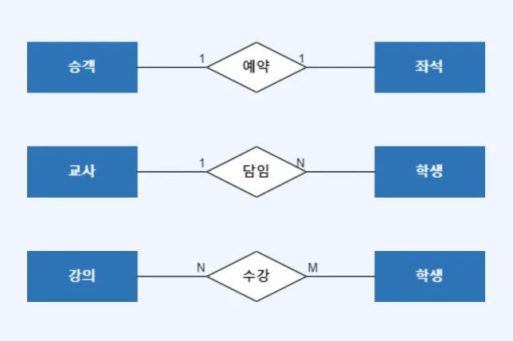
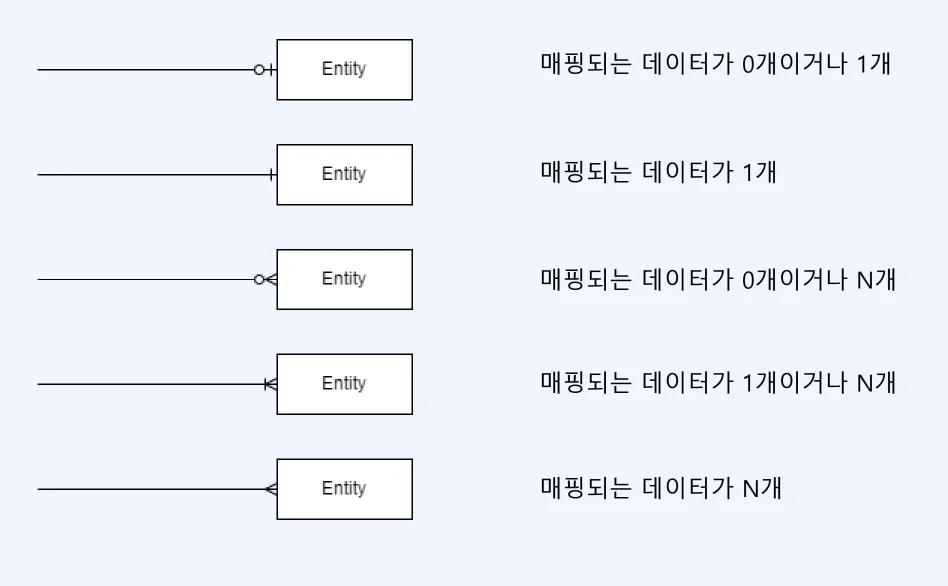
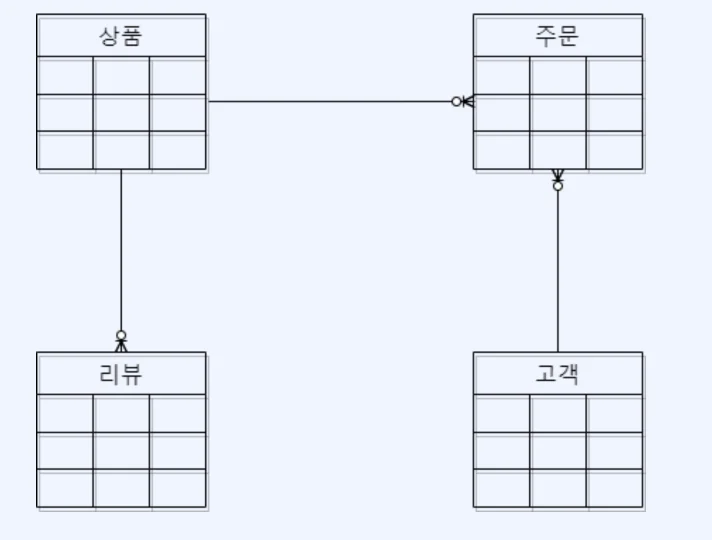

## Excel, Database

Excel

Database

### 테이블

- ‘Column’ 과 Row로 구성

### 모델링

> ✏️ 
> 
> 
> 
> 모델링이란 데이터를 어떤 식으로 그룹화해서 저장할지를 미리 설계하는 과정이다&#46;

- 각 로우(행)을 식별하는 PK값이 존재해야 함

#### 타입

- <code>CHAR</code>, <code>VARCHAR</code>&#58; 글자

- <code>INT</code>&#58; 숫자

- <code>DATE</code>&#58; 날짜 

### ERD (Entity Relationship Diagram)

> ✏️ 
> 
> 
> 
> <code>ERD</code>는 Entity Relationship Diagram의 약자로  테이블과 그들 사이의 관계를 한눈에 알아보기 쉽게 그려놓은 다이어그램이다&#46;

#### Crow’s Foot

#### ERD Example

> ✏️ 
> 
> 
> 
> ERD를 보고 데이터 모델을 잘 파악할 수 있어야 데이터분석을 잘 할 수 있다&#46;

- 상품 테이블 &#58; 주문 테이블 = <code>1&#58;N</code>

- 고객 테이블 &#58; 주문 테이블 = <code>1&#58;N</code>

- 상품 테이블 &#58; 리뷰 테이블 = <code>1&#58;N</code>
