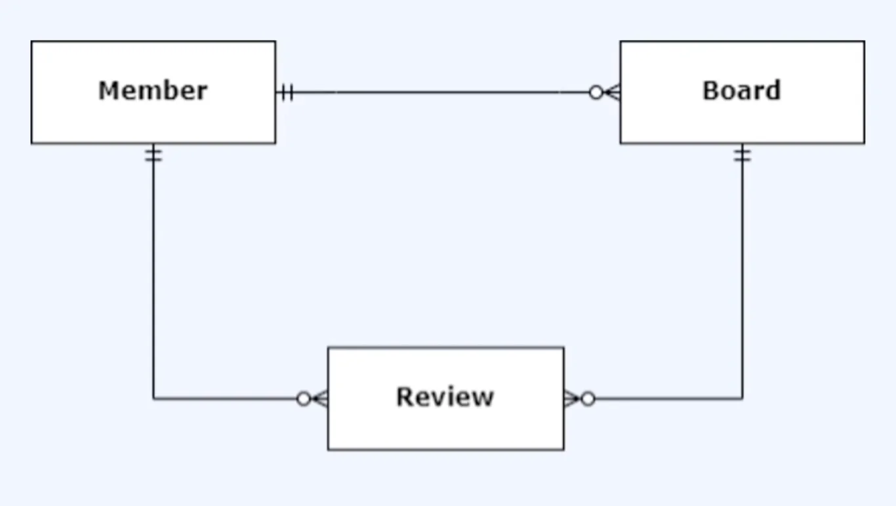
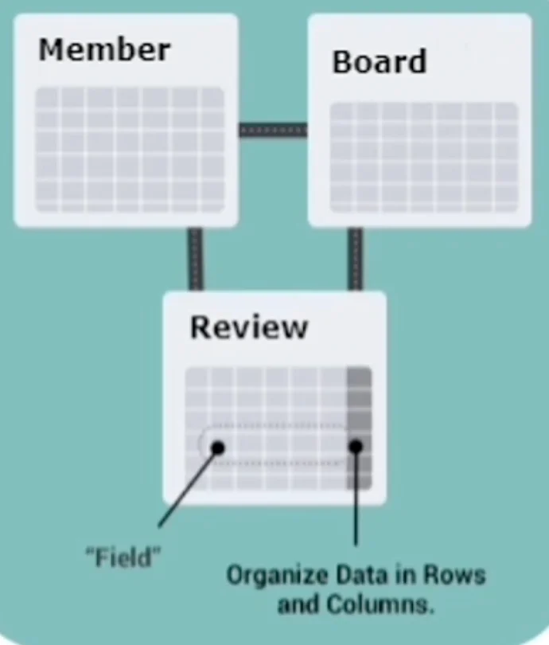
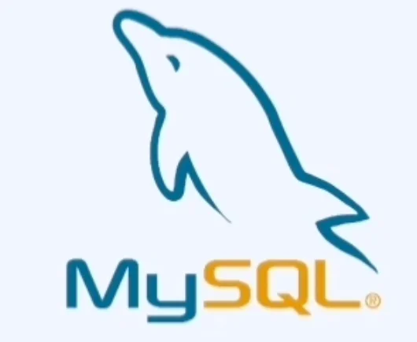
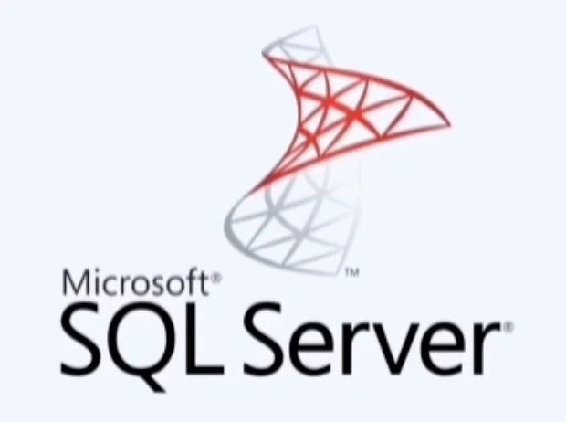
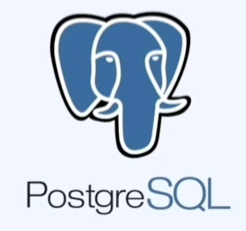
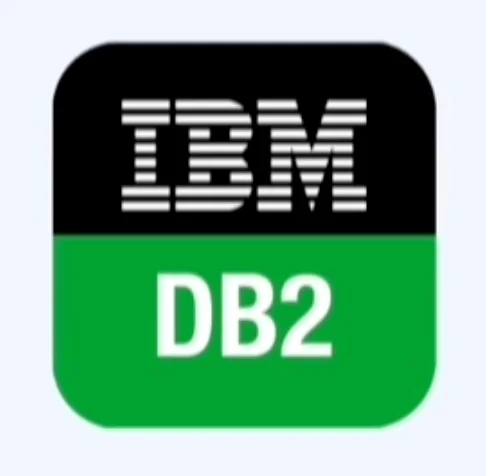
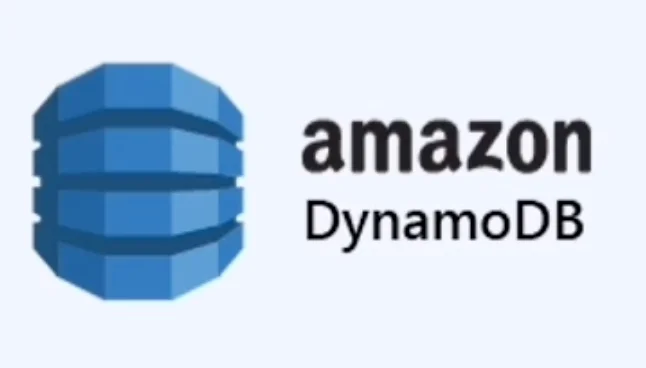

[DB&#45;Engines Ranking]()

## RDBMS (Relational Database Management System)

---

> ✏️ 
> 
> 
> 
> 관계형 데이터 모델

RDBMS 종류

오라클

MySQL

SQL Server

PostgreSQL

MariaDB

IBM DB2

## NoSQL

---

> ✏️ 
> 
> 
> 
> 비 관계형 데이터 모델

NoSQL 같은 경우 <strong><u>빠르게 변화에 대응</u></strong>해야 하는 프로그램이나 <strong><u>빅데이터를 다루는 서비스</u></strong>에 적합한 DBMS라 할 수 있다&#46; 

- 스키마 유연성
    - 컬럼 추가/삭제가 자유로움

    - 빠른 실험/변화에 대응함

- JOIN 제거
    - 한 번에 읽기 가능 (JOIN 없음)

    - 읽기 성능 매우 빠름

- 수평 확장(Scale&#45;out)
    - NoSQL은 처음부터 분산을 고려

    - 노드 추가 → 성능 증가

    - 빅데이터 처리에 적합

실제로 Netflix, Facebook, Google 과 같은 기업에서 NoSQL을 사용하고 있다&#46; 

NoSQL 종류

mongoDB

MariaDB

amazon DynamoDB

cassandra

apache HBASE

| <strong>요구사항</strong> | <strong>RDB</strong> | <strong>NoSQL</strong> |
| --- | --- | --- |
| 트랜잭션 중요 (금융) | ✅ | ❌ |
| 스키마 자주 변경 | ❌ | ✅ |
| 대규모 트래픽 | ❌ | ✅ |
| 복잡한 관계 | ✅ | ❌ |
| 빠른 개발/실험 | ❌ | ✅ |
