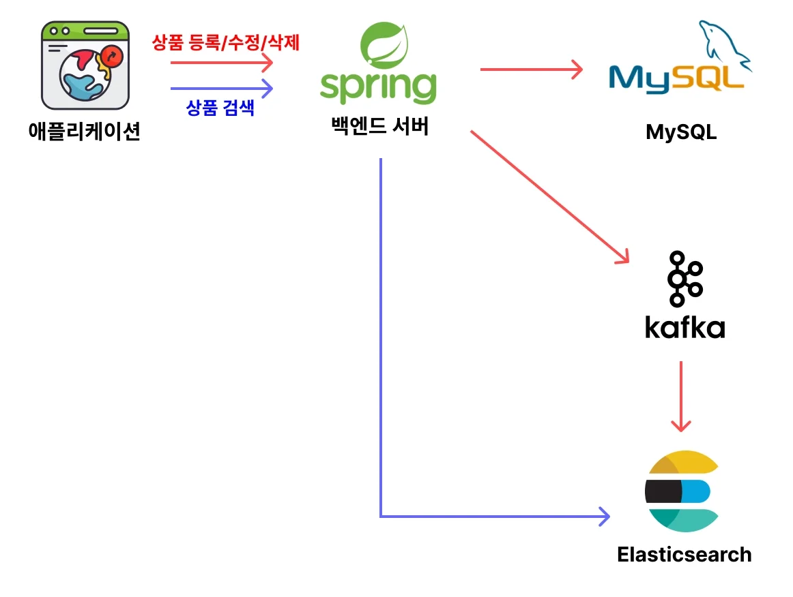
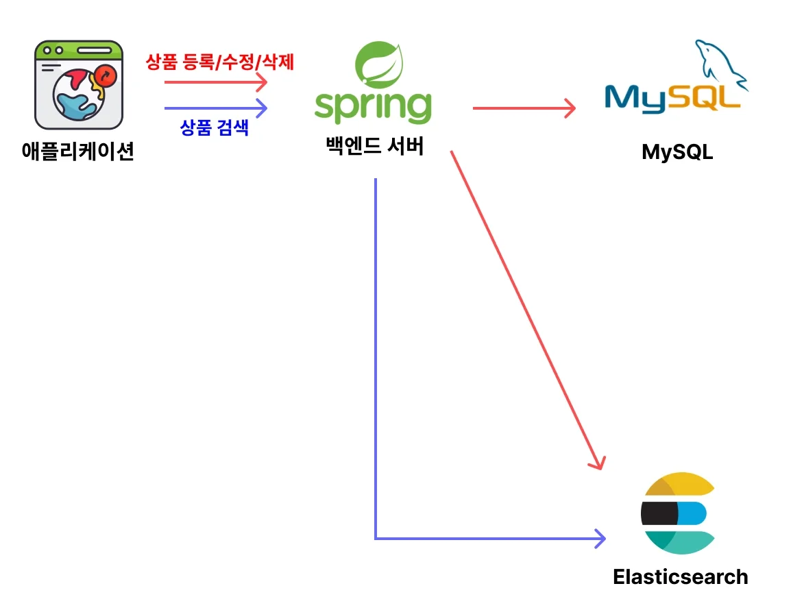

> 
> 
> <a id="34deda9b0fe180f9bfeaefe00f74a0fc"></a>
> 
> 목차
> 
> - [인프라 아키텍처 설계하기](#34deda9b0fe18091b60fe173ade951ab)
> - [방법 1 - 메시지큐 (kafka)](#34deda9b0fe180889d48edfb4ca9234d)
> - [방법 2- 애플리케이션 레벨에서 동기화](#34deda9b0fe180ffb0eaf2aa51275c27)

<a id="34deda9b0fe18091b60fe173ade951ab"></a>

## 인프라 아키텍처 설계하기

> 🤔 
> 
> <a id="34deda9b0fe1807c85aee342f5f1d248"></a>
> 
> MySQL과 Elasticsearch의 장단점은 명확하다&#46;  현업에서는 이 2가지의 장점을 둘 다 활용하기 위해서 MySQL과 Elasticsearch를 둘 다 활용하는 경우가 많다&#46; 
> 
> - <code>MySQL</code>&#58; <strong><u>트랜잭션을 기반</u></strong>으로 <strong>데이터의 정합성 보존</strong>
> 
> - <code>Elasticsearch</code>&#58; <strong>빠른 검색 최적화</strong>
> 
> <a id="34deda9b0fe180e6b9abc455331ce0bb"></a>
> 
> 그러나 이 때, 주의해야할 점은<strong> 데이터 삽입 </strong>시 <code>MySQL</code>과 <code>Elasticsearch</code> <strong><u>둘다 추가</u></strong>되어야한다는 점이다&#46; 즉, <strong><u>데이터 동기화 문제</u></strong><strong><u>를 해결</u></strong>해야 한다&#46;

<a id="34deda9b0fe180889d48edfb4ca9234d"></a>

### 방법 1 &#45; 메시지큐 (kafka)



> ✏️ 
> 
> <a id="34deda9b0fe18076b487e588caa0c225"></a>
> 
> <strong>kafka와 같은 메세지큐를 도입</strong>하여<strong><u> 이벤트 기반으로 데이터 동기화 처리</u></strong>를 한다&#46; 

<a id="34deda9b0fe180ffb0eaf2aa51275c27"></a>

### 방법 2&#45; 애플리케이션 레벨에서 동기화



> ❗ 
> 
> <a id="34deda9b0fe1803eb95de960d009481c"></a>
> 
> 인프라 구성은 정답이라는 게 없다&#46; <strong><u>장단점 </u></strong>과 <strong><u>기회 비용(trade&#45;off)</u></strong>만 있을 뿐이다&#46; 
> 
> <a id="34deda9b0fe1801cb0dde255d068da5c"></a>
> 
> 따라서<strong> 서비스 규모와 실제 트래픽 발생 규모를 판단</strong>하여<strong> 오버엔지니어링을 하지않는 것</strong>이 더 좋은 선택일 수도 있다&#46;

> ✏️ 
> 
> <a id="34deda9b0fe180158805c43081838c1a"></a>
> 
> 소규모 서비스에서는 카프카(kafka)를 도입하고 관리하는 것 자체가 부담인 경우가 많다&#46; <br>이런 경우 <strong>애플리케이션 레벨</strong>에서 아래와 같이 <strong><u>직접 동기화</u></strong>를 한다&#46;

<a id="34deda9b0fe1800b894def168a69b838"></a>

```java
public class ProductService {
  ...
   
  @Transactional 
  public Product createProduct(Product product) {
    // MySQL에 데이터 저장
    productRepository.save(product);
    
    // Elasticsaerch에 데이터 저장
    productSearchRepository.save(product);
  }
}
```
