> 
> 
> <a id="34deda9b0fe1804c905af8950753ef20"></a>
> 
> 목차
> 
> - [[구현] 검색 기능 1 - Kibana에서 요구사항에 맞는 쿼리 작성](#34deda9b0fe180e1b036fec8ca7ef972)
> - [1. 인덱스 생성 / 매핑 정의 / 여러 필드에 걸쳐 검색](#34deda9b0fe180d4b2f7deaba43046a7)
> - [2. 대소문자 구분 없이 검색, 단어 순서 상관없이 검색, HTML 태그 섞이지 않게 검색](#34deda9b0fe180a8a942eac9b0d855da)
> - [3. 한글, 영어 검색 / 동의어 기반 검색 / 필터링](#34deda9b0fe180b492fbfe284f1b47da)
> - [4. 특정 조건 상위 노출 / 오타 허용 검색 / 하이라이팅 처리 / 페이지네이션](#34deda9b0fe1803892bef37b01ac508c)
> - [5. 자동 완성 기능](#34deda9b0fe180ebb077f9779b5e1afa)
> - [6. 최종 쿼리](#34deda9b0fe180559c49dd860ab38b63)
> - [[구현] 검색 기능 2 -Spring Boot에 맞게 구현](#34deda9b0fe1802ca0a9f3f58b287b2b)
> - [1. Spring Boot에서 products 인덱스에 맞는 Document 정의](#34deda9b0fe180f48560ebd170507162)
> - [2.  MySQL에 데이터 삽입/삭제 시 Elasticsearch에도 같이 반영 되도록 구현](#34deda9b0fe1802c9a99d4313543d105)
> - [3. Spring Boot에서 Elasticsearch 활용해 자동완성 API 구현](#34deda9b0fe1801eb259e23a1d913bf6)
> - [4. Spring Boot에서 Elasticsearch 활용해 검색 API 구현](#34deda9b0fe1804f9517f9ead9a91dc6)

> 💬 
> 
> <a id="34deda9b0fe180c39461cd77625bdacd"></a>
> 
> <strong>요구사항 상세 확인&#58; </strong><a href="#/post/348eda9b-0fe1-804e-89b7-dfe822d585c2">페이지</a>

> ✅ 
> 
> 1. <strong>Kibana에서 요구사항에 맞는 쿼리 작성</strong>
> 
> 1. <strong>Spring Boot에 맞게 구현</strong>
> 
> 1. <strong>더미 데이터 넣고 Spring Boot에서 잘 작동하는 지 테스트</strong>

<a id="34deda9b0fe180e1b036fec8ca7ef972"></a>

## &#91;구현&#93; 검색 기능 1 &#45; <strong>Kibana에서 요구사항에 맞는 쿼리 작성</strong>

---

<a id="34deda9b0fe180d4b2f7deaba43046a7"></a>

### 1&#46; 인덱스 생성 / 매핑 정의 / 여러 필드에 걸쳐 검색

> ✅ 
> 
> <a id="34deda9b0fe180888b9dfb41a9b5ad39"></a>
> 
> <strong>요구사항</strong>
> 
> - [ ] 검색 했을 때 <code>상품명</code>, <code>상품 설명</code>, <code>카테고리명</code>을 기반으로 관련된 상품을 검색해야 한다&#46; 
>     - [ ] score 가중치  = <code>상품명 &#58; 상품 설명 &#58; 카테고리명</code> = <code>3 &#58; 1&#58; 2</code>

<details>
<summary><strong>1&#46; Clone 받은 프로젝트 정상 실행 확인</strong></summary>

- <code>application&#46;yml</code> 세팅
    <a id="34deda9b0fe18010b299e63da0d61f28"></a>

    ```yaml
    spring:
      datasource:
        url: jdbc:mysql://localhost:3306/coupang
        username: root
        password: password123
        driver-class-name: com.mysql.cj.jdbc.Driver
      jpa:
        hibernate:
          ddl-auto: update
        show-sql: true
    ```

- mysql 셋업
    <details>
    <summary>docker compose 파일 셋업</summary>

    <a id="34deda9b0fe180de8236fa5f59175959"></a>

    ```yaml
    services:
      mysql:
        image: mysql:8.0
        container_name: coupang-mysql
        restart: always
        environment:
          MYSQL_ROOT_PASSWORD: password123
          MYSQL_DATABASE: coupang
        ports:
          - "3306:3306"
        volumes:
          - mysql_data:/var/lib/mysql
        networks:
          - coupang-network

    volumes:
      mysql_data:

    networks:
      coupang-network:
        driver: bridge

    ```

    </details>

    <a id="34deda9b0fe180dba914ca39ce7666ec"></a>

    ```bash
    # compose 실행
    docker compose up -d 
    ```

- 서버 정상 실행 확인
    <a id="34deda9b0fe180c99514f8c1b38171b6"></a>

    ```bash
    ./gradlew bootRun
    ```

    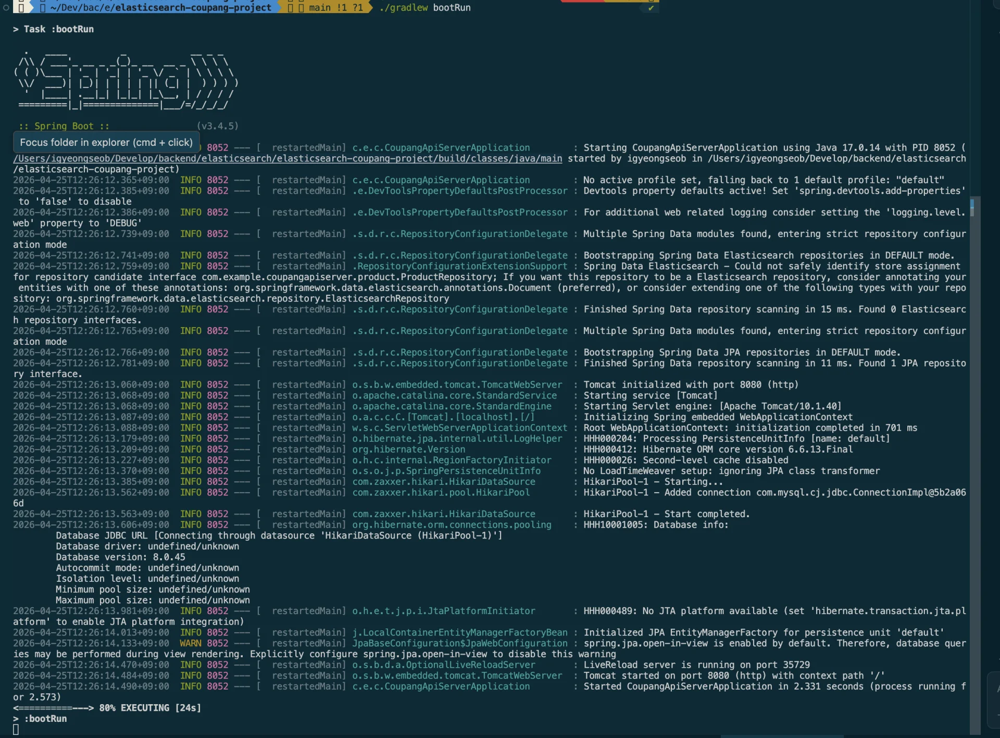

</details>

<details>
<summary><strong>2&#46; Elasticsearch의 인덱스 생성, 매핑 정의</strong></summary>

> ✏️ 
> 
> <a id="34deda9b0fe1806bbdbadd9a6bc416f1"></a>
> 
> Soring Boot에서 정의한 Product 엔티티에 맞게 Elasticsearch의 인덱스 생성 및 매핑 정의

<details>
<summary><strong>&#91;</strong><strong><code>Soring Boot</code></strong><strong>&#93;</strong> <strong>Product 엔티티</strong></summary>

<a id="34deda9b0fe1807f8d7def550db42731"></a>

```java
@Entity
@Table(name = "products")
public class Product {
    @Id
    @GeneratedValue(strategy = GenerationType.IDENTITY)
    private Long id;

    private String name;

    @Column(columnDefinition = "TEXT")
    private String description; // 에디터가 HTML로 상품 설명을 저장

    private int price;

    private double rating;

    private String category;
    
    ...
}
```

</details>

<a id="34deda9b0fe18084bd03f75c1c72681b"></a>

<strong>&#91;</strong><strong><code>Elasticsearch</code></strong><strong>&#93; products 인덱스 생성 / 매핑 정의</strong>

<a id="34deda9b0fe1800faa88daa111cbbdd1"></a>

```bash
DELETE /products

PUT /products
{
  "mappings": {
    "properties": {
      "id": {
        "type": "long"
      },
      "name": {
        "type": "text" // 유연한 검색 필요
      },
      "description": {
        "type": "text" // 유연한 검색 필요
      },
      "price": {
        "type": "integer" // 10억 이하의 정수
      },
      "rating": {
        "type": "double" // 실수(소수점을 가진 숫자 포함)
      },
      "category": {
        "type": "text" // 유연한 검색 필요 
      }
    }
  }
}

GET /products
```

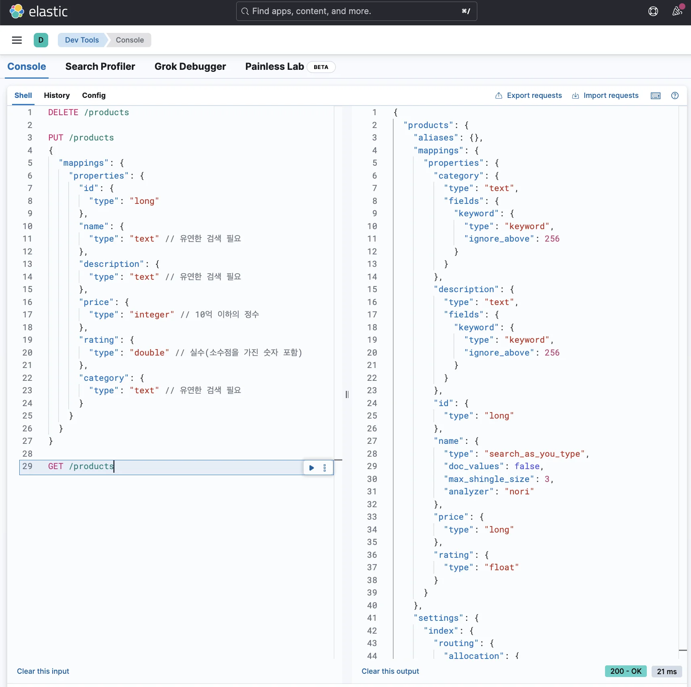

<a id="34deda9b0fe18098b631e69d4a04187d"></a>

<code>상품명</code>, <code>상품 설명</code>, <code>카테고리명</code>을 기반으로 관련된 상품을 검색하기 위해 <br><code>name</code>, <code>description</code>, <code>category</code>를 <code>text</code> 타입으로 매핑했다&#46;

</details>

<details>
<summary><strong>3&#46; 테스트용 데이터 생성</strong></summary>

<a id="34deda9b0fe180f1bf2efabc6b492160"></a>

```java
POST /products/_doc
{
  "id": 1,
  "name": "lg tv",
  "description": "",
  "price": 10000,
  "rating": 5.0,
  "category": ""
}

POST /products/_doc
{
  "id": 2,
  "name": "",
  "description": "lg tv",
  "price": 10000,
  "rating": 5.0,
  "category": ""
}

POST /products/_doc
{
  "id": 3,
  "name": "",
  "description": "",
  "price": 10000,
  "rating": 5.0,
  "category": "lg tv"
}
```

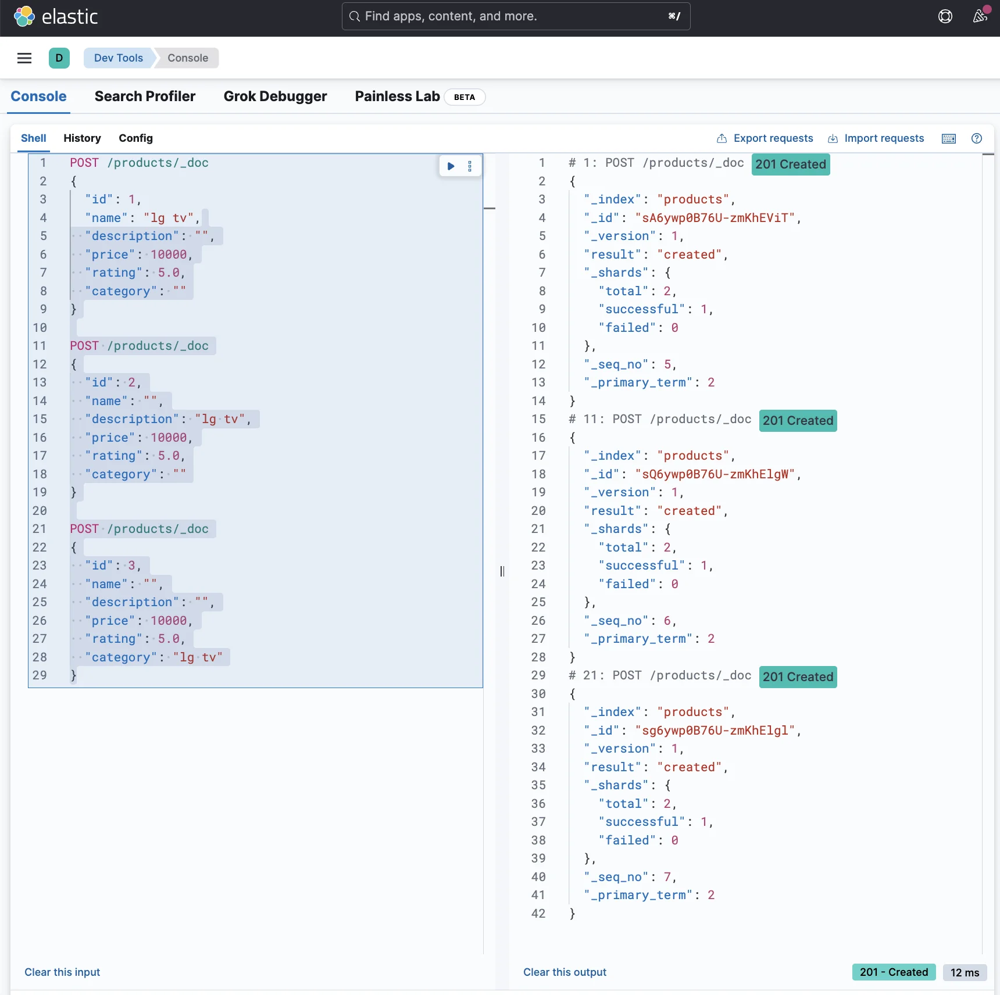

</details>

<details>
<summary><strong>4&#46; 검색</strong></summary>

<a id="34deda9b0fe180079d81f96c46c03c29"></a>

```java
GET /products/_search
{
  "query": {
    "multi_match": {
      "query": "lg",
      "fields": [
        "name^3",
        "description^1",
        "category^2"
      ]
    }
  }
}
```

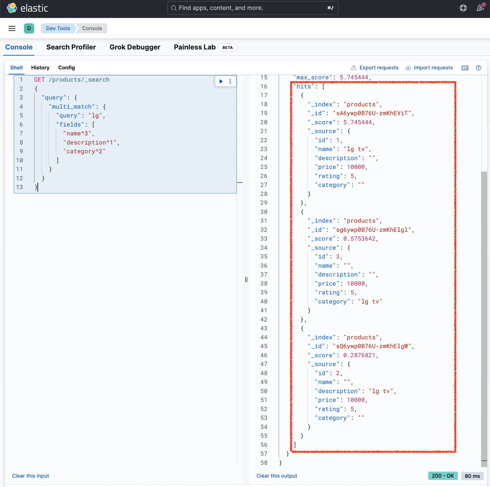

> <code>상품명 &#58; 상품 설명 &#58; 카테고리명</code> = <code>name &#58; description &#58; category </code>= <code>3 &#58; 1&#58; 2</code> 

<a id="34deda9b0fe18036809feb7533ca83cd"></a>

각 필드에 가중치가 적용되어 의도한대로 score가 반영되어 우선순위에 맞게 조회되는 것을 확인할 수 있다&#46;

</details>

<a id="34deda9b0fe180a8a942eac9b0d855da"></a>

### 2&#46; 대소문자 구분 없이 검색, 단어 순서 상관없이 검색, HTML 태그 섞이지 않게 검색

> ✅ 
> 
> <a id="34deda9b0fe18010b337fe37d4e54aeb"></a>
> 
> <strong>요구사항</strong>
> 
> - [ ] 대소문자 구분없이 검색할 수 있어야 한다&#46;
> 
> - [ ] 단어의 순서에 상관없이 검색할 수 있어야 한다&#46; 
>     - ex) <code>삼성 노트북</code>이라는 상품을 <code>노트북 삼성</code>이라고 검색해도 조회가 되야 한다&#46; 
> 
> - [ ] <code>상품 설명</code>에 HTML 태그가 섞여서 저장되어 있는데, 검색할 때는 HTML 태그로 검색되지 않아야 한다&#46;

<details>
<summary><strong>1&#46; 대소문자 구분없이 검색&#58; </strong><strong><code>lowercase</code></strong></summary>

- <strong>애널라이저(Analyzer) 설정</strong>
    > ✏️ 
    > 
    > <a id="34deda9b0fe18043883df428e0fee9f8"></a>
    > 
    > 대소문자를 구분없이 검색하려면 Analyzer의 구성요소인 token filter로 <code>lowercase</code>가 적용어야 한다&#46; 
    > 
    > <a id="34deda9b0fe180c998ddeefb4f11d45c"></a>
    > 
    > <code>lowercase</code>는 기본 설정 <strong>애널라이저(Analyzer)</strong>에 정의된 옵션이기 때문에 따로 설정을 추가하지 않아도 된다&#46;
    > 
    > - 상세 내용 참조&#58; <a href="#/post/348eda9b-0fe1-8085-ad6e-eb586c89df9b">페이지</a> 

    <a id="34deda9b0fe1809ab9c9e321381ecee6"></a>

    ```java
    "char_filter": [], 
    "tokenizer": "standard", 
    "filter": ["lowercase"]
    ```

- <strong>Analyze API를 통한 디버깅</strong>
    <a id="34deda9b0fe180378462e2f7b4b4f688"></a>

    ```java
    GET /products/_analyze
    {
      "field": "name",
      "text": "Samsung TV"
    }
    ```


<a id="34deda9b0fe180eaaca5f0b4d9e83fee"></a>

<strong>응답값</strong>

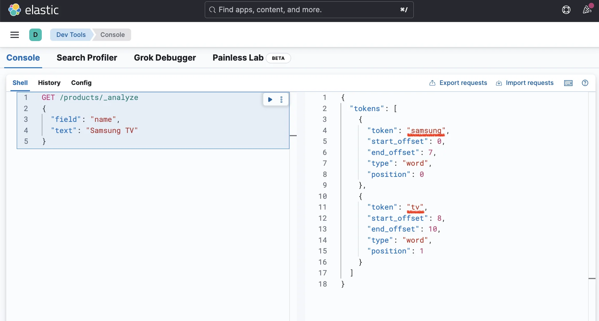

<a id="34deda9b0fe18056a490fabcc84de5ea"></a>

```java
{
  "tokens": [
    {
      "token": "samsung",
      "start_offset": 0,
      "end_offset": 7,
      "type": "<ALPHANUM>",
      "position": 0
    },
    {
      "token": "tv",
      "start_offset": 8,
      "end_offset": 10,
      "type": "<ALPHANUM>",
      "position": 1
    }
  ]
}
```

<a id="34deda9b0fe180b88aedd3b271db16ee"></a>

Analyzer가 나눈 토큰을 살펴보면 <code>lowercase</code>가 잘 적용됐음을 알 수 있다&#46; 

</details>

<details>
<summary><strong>2&#46; 단어의 순서에 상관없이 검색&#58; </strong><strong><code>text</code></strong></summary>

> ✏️ 
> 
> <a id="34deda9b0fe1807bae1aeb77212c8c17"></a>
> 
> 데이터 유형을 <strong><u><code>text</code></u></strong><strong><u>로 설정</u></strong>하면 <strong><u>Analyer가 값을 토큰으로 나눠서 역인덱스에 저장</u></strong>하기 때문에<strong> </strong><strong>단어의 순서에 상관없이 검색이 잘</strong><strong> 된다</strong>
> 
> <a id="34deda9b0fe1803e9737d8f8903ddfc1"></a>
> 
> 반면,<strong><u> </u></strong><strong><u><code>keyword</code></u></strong><strong><u> 타입</u></strong>은 필드 값을 토큰으로 나누지 않고 <strong><u>통째로 역인덱스에 저장</u></strong>한다&#46; <br>따라서 <strong>단어의 순서가 바뀌면 다른 값으로 인식해 검색되지 않</strong>는다&#46;

<a id="34deda9b0fe180c0b2f6da6491c03a0b"></a>

```java
PUT /products
{
  "mappings": {
    "properties": {
      "id": {
        "type": "long"
      },
      "name": {
        "type": "text" // 유연한 검색 필요
      },
      "description": {
        "type": "text" // 유연한 검색 필요
      },
      "price": {
        "type": "integer" // 10억 이하의 정수
      },
      "rating": {
        "type": "double" // 실수(소수점을 가진 숫자 포함)
      },
      "category": {
        "type": "text" // 유연한 검색 필요 
      }
    }
  }
}
```

<a id="34deda9b0fe18056b332f2d150e690c4"></a>

기존에 정의한 매핑에서 type을 <strong><u><code>text</code></u></strong><strong><u>로 이미 설정</u></strong>해뒀기 때문에 <strong>단어의 순서가 바뀌더라도 검색이 잘 된</strong>다&#46; 

</details>

<details>
<summary><strong>3&#46; HTML 태그로 검색되지 않도록 설정&#58; </strong><strong><code>html&#95;strip</code></strong></summary>

> ✏️ 
> 
> <a id="34deda9b0fe180e2a981ff2e81203fc2"></a>
> 
> <strong><u>HTML 태그로 검색되지 않</u></strong>게 만드려면 역인덱스로 생성 시, <strong>전처리&#45;HTML 태그 제거</strong> 후 토큰으로 저장해야 한다&#46; 이는 <strong>character filter에 </strong><strong><code>html&#95;strip</code></strong><strong>를 설정</strong> 시 쉽게 구현 가능하다&#46;

<details>
<summary><strong>🤬 커스텀 Analyzer가 적용되지 않은 필드 확인</strong></summary>

<a id="34deda9b0fe18014a4bef9320cfd7c44"></a>

```java
GET /products/_analyze
{
  "field": "name",
  "text": "<h1>상품 설명</h1>"
}
```

<a id="34deda9b0fe180409b73dc0dd98c49f1"></a>

<strong>응답값</strong>

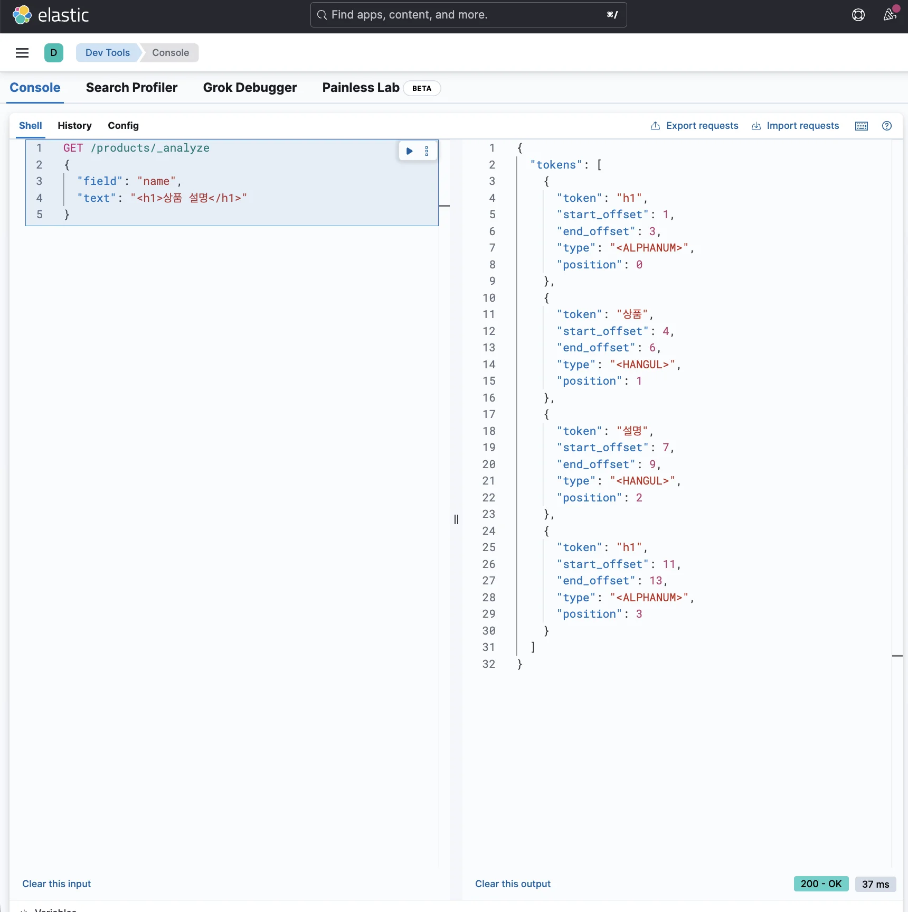

<a id="34deda9b0fe1804a9eabcf34e5b876db"></a>

```java
{
  "tokens": [
    {
      "token": "h1",
      "start_offset": 1,
      "end_offset": 3,
      "type": "<ALPHANUM>",
      "position": 0
    },
    {
      "token": "상품",
      "start_offset": 4,
      "end_offset": 6,
      "type": "<HANGUL>",
      "position": 1
    },
    {
      "token": "설명",
      "start_offset": 7,
      "end_offset": 9,
      "type": "<HANGUL>",
      "position": 2
    },
    {
      "token": "h1",
      "start_offset": 11,
      "end_offset": 13,
      "type": "<ALPHANUM>",
      "position": 3
    }
  ]
}
```

<a id="34deda9b0fe180908279f617bd619942"></a>

<code>html&#95;strip</code> 필터가 <strong><u>적용되지 않</u></strong>아서 <strong><u>HTML 태그도 같이 토큰으로 저장</u></strong>됐다&#46; 

</details>

- <strong> 인덱스 재생성 &#45; 커스텀 Analyzer 적용</strong>
    <a id="34deda9b0fe180edb3f5e07aaf793293"></a>

    ```java
    DELETE /products

    PUT /products
    {
    	"settings": {
    		"analysis": {
    			// 커스텀 애널라이저 정의
    			"analyzer": {
    				"products_description_analyzer": {
    					"char_filter": ["html_strip"],
    					"tokenizer": "standard",
    					"filter": ["lowercase"]
    				}
    			}
    		}
    	},
      "mappings": {
        "properties": {
          "id": {
            "type": "long"
          },
          "name": {
            "type": "text" // 유연한 검색 필요
          },
          "description": {
            "type": "text", // 유연한 검색 필요
            "analyzer": "products_description_analyzer"
          },
          "price": {
            "type": "integer" // 10억 이하의 정수
          },
          "rating": {
            "type": "double" // 실수(소수점을 가진 숫자 포함)
          },
          "category": {
            "type": "text" // 유연한 검색 필요 
          }
        }
    	}
    }
    ```

    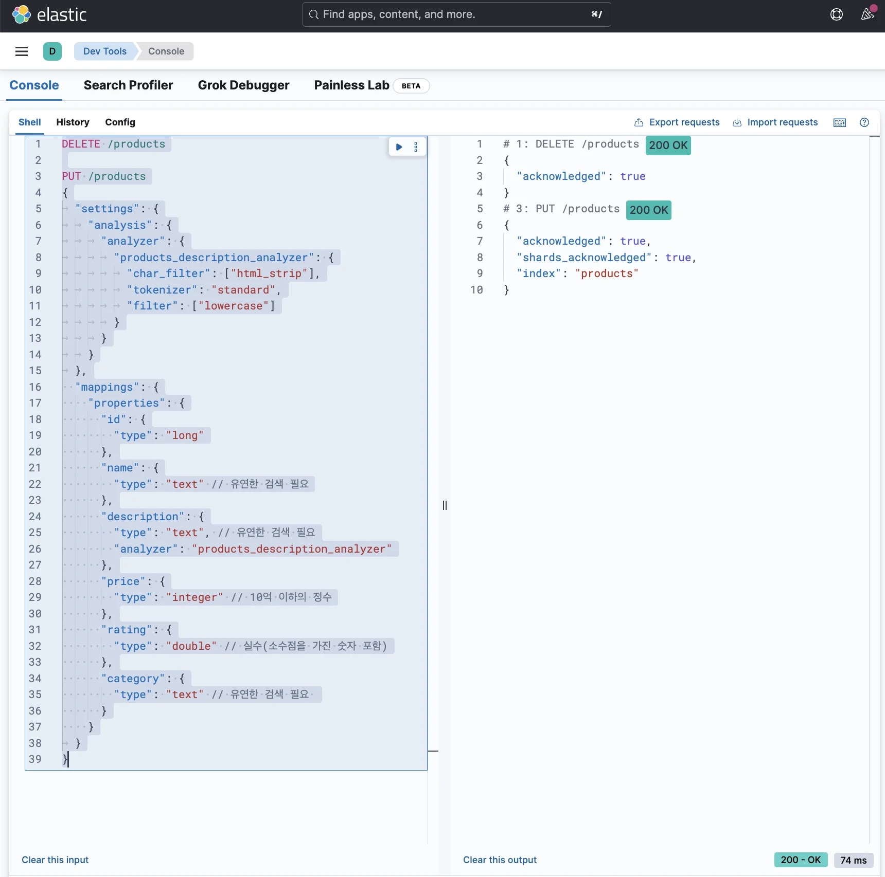

    <a id="34deda9b0fe1809a900ccbc3e6e55017"></a>

    기존 인덱스에 설정되어 있는 Analyzer의 구성 요소를 수정하려면 인덱스를 재생성해야 한다

    - 기존 인덱스 삭제 → 인덱스 재생성

- <strong>Analyze API를 통한 디버깅</strong>
    <a id="34deda9b0fe180938fbcd83ccc94ac02"></a>

    ```java
    GET /products/_analyze
    {
      "field": "description",
      "text": "<h1>상품 설명</h1>"
    }
    ```

    <a id="34deda9b0fe18098813add3f93ce6ca0"></a>

    <strong>응답값</strong>

    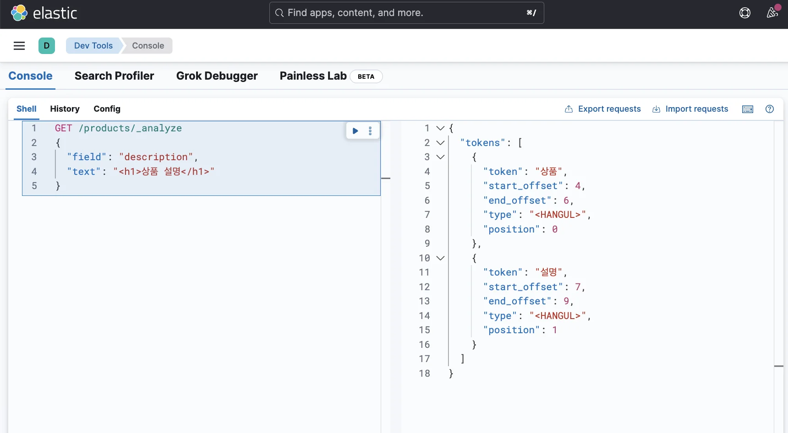

    <a id="34deda9b0fe180a38fb5f81eae1aeeaf"></a>

    ```java
    {
      "tokens": [
        {
          "token": "상품",
          "start_offset": 4,
          "end_offset": 6,
          "type": "<HANGUL>",
          "position": 0
        },
        {
          "token": "설명",
          "start_offset": 7,
          "end_offset": 9,
          "type": "<HANGUL>",
          "position": 1
        }
      ]
    }
    ```

    <a id="34deda9b0fe180f0a27cdff6700b595c"></a>

     HTML 태그가 제거되어 토큰이 저장된 것을 확인할 수 있다&#46;

</details>

<details>
<summary><strong>4&#46; 통합 테스트</strong></summary>

- <strong>테스트 데이터 삽입</strong>
    <a id="34deda9b0fe180c58dc4fc8e20f1002f"></a>

    ```java
    POST /products/_doc
    {
      "id": 1,
      "name": "Samsung TV",
      "description": "<strong>The Best TV</strong>",
      "price": 10000,
      "rating": 5.0,
      "category": "Home"
    }
    ```

    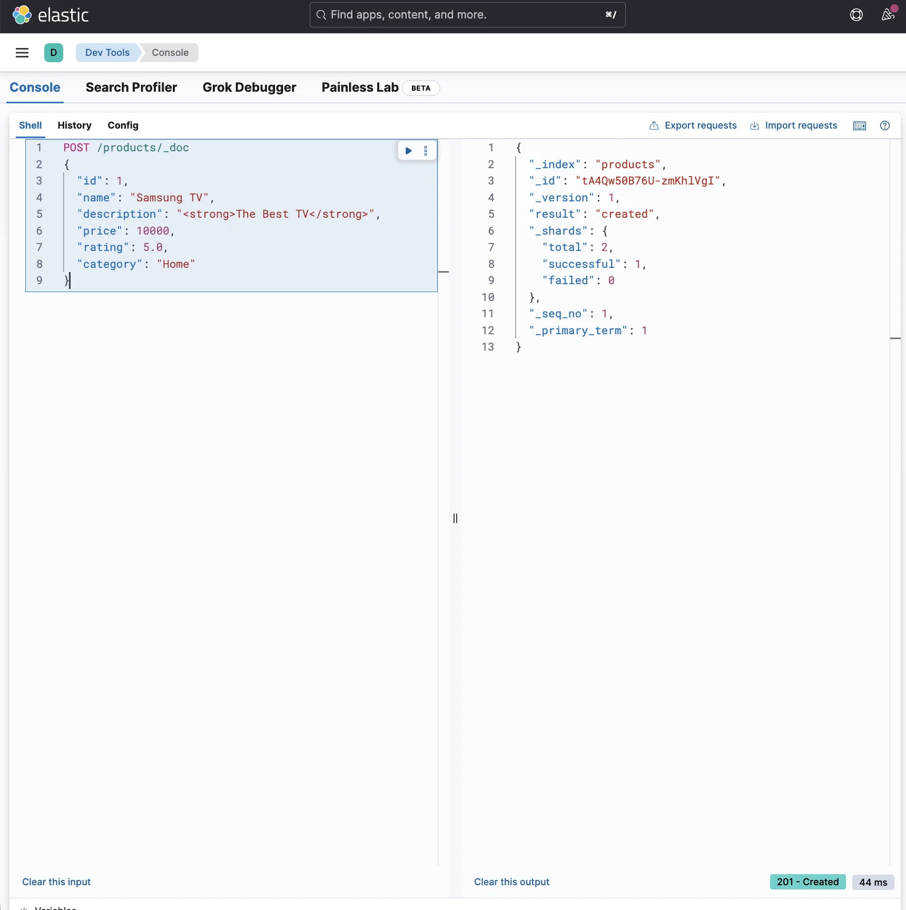

- <strong>검색</strong>
    > ✏️ 
    > 
    > <a id="34deda9b0fe180e5a89dd4b3f496bd62"></a>
    > 
    > 요구사항에 맞게 잘 구현된 것을 확인할 수 있다&#46; 
    > 
    > - [x] 대소문자와 상관없이 검색
    > 
    > - [x] 단어의 순서와 상관없이 검색
    > 
    > - [x] HTML 태그로 검색했을 때 검색

    <a id="34deda9b0fe180fe8434f4cfe9c0eb9f"></a>

    <strong>대소문자 섞어서 검색해보기 &#43; 단어의 순서에 상관없이 검색해보기</strong>

    <a id="34deda9b0fe180928c0afbd120b81e72"></a>

    ```java
    GET /products/_search
    {
      "query": {
        "multi_match": {
          "query": "tv SAMSUNG",
          "fields": [
            "name^3",
            "description^1",
            "category^2"
          ]
        }
      }
    }
    ```

    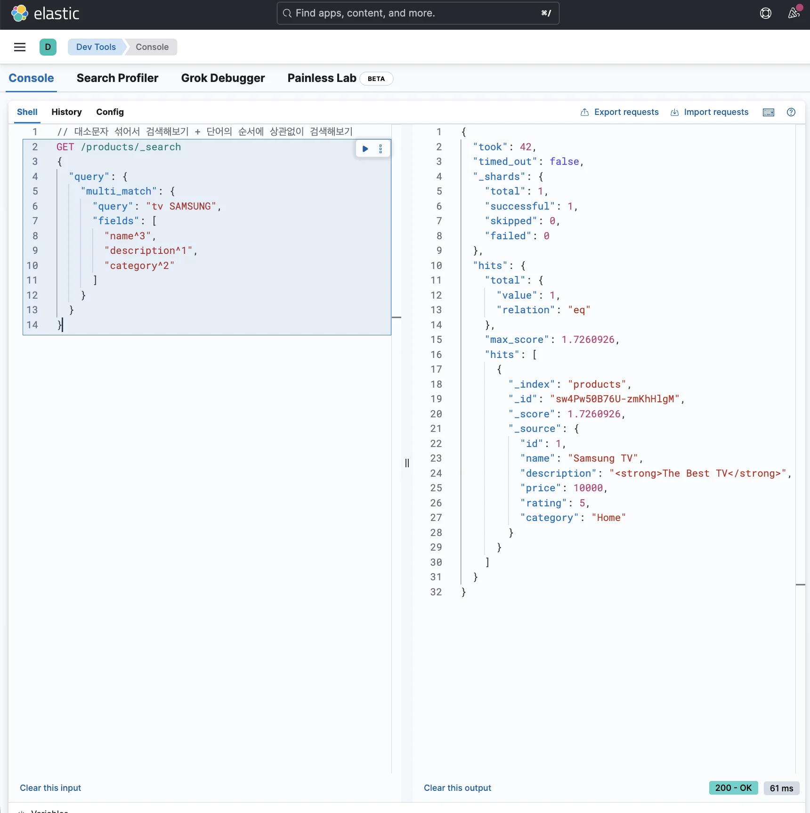

    <a id="34deda9b0fe1808fa3e9d527b09cca96"></a>

    <strong>HTML 태그로 검색해보기</strong>

    <a id="34deda9b0fe1806cb023e6091b106b43"></a>

    ```java
    GET /products/_search
    {
      "query": {
        "multi_match": {
          "query": "strong",
          "fields": [
            "name^3",
            "description^1",
            "category^2"
          ]
        }
      }
    }
    ```

    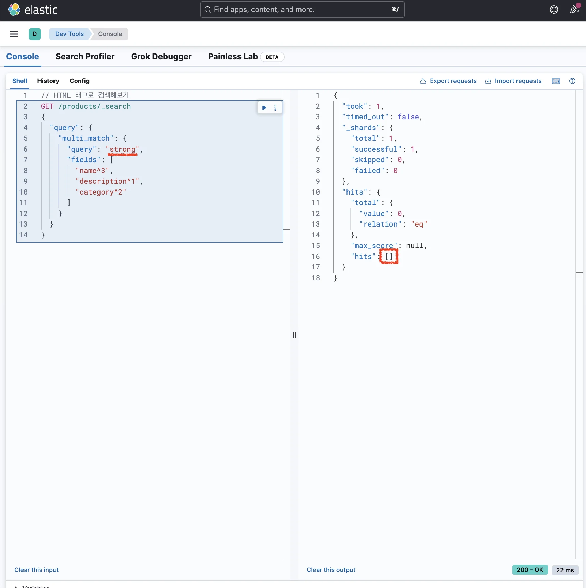

</details>

<a id="34deda9b0fe180b492fbfe284f1b47da"></a>

### 3&#46; 한글, 영어 검색 / 동의어 기반 검색 / 필터링

> ✅ 
> 
> <a id="34deda9b0fe18037a178f6a47d161d83"></a>
> 
> <strong>요구사항</strong>
> 
> - [ ] 한글, 영어 둘 다 검색이 잘 돼야 한다&#46; 
> 
> - [ ] <code>상품명</code>에 대해서는 아래 값을 동의어로 인식할 수 있어야 한다&#46; 
>     <a id="34deda9b0fe180b9af61c17beab55347"></a>
> 
>     ```json
>     samsung, 삼성
>     apple, 애플
>     노트북, 랩탑, 컴퓨터, computer, laptop, notebook
>     전화기, 휴대폰, 핸드폰, 스마트폰, 휴대전화, phone, smartphone, mobile phone, cell phone
>     아이폰, iphone
>     맥북, 맥, macbook, mac
>     ```
> 
> - [ ] 카테고리(<code>category</code>), 가격(<code>price</code>)으로 필터링을 할 수 있어야 한다&#46; 
>     - 특정 카테고리 내에서만 검색할 수 있어야 한다&#46; 
> 
>     - 특정 가격 범위 내에서만 검색할 수 있어야 한다&#46; 

<details>
<summary><strong>1&#46; 한글, 영어 둘 다 검색이 잘 되도록 만들기&#58; </strong><strong><code>Nori Analyzer</code></strong></summary>

> ✏️ 
> 
> <a id="34deda9b0fe1800b9916c9d0813fa77d"></a>
> 
> <strong><u>한글을 적절한 토큰으로 분리</u></strong>하기 위해서는 <strong><code>Nori Analyzer</code></strong>를 사용해야 한다&#46;
> 
> - <a href="#/post/348eda9b-0fe1-80db-8fe1-de321f68e376">페이지</a> 

- <strong><code>Nori Analyzer</code></strong>
    <a id="34deda9b0fe18065bac7ea5ea5531193"></a>

    ```json
    // 방법 1
    "analyzer": "nori"

    // 방법 2 (nori analyzer의 구성을 직접 명시)
    "char_filter": [], 
    "tokenizer": "nori_tokenizer", 
    "filter": ["nori_part_of_speech", "nori_readingform", "lowercase"]
    ```

    <a id="34deda9b0fe1801da735f8d25b4d9b34"></a>

    기존 Nori Analyzer의 구성을 요구사항에 맞게 커스텀해서 사용하려면 2번째 방법을 사용해야 한다&#46; 

- <strong>인덱스 재생성 &#45; Nori Analyzer 적용</strong>
    <a id="34deda9b0fe180898904c0ac78423791"></a>

    ```json
    DELETE /products

    PUT /products
    {
      "settings": {
        "analysis": {
          // 커스텀 애널라이저 정의
          "analyzer": {
            "products_name_analyzer": {
              "char_filter": [],
              "tokenizer": "nori_tokenizer",
              "filter": ["nori_part_of_speech", "nori_readingform", "lowercase"]
            },
            "products_description_analyzer": {
              "char_filter": ["html_strip"],
              "tokenizer": "nori_tokenizer",
              "filter": ["nori_part_of_speech", "nori_readingform", "lowercase"]
            },
            "products_category_analyzer": {
              "char_filter": [],
              "tokenizer": "nori_tokenizer",
              "filter": ["nori_part_of_speech", "nori_readingform", "lowercase"]
            }
          }
        }
      },
      "mappings": {
        "properties": {
          "id": {
            "type": "long"
          },
          "name": {
            "type": "text", // 유연한 검색 필요
            "analyzer": "products_name_analyzer"
          },
          "description": {
            "type": "text", // 유연한 검색 필요
            "analyzer": "products_description_analyzer"
          },
          "price": {
            "type": "integer" // 10억 이하의 정수
          },
          "rating": {
            "type": "double" // 실수(소수점을 가진 숫자 포함)
          },
          "category": {
            "type": "text", // 유연한 검색 필요 
            "analyzer": "products_category_analyzer"
          }
        }
      }
    }
    ```

    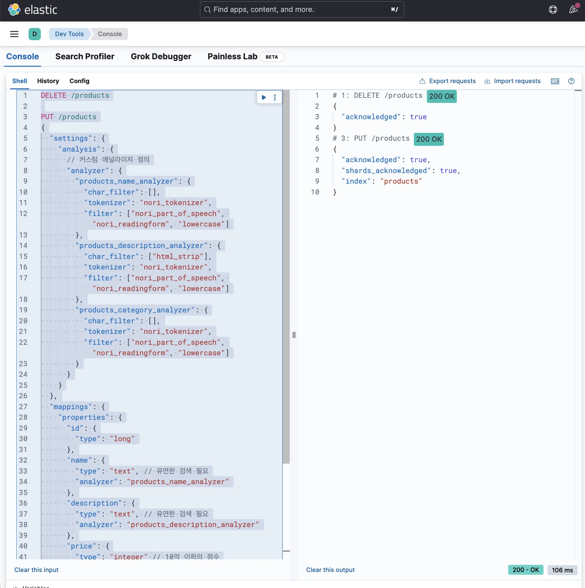

- <strong>Analyze API를 통한 디버깅</strong>
    <a id="34deda9b0fe180a4ae9fc2e80ecb5c62"></a>

    ```json
    GET /products/_analyze
    {
      "field": "name",
      "text": "특수가전제품 Samsung TV"
    }
    ```

    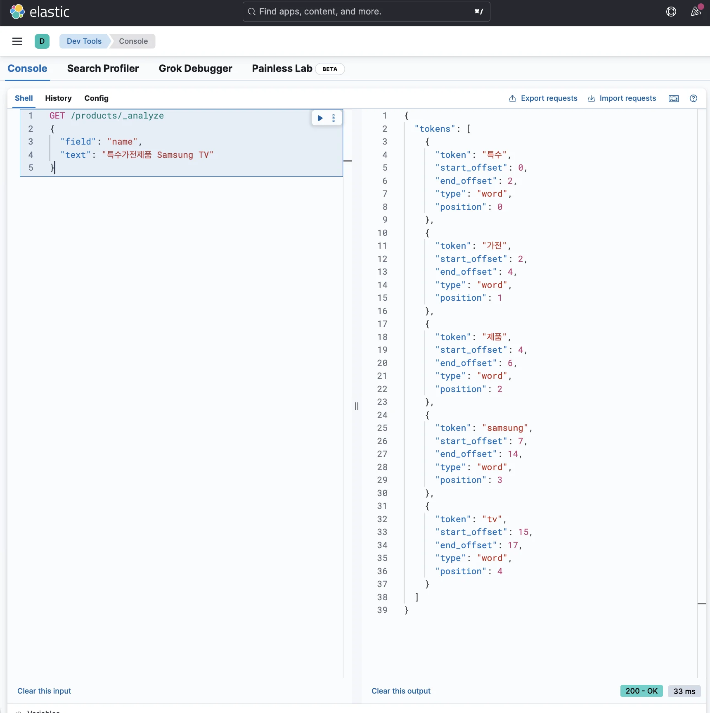

    <a id="34deda9b0fe180e5b764d5879e07dc6b"></a>

    ```json
    GET /products/_analyze
    {
      "field": "description",
      "text": "<h1>특수가전제품 Samsung TV</h1>"
    }
    ```

    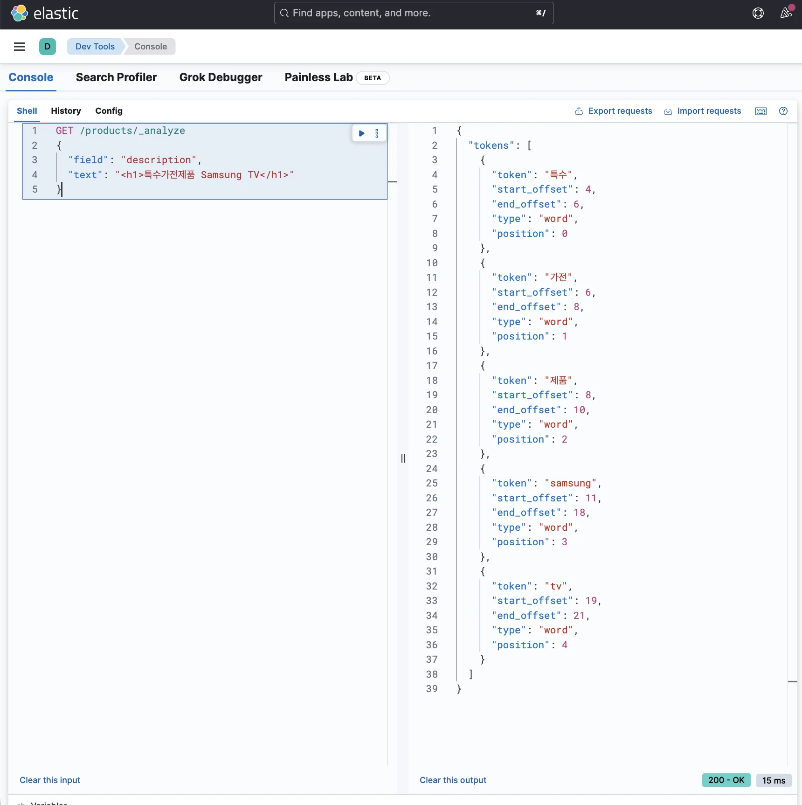

    <a id="34deda9b0fe18040be18d7d86b713325"></a>

    ```json
    GET /products/_analyze
    {
      "field": "category",
      "text": "특수가전제품 Samsung TV"
    }
    ```

    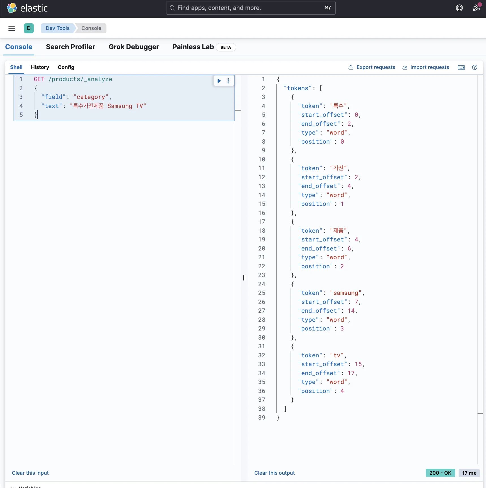

</details>

<details>
<summary><strong>2&#46; 동의어로 검색할 수 있게 만들기&#58; </strong><strong><code>synonym</code></strong></summary>

- <strong>인덱스 재생성 &#45; </strong><strong><code>커스텀 필터 정의 &#45; synonym</code></strong>
    <a id="34deda9b0fe1804fa903f5fcee4b9006"></a>

    ```json
    DELETE /products

    PUT /products
    {
      "settings": {
        "analysis": {
    		  // 필터 정의
    		  "filter": {
            "product_synonyms": {
              "type": "synonym",
              "synonyms": [
                "samsung, 삼성",
    						"apple, 애플",
    						"노트북, 랩탑, 컴퓨터, computer, laptop, notebook",
    						"전화기, 휴대폰, 핸드폰, 스마트폰, 휴대전화, phone, smartphone, mobile phone, cell phone",
    						"아이폰, iphone",
    						"맥북, 맥, macbook, mac"
              ]
            }
          },
    		  
          // 커스텀 애널라이저 정의
          "analyzer": {
            "products_name_analyzer": {
              "char_filter": [],
              "tokenizer": "nori_tokenizer",
              "filter": [
                "nori_part_of_speech", 
                "nori_readingform", 
                "lowercase",
                "product_synonyms"
              ]
            },
            "products_description_analyzer": {
              "char_filter": ["html_strip"],
              "tokenizer": "nori_tokenizer",
              "filter": [
                "nori_part_of_speech", 
                "nori_readingform", 
                "lowercase"
              ]
            },
            "products_category_analyzer": {
              "char_filter": [],
              "tokenizer": "nori_tokenizer",
              "filter": [
                "nori_part_of_speech", 
                "nori_readingform", 
                "lowercase"
              ]
            }
          }
        }
      },
      "mappings": {
        "properties": {
          "id": {
            "type": "long"
          },
          "name": {
            "type": "text", // 유연한 검색 필요
            "analyzer": "products_name_analyzer"
          },
          "description": {
            "type": "text", // 유연한 검색 필요
            "analyzer": "products_description_analyzer"
          },
          "price": {
            "type": "integer" // 10억 이하의 정수
          },
          "rating": {
            "type": "double" // 실수(소수점을 가진 숫자 포함)
          },
          "category": {
            "type": "text", // 유연한 검색 필요 
            "analyzer": "products_category_analyzer"
          }
        }
      }
    }
    ```

    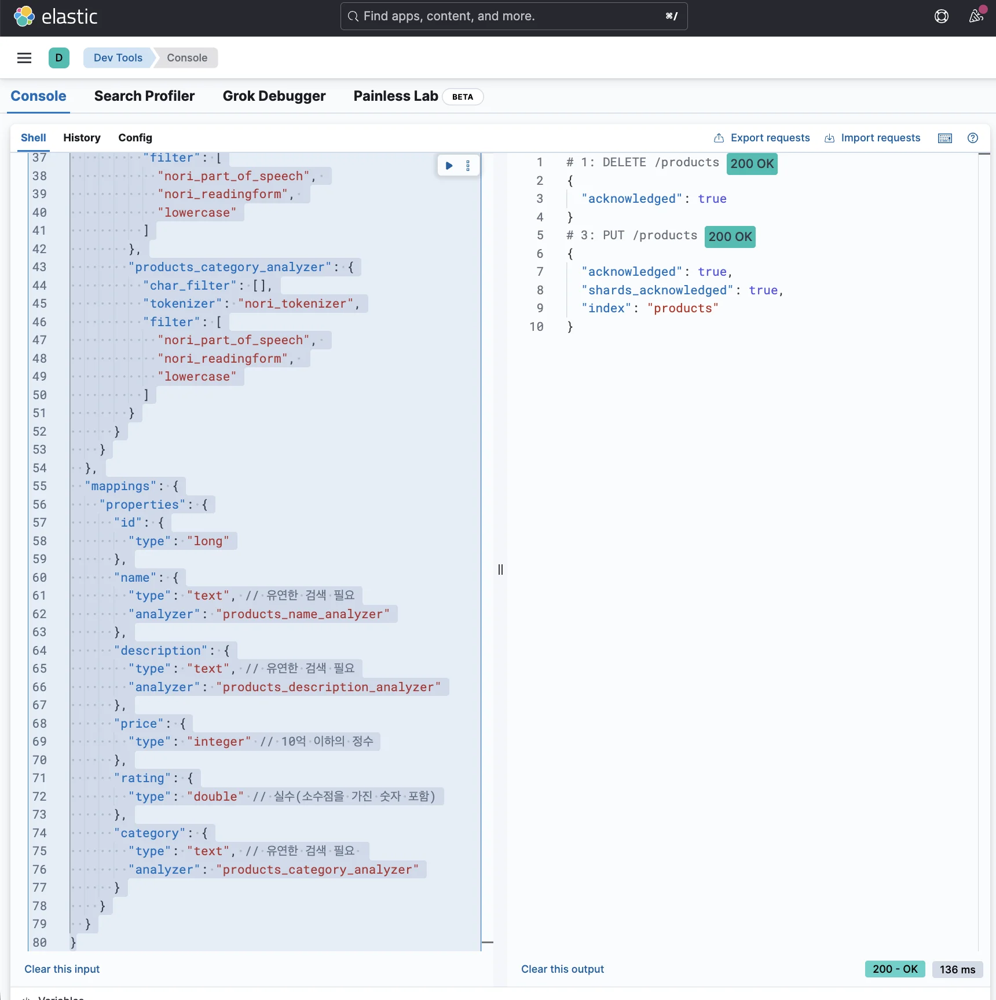

- <strong>Analyze API를 통한 디버깅</strong>
    <a id="34deda9b0fe180f0b34ec6d3a932dfb1"></a>

    ```json
    GET /products/_analyze
    {
      "field": "name",
      "text": "삼성 애플 노트북 전화기 아이폰 맥북"
    }
    ```

    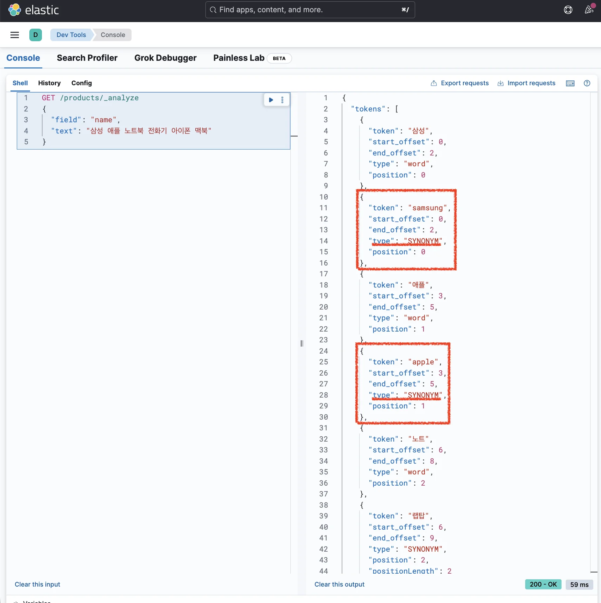

    - 동의어로 설정한 값들이 같이 토큰으로 저장되는 것을 확인할 수 있다&#46; 

</details>

<details>
<summary><strong>3&#46; 필터링&#58; </strong><strong><code>가격</code></strong></summary>

<details>
<summary><strong>기존 검색 쿼리</strong></summary>

<a id="34deda9b0fe18077b635c9b1d13da49f"></a>

```json
POST /products/_search
{
  "query": {
    "multi_match": {
      "query": "lg",
      "fields": [
        "name^3",
        "description^1",
        "category^2"
      ]
    }
  }
}
```

</details>

- <strong>가격(price)으로 필터링</strong>
    <a id="34deda9b0fe18041b54bf9f84e3e97fb"></a>

    ```json
    POST /products/_search
    {
      "query": {
        "bool": { // 2가지 이상의 조건을 적용시켜야 할 때
          "must": { // score와 관련 있는 쿼리 (유연한 검색 필요)
            "multi_match": {
              "query": "lg",
              "fields": [
                "name^3",
                "description^1",
                "category^2"
              ]
            }
          },
          "filter": { // score와 관련 없는 쿼리 (정확한 값 비교 필요)
            "range": {
              "price": {
                "gte": 10000,
                "lte": 50000
              }
            }
          }
        }
      }
    }
    ```

</details>

<details>
<summary><strong>4&#46; 필터링&#58; </strong><strong><code>카테고리</code></strong></summary>

> ✏️ 
> 
> <a id="34deda9b0fe18070b862d33f84dd3c0c"></a>
> 
> category를 기준으로 필터링 시, 정확히 일치하는 값으로 비교해 필터링을 해야하기 떄문에 keyword 타입으로 선언해야 한다&#46; 
> 
> <a id="34deda9b0fe180d9a792f8c757b15dca"></a>
> 
> 따라서 서브 타입으로 keyword를 선언하여 필터링을 구현한다&#46; 
> 
> - 자세한 내용&#58; <a href="#/post/34aeda9b-0fe1-80b2-b492-c7de5628351d">페이지</a> 

- <strong>인덱스 재생성 &#45; category </strong><strong><code>multi&#45;fields(text, keyword)</code></strong> 적용
    <a id="34deda9b0fe1809ca85cde36d7155033"></a>

    ```json
    DELETE /products

    PUT /products
    {
      "settings": {
        "analysis": {
    		  // 필터 정의
    		  "filter": {
            "product_synonyms": {
              "type": "synonym",
              "synonyms": [
                "samsung, 삼성",
    						"apple, 애플",
    						"노트북, 랩탑, 컴퓨터, computer, laptop, notebook",
    						"전화기, 휴대폰, 핸드폰, 스마트폰, 휴대전화, phone, smartphone, mobile phone, cell phone",
    						"아이폰, iphone",
    						"맥북, 맥, macbook, mac"
              ]
            }
          },
    		  
          // 커스텀 애널라이저 정의
          "analyzer": {
            "products_name_analyzer": {
              "char_filter": [],
              "tokenizer": "nori_tokenizer",
              "filter": [
                "nori_part_of_speech", 
                "nori_readingform", 
                "lowercase",
                "product_synonyms"
              ]
            },
            "products_description_analyzer": {
              "char_filter": ["html_strip"],
              "tokenizer": "nori_tokenizer",
              "filter": [
                "nori_part_of_speech", 
                "nori_readingform", 
                "lowercase"
              ]
            },
            "products_category_analyzer": {
              "char_filter": [],
              "tokenizer": "nori_tokenizer",
              "filter": [
                "nori_part_of_speech", 
                "nori_readingform", 
                "lowercase"
              ]
            }
          }
        }
      },
      "mappings": {
        "properties": {
          "id": {
            "type": "long"
          },
          "name": {
            "type": "text", // 유연한 검색 필요
            "analyzer": "products_name_analyzer"
          },
          "description": {
            "type": "text", // 유연한 검색 필요
            "analyzer": "products_description_analyzer"
          },
          "price": {
            "type": "integer" // 10억 이하의 정수
          },
          "rating": {
            "type": "double" // 실수(소수점을 가진 숫자 포함)
          },
          "category": {
            "type": "text", // 유연한 검색 필요 
            "analyzer": "products_category_analyzer",
            // 멀티 필드로 keyword 타입을 추가
            "fields": {
              "raw": {
                "type": "keyword"
              }
            }
          }
        }
      }
    }
    ```

    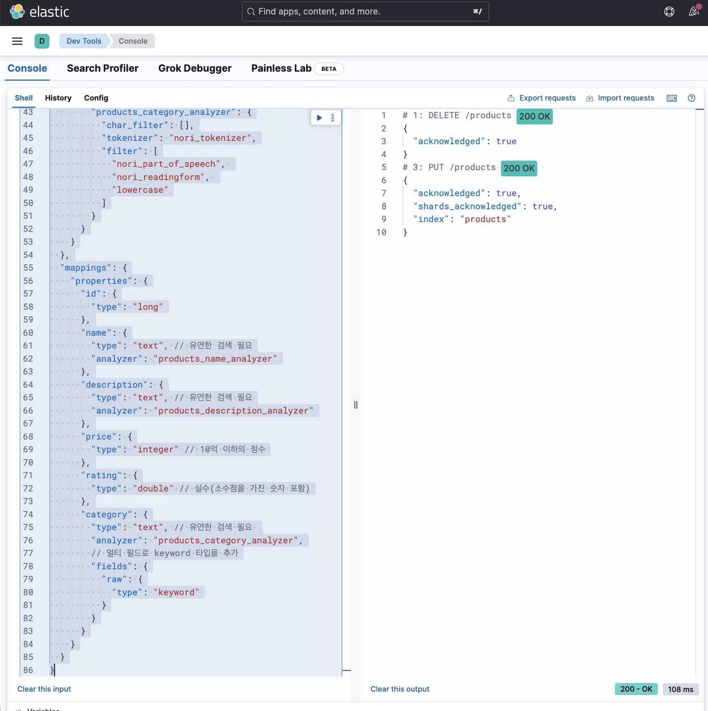

- <strong>테스트를 위한 더미 데이터 생성</strong>
    <a id="34deda9b0fe1802092a0cc67b1f8ba3b"></a>

    ```json
    POST /products/_doc
    {
      "id": 1,
      "name": "LG OLED TV 42인치",
      "description": "<p>선명한 화질의 LG OLED TV입니다.</p>",
      "price": 3000,
      "rating": 4.8,
      "category": "가전제품"
    }

    POST /products/_doc
    {
      "id": 2,
      "name": "LG 냉장고 300L",
      "description": "<p>신선함을 오래 유지하는 LG 냉장고</p>",
      "price": 49000,
      "rating": 4.5,
      "category": "가전제품"
    }

    POST /products/_doc
    {
      "id": 3,
      "name": "삼성 냉장고",
      "description": "<p>삼성의 최신 기술이 적용된 냉장고</p>",
      "price": 20000,
      "rating": 4.7,
      "category": "가전제품"
    }

    POST /products/_doc
    {
      "id": 4,
      "name": "LG 스마트폰",
      "description": "<p>LG의 최신 스마트폰 모델</p>",
      "price": 25000,
      "rating": 4.2,
      "category": "휴대전화"
    }
    ```

    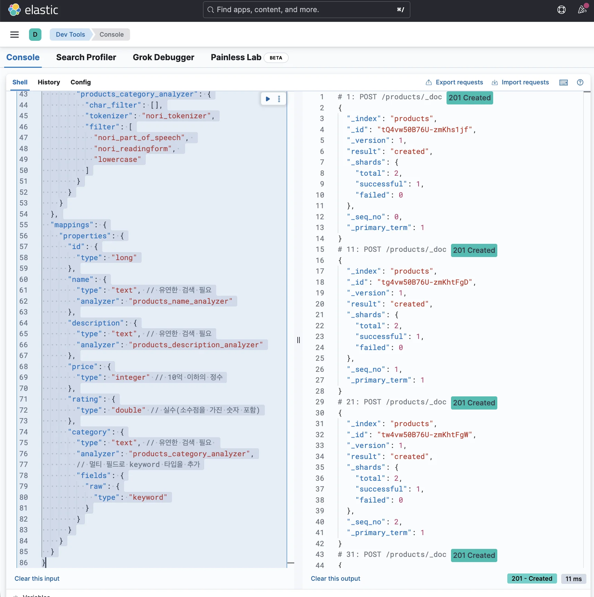

- <strong>Analyze API를 통한 디버깅</strong>
    <a id="34deda9b0fe180d69d0df685940467f9"></a>

    ```json
    POST /products/_search
    {
      "query": {
        "bool": {
          "must": {
            "multi_match": {
              "query": "LG",
              "fields": [
                "name^3",
                "description^1",
                "category^2"
              ]
            }
          },
          "filter": [
            {
              "term": {
                "category.raw": "가전제품"
              }
            },
            {
              "range": {
                "price": {
                  "gte": 10000,
                  "lte": 50000
                }
              }
            }
          ]
        }
      }
    }
    ```

    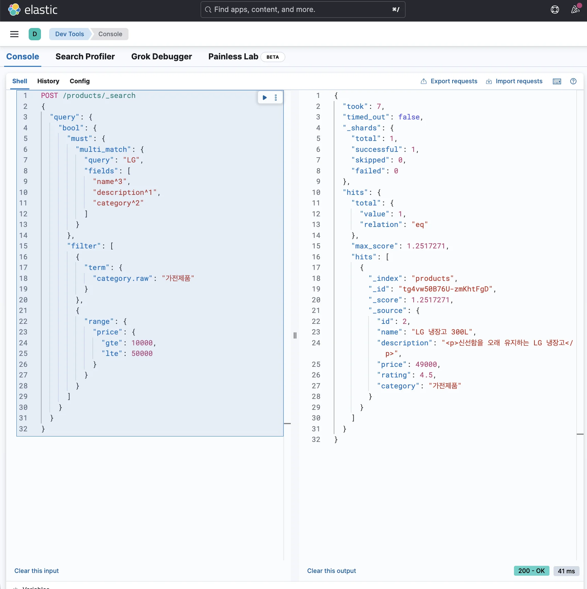

</details>

<a id="34deda9b0fe1803892bef37b01ac508c"></a>

### 4&#46; 특정 조건 상위 노출 / 오타 허용 검색 / 하이라이팅 처리 / 페이지네이션

> ✅ 
> 
> <a id="34deda9b0fe1800d80b0ee321c9ba27a"></a>
> 
> <strong>요구사항</strong>
> 
> - [ ] 되도록이면 검색 결과 중 평점이 4&#46;0이 넘는 상품을 상위에 노출시킬 수 있도록 한다&#46;
> 
> - [ ] 검색어에 어느 정도 오타가 있더라도 유사한 상품을 조회할 수 있어야 한다&#46; 
>     - ex) <code>samsung notebook</code>이라는 상품을 <code>simsung notebook</code>이라고 검색해도 조회가 돼야 한다&#46; 
> 
> - [ ] <code>상품명</code>에서 일치하는 검색 키워드는 하이라이팅 처리( <code>&#60;b&#62;&#60;/b&#62;</code>)를 해야 한다&#46;
> 
> - [ ] 상품이 5개씩 조회되도록 페이지네이션 해야 한다&#46; 

<details>
<summary><strong>1&#46; 평점이 4&#46;0이 넘는 상품을 우선적으로 상위 노출시키기&#58; </strong><strong><code>shoud</code></strong></summary>

<a id="34deda9b0fe180bfa152c3567aec8c9b"></a>

<strong><code>shoud</code></strong><strong> 사용하여 검색</strong>

<a id="34deda9b0fe1800c9412d34fdf4df5e7"></a>

```json
GET /products/_search
{
  "query": {
    "bool": {
      "must": {
        "multi_match": {
          "query": "LG 냉장고",
          "fields": [
            "name^3",
            "description^1",
            "category^2"
          ]
        }
      },
      "filter": [
        {
          "term": {
            "category.raw": "가전제품"
          }
        },
        {
          "range": {
            "price": {
              "gte": 10000,
              "lte": 50000
            }
          }
        }
      ],
      "should": [
        {
          "range": {
            "rating": {
              "gt": 4.0
            }
          }
        }
      ]
    }
  }
}
```

</details>

<details>
<summary><strong>2&#46; 어느 정도 오타가 있더라도 검색되도록 하기&#58; </strong><strong><code>fuzziness</code></strong></summary>

<a id="34deda9b0fe180c7a6b9dd6757fd01b8"></a>

```json
GET /products/_search
{
  "query": {
    "bool": {
      "must": {
        "multi_match": {
          "query": "마전제품",
          "fields": [
            "name^3",
            "description^1",
            "category^2"
          ],
          "fuzziness": "AUTO"
        }
      },
      "filter": [
        {
          "term": {
            "category.raw": "가전제품"
          }
        },
        {
          "range": {
            "price": {
              "gte": 10000,
              "lte": 50000
            }
          }
        }
      ],
      "should": [
        {
          "range": {
            "rating": {
              "gt": 4.0
            }
          }
        }
      ]
    }
  }
}
```

</details>

<details>
<summary><strong>3&#46; </strong><strong><code>상품명</code></strong><strong>에서 일치하는 검색 키워드 하이라이팅 처리( </strong><strong><code>&#60;b&#62;&#60;/b&#62;</code></strong><strong>)&#58; </strong><strong><code>highlight</code></strong></summary>

<a id="34deda9b0fe180698fb2fc235abaf304"></a>

```json
GET /products/_search
{
  "query": {
    "bool": {
      "must": {
        "multi_match": {
          "query": "삼성",
          "fields": [
            "name^3",
            "description^1",
            "category^2"
          ],
          "fuzziness": "AUTO"
        }
      },
      "filter": [
        {
          "term": {
            "category.raw": "가전제품"
          }
        },
        {
          "range": {
            "price": {
              "gte": 10000,
              "lte": 50000
            }
          }
        }
      ],
      "should": [
        {
          "range": {
            "rating": {
              "gt": 4.0
            }
          }
        }
      ]
    }
  },
  "highlight": {
    "fields": {
      "name": {
        "pre_tags": ["<b>"],
        "post_tags": ["</b>"]
      }
    }
  }
}
```

</details>

<details>
<summary><strong>4&#46;  상품 5개씩 조회하도록 페이지네이션 처리&#58; </strong><strong><code>from</code></strong><strong>, </strong><strong><code>size</code></strong></summary>

<a id="34deda9b0fe1809eab01fa9d42062522"></a>

```json
GET /products/_search
{
  "query": {
    "bool": {
      "must": {
        "multi_match": {
          "query": "삼성",
          "fields": [
            "name^3",
            "description^1",
            "category^2"
          ],
          "fuzziness": "AUTO"
        }
      },
      "filter": [
        {
          "term": {
            "category.raw": "가전제품"
          }
        },
        {
          "range": {
            "price": {
              "gte": 10000,
              "lte": 50000
            }
          }
        }
      ],
      "should": [
        {
          "range": {
            "rating": {
              "gt": 4.0
            }
          }
        }
      ]
    }
  },
  "highlight": {
    "fields": {
      "name": {
        "pre_tags": ["<b>"],
        "post_tags": ["</b>"]
      }
    }
  },
  "from": 0, // 몇 번째 데이터부터 조회할 건지 = (페이지 번호 - 1) x size
  "size": 5 // 페이지당 몇 개의 데이터를 조회할 지
}
```

</details>

<a id="34deda9b0fe180ebb077f9779b5e1afa"></a>

### 5&#46; 자동 완성 기능

> ✅ 
> 
> <a id="34deda9b0fe1801694caff164a3821b7"></a>
> 
> <strong>요구사항</strong>
> 
> - [ ] <code>상품명</code>으로만 자동 완성이 되도록 해야 한다&#46; 
> 
> - [ ] 자동 완성 결과가 5개만 조회되도록 설정해야 한다

<details>
<summary><strong>1&#46; 자동 완성 기능 구현&#58; </strong><strong><code>search&#95;as&#95;you&#95;type</code></strong></summary>

- <strong>인덱스 재생성 &#45; name 필드 multi&#45;fields 적용</strong>
    <a id="34deda9b0fe1809ebbaed45b520255d9"></a>

    ```json
    DELETE /products

    PUT /products
    {
      "settings": {
        "analysis": {
    		  // 필터 정의
    		  "filter": {
            "product_synonyms": {
              "type": "synonym",
              "synonyms": [
                "samsung, 삼성",
    						"apple, 애플",
    						"노트북, 랩탑, 컴퓨터, computer, laptop, notebook",
    						"전화기, 휴대폰, 핸드폰, 스마트폰, 휴대전화, phone, smartphone, mobile phone, cell phone",
    						"아이폰, iphone",
    						"맥북, 맥, macbook, mac"
              ]
            }
          },
    		  
          // 커스텀 애널라이저 정의
          "analyzer": {
            "products_name_analyzer": {
              "char_filter": [],
              "tokenizer": "nori_tokenizer",
              "filter": [
                "nori_part_of_speech", 
                "nori_readingform", 
                "lowercase",
                "product_synonyms"
              ]
            },
            "products_description_analyzer": {
              "char_filter": ["html_strip"],
              "tokenizer": "nori_tokenizer",
              "filter": [
                "nori_part_of_speech", 
                "nori_readingform", 
                "lowercase"
              ]
            },
            "products_category_analyzer": {
              "char_filter": [],
              "tokenizer": "nori_tokenizer",
              "filter": [
                "nori_part_of_speech", 
                "nori_readingform", 
                "lowercase"
              ]
            }
          }
        }
      },
      "mappings": {
        "properties": {
          "id": {
            "type": "long"
          },
          "name": {
            "type": "text", // 유연한 검색 필요
            "analyzer": "products_name_analyzer",
            // 멀티 필드로 search_as_you_type 타입을 추가
            "fields": {
              "auto_complete": {
                "type": "search_as_you_type",
                "analyzer": "nori"
              }
            }
          },
          "description": {
            "type": "text", // 유연한 검색 필요
            "analyzer": "products_description_analyzer"
          },
          "price": {
            "type": "integer" // 10억 이하의 정수
          },
          "rating": {
            "type": "double" // 실수(소수점을 가진 숫자 포함)
          },
          "category": {
            "type": "text", // 유연한 검색 필요 
            "analyzer": "products_category_analyzer",
            // 멀티 필드로 keyword 타입을 추가
            "fields": {
              "raw": {
                "type": "keyword"
              }
            }
          }
        }
      }
    }
    ```

- <strong>테스트를 위한 더미 데이터 생성</strong>
    <a id="34deda9b0fe1803aa490d22c744e1673"></a>

    ```json
    POST /products/_doc
    {
      "id": 1,
      "name": "삼성 스마트 TV 65인치",
      "description": "<p>선명한 화질과 뛰어난 스마트 기능을 갖춘 삼성 TV입니다.</p>",
      "price": 4500,
      "rating": 4.6,
      "category": "가전제품"
    }

    POST /products/_doc
    {
      "id": 2,
      "name": "삼성 스마트 냉장고",
      "description": "<p>스마트 기능과 대용량 저장공간을 제공하는 삼성 냉장고입니다.</p>",
      "price": 5000,
      "rating": 4.7,
      "category": "가전제품"
    }
    ```

- <strong>테스트 &#45; 자동 완성 기능</strong>
    <a id="34deda9b0fe180e6bba5d1efac72e4e7"></a>

    ```json
    GET /products/_search
    {
      "query": {
        "multi_match": {
          "query": "삼", // 삼, 삼성, 삼성 스
          "type": "bool_prefix", 
          "fields": [
            "name.auto_complete",
            "name.auto_complete._2gram",
            "name.auto_complete._3gram"
          ]
        }
      }
    }

    GET /products/_search
    {
      "query": {
        "multi_match": {
          "query": "스", // 스, 스마, 스마트
          "type": "bool_prefix", 
          "fields": [
            "name.auto_complete",
            "name.auto_complete._2gram",
            "name.auto_complete._3gram"
          ]
        }
      }
    }
    ```

- 페이지네이션 적용&#58; <code>size&#58; 5</code>
    <a id="34deda9b0fe180f7b134e4a9ad9edd4a"></a>

    ```json
    POST /products/_search
    {
      "query": {
        "multi_match": {
          "query": "삼", // 삼, 삼성, 삼성 스
          "type": "bool_prefix", 
          "fields": [
            "name.auto_complete",
            "name.auto_complete._2gram",
            "name.auto_complete._3gram"
          ]
        }
      },
      "size": 5
    }
    ```

</details>

<a id="34deda9b0fe180559c49dd860ab38b63"></a>

### 6&#46; 최종 쿼리

- <strong>인덱스 및 매핑 정의</strong>
    <a id="34deda9b0fe18033befaef9913589a40"></a>

    ```json
    DELETE /products

    PUT /products
    {
      "settings": {
        "analysis": {
    		  // 필터 정의
    		  "filter": {
            "product_synonyms": {
              "type": "synonym",
              "synonyms": [
                "samsung, 삼성",
    						"apple, 애플",
    						"노트북, 랩탑, 컴퓨터, computer, laptop, notebook",
    						"전화기, 휴대폰, 핸드폰, 스마트폰, 휴대전화, phone, smartphone, mobile phone, cell phone",
    						"아이폰, iphone",
    						"맥북, 맥, macbook, mac"
              ]
            }
          },
    		  
          // 커스텀 애널라이저 정의
          "analyzer": {
            "products_name_analyzer": {
              "char_filter": [],
              "tokenizer": "nori_tokenizer",
              "filter": [
                "nori_part_of_speech", 
                "nori_readingform", 
                "lowercase",
                "product_synonyms"
              ]
            },
            "products_description_analyzer": {
              "char_filter": ["html_strip"],
              "tokenizer": "nori_tokenizer",
              "filter": [
                "nori_part_of_speech", 
                "nori_readingform", 
                "lowercase"
              ]
            },
            "products_category_analyzer": {
              "char_filter": [],
              "tokenizer": "nori_tokenizer",
              "filter": [
                "nori_part_of_speech", 
                "nori_readingform", 
                "lowercase"
              ]
            }
          }
        }
      },
      "mappings": {
        "properties": {
          "id": {
            "type": "long"
          },
          "name": {
            "type": "text", // 유연한 검색 필요
            "analyzer": "products_name_analyzer",
            // 멀티 필드로 search_as_you_type 타입을 추가
            "fields": {
              "auto_complete": {
                "type": "search_as_you_type",
                "analyzer": "nori"
              }
            }
          },
          "description": {
            "type": "text", // 유연한 검색 필요
            "analyzer": "products_description_analyzer"
          },
          "price": {
            "type": "integer" // 10억 이하의 정수
          },
          "rating": {
            "type": "double" // 실수(소수점을 가진 숫자 포함)
          },
          "category": {
            "type": "text", // 유연한 검색 필요 
            "analyzer": "products_category_analyzer",
            // 멀티 필드로 keyword 타입을 추가
            "fields": {
              "raw": {
                "type": "keyword"
              }
            }
          }
        }
      }
    }
    ```

- <strong>검색 기능</strong>
    <a id="34deda9b0fe18057a365fb56e5843cc4"></a>

    ```json
    GET /products/_search
    {
      "query": {
        "bool": {
          "must": {
            "multi_match": {
              "query": "_____",
              "fields": [
                "name^3",
                "description^1",
                "category^2"
              ],
              "fuzziness": "AUTO"
            }
          },
          "filter": [
            {
              "term": {
                "category.raw": "______"
              }
            },
            {
              "range": {
                "price": {
                  "gte": _____,
                  "lte": _____
                }
              }
            }
          ],
          "should": [
            {
              "range": {
                "rating": {
                  "gt": 4.0
                }
              }
            }
          ]
        }
      },
      "highlight": {
        "fields": {
          "name": {
            "pre_tags": ["<b>"],
            "post_tags": ["</b>"]
          }
        }
      },
      "from": 0, 
      "size": 5 
    }
    ```

- <strong>자동 완성 기능</strong>
    <a id="34deda9b0fe180bf8c3ed63aeeb2581a"></a>

    ```json
    POST /products/_search
    {
      "query": {
        "multi_match": {
          "query": "________",
          "type": "bool_prefix", 
          "fields": [
            "name.auto_complete",
            "name.auto_complete._2gram",
            "name.auto_complete._3gram"
          ]
        }
      },
      "size": 5
    }
    ```

<a id="34deda9b0fe1802ca0a9f3f58b287b2b"></a>

## &#91;구현&#93; 검색 기능 2 &#45;Spring Boot에 맞게 구현

[GitHub &#45; JSCODE&#45;EDU/elasticsearch&#45;coupang&#45;project at final]()

<a id="34deda9b0fe180f48560ebd170507162"></a>

### 1&#46; Spring Boot에서 <code>products</code> 인덱스에 맞는 Document 정의

<details>
<summary><strong>1&#46; Elasticsearch 의존성 추가</strong></summary>

<a id="34deda9b0fe18059b9e1f0c82bdf47f5"></a>

<strong>build&#46;gradle</strong>

<a id="34deda9b0fe180ba9986edff844a8bfe"></a>

```groovy
...

dependencies {
    implementation 'org.springframework.boot:spring-boot-starter-data-jpa'
    implementation 'org.springframework.boot:spring-boot-starter-web'
    implementation 'org.springframework.boot:spring-boot-starter-data-elasticsearch'
    developmentOnly 'org.springframework.boot:spring-boot-devtools'
    runtimeOnly 'com.mysql:mysql-connector-j'
    testImplementation 'org.springframework.boot:spring-boot-starter-test'
    testRuntimeOnly 'org.junit.platform:junit-platform-launcher'
}

...
```

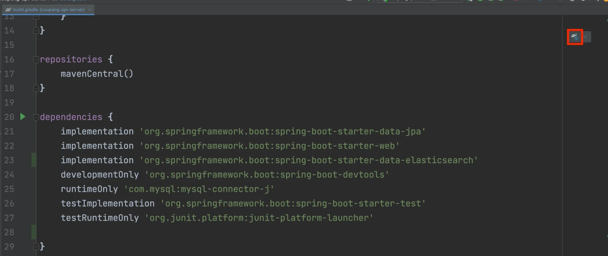

</details>

<details>
<summary><strong>2&#46; application&#46;yml에 Elasticsearch 연결을 위한 정보 작성</strong></summary>

<a id="34deda9b0fe1805c86b2f1b6148a525a"></a>

<strong>application&#46;yml </strong>

<a id="34deda9b0fe1808a94a2fcea4ee35e46"></a>

```yaml
spring:
  datasource:
    url: jdbc:mysql://localhost:3306/coupang
    username: root
    password: password123
    driver-class-name: com.mysql.cj.jdbc.Driver
  jpa:
    hibernate:
      ddl-auto: update
    show-sql: true
  elasticsearch:
    uris: http://localhost:9200
    
logging:
  level:
    org.elasticsearch.client: TRACE
```

</details>

<details>
<summary><strong>3&#46; Document 생성</strong></summary>

> ✏️ 
> 
> <a id="34deda9b0fe1807eb5c9cd68d0b1519c"></a>
> 
> Document 객체에 products 인덱스의 매핑(mapping) 정보 반영

<a id="34deda9b0fe180839003d181eb34a89f"></a>

<strong>ProductDocument</strong>

<a id="34deda9b0fe180a299a5f6cc477061e5"></a>

```java
@Document(indexName = "products") // products 인덱스 생성
@Setting(settingPath = "/elasticsearch/product-settings.json")
public class ProductDocument {
  @Id
  private String id;

  @MultiField(
		  mainField = @Field(
				  type = FieldType.Text, 
				  analyzer = "products_name_analyzer"),
      otherFields = {
          @InnerField(
		          suffix = "auto_complete",
		          type = FieldType.Search_As_You_Type,
		          analyzer = "nori")
      }
  )
  private String name;

  @Field(type = FieldType.Text, analyzer = "products_description_analyzer")
  private String description;

  @Field(type = FieldType.Integer)
  private Integer price;

  @Field(type = FieldType.Double)
  private Double rating;

  @MultiField(
		  mainField = @Field(
				  type = FieldType.Text, 
				  analyzer = "products_category_analyzer"),
      otherFields = {
          @InnerField(
		          suffix = "raw", 
		          type = FieldType.Keyword)
      }
  )
  private String category;
  
  public ProductDocument(Long id, String name, String description, Integer price, Double rating,
      String category) {
    this.id = id;
    this.name = name;
    this.description = description;
    this.price = price;
    this.rating = rating;
    this.category = category;
  }

  // getter, setter 메서드 ...
}
```

</details>

<details>
<summary><strong>4&#46; settings 파일 생성</strong></summary>

> ✏️ 
> 
> - json 형식의 파일로 만들어야 하기 때문에 주석을 전부 지운 채로 작성해야 한다&#46;
> 
> - <code>“settings”</code> 필드 안의 값만 작성해야 한다&#46;
>     - <code>”mappings&#34;</code> 정보는 Document 객체에 기입하기 때문에 적을 필요가 없다&#46;

<a id="34deda9b0fe180ef9868c8a56c0b4e0d"></a>

<strong>src/main/resources/elasticsearch/product&#45;settings&#46;json</strong>

<a id="34deda9b0fe180538ac3ef137408a779"></a>

```json
{
  "analysis": {
	  "filter": {
      "product_synonyms": {
        "type": "synonym",
        "synonyms": [
          "samsung, 삼성",
					"apple, 애플",
					"노트북, 랩탑, 컴퓨터, computer, laptop, notebook",
					"전화기, 휴대폰, 핸드폰, 스마트폰, 휴대전화, phone, smartphone, mobile phone, cell phone",
					"아이폰, iphone",
					"맥북, 맥, macbook, mac"
        ]
      }
    },
    "analyzer": {
      "products_name_analyzer": {
        "char_filter": [],
        "tokenizer": "nori_tokenizer",
        "filter": [
          "nori_part_of_speech", 
          "nori_readingform", 
          "lowercase",
          "product_synonyms"
        ]
      },
      "products_description_analyzer": {
        "char_filter": ["html_strip"],
        "tokenizer": "nori_tokenizer",
        "filter": [
          "nori_part_of_speech", 
          "nori_readingform", 
          "lowercase"
        ]
      },
      "products_category_analyzer": {
        "char_filter": [],
        "tokenizer": "nori_tokenizer",
        "filter": [
          "nori_part_of_speech", 
          "nori_readingform", 
          "lowercase"
        ]
      }
    }
  }
}
```

</details>

<details>
<summary><strong>5&#46; Elasticsearch Repository 생성</strong></summary>

> ⚠️ 
> 
> <a id="34deda9b0fe180349bb4f24ad039fd9c"></a>
> 
> <strong>최소 1개 이상의 ElasticsearchRepository가 존재해야, <br>Spring Boot를 실행시킬 때 Elasticsearch와 연결을 시도한다&#46; </strong>

<a id="34deda9b0fe180eca1edfc7b9be0cb6e"></a>

```java
public interface ProductDocumentRepository extends ElasticsearchRepository<ProductDocument, String> {
}
```

</details>

<details>
<summary><strong>6&#46; 테스트 </strong></summary>

<a id="34deda9b0fe180a0b8d4f08c41f72ff6"></a>

<strong>기존에 생성해둔 products 인덱스 삭제</strong>

<a id="34deda9b0fe18009ad50d6c9c6b10f17"></a>

```java
DELETE /products // 인덱스 삭제

GET /products // 잘 삭제됐는 지 확인
```

<a id="34deda9b0fe180da96cde7c5aa7c3d54"></a>

<strong>Spring Boot 프로젝트 실행</strong>

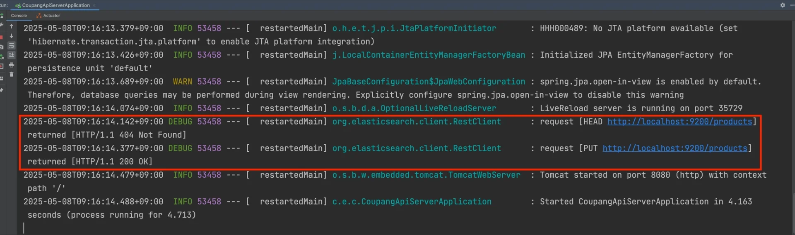

<a id="34deda9b0fe180b79b90ca80a2b1f141"></a>

로그를 통해  Document 객체에 정의한 내용대로 index가 생성된 것을 알 수 있다&#46; 

<a id="34deda9b0fe18092a571c71ba7654c1e"></a>

<strong>index 잘 생성됐는 지 kibana로 확인</strong>

<a id="34deda9b0fe180dbbd2de2f9e8ea92ff"></a>

```java
GET /products
```

</details>

<a id="34deda9b0fe1802c9a99d4313543d105"></a>

### 2&#46;  MySQL에 데이터 삽입/삭제 시 Elasticsearch에도 같이 반영 되도록 구현


<details>
<summary><strong>ProductService 구현</strong></summary>

[elasticsearch&#45;coupang&#45;project/src/main/java/com/example/coupangapiserver/product/ProductService&#46;java at final · JSCODE&#45;EDU/elasticsearch&#45;coupang&#45;project]()

<a id="34deda9b0fe18034ab68d9bc72a84b57"></a>

<strong>ProductDocumentRepository 의존성 추가</strong>

<a id="34deda9b0fe180e48abae89fa2a40cff"></a>

```java
@Service
public class ProductService {

  private final ProductRepository productRepository;
  private final ProductDocumentRepository productDocumentRepository;
  
  public ProductService(ProductRepository productRepository,
      ProductDocumentRepository productDocumentRepository) {
    this.productRepository = productRepository;
    this.productDocumentRepository = productDocumentRepository;
  }
  
```

<a id="34deda9b0fe1802b9469e2577982462c"></a>

<strong>상품 등록 로직 수정</strong>

<a id="34deda9b0fe18022b9dbdae20ebac234"></a>

```java
public Product createProduct(CreateProductRequestDto createProductRequestDto) {
	  Product product = new Product(
	      createProductRequestDto.getName(),
	      createProductRequestDto.getDescription(),
	      createProductRequestDto.getPrice(),
	      createProductRequestDto.getRating(),
	      createProductRequestDto.getCategory()
	  );
	  Product savedProduct = productRepository.save(product);
	
	  ProductDocument productDocument = new ProductDocument(
	      savedProduct.getId().toString(),
	      savedProduct.getName(),
	      savedProduct.getDescription(),
	      savedProduct.getPrice(),
	      savedProduct.getRating(),
	      savedProduct.getCategory()
	  );
	  
	  productDocumentRepository.save(productDocument);
	  
	  return savedProduct;
}
```

<a id="34deda9b0fe18018a3e6db30c5301f2d"></a>

<strong>상품 삭제 로직 수정</strong>

<a id="34deda9b0fe180e19c10d40dda3a7246"></a>

```java
 public void deleteProduct(Long id) {
	  productRepository.deleteById(id);
	  
	  productDocumentRepository.deleteById(id.toString());
}
```

</details>

<details>
<summary><strong>테스트 1&#46; 데이터 생성</strong></summary>

1. <strong>기존 데이터 삭제</strong>
    <details>
    <summary>테이블 삭제</summary>

    <a id="34deda9b0fe180658c5cc8160548a8f7"></a>

    <strong>기존 MySQL 테이블 삭제</strong>

    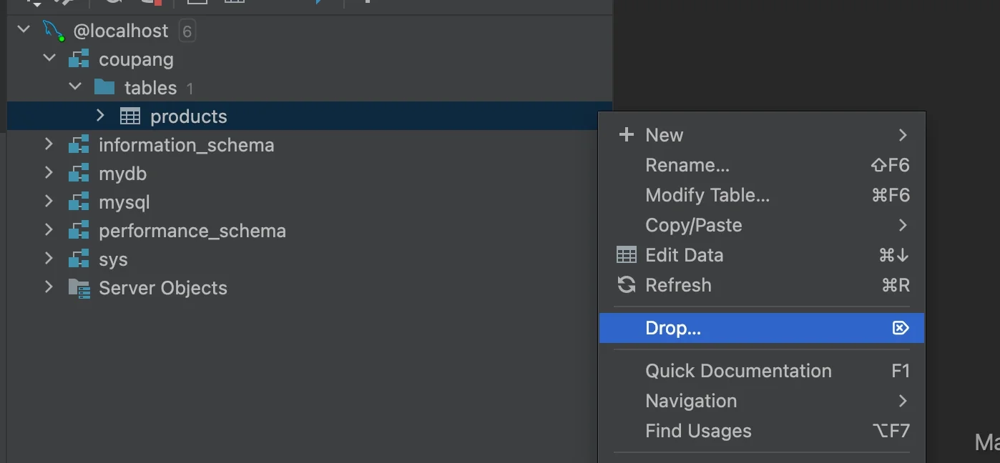

    </details>

    <details>
    <summary>인덱스 삭제</summary>

    <a id="34deda9b0fe18045878ccdb4df133455"></a>

    <strong>Kibana에서 Elasticsearch 인덱스 삭제</strong>

    <a id="34deda9b0fe180cba43ee2380c5dee67"></a>

    ```java
    DELETE /products
    ```

    </details>

1. <strong>Postman으로 데이터 생성</strong>
    <a id="34deda9b0fe1803ab30ae7288091732c"></a>

    ```json
    POST localhost:8080/products
    {
      "name": "삼성 갤럭시 S25",
      "description": "<h2>최신 스마트폰</h2><p>AI 기능과 강력한 배터리를 갖춘 프리미엄 스마트폰입니다.</p>",
      "price": 1290000,
      "rating": 4.8,
      "category": "ELECTRONICS"
    }
    ```

    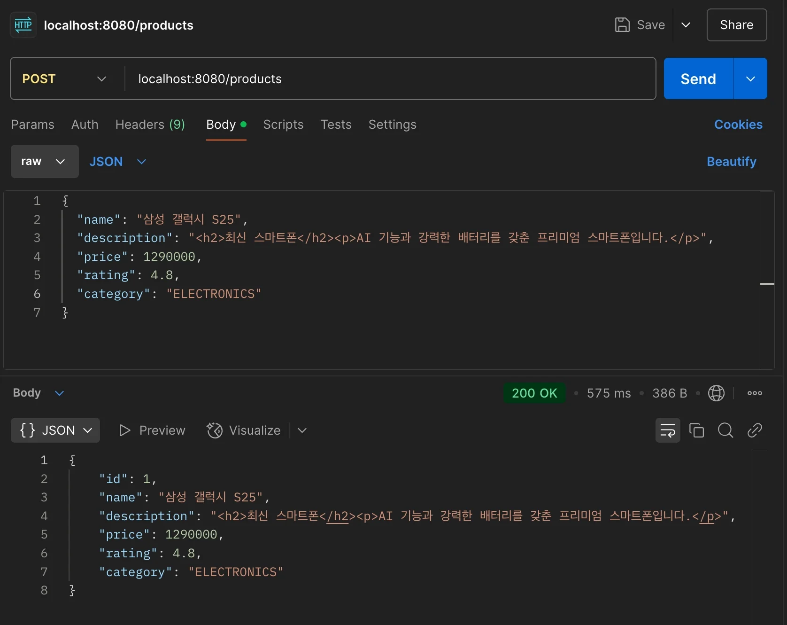

1. <strong> 정상 생성 확인</strong>
    <a id="34deda9b0fe180dbb5b6f4a4db174854"></a>

    <strong>MySQL (Datagrip)</strong>

    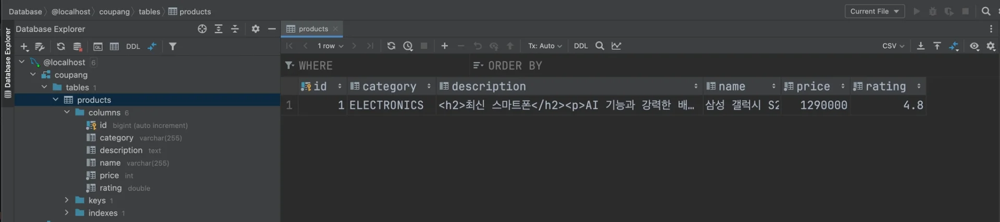

    <a id="34deda9b0fe1807cad46ff8b33e26c50"></a>

    <strong>Elasticsearch (Kibana)</strong>

    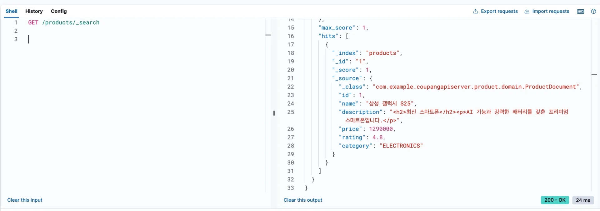

</details>

<details>
<summary><strong>테스트 2&#46; 데이터 삭제</strong></summary>

1. <strong>Postman으로 데이터 생성</strong>
    <a id="34deda9b0fe1802b8bf2cf0251c3df2a"></a>

    ```json
    DELETE localhost:8080/products/1
    ```

    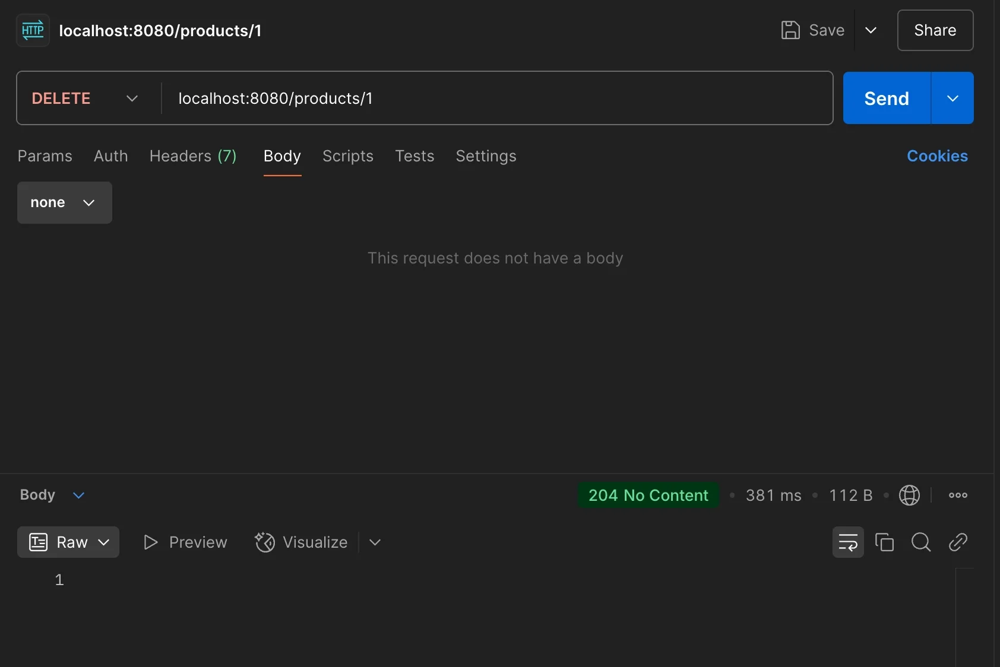

1. <strong> 정상 삭제 확인</strong>
    <a id="34deda9b0fe1809d99d1f3587b203133"></a>

    <strong>MySQL (Datagrip)</strong>

    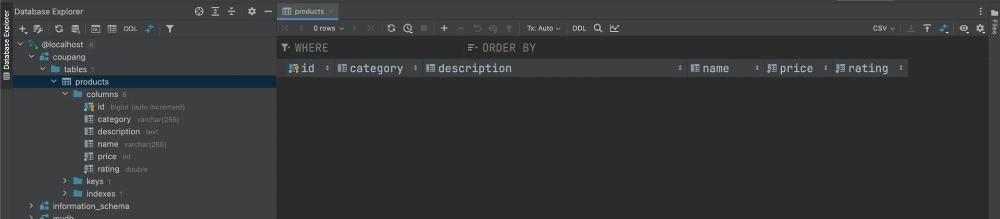

    <a id="34deda9b0fe180f2992ef9d72edeebe8"></a>

    <strong>Elasticsearch (Kibana)</strong>

    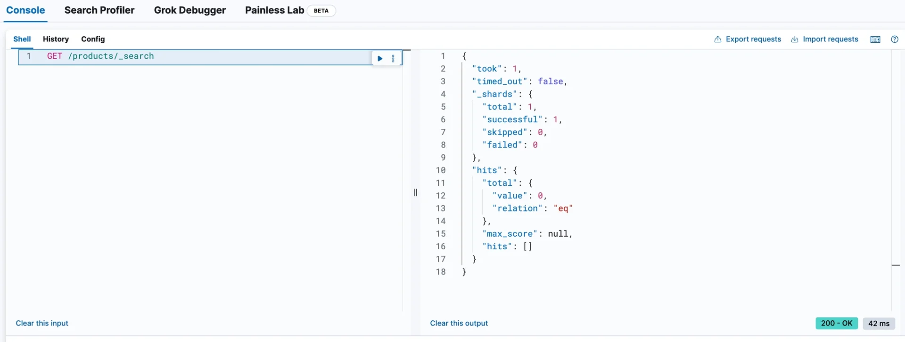

</details>

<a id="34deda9b0fe1801eb259e23a1d913bf6"></a>

### 3&#46; Spring Boot에서 Elasticsearch 활용해 자동완성 API 구현

<details>
<summary><strong>자동완성 API  구현</strong></summary>

1. <strong>Controller에 API 추가</strong>
    <a id="34deda9b0fe18014b773d1a838554672"></a>

    <strong>ProductController</strong>

    <a id="34deda9b0fe1803da5d3dcd9b9b055a2"></a>

    ```java
    @RestController
    @RequestMapping("products")
    public class ProductController {
    		...
    		
    		@GetMapping("/suggestions")
        public ResponseEntity<List<String>> getSuggestions(@RequestParam String query) {
            List<String> suggestions = productService.getSuggestions(query);
            return ResponseEntity.ok(suggestions);
        }
    		
    		...
    }
    ```

1. <strong>Service에 의존성 추가하기</strong>
    <a id="34deda9b0fe180c1a0f8e85986c04a2c"></a>

    <strong>ProductService</strong>

    <a id="34deda9b0fe180149e2afe4ad0495fe1"></a>

    ```java
    @Service
    public class ProductService {

      private final ProductRepository productRepository;
      private final ProductDocumentRepository productDocumentRepository;
      private final ElasticsearchOperations elasticsearchOperations;

      public ProductService(ProductRepository productRepository,
          ProductDocumentRepository productDocumentRepository,
          ElasticsearchOperations elasticsearchOperations) {
        this.productRepository = productRepository;
        this.productDocumentRepository = productDocumentRepository;
        this.elasticsearchOperations = elasticsearchOperations;
      }
      
      ...
    }
    ```

1. <strong>Service에 해당하는 비지니스 로직 정의</strong>
    <a id="34deda9b0fe180809f41c261d582418f"></a>

    <strong>ProductService</strong>

    <a id="34deda9b0fe1801f8008e9e68c9cbec7"></a>

    ```java
    @Service
    public class ProductService {
    		...

    		public List<String> getSuggestions(String query) {
    			  Query multiMatchQuery = MultiMatchQuery.of(m -> m
    			      .query(query)
    			      .type(TextQueryType.BoolPrefix)
    			      .fields("name.auto_complete", "name.auto_complete._2gram", "name.auto_complete._3gram")
    			  )._toQuery();
    			
    			  NativeQuery nativeQuery = NativeQuery.builder()
    			      .withQuery(multiMatchQuery)
    			      .withPageable(PageRequest.of(0, 5))
    			      .build();
    			
    			  SearchHits<ProductDocument> searchHits = this.elasticsearchOperations.search(nativeQuery, ProductDocument.class);
    			  return searchHits.getSearchHits().stream()
    			      .map(hit -> {
    			        ProductDocument productDocument = hit.getContent();
    			        return productDocument.getName();
    			      })
    			      .toList();
        }
    		
    		...
    		
    }
    ```

</details>

<details>
<summary><strong>테스트를 위한 더미 데이터 생성</strong></summary>

<a id="34deda9b0fe180b8bf32d42c145d1a3a"></a>

```json
POST localhost:8080/products
{
  "name": "곱창 돌김생김",
  "description": "신선한 곱창김으로 만든 전통 방식의 돌김입니다.",
  "price": 3900,
  "rating": 4.5,
  "category": "식품"
}
```

<a id="34deda9b0fe180cfa211f4b0cd07e1f9"></a>

```json
POST localhost:8080/products
{
  "name": "구운 돌김",
  "description": "불에 구워 바삭한 식감을 살린 프리미엄 돌김.",
  "price": 4500,
  "rating": 4.7,
  "category": "식품"
}
```

<a id="34deda9b0fe1806dae69e777daea4773"></a>

```json
POST localhost:8080/products
{
  "name": "완도 곱창 돌김 100매",
  "description": "완도산 곱창김 100매 구성, 김밥용으로 적합.",
  "price": 12900,
  "rating": 4.8,
  "category": "식품"
}
```

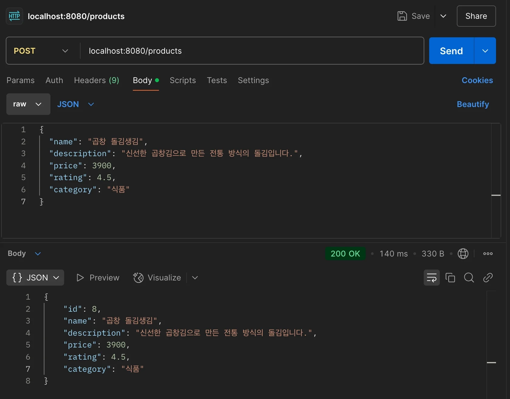

</details>

<details>
<summary><strong>Postman 수동 테스트</strong></summary>

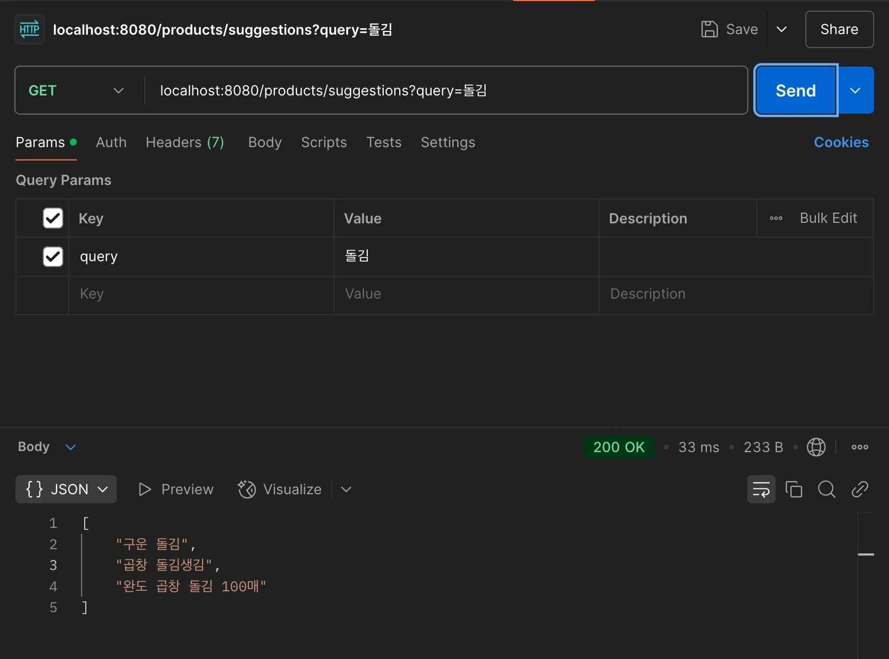

<a id="34deda9b0fe180e3b4e4ef950a315a50"></a>

<code>돌</code>, <code>돌김</code>, <code>곱</code>, <code>곱창</code>으로 요청을 보냈을 때 자동 완성 API의 응답값이 잘 날라오는 걸 확인할 수있다&#46; 

</details>

<a id="34deda9b0fe1804f9517f9ead9a91dc6"></a>

### 4&#46; Spring Boot에서 Elasticsearch 활용해 검색 API 구현

<details>
<summary><strong>검색 API 구현</strong></summary>

1. <strong>Controller에 API 추가</strong>
    <a id="34deda9b0fe180a5ada0f58f34819428"></a>

    <strong>ProductController</strong>

    <a id="34deda9b0fe18008ad56ecd4bf0526ff"></a>

    ```java
    @RestController
    @RequestMapping("products")
    public class ProductController {
    		...
    		
    		@GetMapping("/search")
        public ResponseEntity<List<ProductDocument>> searchProducts(
            @RequestParam String query,
            @RequestParam(required = false) String category,
            @RequestParam(defaultValue = "0") double minPrice,
            @RequestParam(defaultValue = "1000000000") double maxPrice,
            @RequestParam(defaultValue = "1") int page,
            @RequestParam(defaultValue = "5") int size
        ) {
            List<ProductDocument> products = productService.searchProducts(query, category, minPrice, maxPrice, page, size);
            return ResponseEntity.ok(products);
        }
    		
    		...
    }
    ```

1. <strong>Service에 해당하는 비지니스 로직 정의</strong>
    <a id="34deda9b0fe18082beebce83ab5044ea"></a>

    <strong>ProductService</strong>

    <a id="34deda9b0fe18038a37df3ff13d7e0f2"></a>

    ```java
    @Service
    public class ProductService {
    		...

    		public List<ProductDocument> searchProducts(
          String query,
          String category,
          double minPrice,
          double maxPrice,
          int page,
          int size
      ) {

        // multi_match 쿼리
        Query multiMatchQuery = MultiMatchQuery.of(m -> m
            .query(query)
            .fields("name^3", "description^1", "category^2")
            .fuzziness("AUTO")
        )._toQuery();

        // term filter 쿼리 : 카테고리가 정확히 일치하는 것만 필터링
        List<Query> filters = new ArrayList<>();
        if (category != null && !category.isEmpty()) {
          Query categoryFilter = TermQuery.of(t -> t
              .field("category.raw")
              .value(category)
          )._toQuery();
          filters.add(categoryFilter);
        }

        // range filter: 가격 범위 필터
        Query priceRangeFilter = NumberRangeQuery.of(r -> r
            .field("price")
            .gte(minPrice)
            .lte(maxPrice)
        )._toRangeQuery()._toQuery();
        filters.add(priceRangeFilter);

        // should: rating > 4.0
        Query ratingShould = NumberRangeQuery.of(r -> r
            .field("rating")
            .gt(4.0)
        )._toRangeQuery()._toQuery();

        // bool query 조합
        Query boolQuery = BoolQuery.of(b -> b
            .must(multiMatchQuery)
            .filter(filters)
            .should(ratingShould)
        )._toQuery();

        // Highlight Query 생성
        HighlightParameters highlightParameters = HighlightParameters.builder()
            .withPreTags("<b>")
            .withPostTags("</b>")
            .build();
        Highlight highlight = new Highlight(highlightParameters, List.of(new HighlightField("name")));
        HighlightQuery highlightQuery = new HighlightQuery(highlight, ProductDocument.class);

        // NativeQuery 생성
        NativeQuery nativeQuery = NativeQuery.builder()
            .withQuery(boolQuery)
            .withHighlightQuery(highlightQuery)
            .withPageable(PageRequest.of(page - 1, size))
            .build();

        // 쿼리 실행
        SearchHits<ProductDocument> searchHits = this.elasticsearchOperations.search(nativeQuery, ProductDocument.class);
        return searchHits.getSearchHits().stream()
            .map(hit -> {
              ProductDocument productDocument = hit.getContent();
              String highlightedName = hit.getHighlightField("name").get(0);
              productDocument.setName(highlightedName);
              return productDocument;
            })
            .toList();
      }
    		
    		...
    		
    }
    ```

</details>

<details>
<summary><strong>테스트를 위한 더미 데이터 생성</strong></summary>

<a id="34deda9b0fe180d3a0a5fa44c604fa12"></a>

```json
POST localhost:8080/products
{
  "name": "삼성 노트북 13인치",
  "description": "최신형 삼성 노트북입니다.",
  "price": 1200000,
  "rating": 4.6,
  "category": "전자제품"
}
```

<a id="34deda9b0fe180c5b872e9b4293ca062"></a>

```json
POST localhost:8080/products
{
  "name": "삼성 노트북 최신형 15인치",
  "description": "2025년 최신 15인치 노트북입니다.",
  "price": 2200000,
  "rating": 4.8,
  "category": "전자제품"
}
```

<a id="34deda9b0fe180298372db5e6eb25295"></a>

```json
POST localhost:8080/products
{
  "name": "삼성 스마트폰 A17",
  "description": "최신형 스마트폰, 휴대전화",
  "price": 1500000,
  "rating": 4.5,
  "category": "휴대폰"
}
```

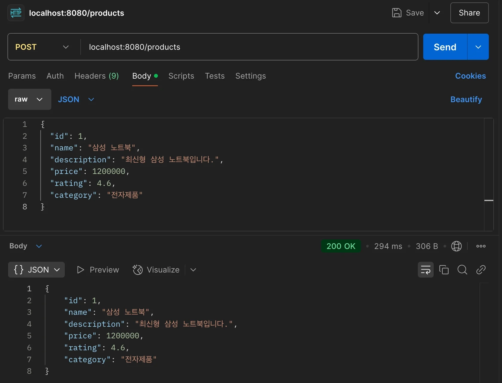

</details>

<details>
<summary><strong>Postman 수동 테스트</strong></summary>

> 💬 
> 
> <a id="34deda9b0fe18079a5e3dbf900534cd0"></a>
> 
> <strong> </strong>만약 테스트 코드를 작성할 수 있는 역량을 갖고 있다면, 테스트 코드를 작성하는 것이 더 좋다&#46; 더 간편하고 명확하게 테스트 가능하다&#46;

> 요구사항의 모든 내용을 다 테스트해보진 않고 몇 가지만 간단하게 테스트해보자&#46; 

1. <code>삼성</code>으로 검색해보기
    <a id="34deda9b0fe1807bb05dee7f1d9a7487"></a>

    ```plaintext
    http://localhost:8080/products/search?query=삼성
    ```

    - 키워드에 맞게 잘 검색이 된다&#46; 

1. 카테고리 필터링 추가해보기
    <a id="34deda9b0fe180fdb72ed8445d8d08c5"></a>

    ```plaintext
    http://localhost:8080/products/search?category=전자제품&query=삼성
    ```

    - 카테고리에 맞는 데이터만 조회가 된다&#46; 

1. 가격 범위 필터링 추가해보기
    <a id="34deda9b0fe180c28b06c833bbc04844"></a>

    ```plaintext
    http://localhost:8080/products/search?category=전자제품&minPrice=0&maxPrice=1500000&query=삼성
    ```

    - 가격 범위에 해당하는 데이터만 조회가 된다&#46; 

1. <code>samsung</code>으로 검색해보기
    <a id="34deda9b0fe1804daadbc0b092170c59"></a>

    ```plaintext
    http://localhost:8080/products/search?category=전자제품&minPrice=0&maxPrice=1500000&query=samsung
    ```

    - 동의어로도 잘 검색이 된다&#46; 

</details>
