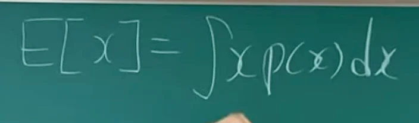
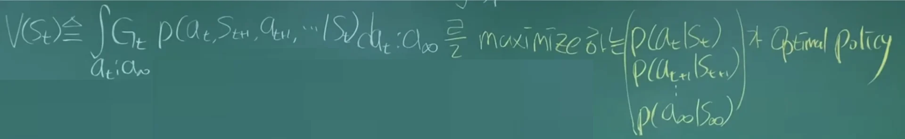
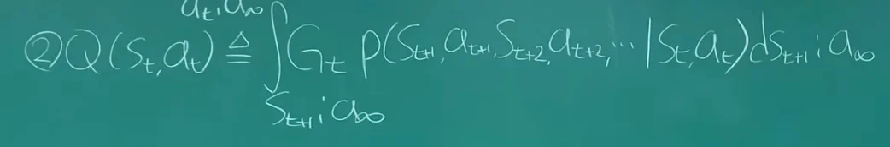

[&#91;강화학습&#93; 2&#45;2강&#46; 상태 가치 함수 V &#38; 행동 가치 함수 Q &#38; Optimal policy 쉬운 설명]()

마르코프 의사결정 과정의 목표는 보상의 평균값을 최대로 값을 찾는 것이다&#46;

그리고 이러한 <strong><u>Expectation Return(보상의 평균값)을 잘 표현</u></strong>하는 방법이 <code>상태 가치 함수(State Value function)</code>, <code>행동 가치 함수(Action value function</code>)이다&#46; 

### &#91;사전 개념&#93;

- x의 평균 값은 도함수의 적분과 같다&#46; 

- Return의 합인 <code class="language-math">G&#95;t</code> 는 위와 같다&#46; 

- <code class="language-math">&#92;gamma</code> (discount factor)는  0 과 1 사이의 값을 가지며,  크기에 따라 과거의 보상에 대한 반영 정도를 정한다&#46; 

### <code>상태 가치 함수(State Value function)</code>

<strong>지금부터 기대되는 Return</strong>

- 현재 state가 주어져 있을 때 Return의 평균을 계산하는 것이다&#46; 

#### <code>Optimal Policy (최적의 정책)</code>

state value function의 값 즉, 지금부터 기대되는 return의 최대로(maximize)하는 정책에 대해서 말한다&#46; 

- 과거는 고려하지 않음

### <code>행동 가치 함수(Action value function)</code>

<strong>지금 행동으로부터 기대되는 Return</strong>

행동에 대해서 점수를 매기는 것
