

## MRP에서 state가 주어졌을 때 얻게 되는 평균 보상 (<code class="language-math">R&#95;s = E&#91;R&#95;{t&#43;1} &#124; S&#95;t = s&#93;</code>)

---

### 식 유도

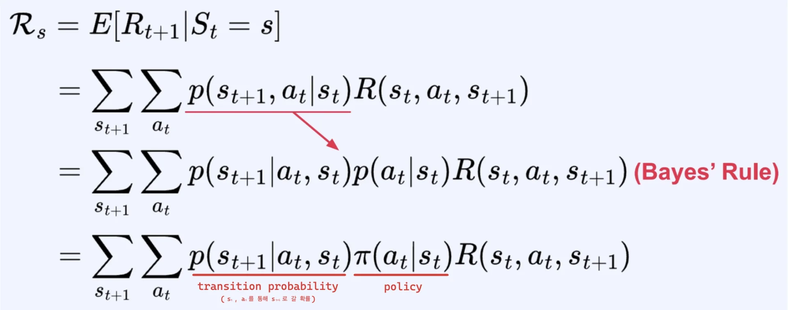

- MDP는 state transition에 action 도 포함되기 때문에 반드시 action을 고려해야 한다&#46;

- 현재 state(<code class="language-math">S&#95;t</code>)에서 가능한 action(<code class="language-math">a&#95;t</code>)과 next state(<code class="language-math">S&#95;{t&#43;1}</code>)를 모두 고려하여 Reward를 계산한다&#46;  
    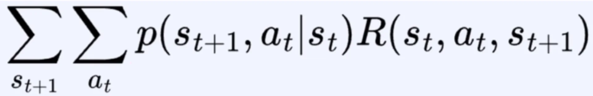

- 결국 ‘<code>policy &#42; transition probability &#42; reward</code>의 평균(expectation)’을 구하는 것이다&#46;
    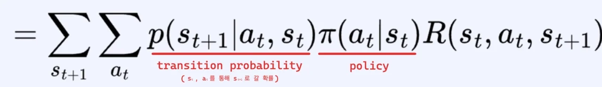

    - <code>policy</code>&#58; 현재 state <code class="language-math">s&#95;t</code>에서 특정 행동 <code class="language-math">a&#95;t</code>가 선택될 확률

    - <code>transition probability</code>&#58; 그 행동이 선택되었을 때를 가정하고 <code class="language-math">s&#95;{t&#43;1}</code>로 갈 확률

    - <code>reward</code>&#58; 현재 state <code class="language-math">s&#95;t</code>에서 action <code class="language-math">a&#95;t</code>를 통해 다음 state <code class="language-math">s&#95;{t&#43;1}</code>로 갔을 때의 보상

### 백업 다이어그램

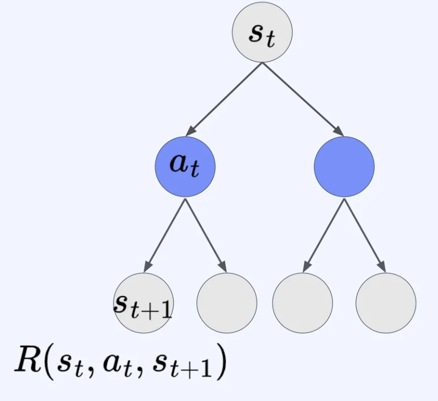

- 현재 state <code class="language-math">s&#95;t</code>에서 action <code class="language-math">a&#95;t</code>를 통해 다음 state <code class="language-math">s&#95;{t&#43;1}</code>로 갔을 때의 보상을 <code class="language-math">R(s&#95;t, a&#95;t, s&#95;{t&#43;1})</code>로 표현한 다이어그램이다&#46; 

## MDP <code class="language-math">&#60;S, A, P, R, &#92;gamma&#62;</code>에서의 Value function에 대한 Bellman equation

---

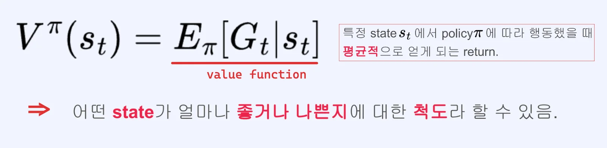

> ✏️ 
> 
> - return 도 random variable이다&#46; 
> 
> - value function은 어떤 <strong>state</strong>가 <strong><u>얼마나 좋거나 나쁜지</u></strong>에 대한 <strong><u>척도</u></strong>이다&#46;
>     - 어떤 state <code class="language-math">V^{&#92;pi}(s&#95;t)</code>가 큰 값이면 해당 state에서는 평균적으로 높은 return 받을 수 있다
> 
>     - return을 많이 받을 수 있는 state가 강화학습에서는 좋은 state이다

### 유도 방법 1

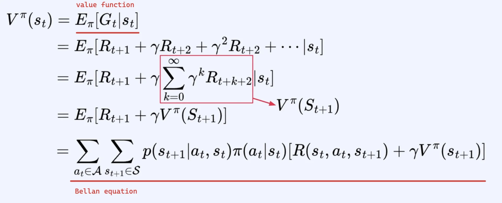

- 이전 MRP의 식 유도와 거의 유사하다&#46; 
    - <a href="#/post/345eda9b-0fe1-8053-b55d-f21cc06fd945">페이지</a> 

- 시점 t 에서의 <strong>총 미래 보상</strong> 
    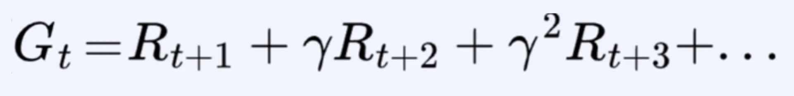

- MDP이기 때문에 Action을 고려하여 계산한다&#46;
    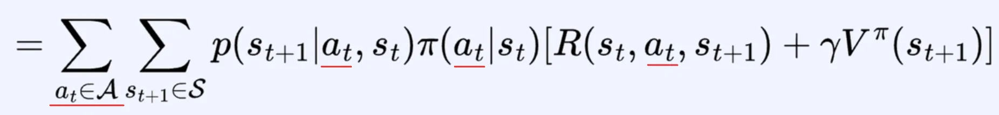

### 유도 방법 2

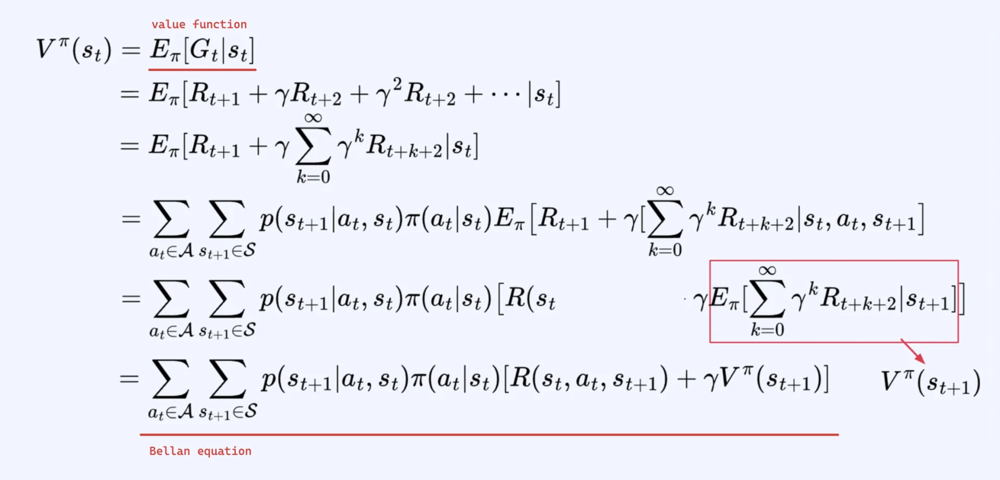

- 시점 t 에서의 <strong>총 미래 보상</strong> 
    

- <code class="language-math">a&#95;t</code>, <code class="language-math">s&#95;{t&#43;1}</code> variable 대한 식으로 변형
    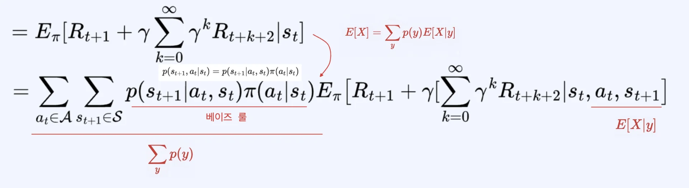

- <code class="language-math">s&#95;t</code>, <code class="language-math">a&#95;t</code>, <code class="language-math">s&#95;{t&#43;1}</code> 이 주어지면 Reward function을 계산할 수 있다&#46;  즉, 더이상 Random variable이 아닌 <strong><u>상수</u></strong>로써 <code class="language-math">E&#95;{&#92;pi}&#91;…&#93;</code>을 빠져나올 수 있다&#46; 
    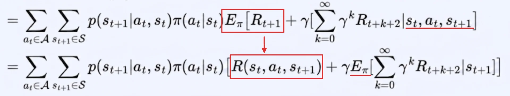

- MDP에서는 <code class="language-math">s&#95;{t&#43;1}</code> 이 주어지면 <code class="language-math">a&#95;t</code>, <code class="language-math">s&#95;t</code> 를 생략할 수 있다&#46; 
    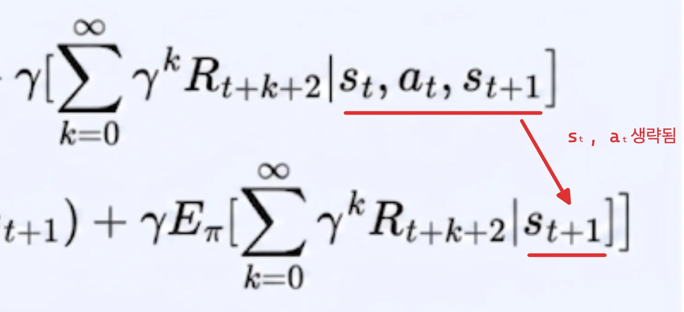

    - <code class="language-math">s&#95;{t&#43;1}</code>에  <code class="language-math">a&#95;t</code>, <code class="language-math">s&#95;t</code>의 값이 포함되어 있다&#46;  따라서 생략 가능하다&#46;

### 정리 &#45; Bellman equation for Value function (MDP)

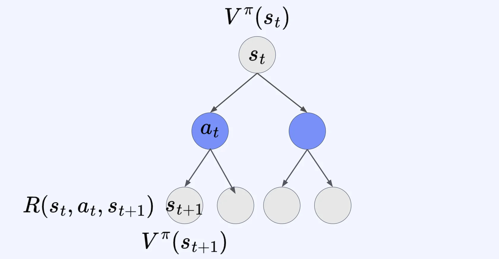

### Bellman equation for Value function (MDP)

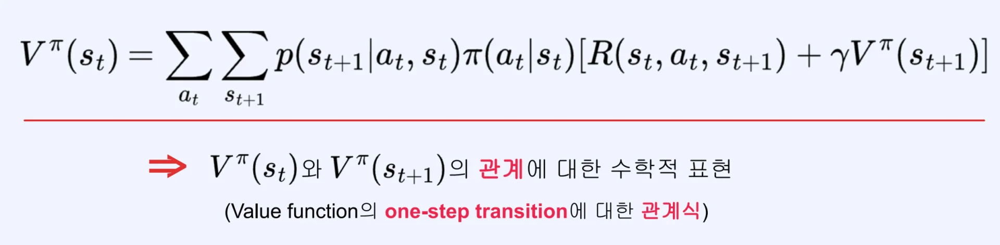

### 예제

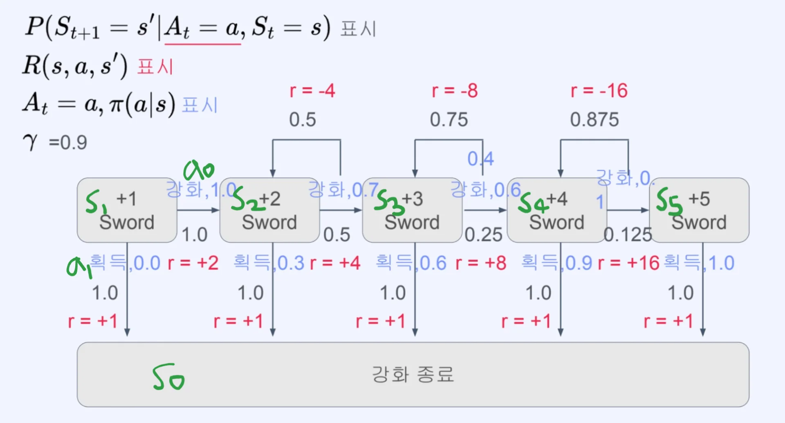

- <code class="language-math">V(S&#95;1)</code>
    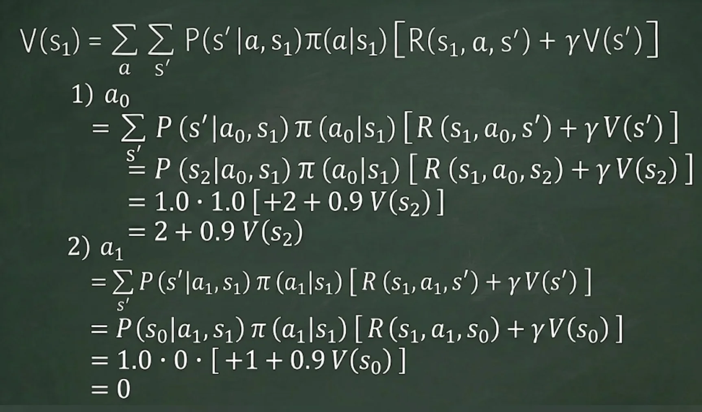

- <code class="language-math">V(S&#95;3)</code>
    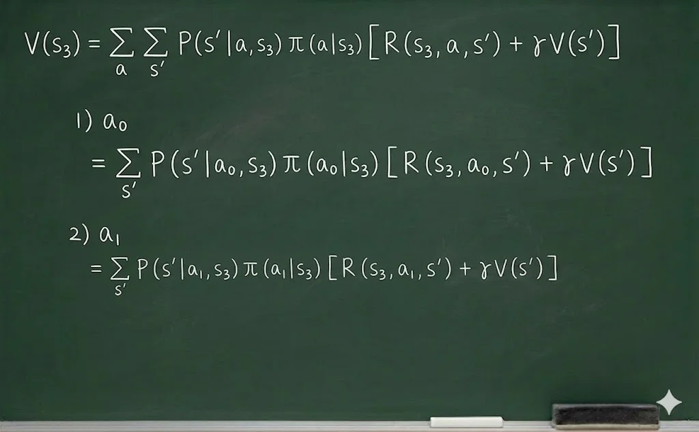

    - 계산은 위와 동일하기 때문에 생략함
