<a id="12feda9b0fe1809091ecfbe6ce407785"></a>

### 프로그램 명명 규칙 (Casing)

---

> 프로그래밍 세계에서는 각각의 언어, 환경에 알맞는 명명 규칙이 존재한다

<details>
<summary><code>snake&#95;case</code> &#45; DB <code>Table</code>, <code>Column</code>, python</summary>

- 문자와 문자 사이를 <code>&#95;</code>언더바 로 이어준다&#46;

- 모든 단어는 <code>소문자</code> 이거나 <code>대문자</code> 이다&#46;

- ex) <code>member&#95;id</code>, <code>MEMBER&#95;ID</code>

</details>

<details>
<summary><code>camelCase</code> &#45; <code>변수명</code>, <code>함수명</code>, <code>메서드명</code></summary>

- Java, JS, TS 등의 언어에서 변수명, 함수명, 메서드명 이름을 만들때 사용하는 형식이다&#46;

- <u>문자와 문자 사이</u>를 <strong><u>대문자</u></strong>로 이어준다&#46; 

- ex) <code>getAll</code>, <code>getItem</code>, <code>setMember</code> … 

</details>

<details>
<summary><code>PascalCase</code> &#45; <code>클래스명</code></summary>

- 대부분의 프로그래밍 언어에서 클래스명을 작성하는데 사용하는 형식

- 문자의 처음 시작&#58; 대문자

- 문자와 문자 사이를 대문자로 이어준다&#46; (camleCase 와 동일)

- ex) <code>MemberController</code>

</details>

<details>
<summary><code>kebab&#45;case</code></summary>

- 문자, 문자 사이를 <code>&#45;</code>대시로 이어준다&#46; 

- 모든 단어는 소문자이다&#46; 

</details>

<details>
<summary>자바 명명법</summary>

| 종류 | 설명 | 예시 |
| --- | --- | --- |
| project 프로젝트, 레파지토리 | 대/소문자 구분없이 시작 | MyProject |
| package 패키지 | 소문자 시작 | com&#46;sparta&#46;homework |
| class 클래스 | 대문자 시작, 명사 사용, PascalCase | class Person; class Car; |
| interface 인터페이스 | 대문자 시작, 형용사 사용, PascalCase | interface Runnable; |
| method 메서드 | 소문자로 시작, 동사 사용, camelCase | add(); move(); calculate(); |
| variable 변수 | 소문자로 시작, camelCase | int number; String inputNumber; |
| constant 상수 | 대문자로 시작, 단어와 단어 사이는 언더바(&#95;)로 구분 | static final int MAX&#95;COUNT = 999; static final String WONUK = &#34;wonuk&#34;; |

</details>

<a id="12feda9b0fe1809a8775ff1858ee95c8"></a>

### JSON (  <strong>JavaScript Object Notation</strong>, <strong>자바스크립트 객체 표기법 )</strong>

---

> 데이터를 구조화된 방식으로 표현하기 위해 사용되는 <strong><u>텍스트 기반 데이터 포맷<br></u></strong>주로 웹 애플리케이션에서  서버와  클라이언트 간의  데이터 교환 형식으로 널리 사용됨
> 
> - &#91; 클라이언트 &#45; 서버 &#93;, &#91; 서버 &#45; 서버 &#93; 통신에서 JSON 형식 사용

<details>
<summary>JSON을 통해 언어에 상관 없이 통신이 가능함</summary>

- &#91; Java 앱 &#45; Python 앱 &#93; 통신
    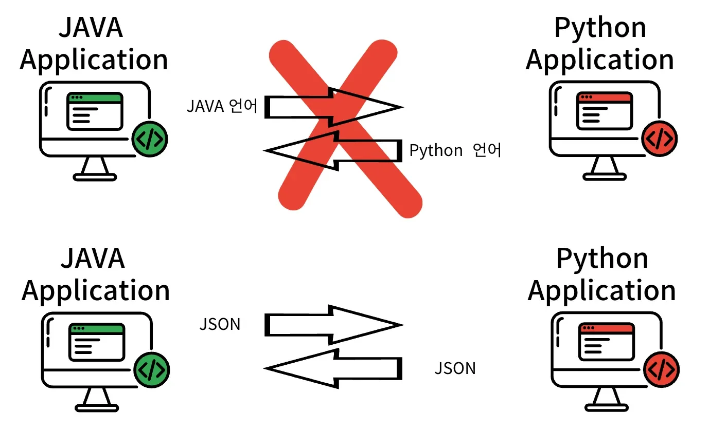

</details>

<details>
<summary>MSA → JSON</summary>

> <strong>MicroService Architecture, </strong>아주 작은 단위로 서비스를 잘게 나누어 운영하는 아키텍처

- 아래와 같이 MSA에서 여러 복잡한 앱들이 서로 통신하며, 구성되는 이유가 JSON 때문이다 

- JSON을 통해 언어의 제약 없이 서로 통신이 가능하다&#46; 
    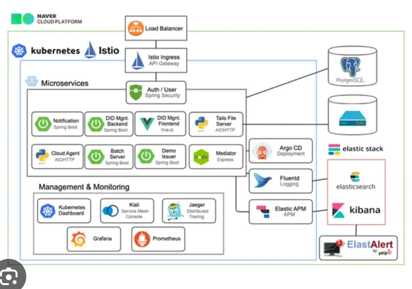

</details>

<details>
<summary>JSON 구조</summary>

- <strong><code>snake&#95;case, camelCase</code></strong> 모두 사용이 가능

- &#91; <strong><code>key</code></strong><strong> &#45; </strong><strong><code>value</code></strong><strong> </strong> &#93; 쌍으로 데이터를 표현

- <code>null, number, string, array, object, boolean</code> 형태의 데이터를 사용할 수 있음

<a id="12feda9b0fe18092bfceea71741110a1"></a>

```java
{
  "user": [
    {
      "first_name": "wonuk",
      "last_name": "Hwang",
      "age": 100,
      "phone_agree": false,
      "hobby": ["Java", "Spring"]
    },
    {
      "firstName": "sparta",
      "lastName": "Team",
      "age": 200,
      "phone_agree": true,
      "hobby": ["React", "Spring", "Node"]
    },
  ]
}
```

</details>

<a id="12feda9b0fe180f9975ec8efe555f766"></a>

### Scale Up, Scale Out ( 수평적 확장 ), 샤딩

---

<details>
<summary>🧐 &#91;<strong>이전 정리 내용&#93; </strong> <code>수직적 규모 확장(</code><strong><code>vertical scaling)</code></strong><strong> vs 수평적 규모 확장</strong></summary>

<details>
<summary><code>수직적 규모 확장(</code><strong><code>vertical scaling)</code></strong></summary>

<a id="622ed2242c534febbdc65555cd9aab74"></a>

‘스케일 업(scale up)’이라 하는 <strong><code>수직적 규모 확장(vertical scaling)</code></strong>은 서버에 <strong><u>더 좋은 고사양 자원(CPU, RAM …)을 추가</u></strong>하여 스펙을 업그레이드 하는 방법을 말한다&#46; 

<a id="249e369905bf4ac3b5e8d13661251ad7"></a>

서버로 유입되는 트래픽양이 적을 경우 좋은 선택이다&#46; <br> ‘<strong><u>단순</u></strong>하게 문제를 처리할 수 있다’ (더 비싼 부품을 장치에 더하면 됨)는 큰 장점이 있으나, <br> 해당 방법은 <u>한계점이 명확</u>하여 대규모 애플리케이션 설계 시에는 적절하지 않다&#46; 

- <strong><u>한 대의 서버에 CPU, 메모리를 무한대로 증설할 수 없</u></strong>다&#46;

- <u>자동복구(failover) 방안</u>이나 <u>다중화(redundancy) 방안</u>을 <strong><u>제시하지 않</u></strong>는다&#46; <br>따라서 <strong><u>서버에 장애가 발생 시, 웹사이트(앱)은 완전히 중단</u></strong>된다&#46; 

</details>

- <strong><code>수평적 규모 확장</code></strong>
    <a id="556293976e6c4e4fa32adff32800ffdf"></a>

    ‘스케일 아웃(scale out)’ 이라고도 하는 <code>수평적 규모 확장 프로세스</code>는 <strong><u>더 많은 서버를 추가</u></strong>하여 <u>성능을 개선</u>하는 방법을 말한다&#46; 

    - 위에서 서버를 증설하여 계층을 나눈 방식이 이에 해당한다&#46; 
        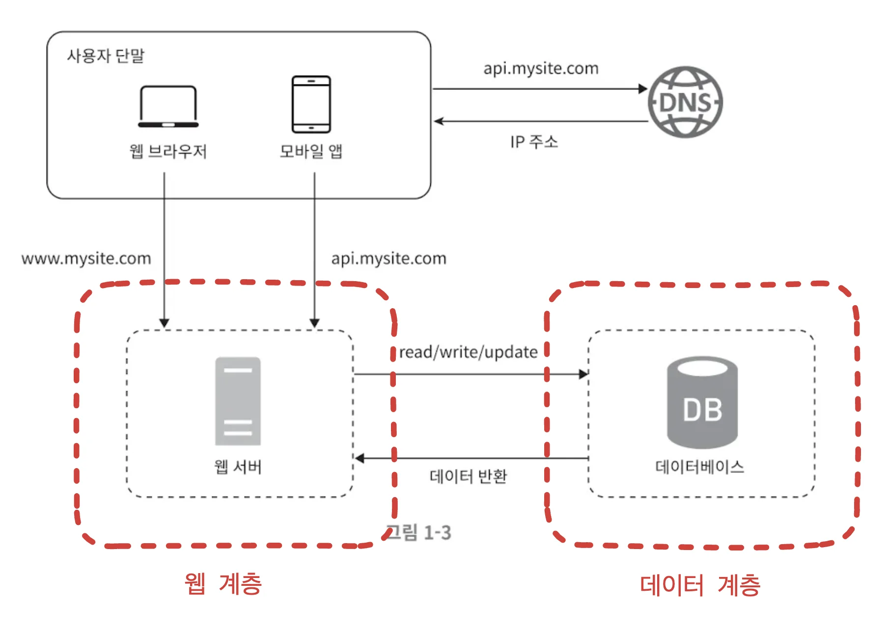

</details>

<details>
<summary>Scale Up, 수직적 확장</summary>

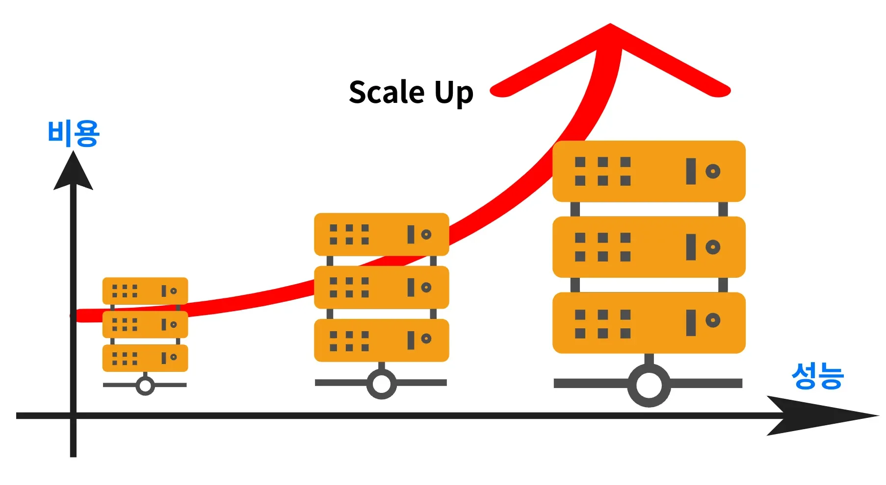

- 서버에 <strong><u>더 좋은 고사양 자원(CPU, RAM …)을 추가</u></strong>하여 스펙을 업그레이드 하는 방법

- ‘<strong><u>단순</u></strong>하게 문제를 처리할 수 있다’ (더 비싼 부품을 장치에 더하면 됨)는 큰 장점이 있으나, <br> 대규모 애플리케이션 설계 시에는 적절하지 않다&#46;
    - <strong><u>한 대의 서버에 CPU, 메모리를 무한대로 증설할 수 없</u></strong>다&#46;

    - <u>자동복구(failover) 방안</u>이나 <u>다중화(redundancy) 방안</u>을 <strong><u>제시하지 않</u></strong>는다&#46; <br>따라서 <strong><u>서버에 장애가 발생 시, 웹사이트(앱)은 완전히 중단</u></strong>된다&#46; 

</details>

<details>
<summary>Scale Out, 수평적 확장</summary>

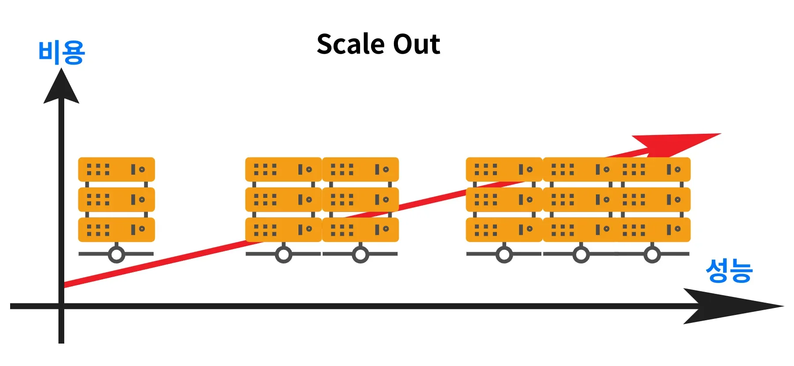

- <strong><u>더 많은 서버를 추가</u></strong>하여 <u>성능을 개선</u>하는 방법

- 많은 트패픽을 처리하는 대규모 애플리케이션을 설계할 때 사용하는 방법이다&#46;

</details>

<details>
<summary><code>샤딩(sharding)</code>, <code>샤드(shard)</code></summary>

- 수평적 규모 확장 방식을 <code>샤딩(sharding)</code>이라고도 부른다&#46; 

- <code>샤딩</code>은 대규모 데이터베이스를 <code>샤드(shard)</code>라고 부르는 <strong><u>작은 단위로 분할</u></strong>하는 기술을 말한다&#46; 

- <strong><u>해시 함수</u></strong>를 통해 데이터를 분리하여 각 샤드에 보관한다&#46; 

<details>
<summary>ex)  해시 함수 &#45; <code>user&#95;id % 4</code> </summary>

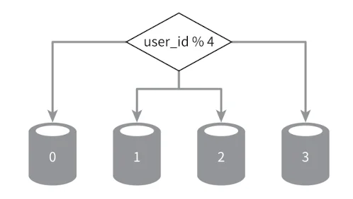

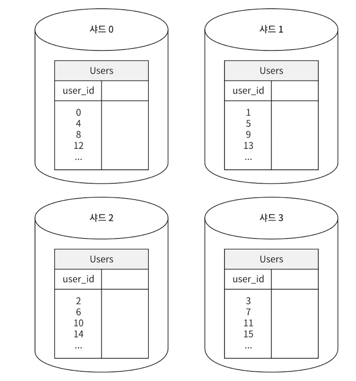

</details>

</details>

<a id="12feda9b0fe1800089b3efa6234a232a"></a>

### Stateful, Stateless(무상태)

---

> 클라이언트와 서버간의 통신 상태(state) 유지 여부

<details>
<summary>Stateful ( 상태 유지)</summary>

> 클라이언트의 상태를 유지

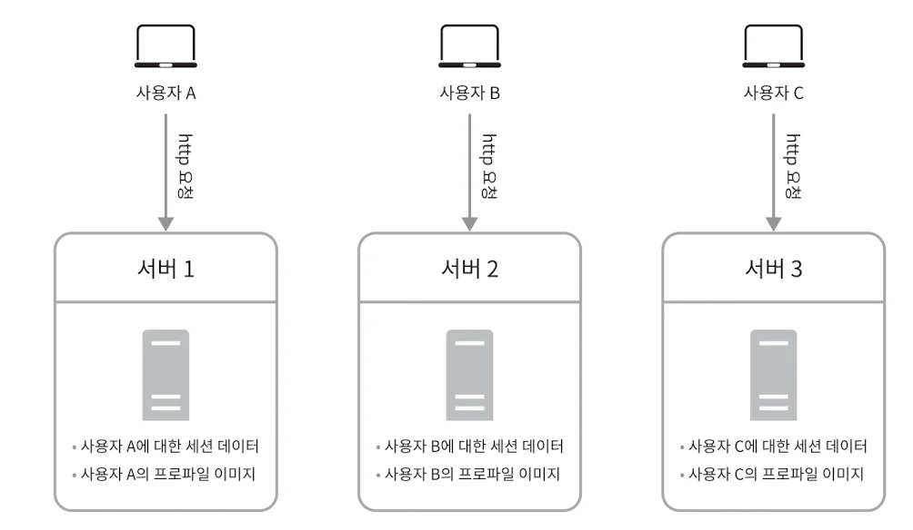

- <u>상태 정보를 보관(stateful)하는 서버</u>는 <u>상태(클라이언트 정보)를 유지</u>하여 <u>요청들 사이에 공</u>유되도록 한다&#46; 

</details>

<details>
<summary>Stateful 방식의 한계점</summary>

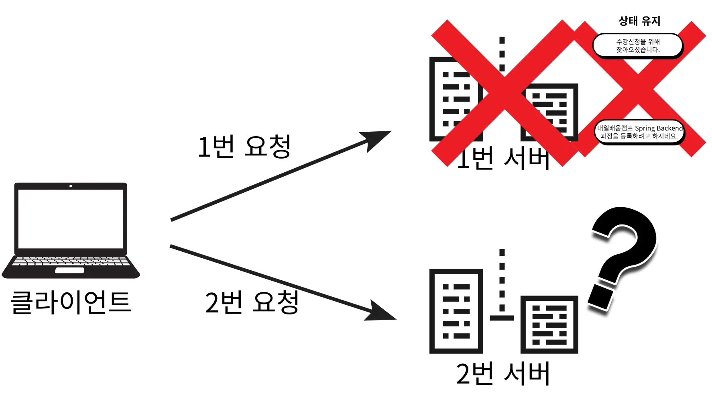

- 한 서버에 클라이언트 정보(상태)에 종속적이기 때문에, 해당 서버가 오류에 의해 동작하지 않으면 다른 서버에서는 해당 유저의 상태(데이터)가 존재하지 않기 때문에 요청을 처리할 수 없다&#46; 

- 이는 서버의 <u>확장</u> 과 <u>가용성(지속적인 서비스)</u>을 어렵게 만든다&#46; 

</details>

---

<details>
<summary>Stateless ( 무상태 )</summary>

> 클라이언트의 상태를 유지하지 않는다&#46;


> ✏️ 
> 
> <a id="255eda9b0fe180d7b847f75c249b32a3"></a>
> 
> 클라이언트 상태가 서버에 종속적이지 않기 때문에, 클라이언트의 요청을 처리하는 서버가 변경되어도 문제가 없다&#46;

<details>
<summary>장 • 단점</summary>

- 장점
    - 같은 서버를 유지할 필요가 없다&#46; 

    - 클라이언트에 종속적이지 않기 때문에, 규모 확장에 용이하다&#46;
        - 갑자기 트래픽이 증가하여도 서버를 증설하면 된다 &#46;

- 단점
    - 클라이언트에서 상태 정보를 포함하여 데이터를 전송해야 한다&#46; 

    - 따라서 전송되는 데이터의 양이 많아 지고, 그만큼 동작이 무거워진다&#46; 

    - 즉, 통신 시 더 많은 비용이 든다&#46; 

</details>

<details>
<summary>공유 저장소</summary>

> 상태 정보를 공유 저장소에 저장하고 각 서버에서 필요 시에 요청해 처리한다&#46; 

<a id="12feda9b0fe18051a05fdd7f18e67d03"></a>

아래와 같이 상태 정보를 저장하는 공유 저장소를 두어, 필요 시에만 조회하여 사용할 수 있게 한다&#46; 

- 만약 공유 저장소가 다운 된다면? → 백업과 서브 자원에 대한 해결책도 준비해야 한다&#46; 
    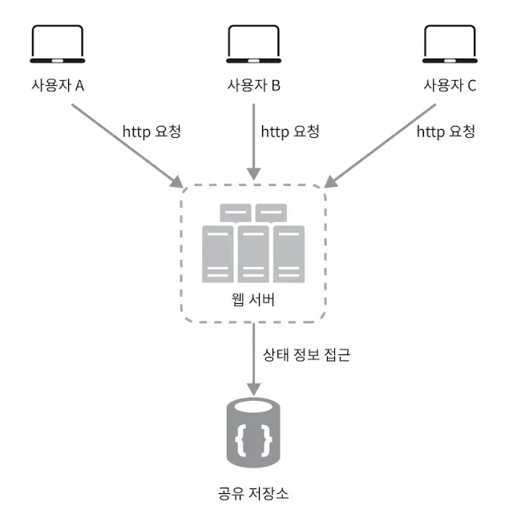

</details>

</details>

<details>
<summary>Stateless 방식의 한계점</summary>

- <code>로그인</code>과 같은 서비스에서는 <u>상태를 유지</u>하여 <u>유저에 대한 인증을 지속적으로 확인</u>해야 한다&#46;

- 이는 <code>Cookie</code>, <code>Session</code>, <code>Token</code> 을 활용하여 해결한다&#46; 

</details>

<a id="12feda9b0fe18014a8e1fa6236348bdb"></a>

### <strong>Connection(연결), Connectionless(비연결)</strong>

---

> 클라이언트와 서버 간의 연결(Connection) 유지 여부

<details>
<summary><strong>Connection(연결)</strong></summary>

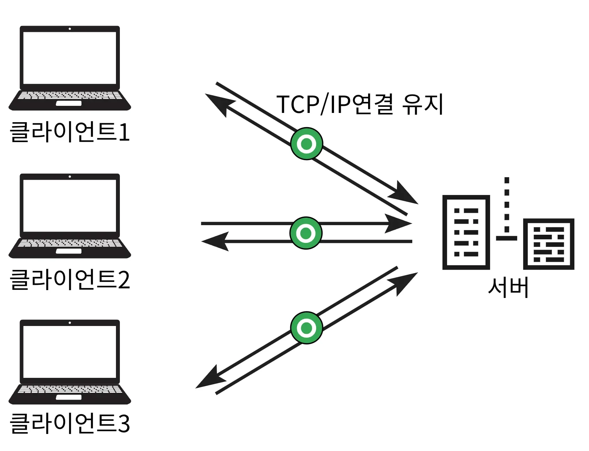

- 클라이언트 와 서버 간에 통신 시에 지속적으로 TCP/IP 연결을 유지하는 것을 말한다&#46;

- 따라서 서버는 클라이언트와의 연결을 유지하기 위해 계속해서 자원을 소모한다&#46; 

- 하지만  1시간 동안 수천명이 서비스를 사용해도, 실제 서버에서 동시에 처리하는 요청은 수십개 이하로 매우 작기 때문에 해당 방식은 많은 비용을 소모하는 적절하지 않는 통신  방법이다&#46; 

</details>

<details>
<summary><strong>Connection(연결)  장•단점</strong></summary>

- 장점
    - 새로운 연결 과정( TCP/IP &#45; <code>3 Way Handshake</code> ) 없이 요청을 전송하고 응답을 수신받을 수 있음

    - 추가 연결에 대한 소모값이 없기 때문에, 그만큼 빠른 통신이 가능함

- 단점
    - 클라이언트가 지속적으로 요청을 보낼 것이라는 보장이 없기 때문에 <br>연결에 대한 자원이 낭비됨

</details>

---

<details>
<summary><strong>Connectionless(비연결)</strong></summary>

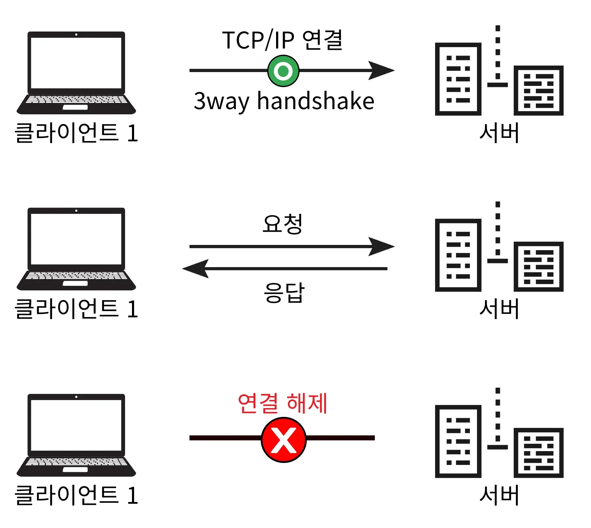

- 클라이언트와 서버의 연결을 유지 하지 않음

- 서버는 최소한의 자원만 사용한다&#46; 

</details>

<details>
<summary>비연결성( <strong>Connectionlese) 장•단점</strong></summary>

- 장점
    - 서버의 자원을 효율적으로 사용할 수 있음

- 단점 
    - 요청마다 매번 TCP/IP 연결(<code>3 Way Handshake</code>)을 해야한다&#46; →  요청에 대한 응답의 소요 시간 증가
        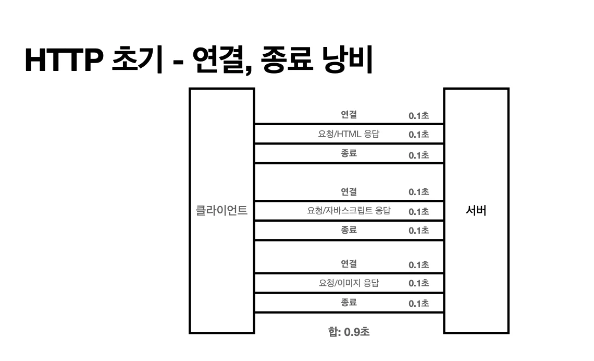

        <a id="12feda9b0fe18071a267cf2e585e3840"></a>

        ⇒ <strong>HTTP 지속연결(Persistent Connections)</strong>을 통해 해결

    - 다시 웹 브라우저 접속 시 → 수많은 자원(HTML, CSS, JS, 이미지 등)들을 다시 응답 받아야 한다&#46;  
        <a id="12feda9b0fe180fc96f6dc9cf44c85ef"></a>

        ⇒  <strong>캐시, 브라우저 캐싱</strong>을 통해 해결

</details>

---

<details>
<summary><strong>HTTP 지속연결(Persistent Connections)</strong></summary>

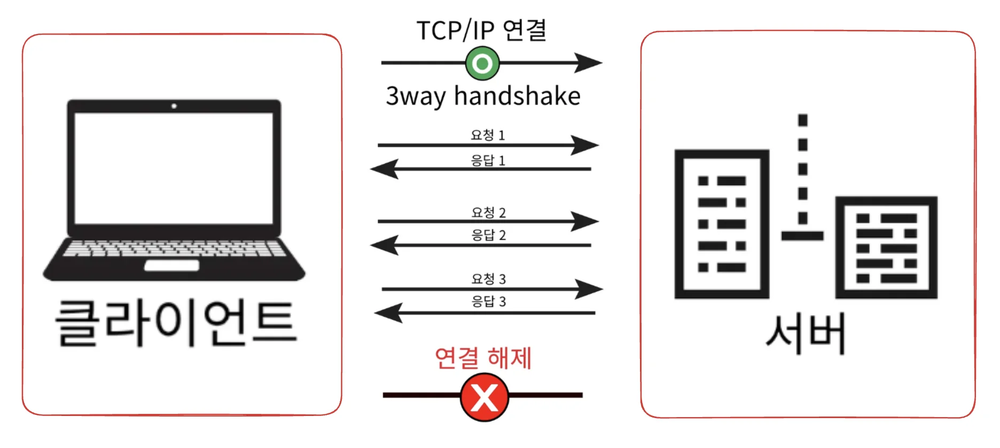

- 하나의 요청에 필요한 요청들이 모두 응답될 때까지 연결을 유지한다&#46; 

- 연결을 한번만 맺고 끊기 때문에, Connectionless 방식보다 TCP/IP 연결 횟수가 적다&#46;
    <a id="aa085ee270e9487aa5bb51b8fcb74a85"></a>

    따라서 그만큼 빠른 통신이 가능하다&#46; 

</details>
