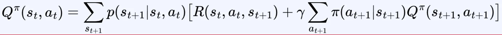
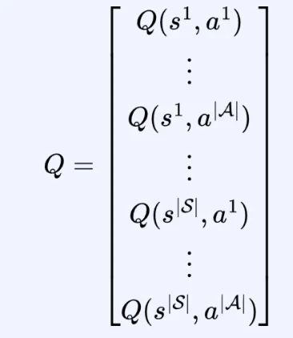
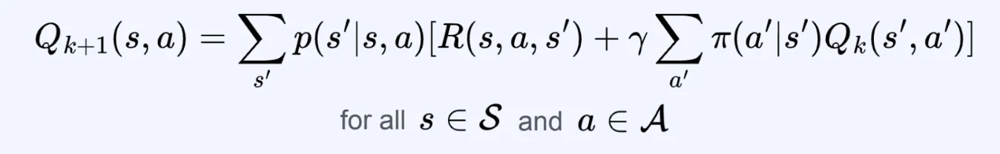
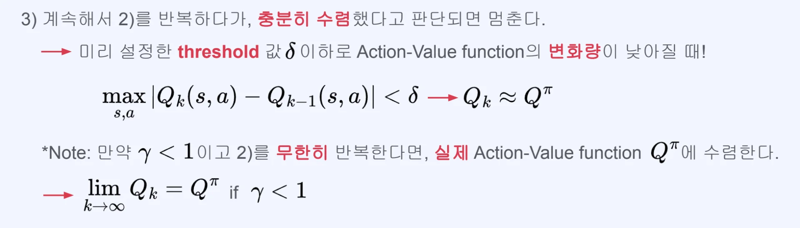
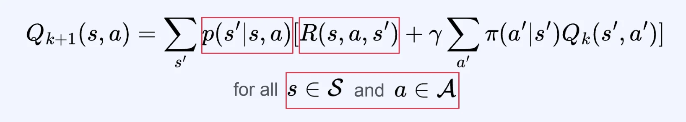

## DP를 활용한 Action&#45;Value function 계산

---

> 📖 
> 
> 
> 
> DP를 활용한 Value function을 계산하는 방법과 거의 동일하다&#46; 
> 
> 
> 
> 또한 DP를 이용해 Action&#45;Value function을 계산하는 방법은<strong> 쓰이지 않</strong>는다&#46;

> 🤔 
> 
> 
> 
> 왜 쓰이지 않는가?
> 
> - <strong>가능한 모든 state 와 모든 action을 다 고려</strong>해야 하기 때문에 value function에 비해서도  연산량이 훨씬 많다&#46; 
> 
> - 이러한 특성으로 인해 실제로는 사용하지 않는다&#46; 

### DP를 활용한 Action&#45;Value function 계산

> 
> 
> 
> 
> <strong>Bellman equation for Action&#45;Value function</strong>
> 
> 

> 💬 
> 
> 
> 
> <a href="#/post/340eda9b-0fe1-812c-a3f0-f7146c5e83ef">페이지</a>  방법과 거의 동일함
> 
> - 추가적으로 action을 더해서 계산하는 것 뿐임

1. 모든 state, action에 대해 정의된 임의의 action&#45;value function을 만든다&#46; 
    

    -  모든 조합의 벡터를 생성 
        - <code class="language-math">&#124;S&#124;</code>x <code class="language-math">&#124;A&#124;</code>  
            - <code class="language-math">&#124; 요소&#124;</code>&#58; 카디널리티, 가능한 모든 요소의 경우의 수

1. Action&#45;Value function에 대한 Bellman equation을 이용해 아래와 같이 Action&#45;Value function을 업데이트 한다&#46;
    

1. 계속해서 &#91;2&#93;를 반복하다가, 충분히 수렴했다고 판단되면 멈춘다&#46;
    

### DP를 활용한 Action&#45;Value function 계산의 특징

1. 환경의 MDP 모델을 알아야 함
    - value function 과 동일하게 transition probability 와 reward function을 알아야 한다&#46; 

    - 즉, MDP 모델이 필요한다&#46; 

1. State space와 action space를 모두 고려하므로, 연산량이 많아 안쓰임&#46;
    - 가능한 모든 state 와 모든 action을 다 고려해야 하기 때문에 value function에 비해서도  연산량이 훨씬 많다&#46; 

    - 이러한 특성으로 인해 실제로는 사용하지 않는다&#46;
