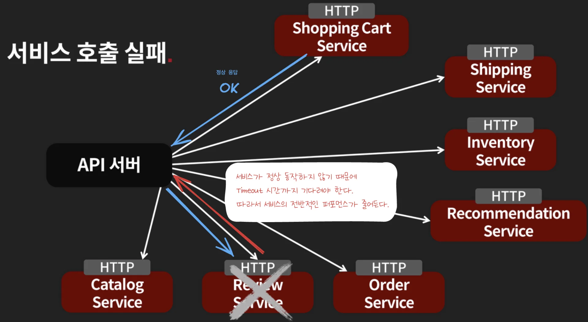
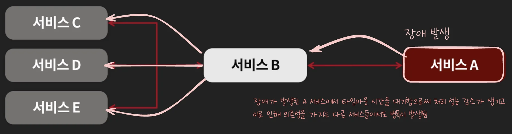
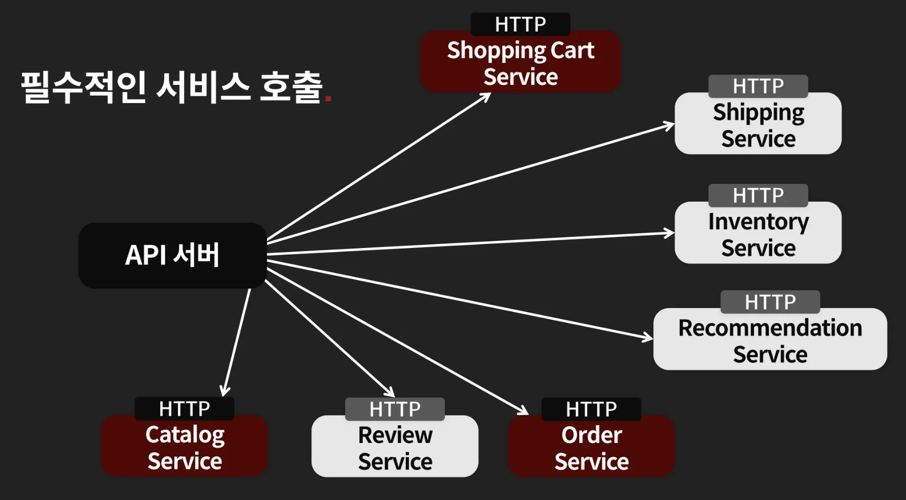
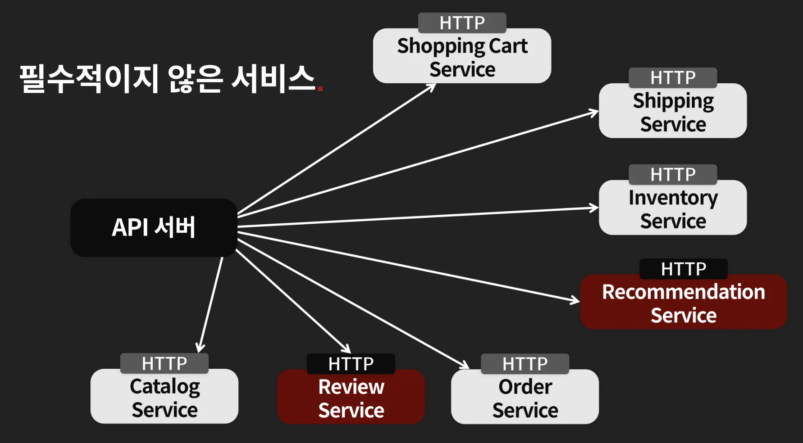
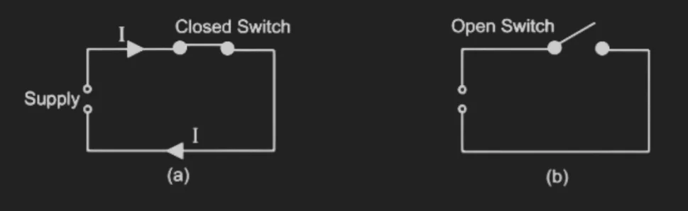
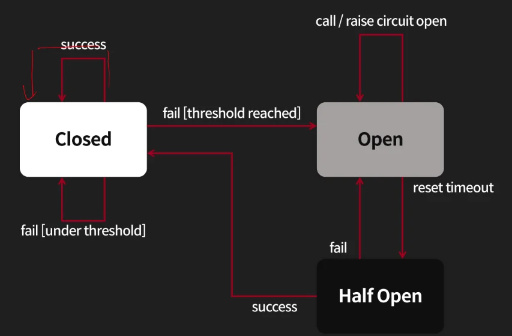

<a id="35ceda9b0fe1807baee7cde134bd4a96"></a>

## Circuit Breaker

---

> 📖 
> 
> <a id="35ceda9b0fe180e48958f9b25b098fac"></a>
> 
> 웹서비스 상에서 서킷 브레이커는 API를 호출 시 <strong><u>해당 API가 계속 실패</u></strong>할 때 이 <strong>실패하는 API를 더이상 호출하지 않고 빠르게 실패(fast fail)하게 만들어 차단</strong>하는 역할을 한다&#46; 
> 
> - <code>Circuit Breaker</code>는 한국말로는 ‘회로차단기’ 라는 의미를 갖는다&#46; <br><strong><u>회로차단기</u></strong>는 <strong>전기가 누전</strong>된 경우, <strong>집안의 전기가 차단</strong>하는 역할을 한다&#46; 

<a id="35ceda9b0fe18015a94dfe92593bf584"></a>

## 서비스 상에서 API 호출 실패 시 문제점

<a id="360eda9b0fe1804eb050fc30074ab66c"></a>

### 문제점 1&#58; 타임아웃 대기 시간으로 인해 스레드 당 요청 처리 성능 감소

> ❗ 
> 
> <a id="360eda9b0fe18018aa23cf9288a60f88"></a>
> 
> <strong>문제점 </strong>
> 
> <a id="360eda9b0fe180efb40dc68ebcde08b4"></a>
> 
> <strong>실패하는 API 호출</strong><strong> </strong>시 <strong>타임아웃 즉, 대기시간까지 기다려야 한다&#46;</strong><br>그러면 <strong>서비스의 전체적인 퍼포먼스가 떨</strong>어진다&#46; 



- 예시 
    > 
    > 
    > - 스레드 1개로 가정
    > 
    > - <code>정상 처리</code>&#58; 평균적으로 <code>20 ms</code>
    > 
    > - <code>오류(API Timeout)</code>&#58; <code>300ms</code>

    - 정상 호출
        <a id="360eda9b0fe1809d8f2deb4135c402c8"></a>

        ⇒ 스레드 1 개가 1초에 50 정도의 API를 처리할 수 있음<br>    <code>50 req/sec (50 TPS)</code>

    - 장애 상황 시 호출
        <a id="360eda9b0fe180718684ef07d8bcd0ed"></a>

        ⇒ 스레드 1개가 1초개 3개의 API 밖에 처리하지 못함<br>    <code>3 req/sec (3 TPS)</code>

    <a id="360eda9b0fe1802aa58bc4a537b45460"></a>

    ### 장애 상황 성능 = <strong>정상의 약 6% 유지성능 ( 94% 성능 감소)<br>즉, 처리 속도가 </strong>약  16&#46;7배 느려짐

    - <strong>(</strong><code class="language-math">&#92;frac{3}{50}</code><strong>)  = 0&#46;06</strong>

<a id="360eda9b0fe180aa98ebf3b4b5bc1720"></a>

### 문제점 2&#58; 장애 연쇄 반응



- 의존성을 가지는 서비스들도 같이 점점 느려져 병목이 발생된다&#46; 
    - A 서비스가 장애가 날 경우, 여기에 의존하는 B 서비스도 점점 느려진다&#46; 

    - 또한 B 서비스에 의존하는 C, D, E 서비스에서도 병목이 발생된다&#46; 

<a id="35ceda9b0fe18013ae51e95d1c66b297"></a>

## <code>필수적인 API</code> vs <code>필수적이지 않은 API</code>

> ❗ 
> 
> <a id="360eda9b0fe180a2830dc64c4b7f24fe"></a>
> 
> 결국<strong> </strong><strong>스레드에서 </strong><strong><u>기다리는 타임아웃 대기시간</u></strong><strong>이 </strong><strong><u>정상 처리 시간</u></strong><strong>보다 </strong><strong>오래 걸리기 때문</strong>에 발생되는<strong> </strong><strong>성능 저하 문제</strong>이다&#46; 
> 
> - 정상적이지 않다면, Timeout 등으로 처리량이 줄어들고, 부하가 늘어날 수 있음
> 
> <a id="360eda9b0fe180f289d2cca34ac22007"></a>
> 
> 따라서 <strong>장애 상황 발생 시,</strong> Timeout을 기다리는 것이 아닌 <strong><u>빠르게 실패 처리(failover)</u></strong><strong>를 하여 성능 병목 요인을 제거</strong>한다&#46; 
> 
> - 타임아웃 대기 (<code>300 ms</code>) → 빠르게 실패 (<code>1 ms</code>)
> 
> <a id="360eda9b0fe180378f42e3fc23dd40fd"></a>
> 
> 이때 각 서비스 마다 다르겠지만 <strong><code>필수적인 API</code></strong> 와 <strong><code>필수적이지 않은 API</code></strong>를 구분하여 <u>장애 상황을 다르게 대처</u>해야한다&#46; 
> 
> - 필수적인 API, 필수적이지 않는 API는 서비스의 기준에 따라서 달라진다&#46;  <br>(도메인마다 다름)

- 예시) 커머스 
    > 
    > 
    > <a id="360eda9b0fe180438146dee06a70a886"></a>
    > 
    > 상품 화면에서 <strong>중요한 리뷰, 추천 서비스</strong>에서 장애가 발생되었다면 <br><strong><u>빠르게 다른 화면으로 대처</u></strong>하거나 <strong><u>해당 페이지가 없</u></strong>던 것 처럼 보여줄 수 있어야 한다&#46; 

    

    - 커머스에서 상품 리스트를 보이지 않음<br>→ 심각한 서비스 오류<br>→ 빠르게 장애 상황을 대처해야 함

    

    - 일부 카테고리만 안보임 <br>→ 사소한 부분이기 때문에 넘어가도 됨

    - 추천 서비스 장애
        <a id="360eda9b0fe180478640fb071e0c4a63"></a>

        → 기본적으로 미리 정의한 동작으로 대체 <br>(ex&#46; 기본적인 순서로 카탈로그 서비스에서 나온 정보를 보여줌 )

    > 🤔 
    > 
    > <a id="360eda9b0fe1806495f4d8a1192072ec"></a>
    > 
    > 필수적이지 않은 API 애서 오류가 발생할 떄, 이를 어떻게 처리해야 서비스에 영향을 낮출 수 있을까?
    > 
    > <a id="364eda9b0fe1803c95becce0f4896135"></a>
    > 
    > 이때 사용하는 것이 <strong><code>Circuit Breaker</code></strong><strong>이다&#46;</strong>

<a id="360eda9b0fe1803e8a96c6e1177d9b3c"></a>

## Circuit Breaker

> 💬 
> 
> <a id="360eda9b0fe18089b33ec6512f68b4a1"></a>
> 
> <strong>논리회로 &#45; Circuit Breaker (회로 차단기)</strong>
> 
> 
> 
> <a id="360eda9b0fe18008bad6cb7c1c242e79"></a>
> 
> Switch가 연결되어 있을 때 전류가 흐르지만 과부하 시 Switch가 열려서 회로를 차단해 전기회로를 보호하는 장치 
> 
> - <code>Closed</code>&#58; 전기가 흐르는 상태
> 
> - <code>Open</code>&#58; 전기가 차단된 상태

> ✏️ 
> 
> <a id="360eda9b0fe180b1b8b1e88d43660486"></a>
> 
> 위 논리회로와 동일하게 소프트웨어에서도 같은 명칭을 사용해서 표현한다&#46; 
> 
> 
> 
> - <code>Closed</code>
>     - 정상적인 API 호출이 되는 상태
> 
> - <code>Open</code>
>     - 일정시간 동안 API 호출을 바로 실패하는 상태
> 
> - <code>Half Open</code>
>     - Open 인 상태에서 일정 시간이 지나면 상태를 다시 확인하기 위해서 API 호출을 시도해보는 상태
> 
>     - Half Oepn에서 성공하면 Closed, 실패하면 다시 Open으로 이동한다&#46; 

<a id="360eda9b0fe180f0bd30fbaf7662a5eb"></a>

### Circuit Breaker 상태&#58; <code>ClOSED</code>

- <strong><u>정상</u></strong>, <code>STATE = CLOSED</code> 에서 호출 성공
    

- <strong><u>실패(threshold 미만 일 때)</u></strong>, <code>STATE = CLOSED</code>
    

    - <strong><u>Threhold 이하</u></strong>에서는 <strong>실패하더라도 계속 call</strong> 한다&#46; 

<a id="360eda9b0fe180ec89d1d0c0de680c3e"></a>

### Circuit Breaker 상태&#58; <code>Open</code>

- <strong><u>실패(threshold 이상 일 때)</u></strong>, <code>STATE = OPEN</code>
    

    - Open이면 Circuit Breaker에서 바로 실패로 리턴

<a id="360eda9b0fe1809db3c8d95b73048c29"></a>

### Circuit Breaker 상태&#58; <code>Half Open</code>

- <code>STATE = OPEN</code> 에서 특정 시간 이상일 때, <code>STATE = HALF&#95;OPEN</code> 호출이 <strong><u>성공</u></strong>할 때
    

    - 호출 성공 → 다시 <code>Closed</code> 상태

- <code>STATE = OPEN</code> 에서 특정 시간 이상일 때, <code>STATE = HALF&#95;OPEN</code> 호출이 <strong><u>실패</u></strong>할 때
    

    - 호출 실패 → 다시 <code>Half Open</code> 상태

<a id="35ceda9b0fe180f58f2ce6be2f5a0bac"></a>

## 구현

> 🤔 
> 
> <a id="362eda9b0fe1800fb204e038966770eb"></a>
> 
> <strong>Circuit Breaker 구현 시 고려해야 할 점</strong>
> 
> - 몇 번이나 실패하면 circuit breaker 로 fail back이 동작해야 하는가?
> 
> - 서비스가 살아있는지 확인하는 방법 → helth check 동일
>     - ex) 3번 정도 요청 후 실패로 판단
> 
>     - 이때 interval을 얼마로 설정하는지에 따라 민감도가 달라진다&#46; 
>         - 자주 실패하거나, 실패가 오랫동안 지속될 수 있다&#46;  (1초 or 1분  …)
> 
> - 연계되는 서비스들에 대한 특성을 파악하여 민감도 설정
>     - 호출 빈도에 따른 주기를 파악하고 이를 통해 interval time 설정을 해, 호줄 빈도, 주기를 적절하게 선택해야 한다&#46; 
> 
>     - ex) 자주 죽을 수 있는 서비스는 민감도를 높게하여(interval 설정 짧게) 호출 빈도를 높여 자주 호출한다&#46; 

> ✏️ 
> 
> <a id="360eda9b0fe180b1ab1ae70dc2079737"></a>
> 
> <strong>Circuit Breaker 구현체</strong>
> 
> - python
>     - <strong><a href="https://github.com/danielfm/pybreaker">pybreaker</a></strong> (구식)
> 
>     - <strong><a href="https://github.com/arlyon/aiobreaker">aiobreaker</a></strong> (asyncio 지원)
> 
> - Java
>     - <strong><a href="https://github.com/Netflix/Hystrix">Hystrix (Netfilx, 업데이트 x)</a></strong>
> 
>     -  <strong><a href="https://github.com/resilience4j/resilience4j">resilience4j</a></strong>
> 
> - 직접 구현
>     - <strong><u>래퍼 함수, 래퍼 프록시를 만</u></strong>들어서 직접 구현하는 것과 난이도가 높지 않음

<a id="360eda9b0fe18086b80aff718f062b49"></a>

### 실습 &#45; Circuit Breaker를 통해서 빠르게 Fast Fail 

[the&#95;red/chapter&#95;2/circuit&#95;breaker at main · charsyam/the&#95;red]()

> ✏️ 
> 
> <details>
> <summary>Circuit Breaker 구현체</summary>
> 
> > ‣
> 
> <a id="361eda9b0fe18060a106e81028b6363c"></a>
> 
> ```plaintext
> aiobreaker==1.2.0
> ```
> 
> - Circuit Breaker 는 aiobreaker 패키지에서 가져와서 사용
> 
> </details>
> 
> <details>
> <summary><code>caller</code>&#58; 클라이언트 요청을 받고, circuit breaker를 거쳐 callee를 호출</summary>
> 
> - ‣
> 
> </details>
> 
> <details>
> <summary><code>callee</code>&#58; 실제 URL을 가져와 OpenGraph 메타데이터를 파싱해서 응답</summary>
> 
> - ‣
> 
> </details>

<details>
<summary>1&#46; 사용자가 caller  <code>/api/v1/scrap/?url=&#46;&#46;&#46;</code> api 호출</summary>

<a id="362eda9b0fe18028b5e1ca4106dcd1ce"></a>

```python
curl -X "http:192.168.0.1.7001/api/v1/scrap/?url=..."
```

</details>

<details>
<summary>2&#46; caller에서 CircuitBreaker로 보호된 <code>call&#95;api()</code> 호출</summary>

<details>
<summary>&#91;코드&#93; ‣</summary>

<a id="379eda9b0fe18056997be6423d576e18"></a>

```python
from typing import Optional
from fastapi import FastAPI, Request
from fastapi.responses import JSONResponse
from pydantic import BaseModel
from exceptions import UnicornException
from datetime import timedelta

import urllib.parse
import json
import redis
import httpx

from settings import Settings
from log import init_log
from cors import init_cors
from instrumentator import init_instrumentator
from config import Config

import aiobreaker 


app = FastAPI()
my_settings = Settings()
conf = Config(my_settings.CONFIG_PATH)

init_log(app, conf.section("log")["path"])
init_cors(app)
init_instrumentator(app)


cb = aiobreaker.CircuitBreaker(fail_max=3, timeout_duration=timedelta(seconds=20))


@app.exception_handler(UnicornException)
async def unicorn_exception_handler(request: Request, exc: UnicornException):
    return JSONResponse(
        status_code=exc.status,
        content={"code": exc.code, "message": exc.message},
    )


@cb
async def call_api(url: str):
    endpoint = conf.section("scrap")["endpoint"]
    encoded_url = urllib.parse.quote(url)
    url = f"http://{endpoint}/api/v1/scrap?url={encoded_url}"
    async with httpx.AsyncClient(timeout=2) as client:
        r = await client.get(url)
        return endpoint, r.text
    

@app.get("/api/v1/scrap/")
async def get_post(url: str):
    decoded_url = urllib.parse.unquote(url)
    try:
        endpoint, scrap_raw = await call_api(decoded_url)
        scrap = json.loads(scrap_raw)
        return {"code": 0, "message": "Ok", "endpoint": endpoint, "scarp": scrap}
    except aiobreaker.state.CircuitBreakerError as e:
        raise UnicornException(status=500, code=-20005, message="CircuitBreakerError")
```

</details>

<a id="362eda9b0fe1801d9038f2ee6ed8222e"></a>

```python
# circuit_breaker/caller/main.py
cb = aiobreaker.CircuitBreaker(
		fail_max=3,
		timeout_duration=timedelta(seconds=20)
)
```

- <code>fail&#95;max=3</code>&#58; 보호 대상 함수가 연속으로 최대 3번 실패하면 Circuit Breaker 실행

- <code>timeout&#95;duration=20초</code>&#58; 회로가 열린 뒤 20초 동안 실제 호출을 막는다&#46;

- <code>&#64;cb</code>&#58; call&#95;api() 함수를 circuit breaker 보호 대상으로 등록한다&#46;

<a id="362eda9b0fe18014a7b0c5ef7e8ef871"></a>

```python
@cb
async def call_api(url: str):
    endpoint = conf.section("scrap")["endpoint"]
    encoded_url = urllib.parse.quote(url)
    url = f"http://{endpoint}/api/v1/scrap?url={encoded_url}"
    async with httpx.AsyncClient(timeout=2) as client:
        r = await client.get(url)
        return endpoint, r.text
```

- caller <code>call&#95;api()</code> 호출 <br>→ callee <code>/api/v1/scrap/?url=…</code> 엔드포인트로 요청 보냄

</details>

<details>
<summary>3&#46; callee에서 <code>/api/v1/scrap/?url=&#46;&#46;&#46;</code>엔드포인트로 요청을 받아와  외부 URL 호출</summary>

> <a href="https://github.com/charsyam/the_red/blob/main/chapter_2/circuit_breaker/callee/main.py">chapter&#95;2/circuit&#95;breaker/callee/main&#46;py</a>

<a id="362eda9b0fe180c8a00cdb8be442b360"></a>

```python
# circuit_breaker/callee/main.py
@app.get("/api/v1/scrap/")
async def scrap(url: str):
    try:
#        time.sleep(5)
        url = urllib.parse.unquote(url)
        body = await call_api(url)
        return parse_opengraph(body)
    except Exception as e:
        raise UnicornException(status=400, code=-20000, message=str(e))
```

- 위 caller의 <code>call&#95;api()</code>에서 time out 설정이 2초이기 때문에 <code>time&#46;sleep(5)</code>로 설정 시 타임아웃 예외가 발생된다&#46; 
    - 이를 반복 호출하여 3번의 예외가 발생되면 caller에서 Circuit Breaker가 실행된다&#46;

</details>

<details>
<summary>4&#46; Circuit Breaker를 통한 fast fail 및 복구 로직</summary>

<a id="362eda9b0fe180d58d45e16dd77dca83"></a>

```python
CLOSED -> OPEN -> HALF_OPEN -> CLOSED
```

<details>
<summary><strong>1&#46; 정상 &#45; </strong><strong><code>CLOSED</code></strong></summary>

- 모든 요청이 실제로 callee까지 전달됨
    <a id="362eda9b0fe180b39e3ce2a7c41ceb53"></a>

    ```python
    caller -> callee 호출
    ```

- 결과 반환
    <a id="362eda9b0fe180829ae7da51340ad7f9"></a>

    ```python
    endpoint, scrap_raw = await call_api(decoded_url)
    scrap = json.loads(scrap_raw)
    return {"code": 0, "message": "Ok", "endpoint": endpoint, "scrap": scrap}
    ```

</details>

<details>
<summary><strong>2&#46; 실패 누적 &#45; </strong><strong><code>CLOSED → OPEN</code></strong></summary>

<a id="362eda9b0fe18071a7cdf35cc93c52d4"></a>

```python
1번째 실패: 실패 카운트 1
2번째 실패: 실패 카운트 2
3번째 실패: 실패 카운트 3 -> circuit OPEN
```

- 위와 같이 <code>fail&#95;max</code>를 <code>3</code>으로 설정했기 때문에 3번의 재시도 후 OPEN 상태로 변경된다&#46; 

- 실제 테스트 
    - <code>caller</code>에서 <code>httpx&#46;AsyncClient(timeout=2) </code>때문에 callee가 2초 이상 느리면 실패로 간주된다&#46; 

    - 따라서 callee에서  <code>time&#46;sleep(5)</code>를 통해 고의로 장애를 발생시켜 <strong>&#91;테스트&#58; 실패 → Circuit Breaker&#93;</strong>를 진행한다&#46; 

</details>

<details>
<summary>3&#46; 빠른 실패(fast fail) 응답 &#45; <code>OPEN</code> </summary>

1. 실패가 반복되어 설정한 fail&#95;max 값에 도달하는 경우 Circuit Breaker 의 state는 <code>CLOSED → OPEN</code> 으로 변경된다&#46; 

1. OPEN 상태부터는 <strong>실패한 API 요청을 보내지 않고 빠르게 실패 응답으로 처리</strong>한다&#46;  &#45; <code>fast fail</code>
    <a id="362eda9b0fe18045b724ea8744a13cee"></a>

    ```python
    @app.get("/api/v1/scrap/")
    async def get_post(url: str):
        decoded_url = urllib.parse.unquote(url)
        try:
            endpoint, scrap_raw = await call_api(decoded_url)
            scrap = json.loads(scrap_raw)
            return {"code": 0, "message": "Ok", "endpoint": endpoint, "scarp": scrap}
        except aiobreaker.state.CircuitBreakerError as e:
            raise UnicornException(status=500, code=-20005, message="CircuitBreakerError")
    ```

    - 설정한 <code>timeout&#95;duration(20초)</code> 동안 <code>fast fail</code>이 진행된다&#46; 
        <a id="362eda9b0fe18055b26cf6f17a412748"></a>

        ```python
        cb = aiobreaker.CircuitBreaker(
        		fail_max=3, 
        		timeout_duration=timedelta(seconds=20)
        )
        ```

1. <code>timeout&#95;duration(20초)</code>이 지난 이후 <code>CLOSED → HALF OPEN</code>으로 state가 변경되고 다시 실제 API call 재시도 한다&#46; 
    - 20초 경과
        - <code>CLOSED → HALF&#95;OPEN</code>

        - <code>call&#95;api()</code> 요청 1개를 다시 실제로 실행

    - 호출 성공
        - <code>HALF&#95;OPEN → CLOSED</code>

        - 실패 카운트 초기화

        - 정상 호출 재개

    - 호출 실패 
        - <code>HALF&#95;OPEN → OPEN</code><br>다시 20초 동안 fast fail

</details>

</details>

<a id="360eda9b0fe180019f23fa67412bbb68"></a>

### Circuit Breaker 구현체 &#45; aiobreaker

[aiobreaker/aiobreaker at master · arlyon/aiobreaker]()

<details>
<summary>‣</summary>

<a id="362eda9b0fe180bfbeeeff6e67fd003f"></a>

```python
import asyncio
import inspect
from datetime import timedelta, datetime
from functools import wraps
from typing import Optional, Iterable, Callable, Coroutine, Type, List, Union, Tuple

from .listener import CircuitBreakerListener
from .state import CircuitBreakerState, CircuitBreakerBaseState
from .storage.base import CircuitBreakerStorage
from .storage.memory import CircuitMemoryStorage


class CircuitBreaker:
    """
    A circuit breaker is a route through which functions are executed.
    When a function is executed via a circuit breaker, the breaker is notified.
    Multiple failed attempts will open the breaker and block additional calls.
    """

    def __init__(self, fail_max=5,
                 timeout_duration: Optional[timedelta] = None,
                 exclude: Optional[Iterable[Union[Callable, Type[Exception]]]] = None,
                 listeners: Optional[Iterable[CircuitBreakerListener]] = None,
                 state_storage: Optional[CircuitBreakerStorage] = None,
                 name: Optional[str] = None):
        """
        Creates a new circuit breaker with the given parameters.

        :param fail_max: The maximum number of failures for the breaker.
        :param timeout_duration: The timeout to elapse for a breaker to close again.
        :param exclude: A list of excluded :class:`Exception` types to ignore.
        :param listeners: A list of :class:`CircuitBreakerListener`
        :param state_storage: A type of storage. Defaults to :class:`~aiobreaker.storage.memory.CircuitMemoryStorage`
        """
        self._state_storage = state_storage or CircuitMemoryStorage(CircuitBreakerState.CLOSED)
        self._state = self._create_new_state(self.current_state)

        self._fail_max = fail_max
        self._timeout_duration = timeout_duration if timeout_duration else timedelta(seconds=60)

        self._excluded_exceptions: List[Union[Callable, Type[Exception]]] = list(exclude or [])
        self._listeners = list(listeners or [])
        self._name = name

    @property
    def fail_counter(self):
        """
        Returns the current number of consecutive failures.
        """
        return self._state_storage.counter

    @property
    def fail_max(self):
        """
        Returns the maximum number of failures tolerated before the circuit is opened.
        """
        return self._fail_max

    @fail_max.setter
    def fail_max(self, number):
        """
        Sets the maximum `number` of failures tolerated before the circuit is opened.
        """
        self._fail_max = number

    @property
    def timeout_duration(self):
        """
        Once this circuit breaker is opened, it should remain opened until the timeout period elapses.
        """
        return self._timeout_duration

    @timeout_duration.setter
    def timeout_duration(self, timeout: datetime):
        """
        Sets the timeout period this circuit breaker should be kept open.
        """
        self._timeout_duration = timeout

    @property
    def opens_at(self) -> Optional[datetime]:
        """Gets the remaining timeout for a breaker."""
        open_at = self._state_storage.opened_at + self.timeout_duration
        if open_at < datetime.now():
            return None
        else:
            return open_at

```

<a id="362eda9b0fe1807cb4cafba539833a42"></a>

```python
    @property
    def time_until_open(self) -> Optional[timedelta]:
        """
        Returns a timedelta representing the difference between the current
        time and when the breaker closes again, or None if it has elapsed.
        """
        opens_in = self.opens_at - datetime.now()
        if opens_in < timedelta(0):
            return None
        return opens_in

    async def sleep_until_open(self):
        await asyncio.sleep(self.time_until_open.total_seconds())

    def _create_new_state(self, new_state: CircuitBreakerState, prev_state=None,
                          notify=False) -> 'CircuitBreakerBaseState':
        """
        Return state object from state string, i.e.,
        'closed' -> <CircuitClosedState>
        """

        try:
            return new_state.value(self, prev_state=prev_state, notify=notify)
        except KeyError:
            msg = "Unknown state {!r}, valid states: {}"
            raise ValueError(msg.format(new_state, ', '.join(state.value for state in CircuitBreakerState)))

    @property
    def state(self):
        """
        Update (if needed) and returns the cached state object.
        """
        # Ensure cached state is up-to-date
        if self.current_state != self._state.state:
            # If cached state is out-of-date, that means that it was likely
            # changed elsewhere (e.g. another process instance). We still send
            # out a notification, informing others that this particular circuit
            # breaker instance noticed the changed circuit.
            self.state = self.current_state
        return self._state

    @state.setter
    def state(self, state_str):
        """
        Set cached state and notify listeners of newly cached state.
        """
        self._state = self._create_new_state(
            state_str, prev_state=self._state, notify=True)

    @property
    def current_state(self) -> CircuitBreakerState:
        """
        Returns a CircuitBreakerState that identifies the state of the circuit breaker.
        """
        return self._state_storage.state

    @property
    def excluded_exceptions(self) -> tuple:
        """
        Returns a tuple of the excluded exceptions, e.g., exceptions that should
        not be considered system errors by this circuit breaker.
        """
        return tuple(self._excluded_exceptions)

    def add_excluded_exception(self, exception: Type[Exception]):
        """
        Adds an exception to the list of excluded exceptions.
        """
        self._excluded_exceptions.append(exception)

    def add_excluded_exceptions(self, *exceptions):
        """
        Adds exceptions to the list of excluded exceptions.

        :param exceptions: Any Exception types you wish to ignore.
        """
        for exc in exceptions:
            self.add_excluded_exception(exc)

    def remove_excluded_exception(self, exception: Type[Exception]):
        """
        Removes an exception from the list of excluded exceptions.
        """
        self._excluded_exceptions.remove(exception)

    def _inc_counter(self):
        """
        Increments the counter of failed calls.
        """
        self._state_storage.increment_counter()

    def is_system_error(self, exception: Exception):
        """
        Returns whether the exception `exception` is considered a signal of
        system malfunction. Business exceptions should not cause this circuit
        breaker to open.
        """
        exception_type = type(exception)
        for exclusion in self._excluded_exceptions:
            if type(exclusion) is type:
                if issubclass(exception_type, exclusion):
                    return False
            elif callable(exclusion):
                if exclusion(exception):
                    return False

        return True

    def call(self, func: Callable, *args, **kwargs):
        """
        Calls `func` with the given `args` and `kwargs` according to the rules
        implemented by the current state of this circuit breaker.
        """
        if getattr(func, "_ignore_on_call", False):
            # if the function has set `_ignore_on_call` to True,
            # it is a decorator that needs to avoid triggering
            # the circuit breaker twice
            return func(*args, **kwargs)

        return self.state.call(func, *args, **kwargs)

    async def call_async(self, func: Callable[..., Coroutine], *args, **kwargs):
        """
        Calls `func` with the given `args` and `kwargs` according to the rules
        implemented by the current state of this circuit breaker.
        """
        if getattr(func, "_ignore_on_call", False):
            # if the function has set `_ignore_on_call` to True,
            # it is a decorator that needs to avoid triggering
            # the circuit breaker twice
            return await func(*args, **kwargs)

        return await self.state.call_async(func, *args, **kwargs)

    def open(self):
        """
        Opens the circuit, e.g., the following calls will immediately fail
        until timeout elapses.
        """
        self._state_storage.opened_at = datetime.utcnow()
        self.state = self._state_storage.state = CircuitBreakerState.OPEN

    def half_open(self):
        """
        Half-opens the circuit, e.g. lets the following call pass through and
        opens the circuit if the call fails (or closes the circuit if the call
        succeeds).
        """
        self.state = self._state_storage.state = CircuitBreakerState.HALF_OPEN

    def close(self):
        """
        Closes the circuit, e.g. lets the following calls execute as usual.
        """
        self.state = self._state_storage.state = CircuitBreakerState.CLOSED

    def __call__(self, *call_args, ignore_on_call=True):
        """
        Decorates the function such that calls are handled according to the rules
        implemented by the current state of this circuit breaker.

        :param ignore_on_call: Whether the decorated function should be ignored when using
            :func:`~CircuitBreaker.call`, preventing the breaker being triggered twice.
        """

        def _outer_wrapper(func):
            @wraps(func)
            def _inner_wrapper(*args, **kwargs):
                return self.call(func, *args, **kwargs)

            @wraps(func)
            async def _inner_wrapper_async(*args, **kwargs):
                return await self.call_async(func, *args, **kwargs)

            return_func = _inner_wrapper_async if inspect.iscoroutinefunction(func) else _inner_wrapper
            return_func._ignore_on_call = ignore_on_call
            return return_func

        if len(call_args) == 1 and inspect.isfunction(call_args[0]):
            # if decorator called without arguments, pass the function on
            return _outer_wrapper(*call_args)
        elif len(call_args) == 0:
            # if decorator called with arguments, _outer_wrapper will receive the function
            return _outer_wrapper
        else:
            raise TypeError("Decorator does not accept positional arguments.")

```

<a id="362eda9b0fe180aab4dceffde4d7a260"></a>

```python
		@property
    def listeners(self):
        """
        Returns the registered listeners as a tuple.
        """
        return tuple(self._listeners)

    def add_listener(self, listener):
        """
        Registers a listener for this circuit breaker.
        """
        self._listeners.append(listener)

    def add_listeners(self, *listeners):
        """
        Registers listeners for this circuit breaker.
        """
        for listener in listeners:
            self.add_listener(listener)

    def remove_listener(self, listener):
        """
        Unregisters a listener of this circuit breaker.
        """
        self._listeners.remove(listener)

    @property
    def name(self) -> str:
        """
        Returns the name of this circuit breaker. Useful for logging.
        """
        return self._name

    @name.setter
    def name(self, name: str):
        """
        Set the name of this circuit breaker.
        """
        self._name = name
```

</details>

<details>
<summary>‣</summary>

<a id="362eda9b0fe180e0936bcdc9cf04d033"></a>

```python
from typing import Callable


class CircuitBreakerListener:
    """
    Listener class used to plug code to a CircuitBreaker instance when certain events happen.

    todo async listener handlers
    """

    def before_call(self, breaker: 'CircuitBreaker', func: Callable, *args, **kwargs) -> None:
        """
        Called before a function is executed over a breaker.

        :param breaker: The breaker that is used.
        :param func: The function that is called.
        :param args: The args to the function.
        :param kwargs: The kwargs to the function.
        """

    def failure(self, breaker: 'CircuitBreaker', exception: Exception) -> None:
        """
        Called when a function executed over the circuit breaker 'breaker' fails.
        """

    def success(self, breaker: 'CircuitBreaker') -> None:
        """
        Called when a function executed over the circuit breaker 'breaker' succeeds.
        """

    def state_change(self, breaker: 'CircuitBreaker', old: 'CircuitBreakerState', new: 'CircuitBreakerState') -> None:
        """
        Called when the state of the circuit breaker 'breaker' changes.
        """
```

</details>

<details>
<summary>‣</summary>

<a id="362eda9b0fe18045974cd80002780577"></a>

```python
import asyncio
import types
from abc import ABC
from datetime import datetime, timedelta
from enum import Enum
from typing import Callable, Union, Optional, TypeVar, Awaitable, Generator


class CircuitBreakerError(Exception):
    """
    Raised when the function fails due to the breaker being open.
    """

    def __init__(self, message: str, reopen_time: datetime):
        """
        :param message: The reasoning.
        :param reopen_time: When the breaker re-opens.
        """
        self.message = message
        self.reopen_time = reopen_time

    @property
    def time_remaining(self) -> timedelta:
        return self.reopen_time - datetime.now()

    async def sleep_until_open(self):
        await asyncio.sleep(self.time_remaining.total_seconds())


T = TypeVar('T')


class CircuitBreakerBaseState(ABC):
    """
    Implements the behavior needed by all circuit breaker states.
    """

    def __init__(self, breaker: 'CircuitBreaker', state: 'CircuitBreakerState'):
        """
        Creates a new instance associated with the circuit breaker `cb` and
        identified by `name`.
        """
        self._breaker = breaker
        self._state = state

    @property
    def state(self) -> 'CircuitBreakerState':
        """
        Returns a human friendly name that identifies this state.
        """
        return self._state

    def _handle_error(self, func: Callable, exception: Exception):
        """
        Handles a failed call to the guarded operation.

        :raises: The given exception, after calling all the handlers.
        """
        if self._breaker.is_system_error(exception):
            self._breaker._inc_counter()
            for listener in self._breaker.listeners:
                listener.failure(self._breaker, exception)
            self.on_failure(exception)
        else:
            self._handle_success()
        raise exception

    def _handle_success(self):
        """
        Handles a successful call to the guarded operation.
        """
        self._breaker._state_storage.reset_counter()
        self.on_success()
        for listener in self._breaker.listeners:
            listener.success(self._breaker)

    def call(self, func: Callable[..., T], *args, **kwargs) -> T:
        """
        Calls `func` with the given `args` and `kwargs`, and updates the
        circuit breaker state according to the result.
        """
        ret = None

        self.before_call(func, *args, **kwargs)
        for listener in self._breaker.listeners:
            listener.before_call(self._breaker, func, *args, **kwargs)

        try:
            ret = func(*args, **kwargs)
            if isinstance(ret, types.GeneratorType):
                return self.generator_call(ret)
        except Exception as e:
            self._handle_error(func, e)
        else:
            self._handle_success()
        return ret

    async def call_async(self, func: Callable[..., Awaitable[T]], *args, **kwargs) -> Awaitable[T]:

        ret = None
        self.before_call(func, *args, **kwargs)
        for listener in self._breaker.listeners:
            listener.before_call(self._breaker, func, *args, **kwargs)

        try:
            ret = await func(*args, **kwargs)
        except Exception as e:
            self._handle_error(func, e)
        else:
            self._handle_success()
        return ret

    def generator_call(self, wrapped_generator: Generator):
        try:
            value = yield next(wrapped_generator)
            while True:
                value = yield wrapped_generator.send(value)
        except StopIteration:
            self._handle_success()
            return
        except Exception as e:
            self._handle_error(None, e)

    def before_call(self, func: Union[Callable[..., any], Callable[..., Awaitable]], *args, **kwargs):
        """
        Override this method to be notified before a call to the guarded
        operation is attempted.
        """
        pass

    def on_success(self):
        """
        Override this method to be notified when a call to the guarded
        operation succeeds.
        """
        pass

    def on_failure(self, exception: Exception):
        """
        Override this method to be notified when a call to the guarded
        operation fails.
        """
        pass


class CircuitClosedState(CircuitBreakerBaseState):
    """
    In the normal "closed" state, the circuit breaker executes operations as
    usual. If the call succeeds, nothing happens. If it fails, however, the
    circuit breaker makes a note of the failure.

    Once the number of failures exceeds a threshold, the circuit breaker trips
    and "opens" the circuit.
    """

    def __init__(self, breaker, prev_state: Optional[CircuitBreakerBaseState] = None, notify=False):
        """
        Moves the given circuit breaker to the "closed" state.
        """
        super().__init__(breaker, CircuitBreakerState.CLOSED)
        if notify:
            # We only reset the counter if notify is True, otherwise the CircuitBreaker
            # will lose it's failure count due to a second CircuitBreaker being created
            # using the same _state_storage object, or if the _state_storage objects
            # share a central source of truth (as would be the case with the redis
            # storage).
            self._breaker._state_storage.reset_counter()
            for listener in self._breaker.listeners:
                listener.state_change(self._breaker, prev_state, self)

    def on_failure(self, exception: Exception):
        """
        Moves the circuit breaker to the "open" state once the failures
        threshold is reached.
        """
        if self._breaker._state_storage.counter >= self._breaker.fail_max:
            self._breaker.open()
            raise CircuitBreakerError('Failures threshold reached, circuit breaker opened.', self._breaker.opens_at) from exception


class CircuitOpenState(CircuitBreakerBaseState):
    """
    When the circuit is "open", calls to the circuit breaker fail immediately,
    without any attempt to execute the real operation. This is indicated by the
    ``CircuitBreakerError`` exception.

    After a suitable amount of time, the circuit breaker decides that the
    operation has a chance of succeeding, so it goes into the "half-open" state.
    """

    def __init__(self, breaker, prev_state=None, notify=False):
        """
        Moves the given circuit breaker to the "open" state.
        """
        super().__init__(breaker, CircuitBreakerState.OPEN)
        if notify:
            for listener in self._breaker.listeners:
                listener.state_change(self._breaker, prev_state, self)

    def before_call(self, func, *args, **kwargs):
        """
        After the timeout elapses, move the circuit breaker to the "half-open" state.
        :raises CircuitBreakerError: if the timeout has still to be elapsed.
        """
        timeout = self._breaker.timeout_duration
        opened_at = self._breaker._state_storage.opened_at
        if opened_at and datetime.utcnow() < opened_at + timeout:
            raise CircuitBreakerError('Timeout not elapsed yet, circuit breaker still open', self._breaker.opens_at)

    def call(self, func, *args, **kwargs):
        """
        Call before_call to check if the breaker should close and open it if it passes.
        """
        self.before_call(func, *args, **kwargs)
        self._breaker.half_open()
        return self._breaker.call(func, *args, **kwargs)

    async def call_async(self, func, *args, **kwargs):
        """
        Call before_call to check if the breaker should close and open it if it passes.
        """
        self.before_call(func, *args, **kwargs)
        self._breaker.half_open()
        return await self._breaker.call_async(func, *args, **kwargs)


class CircuitHalfOpenState(CircuitBreakerBaseState):
    """
    In the "half-open" state, the next call to the circuit breaker is allowed
    to execute the dangerous operation. Should the call succeed, the circuit
    breaker resets and returns to the "closed" state. If this trial call fails,
    however, the circuit breaker returns to the "open" state until another
    timeout elapses.
    """

    def __init__(self, breaker, prev_state=None, notify=False):
        """
        Moves the given circuit breaker to the "half-open" state.
        """
        super().__init__(breaker, CircuitBreakerState.HALF_OPEN)
        if notify:
            for listener in self._breaker._listeners:
                listener.state_change(self._breaker, prev_state, self)

    def on_failure(self, exception):
        """
        Opens the circuit breaker.
        """
        self._breaker.open()
        raise CircuitBreakerError('Trial call failed, circuit breaker opened.',
                                  self._breaker.opens_at) from exception

    def on_success(self):
        """
        Closes the circuit breaker.
        """
        self._breaker.close()


class CircuitBreakerState(Enum):

    OPEN = CircuitOpenState
    CLOSED = CircuitClosedState
    HALF_OPEN = CircuitHalfOpenState
```

</details>

---

<details>
<summary>storage</summary>

<details>
<summary>‣</summary>

<a id="362eda9b0fe1808fa648c415ff1e5f28"></a>

```python
from abc import ABC, abstractmethod
from datetime import datetime

from aiobreaker.state import CircuitBreakerState


class CircuitBreakerStorage(ABC):
    """
    Defines the underlying storage for a circuit breaker - the underlying
    implementation should be in a subclass that overrides the method this
    class defines.
    """

    def __init__(self, name: str):
        """
        Creates a new instance identified by `name`.
        """
        self._name = name

    @property
    def name(self) -> str:
        """
        Returns a human friendly name that identifies this state.
        """
        return self._name

    @property
    @abstractmethod
    def state(self) -> CircuitBreakerState:
        """
        Override this method to retrieve the current circuit breaker state.
        """

    @state.setter
    @abstractmethod
    def state(self, state: CircuitBreakerState):
        """
        Override this method to set the current circuit breaker state.
        """

    @abstractmethod
    def increment_counter(self):
        """
        Override this method to increase the failure counter by one.
        """

    @abstractmethod
    def reset_counter(self):
        """
        Override this method to set the failure counter to zero.
        """

    @property
    @abstractmethod
    def counter(self) -> int:
        """
        Override this method to retrieve the current value of the failure counter.
        """

    @property
    @abstractmethod
    def opened_at(self) -> datetime:
        """
        Override this method to retrieve the most recent value of when the
        circuit was opened.
        """

    @opened_at.setter
    @abstractmethod
    def opened_at(self, date_time: datetime):
        """
        Override this method to set the most recent value of when the circuit
        was opened.
        """
```

</details>

<details>
<summary>‣</summary>

<a id="362eda9b0fe18029854fdddf12d615bd"></a>

```python
from aiobreaker.state import CircuitBreakerState
from .base import CircuitBreakerStorage


class CircuitMemoryStorage(CircuitBreakerStorage):
    """
    Implements a `CircuitBreakerStorage` in local memory.
    """

    def __init__(self, state: CircuitBreakerState):
        """
        Creates a new instance with the given `state`.
        """
        super().__init__('memory')
        self._fail_counter = 0
        self._opened_at = None
        self._state = state

    @property
    def state(self) -> CircuitBreakerState:
        """
        Returns the current circuit breaker state.
        """
        return self._state

    @state.setter
    def state(self, state: CircuitBreakerState):
        """
        Set the current circuit breaker state to `state`.
        """
        self._state = state

    def increment_counter(self):
        """
        Increases the failure counter by one.
        """
        self._fail_counter += 1

    def reset_counter(self):
        """
        Sets the failure counter to zero.
        """
        self._fail_counter = 0

    @property
    def counter(self):
        """
        Returns the current value of the failure counter.
        """
        return self._fail_counter

    @property
    def opened_at(self):
        """
        Returns the most recent value of when the circuit was opened.
        """
        return self._opened_at

    @opened_at.setter
    def opened_at(self, date_time):
        """
        Sets the most recent value of when the circuit was opened to
        `datetime`.
        """
        self._opened_at = date_time
```

</details>

<details>
<summary>‣</summary>

<a id="362eda9b0fe180afa9f2c9ebb2f4e5d9"></a>

```python
import calendar
import logging
import time
from datetime import datetime

from aiobreaker.state import CircuitBreakerState
from .base import CircuitBreakerStorage

try:
    from redis.exceptions import RedisError
except ImportError:
    HAS_REDIS_SUPPORT = False
    RedisError = None
else:
    HAS_REDIS_SUPPORT = True


class CircuitRedisStorage(CircuitBreakerStorage):
    """
    Implements a `CircuitBreakerStorage` using redis.
    """

    BASE_NAMESPACE = 'aiobreaker'

    logger = logging.getLogger(__name__)

    def __init__(self, state: CircuitBreakerState, redis_object, namespace=None,
                 fallback_circuit_state=CircuitBreakerState.CLOSED):
        """
        Creates a new instance with the given `state` and `redis` object. The
        redis object should be similar to pyredis' StrictRedis class. If there
        are any connection issues with redis, the `fallback_circuit_state` is
        used to determine the state of the circuit.
        """

        # Module does not exist, so this feature is not available
        if not HAS_REDIS_SUPPORT:
            raise ImportError("CircuitRedisStorage can only be used if the required dependencies exist")

        super(CircuitRedisStorage, self).__init__('redis')

        try:
            self.RedisError = __import__('redis').exceptions.RedisError
        except ImportError:
            # Module does not exist, so this feature is not available
            raise ImportError("CircuitRedisStorage can only be used if 'redis' is available")

        self._redis = redis_object
        self._namespace_name = namespace
        self._fallback_circuit_state = fallback_circuit_state
        self._initial_state = state

        self._initialize_redis_state(self._initial_state)

    def _initialize_redis_state(self, state: CircuitBreakerState):
        self._redis.setnx(self._namespace('fail_counter'), 0)
        self._redis.setnx(self._namespace('state'), state.name)

    @property
    def state(self):
        """
        Returns the current circuit breaker state.

        If the circuit breaker state on Redis is missing, re-initialize it
        with the fallback circuit state and reset the fail counter.
        """
        try:
            state_bytes = self._redis.get(self._namespace('state'))
        except self.RedisError:
            self.logger.error('RedisError: falling back to default circuit state', exc_info=True)
            return self._fallback_circuit_state

        state = self._fallback_circuit_state
        if state_bytes is not None:
            state = state_bytes.decode('utf-8')
        else:
            # state retrieved from redis was missing, so we re-initialize
            # the circuit breaker state on redis
            self._initialize_redis_state(self._fallback_circuit_state)

        return getattr(CircuitBreakerState, state)

    @state.setter
    def state(self, state):
        """
        Set the current circuit breaker state to `state`.
        """
        try:
            self._redis.set(self._namespace('state'), state.name)
        except self.RedisError:
            self.logger.error('RedisError', exc_info=True)

    def increment_counter(self):
        """
        Increases the failure counter by one.
        """
        try:
            self._redis.incr(self._namespace('fail_counter'))
        except self.RedisError:
            self.logger.error('RedisError', exc_info=True)

    def reset_counter(self):
        """
        Sets the failure counter to zero.
        """
        try:
            self._redis.set(self._namespace('fail_counter'), 0)
        except self.RedisError:
            self.logger.error('RedisError', exc_info=True)

    @property
    def counter(self):
        """
        Returns the current value of the failure counter.
        """
        try:
            value = self._redis.get(self._namespace('fail_counter'))
            if value:
                return int(value)
            else:
                return 0
        except self.RedisError:
            self.logger.error('RedisError: Assuming no errors', exc_info=True)
            return 0

    @property
    def opened_at(self):
        """
        Returns a datetime object of the most recent value of when the circuit
        was opened.
        """
        try:
            timestamp = self._redis.get(self._namespace('opened_at'))
            if timestamp:
                return datetime(*time.gmtime(int(timestamp))[:6])
        except self.RedisError:
            self.logger.error('RedisError', exc_info=True)
            return None

    @opened_at.setter
    def opened_at(self, now):
        """
        Atomically sets the most recent value of when the circuit was opened
        to `now`. Stored in redis as a simple integer of unix epoch time.
        To avoid timezone issues between different systems, the passed in
        datetime should be in UTC.
        """
        try:
            key = self._namespace('opened_at')

            def set_if_greater(pipe):
                current_value = pipe.get(key)
                next_value = int(calendar.timegm(now.timetuple()))
                pipe.multi()
                if not current_value or next_value > int(current_value):
                    pipe.set(key, next_value)

            self._redis.transaction(set_if_greater, key)
        except self.RedisError:
            self.logger.error('RedisError', exc_info=True)

    def _namespace(self, key):
        name_parts = [self.BASE_NAMESPACE, key]
        if self._namespace_name:
            name_parts.insert(0, self._namespace_name)

        return ':'.join(name_parts)
```

</details>

</details>
