<a id="388eda9b0fe180ddaf57f6b5159fdd2c"></a>

## <code>Redis</code> 와 <code>Memcached</code>  

> ✏️ 
> 
> <a id="388eda9b0fe18004ae2cc49f7afc0d8b"></a>
> 
> <strong><u>오픈소스 In&#45;Memory Cache 솔루션</u></strong>으로 가장 많이 쓰는 것 2가지를 뽑으면 <code>Redis</code> , <code>Memcached</code> 이다&#46; 
> 
> - redis&#58; <a href="https://redis.io/">https&#58;//redis&#46;io/</a>
> 
> - memcached&#58; <a href="https://memcached.org/">https&#58;//memcached&#46;org/</a>

<details>
<summary>Key&#45;Value store 순위 (with db&#45;engines&#46;com)</summary>

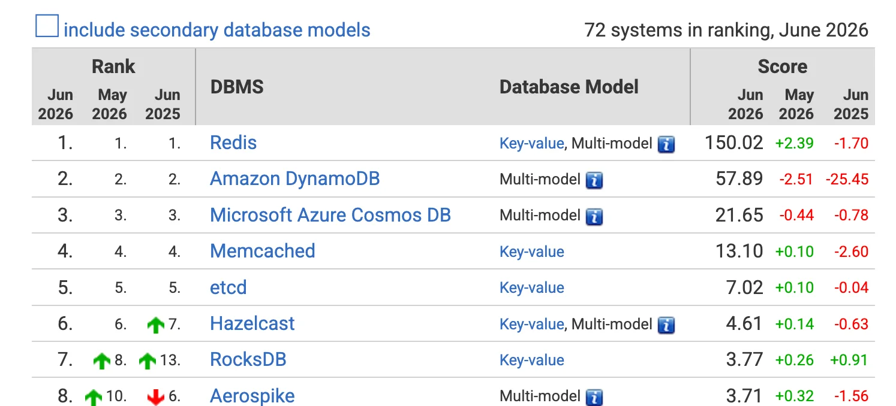

- <a href="http://db-engines.com">db&#45;engines&#46;com</a> 순위에 의하면 Key&#45;Value Store 중 Redis가 1위, Memcached가 4위 이다&#46;

</details>

<details>
<summary>Key&#45;Value Store</summary>

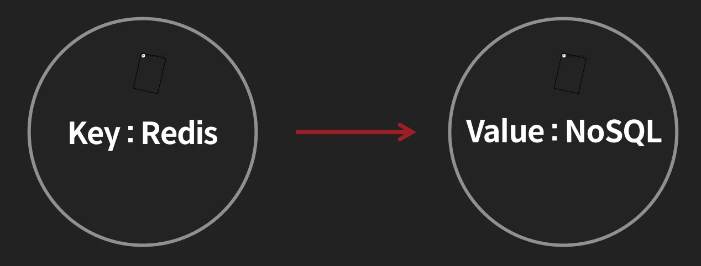

- 데이터를 지칭하는 Key 와 이에 대한 데이터를 저장하는 Value 구조

- 위 <code>Redis&#58; NoSQL</code>로  저장 시 <code>Redis</code> 라는 key를 가지고 <code>NoSQL</code> 이라는 Value를 조회한다&#46;

</details>

<details>
<summary><code>Redis</code> vs <code>Memcached</code></summary>

- <code>Redis</code>
    - 많은 자료구조(Collection)을 제공한다&#46; 

    - Replication을 제공해서 더 서비스를 안정적으로 제공할 수 있다&#46;

    - Cluster 모드를 제공한다&#46; 

- <code>Memcached</code>
    - Redis에 비해 메모리 관리가 더 안정적이다&#46; 

</details>

<a id="388eda9b0fe1807d83cbec10ca03c88f"></a>

## Redis 자료구조

> 
> 
> <details>
> <summary>Redis 설명</summary>
> 
> - Repository
>     - <a href="https://github.com/redis/redis">https&#58;//github&#46;com/redis/redis</a>
> 
> - <strong>In&#45;Memory Key&#45;Value</strong> NoSQL
>     - In&#45;Memory Cache Solution
> 
> - Open Source
>     - BSD 3 License
> 
> - Support Data Structures
>     - Strings, Set, Sorted&#45;Set
> 
>     - Hash, List 등
> 
>     - Stream
> 
> - Cluster 도 제공
> 
> </details>
> 
> <details>
> <summary>Redis 사용</summary>
> 
> - 주로 Cache를 저장하기 위한 저장소 
> 
> - 특수한 케이스는 DB 자체로 Redis를 사용
>     - SQL 지원 ❌
> 
> - 주로 사용하는 기업들
>     - 국내 
>         - 네이버, 카카오, 쿠팡, 배민 등에서 많이 사용
> 
>         - 국내 대규모 서비스를 제공하는 곳은 전부라고 생각해도 됨
> 
>     - 해외
>         - 트위터, 페이스북, 넷플릭스, 애플, 아마존 등 큰 기업에서도 사용
> 
> </details>

> ✏️ 
> 
> <a id="388eda9b0fe1800280bdfe8d0dbd9242"></a>
> 
> Redis 제공 자료 구조
> 
> - <code>Strings</code>
> 
> - <code>List</code>
> 
> - <code>Set</code>
> 
> - <code>Hash</code>
> 
> - <code>Sorted Set</code>

<a id="388eda9b0fe1803b8520c6aecaeb2efa"></a>

### 기본적으로 <code>Hash Table</code> 구조 사용

[해시 테이블(Hash table)]()

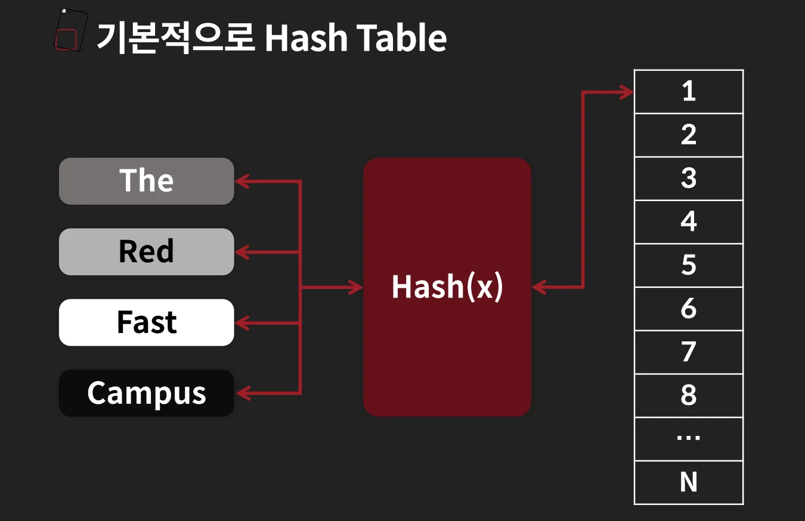

<details>
<summary>Value 삽입 → <strong><code>개별 체이닝(Separate Chaining)</code></strong></summary>

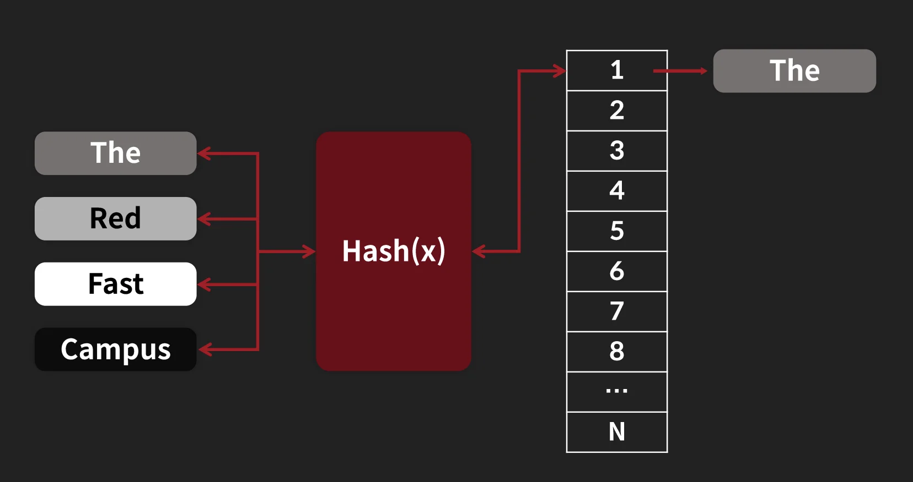

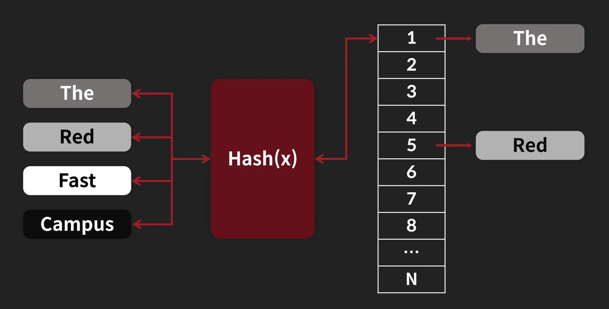

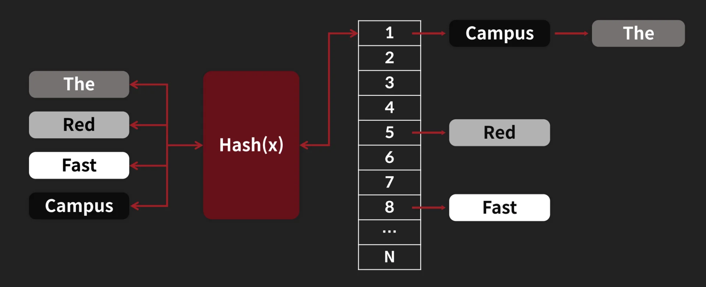

- 위 그림과 같이 포인터(연결리스트) 방식으로 데이터를 할당한다&#46; 

</details>

<a id="388eda9b0fe180bea452e5bd9d22c9f4"></a>

### <strong>Strings</strong>

> ✏️ 
> 
> <a id="388eda9b0fe180299596f57ed50f2ee8"></a>
> 
> <code>Key&#45;Value</code>를 사용하는 자료구조 
> 
> - Key를 이용해 Date 조회
> 
> - 기본 구조인 Hash Table 사용

<details>
<summary>데이터 저장/조회&#58; <code>set</code>, <code>get</code></summary>

> ❗ 
> 
> <a id="38aeda9b0fe1805a868ee2615ffe653c"></a>
> 
> set, get의 데이터 사이즈가 너무 크지 않도록 조절할 필요가 있다&#46; 
> 
> - 많으면 몇 k, 몇십 k 수준으로 조절하는 것이 좋다&#46; 
> 
> - 꽤 많은 크기가 들어가면 그 데이터를 가져오는 데 시간이 걸리기 때문에 서비스의 속도가 떨어질 수 있다&#46; 

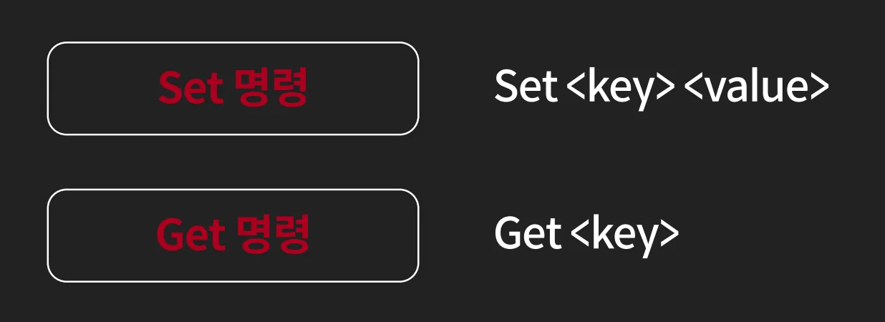

- ex)
    <a id="388eda9b0fe180cab18debf4b3029fcf"></a>

    ```python
    # 데이터 저장 - set <key> <value>
    127.0.0.1:6379>set api:feeds:1234 "{'user_id':1234}"
    OK

    # 데이터 조회 - get <key>
    127.0.0.1:6379>get api:feeds:1234
    "{'user_id':1234}"
    ```

</details>

<details>
<summary>여러 데이터 저장/조회&#58; <code>mset / mget</code></summary>


- example
    <a id="388eda9b0fe18095b41fff4b04bd679b"></a>

    ```python
    # 데이터 저장 - mset <key> <value> <key> <value> ...
    127.0.0.1:6379>mset api:feeds:1234 "{}" api:feeds:1235 "{'user_id':1234}"
    OK

    # 데이터 조회 - mget <key> <value> <key> <value> ...
    127.0.0.1:6379>mget api:feeds:1234
    1) "{}"

    127.0.0.1:6379>mget api:feeds:1234 api:feeds:1235
    1) "{}"
    2) "{'user_id':1234}"
    ```

</details>

---

<details>
<summary>ex) <code>python</code></summary>

<details>
<summary>redis 의존성 설치</summary>

<a id="388eda9b0fe1802e9ba7e20b05986e6d"></a>

```bash
pip install redis or pip3 install redis
```

</details>

<a id="388eda9b0fe180258cdad9c2cac4f0ec"></a>

```python
# test.py
import redis

rconn = redis.StrictRedis("127.0.01". 6379)
key = "api:feeds:1234"
value = "{'user_id': 1234}"

rconn.set(key.value)
value2 = rconn.get(key)

print("value", value)
print("value2", value2)
```

<a id="388eda9b0fe18081a740ca58ffe9622f"></a>

```bash
python3 test.py
# value: "{'user_id': 1234}"
# value2: "{'user_id': 1234}"
```

</details>

<details>
<summary>ex) <code>sql</code> vs <code>redis</code></summary>

<a id="388eda9b0fe180da9708c56a980cb3b0"></a>

```sql
# Schema
Create table Users(
	name varchar(100)
	email varchar(100)
);

# SQL
Insert into users(name, email) values('Lee', 'dltjq2323@gmail.com')

# Set
set name:'Lee'
set email:'dltjq2323@gmail.com'

# mset
mset name:'Lee' email:'dltjq2323@gmail.com'
```

- expire를 해서 TTL을 걸면 위와 같은 데이터들이 서로 독립적으로 존재하면 사라질 수도 있다&#46; 
    <a id="38aeda9b0fe18067b37ecbf821635734"></a>

    따라서 hash 등을 통해서 관리하는 게 더 좋다&#46; 

- mset, mget을 사용할 때도 key를 50개 정도 사용하는 것이 좋고 너무 많은 key를 사용하면 싱글스레드인 redis에서는 한번에 계속 돌기 때문에 다른 명령어를 처리할 수 없다&#46; 
    <a id="38aeda9b0fe180748747f6443ffe8431"></a>

    따라서 mget의 조회 개수를 줄여서 처리량을 낮추는 게 중요하다&#46; 

</details>

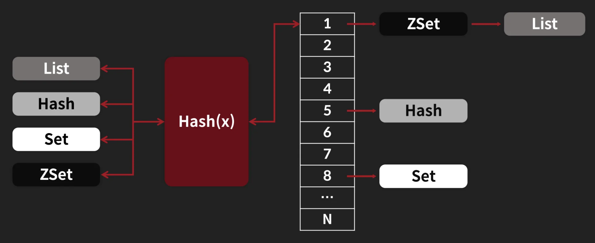

<a id="388eda9b0fe180e2ad69c03f88161526"></a>

### List

> ✏️ 
> 
> <a id="388eda9b0fe1802dbce3c061697b03c5"></a>
> 
> Redis에서 제공하는 List 자료구조
> 
> - 중간 추가/삭제가 느리고, Head, Tail 에만 데이터 <code>추가/삭제</code>할 때 유용한 자료구조
>     - <code>O(N)</code>이라 선형 탐색의 비용이 비싸다&#46;
>         <a id="388eda9b0fe18049a2f2cc33669acea4"></a>
> 
>          →  <code>연결리스트</code>로 구성된 것 같음
> 
> - Queue 형태의 자료구조가 필요할 때 많이 사용
>     - <code>SideKiq</code> 이나 <code>Jesque</code> 라는 Redis 기반의 Queue들 존재

<details>
<summary>데이터 삽입/제거&#58; <code>push</code>, <code>pop</code></summary>

> 
> 
> - Push 명령어
>     <a id="38aeda9b0fe180c9b123ed513ce40a38"></a>
> 
>     ```bash
>     Lpush <key> <value>
>     Rpush <key> <value>
>     ```
> 
>     - <code>Lpush</code>&#58; 왼쪽 추가, <code>Rpush</code>&#58; 오른쪽 추가
> 
> - Pop 명령어
>     <a id="38aeda9b0fe18061b6f5ef3952a6d1cb"></a>
> 
>     ```bash
>     Lpop <key>
>     Rpop <key>
>     ```
> 
>     - <code>Lpop</code>&#58; 왼쪽 요소 꺼내오기, <code>Rpush</code>&#58; 오른쪽 요소 꺼내오기

- ex)
    <a id="388eda9b0fe1802395b2fa54ff3933b5"></a>

    ```python
    Lpush list1 1
    # (1)

    Lpush list1 2
    # (2, 1)

    Rpush list1 3
    # (2, 1, 3)

    Rpop list1
    # return 3
    # (2, 1)

    Lpop list1
    # return 2
    # (1)
    ```

</details>

<details>
<summary>리스트 아이템 조회&#58; <code>lrange</code></summary>

> 
> 
> - Irange 명령어
>     <a id="38aeda9b0fe180bea292c24a0a87325e"></a>
> 
>     ```bash
>     lrange <key> <시작 인덱스> <끝 인덱스>
>     ```
> 
>     - List의 아이템들을 조회

</details>

---

<details>
<summary>ex) <code>redis cli</code></summary>

<a id="388eda9b0fe180428ebaf41ea1ea84fb"></a>

```python
# ex 1
127.0.0.1:6379>lpush listkey 1
(integer) 1

127.0.0.1:6379>lpush listkey 2
(integer) 2

127.0.0.1:6379>lpush listkey 3
(integer) 3

127.0.0.1:6379>lrange listkey 0 -1
1) "2"
2) "1"
3) "3"
```

<a id="388eda9b0fe18043971de180d90e5c43"></a>

```python
# ex 2
127.0.0.1:6379>lpop listkey
"2"

127.0.0.1:6379>lrange listkey 0 -1
1) "1"
2) "3"

127.0.0.1:6379>rpop listkey
"3"

127.0.0.1:6379>lrange listkey 0 -1
1) "1"
```

</details>

<details>
<summary>ex) <code>python</code> &#45; <strong>List, 큐로 사용</strong></summary>

<details>
<summary>redis 의존성 설치</summary>

<a id="388eda9b0fe180049823eb8843b9f087"></a>

```bash
pip install redis or pip3 install redis
```

</details>

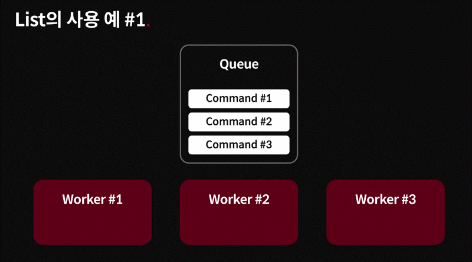

> ✏️ 
> 
> <a id="38aeda9b0fe1805c971cffaf59051143"></a>
> 
> <code>큐(First In First Out)</code> 자료구조로 사용 시 List를 사용한다&#46; <br>즉, 아래와 같은 패턴으로 명령어를 사용한다&#46;
> 
> - <code>lpush</code> → <code>rpop</code>
> 
> - <code>rpush</code> → <code>lpop</code>

> 🤔 
> 
> <a id="38aeda9b0fe180ca920ec4c7451fa3ea"></a>
> 
> <strong><u><code>b</code></u></strong><code>rpop</code> (b = blocking)
> 
> - <code>rpop</code>, <code>lpop</code> 등 데이터가 없으며 바로 return 한다&#46;<br> 하지만 <code>brpop</code>, <code>blpop</code>은 데이터가 없으면 데이터가 생길 때까지 대기 후 처리한다&#46; 
> 
> - <code>rpop</code>, <code>lpop</code>의 경우 데이터 체크(확인)를 polling 형태로 던져서 확인하는데  <code>brpop</code>, <code>blpop</code>의 경우 대기 후 처리하기 때문에 큐 입장에서는 굉장히 편하게 데이터 처리가 가능하다&#46; 

<a id="388eda9b0fe1806d8926ee04b3b0c9da"></a>

```python
# job 추가
import redis
import time

rconn = redis.StrictRedis("127.0.01". 6379)

key = "job:imagetransform"
value = time.time()

rconn.lpush(key, value)
```

<a id="388eda9b0fe180c6b429e9407125bce8"></a>

```python
# job 처리
import redis

rconn = redis.StrictRedis("127.0.01". 6379)

key = "job:imagetransform"

while True:
		value = rconn.brpop(key)
		print("value:", value)
```

</details>

<a id="388eda9b0fe180d1bca9f81346513c07"></a>

### Set

> ✏️ 
> 
> - 유일한 값들만 있는 집합을 유지하는 자료구조
>     - 중복된 값 할당 X
> 
> - 친구 리스트, 팔로워 리스트 등 저장하는데 사용 가능
>     - 특정 그룹을 저장할 때 사용 가능

> 
> 
> <a id="388eda9b0fe1801ebcbed8dddd18ca9f"></a>
> 
> 명령어
> 
> - SADD
>     <a id="388eda9b0fe180149e9cd7bec37817b0"></a>
> 
>     ```bash
>     sadd <key> <item>
>     ```
> 
>     - Set에 데이터 추가
> 
> - SISMEMBER
>     <a id="388eda9b0fe180e8b9c5d28a7f611644"></a>
> 
>     ```bash
>     sismember <key> <item>
>     ```
> 
>     - Set에 해당 Item이 있는지 확인
> 
>     - 데이터 있으면 1, 없으면 0
> 
> - SREM
>     <a id="388eda9b0fe180fa8ad3dce3a4932431"></a>
> 
>     ```bash
>     srem <key> <item>
>     ```
> 
>     - Set에 해당 Item이 있으면 삭제
> 
>     -  rem&#58; remove의 약자
> 
> - SMEMBERS
>     <a id="38aeda9b0fe180e09eaac5c18a078876"></a>
> 
>     ```bash
>     smembers <key>
>     ```
> 
>     - key에 해당되는 모든 value들을 조회

<details>
<summary>ex) <code>redis cli</code></summary>

<a id="388eda9b0fe1804089bfc4b94e63edc2"></a>

```python
127.0.0.1:6379>sadd setkey one
(integer) 1

127.0.0.1:6379>sadd setkey two
(integer) 1

127.0.0.1:6379>sismember setkey one
(integer) 1

127.0.0.1:6379>sismember setkey three
(integer) 0

127.0.0.1:6379>smembers setkey
1) "two"
2) "one"

127.0.0.1:6379>srem setkey one
(integer) 1

127.0.0.1:6379>smembers setkey
1) "two"
```

</details>

<details>
<summary>ex) <code>python</code></summary>

<details>
<summary>redis 의존성 설치</summary>

<a id="388eda9b0fe180aa8143cdef027e0b5a"></a>

```bash
pip install redis or pip3 install redis
```

</details>

<a id="388eda9b0fe1804b9043dd0102aadf57"></a>

```python
# test.py
import redis
import time

rconn = redis.StrictRedis("127.0.01". 6379)
key = "set:userlist"

rconn.sadd(key, 1)
rconn.sadd(key, 2)
rconn.sadd(key, 2)
rconn.sadd(key, 3)

print("sismember2: ", rconn.sismember(key, 2))
print("sismember4: ", rconn.sismember(key, 4))
print(rconn.sismember(key))
```

<a id="388eda9b0fe180eebe98c81e5b2d6a07"></a>

```bash
python3 test.py
# sismember 2: True
# sismember 4: False
# {b'2', b'1', b'3'}
```

</details>

<a id="388eda9b0fe1806da748ccd99fd33711"></a>

### Sorted Set

> ✏️ 
> 
> - 스코어를 가지는 Set 자료구조
> 
> - 아이템들을 랭킹을 가지는데 사용 가능
> 
> - 스코어는 Double 형태이므로, 특정 정수값을 사용할 수 없음
> 
> - 메모리를 아끼기 위해 작은 경우 <code>Quick List</code> 형태로 저장하지만
> 
> - 기본적으로 <code>Skiplist</code> 자료구조 사용한다&#46;
>     [화면 기록 2026-06-23 오후 11.13.18.mov](6c5832e2cd76a0ae.mov)

<details>
<summary>데이터 저장/조회&#58; <code>ZADD</code>, <code>ZRANGE</code></summary>

> 
> 
> - ZADD
>     <a id="388eda9b0fe180b0a2e5c710fe2a922a"></a>
> 
>     ```bash
>     ZADD <key> <score> <item>
>     ```
> 
>     - Sorted Set 에 item 추가
> 
>     - Value가 이미 존재하면 해당 score로 변경됨
> 
> - ZRANGE
>     <a id="388eda9b0fe180538a07cd181f04ec7f"></a>
> 
>     ```bash
>     ZRANGE <key> <start index> <end index>
>     ```
> 
>     - 요청한 Range의 item들을 가져옴
> 
>     - <code>Zrange &#60;key&#62; 0 &#45;1</code> 로 모든 item 조회 가능

<details>
<summary>ex) <code>redis cli</code></summary>

<a id="388eda9b0fe18078b425e199b258d28f"></a>

```python
127.0.0.1:6379>zadd zaddkey 10 one
(integer) 1

127.0.0.1:6379>zadd zaddkey 40 twe
(integer) 1

127.0.0.1:6379>zadd zaddkey 5 three
(integer) 1

# zrange - 스코어 순으로 오름차순 조회
127.0.0.1:6379>zrange zaddkey 0 -1
1) "three"
2) "one"
3) "two"

# zrevrange - 스코어 순으로 내림차순 조회
127.0.0.1:6379>zrevrange zaddkey 0 -1
1) "two"
2) "one"
3) "three"
```

</details>

</details>

<details>
<summary>조회&#58; <code>ZREVRANGE</code>, <code>ZRANGEBYSCORE</code></summary>

> 
> 
> - <code>ZREVRANGE</code>
>     <a id="388eda9b0fe1804a9eefdf9b2ebe65d8"></a>
> 
>     ```bash
>     ZREVRANGE <key> <start index> <end index>
>     ```
> 
>     - 요청한 Range의 Item들을 score 역순으로 가져온다&#46; 
> 
>     - <code>Zrevrange &#60;key&#62; 0 &#45;1</code>로 모든 item 조회 가능
> 
> - <code>ZRANGEBYSCORE</code>
>     <a id="388eda9b0fe1802190f1f806f65f34d7"></a>
> 
>     ```bash
>     ZRANGEBYSCORE <key> <start score> <end score>
>     ```
> 
>     - 요청한 Score Range의 Item들을 가져온다&#46; 

<details>
<summary>ex) <code>redis cli</code></summary>

<a id="388eda9b0fe180a58bb2dcd87f48bc93"></a>

```python
127.0.0.1:6379>zadd zaddkey 10 one
(integer) 0

127.0.0.1:6379>zadd zaddkey 40 twe
(integer) 0

127.0.0.1:6379>zadd zaddkey 5 three
(integer) 0

# 범위 점수 내 아이템 조회
127.0.0.1:6379>zrangebyscore zaddkey 5 40
1) "three"
2) "one"
3) "two"

127.0.0.1:6379>zrangebyscore zaddkey 5 30
1) "one"
2) "three"
```

</details>

</details>

---

<details>
<summary>ex) <code>python</code></summary>

<details>
<summary>redis 의존성 설치</summary>

<a id="388eda9b0fe180cfb396f5020353c402"></a>

```bash
pip install redis or pip3 install redis
```

</details>

<a id="388eda9b0fe1801b9ce9e7a5df940c37"></a>

```python
# test.py
import redis
import time

rconn = redis.StrictRedis("127.0.01". 6379)

key = "zset:zset"
rconn.zadd(key, {"v1":1})
rconn.zadd(key, {"v2":2})
rconn.zadd(key, {"v3":3})
rconn.zadd(key, {"v4":4})

print(rconn.zrange(key, 0-1, withscores=True))
```

<a id="388eda9b0fe180cca747e51ed0926c19"></a>

```bash
python3 test.py
# [(b'v1', 1.0), (b'v2', 2.0), (b'v3', 1.0), (b'v4', 3.0)]
```

</details>

<details>
<summary>ex) <code>sql</code> vs <code>redis cli</code></summary>

<a id="388eda9b0fe180f59b1ef2df602a8a1d"></a>

```sql
# Schema
Create table Users(
	name varchar(100)
	email varchar(100)
);
```

<a id="388eda9b0fe180f78ac1e31a7cde6beb"></a>

<strong>비교 1</strong>

<a id="388eda9b0fe180b3b379d91442ba97f2"></a>

```python
# SQL 1
select * from rank where score >= 70 and score < 100

# zrangebyscore 1
zrangebyscore rank 70 (100
```

<a id="388eda9b0fe1800f866fc56eff237cea"></a>

<strong>비교 2</strong>

<a id="388eda9b0fe180078537c42173ce1fa7"></a>

```python
# SQL 2
select * from rank where score > 70 and score < 100

# zrangebyscore 2
zrangebyscore rank (70 (100
```

<a id="388eda9b0fe180559a2cd45e4d32394e"></a>

<strong>비교 3</strong>

<a id="388eda9b0fe180848682f4f2b04ef35d"></a>

```python
# SQL 3
select * from rank where score >= 70

# zrangebyscore 3
zrangebyscore rank 70 + inf
```

</details>

<a id="388eda9b0fe180d68abed2aaacb4b43f"></a>

### Hash

> ✏️ 
> 
> <a id="388eda9b0fe180e5b6bdce9889813551"></a>
> 
> Key 하위에 Subkey를 이용해 추가적인 Hash Table을 제공하는 자료구조
> 
> - 일반적인 Key/Value 데이터를 특정군의 데이터로 묶고 싶을 때 유용함

<details>
<summary><strong>subkey&#45;value</strong> 추가/조회&#58; <code>hset</code>, <code>hget</code></summary>

> 
> 
> <a id="388eda9b0fe180589ca2d780918c70b6"></a>
> 
> <strong>Hset</strong>
> 
> <a id="388eda9b0fe180609922e386f5c6c9ac"></a>
> 
> ```bash
> hset <key> <subkey> <value>
> ```
> 
> - Subkey에 Value 추가
> 
> <a id="388eda9b0fe1803eba4ce6b2c88bc326"></a>
> 
> <strong>Hget</strong>
> 
> <a id="388eda9b0fe18029bd0dd695da77b64e"></a>
> 
> ```bash
> hget <key> <subkey>
> ```
> 
> - Subkey로 Value 조회

</details>

<details>
<summary>여러 개의 <strong>subkey&#45;value </strong>추가/조회&#58; <code>hmset</code>, <code>hmget</code></summary>

> 
> 
> <a id="388eda9b0fe180b1a4c0d29f2b8205e9"></a>
> 
> <strong>Hmset</strong>
> 
> <a id="388eda9b0fe18067a593cdeeea546c14"></a>
> 
> ```bash
> Hmset <key> <subkey> <value> <subkey> <value> ...
> ```
> 
> - 여러 Subkey&#45;Value 추가
> 
> <a id="388eda9b0fe180dfb5ede89d275904fa"></a>
> 
> <strong>Hmget</strong>
> 
> <a id="388eda9b0fe1806892c8f15feb545014"></a>
> 
> ```bash
> Hmget <key> <subkey> <subkey> <subkey> ...
> ```
> 
> - 여러 Subkey로 Value들을 조회

</details>

<details>
<summary>전체 조회&#58; <code>hgettall</code></summary>

> 
> 
> <a id="388eda9b0fe18009bfc4c7ee4708582e"></a>
> 
> 모든 subkey 와 value를 가져온다&#46; 
> 
> - <code>Hgetall &#60;key&#62;</code>

> ❗ 
> 
> <a id="38aeda9b0fe18042a32bcec0a55eb656"></a>
> 
> <strong>Collection에 너무 많은 키를 넣으면 안된다&#33;</strong>
> 
> <a id="38aeda9b0fe1805e820fe44d2f5f5c27"></a>
> 
> 해당 장애의 원인 추적 <code>Hgetall</code> 명령어를 많이 사용한다&#46;

</details>

---

<details>
<summary>ex) <code>redis cli</code></summary>

<a id="388eda9b0fe180d29cb8d7a673ef133a"></a>

```python
127.0.0.1:6379>hset hsetkey name lee
(integer)1

127.0.0.1:6379>hget hsetkey name
"lee"

127.0.0.1:6379>hmset hsetkey name1 c1 name2 c2
OK

127.0.0.1:6379>hmget hsetkey name1 name2
1) "c1"
2) "c2"

127.0.0.1:6379>hgetall hsetkey
1) "name"
2) "lee"
3) "name1"
4) "c1"
5) "name2"
6) "c2"
```

</details>

<details>
<summary>ex) <code>python</code></summary>

<details>
<summary>redis 의존성 설치</summary>

<a id="388eda9b0fe1803595fef567b94126cd"></a>

```bash
pip install redis or pip3 install redis
```

</details>

<a id="388eda9b0fe1805387d3ed96e4b1f1ad"></a>

```python
# hash.py
import redis
import time

rconn = redis.StrictRedis("127.0.01". 6379)

key1 = "hash:hash1"
key2 = "hash:hash2"

rconn.hset(key1, "name", "hash1")
rconn.hset(key1, "age", "30")

print(rconn.hgetall(key1))
# {b'name':b'hash1', b'age':b'30'}

rconn.hset(key2, mapping={"name":"hash2", "age":"40"})

print(rconn.hgetall(key2))
# {b'name':b'hash2', b'age':b'40'}
```

- 결과
    <a id="388eda9b0fe18032bbc7edfc99cb96d9"></a>

    ```bash
    python3 hash.py
    # {b'name':b'hash1', b'age':b'30'}
    # {b'name':b'hash2', b'age':b'40'}
    ```

</details>

<details>
<summary>ex) <code>sql</code> vs <code>redis</code></summary>

<a id="388eda9b0fe1804997b7ee763d9fb3ec"></a>

```sql
# Schema
Create table Users(
	name varchar(100)
	email varchar(100)
);

# SQL
Insert into users(name, email) values('Lee', 'dltjq2323@gmail.com')

# hset <key> <subkey> <value>
hset key1 name:'Lee'
hset key1 email:'dltjq2323@gmail.com'

# hmset <key> <subkey1> <value1> <subkey2> <value2>
hmset key1 name 'Lee' email 'dltjq2323@gmail.com'
```

</details>

<a id="388eda9b0fe180509d9ed01d2b58c262"></a>

### Redis Transaction&#58; <code>Multi/Exec</code>

> ✏️ 
> 
> <a id="38aeda9b0fe180729db3c7fec12a3ee2"></a>
> 
> Redis는 <code>single thread</code>이기 때문에 <strong><u>atomic(원자성)을 보장</u></strong>해준다&#46; <br>이때, 즉, atomic(원자성)을 보장해 줄 때도 여러 명령들을 동시에 실행되기 원할 때 사용할 수 있는 방법이다&#46; 
> 
> - Redis Transaction으로 부름
> 
> > 명령어
> 
> - <code>Multi</code>
>     - <code>Exec</code>가 나올 때 까지 명령을 모아서 대기
> 
> - <code>Exec</code>
>     - Exec 실행 시 Multi로 모인 명령이 순서대로 실행
>         - 다른 명령의 수행없이 수행됨
> 
>         - Redis는 <strong>Single Threaded</strong> 형태이므로 다른 명령이 이 동안에 수행되지 않는다&#46; 
> 
>         - <strong><u>너무 많은 작업</u></strong>이 있으면 <strong>전체 Redis 성능이 떨</strong>어진다&#46;

- ex)
    <a id="388eda9b0fe1808ea9f5d9965e6f50c5"></a>

    ```python
    Multi
    Set A 123
    Set B 123
    Exec
    ```

<a id="388eda9b0fe180748365f5b3522e105e"></a>

### Redis Pipeline

> ✏️ 
> 
> - redis pipeline은 redis에서 제공하는 기능이 아닌 library에서 제공하는 기능이다&#46;
>     - 라이브러리 응답을 기다리기 떄문에 발생했던 현상을 줄여준다&#46; 
> 
> - 보통 Sync 클라이언트에서 많이 사용한다&#46;
>     - <strong><u>Sync 형태를 사용</u></strong>한다면 pipeline의 개념을 인지하고 <strong><u>batch 작업 등에 적용</u></strong>하면 <strong><u>굉장히 빠른 속도를 얻</u></strong>을 수 있다&#46;
> 
> - <code>Async Redis Client</code>라면 Redis Pipeline 기능을 따로 제공할 필요가 없이 빠른 편이다&#46;
>     - ex&#46; Java의 Lettuce Redis Client

<a id="38aeda9b0fe180d9a876ddcb0372a684"></a>

#### Pipeline 적용 전, 후

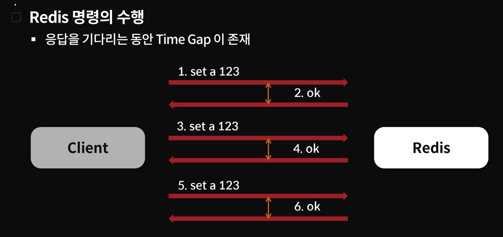

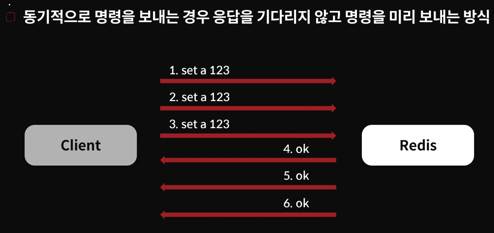

<a id="38aeda9b0fe1806e89fbd3a2bc52f883"></a>

Pipeline 적용 전 <strong>동기(Sync) 작업에 대해서 응답을 기다려야하는 병목이 발생</strong>된다&#46;

<a id="38aeda9b0fe1800988e3f5eb1acf48af"></a>

이를 pipeline 적용 후 <strong><u>응답을 대기하지 않고 바로 처리</u></strong>하기 때문에 빠르게 처리 가능하다&#46; 

> 🤔 
> 
> <a id="38aeda9b0fe1804a90fddb101b7b40a9"></a>
> 
> <code>Redis Pipeline</code> vs <code>Non&#45;Pipeline</code> 
> 
> <a id="38aeda9b0fe18075b009f33fc6d3c9ec"></a>
> 
> 100만개 set 하는 테스트에서 파이프라인 사용 유무가 <strong><u>약 10배 이상 차이</u></strong>가 난다&#46; 
> 
> <a id="38aeda9b0fe180c18e88ee01dea788f1"></a>
> 
> ```python
> python main.py 1000000
> ```
> 
> - Pipeline&#58; Elapsed time&#58; <code>12&#46;49348433315754 3580331&#46;0556506693580318&#46;562166336</code>
> 
> - No&#45;Pipeline Elapsed time&#58; <code>184&#46;35796361975372<br>3580515&#46;41368836 3580331&#46;05572474</code>

<a id="38aeda9b0fe1802484eff2b97339852b"></a>

‣

<a id="38aeda9b0fe180179b90cfed35c5370c"></a>

```python
from time import perf_counter

import redis
import sys


# 실행시간: 18초 (약 10배 이상 빠름)
def pipeline(conn, n):
    t1_start = perf_counter()
    pipeline = conn.pipeline()
    # 명령들의 응답을 대기하지 않고 무조건 써버리고 끝나면 그 응답을 기다린다.
    for i in range(n):
        key = 'PR:%s'%(i)
        pipeline.set(key, key)
        if i%1024 == 0:
            pipeline.execute();

    t1_stop = perf_counter()
    print("Pipeline: Elapsed time:", t1_stop - t1_start, t1_stop, t1_start) 


# 실행시간: 184초
def no_pipeline(conn,n):
    t1_start = perf_counter()
    for i in range(n):
        key = 'PR:%s'%(i)
        conn.set(key, key)

    t1_stop = perf_counter()
    print("No-Pipeline Elapsed time:", t1_stop - t1_start, t1_stop, t1_start) 

rconn = redis.StrictRedis(host='127.0.0.1', port=6379, db=0)

pipeline(rconn, int(sys.argv[1]))
no_pipeline(rconn, int(sys.argv[1]))
```
