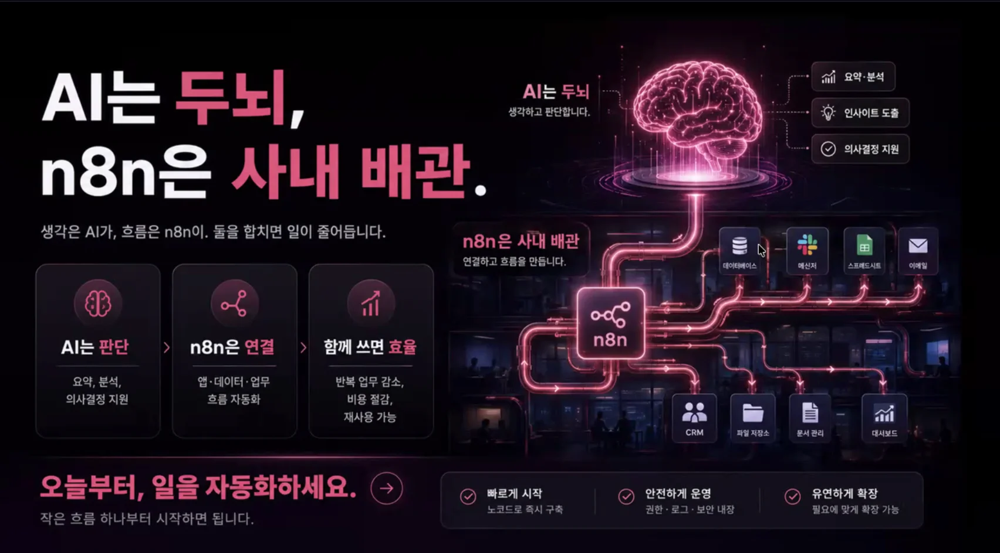

> 
> 
> 
> 
> <strong>n8n 이점</strong>
> 
> - 플로우 가시적으로 확인 가능
> 
> - 비개발자와 협업 용이
> 
> - 유지보수, 버전 관리 용이
> 
> - 폐쇠망 사용 가능
> 
> - 토큰 최적화 

- self&#45;hosted&#45;ai&#45;starter&#45;kit  셀프 호스팅
    

    ‣

    - self&#45;hosted&#45;ai&#45;starter&#45;kit 을 클로드코드에게 던져주면 선택지를 통해 쉽게 셀프 호스팅 가능함

- docs 
    - ‣

- n8n mcp를 통해 노드 생성이 예전에 비해 굉장히 쉬워짐
    > ‣

    - 안정화가 많이 됨

    - hermes agent → n8n 노드 생성

### 자동화 사례

- 영업
    - 홈페이지 문의 → 회사 정보 자동 조회  → AI 점수 → CRM 자동 입력

- 회계
    - 메일로 온 PDF 청구서 → 글자 금액 자동 추출 → 검증 → 구글 시트 입력

- 오더 운영
    - 30분마다 주문 자동 수집 → 재고 차감 → 슬랙 알람

- 사업
    - cron job 으로 경쟁사 보고서 작성

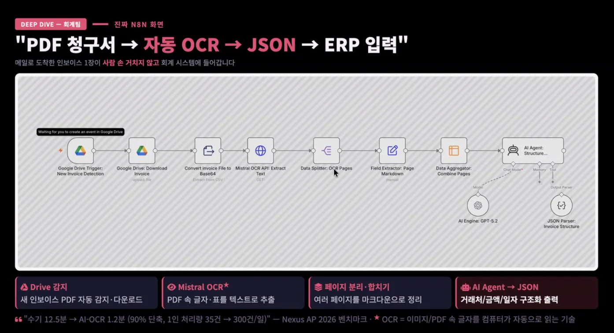

- 이러한 작업들을 토큰으로 진행 시 굉장히 많은 토큰 비용이 든다&#46; 

- 로그를 쌓아서 관리 용이

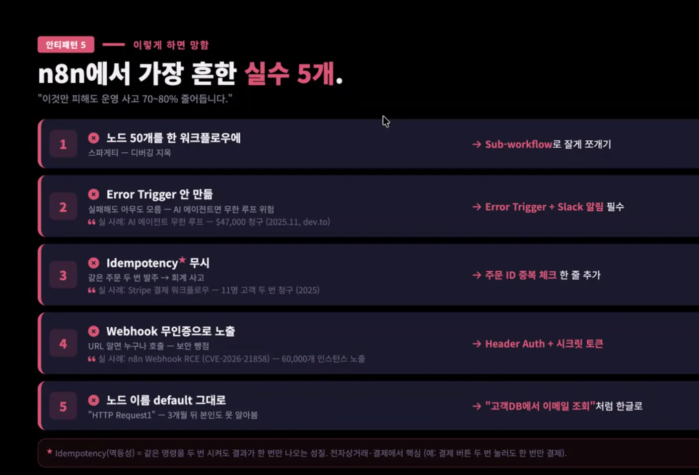

- 솔라피  → 문자

ERP, 회계 → 같은 주문 재요청

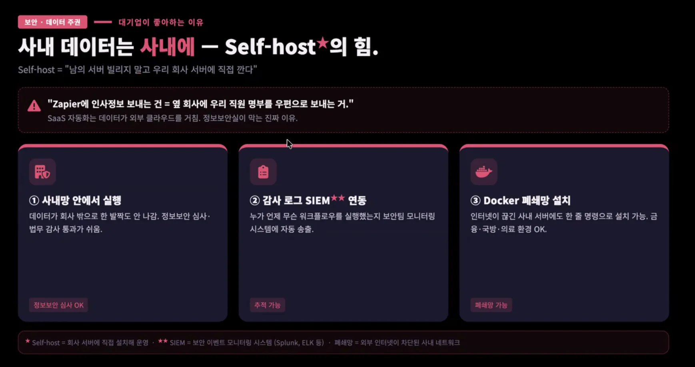

- 감사 로그 
    - AI 기본법 등 감사

    - 로그 값으로 해결

### 에이전트 ai 굉장히 비싸다 

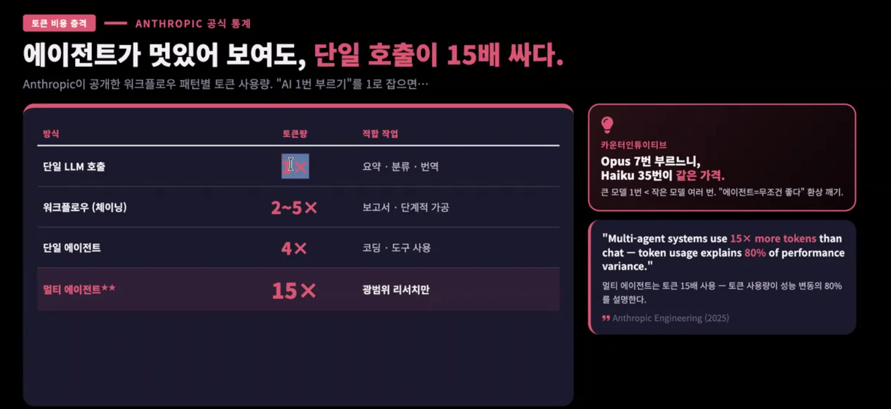

리서치, 병렬 에이전트 → 토큰 소모 급증

토큰 사용량 대비 ROI 작업 측정

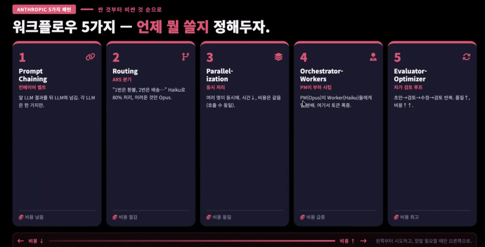

- 프롬프트 체이닝
    - 비용 낮음

- 라우팅
    - 비싼 모델만 사용할 수 없음

    - 값싼 모델들을 잘 분배해서 사용해야 함

- 동시 처리 ( Parallel&#45;ization )

- 오케스트레이터
    - PM, Worker 들에게 일 분배

    - 토큰 사용 폭증

- 자가 검토 루트
    - 토큰 사용 폭증

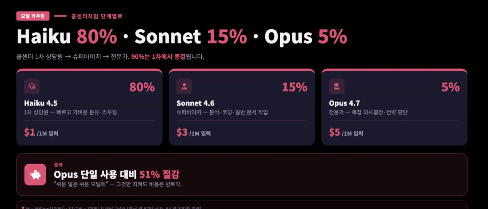

- 오픈클로, 나노클로, 에르메스 에이전트

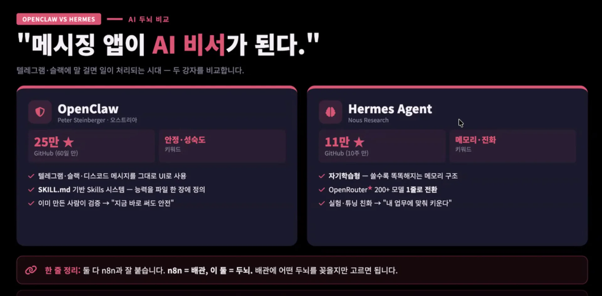

- 비서 → ai 에이전트

- 반복 작업 →  N8N

에르메스 에이전트가 n8n 워크플로를 더 잘만들고 가볍다&#46;

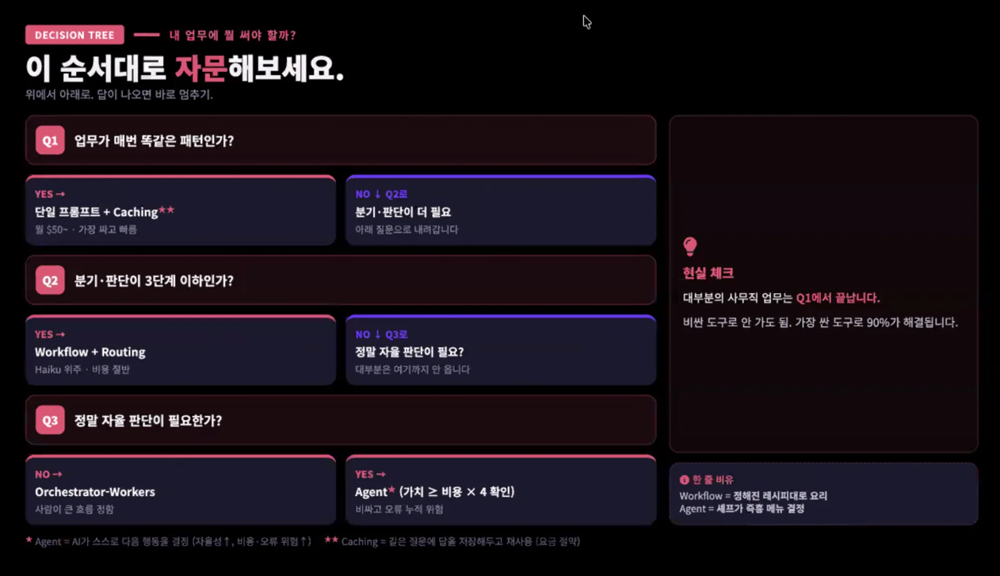

- 간단 작업 &#45; 단일 프롬프트, caching

- 분기 판단 &#45; if / switching, routing → n8n 

- 자율 판단 → 오픈클로, 에르메스 에이전트

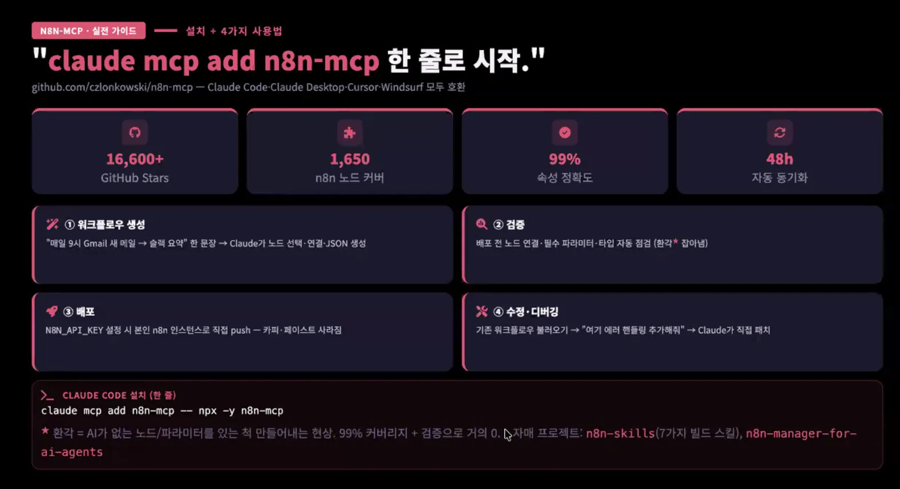

## 에르메스 에이전트, mcp 연동

- 클라우드 
    - n8n 서버 api 키 발급 후 hermess 세팅 
        - 보안 주의 &#45; 채팅창으로 넣지 않기

- 채팅창 대신, 터미널 창으로? 물어보면 잘 알려줘

- 워크플로 생성, publish, 검증까지 가능
    - 자연어만은 권장하지 않음

    - human in the loop가 있어야 검증 가능

- 손으로 하는 것보다는 느릴 수 있다

- 사내 폼 링크 자동화도 가능

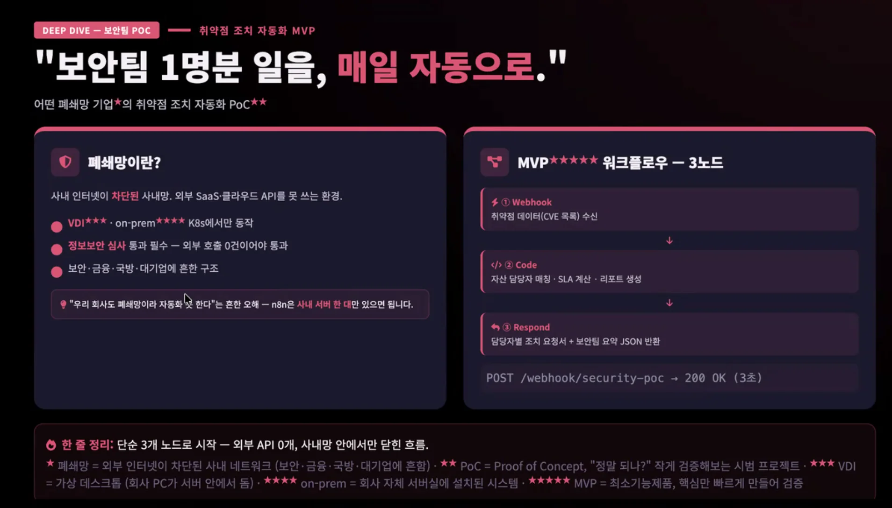

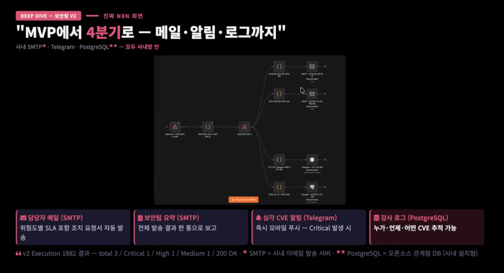

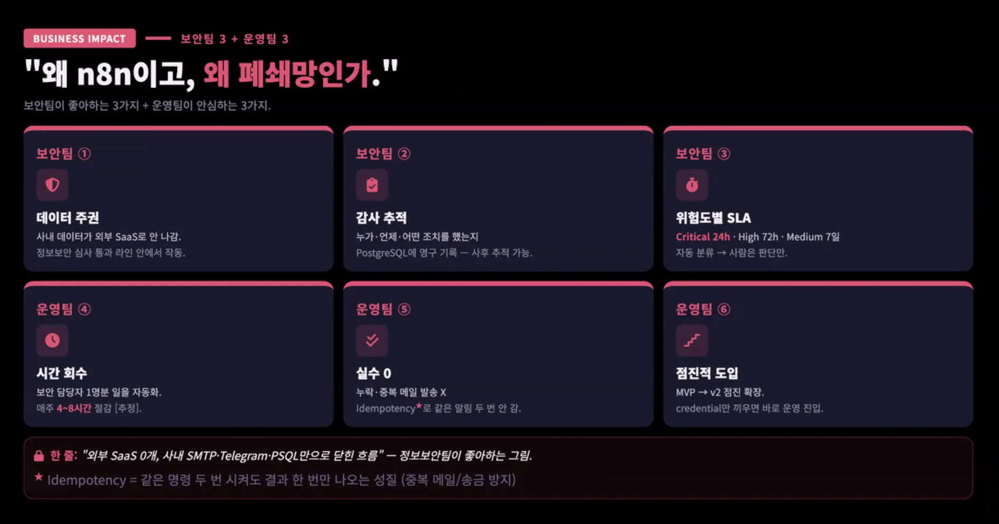
