> 
> 
> <a id="375eda9b0fe180179cfde139f8b54e4e"></a>
> 
> <strong>목차</strong>
> 
> - [샤딩 (Sharding)](#36ceda9b0fe180f1ba4afabb6129f2bd)
> - [ Stateless, State  서버의 확장](#36aeda9b0fe180ce9ffec1fd2e0c9423)
> - [Stateless 서버의 확장](#36aeda9b0fe1807cbbb8e8f6e654e611)
> - [State 서버의 확장](#36ceda9b0fe180de86ffcef0f5ea3c8a)
> - [[한계점] Replica 장비(Scale Out)를 통한 Read 성능 향상  → Write 에서 병목 발생](#36aeda9b0fe180059e56eba58a1a1593)
> - [ Database Partitioning](#36ceda9b0fe18032ac06cee9578d6ae0)
> - [Vertical Partitioning](#36ceda9b0fe18083b30de537dd2791a7)
> - [Horizontal Partitioning](#36ceda9b0fe1806f933cfe4b4674ed7e)
> - [ Sharding(Horizontal Partitioning)](#36ceda9b0fe1809ab2f6f0e59d4d7e3b)
> - [Range](#36ceda9b0fe1806bbc2adb359b285860)
> - [Modular](#36ceda9b0fe180f8a74ce800bc23b35b)
> - [Indexed](#36ceda9b0fe180d6ac9ff76bf996c6e9)
> - [Complexed](#36ceda9b0fe180559e14d3313fd05fd1)
> - [ 실습](#36ceda9b0fe1808ea444f3c2779e35f2)

<a id="36ceda9b0fe180f1ba4afabb6129f2bd"></a>

# 샤딩 (Sharding)

---

<a id="36aeda9b0fe180ce9ffec1fd2e0c9423"></a>

##  Stateless, State  서버의 확장

> 🤔 
> 
> - <code>State</code><strong>&#58; </strong>사라지지 않고 유지해야 하는 정보
> 
> - <code>Stateless</code>&#58; 유지하지 않아도 되는 데이터
>     - Scrap 서버의 경우, 데이터가 없다면 해당 데이터를 다시 접속하여 생성해서 서비스 가능
> 
>     - GeoIP 서버의 경우, 해당 GeoIP를 호출해서 결과를 가져올 수 있다&#46; 
> 
>     - 이렇게 <strong><u>쉽게 재생성할 수 있는 데이터들</u></strong>을 <strong><u><code>Stateless</code></u></strong><strong><u> 한 데이터</u></strong>라고 한다&#46; 
> 
>     - 실제 필요한 데이터를 DB에 저장하고 비지니스 로직만 들고 있는 API 서버들은 대부분 stateless 하다&#46;

<a id="36aeda9b0fe1807cbbb8e8f6e654e611"></a>

### Stateless 서버의 확장

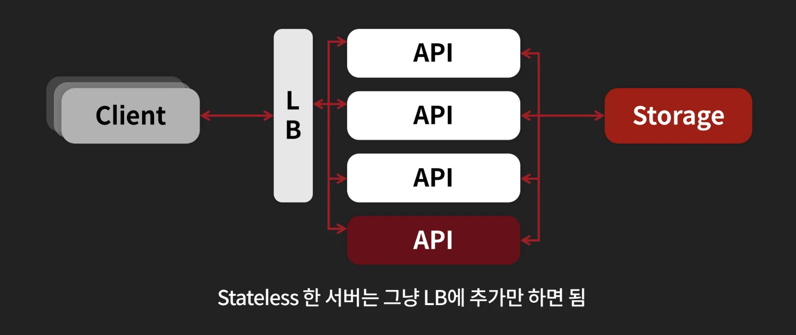

- API 서버는 stateless 하기 때문에 서버만 추가하여 로드벨런서로 트래픽을 분산시켜 처리해 쉽게 확장할 수 있다&#46;

<a id="36ceda9b0fe180de86ffcef0f5ea3c8a"></a>

### State 서버의 확장

> ✏️ 
> 
> - State를 저장하는 DB 서버의 확장은 쉽지 않다&#46;
>     - 보통 Scale Up (CPU, 메모라 &#46;&#46;&#46;↑) 방식을 사용한다&#46; 
> 
> - state를 가지는 서버의 확장 방식 중 하나&#58; <code>Queryy Off</code> 
>     - 앞에서 읽기 분산을 통해 부하를 분산하는 <code>Queryy Off</code> 방법을 배웠다&#46; 
> 
>     - <a href="#/post/367eda9b-0fe1-8014-b834-f04a86647e59">페이지</a> &#45; <code>Query Off</code>

- <strong>일반적인 DB 서버의 부하</strong>
    

    - 장비의 최대 한계를 <code>Read &#43; Write</code> 를 합쳐 1000이라고 가정

    - 일반적으로 <code>Read</code> 요청이 훨씬 많이 발생한다&#46;

- 읽기 분배 &#45; <code>Query Off</code>를 통한  <strong>Read 부하 분산</strong>
    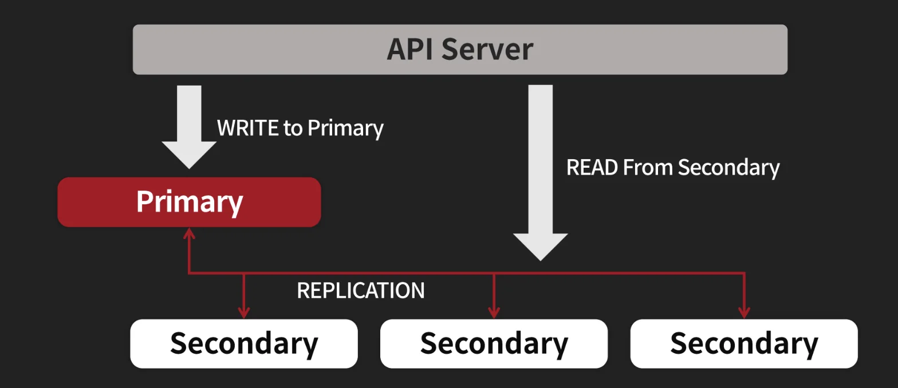

    - 읽기 분배 후 
        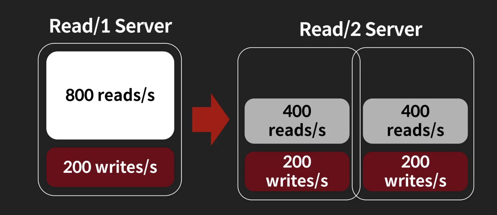

<a id="36aeda9b0fe180059e56eba58a1a1593"></a>

### &#91;한계점&#93; Replica 장비(Scale Out)를 통한 Read 성능 향상  → <strong><u>Write 에서 병목 </u></strong>발생

<a id="36ceda9b0fe180fe9b21ef1bdeb3f182"></a>

<strong>읽기 분산의 한계</strong>

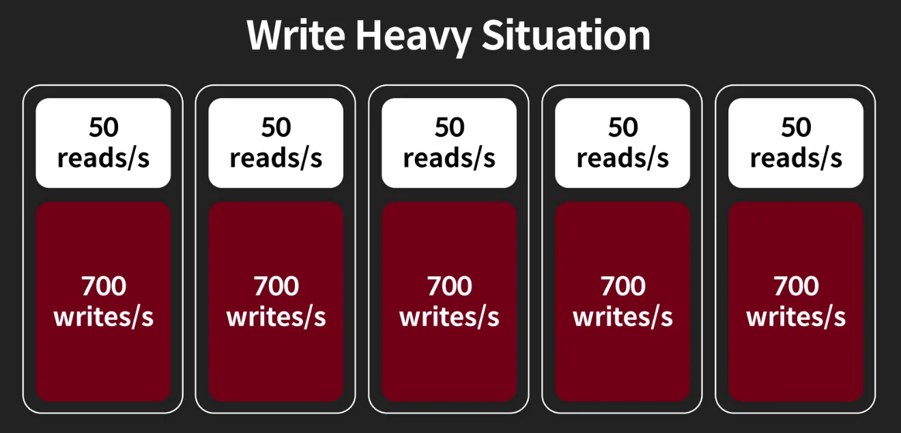

- Replica는 마스터의 write 된 데이터를 각각 리플리카들로 복제하는 것을 의미한다&#46; 
    - 서비스의 Read 트래픽을 분산 처리하기 위해 사용

- 이는 <strong><u>마스터에 200의 데이터 쓰기(write)가 발생</u></strong>하면 <strong>그 밑의 리플리카들도 각각200의 쓰기(write)가 발생되는 것</strong>을 의미한다&#46; 

- 즉, 쓰기 부하가 커질 경우 위 그림과 같이 각각 레플리카 노드에 동일한 쓰기 연산이 발생되어 성능이 떨어진다&#46; 
    - 마스터(primary)에 발생되는 모든 쓰기 데이터에 대해 <strong><u>각각의 레플리카 노드가 전부 복제해온다는 상황에서 성립</u></strong>

    - <code>Database Partitioning</code>을 통한 데이터 분산 처리 시, 해결 (아래 참조)

---

- ex) 초당 1000번의 연산을 견디는 서비에 초당 1000번 이상 Write 요청이 들어오면?
    - 더 좋은 장비 사용 → 비용 증가

    - 더이상 좋은 장비도 없다면?
        <a id="36ceda9b0fe18066932ae951334650b6"></a>

        ⇒ <code>Database Partitioning</code>

<a id="36ceda9b0fe18032ac06cee9578d6ae0"></a>

##  Database Partitioning

<a id="36ceda9b0fe18083b30de537dd2791a7"></a>

### Vertical Partitioning

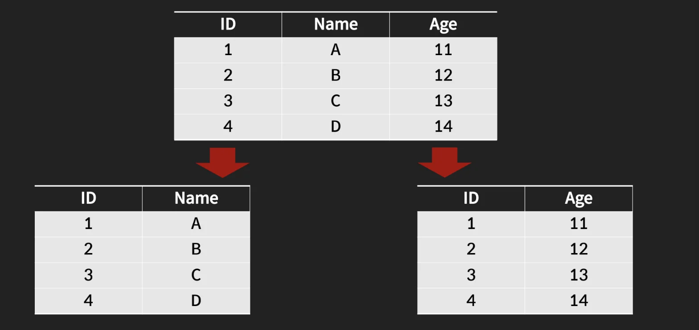

- 하나의 테이블을 <strong><u>컬럼</u></strong><strong><u> 기준으로 나눈</u></strong>다&#46; 

- <code>자주 사용하는 컬럼</code>과 <code>자주 사용하지 않는 컬럼</code>으로 나눠 <strong><u>성능을 향상시킬 수 있</u></strong>다&#46; 
    - 해당 테이블에 <u>자주 쓰지 않는 컬럼의 데이터가 없</u>어지므로, <strong><u>테이블이 더 적은 사이즈를 차지</u></strong>하게 된다&#46; 

<a id="36ceda9b0fe1806f933cfe4b4674ed7e"></a>

### Horizontal Partitioning

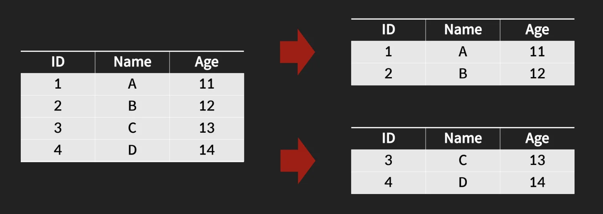

- 같은 테이블을 <strong><u>데이터</u></strong><strong><u>를 기준으로 나눈</u></strong>다&#46; 

- <strong><u>데이터의 개수가 적</u></strong>어지므로 <strong><u>하나의 DB에서 처리</u></strong>해야 하는 <strong><u>부하가 줄</u></strong>어든다&#46; 

- <code>Horizontal Partitioning</code>을 <strong>Sharding</strong> 이라고 한다&#46; 

- 여러 대의 DB와 연결되어야 한다는 단점이 있다&#46;
    <a id="36ceda9b0fe1809dbd01c9cdddccc430"></a>

    → 운영 비용 증가

<a id="36ceda9b0fe1809ab2f6f0e59d4d7e3b"></a>

##  Sharding(Horizontal Partitioning)

> 🤔 
> 
> <a id="36ceda9b0fe180129e55f38d632494ac"></a>
> 
> <strong>Sharding 에서 대두되는 이슈</strong>
> 
> <a id="36ceda9b0fe1806f9d75ccee0600252e"></a>
> 
> 데이터가 여러 대의 DB에 저장된다면 <strong>어떤 데이터를 </strong><strong><u>어디에</u></strong><strong>, </strong><strong><u>어떻게</u></strong><strong> 저장할 것 인지</strong>를 정해야 한다&#46;
> 
> - 특정 Key를 어디에 저장할 것 인가?
> 
> - 즉, 특정 Key를 어떻게 찾을 것 인가?
> 
> <a id="36deda9b0fe180439b88c51971c632ca"></a>
> 
> 이에 대해 <code>Range</code>, <code>Modular</code>, <code>Indexed</code> 등의 방식들이 있다&#46; 

<a id="36ceda9b0fe1806bbc2adb359b285860"></a>

### Range

> ✏️ 
> 
> <a id="375eda9b0fe180b6bed5d44e00d13f3f"></a>
> 
> <strong>Range 방식</strong>
> 
> 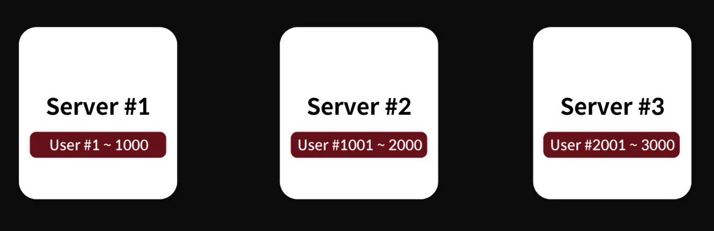
> 
> - 특정 범위 대역으로 나눔
> 
> <details>
> <summary>ex) User 1000명당 하나의 서버로 나눈다&#46;</summary>
> 
> - <code>Server 1</code>&#58; 유저 1 &#126; 1000
> 
> - <code>Server 2</code>&#58; 유저 1001 &#126; 2000
> 
> - <code>Server 3</code>&#58; 유저 2001 &#126; 3000
> 
> </details>

> 
> 
> - <code>장점</code>
>     - 새로은 Shard를 추가하는 것이 다른 방식보다 쉽다&#46; 
> 
> - <code>단점</code>
>     - Shard 간의 데이터가 균등하지 못할 가능성이 높다&#46; 
> 
>     - ex) 1번 Shard는 사용자가 800명, 2번 Shard는 사용자가 100명일 수 있다&#46; 

- 사례) 이벤트 유저 가입 → Range 경우, 극심한 서버 자원가 발생됨
    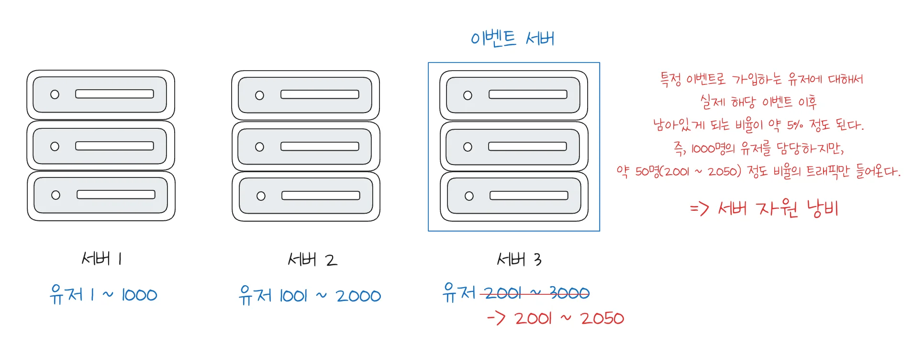

    - 특정 이벤트로 가입하는 사용자의 경우, 이후 남아있는 유저 비율이 5%도 되지 않는다&#46; 

<a id="36ceda9b0fe180f8a74ce800bc23b35b"></a>

### Modular

> ✏️ 
> 
> <a id="375eda9b0fe180d6b4d4fdda58bf79bb"></a>
> 
> <strong>Modular 방식</strong>
> 
> 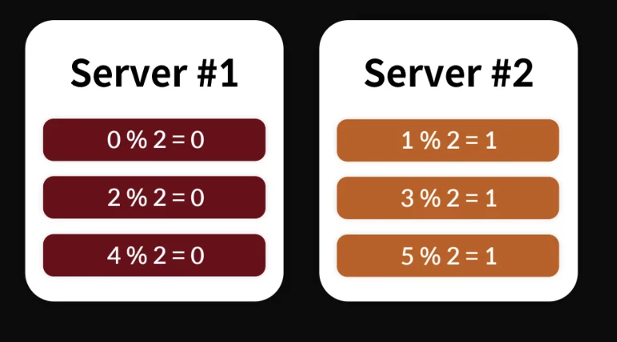
> 
> - 서버 수 만큼 나눠서 분배한다&#46; 

> 
> 
> - <code>장점</code>
>     - 데이터 분배가 균등한 편이다&#46; 
> 
> - <code>단점</code>
>     - Shard 의 추가 시에 데이터 이동이 많고, 시간이 지날수록 많은 서버가 추가되어야 한다&#46; 
> 
>     - 2배수로 증가하기 때문에 비용이 매우 많이 증가된다&#46; 
>         - 1대 → 2대 → 4대 → 8대 → 16대 순으로 서버 증가됨
> 
> - <code>특징</code>
>     - Modular 방식을 사용할 때는 Preshard를 한 다음 Scale&#45;Up으로 가져가는 전략을 취하기도 한다&#46; 
> 
>     - 처음 내부적으로 최대 증가 가능한 개수를 지정한다&#46; 

- <strong>&#91;Bad Case&#93;</strong><strong> 서버 </strong><strong>한대만</strong><strong> 추가?</strong>
    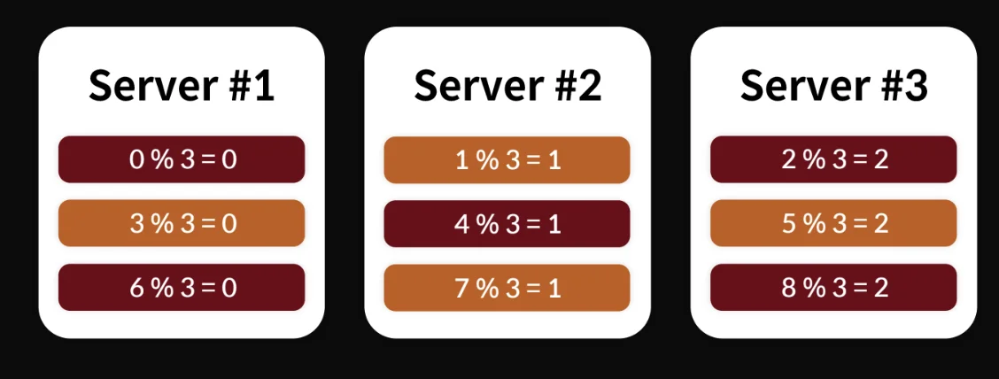

    - 데이터 이동이 심해진다&#46; 
        - <strong>데이터 리벨런싱이 자주 발생</strong>된다&#46; 

        - 리벨런싱이 자주 발생되면 <strong>서버 전체의 부하가 안 좋아진다&#46; </strong>
            - 계속 &#91;데이터 읽기 → 복사&#93; 이 과정을 반복한다&#46; 

            - 2로 나눠진 데이터를 다시 모아서  3으로 나눠 재분배한다&#46; 

- 서버 2배 씩 증가 → 절반 씩 이동 시킬 수 있기 때문에 확장에 용의함 <br>( 그만큼 비용도 기하 급수적으로 증가( <code class="language-math">2^n</code>))
    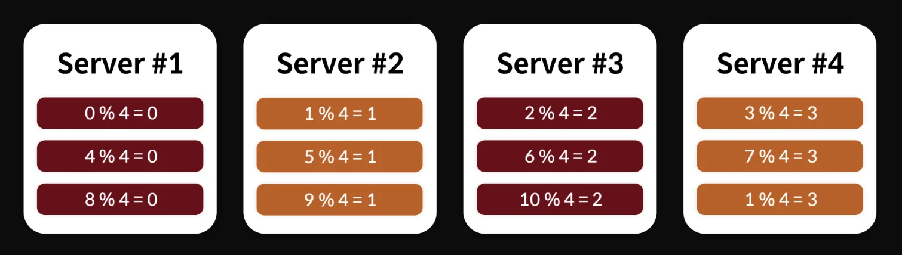

<a id="36ceda9b0fe180d6ac9ff76bf996c6e9"></a>

### Indexed

> ✏️ 
> 
> <a id="36ceda9b0fe18016887cc85244c8f7e8"></a>
> 
> <strong>Indexed 방식</strong>
> 
> 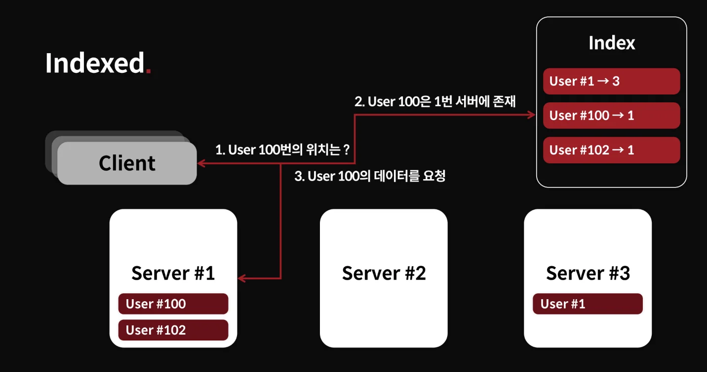
> 
> - 데이터의 위치인 Index를 관리하는 서버를 둬, 데이터 위치 받아와 해당하는 DB에 데이터를 요청한다&#46; 
>     - DNS 방식과 유사 

> 
> 
> - <code>장점</code>
>     - 데이터 분배가 균등한 편이다&#46; 
> 
> - <code>단점</code>
>     - Indexed 자체가 하나의 서비스가 되어야 한다&#46; 
>         - 관리 포인트 증가
> 
>         - Indexed 자체가 <strong>SFOF</strong>가 될 수 있다&#46; 

<details>
<summary><strong>Indexed 방식에서의 데이터 Migration 과정</strong></summary>

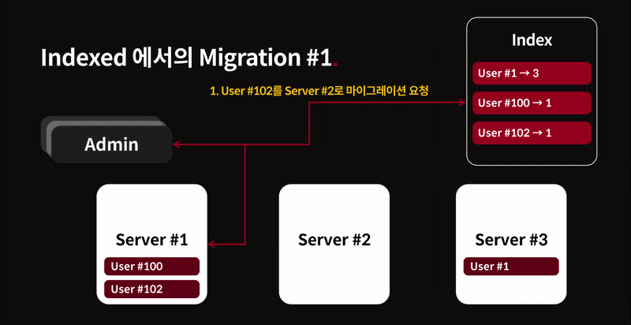

1. User &#35;102를 Server &#35;2로 마이그레이션 요청

1. User &#35;102 상태를 이동 중으로 변경

1. Data 복사

1. User 상태를 정상으로 변경

</details>

<details>
<summary>문제점</summary>

1. 매번 Index 서버에 요청을 해 데이터 위치를 받아온다&#46; 
    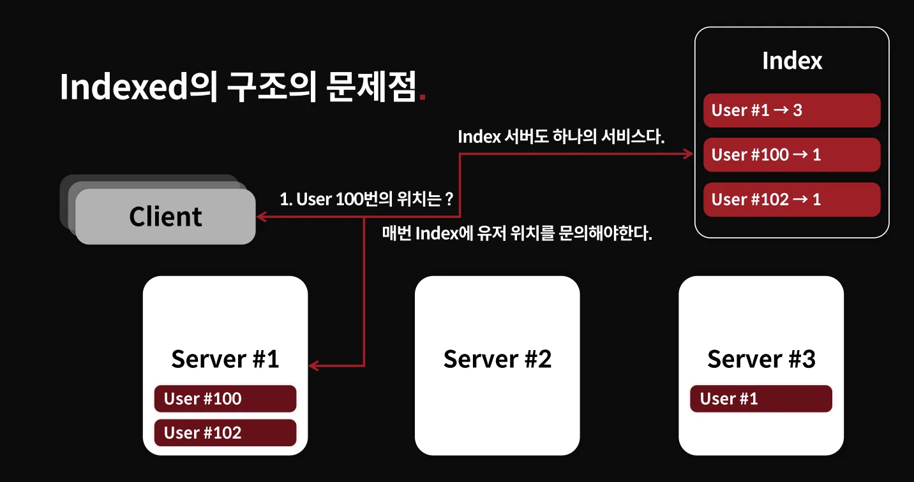

    - 병목 지점이 될 수 있다&#46; 

1. Index 서버 장애
    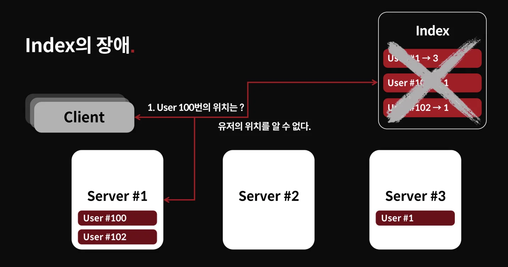

    - Index 서버 장애 시, 데이터 위치를 찾을 수 없다&#46;

</details>

<details>
<summary>Indexed 장애 완화</summary>

- 위치 저장
    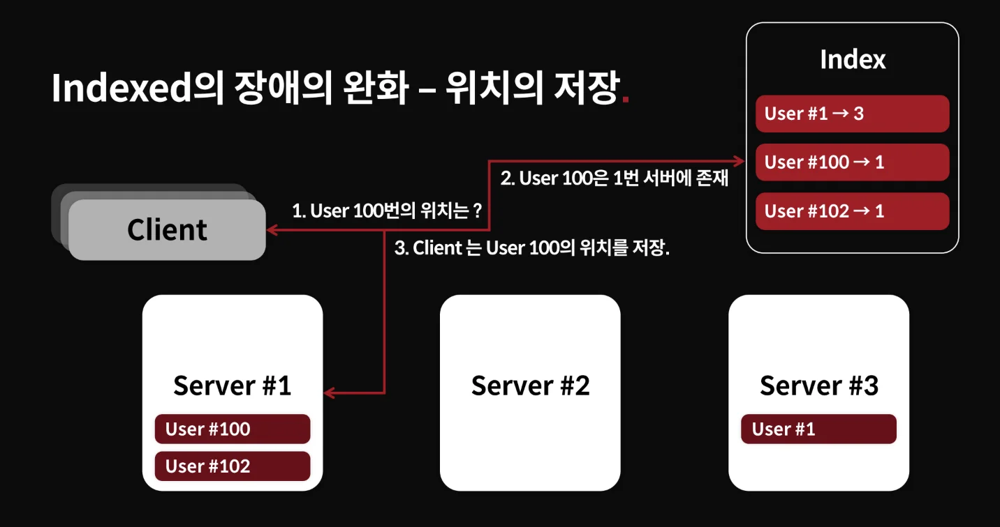

    - 요청 후 User 위치 정보를 저장하고 그 후에는 가지고 있는 정보로 요청한다&#46; 

    - User 재요청의 경우
        - 새 접속 시 유저 정보가 없을 경우

        - 유저 정보가 변경된 경우
            - 해당 서버에서 해당 유저 정보가 없다라는 응답을 받은 경우

    - Client가 자신의 정보를 가지고 있어야 하므로 이에 대한 구현이 필요하다&#46; 

</details>

<a id="36ceda9b0fe180559e14d3313fd05fd1"></a>

### Complexed

> ✏️ 
> 
> <a id="375eda9b0fe180c083f0e33869c92801"></a>
> 
> <strong>Comlexed 방식</strong>
> 
> 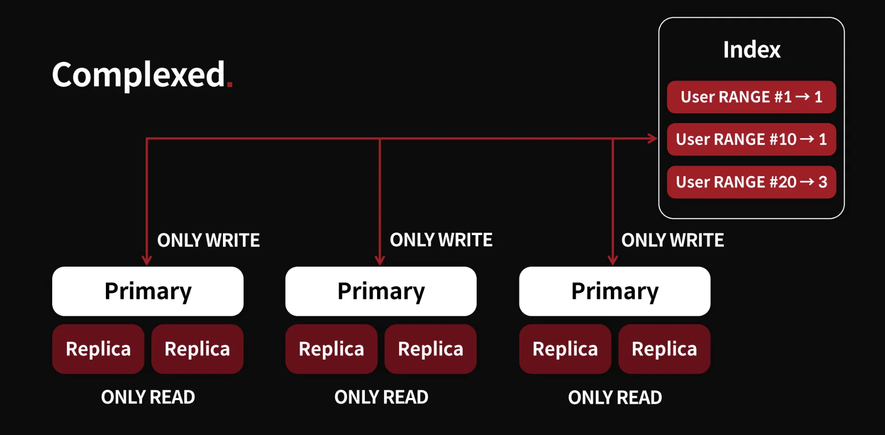
> 
> - 여러가지 방식을 혼합하여 사용
> 
> - Indexed &#43; 노드 분산 &#43; Query&#45;Off &#43; failover

> 
> 
> - <code>장점</code>
>     - 위 내용들의 복합 형태 
>         <a id="36ceda9b0fe1807898e8f6c7c4e41e08"></a>
> 
>         → 여러가지 장점을 모두 취할 수 있다&#46;
> 
> - <code>단점</code>
>     - 구현이 복잡하다&#46;

<a id="36ceda9b0fe1808ea444f3c2779e35f2"></a>

##  실습

[the&#95;red/chapter&#95;2/shard at main · charsyam/the&#95;red]()

> ✏️ 
> 
> <a id="36eeda9b0fe180f4896aed06cbe52b29"></a>
> 
> <strong>&#91;실습&#93; Range 샤딩을 이용한 데이터 분산</strong>
> 
> <a id="36eeda9b0fe180888b4ecec662721b80"></a>
> 
> DB/Redis 자체의 파티셔닝 기능을 쓰는 게 아닌, 애플리케이션 레벨에서 <code>user&#95;id</code> 값을 보고 Redis 인스턴스를 골라 사용한다&#46; 
> 
> 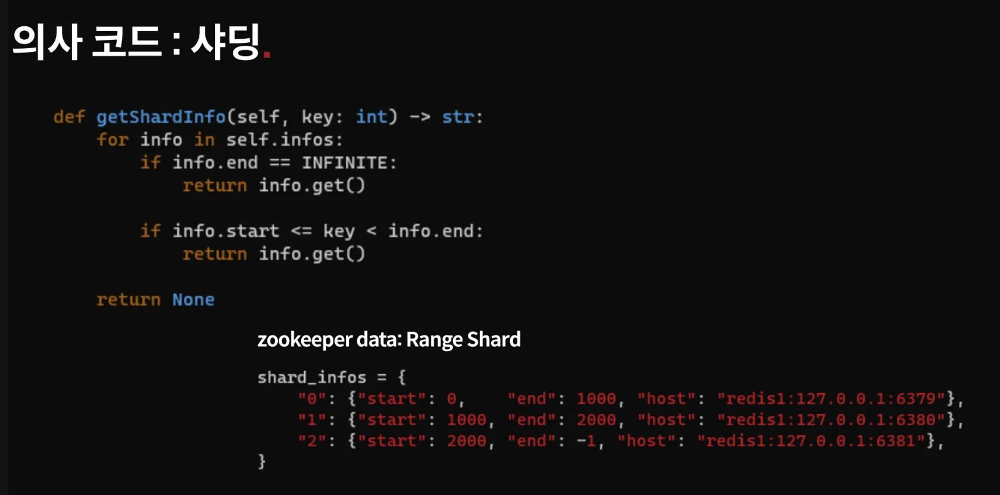

<details>
<summary>1&#46; Range 클래스 정의</summary>

<details>
<summary>‣</summary>

<a id="36eeda9b0fe1806c997bc2bc3fba8c92"></a>

```python
import typing

from redis_conn import RedisConnection


INFINITE = -1


class RangeInfo:
    def __init__(self, start: int, end: int, host: str):
        self.start = start
        self.end = end
        self.host = host

    def validate(self) -> bool:
        if not self.host:
            return False

        if self.start < 0:
            return False

        if self.end == 0:
            return False

        if self.end > 0 and self.end <= self.start:
            return False

        return True

    def get(self) -> str:
        return self.host


class ShardPolicy:
    pass


class RangeShardPolicy(ShardPolicy):
    def __init__(self, infos):
        length = len(infos) 

        current = infos[0]
        if current.validate() == False:
            raise Exception("RangeInfo is invalid")
        
        for i in range(1, length):
            prev = infos[i-1]
            current = infos[i]

            if current.validate() == False:
                raise Exception("RangeInfo is invalid")

            if prev.end != current.start:
                raise Exception("RangeInfo Order is invalid")

        self.infos = infos

    def getShardInfo(self, key: int) -> str:
        for info in self.infos:
            if info.end == INFINITE:
                return info.get()

            if info.start <= key < info.end:
                return info.get()

        return None


class RangeShardManager:
    def __init__(self, policy):
        self.policy = policy
        try:
            connections = {}
            for info in policy.infos:
                parts = info.host.split(':')
                conn = RedisConnection(f"{parts[1]}:{parts[2]}")
                connections[info.host] = conn

            self.connections = connections
        except Exception as e:
            print(str(e))
       
    def get_policy(self):
        return self.policy

    def get_conn_by_host(self, host: str):
        return self.connections[host].get_conn()

    def get_conn(self, key: int):
        host = self.policy.getShardInfo(key)
        return self.connections[host].get_conn()
```

</details>

<a id="36ceda9b0fe180cda930dbcd324c56a5"></a>

```python
# shard.py - line 9
class RangeInfo:
    def __init__(self, start: int, end: int, host: str):
        self.start = start
        self.end = end
        self.host = host

```

<details>
<summary>RangeInfo 하나는 “어떤 key 범위를 어떤 Redis host가 담당하는가”를 나타낸다&#46;</summary>

- zoo&#95;setup&#46;py (line 14)의 JSON 설정이 ZooKeeper에 저장되고
    <a id="36eeda9b0fe180f7ab96d46106c8ba2a"></a>

    ```python
    # zoo_setup.py - line 14
    "0": {"host": "redis0:127.0.0.1:16379", "start": 0, "end": 1000} 
       ...
    ```

- 해당 설정이 RangeInfo 객체로 바뀐다&#46; 
    <a id="36eeda9b0fe180a2a0c7f12cf8d344b0"></a>

    ```python
    # utils.py - line 4
    infos.append(RangeInfo(
        config[idx]["start"],
        config[idx]["end"],
        config[idx]["host"]
    ))
    ```

</details>

</details>

<details>
<summary>2&#46; Range 샤드 노드 설정</summary>

<details>
<summary>‣</summary>

<a id="36eeda9b0fe180b99848e7dd5ecb39a0"></a>

```python
from kazoo.client import KazooClient
from kazoo.exceptions import NoNodeError
from kazoo.exceptions import NodeExistsError

import json

ZK_DATA_PARENT_PATH = "/the_red/storages/redis/shards"
ZK_DATA_PATH = ZK_DATA_PARENT_PATH + "/ranges"
ZK_HOSTS = "127.0.0.1:2181"
zk = KazooClient(hosts=ZK_HOSTS)

zk.start()

data = {
    "0": {"host": "redis0:127.0.0.1:16379", "start": 0, "end": 1000},
    "1": {"host": "redis1:127.0.0.1:16380", "start": 1000, "end": 2000},
    "2": {"host": "redis2:127.0.0.1:16381", "start": 2000, "end": 3500},
    "3": {"host": "redis3:127.0.0.1:16382", "start": 3500, "end": -1},
}


try:
    if zk.exists(ZK_DATA_PATH):
        zk.delete(ZK_DATA_PATH)
except Exception as e:
    print(str(e))
    print("")

zk.ensure_path(ZK_DATA_PARENT_PATH)
zk.create(ZK_DATA_PATH, value=json.dumps(data).encode('utf-8'))
```

</details>

<a id="36eeda9b0fe180bfa3baf2da4e6b9469"></a>

```python
# zoo_setup.py - line 14
data = {
    "0": {
		    "host": "redis0:127.0.0.1:16379", 
		    "start": 0, 
		    "end": 1000
    },
    "1": {
		    "host": "redis1:127.0.0.1:16380", 
		    "start": 1000, 
		    "end": 2000
    },
    "2": {
		    "host": "redis2:127.0.0.1:16381", 
		    "start": 2000, 
		    "end": 3500
    },
    "3": {
		    "host": "redis3:127.0.0.1:16382", 
		    "start": 3500, 
		    "end": -1
    },
}
```

- 위와 같이 Range 샤드 노드들을 설정한다&#46; 

<a id="36eeda9b0fe180d280faf9b00121b61f"></a>

실제 각 노드 마다의 Range 범위는 아래와 같다&#46; 

<a id="36eeda9b0fe180589ce3eaaefadd2c3f"></a>

```plaintext
  0  <= user_id < 1000    -> redis0
1000 <= user_id < 2000    -> redis1
2000 <= user_id < 3500    -> redis2
3500 <= user_id           -> redis3
```

- <code>end = &#45;1 </code>은 무한대 구간을 뜻한다&#46; 
    - 코드에서는 <code>INFINITE = &#45;1</code> 로 정의되어 있다&#46; 

</details>

<details>
<summary>3&#46; 샤드 선택</summary>

<details>
<summary>‣</summary>

<a id="36eeda9b0fe1809394cbee2002f6c3bf"></a>

```python
import typing

from redis_conn import RedisConnection


INFINITE = -1


class RangeInfo:
    def __init__(self, start: int, end: int, host: str):
        self.start = start
        self.end = end
        self.host = host

    def validate(self) -> bool:
        if not self.host:
            return False

        if self.start < 0:
            return False

        if self.end == 0:
            return False

        if self.end > 0 and self.end <= self.start:
            return False

        return True

    def get(self) -> str:
        return self.host


class ShardPolicy:
    pass


class RangeShardPolicy(ShardPolicy):
    def __init__(self, infos):
        length = len(infos) 

        current = infos[0]
        if current.validate() == False:
            raise Exception("RangeInfo is invalid")
        
        for i in range(1, length):
            prev = infos[i-1]
            current = infos[i]

            if current.validate() == False:
                raise Exception("RangeInfo is invalid")

            if prev.end != current.start:
                raise Exception("RangeInfo Order is invalid")

        self.infos = infos

    def getShardInfo(self, key: int) -> str:
        for info in self.infos:
            if info.end == INFINITE:
                return info.get()

            if info.start <= key < info.end:
                return info.get()

        return None


class RangeShardManager:
    def __init__(self, policy):
        self.policy = policy
        try:
            connections = {}
            for info in policy.infos:
                parts = info.host.split(':')
                conn = RedisConnection(f"{parts[1]}:{parts[2]}")
                connections[info.host] = conn

            self.connections = connections
        except Exception as e:
            print(str(e))
       
    def get_policy(self):
        return self.policy

    def get_conn_by_host(self, host: str):
        return self.connections[host].get_conn()

    def get_conn(self, key: int):
        host = self.policy.getShardInfo(key)
        return self.connections[host].get_conn()
```

</details>

<a id="36eeda9b0fe180ac9f84c76ce13b365e"></a>

```python
# shard.py - line 58
def getShardInfo(self, key: int) -> str:
    for info in self.infos:
        if info.end == INFINITE:
            return info.get()

        if info.start <= key < info.end:
            return info.get()

    return None
```

- getShardInfo로 들어오는 인자 키(user&#95;id)를  

- ex1) user&#95;id = 25 
    - <code>0&#126;1000</code> 구간 → 노드 1, <code>127&#46;0&#46;0&#46;1&#58;16379</code>

- ex2) ser&#95;id = 1500 
    - <code>1000&#126;2000</code> 구간 → 노드 2, <code>127&#46;0&#46;0&#46;1&#58;16380</code>

- ex3) user&#95;id = 9000 
    - <code>3500 &#126; &#45;1</code> 구간 → 노드 3, <code>127&#46;0&#46;0&#46;1&#58;16382</code>

</details>

<details>
<summary>4&#46; <code>user&#95;id</code>를 기준으로 해당되는 샤드 노드로 라우팅</summary>

<details>
<summary>‣</summary>

<a id="36eeda9b0fe1809aa27fc22982b70931"></a>

```python
from typing import Optional
from fastapi import FastAPI, Request
from fastapi.responses import JSONResponse
from fastapi.responses import HTMLResponse
from fastapi.templating import Jinja2Templates
from pydantic import BaseModel
from exceptions import UnicornException

from model import Post
from shard import RangeShardPolicy, RangeShardManager
from utils import range_config_to_range_infos
from post import PostService

from log import init_log
from cors import init_cors
from instrumentator import init_instrumentator
from zoo import init_kazoo
from config import Config
from settings import Settings
from redis_conn import RedisConnection

import traceback
import json
import sys


g_shardmanager = None

def refresh_shard_range(data, stat):
    if not data:
        print("There is no data")
        return

    try:
        infos = range_config_to_range_infos(data)
        policy = RangeShardPolicy(infos)
    except Exception as e:
        print(str(e))
        return None

    global g_shardmanager
    shardmanager = RangeShardManager(policy)
    g_shardmanager = shardmanager
    print("Finished refresh_shard_range")


app = FastAPI()


g_post_service = PostService()

my_settings = Settings()

conf = Config(my_settings.CONFIG_PATH)
init_log(app, conf.section("log")["path"])
init_cors(app)
init_instrumentator(app)
zk = init_kazoo(conf.section("zookeeper")["hosts"], conf.section("zookeeper")["path"], refresh_shard_range, False)

templates = Jinja2Templates(directory="templates/")


@app.exception_handler(UnicornException)
async def unicorn_exception_handler(request: Request, exc: UnicornException):
    return JSONResponse(
        status_code=exc.status,
        content={"code": exc.code, "message": exc.message},
    )


def get_conn_from_shard(key: int):
    return g_shardmanager.get_conn(key)


@app.get("/api/v1/posts/{user_id}/")
async def lists(user_id: int, last: int = -1, limit: int = 10):
    conn = get_conn_from_shard(user_id)
    values, next_id = g_post_service.list(conn, user_id, limit, last)
    return {"data": values, "next": next_id}


@app.get("/api/v1/posts/{user_id}/{post_id}")
async def get_post(user_id: int, post_id: int):
    conn = get_conn_from_shard(user_id)
    post = g_post_service.get(conn, user_id, post_id)
    if not post:
        raise UnicornException(404, -10001, "No Post: {post_id}") 

    return {"post_id": post["post_id"], "contents": post["contents"]}


@app.get("/api/v1/write_post/{user_id}")
async def write_post(user_id: int, post_id: int, text: str):
    try:
        conn = get_conn_from_shard(user_id)
        post = g_post_service.write(conn, user_id, post_id, text)
        return {"post_id": post["post_id"], "contents": post["contents"]}
    except Exception as e:
        traceback.print_exc(file=sys.stderr)
        raise UnicornException(404, -10002, str(e)) 


def all_keys(conn):
    results = []
    for key in conn.scan_iter("*"):
        k = key.decode('utf-8')
        results.append(k)

    return sorted(results, key=lambda x: x[0])


@app.get("/demo")
async def demo(request: Request):
    policy = g_shardmanager.get_policy()
    results = []

    for info in policy.infos:
        r = f"{info.start} - {info.end}"
        try:
            conn = g_shardmanager.get_conn_by_host(info.host)
            print(conn)
            keys = all_keys(conn)
            results.append((info.host, r, keys))
            print(keys)
        except Exception as e:
            print(str(e))
            results.append((info.host, r, []))

    return templates.TemplateResponse('demo.html', context={'request': request, 'results': results})
```

</details>

<a id="36eeda9b0fe180f09d0cde8bf723970f"></a>

```python
# main.py - line 92
@app.get("/api/v1/write_post/{user_id}")
async def write_post(user_id: int, post_id: int, text: str):
    conn = get_conn_from_shard(user_id)
    post = g_post_service.write(conn, user_id, post_id, text)
```

<a id="36eeda9b0fe180a5bd76e48a8bbb1391"></a>

```python
# main.py - line 71
def get_conn_from_shard(key: int):
    return g_shardmanager.get_conn(key)
```

<a id="36eeda9b0fe180c78a2ee274f7540df1"></a>

```python
# main.py - line 50
g_post_service = PostService()
```

<a id="36eeda9b0fe180879631c564b1332a19"></a>

```python
# post.py - line 1
class PostService:
    def write(self, conn, user_id, post_id, value):
        user_key = f"key:{user_id}"
        post_key = f"p:{user_id}"
        conn.zadd(user_key, {post_id: post_id})
        conn.hset(post_key, post_id, value)
        return {"post_id": post_id, "contents": value}

```

<a id="36eeda9b0fe1807aa05ac6768d1d3da0"></a>

<strong>동작 시나리오 </strong>

- <code>user&#95;id = 1500</code>으로 쓰기 요청
    <a id="36eeda9b0fe180949ca2f8aad399a70c"></a>

    ```python
    GET /api/v1/write_post/1500?post_id=1&text=hello
    ```

- <code>1500</code>
    <a id="36eeda9b0fe180c08018e2f445f7759c"></a>

    → RangeShardPolicy <code>1000 &#126; 2000</code> 사이에 해당됨

    <a id="36eeda9b0fe180768cdef724f49e362c"></a>

    → 노드 2, <code>redis1&#58;127&#46;0&#46;0&#46;1&#58;16380</code> 선택

    <a id="36eeda9b0fe180b0b747dc4eab7176c6"></a>

    → 해당 Redis에 <code>key&#58;1500</code>, <code>p&#58;1500</code> 저장

</details>
