<details>
<summary>reference</summary>

- ‣

- ‣

- ‣

- ‣

</details>

> 🤔 
> 
> <a id="38feda9b0fe1802f837bd90b64cf1463"></a>
> 
> ### Redis는 어디서 사용하는가?
> 
> > 필요한 곳
> 
> - <strong><u>Cache</u></strong>가 필요한 곳
> 
> - In&#45;Memory를 DB로 사용하는 곳
> 
> - Ranking 저장용
>     - 게임에서 실시간 순위를 저장하는 데 사용
> 
> - Job Queue
>     - 작업 분산 처리 시, 큐로 사용
> 
> > 사용 예
> 
> - Cache
>     - <code>{key &#58; value} = {Web API 요청 &#58; 응답}</code>
> 
> - 서비스의 Access Token 저장
>     - db까지 가지 않고 redis에서 처리 
> 
> - 요청 수 제한을 위한 Rate Limit
>     - <code>유저 당 호출 제한</code> 정보 저장 시 
> 
> - Ranking 저장을 위한 Ranking 스코어 보드

<a id="38aeda9b0fe1802cb448e1c27bfaa0fa"></a>

## Cache

---

> 📖 
> 
> - <strong><u>같은 요청에 대해서 같은 결과를 제공</u></strong>할 떄, <strong><u>시간이 오래 걸리거나 많은 리소스를 사용하는 작업</u></strong>에 대한 결과를 계산해 두었다가, <strong><u>재요청</u></strong><strong> 시 </strong><strong><u>재 계산 없</u></strong><strong>이 바로 결과 응답</strong>
>     - <code>변하지 않는 값</code> → <code>캐시 처리</code>
> 
> - Reduces the distance from Resource 
>     - 사용할 리소스의 거리를 줄여준다&#46;
> 
>     - db까지 도달해 리소스를 조회하기 전 redis 계층에서 반환하기 때문에 이러한 표현을 사용하는 듯 하다&#46;

> 🤔 
> 
> <a id="38aeda9b0fe18089a570f7617920311d"></a>
> 
> Cache 가 유용한 케이스
> 
> - <strong>적은 데이터가 빈번하게 접근</strong>될 때 유용하다&#46; 
> 
> - 반대로 <strong><u>여러 데이터가 조금씩 다 접근</u></strong>하면 <strong>캐시의 효용성이 떨</strong>어진다&#46; 

<a id="38aeda9b0fe180b38d70d3c57432cb07"></a>

### 리소스별 접근 속도

> ✏️ 
> 
> <a id="390eda9b0fe1808d91decf3aa4e00a6b"></a>
> 
> 아래와 같이 각 리소스 별로 데이터 접근 속도가 다르다&#46;
> 
> <a id="390eda9b0fe180f18fd3c4ccce04dda1"></a>
> 
> 이때 <code>Redis의 </code><strong><code>캐시</code></strong>는 <code>Disk 계층의 I/O</code>보다 <strong><u>빠르게 처리</u></strong>하기 위해서 <code>메모리 계층 I/O</code>로 처리하는 것을 의미한다&#46;
> 
> <a id="390eda9b0fe180bda01dd4779c30906c"></a>
> 
> → <code>SSD, HDD</code> 와 <code>Memory</code>는 <u>100배 이상의 속도 차이</u>가 있다&#46;

<a id="38feda9b0fe1801887c2d319059f96ad"></a>

####  CPU(core)와 가까울수록 빠르고 작고 비싸며, 멀수록 느리고 크고 저렴하다&#46; 

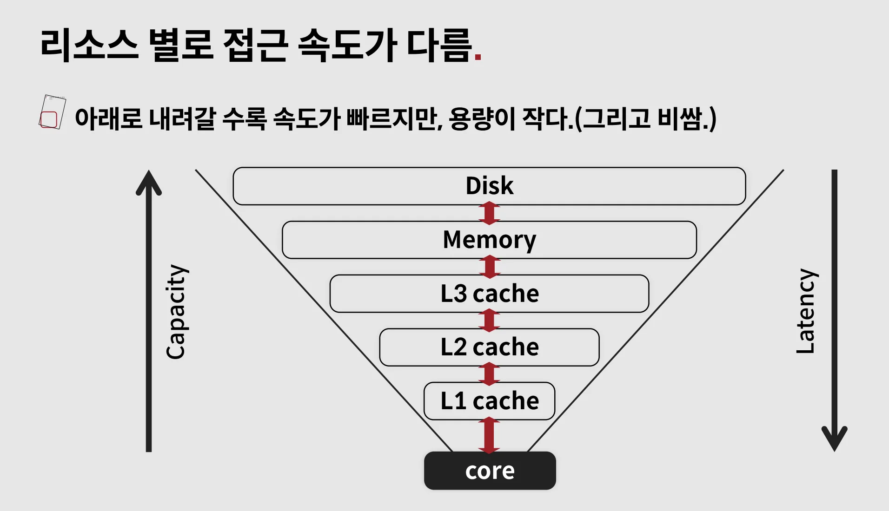

| <strong>계층</strong> | <strong>위치</strong> | <strong>속도</strong> | <strong>용량</strong> | <strong>용도</strong> |
| --- | --- | --- | --- | --- |
| L1 Cache | CPU 코어 내부 | 가장 빠름 | 매우 작음 | 지금 바로 실행할 데이터 |
| L2 Cache | CPU 코어 근처 | 매우 빠름 | 작음 | L1에 없는 데이터 보관 |
| L3 Cache | CPU 칩 내부, <br>여러 코어 공유 | 빠름 | 비교적 큼 | 여러 코어가 공유하는 캐시 |
| Memory / RAM | 메인보드 | 보통 | GB 단위 | 실행 중인 프로그램 데이터 |
| Disk / SSD / HDD | 저장장치 | 느림 | 매우 큼 | 영구 저장 |

<a id="38aeda9b0fe180c3a116f6de144c55c3"></a>

####  각 리소스 별 접근 속도

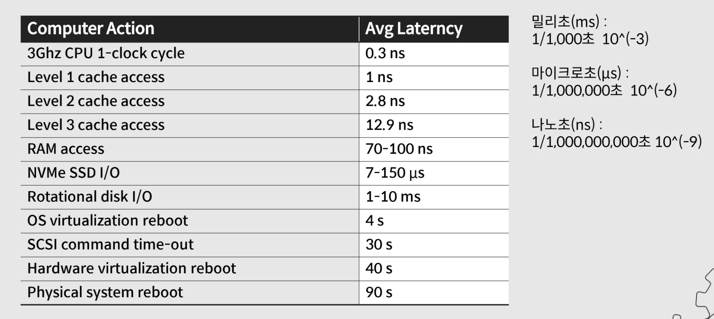

- 실제 CPU 내부 레벨에서 공유되는 L1, L2 캐시가 압도적으로 빠르며

- 여러 CPU가 공유하는 L3 캐시가 RAM보다는 훨씬 빠르다

- 그다음 RAM(메모리) 계층이 여전히 <code>ns</code>  단위를 가지며 빠르게 처리하며

- 그 아래로 디스크/스토리지 계층인 SSD, HDD 가 위치한다&#46; 

<a id="38feda9b0fe180ba83bbd389f12367c9"></a>

#### <code>SSD, HDD</code> 와 <code>Memory</code>는 <u>100배 이상의 속도 차이</u>가 있다&#46; 

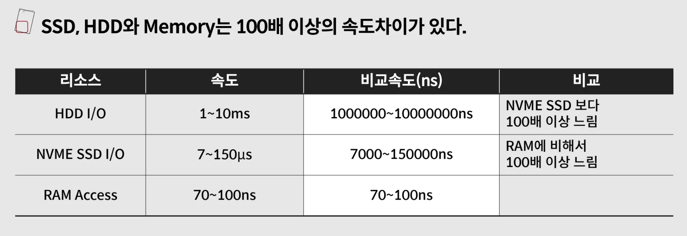

<a id="38aeda9b0fe1807da8aec2222cb93102"></a>

### In&#45;Memory의 장단점

> 🤔 
> 
> <a id="38aeda9b0fe180168270e62e8430112b"></a>
> 
> <code>In&#45;Memory</code>는 <strong><u>성능이 중요</u></strong>할 때 사용한다&#46; 

- 장점
    - 접근 속도가 빠르므로, 다른 스토리지(SSD, HDD)를 쓰는 것 보다 속도가 빠르다&#46; 

- 단점
    - 다른 스토리지 보다 <strong>크기가 작으면서 비싸다&#46;</strong>
        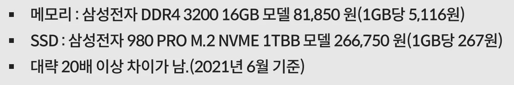

<a id="38aeda9b0fe1806da560cb15ee1f8623"></a>

### 파레토 법칙 과 Cache의 연관성

> 🤔 
> 
> <a id="38feda9b0fe18020a0d1ffd81fffd147"></a>
> 
> 파레토 법칙&#58; <code>8&#58;2</code> 의 법칙 
> 
> 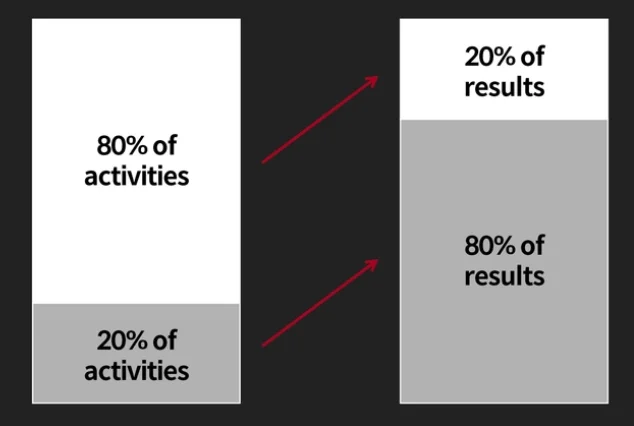
> 
> - 전체 활동에 대한 20%를 80%의 결과를 차지한다는 이론이다&#46;

<a id="38feda9b0fe1809991ffe7d6892eb17d"></a>

파레토 법칙에 대한 이론이 Cache에도 비슷하게 적용된다&#46; 

<a id="38aeda9b0fe180aaa3bbc54d09cd4c7c"></a>

<code>80% 활동</code>을 <code>20% 유저</code>가 하기 때문에 <strong><u>20% 데이터를 캐시</u></strong><strong>하면 </strong><strong><u>서비스의 대부분의 데이터를 커버</u></strong>할 수 있다&#46; 

---

<a id="38feda9b0fe18017be1cc4175b9f747d"></a>

### 트래픽 부하 해결책 1&#58; <code>Scale Up (더 좋은 장비 구매)</code>

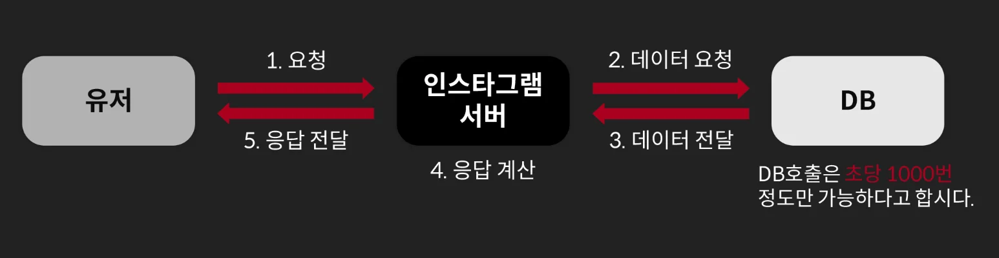

- 위 그림과 같이<strong><u> DB 서버가 초당 1000번의 호출</u></strong>의 트래픽만 감당할 수 있다고 가정

<a id="38feda9b0fe180a99651e42de296abba"></a>

#### 이때, 🤔 <strong>초당 1000번 이상의 요청이 발생</strong><strong>된다면?</strong> 

<a id="38feda9b0fe180539ab6e9d73f2ac23a"></a>

단순히 <strong><u>더 좋은 장비를 사용 (Scale Up)</u></strong>해서 해결해도 된다&#46;

- <strong>비용이 더 비싸다&#46;</strong>

<a id="38feda9b0fe18053a45cda41f01e0a15"></a>

#### AWS RDS, Aurora 사양 (vcpu, mem)

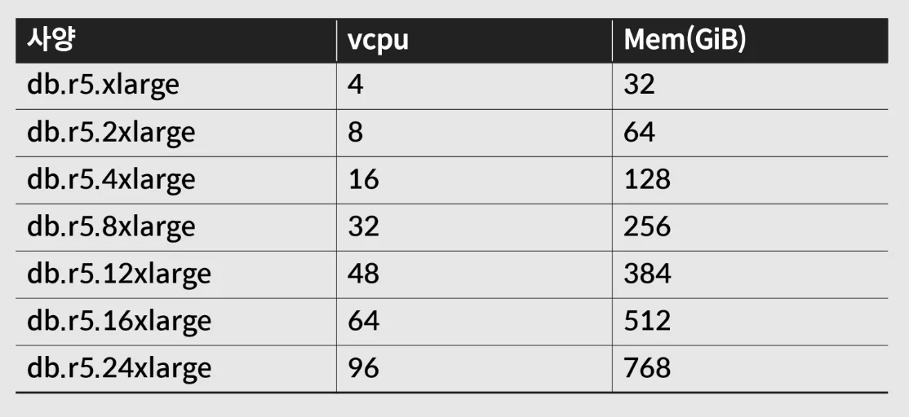

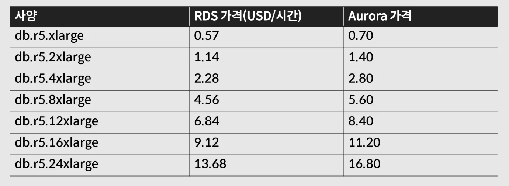

- 가격은 Aurora가 좀 더 비싸지만, 가격대 성능비로는 Aurora가 훨씬 유리하다&#46;

<a id="38aeda9b0fe180249b60c0bb7dd3060d"></a>

### 트래픽 부하 해결책 2&#58; <code>Cache 적용</code>

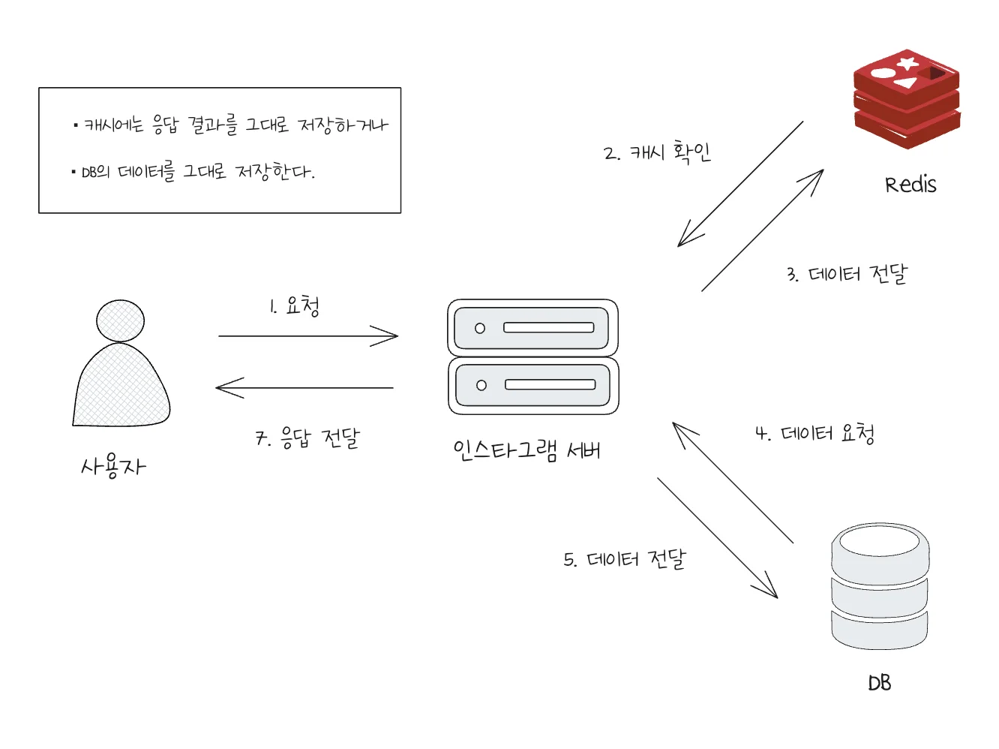

- 위 그림과 같이 Redis를 추가하여 <code>캐싱</code> 처리를 통해 <strong><u>DB 서버의 부하를 줄</u></strong>인다&#46; 

<a id="38aeda9b0fe18068b18efabf03475f28"></a>

#### Cache 적용 전과 적용 후 비교

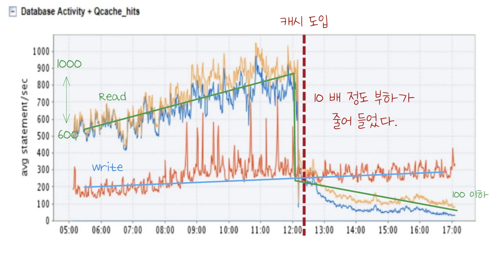

- 위 지표와 같이 캐시 도입을 통해 약 10배 정도 부하가 낮아진 것을 확인할 수 있다&#46;

<a id="38aeda9b0fe18084a6b1f0615b385f53"></a>

### In&#45;memory Cache 종류 및 처리 속도

<a id="38feda9b0fe1801d8ba5d4a2bda623c2"></a>

#### 오픈소스 프레임워크 처리 속도

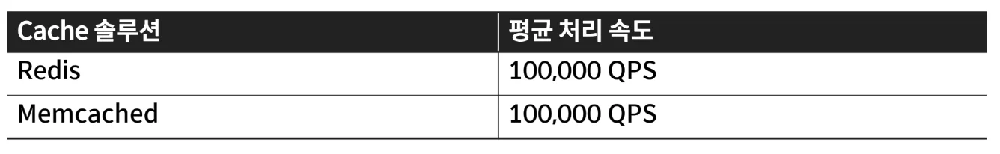

- 평균 처리 속도가 <code>초당 10만</code> 정도 처리 가능하다&#46;

- 요청 1개 당 <code class="language-math">1 &#92;mu s</code>(마이크로 세컨드)로 처리 가능하다&#46;

<a id="38feda9b0fe1808db787c60f6cf4cd68"></a>

### AWS ElasticCache 처리 속도

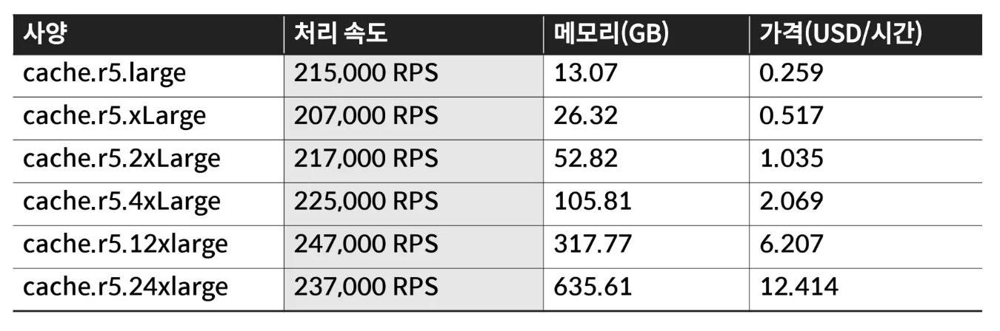

- DB 보다 더 적은 스토리지를 제공하지만, 처리 속도는 Cache가 훨씬 빠르다&#46;

- 실제 redis 처리 속도는 메모리에 영향을 많이 받는다&#46; <br>따라서 메모리가 클수록 유리하다&#46;

- 초당 20만 정도 처리 속도가 나오지만 <strong><u>잘 주의해서 사용</u></strong>하지 않으면 병목이 발생되어 초당 1 &#126; 2만 정도로 낮은 처리 속도를 보일 수 있다&#46;

---

<a id="38feda9b0fe180248579f16914ac85b6"></a>

### 캐시 사용 예 1&#58; <code>API 응답</code>

> 🤔 
> 
> <a id="38feda9b0fe1803bb936f5bc08ff7f55"></a>
> 
> API를 캐싱 처리하기 위해서는 아래와 같은 고민들이 필요하다&#46; 
> 
> 1. 캐시를 해도 되는 API 인가?
> 
> 1. <code>Key</code>를 어떻게 정의할 것인가?
> 
> 1. <code>Value</code>를 어떻게 정의할 것인가?

<a id="38feda9b0fe180299523cf550a3dfaf2"></a>

#### 1&#46; Cache를 할 수 있는 API인가?

- <code>Write API</code>  → ❌
    - ex) 포스트 작성, 댓글 작성, 댓글 삭제, 포스트 내용 변경 등

- <code>Read API</code> → ✅
    > ⚠️ 
    > 
    > <a id="390eda9b0fe18090959ffda8eda7e062"></a>
    > 
    > <code>Read API</code>라도 조회수(viewCount)를 증가시키면 내부적으로 <strong><u>DB write가 발생</u></strong>한다&#46;
    > 
    > <a id="390eda9b0fe180e9aaebe70b34f9e29e"></a>
    > 
    > <strong> 조회수처럼 </strong><strong><u>자주 변경되는 값</u></strong><strong>은 </strong><strong><u>본문/제목 같은 조회 데이터와 분리</u></strong>하는 것이 좋다&#46;
    > 
    > <a id="390eda9b0fe180b6b2fdc0bed479f5c1"></a>
    > 
    > 예를 들어 <code>viewCount</code>는 <strong><u>캐시나 별도 테이블에 업데이트</u></strong>하고, <strong><u>응답 시 조회 데이터와 조합</u></strong>해서 보여주는 구조가 유리하다&#46;

<a id="38feda9b0fe1806da7f7ddb7a24dba08"></a>

캐싱 처리를 하는 이유는 DB에 접근없이 메모리에서 빠르게 데이터를 읽어서 처리하기 위함이다&#46; 

<a id="38feda9b0fe18083a15ecfe1ec9f397d"></a>

이때, <strong><u>실제 DB에 저장된 데이터</u></strong>와 <strong><u>메모리 캐시 계층에서 저장된 데이터</u></strong>가 같아야 <strong>데이터의 무결성을 보장</strong>하면서 신뢰성 있는 서비스 구성이 가능하다&#46; 

<a id="38feda9b0fe1804b8b17cd152da03f26"></a>

따라서 데이터의 수정이 일어나지 않는 <code>조회 API</code>가 캐싱에 적합하며 자주 쓰기 작업이 발생돼 데이터가 변경되는 경우 캐싱 처리 비용을 고려하여 캐싱을 하지 않는 것이 더 좋은 선택일 수  있다&#46; 

- 자주 변경되는 데이터의 경우 오히려 캐싱 비용이 더 커지기 때문에 캐싱을 하지 않는 것이 좋다&#46; 

<a id="38feda9b0fe180f0bf15f23de98880ca"></a>

#### 2&#46; <code>Key</code>를 어떻게 정의할 것인가?

> Key는 데이터를 구분하는 유일한 값이다&#46; <br>따라서 <code>유일(유니크)</code> 해야 한다&#46; 

1. api endpoint
    - ex) <code>api&#58;feeds</code>

1. 특정 유저의 feed
    - ex) 유저 ID = <code>user 123 </code>
        - → <code>api&#58;feeds&#58;1234</code>

1. 그 외 다른 옵션
    - ex) 특정 기간의 정보를 요청하는 파라미터 
        - → key에 기간 정보 포함

        - → <code>api&#58;feeds&#58;1234&#58;20200901&#58;20200920</code>

<a id="38feda9b0fe1804c84bdef5849161e15"></a>

#### 3&#46; <code>Value</code>를 어떻게 정의할 것인가?

1. <code>응답 결과를 그대로 저장</code>
    - 응답 결과가 항상 바뀌는 값이 없다면, 그대로 저장 가능

1. <code>실제 데이터 부분만 저장</code>
    - 응답 결과의 일부분이 바뀌어야 한다면, DB에 저장된 데이터를 저장하고 이를 토대로 응답을 새로 만든다&#46; 

---

<a id="390eda9b0fe18080b13be923ba93f14d"></a>

#### 예시

- 피드 추가 (redis 저장)
    <a id="390eda9b0fe1803ca798dde65d4bb022"></a>

    ```bash
    Zadd feeds:1234567 {score} {feed_id}
    ```

- 피드 조회
    <a id="390eda9b0fe180d19f15d626b4f86ae7"></a>

    ```bash
    zreverange feeds:1234567 0 -1 count 50
    ```

<a id="390eda9b0fe180fe92b0ceb34a4079f4"></a>

### 캐시 사용 예 2&#58; <code>Access Token</code>

> ✏️ 
> 
> <a id="390eda9b0fe18066a007c7c4f5b64af4"></a>
> 
> 서비스에서 인증/인가를 위해 로그인 이후 <code>access token</code>을 사용한다&#46;
> 
> <a id="390eda9b0fe180aca9cdcb308cca81e1"></a>
> 
> 보통 <code>access token</code>에 대응되는 유저 정보가 DB에 존재하며, 
> 
> <a id="390eda9b0fe180d2bfade8c3eeac35df"></a>
> 
> JWT 사용 시, 유저 state를 토큰 payload 내부에 저장하며 stateless로 운영한다&#46; 
> 
> - ‣

<a id="390eda9b0fe180a4a74defa509f2cf82"></a>

#### Key는 어떻게 정의하는가?

- Access Token 자체를 키로 사용한다&#46; 
    <a id="390eda9b0fe1809dacebc15e31efd2ba"></a>

    ```bash
    token:abcdefghijklmn...
    ```

    - Access Token 자체가 유일하므로 그대로 사용

<a id="390eda9b0fe1800f8474c517a2ae3d84"></a>

#### Value를 어떻게 정의하는가?

- User 정보&#58; <code>user id</code>, <code>user 권한</code>

- 토큰 유효기간

<a id="390eda9b0fe180d79a18ef77440129bb"></a>

#### 예시

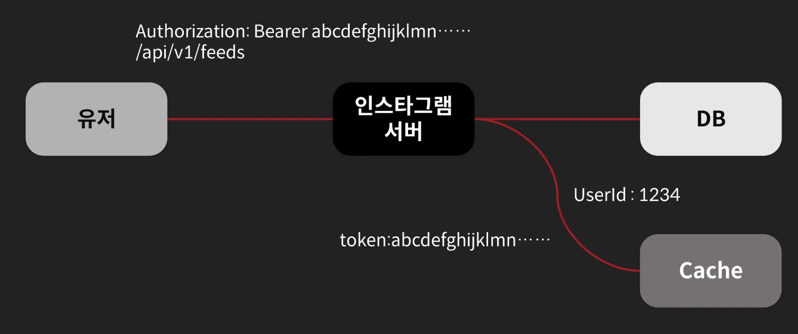

- token 추가
    <a id="390eda9b0fe180a2a7f8d4e5b1548cfb"></a>

    ```bash
    set token:abcdefghijklmn... ex 1000
    ```

- token 확인
    <a id="390eda9b0fe1800f93c2c868186aa0c0"></a>

    ```bash
    get token:abcdefghijklmn...
    ```

<a id="390eda9b0fe180fdbd1be876de20511d"></a>

### 캐시 사용 예 3&#58; <code>Rate Limit</code>

> ✏️ 
> 
> <a id="390eda9b0fe180cbb101f911236d5722"></a>
> 
> 오픈 API나 외부에 특정 API를 제공하는 서비스의 경우 <code>시간당 몇 회 호출</code>이나, <code>하루 몇 회 호출</code> 등의 제한을 걸어 둔다&#46; 
> 
> <a id="390eda9b0fe18001bb71c90c3785fdc1"></a>
> 
> 이를 구현하는데도 Redis가 많이 사용된다&#46; 
> 
> - 자세한 해당 포스팅 참조&#58; ‣

<a id="390eda9b0fe1801682ced6568dc3721f"></a>

#### Key를 어떻게 정의해야 하는가?

1. 특정 기간에 n회 라는 제한이 있다&#46; 
    - n회는 지속적으로 바뀌는 값이므로 Key 반영되기 어렵다&#46; 

1. API가 여러 개라면 API 종류 값이 들어가야 한다&#46;
    - ex) <code>api&#58;maps</code>

1. 유저별로 개수 제한이 존재하므로 user id가 필요하다&#46; 
    - ex) <code>api&#58;maps&#58;1234</code>

1. 특정 기간의 정보가 필요하다&#46; 
    - 5분마다 10회라고 한다면 아래의 경우에 따라서 구현 방식이  달라진다&#46;
        - 5분을 연속적인 5분으로 볼 것인가?

        - 0 &#126; 5분, 5분 &#126; 10 까지로 볼 것인가?

        <a id="390eda9b0fe18009a2f8e2981b1599b7"></a>

        구현에 대한 내용은 <a href="https://www.mimul.com/blog/about-rate-limit-algorithm/">해당 포스팅</a> 참조

1. 시간이라는 정보는 계속 변경되지만, 해당 시간이라는 정보는 변경되지 않는다&#46; 
    - 5분마다 N회를 위해서 매분마다 호출 횟수를 기록한다&#46; 
        - ex) YYYYmmddHHMM
            - <code>api&#58;maps&#58;1234&#58;202010011111</code> 

    - 현재 시간에서 이전 5분 데이터를 가져와서 카운팅을 하는 방식으로 처리 가능
        - ex) 2020년 10월 1일 9시 25분에 접속, 아래 5개의 key를 가져옴
            - <code>api&#58;maps&#58;1234&#58;202010010925</code>

            - <code>api&#58;maps&#58;1234&#58;202010010924</code>

            - <code>api&#58;maps&#58;1234&#58;202010010923</code>

            - <code>api&#58;maps&#58;1234&#58;202010010922</code>

            - <code>api&#58;maps&#58;1234&#58;202010010921</code>

<a id="390eda9b0fe18013b73af5ea87072796"></a>

#### Value를 어떻게 정의해야 하는가?

- 호출 횟수 저장

---

<a id="390eda9b0fe180a2bfffd0370ddef66f"></a>

### AWS ElastiCache

> AWS Redis Mamaged Service

<a id="390eda9b0fe18012938dca320de4acfc"></a>

#### Restricted Redis Commands

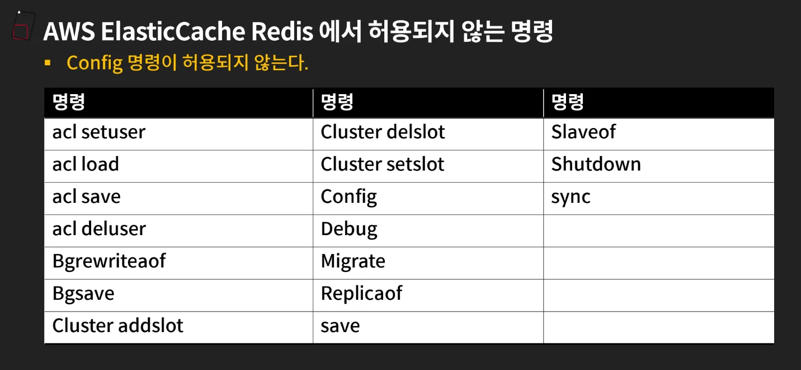

<a id="390eda9b0fe180a29e5ef9c567d2e73a"></a>

### 대규모 서비스에서의 캐시

- 대규모 서비스에서는 캐시도 1 &#126; 2대만 사용하는 것이 아닌, 굉장히 많은 수를 사용한다&#46; 

- 대규모로 사용하기 위해서, 샤딩 또는 Consistent Hashing 등을 통해서 데이터를 저장한다&#46;

> 🤔 
> 
> <a id="390eda9b0fe1806ea3afc0c7d515a137"></a>
> 
> 고민할 문제
> 
> <a id="390eda9b0fe1800da07ee8361bf4178b"></a>
> 
> 평소에 API 서버 5대와 DB 중간 사양으로 충분히 서비스가 가능하다고 가정한다&#46;
> 
> <a id="390eda9b0fe180199ab4edfed6a1d095"></a>
> 
> 피크타임에는 API 서버 10대와 DB 최고급 사양이 필요하다면, 평소 몇대의 서버를 둬야 하는가?
> 
> <a id="390eda9b0fe18063a2aaf1f7a7b203d8"></a>
> 
> 피크타임이 언제인지는 알수 없다&#46;

<a id="390eda9b0fe180578fb4ec9d14eca42f"></a>

### 답변

- 평소 필요량&#58; <code>API 5대</code> &#43; <code>중간 사양 DB</code>

- 피크 필요량&#58; <code>API 10대</code> &#43; <code>최고급 DB</code>

- 피크 시간&#58; <code>예측 불가</code>

<a id="390eda9b0fe18079afbcd56c5a2b47b0"></a>

위와 같은 경우 평소 API 서버 10대를 고정적으로 두는 것은 비용 낭비이며<br>반대로 5대만 두는 것은 갑작스러운 피크 상황 시 서비스 장애가 발생될 수 있다&#46;

<a id="390eda9b0fe1807fbf8efa58b735dfe0"></a>

따라서 보통 아래와 같은 방식으로 설계한다&#46; 

- API 서버는 Auto Scaling

- DB는 Scale&#45;up보다 병목 완화 구조

- 캐시/큐/읽기 복제본으로 DB 부하 분산

<a id="390eda9b0fe1800597fdda3b7845cc06"></a>

<strong>⇒ 평소 5대를 두고 자동으로 10대까지 늘릴 수 있게 한다</strong>

<a id="390eda9b0fe18059ac00fb287268c311"></a>

#### 1&#46; <strong>API 서버 설계</strong>

<a id="390eda9b0fe18030a877fc3d32750b51"></a>

API 서버는 비교적 쉽게 늘릴 수 있다&#46;

<a id="390eda9b0fe180a2ba0ae1a41b082639"></a>

즉, 평소에는 5대를 유지하고 CPU, 메모리, 요청 수, 응답 지연 시간이 올라가면 자동으로 10대까지 늘린다&#46;

<a id="390eda9b0fe1800d9113fa55a2e7387b"></a>

```bash
Load Balancer
		⎮
    ▼
API Server 1 ~ 5
    ⎮ 부하 증가
    ▼
API Server 6 ~ 10 자동 추가
```

<a id="390eda9b0fe180e1b8bff19baa5b77bd"></a>

이때, 중요한 점은 API 서버가 <code>stateless</code> 해야한다는 점이다&#46; 

<a id="390eda9b0fe180fcadfbe1746664fe3c"></a>

그래야 서버를 언제든지 늘리고 줄일 수 있다&#46; 

<a id="390eda9b0fe1809090b5d5de9558e698"></a>

```bash
세션 → Redis / JWT
파일 → S3 / Object Storage
상태 → DB / Cache
API 서버 내부에는 상태 저장 X
```

<a id="390eda9b0fe180d59663c9da1a0b9340"></a>

#### 2&#46; DB 설계  (중요)

<a id="390eda9b0fe180e6ab23efb24714da22"></a>

위에서 정리했듯이 DB를 Scale Up(서버 성능 향상)하여 트래픽을 처리하는 것은 한계가 있으며 비용적으로도 좋지 못한 선택이다&#46; 

<a id="390eda9b0fe180b49e04f11e5daee4c7"></a>

따라서 scale out(서버 증설)로 처리해야 하는데, state 값을 가지고 있기 때문에 이는 기술적으로 난이도가 있다&#46; 

<a id="390eda9b0fe18013abd6c9c1fd6227ab"></a>

```bash
1. Redis Cache
2. Read Replica
3. Queue
4. Connection Pool 제한
5. 조회/쓰기 모델 분리
```

- 위와 같은 기술적인 방법들을 통해서 db로 직접 가능 요청을 줄여 부하를 분산 처리해 더 많은 트래픽을 처리 가능토록 한다&#46;
