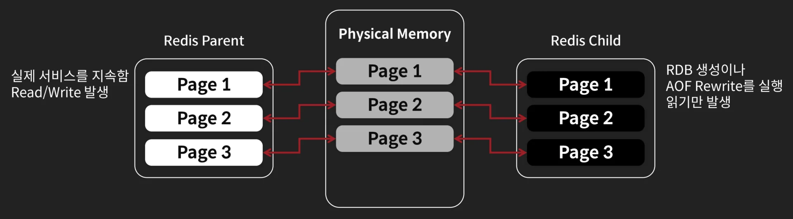
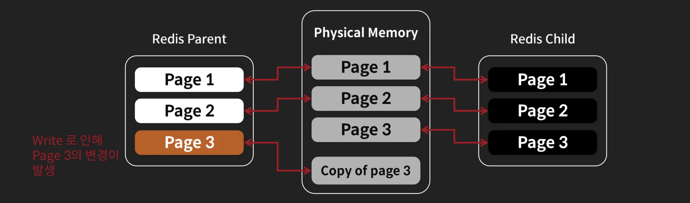
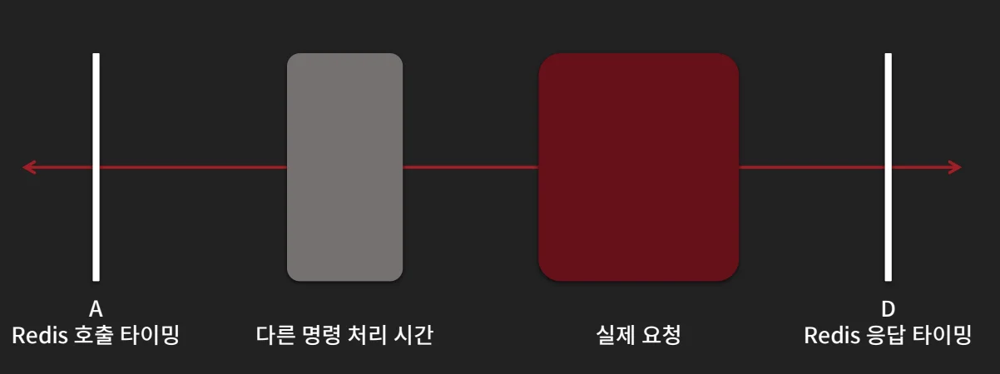
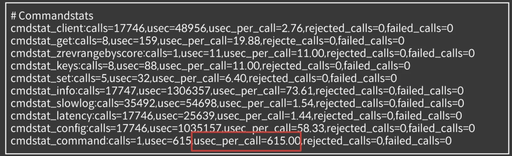
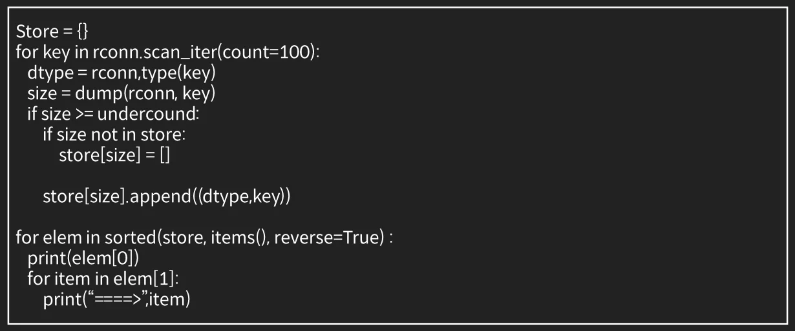

<a id="39feda9b0fe180ba8f09d7e3fb422e68"></a>

## Redis 장애 원인

---

> 📖 
> 
> - Redis는 Main Thread 가 대부분의 처리를 하는 Single Threaded 형태이기 때문에, <strong><u>하나의 명령에서 시간이 많이 걸</u></strong><strong>리면 </strong><strong><u>전체 성능 저하</u></strong><strong>가 발생</strong>된다&#46;
> 
> - 실제로 더 빠른 CPU, 더 많은 메모리를 달수록 성능이 좋아지지만, <strong><u>Scale Up을 하더라도 잘못된 사용 패턴은 장애</u></strong>를 일으킬 수 있다&#46; 

<a id="39feda9b0fe1800d87efec7be6ae5da9"></a>

### Redis 장애 종류

| 장애 타입 | 소분류 | 내용 |
| --- | --- | --- |
| 메모리 | 메모리 과다 사용<br>(maxmemory 설정) | Maxmemory가 설정되었을 때, maxmemory policy에 따라서 더이상 eviction 할 수 있는 메모리가 없다면 OOM 에러를 Redis가 전달한다&#46;  |
| &#45; | RSS 관리 | Redis에서 <strong>실제 물리메모리보다 더 많은 메모리를 사용</strong>하면 해당 페이지에 <strong>Swap이 발생</strong>하고, 이에 접근할 때 마다 <strong><u>디스크 페이지에 접근</u></strong>할 수 있어서 <strong><u>성능이 떨</u></strong>어진다&#46; 실제 used memory 와 RSS 사용은 다르다&#46; |
| 설정 | 기본 설정 사용 | <strong>기본 설정으로 사용 시</strong>, SAVE 설정이 1 시간에 1개, 5분에 100개,<br>1분에 1000개가 변경되면 <strong><u>디스크에 메모리를 덤프</u></strong>하게 되므로, <br>I/O를 과다하게 사용해서 장애가 발생한다 <br>(실서비스에서 1분에 10000개 변경은 항상 일어나는 상황이다&#46;) |
| 싱글 스레드 | 과도한 Value 크기 | Redis는 싱글 스레드이기 때문에 <strong>하나의 명령이 긴 시간을 차지</strong>하면 결국<strong> Redis 성능저하</strong>로 이어진다&#46; <br>Hgetall, hvals 등의 <strong>collection의 데이터를 과도하게 많이 가져온다</strong>거나 <strong>몇 MB 이상의 Key 나 Value를 사용</strong>할 경우 문제가 발생한다&#46;  |
| &#45; | O(N) 명령의 사용 | <code>Keys</code>나 <code>flushdb/flushall</code>, <code>큰 크기의 collection을 지우는 작업</code> 등은 O(n)의 복잡도를 가지기 때문에 싱글스레드로 동작하는 레디에서 성능을 떨어뜨리는 원인이 된다&#46; |

<a id="39feda9b0fe180f59ccecc56d78e9b50"></a>

### Case 1) <code>메모리</code> 관련 장애

> ✏️ 
> 
> <a id="39feda9b0fe180559ba9efd4bc1882c4"></a>
> 
> redis 메모리 관련 장애 
> 
> - 메모리 부족으로 인한 이슈
>     - Redis의 처리 속도가 떨어진다&#46;  (Swap등의 이슈)
> 
>     - OOM 이슈로 처리가 되지 않고 명령이 실패한다

<details>
<summary>redis 메모리 관련 &#45; Copy on write 이슈</summary>

> 
> 
> <a id="3a0eda9b0fe180f880e5ddf6e3e7f16a"></a>
> 
> Redis가 fork 할때 메모리 사용량이 최대 두배까지 늘어날 수 있다&#46; 

<details>
<summary>Redis 가 fork를 하게 되는 경우</summary>

- replica가 연결이 되는 순간 데이터 이전을 위한 rdb를 만들면서 fork 

- AOF Rewrite를 하기 위한 경우(bgrewriteaof 명령) fork

- RDB 생성을 하기 위한 경우(bgsave 명령) fork

</details>

<details>
<summary>Cow (copy on write)</summary>



- fork를 할 경우 부모와 자식 프로세스가 읽기용 메모리를 공유해 메모리를 절약

- 공유 메모리에 쓰기가 발생하는 프로세스가 해당 메모리를 복사해서 사용

- Redis는 Child Process는 RDB 생성을 담당하기 때문에 읽기만 주로 발생



- 해당 메모리 Page에 변경이 발생한 해당 프로세스가 해당 메모리 Page를 복사하고 여기에 Write를 실행한다&#46;

- 이로인해, 전체 공유된 Page에 Write가 발생하면 최대 메모리 사용량이 두 배까지 증가한다&#46;

</details>

</details>

<details>
<summary>Redis 메모리 관련 장애 확인 방법</summary>

- <code>Application 레벨에서의 확인</code>
    - API 별 Latency를 측정

    - Redis 관련 호출에서 시간이 얼마나 걸리는 지 확인

    - Redis 응답이 무엇이 오는 지 확인

- <code>Redis레벨에서의 확인</code>
    - 메모리 사용량이 얼마인지 확인
        - Used memory와 RSS가 현재 설정도니 메모리 크기와 유사할 경우 문제가 있다&#46; 

        - OS와 다른 프로세스에서 사용하는 메모리 사이즈가 있으므로, 4G 머신에서 만약 3G 이상 Redis가 쓰고 있다면 문제의 소지가 있을 수 있다&#46; 

    - Slow Log가 남는지 확인

</details>

<details>
<summary>Redis 메모리 관련 장애 해결 방법 </summary>

- <code>방법 1</code>
    - 메모리가 더 큰 장비로 업그레드 한다&#46; 
        - 비용이 들어가지만 가장 좋은 방법

    - Redis 는 항상 Fork 의 위험성이 있으므로, 메모리가 충분할 수록 좋다&#46;

- <code>방법 2</code>
    - 효율성이 떨어지는 Key를 지운다&#46; 
        - redis는 개별 key의 hit, miss를 보여주지 않으므로, 개별로 따로 관리해야 한다&#46; 

        - 실제 캐시되는 키가 줄어드므로, db 부하가 늘어날 수 있다&#46;

</details>

<details>
<summary><code>Copy on Write  이슈</code> 해결 방법</summary>

- 현재 이를 Redis에서 해결하는 좋은 방법은 없다&#46; 
    - 한 대의 Redis 서버의 메모리 사용량을 물리 메모리의 절반 이하로 유지하는 것이 좋다 &#46;

- 현재 COW에서 메모리를 좀 덜 사용하게 하는 패치가 나와 있다&#46; 
    - ‣

</details>

---

<details>
<summary>Redis SlowLog의 문제점</summary>

> 일반적으로 서비스에서 Redis가 느리다고 생각하는 것은 Redis를 호출하고 응답 받기까지의 시간이 느릴 때 Redis가 느리다고 생각한다&#46; <br>즉, 실제 Redis 처리가 느린 것이 아닌 <strong><u>연관된 다른 작업</u></strong>에 의해 처리시간이 느린 것이다&#46; 

- 사용자 A → D 까지의 시간으로 인식하지만 Redis의 SlowLog는 실제로 실제 요청이 처리된 시간을 기준으로 하기 때문에, 인식의 불일치가 발생한다&#46;
    

</details>

<a id="39feda9b0fe1800f8d8fcce00a0a91af"></a>

### Case 2) <code>기본 설정</code> 관련 장애 

> ✏️ 
> 
> <a id="39feda9b0fe18087bb07df6fe4be5b42"></a>
> 
> Redis 기본 설정 관련 장애
> 
> - Redis 기본 설정 사용으로 인한 과도한 IO 로 인한 성능 저하
> 
> - Redis 가 bgsave 동작이 Fork로 인해서 메모리 사요량도 늘어날 수 있다&#46; 

<details>
<summary>Redis 기본 설정 관련 장애 확인 방법</summary>

<details>
<summary>서버 레벨에서의 확인</summary>

- Disk 사용량을 확인한다&#46; 

- Bgsave 옵션으로 인해서 write 가 많아지므로<br>write 가 많아지는 지 확인한다&#46;

</details>

<details>
<summary>Redis 레벨에서의 확인</summary>

- SAVE 관련 설정을 확인한다&#46; 
    - 서비스를 위해 해당 설정은 끄는 것이 좋다&#46;

    - <code>config get save</code>
        <a id="39feda9b0fe1808297effcde95fc4638"></a>

        ```bash
        127.0.0.1:6379> config get save
        1) "save"
        2) "3600 1 300 100 60 100000"
        ```

</details>

</details>

<details>
<summary>Redis 기본 설정 관련 장애 해결 방법</summary>

- 사용 전
    - SAVE 설정을 끄고 사용

- 이미 사용중일 때
    <a id="39feda9b0fe18032af5dd12a676ac9f4"></a>

    ```plaintext
    127.0.0.1:6379> config get save
    1) "save"
    2) ""
    ```

- 실행 중
    <a id="39feda9b0fe180c5a085e6704f9a3e8c"></a>

    ```json
    // redis.conf
    SAVE ""
    ```

    - 다른 SAVE 설정 지우기

</details>

<a id="39feda9b0fe18009bb1fd41152eb418d"></a>

### Case 3) <code>싱글 스레드</code> 관련 장애

> ✏️ 
> 
> <a id="39feda9b0fe1802d9ca1da78ab5962e1"></a>
> 
> 과도한 Value 로 인해 발생하는 장애
> 
> - Redis의 Sorted Set, Hash, Set 등의 자료구조는 <br>내부적으로 다시 <code>Hash Table</code> 등을 구성해서 관리한다&#46; 

<details>
<summary>Redis Single Threaded 관련 장애</summary>

- <code>사용하면 안되는 명령을 사용 중인지 확인한다&#46;</code>
    - KEYS 명령의 사용 횟수가 계속 늘어나면 해당 명령이 문제를 일으킬 수 있다&#46; 

- <code>O(N) 계열 커맨드의 사용이 늘어나는지 확인한다&#46;</code>
    - Hgetall, hvals, smembers, zrange 계열 함수

- <code>Monitor 명령을 통해서 들어오는 KEY들의 빈도 확인</code>
    - Monitor 명령은 해당 서버에 부하를 추가로 주게되므로 사용하면서 서버 부하가 더 커지는 지 확인해야 한다&#46;

- <code>Scan 명령을 통해서 각 Key의 사이즈를 확인해서 특정 크기 이상의 Key를 확인한다&#46;</code>

</details>

<details>
<summary>Redis Single Threaded 관련 장애 확인</summary>

<details>
<summary>Info all 에서 commands stats을 확인한다&#46; </summary>

- <code>usec&#95;per&#95;call</code> 이 micro seconds 이므로 주요 호출 명령에서 해당 값이 크면 확인이 필요하다&#46; 
    

</details>

<details>
<summary>특정 Key 사이즈를 확인한다&#46;</summary>



</details>

</details>

<a id="39feda9b0fe1806bb05ad621f791d8ff"></a>

### Case 4) <code>O(N)</code>에 의한 장애

> ✏️ 
> 
> <a id="39feda9b0fe1809585dcd75f3227d857"></a>
> 
> Redis는 싱글 스레드이므로 <code>O(N)</code> 명령은 Redis 성능에 큰 병목을 발생시킨다&#46; 
> 
> - <code>KEYS</code>
>     - 대표적으로 Redis에 어떤 Key들이 들어 있는지를 확인하기 위해서 사용하는 <code>O(N)</code>의 시간복잡도를 가지는 명령어이다&#46;
> 
> - 그외에도 <code>Collection 삭제</code>, <code>모두 가져오는 케이스</code> 등이  <code>O(N)</code> 명령어에 해당된다&#46;
>     - ex) <code>hgetall</code>, <code>smembers</code>

<details>
<summary>장애 해결 예시) KEYS 명령으로 인한 장애 해결</summary>

- keys 명령으로 인한 장애 확인
    <a id="39feda9b0fe1803ca893eb54767df674"></a>

    ```json
    // KEYS의 call 수가 계속 증가하는지 확인
    127.0.0.1:6379> info all
    ```

- Keys 명령 대신에 <code>scan</code> 명령으로 바꾼다&#46;
    - 아래 1)에 나오는 숫자가 다시 0이 나올때 까지 호출한다&#46;
        <a id="39feda9b0fe1808bbfe9ee2039413ffa"></a>

        ```json
        127.0.0.1:6379> scan 0
        1)
        2) 1) "a"
           2) "key:90"
           3) "key:{user_id}"
           4) "key:10"
        ```

    - Python Code
        <a id="39feda9b0fe18073a419c32d6381fca2"></a>

        ```json
        for key in rconn.scan_iter(count=100):
        		print(key)
        ```

</details>

<details>
<summary>Spring Security OAuth 성능 개선 사례</summary>

> 2018년 6월 버전까지 RedisTokenStore를 통해서 oauth access token을 관리할 경우, token 개수가 많아지면 전체 인증 로직이 느려지는 버그가 존재했음

- 버그 원인 
    - O(N) 자료구조인 List 자료구조 사용

    - 백만개의 token 중에서 하나의 token을 찾아야 하는 경우 반복적으로 발생

- 실제로 국내외 많은 서비스에서 해당 이슈로 인한 장애가 발생

- 해결
    - <code>O(N)</code> 명령인 list 자료구조를 <code>O(1)</code>을 사용하는 Set 자료구조를 사용하도록 변경
        [Fix Redis Token Store Performance Issue](https://github.com/spring-attic/spring-security-oauth/pull/1396)

</details>

<a id="39feda9b0fe180f18ca5c96f9ac601b5"></a>

### 보안 권장 사항

- Redis 보안 관련
    - 절대로 Redis의 포트를 Public으로 공개하면 안된다&#46; 
        - storage 계열은 무조건 private 하게 관리해야 한다&#46;

        - Redis 6부터는 ACL 설정 제공

    - 해당 이슈로 전체 시스템의 보안 위협이 높아지는 경우가 많다&#46;<br>
