<a id="362eda9b0fe180d8a317f5583964ff42"></a>

## Failover

---

> 📖 
> 
> <a id="362eda9b0fe1809da264ca0d58567f2d"></a>
> 
> <code>failover</code>란 어떤 서버에 장애가 일어났을 때 그 서버의 장애를 회복시키기 위해서 다른 서버가 그 서버의 기능을 가져가는 것을 말한다&#46;
> 
> - <strong>Active 한 서버에 장애가 발생</strong>했을 때 <strong>StandBy 서버를 Active로 전환</strong>해서 <strong><u>서비스가 계속 운영</u></strong>되도록 함
> 
> - 서비스 가용성(High Availabilty)을 제공하기 위해 사용
> 
> - ex)
>     - 웹 서버 장애 → 다른 웹 서버가 해당 트래픽 처리
> 
>     - DB 서버 장애  → 다른 DB 서버가 해당 트래픽 처리

<a id="362eda9b0fe1802e968aeb347ee4e8dc"></a>

## &#91;Bad&#93; 수동 Failover 시나리오

---

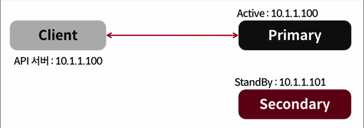

> 장애가 일어나면 개발자가 직접 설정을 바꿔서 배포한다&#46; 
> 
> - 사람이 계속 장애를 모니터링 하다가, 장애가 발생한 시점에 설정을 바꾸고 재배포 해야한다&#46; 

<a id="362eda9b0fe1807c8314d9a8c10600e9"></a>

<strong>문제점</strong>

- 언제, 어느 시간에 장애가 발생될 지 모르는데 이를 사람이 수동으로 24시간 모니터링하는 것은 불가능하다&#46; 

- 아무리 빨리 대응한다고 해도 장애를 인지하고, 알람이 전송되고, 이를 확인 후 오류를 수정하는 과정 속에서 서비스가 중단되는 상황이 발생된다&#46; 

<a id="362eda9b0fe180f3ae3ff297c659a749"></a>

## &#91;Good&#93; 자동 Failover 시나리오

---

<a id="362eda9b0fe180c2a307e27ed57defee"></a>

### 방법 1)  coordinator

> ✏️ 
> 
> - Service Discovery 형태
>     - <strong><u>자체 라이브러리(주키퍼, 컨셀 등)</u></strong>를 사용하거나 <br><strong><u>에이전트</u></strong>를 붙여서 감시할 수도 있다&#46; 
> 
> - Coordinator와 연동이 필요하다&#46; 
> 
> - 이미 Coordinator를 쓰고 있는 서비스라면 적용이 쉽지만, <br>그렇지 않다면 적용이 복잡할 수 있다&#46; 
> 
> - <strong>클라이언트에서 </strong><strong><u>서버의 주소에 의존성</u></strong><strong>을 가지</strong>기 때문에 <br>서버 주소가 변경되면 다시 클라이언트를 재배포해야한다&#46; 

1. 클라이언트에서는 Coordinator를 통해 <strong><u>서버 주소를 확인</u></strong> 받아 동작한다&#46; 
    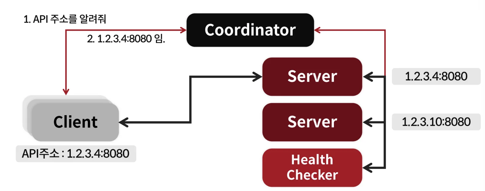

1. 만약 연결된 서버에 장애가 발생되면 Coordinator에서 이를 자동으로 확인하고 failover 처리를 한다&#46;
    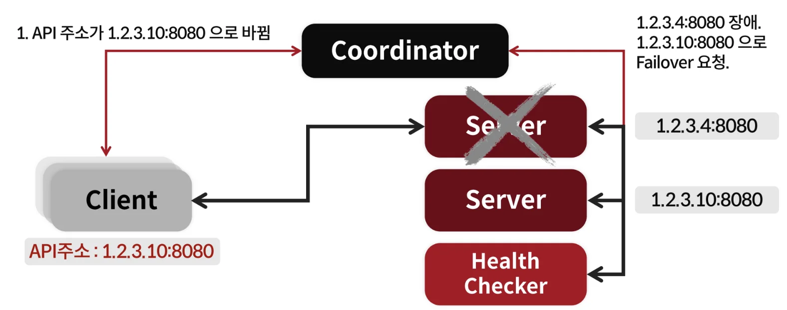

    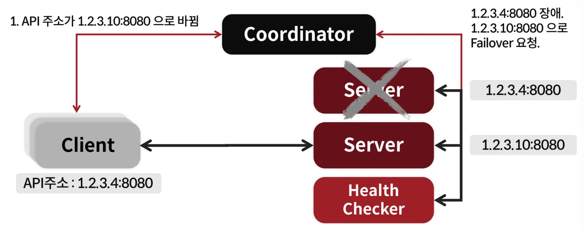

<a id="362eda9b0fe1801a8f94e703640fb5d1"></a>

### 방법 2) VIP (Virtual IP)

> ✏️ 
> 
> <a id="362eda9b0fe18099b56df4ae8164dc78"></a>
> 
> Active 서버에 장애가 발생되면 StandBy 서버 주소를 VIP에 매핑하여 가용성을 확보한다&#46; 
> 
> - Client는 서버의 주소가 아닌 VIP에만 의존하기 때문에 서버 장애 시, Health Checker 서버에서 VIP 매핑되는 서버 주소를 자동으로 변경하여 해결한다&#46; 

1. 클라이언트는 서버의 주소를 모르고 VIP만을 의존한다&#46;
    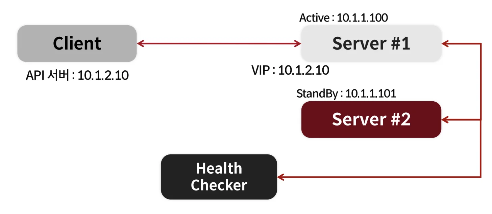

1. 장애가 발생되면 VIP에 매핑되는 서버 주소를 변경한다&#46; 
    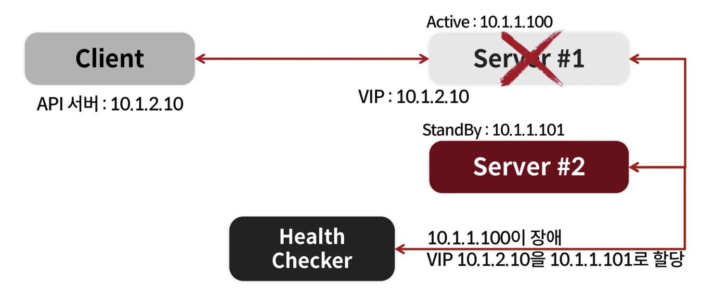

    - health checker에서 서버를 모니터링하다가 장애가 발생을 확인하고 <br>StandBy 서버를 VIP에 매핑하여 가용성을 확보한다&#46; 

1. 클라이언트는 VIP에만 의존하기 때문에 서버가 변경되어도 수정없이 정상 운영이 가능하다&#46; 
    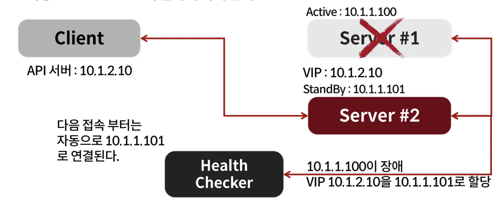

<a id="362eda9b0fe180a19532d407bc70a32c"></a>

### 방법 3) DNS

> ✏️ 
> 
> <a id="362eda9b0fe18082a774dffe088ddf6c"></a>
> 
> VIP 방식과 동작은 동일하다&#46; 
> 
> - Active 서버에 장애가 발생되면 StandBy 서버 주소를 DNS에 매핑하여 가용성을 확보한다&#46; 

1. 클라이언트는 서버의 주소를 모르고 DNS만을 의존한다&#46;
    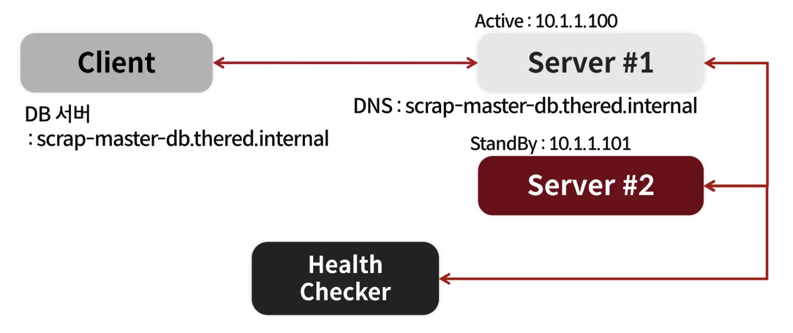

1. DNS 주소에 정상 동작하는 서버의 주소를 다시 매핑하여 가용성을 확보한다&#46; 
    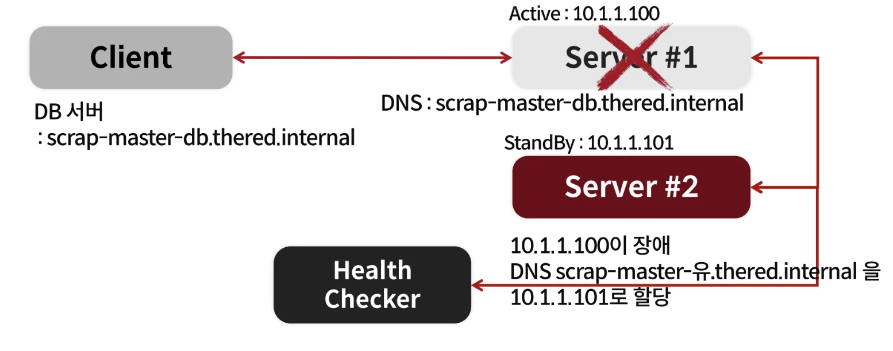

    - Active 서버에 발생된 장애를 Health Checker 서버가 확인하고 DNS 주소 매핑을 StandBy 서버로 변경하여 서비스의 가용성을 확보한다&#46; 

1. 클라이언트는 DNS 주소만을 의존하기 때문에 서버가 변경되어도 재배포없이 정상 동작 가능하다&#46;
    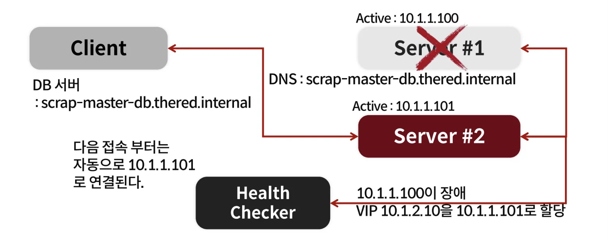

<a id="362eda9b0fe180ea890ad2f1356f5496"></a>

### AWS에서 제공하는 Failover 방식 → <code>DNS</code>

> AWS 서비스는 <strong>DNS 기반 Auto&#45;Failover 방식</strong>을  사용해 서비스 가용성을 제공한다&#46; 

- <code>ELB</code>의 Failover

- <code>ElastiCache</code>의 Endpoint Failover
    - Primary 노드가 장애가 나더라도 기존 DNS로 다시 액세스 시, <br>새로운 Primary 노드로 접속되어 서비스를 정상 운영 가능하다&#46; 

- <code>RDS</code>의 Endpoint Failover

> ❗ 
> 
> <a id="362eda9b0fe18088b8afc999392e038c"></a>
> 
> DNS 방식의 주의점
> 
> - DNS는 TTL이 존재한다&#46; 
>     - DNS를 사용한 Failover는 DNS TTL을 짧게 설정한다&#46; <br>이로인해 DNS 서버에 많은 부하가 발생될 수 있다&#46; 
> 
> - 특정 어플리케이션은 DNS를 영구 캐시하는 솔루션을 사용할 수 있다&#46; <br>이러한 경우 제대로 동작하지 않는다&#46; 
>     - 서버 주소가 변경되어도 <strong>변경 전 캐시된 주소를 사용</strong>하기 때문에 계속 이전 장애 서버로 요청을 보냄

<a id="362eda9b0fe180e5bc3bd16d65ee2ea1"></a>

## 실습

---

[the&#95;red/chapter&#95;2/redis&#95;failover at main · charsyam/the&#95;red]()

> ✏️ 
> 
> <a id="364eda9b0fe180bdb7bddd0cc9e681ad"></a>
> 
> <strong>Redis 주소</strong>를 앱 코드로 고정하는 것이 아닌, <strong><u>ZooKeeper에 저장</u></strong>해 <br><strong><u>primary Redis가 죽</u></strong>으면 <strong><u>monitor가 ZooKeeper 값을 바꿔서 secondary Redis를 primary로 승급</u></strong> 시켜 <strong><u>API 서버가 새 primary로 자동 재연결</u></strong> 가능토록 한다&#46;
> 
> <a id="364eda9b0fe180779129cdc496a8e871"></a>
> 
>  ⇒ <code>failover</code> 

<a id="364eda9b0fe180d9bd8aed0cdc4ec8e9"></a>

### failover 핵심 코드 

> ✏️ 
> 
> <a id="364eda9b0fe1803ea084f0381754b71f"></a>
> 
> failover 핵심 코드 <strong>(</strong><strong><a href="https://github.com/charsyam/the_red/blob/main/chapter_2/redis_failover/monitor.py">monitor&#46;py</a></strong><strong> &#45; line 127 )</strong>

<a id="364eda9b0fe180fc90c7e0b2fbc06488"></a>

```bash
# 3번의 실패 발새 시 failover 동작
if failure_count >= 3:
		# zookeeper znode 정보 확인
		hosts = get_redis_info_from_zk(ZK_PATH)
		if not hosts:
		    print("There is no data")
		    time.sleep(10)
		    continue
		
		# secondary node 정상 동작 확인
		host, conn = get_good_secondary(hosts["secondary"])
		if not conn:
		    print("There is no good secondary", hosts)
		    time.sleep(10)
		    continue
		
		# primary <-> secondary 주소 변경
		old_p = hosts["primary"]
		hosts["secondary"].remove(host)
		hosts["secondary"].append(old_p)
		hosts["primary"] = host
		
		# secondary -> primary로 승격
		set_primary(host)
		zk.set(ZK_PATH, json.dumps(hosts).encode('utf-8'))
		
		failure_count = 0
```

- <code>primary Redis</code> 장애 → <code>secondary Redis</code>, primary로 승급
    - 장애 전
        <a id="364eda9b0fe180f59790eddf8ac55e0a"></a>

        ```json
        {
          "primary": "127.0.0.1:6379",
          "secondary": ["127.0.0.1:6380"]
        }
        ```

    - 장애 후 ( <code>primary</code> ↔ <code>secondary</code> )
        <a id="364eda9b0fe1802dbb70c0f185ca7fca"></a>

        ```json
        hosts["secondary"].remove("127.0.0.1:6380")
        hosts["secondary"].append("127.0.0.1:6379")
        hosts["primary"] = "127.0.0.1:6380"
        ```

        <a id="364eda9b0fe1806da022fc4326d6ea26"></a>

        ```json
        {
          "primary": "127.0.0.1:6380",
          "secondary": ["127.0.0.1:6379"]
        }
        ```

<a id="364eda9b0fe1806bab88f275a2f159ca"></a>

### failover 동작 흐름

> ✏️ 
> 
> <a id="364eda9b0fe1807c8aa7d67b512e9804"></a>
> 
> 구성 요소
> 
> 1. <a href="https://github.com/charsyam/the_red/blob/main/chapter_2/redis_failover/zoo_setup.py"><code>zoo&#95;setup&#46;py</code></a>
>     - ZooKeeper에 최초 Redis topology를 저장한다&#46; 
> 
> 1. <a href="https://github.com/charsyam/the_red/blob/main/chapter_2/redis_failover/main.py"><code>main&#46;py</code></a>
>     - FastAPI 서버, ZooKeeper의 Redis primary 정보를 watch하다가, <br>값이 바뀌면 Redis connection을 새로 만든다&#46; 
> 
> 1. <a href="https://github.com/charsyam/the_red/blob/main/chapter_2/redis_failover/monitor.py"><code>monitor&#46;py</code></a>
>     - Redis의 primary 상태를 주기적으로 검사한다&#46; 
> 
>     - primary가 계속 죽어 있으면 secondary 중 살아있는 Redis를 primary로 승격하고 ZooKeeper 값을 갱신한다&#46; 

<a id="364eda9b0fe180e9a386e727161a7a3e"></a>

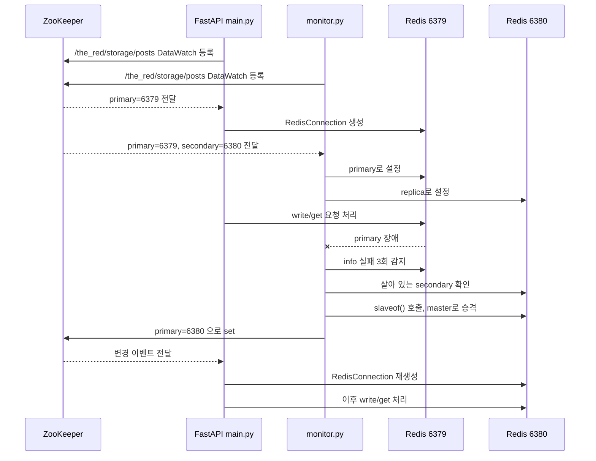

<details>
<summary>1&#46; 초기 설정 &#45; zookeeper 설정</summary>

<details>
<summary>&#91;전체코드&#93; zoo&#95;setup&#46;py</summary>

> ‣

<a id="364eda9b0fe180afa6d3f51ef55826ae"></a>

```python
from kazoo.client import KazooClient
from kazoo.exceptions import NoNodeError
from kazoo.exceptions import NodeExistsError

import json

ZK_DATA_PARENT_PATH = "/the_red/storage"
ZK_DATA_PATH = ZK_DATA_PARENT_PATH + "/posts"
ZK_HOSTS = "127.0.0.1:2181"
zk = KazooClient(hosts=ZK_HOSTS)

zk.start()

data = {
    "primary": "127.0.0.1:6379",
    "secondary": ["127.0.0.1:6380"]
}


try:
    if zk.exists(ZK_DATA_PATH):
        zk.delete(ZK_DATA_PATH)
except Exception as e:
    print(str(e))
    print("")

zk.ensure_path(ZK_DATA_PARENT_PATH)
zk.create(ZK_DATA_PATH, value=json.dumps(data).encode('utf-8'))
```

</details>

<a id="364eda9b0fe180a895c0f71db7d5b6c0"></a>

```python
# zoo_setup.py - line 7
ZK_DATA_PARENT_PATH = "/the_red/storage"
ZK_DATA_PATH = ZK_DATA_PARENT_PATH + "/posts"
ZK_HOSTS = "127.0.0.1:2181"

# zoo_setup.py - line 14
data = {
    "primary": "127.0.0.1:6379",
    "secondary": ["127.0.0.1:6380"]
}
```

- 위 설정을 통해서 ZooKeeper의 <code>/the&#95;red/storage/posts</code> 경로로 생성되는 <code>znode</code>에서 아래 JSON 형태로 저장된다&#46; 
    <a id="364eda9b0fe18046b882f1538d97c219"></a>

    ```json
    {
      "primary": "127.0.0.1:6379",
      "secondary": ["127.0.0.1:6380"]
    }
    ```

</details>

<details>
<summary>2&#46; Zookeeper watch 등록</summary>

<details>
<summary>&#91;전체코드&#93; main&#46;py</summary>

> ‣

<a id="364eda9b0fe18039ae18ebb24244b396"></a>

```python
from typing import Optional
from fastapi import FastAPI, Request, Response
from fastapi.responses import JSONResponse
from fastapi.middleware.cors import CORSMiddleware
from pydantic import BaseModel

import sys
import json


from datetime import datetime
from bs4 import BeautifulSoup

import httpx
import urllib.parse
import traceback

from exceptions import UnicornException
from settings import Settings
from log import init_log
from cors import init_cors
from instrumentator import init_instrumentator
from zoo import init_kazoo
from config import Config
from redis_conn import RedisConnection


pconn = None

def refresh_storage(data, stat):
    if not data:
        print("no data")
        return

    print(data)
    hosts = json.loads(data.decode('utf-8'))
    print(hosts)
    h1 = hosts["primary"] 

    global pconn
    pconn = RedisConnection(h1)
    print("Finished refresh_storage")


app = FastAPI()

ZK_SCRAP_PATH = "/the_red/storage/posts"

my_settings = Settings()
conf = Config(my_settings.CONFIG_PATH)
init_log(app, conf.section("log")["path"])
init_cors(app)
init_instrumentator(app)
zk = init_kazoo(conf.section("zookeeper")["hosts"], ZK_SCRAP_PATH, refresh_storage, children=False)


client = httpx.AsyncClient()


@app.exception_handler(UnicornException)
async def unicorn_exception_handler(request: Request, exc: UnicornException):
    return JSONResponse(
        status_code=exc.status,
        content={"code": exc.code, "message": exc.message},
    )


@app.get("/api/v1/write/{user_id}")
async def write(user_id: int, value: str):
    try:
        key = f"k:{user_id}"
        pconn.get_conn().set(key, value)
        return {"user_id": user_id, "value": value}
    except Exception as e:
        traceback.print_exc(file=sys.stderr)
        raise UnicornException(status=400, code=-20000, message=str(e))


@app.get("/api/v1/get/{user_id}")
async def get(user_id: int):
    try:
        key = f"k:{user_id}"
        value = pconn.get_conn().get(key)
        
        result = None
        if value:
            result = value.decode('utf-8')

        return {"user_id": user_id, "value": result}

    except Exception as e:
        traceback.print_exc(file=sys.stderr)
        raise UnicornException(status=400, code=-20000, message=str(e))
```

</details>

<a id="364eda9b0fe18016a725d386ec6cc520"></a>

```python
# main.py - line 54
zk = init_kazoo(
    conf.section("zookeeper")["hosts"],
    ZK_SCRAP_PATH,
    refresh_storage,
    children=False
)
```

- API 서버에서 ZooKeeper watch를 등록한다&#46; 

<details>
<summary>&#91;전체코드&#93; zoo&#46;py</summary>

> ‣

<a id="364eda9b0fe181128df0f8a05ae3f0f7"></a>

```python
from kazoo.client import KazooClient
from kazoo.exceptions import NoNodeError
from kazoo.exceptions import NodeExistsError


_callback = None
_zk = None

def init_kazoo(hosts, data_path, callback, children=True):
    global _zk
    global _callback

    _zk = KazooClient(hosts=hosts)
    _zk.start()

    _callback = callback

    if data_path:
        if children:
            @_zk.ChildrenWatch(data_path)
            def watch_children(children):
                print("Watch Children")
                if _callback:
                    _callback(children)
        else:
            @_zk.DataWatch(data_path)
            def watch_node(data, stat):
                print("Watch Node")
                if _callback:
                    _callback(data, stat)

    return _zk


```

</details>

<a id="364eda9b0fe1809db79bc4b96ea742b2"></a>

```python
def init_kazoo(hosts, data_path, callback, children=True):
		
		 . . .

    _callback = callback

    if data_path:
        if children:
            @_zk.ChildrenWatch(data_path)
            def watch_children(children):
                print("Watch Children")
                if _callback:
                    _callback(children)
        else:
            @_zk.DataWatch(data_path)
            def watch_node(data, stat):
                print("Watch Node")
                if _callback:
                    _callback(data, stat)

    return _zk
```

- <code>children=False</code>이므로 data watch로 넘어가서 callback으로 넘긴 <code>refresh&#95;storage</code>를 실행시킨다&#46;

<details>
<summary>&#91;전체코드&#93; main&#46;py</summary>

> ‣

<a id="364eda9b0fe1813e8a66e3d227fbc9f9"></a>

```python
from typing import Optional
from fastapi import FastAPI, Request, Response
from fastapi.responses import JSONResponse
from fastapi.middleware.cors import CORSMiddleware
from pydantic import BaseModel

import sys
import json


from datetime import datetime
from bs4 import BeautifulSoup

import httpx
import urllib.parse
import traceback

from exceptions import UnicornException
from settings import Settings
from log import init_log
from cors import init_cors
from instrumentator import init_instrumentator
from zoo import init_kazoo
from config import Config
from redis_conn import RedisConnection


pconn = None

def refresh_storage(data, stat):
    if not data:
        print("no data")
        return

    print(data)
    hosts = json.loads(data.decode('utf-8'))
    print(hosts)
    h1 = hosts["primary"] 

    global pconn
    pconn = RedisConnection(h1)
    print("Finished refresh_storage")


app = FastAPI()

ZK_SCRAP_PATH = "/the_red/storage/posts"

my_settings = Settings()
conf = Config(my_settings.CONFIG_PATH)
init_log(app, conf.section("log")["path"])
init_cors(app)
init_instrumentator(app)
zk = init_kazoo(conf.section("zookeeper")["hosts"], ZK_SCRAP_PATH, refresh_storage, children=False)


client = httpx.AsyncClient()


@app.exception_handler(UnicornException)
async def unicorn_exception_handler(request: Request, exc: UnicornException):
    return JSONResponse(
        status_code=exc.status,
        content={"code": exc.code, "message": exc.message},
    )


@app.get("/api/v1/write/{user_id}")
async def write(user_id: int, value: str):
    try:
        key = f"k:{user_id}"
        pconn.get_conn().set(key, value)
        return {"user_id": user_id, "value": value}
    except Exception as e:
        traceback.print_exc(file=sys.stderr)
        raise UnicornException(status=400, code=-20000, message=str(e))


@app.get("/api/v1/get/{user_id}")
async def get(user_id: int):
    try:
        key = f"k:{user_id}"
        value = pconn.get_conn().get(key)
        
        result = None
        if value:
            result = value.decode('utf-8')

        return {"user_id": user_id, "value": result}

    except Exception as e:
        traceback.print_exc(file=sys.stderr)
        raise UnicornException(status=400, code=-20000, message=str(e))
```

</details>

<a id="364eda9b0fe18068b079f14b1fb849b8"></a>

```python
# main.py - line 30
def refresh_storage(data, stat):
    hosts = json.loads(data.decode('utf-8'))
    h1 = hosts["primary"]

    global pconn
    pconn = RedisConnection(h1)
```

- 핵심은 <code>host&#91;”primary”&#93;</code>만 사용한다는 점이다&#46; 

- <strong><u>API 서버는 secondary 목록을 직접 쓰지 않</u></strong>으며, <strong>Zookeeper에 기록된 primary만 보고 Redis connection을 교체</strong>한다&#46; 

</details>

<details>
<summary>3&#46; <strong>&#91;정상 동작&#93; </strong>api call &#45; primary redis에 쓰기, 읽기 작업</summary>

<details>
<summary>&#91;전체코드&#93; redis&#95;conn&#46;py</summary>

> ‣

<a id="364eda9b0fe181f9a4bdca524bbfd137"></a>

```python
import redis

class RedisConnection:
    def __init__(self, host):
        self.pool = redis.ConnectionPool.from_url(f"redis://{host}")

    def get_conn(self):
        return redis.StrictRedis(connection_pool=self.pool)
```

</details>

<a id="364eda9b0fe180afbca9c553a6553b85"></a>

```python
class RedisConnection:
    def __init__(self, host):
        self.pool = redis.ConnectionPool.from_url(f"redis://{host}")

    def get_conn(self):
        return redis.StrictRedis(connection_pool=self.pool)
```

- 예를 들어 primary가 <code>127&#46;0&#46;0&#46;1&#58;6379</code> 이면 내부적으로 <code>redis&#58;//127&#46;0&#46;0&#46;1&#58;6379</code>로 connection pool을 만든다&#46; 

<details>
<summary>&#91;전체코드&#93; main&#46;py</summary>

> ‣

<a id="364eda9b0fe1802aabcefff76d6dd885"></a>

```python
from typing import Optional
from fastapi import FastAPI, Request, Response
from fastapi.responses import JSONResponse
from fastapi.middleware.cors import CORSMiddleware
from pydantic import BaseModel

import sys
import json


from datetime import datetime
from bs4 import BeautifulSoup

import httpx
import urllib.parse
import traceback

from exceptions import UnicornException
from settings import Settings
from log import init_log
from cors import init_cors
from instrumentator import init_instrumentator
from zoo import init_kazoo
from config import Config
from redis_conn import RedisConnection


pconn = None

def refresh_storage(data, stat):
    if not data:
        print("no data")
        return

    print(data)
    hosts = json.loads(data.decode('utf-8'))
    print(hosts)
    h1 = hosts["primary"] 

    global pconn
    pconn = RedisConnection(h1)
    print("Finished refresh_storage")


app = FastAPI()

ZK_SCRAP_PATH = "/the_red/storage/posts"

my_settings = Settings()
conf = Config(my_settings.CONFIG_PATH)
init_log(app, conf.section("log")["path"])
init_cors(app)
init_instrumentator(app)
zk = init_kazoo(conf.section("zookeeper")["hosts"], ZK_SCRAP_PATH, refresh_storage, children=False)


client = httpx.AsyncClient()


@app.exception_handler(UnicornException)
async def unicorn_exception_handler(request: Request, exc: UnicornException):
    return JSONResponse(
        status_code=exc.status,
        content={"code": exc.code, "message": exc.message},
    )


@app.get("/api/v1/write/{user_id}")
async def write(user_id: int, value: str):
    try:
        key = f"k:{user_id}"
        pconn.get_conn().set(key, value)
        return {"user_id": user_id, "value": value}
    except Exception as e:
        traceback.print_exc(file=sys.stderr)
        raise UnicornException(status=400, code=-20000, message=str(e))


@app.get("/api/v1/get/{user_id}")
async def get(user_id: int):
    try:
        key = f"k:{user_id}"
        value = pconn.get_conn().get(key)
        
        result = None
        if value:
            result = value.decode('utf-8')

        return {"user_id": user_id, "value": result}

    except Exception as e:
        traceback.print_exc(file=sys.stderr)
        raise UnicornException(status=400, code=-20000, message=str(e))
```

</details>

<a id="364eda9b0fe180c1bb1ce9d60ac69301"></a>

```bash
# API 요청
GET /api/v1/write/1?value=ok
```

<a id="364eda9b0fe1803c9eddede69b091490"></a>

```python
# main.py - line 68
# 쓰기 작업
@app.get("/api/v1/write/{user_id}")
async def write(user_id: int, value: str):
    key = f"k:{user_id}"
    pconn.get_conn().set(key, value) # 쓰기 작업
    return {"user_id": user_id, "value": value}
```

- 연결된 connection pool 정보를 통해 실제 redis connection을 생성하여 primary redis로 쓰기 작업을 진행한다&#46; 

<a id="364eda9b0fe1804989cec1adee06d053"></a>

```python
# main.py - line 79
# 읽기 작업
@app.get("/api/v1/get/{user_id}")
async def get(user_id: int):
    key = f"k:{user_id}"
    value = pconn.get_conn().get(key)
```

- 읽기 작업도 동일하게 연결된 connection pool 정보를 통해 실제 redis connection을 생성하여 정상 진행된다&#46; 

</details>

<details>
<summary>4&#46; <strong>&#91;장애 발생&#93; 모니터링 → 장애 → failover </strong></summary>

<details>
<summary>&#91;전체코드&#93; monitor&#46;py</summary>

> ‣

<a id="364eda9b0fe180daae8dc61a076f0182"></a>

```python
import redis
import os
import time
import json
import sys

from kazoo.client import KazooClient
from kazoo.exceptions import NoNodeError
from kazoo.exceptions import NodeExistsError

from config import Config
from zoo import init_kazoo


conf = Config(sys.argv[1])
ZK_PATH = conf.section("zookeeper")["path"]
print(ZK_PATH)
primary_addr = None


def connect_to_redis(host):
    try:
        return redis.from_url(f"redis://{host}/")
    except Exception as e:
        print(str(e))
        return None


def set_primary(host):
    try:
        rconn = connect_to_redis(host)
        rconn.slaveof()
        return rconn
    except Exception as e:
        print(str(e))
        return None


def info(conn):
    try:
        value = conn.info()
        return True, value
    except redis.exceptions.ConnectionError as e:
        print(str(e))
        return False, None


def set_replicas(primary, hosts):
    parts = primary.split(":")
    for h in hosts:
        rconn = connect_to_redis(h)
        ok, value = info(rconn)
        if ok:
            set_as_replica = False
            role = value["role"] 
            if role != "slave":
                set_as_replica = True
            else:
                master_host = value["master_host"]
                master_port = value["master_port"]
                master_addr = f"{master_host}:{master_port}"

                if master_addr != primary:
                    set_as_replica = True

            if set_as_replica:
                rconn.slaveof(parts[0], int(parts[1]))
                print(f"set {h} as replica of {primary}")


def refresh_node(data, stat):
    global primary_addr
    if not data:
        print("There is no data")
        return

    hosts = json.loads(data.decode('utf-8'))
    primary = hosts["primary"]

    primary_addr = primary
    conn = set_primary(primary)
    if conn:
        print(f"Primary Redis is {primary}")
        set_replicas(primary, hosts["secondary"])


zk = init_kazoo(conf.section("zookeeper")["hosts"], ZK_PATH, refresh_node, False)

failure_count = 0


def get_good_secondary(hosts):
    for h in hosts:
         conn = redis.from_url(f"redis://{h}/")
         if info(conn)[0]:
             return h, conn
    
    return None, None
        

def get_redis_info_from_zk(path):
    data = zk.get(ZK_PATH)
    if not data:
        return None

    return json.loads(data[0].decode('utf-8'))


def monitor():
    global failure_count
    global primary_addr

    while True:
        conn = connect_to_redis(primary_addr)
        ok, value = info(conn)
        if ok:
            failure_count = 0
            hosts = get_redis_info_from_zk(ZK_PATH)
            if hosts:
                if primary_addr == hosts["primary"]:
                    set_replicas(hosts["primary"], hosts["secondary"])

            time.sleep(10)
        else:
            print(f"check: {primary_addr} failure_count: {failure_count}")
            failure_count += 1
            if failure_count >= 3:
                hosts = get_redis_info_from_zk(ZK_PATH)
                if not hosts:
                    print("There is no data")
                    time.sleep(10)
                    continue

                host, conn = get_good_secondary(hosts["secondary"])
                if not conn:
                    print("There is no good secondary", hosts)
                    time.sleep(10)
                    continue

                old_p = hosts["primary"]
                hosts["secondary"].remove(host)
                hosts["secondary"].append(old_p)
                hosts["primary"] = host

                set_primary(host)
                zk.set(ZK_PATH, json.dumps(hosts).encode('utf-8'))

                failure_count = 0
                

monitor()
```

</details>

<a id="364eda9b0fe1802c8ac9cb27f3e62e9b"></a>

```python
# monitor.py - line 15
conf = Config(sys.argv[1])
ZK_PATH = conf.section("zookeeper")["path"]
```

- monitor 시작 시 <code>monitor&#46;py</code> 에서 이 config 파일을 읽어온다&#46;
    <details>
    <summary>config 파일</summary>

    <a id="364eda9b0fe1803fab65c79e5edcaa09"></a>

    ‣

    <a id="364eda9b0fe1800eb07cd15fd9e53e65"></a>

    ```python
    # monitor.ini - line 1
    [zookeeper]
    hosts=127.0.0.1:2181
    path=/the_red/storage/posts
    ```

    </details>

<a id="364eda9b0fe1808bb811dabbbec453da"></a>

```python
# monitor.py - line 109
def monitor():
    global failure_count
    global primary_addr

    while True:
        conn = connect_to_redis(primary_addr)
        ok, value = info(conn)
        if ok:
            failure_count = 0
            hosts = get_redis_info_from_zk(ZK_PATH)
            if hosts:
                if primary_addr == hosts["primary"]:
                    set_replicas(hosts["primary"], hosts["secondary"])

            time.sleep(10)
        else:
            print(f"check: {primary_addr} failure_count: {failure_count}")
            failure_count += 1
            if failure_count >= 3:
                hosts = get_redis_info_from_zk(ZK_PATH)
                if not hosts:
                    print("There is no data")
                    time.sleep(10)
                    continue

                host, conn = get_good_secondary(hosts["secondary"])
                if not conn:
                    print("There is no good secondary", hosts)
                    time.sleep(10)
                    continue

                old_p = hosts["primary"]
                hosts["secondary"].remove(host)
                hosts["secondary"].append(old_p)
                hosts["primary"] = host

                set_primary(host)
                zk.set(ZK_PATH, json.dumps(hosts).encode('utf-8'))

                failure_count = 0
```

- while 문을 통해 무한 반복하여 redis connection을 모니터링한다&#46; 
    - info() 메서드를 통해 connection 연결을 확인
        - 연결 성공 → 10초 sleep

        - 연결 실패 → 3번 누적 → failover 동작

- monitor도 Zookeeper watch를 등록한다&#46; 
    <details>
    <summary>&#91;전체코드&#93; zoo&#46;py</summary>

    > ‣

    <a id="364eda9b0fe18047afcfd61f654df95c"></a>

    ```python
    from kazoo.client import KazooClient
    from kazoo.exceptions import NoNodeError
    from kazoo.exceptions import NodeExistsError


    _callback = None
    _zk = None

    def init_kazoo(hosts, data_path, callback, children=True):
        global _zk
        global _callback

        _zk = KazooClient(hosts=hosts)
        _zk.start()

        _callback = callback

        if data_path:
            if children:
                @_zk.ChildrenWatch(data_path)
                def watch_children(children):
                    print("Watch Children")
                    if _callback:
                        _callback(children)
            else:
                @_zk.DataWatch(data_path)
                def watch_node(data, stat):
                    print("Watch Node")
                    if _callback:
                        _callback(data, stat)

        return _zk


    ```

    </details>

    <a id="364eda9b0fe180f18c3bc5f2a0fa1cc8"></a>

    ```python
    # monitor.py - line 87
    zk = init_kazoo(
    		conf.section("zookeeper")["hosts"], 
    		ZK_PATH, 
    		refresh_node, 
    		False
    )

    # zoo.py - line 9
    def init_kazoo(hosts, data_path, callback, children=True):

    		...
    		
    		if data_path:
            if children:
                @_zk.ChildrenWatch(data_path)
                def watch_children(children):
                    print("Watch Children")
                    if _callback:
                        _callback(children)
            else:
                @_zk.DataWatch(data_path)
                def watch_node(data, stat):
                    print("Watch Node")
                    if _callback:
                        _callback(data, stat)

        return _zk
    ```

    - ZooKeeper에 값이 들어오면 watch가 이를 감지하고 callback으로 넘긴  <code>refresh&#95;node()</code>를 실행한다&#46;

<a id="364eda9b0fe1806a8b88d2cf356a0a90"></a>

```python
# monitor.py - line 109
def monitor():
		... 
		
		# primary <-> secondary 변경
	  old_p = hosts["primary"]
	  hosts["secondary"].remove(host)
	  hosts["secondary"].append(old_p)
	  hosts["primary"] = host
	  set_primary(host)
	  
	  # Zookeeper 값 변경 -> watch 감지 -> callback (refresh_node) 실행
	  zk.set(ZK_PATH, json.dumps(hosts).encode('utf-8'))

# monitor.py - line 71
def refresh_node(data, stat):
    hosts = json.loads(data.decode('utf-8'))
    primary = hosts["primary"]

    primary_addr = primary
    conn = set_primary(primary)
    if conn:
        set_replicas(primary, hosts["secondary"])
```

- 3번 누적 실패 후 failover가 동작하여  <code>primary ↔ secondary</code> 로 변경된 데이터 zookeeper에 쓰여지고 이를 watch가 감지하여 callback으로 넘기는 refresh&#95;node()를 실행시킨다&#46; 

- refresh&#95;node() 노드로 넘어가는 데이터는 <code>primary ↔ secondary</code> 로 변경된 데이터이며 이를 primary(실제 secondary)를 master로, secondary(실제 primary)를 replicas로 등록한다&#46; 

</details>

<a id="364eda9b0fe18098ba20c35c90c239ef"></a>

### 의문점

<details>
<summary>🧐 <code>redis&#46;ConnectionPool</code>, <code>redis&#46;StrictRedos()</code></summary>

<a id="364eda9b0fe180888af7efc683e1c48b"></a>

### <a href="https://github.com/charsyam/the_red/blob/main/chapter_2/redis_failover/redis_conn.py">redis&#95;conn&#46;py</a> 

<a id="364eda9b0fe1800f96d0e1085058c44e"></a>

```python
import redis


class RedisConnection:
    def __init__(self, host):
        self.pool = redis.ConnectionPool.from_url(f"redis://{host}")

    def get_conn(self):
        return redis.StrictRedis(connection_pool=self.pool)
```

<details>
<summary><code>redis&#46;ConnectionPool</code></summary>

<a id="364eda9b0fe180f4bdc2e6d24eee8474"></a>

```python
# Redis 서버 주소, 포트, DB 번호 같은 정보를 가진 connection pool 생성
pool = redis.ConnectionPool.from_url("redis://127.0.0.1:6379")
```

- ‘Redis 연결 관리자 준비’에 가깝다&#46; <br>즉, 이 시점에 반드시 TCP connection이 바로 열리는 것 아니다&#46; 

- 보통 lazy connection 방식으로 실제 연결 <code>GET</code>, <code>SET</code>, <code>INFO</code> 같은 명령을 실행할 때 pool에서 connection을 꺼내면서 만들어진다&#46; 

<details>
<summary>ex) 생성되는 pool 정보, <code>host = “127&#46;0&#46;0&#46;1&#58;6379”</code></summary>

<a id="364eda9b0fe180c0894ae224a1ed7b08"></a>

```python
scheme = redis
host = 127.0.0.1
port = 6379
db = 0
```

</details>

</details>

<details>
<summary><code>redis&#46;StrictRedis()</code></summary>

<a id="364eda9b0fe180fe997ddef32cccd6b4"></a>

```python
client = redis.StrictRedis(connection_pool=pool)
client.set("k", "v")
```

- 실제 Redis 명령(set)이 실행되면서 connection이 사용된다&#46; 

</details>

<details>
<summary>왜 StrictRedis로 감싸는가?</summary>

<a id="364eda9b0fe18052b2cbfbff2e89c2aa"></a>

```python
pool.set("k", "v") # ❌
```

- ConnectionPool 은 낮은 수준의 connection 관리 객치이다&#46; <br>따라서 보통 위와 같이 사용하지 않는다&#46; 

<a id="364eda9b0fe18036a30ddc1a3e469d6c"></a>

```python
client = redis.StrictRedis(connection_pool=pool)
client.set("k", "v")
client.get("k")
client.info()
```

- 또한 Redis 명령 API는 <code>StrictRedis</code> 에서 제공한다&#46; 

---

<a id="364eda9b0fe1807b8541c160c24e187b"></a>

⇒ <code>ConnectionPool</code>&#58; TCP connection들을 만들고 재사용하는 관리자

<a id="364eda9b0fe18045bd57e28a7b9f13ef"></a>

⇒  <code>StrictRedis</code>&#58;GET, SET, INFO, SLAVEOF 같은 Redis 명령을 제공하는 client

</details>

<details>
<summary>개선</summary>

<a id="364eda9b0fe180f186c6f33327dd273f"></a>

```python
class RedisConnection:
    def __init__(self, host):
        self.pool = redis.ConnectionPool.from_url(f"redis://{host}")
        self.client = redis.StrictRedis(connection_pool=self.pool)

    def get_client(self):
        return self.client
```

- 매번 StrictRedis 객체를 새로 만들 필요는 없다&#46; <br>보통 한 번 만들어 재사용한다&#46; 

<details>
<summary><code>conn</code> → <code>client</code></summary>

<a id="364eda9b0fe180a5842ff1cbf67078f7"></a>

```python
ConnectionPool
= TCP connection들을 만들고 재사용하는 관리자

StrictRedis
= GET, SET, INFO, SLAVEOF 같은 Redis 명령을 제공하는 client
```

- pool을 사용하는 Redis client 객체를 반환하는 것이기 때문에 <code>conn</code> 보다는 <code>client</code> 가 더 명확한 표현이다&#46; 

</details>

</details>

</details>
