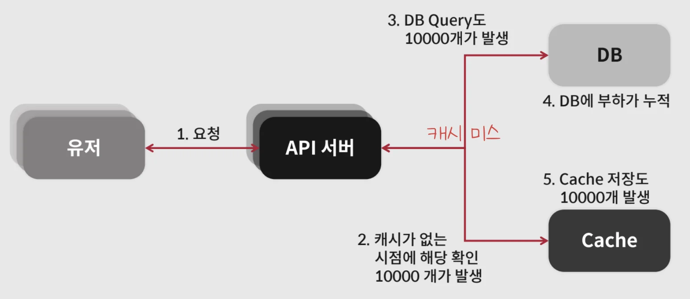

<a id="3a0eda9b0fe180ec99e9f8d32dbe9e89"></a>

## 대규모 트래픽 처리 시, 발생될 수 있는 이슈들

---

> 📖 
> 
> <a id="3a0eda9b0fe180c4aa30c3a45a33f5da"></a>
> 
> 대규모 트래픽 처리 시 발생할 수 있는 여러가지 이슈들에 대해서 학습한다&#46;

<a id="3a0eda9b0fe1801bafedd14fd2ba32eb"></a>

### Thundering Herd

> ✏️ 
> 
> <a id="3a0eda9b0fe1809faca2c5f2eb077b56"></a>
> 
> 하나의 이벤트 때문에 많은 프로세스·스레드·클라이언트가 동시에 깨어나, 동일한 제한된 자원에 몰리는 현상을 말한다&#46; 
> 
> - 한국어로는 흔히 “우르르 몰려드는 현상” 정도로 표현 가능
> 
> - 웹 서비스에서는 <code>Cache Miss</code> 로 인해, <strong><u>많은 프로세스가 같은 Key를 DB에서 읽으려고 시도</u></strong>하면서, 특정 서버에 부하를 극도로 증가시키는 경우를 의미한다&#46;
>     

> 
> 
> <a id="3a0eda9b0fe18054a9fdcc3b90c547cc"></a>
> 
> <code>Cache Stampede</code>
> 
> - Cache 의 Expire Time 설정으로 인해 대규모 중복된 DB 쿼리와 중복된 Cache 쓰기가 발생하는 현상 (Thundering Herd)

<details>
<summary>원인</summary>

- 캐시가 없을 때 발생
    - 캐시 서버의 추가/삭제

    - 해당 키의 TTL에 의한 데이터 삭제

    - 캐시 서버 메모리 부족으로 해당 키의 Eviction

</details>

<details>
<summary>ex) 캐시 만료</summary>

<a id="3a0eda9b0fe180879b6dfc6b772d212a"></a>

```bash
          캐시 만료
             ↓
    해당 만료된 데이터 요청 10,000개
             ↓
      모두 Cache Miss 발생
             ↓
      모두 DB를 동시에 조회
             ↓
    DB 과부하 → 응답 지연/장애
```

- 원래 DB 조회는 한 번만 하고 결과를 캐시에 넣으면 충분하지만, 10,000개의 요청이 같은 작업을 동시에 수행하여 I/O 병목 발생

- 이를 <strong><code>Cache Stampede</code></strong>라고도 하며 Thundering Herd의 대표적인 형태

</details>

<details>
<summary>ex) 동시 재시도</summary>

<a id="3a0eda9b0fe1808f8278c966cf39d98f"></a>

```bash
# 서버가 잠시 장애를 일으켰다고 가정
0초: 1,000개 요청 실패
1초: 1,000개가 동시에 재시도 → 다시 과부하
2초: 1,000개가 다시 동시에 재시도 → 다시 과부하
```

- 재시도 자체는 올바른 대응이지만, 모든 클라이언트가 같은 시간에 재시도하면 장애가 오히려 증폭된다&#46;

- 핵심 문제는 단순히 “요청이 많다”가 아닌 “<strong><u>요청들의 타이밍이 서로 동기화</u></strong>되어 있다”는 것 이다&#46;

</details>

<details>
<summary>왜 <code>Thundering Herd</code> 가 문제가 되는가?</summary>

> 🤔 
> 
> <a id="3a0eda9b0fe18004a203ccdcd2bdf241"></a>
> 
> Linux도 여러 작업자를 전부 깨우는 문제를 줄이기 위해 <code>EPOLLEXCLUSIVE</code> 같은 기능을 제공
> 
> - ‣

- CPU 컨텍스트 스위칭 증가

- DB, 락, 소캣 등 공유 자원 경합

- 순간적인 트래픽 폭증

- 응답 시간 증가와 타임아웃

- 재시도가 추가 부하를 만드는 연쇄 장애

- 실제로 작업을 처리하는 자원는 소수인데, 모두 작업 시도를 하는 낭비 발생

</details>

<details>
<summary>🤔 <code>Jitter</code></summary>

[시간 제한, 재시도 및 지터를 사용한 백오프]()

> ✏️ 
> 
> <a id="3a0eda9b0fe1808e8391ff54656c616b"></a>
> 
> Jitter는 작업 실행 시점에 <strong><u>작은 무작위성을 넣어</u></strong>, <strong><u>여러 요청이  동시에 몰리지 않도록 분산</u></strong>하는 기법이다&#46; 
> 
> <a id="3a0eda9b0fe180d89931cd17cdd36408"></a>
> 
> Jitter는 재시도뿐 아니라 캐시 TTL, 주기 작업, 연결 재수립 등에도 사용된다&#46; 
> 
> <a id="3a0eda9b0fe18079b1e0ff90521ddbf7"></a>
> 
> 핵심 목적은 <strong>작업량을 줄이는 것이 아니라 </strong><strong><u>동기화를 깨뜨리는 것</u></strong><strong>이다&#46;</strong>

<details>
<summary>ex) 서버 오류 후 1000개 클라이언트가 재시도</summary>

-  Jitter 없음
    <a id="3a0eda9b0fe18080b5eeda88dadd3803"></a>

    ```bash
    모든 클라이언트 
    	→ 정확히 2초 후 재시도 
    	→ 요청 1,000개 한번에 처리 시도
    ```

- Jitter 적용
    <a id="3a0eda9b0fe1800e900dd1e9bf62952b"></a>

    ```bash
    클라이언트 A → 0.7초 후 재시도
    클라이언트 B → 1.3초 후 재시도
    클라이언트 C → 1.9초 후 재시도
    ```

    - 요청을 시간축에 흩뿌리는 것

</details>

<details>
<summary>Backoff와의 차이</summary>

- <code>Back off</code>&#58; 실패할수록 대기 범위를 늘린다&#46;

- <code>Jitter</code>&#58; 그 범위 안에서 실제 대기 시간을 무작위로 선택

</details>

<a id="3a0eda9b0fe180c5a246dfa56ca44b01"></a>

대표적인 <code>Full Jitter</code> 계산

> 
> 
> <a id="3a0eda9b0fe18043be40c7c46a08d0bd"></a>
> 
> 최대 대기 시간 = <code class="language-math">min(상한, 기본시간 × 2^{재시도횟수})</code><br>실제 대기 시간 = <code class="language-math">random(0, 최대 대기 시간)</code>

- ex) 
    <a id="3a0eda9b0fe180be9808d240ae205c73"></a>

    최대 대기 시간 8초<br>→ 모든 클라이언트가 8초를 기다리는 대신 각자 0 &#126; 8 초 중 무작위 시간을 기다린다&#46; 

</details>

<details>
<summary>주요 해결 방법</summary>

<details>
<summary>1&#46; <code>Exponential Backoff &#43; Jitter</code></summary>

<a id="3a0eda9b0fe1800fb557c00e30b7be10"></a>

```bash
고정 재시도: 1초, 2초, 4초
Jitter 적용: 0.7초, 2.4초, 3.2초 ...
```

- 재시도 간격을 점점 늘리고, 무작위 시간을 추가한다&#46; 

- <code>Backoff</code>만 사용하면 클라이언트들이 여전히 같은 시간에 재시도할 수 있으므로, 무작위 분산인 <code>Jitter</code>가 중요하다&#46;

</details>

<details>
<summary>2&#46; <code>Single Flight / Request Coalescing</code></summary>

<a id="3a0eda9b0fe18044b310d4271e7e1ce7"></a>

```bash
요청 A ── DB 조회 ── 결과 공유
요청 B ── 기다림 ───┘
요청 C ── 기다림 ───┘
```

- 동일한 작업은 한 요청만 실행하고, 나머지는 그 결과 기다려 공유 받는다&#46; 

</details>

<details>
<summary>3&#46; <code>캐시 만료 시간</code>에 <code>Jitter</code> 추가</summary>

<a id="3a0eda9b0fe18002b3c7c854def88dd8"></a>

```bash
TTL = 60초 + random(0~10초)
```

- 모든 캐시가 정확히 60초 후 동시에 만료되지 않게 한다&#46;

</details>

<details>
<summary>4&#46; <code>락</code> 또는 <code>큐</code> 사용</summary>

- 한 번에 제한된 수의 작업자만 공유 자원에 접근하게 한다&#46; 

- 여러 서버에 걸친 시스템이라면 로컬 락이 아니라 분산 락 이나 공유 상태가 필요할 수 있다&#46; 

</details>

<details>
<summary>5&#46; <code>Rate Limiting</code> 과 <code>Load Shedding</code></summary>

- 처리 능력을 초과한 요청은 대시키거나 빠르게 거절해 전체 시스템이 무너지는 것을 막는다&#46; 

</details>

</details>

<a id="3a0eda9b0fe180acaeffe8db274e28ea"></a>

### Hot Key
