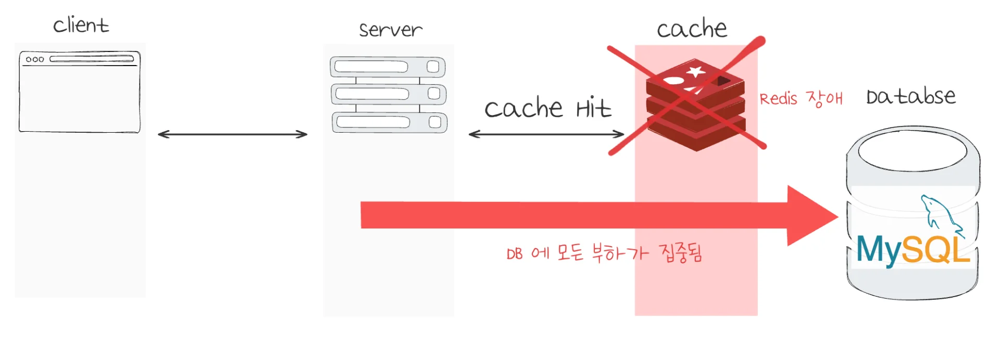
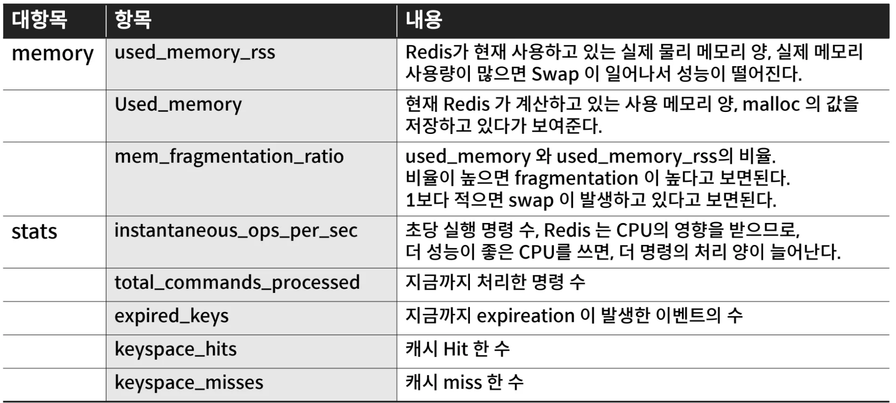
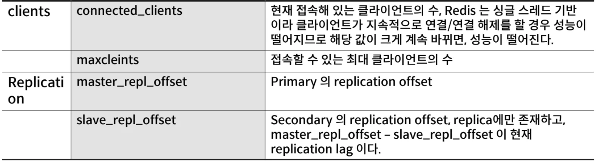
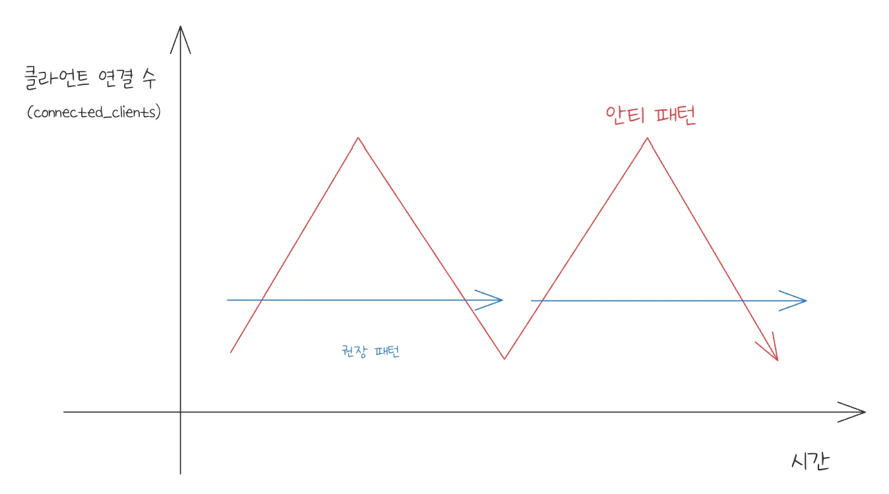
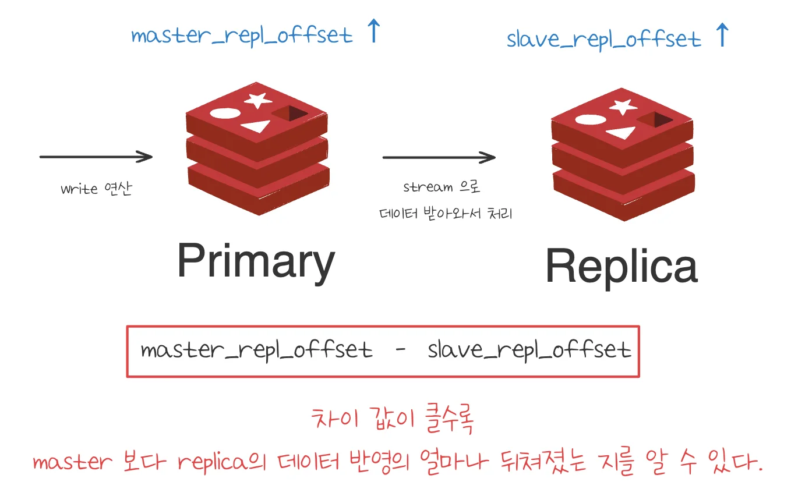
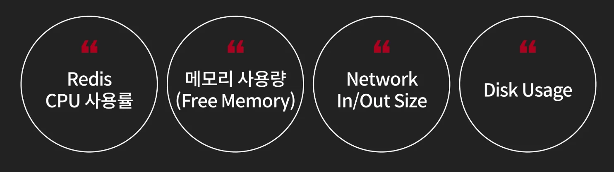
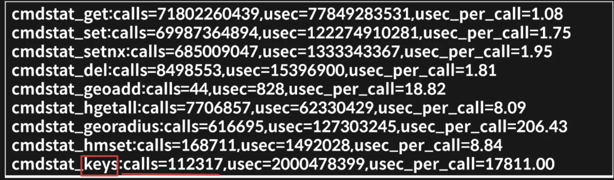

<a id="395eda9b0fe1800c875efe6857c7c18f"></a>

## Redis 모니터링 매트릭

---

> 
> 
> 
> 
> > Redis는 많은 트래픽을 처리할 수 있기 때문에, <strong>Redis의 문제</strong>가 생기면 <strong>전체 시스템의 성능 저하</strong>로 이어질 수 있다&#46;
> 
> <a id="395eda9b0fe180adb1ade0144ab3f118"></a>
> 
> 레디스는 평소에도 많은 트래픽을 처리하고 있을 가능성이 높고 그렇기 때문에 뒷단의 DB와 같은 서비스들이 Redis를 통해서 많은 트래픽을 부하 분산 처리한다&#46; 
> 
> <a id="395eda9b0fe180c1b512e0f621728f4a"></a>
> 
> 그러나 Redis에 장애가 생기면 Redis에서 처리하던 많은 트래픽들이 DB로 넘어가 부하가 발생되며 전체 서비스에 큰 영향을 줄 수 있다&#46; 
> 
> <a id="395eda9b0fe180568d7ce12664f43779"></a>
> 
> 따라서 <strong><u>레디스는 꼭 모니터링이 필요</u></strong>하다&#46;

<details>
<summary>🤔 redis가 고장, failover 처리로 복구하면 되지 않는가?</summary>

- <a href="#/post/362eda9b-0fe1-806d-a9f3-ef4aa63ecb51">페이지</a> 

- 장비, 메모리 고장 
    <a id="396eda9b0fe180d195cee6a1ecac2136"></a>

    → 장비만 교체하면 된다&#46; 

- Redis 사용 패턴에 문제
    <a id="395eda9b0fe180319323e2d95c403cf6"></a>

    그러나 베포를 했는데 사용 패턴에 이상이 있으면 해당 redis 서버가 failover 되더라도 <br>이상한 패턴으로 처리하기 때문에 또 redis 서버에 장애가 발생될 수 있다&#46; 

    <a id="395eda9b0fe1804e960dc9de730dee51"></a>

    따라서 <strong><u>redis의 모니터링</u></strong>을 통해 <strong>사용되는 자원을 확인</strong>하여 <strong><u>이상한 사용 패턴을 조기에 감지</u></strong>하는 것이 굉장히 중요하다&#46; 

</details>

<a id="395eda9b0fe18058afbfd3453de0ef09"></a>

### Redis Metrics 수집 방법

> ✏️ 
> 
> <a id="396eda9b0fe1802fb7a1c5843f56bee8"></a>
> 
> <code>info all</code> 명령으로 <strong><u>Redis 자체에서 제공하는 Metrics를 확인</u></strong>할 수 있다&#46; 
> 
> - 목록은 아래와 같다&#46;

<a id="395eda9b0fe18005ab9fe0c25f6cc8ae"></a>

#### Redis Metrics





<a id="395eda9b0fe1802dad54ea62abc72600"></a>

#### memory

> 🤔 
> 
> <a id="396eda9b0fe18064b6d1fa90f31906ba"></a>
> 
> 프로그램이 os에서 사용하는 메모리는 아래 2가지 종류가 있다&#46;
> 
> - <code>물리 메모리 (physical memory)</code>
> 
> - <code>가상 메모리 (virtual memory)</code>
> 
> <a id="396eda9b0fe180c0bfc7c862d0a08444"></a>
> 
> 실제 메모리가 필요할 때 <code>물리 메모리(physical memory)</code>가 부족하더라도 <u>잘 안 쓰는 메모리를 디스크</u>에 올리는 <code>스왑 아웃</code>을 하고 <u>다시 필요하면 디스크에서 읽</u>어드리는 <code>스왑 인</code> 을 한다&#46; 이를 <code>가상 메모리(virtual memory)</code>라 하며 실제 물리 메모리 보다 가상 메모리를 더 많이 사용할 수 도 있다&#46; 
> 
> <a id="396eda9b0fe180079685d386a64ceceb"></a>
> 
> 그런데 레디스 같은 경우 인메모리 솔루션이다 보니 인메모리 솔루션은 스왑 발생 시 성능이 많이 떨어지게 된다&#46; 
> 
> - 매모리 빠르게 처리하는 솔루션이다&#46; 따라서 스윕 처리 즉, 디스크 I/O 발생 시 병목이 발생된다&#46;
> 
> <a id="396eda9b0fe180b88c3af50aea359ae7"></a>
> 
> 따라서 RSS(<code>used&#95;memory&#95;rss</code>)를 보고 이 RSS가 실제 물리 사용 메모리보다 적도록 유지해야 한다&#46; 

> ❗ 
> 
> <a id="396eda9b0fe18074b61ac350650d302a"></a>
> 
> <strong>메모리 파편화</strong> 발생 시 <code>used&#95;memory</code>는 <strong><u>2기가 밖에 안</u></strong>되지만 <strong><u>실제</u></strong><strong>로 </strong><strong><code>used&#95;memory&#95;rss</code></strong><strong>는 </strong><strong><u>12기가 정도 되는 현상이 발생</u></strong>될 수 있다&#46; 
> 
> <a id="396eda9b0fe1808da109cdb9de95a84d"></a>
> 
> 따라서 <code>used&#95;memory</code> 보다 <code>used&#95;memory&#95;rss</code>를 <strong><u>모니터링하는 것이 더 중요</u></strong>하다&#46; 

- <code>used&#95;memory&#95;rss</code>
    - Redis가 현재 사용하고 있는 실제 물리 메모리양

    - 실제 메모리 사용량이 많으면 Swap이 일어나서 성능이 떨어진다&#46;

- <code>User&#95;memory</code>
    - Redis가 할당을 요청한 메모리 이다&#46; 

    - 현재 Redis가 계산하고 있는 사용 메모리 양

    - malloc 의 값을 저장하고 있다가 보여준다&#46; 

- <code>mem&#95;fragmentation&#95;ratio</code>
    - used&#95;memory 와 used&#95;memory&#95;rss 의 비율
        - <code class="language-math">&#92;frac{used&#45;memory&#45;rss}{used&#45;memory} </code>
            - <strong><u>1보다 높</u></strong>으면 <strong><code>파편화(fragmentation)</code></strong>

            - <strong><u>1보다 적</u></strong>으면 <strong><code>swap</code></strong> 발생

<a id="395eda9b0fe180a0b555de64e853e518"></a>

#### stats

<details>
<summary><strong><code>instantaneous&#95;ops&#95;per&#95;sec</code></strong></summary>

> ✏️ 
> 
> <a id="396eda9b0fe180c88770c706540c2d67"></a>
> 
> Redis가 현재 <strong><u>초당 처리하고 있는 명령 수</u></strong>다&#46;
> 
> <a id="396eda9b0fe1805a8fd5c327a31ab097"></a>
> 
> Redis의 순간 처리량을 나타내는 지표이며 <strong><u>값이 높</u></strong>으면 <strong><u>현재 Redis에 많은 명령 요청이 들</u></strong>어오고 있거나, <strong><u>Redis가 많은 명령을 빠르게 처리</u></strong>하고 있다는 의미다&#46;
> 
> <a id="396eda9b0fe1800fa991f44812a1c103"></a>
> 
> 값이 낮다고 해서 항상 문제가 있는 것은 아니다&#46;
> 
> <details>
> <summary>1&#46; 실제 트래픽이 적다&#46;</summary>
> 
> <a id="396eda9b0fe18022ac28e1272f3b52bb"></a>
> 
> 애플리케이션에서 Redis로 보내는 요청 자체가 적은 상태다&#46;
> 
> <a id="396eda9b0fe18085a0c8c8e7d4a38a53"></a>
> 
> 이 경우에는 정상적인 저부하 상태로 볼 수 있다&#46;
> 
> </details>
> 
> <details>
> <summary>2&#46; <strong>느린 명령</strong>으로 인해 전체 처리량이 줄었다&#46;</summary>
> 
> <a id="396eda9b0fe1809c9abfde965f40d983"></a>
> 
> KEYS, 큰 범위의 LRANGE, 큰 Sorted Set 조회, Lua script, 대량 삭제, 큰 JSON/string 처리 같은 명령이 오래 걸리면 Redis 이벤트 루프가 오래 점유된다&#46;
> 
> <a id="396eda9b0fe18045b726c7856ffd4582"></a>
> 
> Redis는 기본적으로 단일 스레드 이벤트 루프 기반으로 명령을 처리하므로, 느린 명령 하나가 뒤의 명령 처리를 지연시킬 수 있다&#46;
> 
> <a id="396eda9b0fe180f2b94be95dd38659ee"></a>
> 
> 이 경우 <code>instantaneous&#95;ops&#95;per&#95;sec</code>는 낮아질 수 있고, 동시에 latency는 증가할 수 있다&#46;
> 
> </details>

> 🤔 
> 
> <a id="396eda9b0fe180f3bf12e172d5c1c6db"></a>
> 
> <code>instantaneous&#95;ops&#95;per&#95;sec</code>는 <strong>처리량 지표</strong>이지, 단독으로 성능 문제를 확정하는 지표는 아니다&#46;
> 
> <a id="396eda9b0fe18078bb25dd0ac6a1fcf3"></a>
> 
> Redis 공식 운영 문서에서도 <code>keyspace&#95;hits</code>, <code>keyspace&#95;misses</code>, <code>expired&#95;keys</code>, <code>evicted&#95;keys</code>, <code>instantaneous&#95;ops&#95;per&#95;sec</code> 등을 주요 관찰 지표로 함께 본다&#46;
> 
> - ‣

</details>

<details>
<summary><strong><code>total&#95;commands&#95;processed</code></strong></summary>

> ✏️ 
> 
> <a id="396eda9b0fe1808d80cbc7b29935041a"></a>
> 
> Redis 서버가 <strong><u>시작된 이후 지금까지 처리한 전체 명령 수</u></strong>다&#46;
> 
> <a id="396eda9b0fe18034bb7dc449f50a1043"></a>
> 
> GET, SET, DEL, EXPIRE, HGET, ZADD 같은 <strong><u>모든 명령 처리가 누적</u></strong>되며 <u>Redis가 재시작</u>되면 <em>다시 초기화 </em>된다&#46;

- ex)
    <a id="396eda9b0fe180be8d86d61b65b93f82"></a>

    ```bash
    total_commands_processed:1000000
    ```

    - Redis 프로세스가 시작된 이후 총 100만 개의 명령을 처리했다는 의미다&#46;

    - 이 값 자체보다는 <code>증가량</code>이 중요하다&#46;

    <a id="396eda9b0fe180a1a5acc86a94bf856a"></a>

    ```plaintext
    이전 값: 1,000,000
    1분 후: 1,060,000

    1분 동안 처리한 명령 수 = 60,000
    초당 평균 처리량 = 60,000 / 60 = 1,000 ops/sec
    ```

    - <code>total&#95;commands&#95;processed</code>는 누적값을 기반으로 직접 처리량 추이를 계산할 때 사용할 수 있다&#46;
        - <code>instantaneous&#95;ops&#95;per&#95;sec</code>는 Redis가 계산해주는 순간 처리량이다&#46;

</details>

<details>
<summary><strong><code>expired&#95;keys</code></strong></summary>

> ✏️ 
> 
> <a id="396eda9b0fe180ac8419df5486d85b5c"></a>
> 
> <strong><u>TTL이 만료</u></strong>되어 Redis가 <strong><u>삭제한 키의 누적 개수</u></strong>다&#46;
> 
> <a id="396eda9b0fe180aa99cfca0e80e5b90f"></a>
> 
> EXPIRE, SET EX, SET PX 등으로 <u>만료 시간이 설정된 키가 실제로 만료되어 제거되면 증가</u>한다&#46;
> 
> - Redis 서버가 시작된 이후 누적된 값이다&#46;

> ⚠️ 
> 
> <a id="396eda9b0fe180d0a7e1c61dbfd41448"></a>
> 
> 주의할 점은 <code>expired&#95;keys</code>가 높다고 무조건 문제는 아니라는 점이다&#46; TTL 기반 캐시, 세션, 인증 토큰 저장소에서는 자연스럽게 증가할 수 있다&#46; 
> 
> <a id="396eda9b0fe1800baecee376baef227c"></a>
> 
> 다만 <strong>예상보다 급격히 증가</strong>한다면 <strong><u>TTL이 너무 짧</u></strong>거나, <strong><u>키 생성량이 과도</u></strong>하거나, <strong><u>캐시가 너무 빨리 사라</u></strong>지는 구조일 수 있다&#46;

- ex)
    <a id="396eda9b0fe180a3ad7ff845990bc094"></a>

    ```plaintext
    SET session:1 "userA" EX 1800
    ```

    - 세션 캐시를 Redis에 저장하고 TTL을 30분으로 둔다면, 시간이 지나 만료된 세션 키들이 삭제될 때 <code>expired&#95;keys</code>가 증가된다&#46; 
        <a id="396eda9b0fe18064adf6e1c0a3daba56"></a>

        → 30분이 지나 해당 키가 만료되면 <code>expired&#95;keys</code> 값 증가

</details>

<details>
<summary><strong><code>evicted&#95;keys</code></strong></summary>

> ✏️ 
> 
> <a id="396eda9b0fe180ea8710c592986675af"></a>
> 
> Redis가 <strong>maxmemory 제한에 도달</strong>했을 때, <strong><u>eviction policy에 따라 제거한 키의 누적 개수</u></strong>다&#46;
> 
> - 메모리가 부족해서 Redis가 강제로 키를 쫓아낸 횟수라고 볼 수 있다&#46;
> 
> - ‣
> 
> <a id="396eda9b0fe18096b585f2ba5c5c5cac"></a>
> 
> 따라서 실무적으로는 <code>evicted&#95;keys</code>가 증가하는지 주의 깊게 봐야한다&#46;<br>특히 Redis를 <strong>캐시</strong>가 아니라 <strong>중요 데이터 저장소</strong>처럼 쓰고 있다면  <code>evicted&#95;keys</code> 증가는 위험 신호이다&#46; 이는 의도치 않게 데이터가 사라질 수 있는 원인이 되기 때문이다&#46;
> 
> - evicted&#95;keys 증가 ❌
>     <a id="396eda9b0fe180b5b348f5984be9b2d5"></a>
> 
>     → 메모리 부족으로 강제 삭제되는 키가 거의 없음
> 
> - evicted&#95;keys 지속 증가
>     <a id="396eda9b0fe180e0a3bee6eb011e0d7b"></a>
> 
>     → Redis 메모리가 부족하거나 maxmemory가 너무 작거나, 캐시 적재량이 과도하거나, eviction policy가 실제 서비스 특성과 맞지 않을 수 있음

- ex)
    <a id="396eda9b0fe1802c8dc7fb6bd9a0883f"></a>

    ```plaintext
    maxmemory 2gb
    maxmemory-policy allkeys-lru
    ```

    - 위 설정에서는 <u>Redis 메모리가 2GB에 가까워졌을 때</u><strong> </strong>전체 키 중 LRU 기준으로 덜 사용된 키를 제거한다&#46; <br>이때 <code>evicted&#95;keys</code>가 증가한다&#46;

</details>

<details>
<summary><strong><code>keyspace&#95;hits</code></strong></summary>

> ✏️ 
> 
> <a id="396eda9b0fe180178d33ce4683bb2f9e"></a>
> 
> Redis에서 조회한 키가 실제로 존재해서 성공한 횟수다&#46;
> 
> - 캐시 관점에서는 cache hit 횟수다&#46;

- ex)
    <a id="396eda9b0fe1800095f7e3d585a86f06"></a>

    ```plaintext
    GET user:1
    ```

    - 위 요청 실행 시, <code>user&#58;1</code> 키가 Redis에 존재하면 <code>keyspace&#95;hits</code>가 증가

</details>

<details>
<summary><strong><code>keyspace&#95;misses</code></strong></summary>

> ✏️ 
> 
> <a id="396eda9b0fe1809fb6b0ce1a90a7845c"></a>
> 
> Redis에서 조회한 키가 존재하지 않았던 횟수다&#46;
> 
> - 캐시 관점에서는 cache miss 횟수다&#46;

- ex)
    <a id="396eda9b0fe180f9904bc75c0eb859c5"></a>

    ```plaintext
    GET user:999
    ```

    - 위 요청 실행 시,  <code>user&#58;999</code> 키가 Redis에 없다면 <code>keyspace&#95;misses</code>가 증가

    - <strong>캐시 miss가 발생</strong>하면 보통 애플리케이션은 <strong><u>DB나 외부 API에서 데이터를 다시 가져온 뒤 Redis에 저장</u></strong>한다&#46;

</details>

<details>
<summary><strong><code>Cache Hit Ratio</code></strong></summary>

> ✏️ 
> 
> <a id="396eda9b0fe1800f92a3d4c6fda4b407"></a>
> 
> <code>keyspace&#95;hits</code>와 <code>keyspace&#95;misses</code>는 각각 따로 보는 것보다 <strong>cache hit ratio</strong>로 보는 것이 더 유용하다&#46; 
> 
> <a id="396eda9b0fe180aa8cb1c765a02d4b6e"></a>
> 
> ```plaintext
> cache_hit_ratio 
> = keyspace_hits / (keyspace_hits + keyspace_misses)
> ```
> 
> - <code>hit ratio</code> ↑
>     <a id="396eda9b0fe180978e4af62c3ca44697"></a>
> 
>     → Redis 캐시가 효과적으로 동작
> 
> - <code>hit ratio</code> ↓
>     <a id="396eda9b0fe180bc9f4df1a3bef2e422"></a>
> 
>     → 캐시 키 설계, TTL, 캐시 적재 전략, 요청 패턴 점검

> ☝🏻 
> 
> <a id="396eda9b0fe1804d8924fb429e66bf8d"></a>
> 
> <code>hit ratio</code>가 높다고 항상 좋은 것은 아니다&#46; 
> 
> <a id="396eda9b0fe180869dc0c70857befa2c"></a>
> 
> 예를 들어 <strong><u>오래된 데이터를 너무 길게 캐시</u></strong>해서 <strong><code>hit ratio</code></strong><strong>는 높지만 데이터 신선도가 떨</strong>어질 수도 있습니다&#46;

- ex)
    <a id="396eda9b0fe1807ea5e4f36382ceb25e"></a>

    ```plaintext
    keyspace_hits   = 900
    keyspace_misses = 100

    cache_hit_ratio = 900 / (900 + 100)
                    = 0.9
                    = 90%
    ```

    - 이 경우 Redis 조회 중 90%는 캐시에서 바로 응답했고, 10%는 Redis에 데이터가 없어서 DB나 원본 저장소를 조회했을 가능성이 있다&#46;

</details>

<a id="396eda9b0fe1801395e7dd40bda33c54"></a>

#### clients

- <code>connected&#95;clients</code>
    > ✏️ 
    > 
    > - <code>connected&#95;clients </code>현재 몇개의 클라이언트가 redis에 붙어있는지를 보여주는 수이다&#46; 
    > 
    > - 평소에는 큰 문제 없지만 큰 폭으로 <u><code>클라이언트 연결 수(connected&#95;clients)</code></u><u>가 늘었다 줄었다</u> 하는 것은 <u>명령을 사용하고 끊어버리 반복하는 클라이언트가 많다</u>는 의미이다&#46;
    >     <a id="396eda9b0fe180c2984bd574f2d243e5"></a>
    > 
    >     그렇게 되면 <strong>싱글스레드 기반인 레디스에서는 성능이 크게 떨</strong>어진다&#46; 
    > 
    > - 따라서 <strong>한번 연결 후 작업을 다 처리하고 종료</strong>하는 패턴이 레디스의 성능을 훨씬 높일 수 있다&#46; 

    

    <a id="396eda9b0fe18064bfaec5595d41ee47"></a>

      → 현재 접속해 있는 클라이언트 수

    <a id="396eda9b0fe180139be4e531eef74f22"></a>

      → Redis 는 싱글 스레드 기반이라 클라이언트가 지속적으로 연결/연결 해제를 할 경우 성능이 떨어지므로 해당 값이 크게, 계속 바뀌면 성능이 떨어진다&#46; 

- <code>maxclients</code>
    - 접속할 수 있는 최대 클라이언트 수

    - 이 값을 충분하게 설정하지 않으면 클라이언트 수 만으로 해당 횟수를 초과하여 모니터링 툴이 붙을 수 없는 상황이 벌어질 수도 있다&#46; 

<a id="395eda9b0fe1800c90b4c29ff07e9e58"></a>

#### Replication



> ✏️ 
> 
> <a id="396eda9b0fe18031981bca63aadc7b27"></a>
> 
> <code>Primary</code>에 <u>write가 발생</u>하면 <code>master&#95;repl&#95;offset</code>이 증가한다&#46;
> 
> <a id="396eda9b0fe180859dafeac288387005"></a>
> 
> <code>Replica</code>는 <u>primary의 replication stream을 받아 처리</u>하면서 <code>slave&#95;repl&#95;offset</code>을 증가시킨다&#46;
> 
> <a id="396eda9b0fe180258406ed87741d041c"></a>
> 
> 따라서 <strong><u>master&#95;repl&#95;offset과 slave&#95;repl&#95;offset의 차이</u></strong>는 <strong>primary에는 반영되었지만 replica에는 아직 반영되지 않은 replication stream의 크기</strong>를 의미한다&#46;

> ⚠️ 
> 
> <a id="396eda9b0fe18013ad0dc0eab2b03962"></a>
> 
> <code>master&#95;repl&#95;offset &#45; slave&#95;repl&#95;offset</code>은 보통 <strong>시간 단위 lag</strong>이 아니라 <strong>offset 차이</strong>, <br>즉 replication stream의 진행 위치 차이이다&#46; 
> 
> <a id="396eda9b0fe1808ab85ff9fd828bb12f"></a>
> 
> 따라서 “몇 초 늦었다”라기보다는 “얼마나 많은 replication 데이터만큼 뒤처졌다”에 가깝다&#46; <br>실제 운영에서는 <code>master&#95;link&#95;status</code>, <code>master&#95;last&#95;io&#95;seconds&#95;ago</code>, <code>master&#95;sync&#95;in&#95;progress</code> 같은 값도 함께 봐야 한다&#46;
> 
> <a id="396eda9b0fe18029a2e0dc50c4d51726"></a>
> 
> Redis 공식 문서도 replica 연결 상태, 마지막 master와의 I/O 시간, sync 진행 여부 등을 <code>INFO replication</code>에서 제공한다고 설명한다
> 
> - ‣

<details>
<summary><code>master&#95;repl&#95;offset</code></summary>

- Primary Redis 인스턴스의 현재 replication offset이다&#46;

- Primary가 replica에게 전파해야 하는 replication stream의 현재 위치라고 볼 수 있다&#46;

- 즉, primary에서 write 명령이 처리될수록 증가한다&#46;

</details>

<details>
<summary><code>slave&#95;repl&#95;offset</code></summary>

- Replica Redis 인스턴스가 현재까지 따라온 replication offset이다&#46;

- replica에만 존재하는 값이다&#46;

- replica가 primary로부터 받은 replication stream을 어느 지점까지 처리했는지를 나타낸다&#46;

</details>

<details>
<summary><code>replication lag</code></summary>

- primary와 replica 사이의 replication 진행 차이를 의미한다&#46;

- 일반적으로 다음과 같이 계산한다&#46;
    <a id="396eda9b0fe180da82afc125be7fbb46"></a>

    ```
    replication_lag = master_repl_offset - slave_repl_offset
    ```

- 이 값이 0에 가까우면 replica가 primary를 거의 실시간으로 따라가고 있다는 뜻이다&#46;

- 값이 커질수록 replica가 primary보다 뒤처져 있다는 의미다&#46;

- 예시)
    <a id="396eda9b0fe180fcbb95da9540159834"></a>

    ```bash
    master_repl_offset = 105000
    slave_repl_offset  = 103500

    replication_lag = 105000 - 103500 = 1500
    ```

    - 위 예시의 경우 replica는 primary보다 replication stream 기준으로 <code>1500</code>만큼 뒤처져 있다&#46;

</details>

<a id="395eda9b0fe18096a2acd9d2a23108e7"></a>

### Host Metrics



- <code>Redis CPU 사용률</code>
    - <strong><u>몇개의 command 를 처리</u></strong>하는가 

    - redis는 <strong><u>cpu가 빨라지면 처리할 수 있는 command 수도 많</u></strong>아진다&#46;

- <code>메모리 사용량 (Free Memory)</code>
    - 메모리가 많을수록 유리하다&#46;

    - 프리 메모리(메모리 여유공간)이 없으면 redis 뿐만아니라 os 등 에서 기본적으로 사용하는 메모리 공간 때문에 스왑이 발생돼 성능이 떨어질 수 있다&#46; 

- <code>Network In/Out Size</code>
    - 과도하게 사용량이 많으면 큰 value를 가진 키가 계속 전송되고 있거나 대량의 데이터가 복사되고 있는 상황일 수 있다&#46; 
        - replica가 붙어서 데이터를 전송하는 상황

- <code>Disk Usage</code>
    - 서버 기 때문에 Disk Usage 모니터링도 필요하다&#46; 
        - Disk Usage 때문에 서버가 죽는 경우가 생길 수 있음

        - elastic cat 등과 같은 <strong><u>클라우드에서 매니징</u></strong>을 하는 경우 <strong><u>신경쓰지 않</u></strong>아도 된다&#46;

<a id="395eda9b0fe180a2af33dc8ac60bcd4c"></a>

### 명령어 모니터링

<a id="395eda9b0fe180e9907cf12f2f674edc"></a>

<code>Info all</code> 명령의 Commandstats 확인

<a id="395eda9b0fe1808ca35dc17faa7abe80"></a>

<code>O(N)</code> 관련 명령의 <code>calls</code> 와 <code>usec&#95;per&#95;call</code> 이 증가하는 지를 확인해야 한다&#46; 



- 사용하는 명령을 모니터링 해야한다&#46; 
    - info all commandstats를 확인 가능한데, 이를 통해 모니터링을 통해서 명령어 병목 요인들을 파악한다&#46;

    - 이때 위의 <code>keys</code> 같은 명령어들 사용을 지양한다&#46;
