

## Consistent Hashing

---

> 🤔 
> 
> 
> 
> <strong>Modular 방식의 문제점 및 이를 해결하는 </strong><strong><code>consistent hashing</code></strong><strong> 방법</strong>
> 
> ---
> 
> 
> 
> 일반적인 모듈러 방식을 사용하면 <strong>서버의 추가/삭제 마다 리벨런싱이 많이 일</strong>어난다&#46; 
> 
> - 리벨런싱이 많이 일어나면 서버 확장/장애 시 복구 비용이 많이 든다&#46; 
> 
> - <a href="#/post/362eda9b-0fe1-8012-8645-f1e3ff04f9fc">페이지</a><code> Moduler 단점(리벨린싱)</code>  참고
> 
> 
> 
> 그걸 피하기 위해 <strong><u>장비를 2배씩 늘리는 방식</u></strong>(<code class="language-math">2^n</code>)도 있지만 <strong>인프라 비용이 많</strong>이 든다&#46; 이를 <code>consistent hashing</code>방식을 통해 <strong><u>비용 효율적</u></strong>이면서도 <strong><u>Modular 방식의 문제점을 개선</u></strong>할 수 있다&#46; 
> 
> - <strong>서버 추가/삭제 시 </strong><strong><u>리밸런싱이 적게 발생</u></strong>된다&#46;

> 
> 
> 
> 
> <strong>Consistent Hashing의 핵심</strong>
> 
> > <strong><u>같은 Hash를 사용</u></strong>하면 <strong><u>hash(key)는 항상 같은 결과</u></strong>를 보여준다&#46; 
> 
> - <code>hash(”server”) = 1</code> 
> 
> - <code>hash(”server1”) = 3</code>
> 
> - <code>hash(”server”) = 1</code> → 동일한 키(hash) 조회 → 동일한 결과값
> 
> - <code>hash(”server4”) = 2</code>

### 예시) Consistent Hashing 의 데이터 쓰기 작업 

> ✏️ 
> 
> 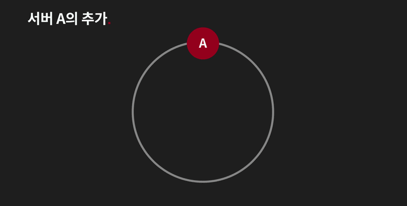
> 
> - 기준 노드들 과 rule을 설정하고 그에 따라 적절하게 데이터를 분산시켜 저장한다&#46; 
>     - 원형 큐 와 유사
> 
> - 이러한 매커니즘으로 인해 <strong><u>서버 노드 추가/삭제 시의 데이터 리벨런싱이 적게 일</u></strong>어난다&#46;

> <strong>1&#46; 기본 셋업</strong>

- 노드 설정
    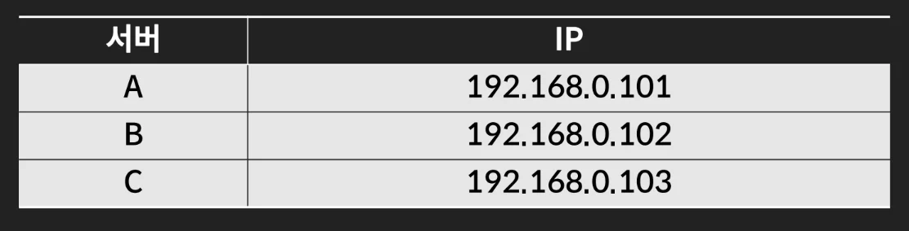

    - 아래와 같이 3대의 서버가 있다고 가정

- hash 설정
    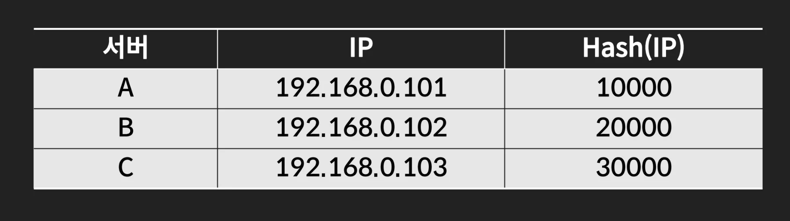

    - ip 기준으로 hash 적용

> <strong>2&#46; 데이터 쓰기 Rule 정의</strong>

- Hash 값을 기준으로 적절하게 분산되어 저장될 수 있도록 rule 설정 
    > <strong>Hash(key)의 값보다 크면서 가장 가까운 hash 값을 가진 서버에 데이터 저장한다&#46;</strong>

> <strong>3&#46;  데이터 쓰기(저장)</strong>

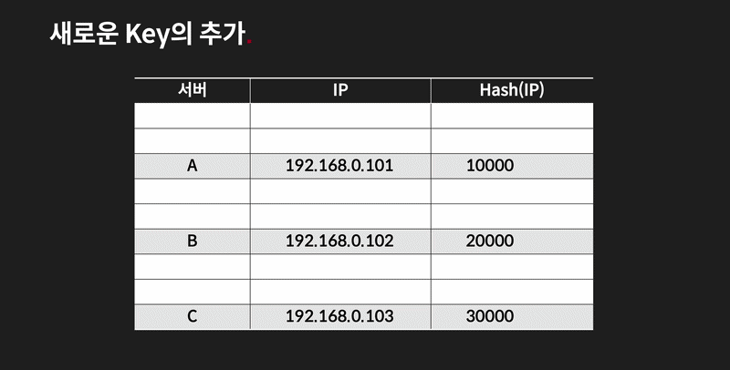

- 위와 같이 rule에 따라 데이터가 각 노드들에게 적절하게 분산된다&#46; 

- 위 표는 추상화하면 위 원형 형태와 같다&#46; 

### Consistent Hashing은 <u><code>장애</code></u><u>에 안정적</u>인가?

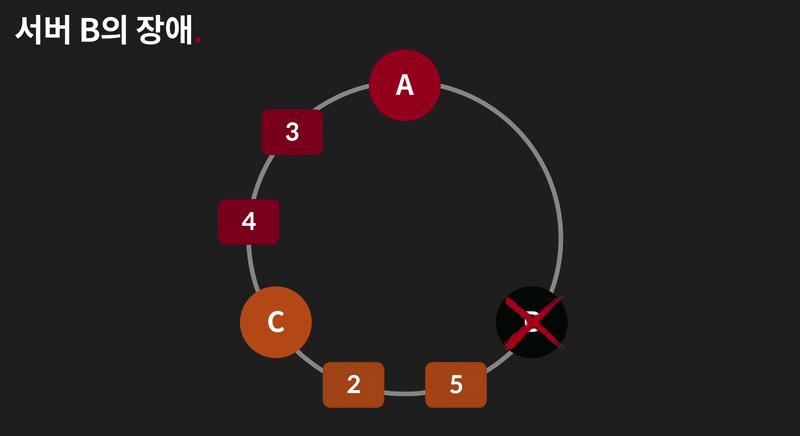

- B 서버에서 장애가 발생되면 <u>해당 범위의 데이터가 가까운 C 서버에 저장</u>된다&#46; (stale)
    - 이때 <strong><u>다른 서버들의 데이터들의 변동없이(리벨런싱 없이) </u></strong><strong>장애 대응이 가능</strong>하다&#46; 

- B 서버가 정상 동작하면 <strong>장애 상황에 저장된 데이터 1은 존재하지 않</strong>게 된다&#46; 이후 데이터 1의 쓰기 작업 발생 시, 서버 B에 정상 저장된다&#46; 
    - 🧐 데이터 무결성 문제 발생, 어떻게 복구하는가?

- <strong>다른 노드들은 변경이 없고 </strong><strong><u>서버가 추가/삭제 되는 범위 안의 값들만 변경</u></strong>되기 때문에 <strong><u>서버 장애, 추가 시에 안정</u></strong>이라고 평가된다&#46; 
    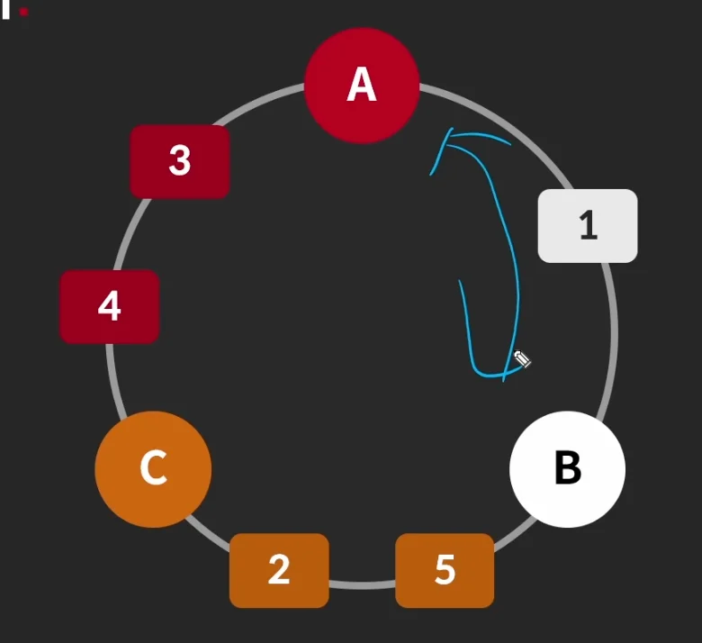

### Consistent Hashing은 <u><code>부하</code></u><u>에 안정적</u>인가?

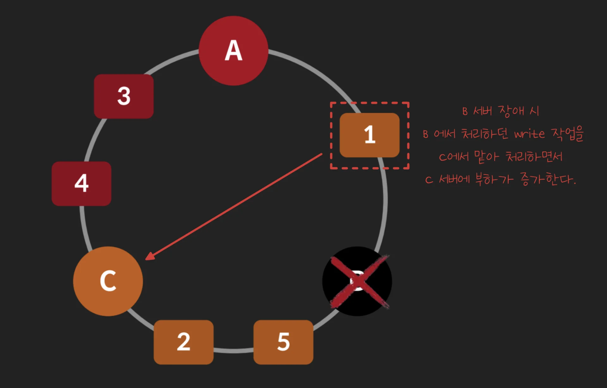

- B에 발생되던 쓰기 작업이 C로 넘어가기 때문에 서버 C의 부하가 증가된다&#46; 

- 즉, Consistent Hashing은 부하에 안정적이지 않다&#46;  
    - 장애 서버의 부하가 다른 서버로 넘어간다&#46; 

- 이를 해결하기 위해 <code>Virtual Node</code> 라는 개념을 사용한다&#46; 

### Virtual Node

> ✏️ 
> 
> 
> 
> <strong>Virtual Node</strong>
> 
> 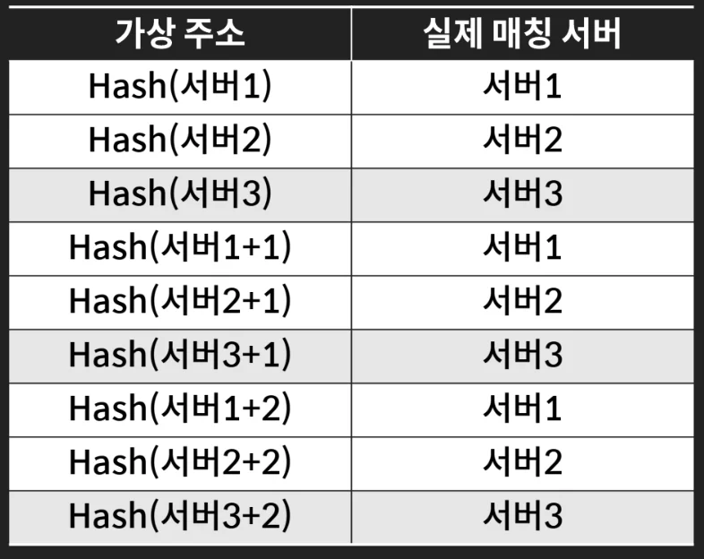
> 
> 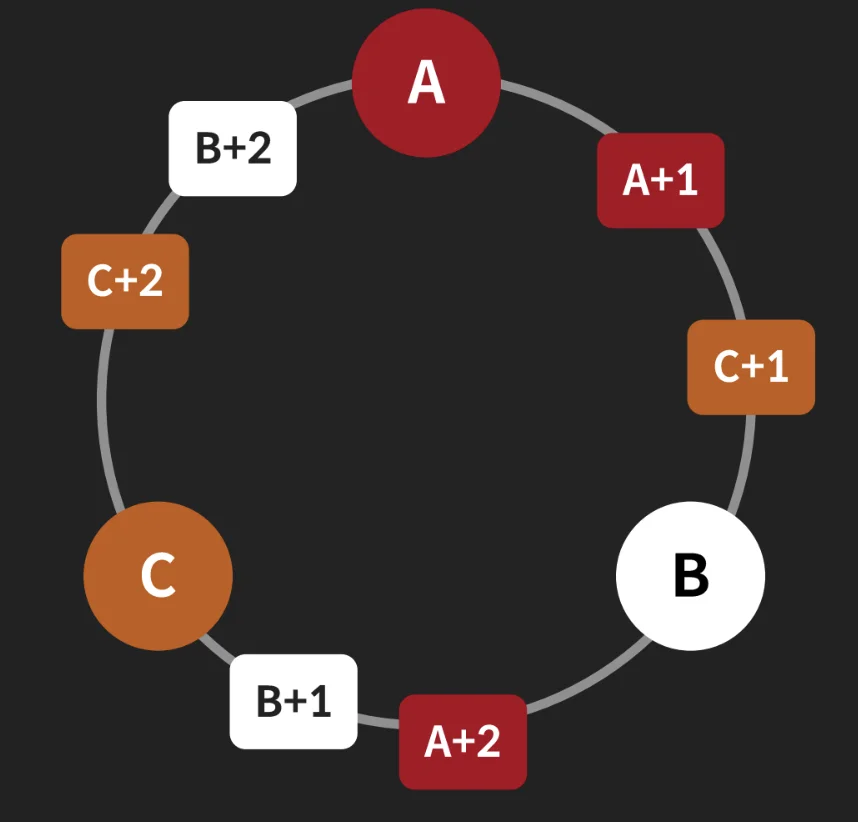
> 
> 
> 
> 서버를 논리적인 <strong><u>가상 주소</u></strong>로 분할시켜 <strong>장애 서버의 부하를 가용되는 모든 노드에 적절하게 분산</strong>시킨다&#46; 

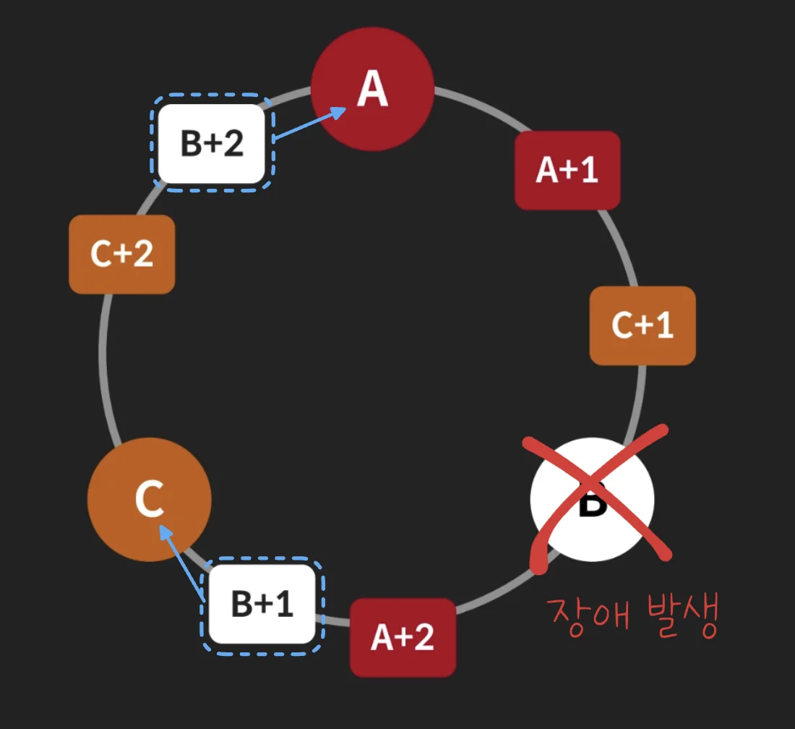

- 서버 장애 발생 시, 논리적으로 나눠진 주소를 포함시켜 데이터를 분산시킨다&#46; 

- 이전 하나의 서버에 모든 부하를 집중시켰던 단점을 논리적인 서버 도입을 통해 잘게 나눠 부하를 분산시킨다&#46; 

### Consistent Hashing의 <strong><code>서버 이름</code></strong>

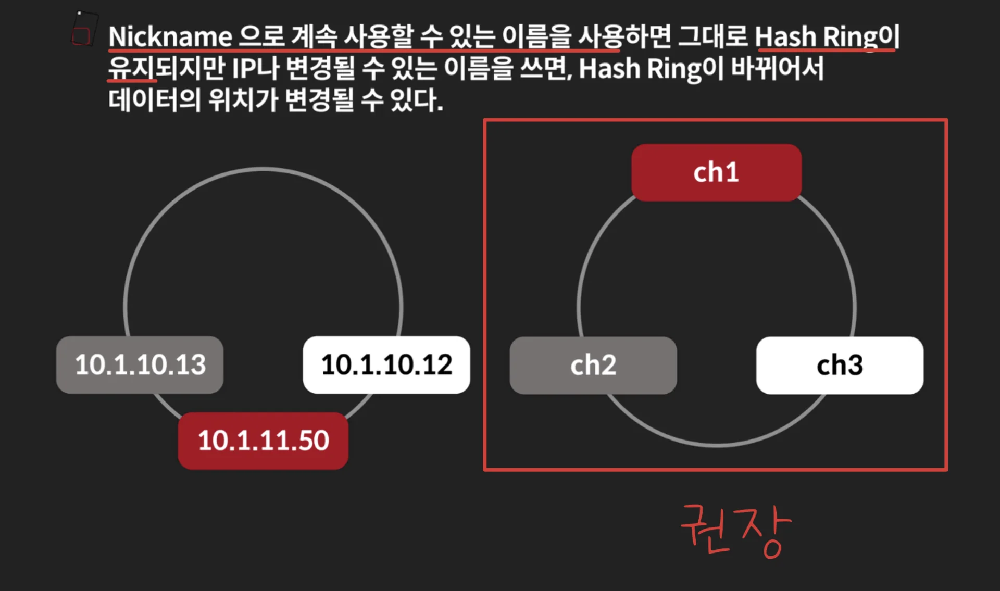

- 서비스 디스커버리 방식과 동일하게 서버를 <strong>중간 식별자 값을 통해 식별</strong>하여 <strong><u>ip 주소에 대한 직접적인 의존성을 제거</u></strong>한다&#46; 

- 단순한 Cache로만 사용할 때는 문제가 되지 않지만, 데이터를 유지하려고 한다면 꼭 Unique한 Nickname을 사용해야 한다&#46; 
    - ex) Redis 서버로 RDS 나 AOF 등으로 데이터를 백업하고 있는 경우

### Consistent Hashing HashCode 구현

- <code>Ketema hash</code>
    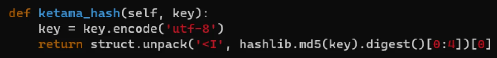

    - libmemcached 에서 이용하는 hash 함수

    - md5 사용

- <code>murmurhash3</code>

- <code>jump hash</code>

## 실습

[the&#95;red/chapter&#95;2/consistent&#95;hashing at main · charsyam/the&#95;red]()
