

## AnalyzationOfPE

---

### <strong>Contraction mapping theorem을 활용한 policy evaluation의 수렴점 분석</strong>

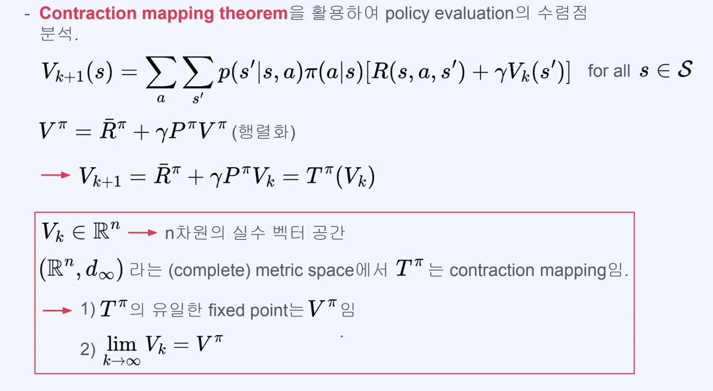

- value&#45;function에 대한 bellman equation 행렬화
    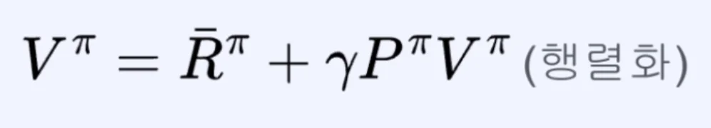

- 이와 같이 policy evaluation 도 벡터화 해서 행렬화 가능
    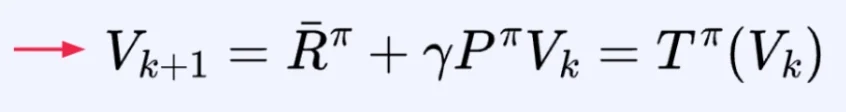

- <code class="language-math">(R^n, d&#95;&#92;infty)</code>  라는 metric space에서 <code class="language-math">T^&#92;pi</code>는 contraction mapping 이다&#46;
    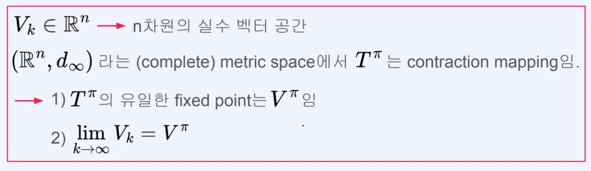

    - <code class="language-math">R^n</code>&#58; n 차원 실수 공간

    - <code class="language-math">d&#95;&#92;infty</code>&#58; 
        - p&#45;norm 에서 p 가 <code class="language-math">&#92;infty</code> 인 경우

        - 즉, distant metrix 로 사용

### 증명 &#45; <code class="language-math">T^{&#92;pi}(V&#95;k)</code> 가 contraction mapping 인가

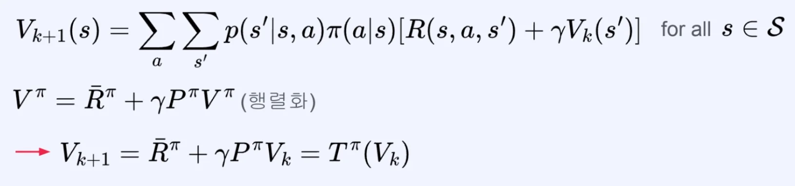

- contraction mapping 이론
    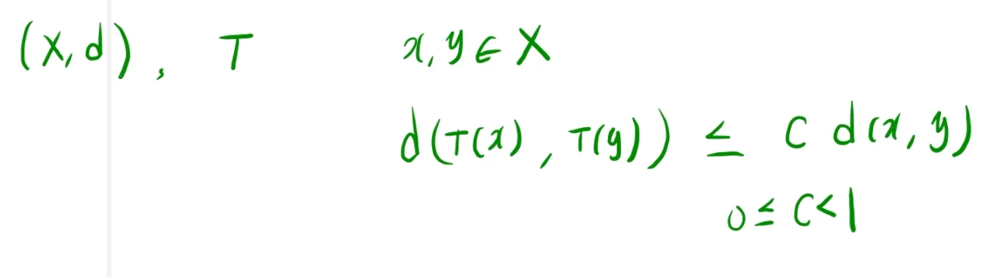

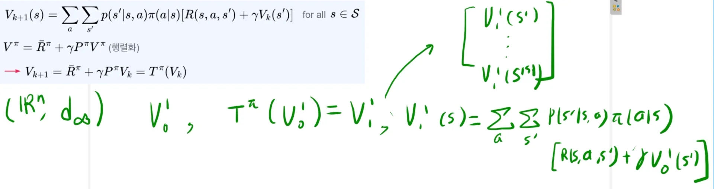

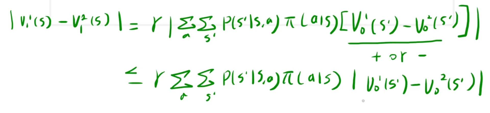

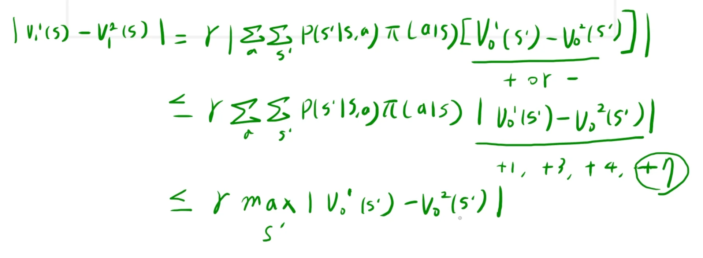

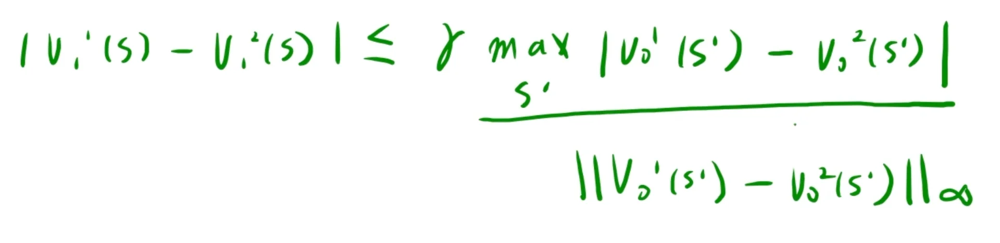

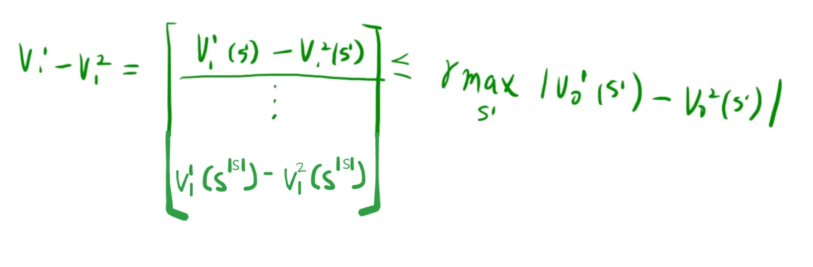

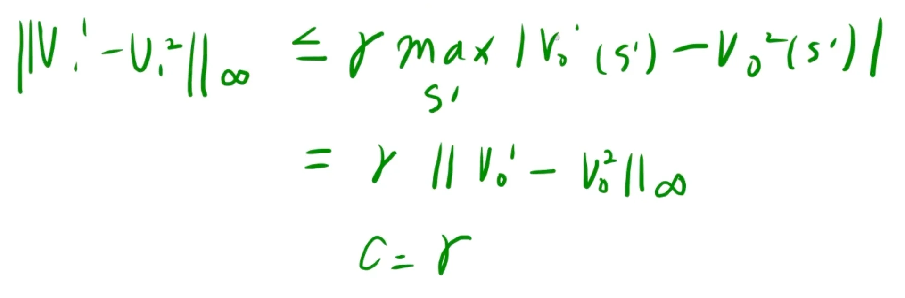

#### 정리 

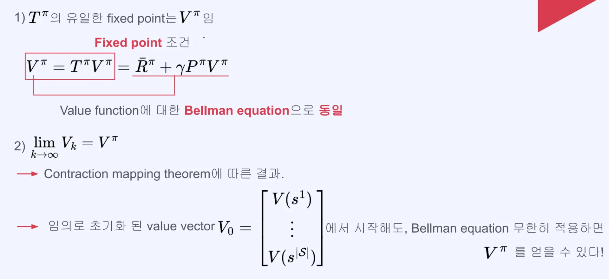
