

## Contraction mapping theorem

---

### <strong>Metric space</strong>

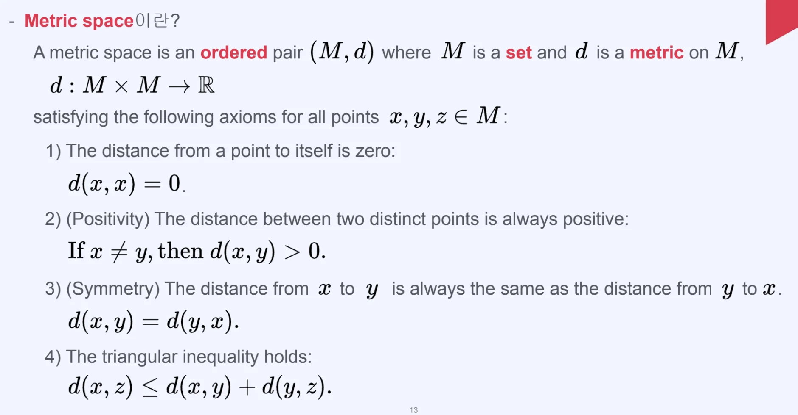

- 순서가 정해진 쌍 (M, d)가 아래의 조건을 만족할 때 이를, <code>Metric space</code> 라고 한다&#46;
    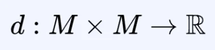

    - <code>M</code>&#58; 집합

    - <code>d(distance)</code>&#58; M에 대한 metric

- <code class="language-math">x, y, z &#92;in M</code> 에 대해서 아래의 조건을 만족해야 한다&#46; 
    1. <code class="language-math">x</code> 에서 시작해서 <code class="language-math">x</code> 까지의 거리는 <code class="language-math">0</code> 이어야 한다&#46; 
        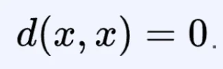

    1. 다른 두 점 사이의 거리는 항상 양수여야 한다&#46; 
        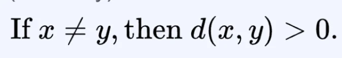

    1. x 에서 y까지의 거리와 y에서 x까지의 거리가 동일해야 한다&#46;
        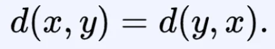

    1. x 에서 z 까지의 거리가 중간 y 점을 거친 것 보다 작거나 같아야 한다&#46; (<code>triangular inequality</code>) 
        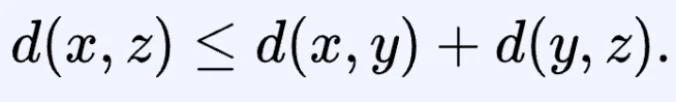

        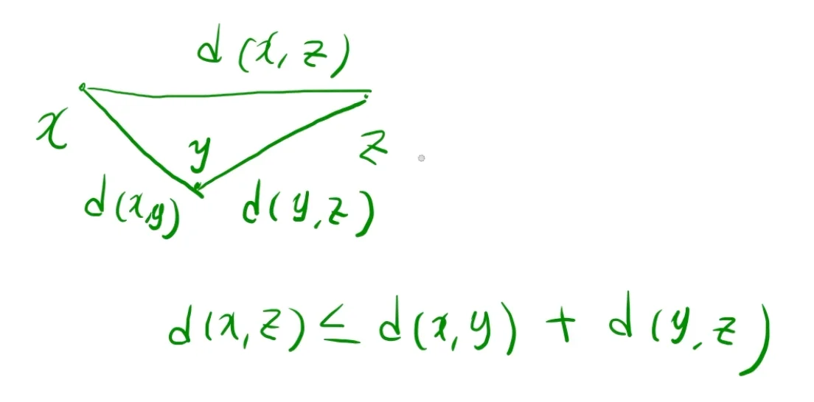

### <strong>p&#45;norm</strong>

> ✏️ 
> 
> 
> 
> <code>p&#45;norm</code>은 벡터의 <strong>크기(magnitude)</strong> 또는 <strong>거리(distance)</strong> 를 측정하는 일반화된 방법을 말한다&#46; 
> 
> 
> 
> 수학적으로는 아래와 같이 정의된다&#46; 
> 
> 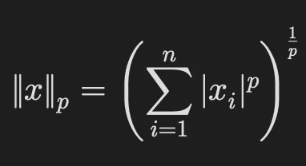

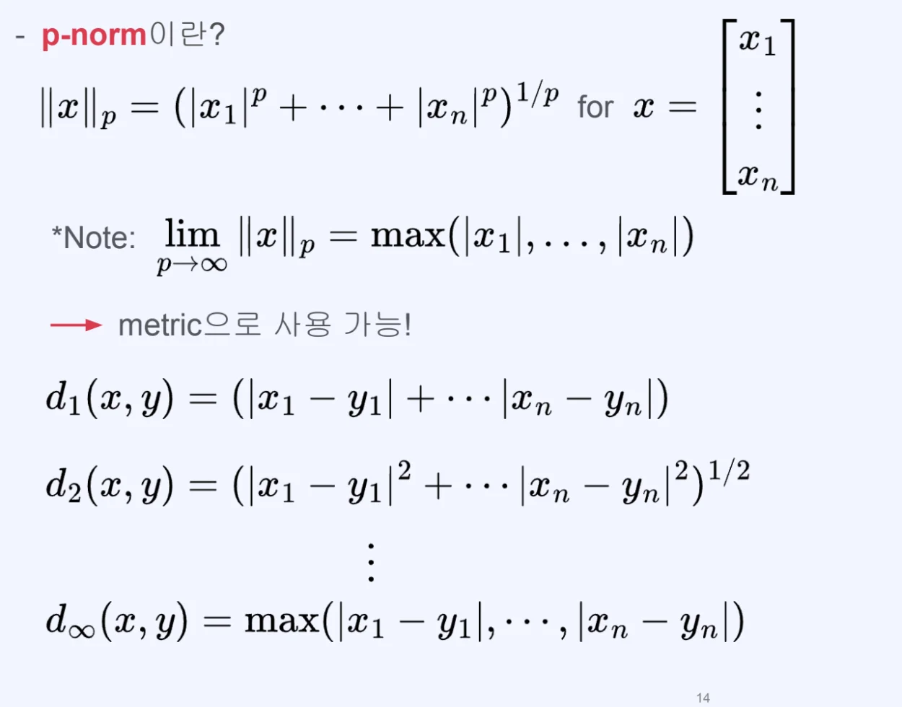

- <code class="language-math">&#124;&#124;x&#124;&#124;&#95;p</code>
    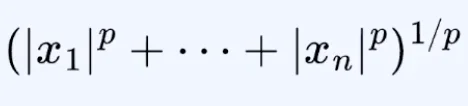

    - 유클리디안 거리 식과 동일

- 앞 선 Metric space 의 조건을 아래 식들이 만족한다&#46;
    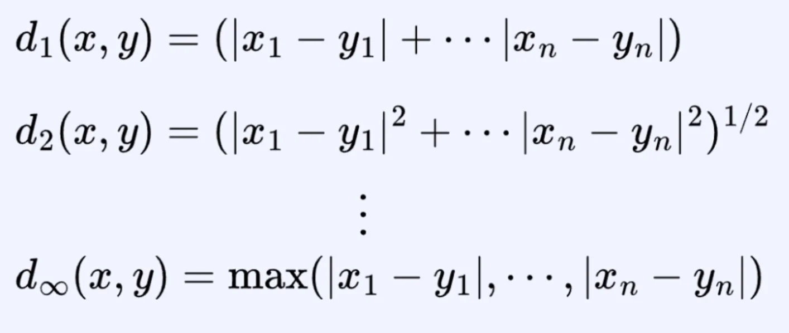

### <strong>Contraction mapping</strong>

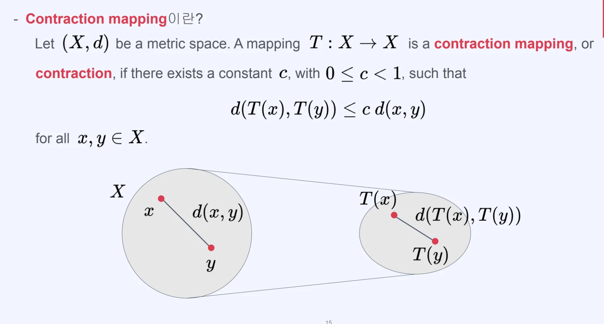

(X, d) 가 metric space 이고,  X → X 로 가는 매핑 함수를 지날 때

- X&#58; 매트릭 스페이스에서 거리의 점이 되는 원소들의 집합

- d&#58; 거리를 재는 척도

- 매핑 함수(X → X)
    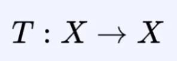

만약 constant <code>c</code>가 <code>0 ≤ c ≤ 1</code> 일 때, 이 함수를 contraction mapping 또는 contraction 이라 부른다&#46; 

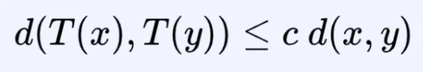

- X 에 존재하는 x, y 의 모든 원소를 만족할 때 성립한다&#46;
    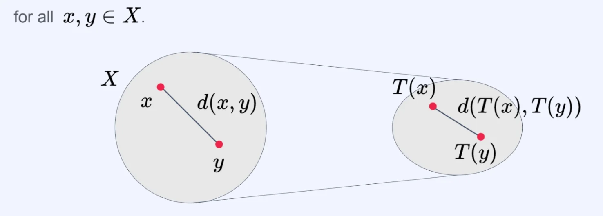

    - 이때 매핑함수의 c가 <code>0 ≤ c ≤ 1</code> 이기 때문에 위 그림과 같이 원본 함수보다 작은 분포를 가지게 된다&#46;

    - T(x), T(y) 두 점 사이의 거리가 까워진다&#46; 

### <strong>Contraction mapping theorem</strong>

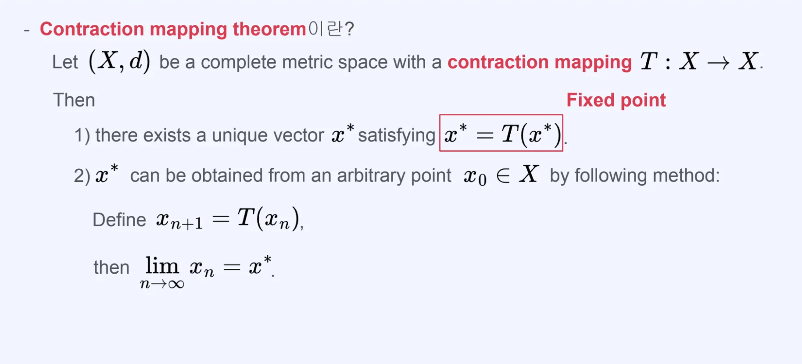

- 설명 1
    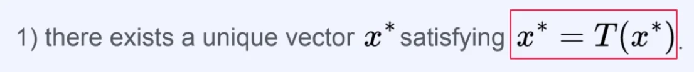

    - 점 <code class="language-math">x^&#42;</code>에 transfoemation <code class="language-math">T(x)</code>를 씌울 때 다시 자기 자신을 만족하는  점 <code class="language-math">x^&#42;</code> 는 고유하다&#46;  이러한 점을 fixed point(고정 점)이라고 한다&#46;

- 설명 2
    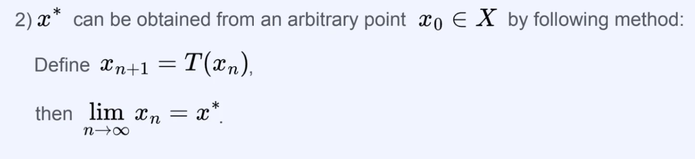

    - <code class="language-math">x&#95;0 &#92;in X</code> 일 때 <code class="language-math">x&#95;n = T^n(x&#95;0)</code>  즉,  <code class="language-math">x&#95;0</code> 에 transformation 함수를 n 번 씌운 것이 된다&#46;

    - 따라서 <code class="language-math">n → &#92;infty</code> 갈 때 <code class="language-math">x^&#42;</code> 는 fixed point가 된다&#46;
