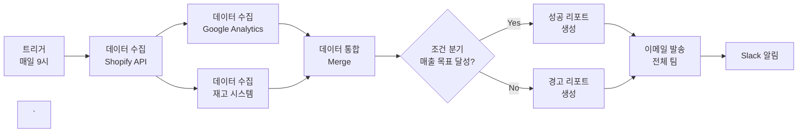
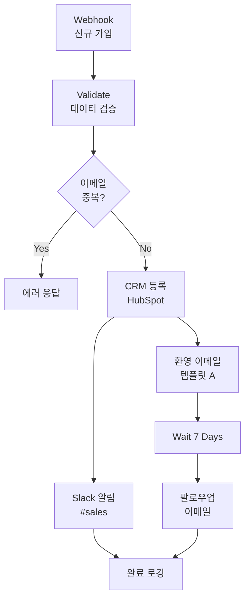

> 
> 
> <a id="371eda9b0fe180448d7dfeb178521828"></a>
> 
> <strong>목차</strong>
> 
> - [워크플로우 생성: 6단계 프로세스](#371eda9b0fe18038b195e0390ad94098)
> - [1. 목적 정의 (Define)](#371eda9b0fe180c1baabea47c95f90e4)
> - [2. 프로세스 맵핑 (Map)](#371eda9b0fe180aa9edec7a346c2ce41)
> - [3. 기술 분석 (Analyze)](#371eda9b0fe18022aa0eff5d70109af5)
> - [4. 설계 원칙 (Design)](#371eda9b0fe18046a681c1aa06e66171)
> - [5. 단계별 구현 (Implement)](#371eda9b0fe180a7b64afd398a0919ff)
> - [6. 테스트와 검증 (Test)](#371eda9b0fe180a88986f37f946410d2)
> - [예제 - 고객 온보딩 자동화](#371eda9b0fe1802991c9cfa24acd596e)
> - [시나리오](#371eda9b0fe180a9b752ff3add1e081f)
> - [완성된 워크플로우](#371eda9b0fe1809b850cc737a19b12d9)
> - [구현 코드와 설정](#371eda9b0fe180349c94d3d62df61a82)
> - [자주하는 실수 Top 10 및 해결책](#371eda9b0fe1802e956efd029d998ec3)
> - [워크플로우 템플릿](#371eda9b0fe180418230d8eaf7603e25)

<a id="371eda9b0fe18038b195e0390ad94098"></a>

## 워크플로우 생성&#58; <code>6단계 프로세스</code>

> 🤔 
> 
> <a id="371eda9b0fe1805e8b67d0b3c221aaab"></a>
> 
> <strong>왜 기획 중요한가?</strong>
> 
> > 어떤 업무를 자동화할 지 설계 후 검증, 테스트를 통해서 점진적으로 개선해 나가야한다&#46;
> 
> ---
> 
> - <strong>자동화 실패의 주요원인</strong>
>     - 무계획적인 노드 연결
> 
>     - 에러 처리 미비
> 
>     - 확장성 고려 부족
> 
>     - 유지보수 불가능한 스파게피 워크플로우
> 
> ---
> 
> - <strong>6 단계 프로세스의 목적</strong>
>     - 30분의 투자로 3시간 짜리 실수 예방
> 
>     - 체계적인 6단계 프레임워크를 통해 실무에서 활용 가능한 워크플로우를 설계

<a id="371eda9b0fe180c1baabea47c95f90e4"></a>

### 1&#46; 목적 정의 (Define)

> ✏️ 
> 
> <a id="371eda9b0fe180ff9f43d33b0173649c"></a>
> 
> 어떤 프로세스를 자동화하려는 지 정의가 필요하다&#46;

<details>
<summary>왜 자동화를 하려고 하는가?  <strong><code>5W1H 프레임워크</code></strong></summary>

| 질문 | 구체적 체크포인트 | 예시 답변 |
| --- | --- | --- |
| <strong>What</strong> | 무엇을 자동화? | 일일 판매 리포트 생성 |
| <strong>Why</strong> | 왜 필요한가? | 매일 2시간 수작업 소요 |
| <strong>Who</strong> | 누가 사용? | 영업팀 5명 |
| <strong>When</strong> | 언제 실행? | 매일 오전 9시 |
| <strong>Where</strong> | 어디서 데이터? | Shopify &#43; Google Sheets |
| <strong>How</strong> | 어떻게 개선? | 2시간 → 0분 (완전 자동화) |

</details>

<details>
<summary>예제 &#45; 이커머스 일일 리포트</summary>

- AS&#45;IS (현재)
    <a id="371eda9b0fe1803fa27dd2a9cef567f8"></a>

    ```python
    1. Shopify 관리자 페이지 로그인 (5분)
    2. 어제 판매 데이터 엑셀 다운로드 (10분)
    3. Google Analytics 데이터 추출 (15분)
    4. 엑셀에서 데이터 정리 및 계산 (60분)
    5. 보고서 작성 및 이메일 발송 (30분)
    = 총 120분/일
    ```

- TO&#45;BE (목표)
    <a id="371eda9b0fe180a3a239d605feb3d0d8"></a>

    ```python
    1. n8n이 자동으로 모든 데이터 수집
    2. 자동 계산 및 보고서 생성
    3. 팀 전체에 자동 발송
    = 총 0분/일 (완전 자동화)
    ```

</details>

<a id="371eda9b0fe180aa9edec7a346c2ce41"></a>

### 2&#46; 프로세스 맵핑 (Map)

> ✏️ 
> 
> <a id="371eda9b0fe180e9bc08ce0fc916ff1e"></a>
> 
> 자동화하려는 워크플로우를 설계하고 각 노드들을 필요한 기술들을 맵핑한다&#46;

<details>
<summary>워크플로우 블록 다이어그램</summary>

<a id="371eda9b0fe18068b8c5ccaccf4b92ef"></a>



</details>

<details>
<summary>n8n 노드 매핑 테이블</summary>

| 프로세스 단계 | n8n 노드 | 설정 포인트 | 예상 시간 |
| --- | --- | --- | --- |
| 시작 트리거 | Schedule Trigger | Cron&#58; 0 9 &#42; &#42; &#42; | 즉시 |
| Shopify 데이터 | HTTP Request | API 인증, 날짜 필터 | 3초 |
| GA 데이터 | Google Analytics | 메트릭 선택 | 5초 |
| 데이터 병합 | Merge | Join 타입&#58; Outer | 1초 |
| 조건 확인 | IF | 매출 &#62;= 목표값 | 즉시 |
| 리포트 생성 | Code (템플릿) | HTML/CSS 포맷 | 2초 |
| 이메일 발송 | Send Email | SMTP 설정 | 2초 |
| Slack 알림 | Slack | 웹훅 URL | 1초 |

</details>

<a id="371eda9b0fe18022aa0eff5d70109af5"></a>

### 3&#46; 기술 분석 (Analyze)

<details>
<summary>연동 서비스 체크리스트 &#45; <code>필수 준비사항</code> 확인</summary>

> ✏️ 
> 
> <a id="371eda9b0fe18071a9cdf591406e349e"></a>
> 
> 아래와 같이 <code>필수 준비사항</code>을 정의한다&#46; 

| 서비스 | 필요한 것 | 획득 방법 | 주의사항 |
| --- | --- | --- | --- |
| <strong>Shopify</strong> | API Key &#43; Secret | 관리자 → 앱 → 프라이빗 앱 | Rate limit&#58; 2회/초 |
| <strong>Google Analytics</strong> | Service Account | Google Cloud Console | 권한&#58; 읽기 전용 |
| <strong>Gmail</strong> | App Password | 계정 설정 → 보안 | 2단계 인증 필수 |
| <strong>Slack</strong> | Webhook URL | 앱 → Incoming Webhooks | 채널별 URL 다름 |

</details>

<details>
<summary>데이터 플로우 다이어그램</summary>

<a id="371eda9b0fe1807b86dac5aa788f152c"></a>

```plaintext
[Shopify API]
    ↓ (JSON)
[Transform: 필드 추출]
    ↓ (정제된 데이터)
[Merge with GA Data]
    ↓ (통합 데이터셋)
[Aggregate: 집계 계산]
    ↓ (최종 지표)
[Template: 리포트 생성]
    ↓ (HTML)
[Output: 이메일/Slack]
```

</details>

<a id="371eda9b0fe18046a681c1aa06e66171"></a>

### 4&#46; 설계 원칙 (Design)

<details>
<summary>n8n 워크플로우 설계 패턴</summary>

1. 에러 처리 패턴
    <a id="371eda9b0fe1806490b7d3c7fdbfdf68"></a>

    ```plaintext
    [메인 플로우]
        ↓
    [Try/Catch 구조]
        ├─ 성공 → [정상 처리]
        └─ 실패 → [에러 핸들러]
                  ├─ [로깅]
                  ├─ [재시도]
                  └─ [알림]
    ```

1. 병렬 처리 패턴
    <a id="371eda9b0fe18024a473d82c8ef6e67c"></a>

    ```plaintext
    [메인 플로우]
        ↓
    [Try/Catch 구조]
        ├─ 성공 → [정상 처리]
        └─ 실패 → [에러 핸들러]
                  ├─ [로깅]
                  ├─ [재시도]
                  └─ [알림]
    ```

1. 조건부 실행 패턴
    <a id="371eda9b0fe180d7b660de3979427b2d"></a>

    ```plaintext
    [데이터 확인]
        ↓
    [Switch]
        ├─ Case: 평일 → [상세 리포트]
        ├─ Case: 주말 → [요약 리포트]
        └─ Default → [기본 리포트]
    ```

</details>

<details>
<summary>모듈화 전략</summary>

| 모듈 타입 | 용도 | 재사용 시나리오 | n8n 구현 |
| --- | --- | --- | --- |
| <strong>데이터 수집</strong> | API 호출 표준화 | 여러 워크플로우 | Execute Workflow |
| <strong>에러 처리</strong> | 공통 에러 대응 | 모든 워크플로우 | Error Workflow |
| <strong>알림 발송</strong> | 표준 알림 포맷 | 다양한 이벤트 | Sub&#45;workflow |
| <strong>데이터 변환</strong> | 포맷 표준화 | 데이터 파이프라인 | Function Item |

</details>

<a id="371eda9b0fe180a7b64afd398a0919ff"></a>

### 5&#46; 단계별 구현 (Implement)

<details>
<summary>phase 1&#46; <code>MVP</code> (최소 기능 제품)</summary>

<a id="371eda9b0fe1804fb365dbff7117d083"></a>

<strong>기본 플로우</strong>

<a id="371eda9b0fe1802981d0e8aa4688efb6"></a>

```plaintext
목표: Happy Path 구현
범위:
  - Schedule Trigger
  - 단일 데이터 소스 (Shopify)
  - 간단한 이메일 발송
테스트: 수동 실행으로 확인
```

<a id="371eda9b0fe180b297e6e96c8263447e"></a>

<strong>실제 n8n 노드 구성</strong>

<a id="371eda9b0fe1805fbb94f2897c882444"></a>

```plaintext
1. Schedule Trigger
   설정: Test Mode (즉시 실행)

2. HTTP Request (Shopify)
   Method: GET
   URL: https://store.myshopify.com/admin/api/orders.json
   Auth: Bearer Token

3. Set (데이터 정리)
   Fields:
   - total_sales: {{$json["orders"].sum("total_price")}}
   - order_count: {{$json["orders"].length}}

4. Send Email
   To: team@company.com
   Subject: 일일 매출 리포트
   Body: 오늘 매출: {{$node["Set"].json["total_sales"]}}
```

</details>

<details>
<summary>phase 2&#46; <code>안정화</code></summary>

<a id="371eda9b0fe18049ac17cb54ece1bcbe"></a>

<strong>에러 처리 추가</strong>

| 에러 유형 | 처리 방법 | n8n 구현 |
| --- | --- | --- |
| API 타임아웃 | 3회 재시도 | Error Trigger &#43; Wait |
| 인증 실패 | 관리자 알림 | IF → Slack |
| 데이터 없음 | 기본값 처리 | IF → Set Default |
| 네트워크 오류 | 대체 경로 | Try/Catch Pattern |

</details>

<details>
<summary>phase 3&#46; <code>최적화</code></summary>

<a id="371eda9b0fe1802b9b20eaf3a7a01a5a"></a>

<strong>성능 개선</strong>

<a id="371eda9b0fe180c9bb3cd5399f3698d9"></a>

```javascript
// Code 노드 예제: 배치 처리
const items = $input.all();
const batchSize = 100;
const batches = [];

for (let i = 0; i < items.length; i += batchSize) {
  batches.push(items.slice(i, i + batchSize));
}

// 각 배치를 병렬 처리
return batches.map(batch => ({
  json: { batch }
}));
```

</details>

<a id="371eda9b0fe180a88986f37f946410d2"></a>

### 6&#46; 테스트와 검증 (Test)

<details>
<summary>테스트 시나리오 체크리스트</summary>

<a id="371eda9b0fe18029b71be6e95cfe534c"></a>

<strong>필수 테스트 케이스</strong>

| 테스트 유형 | 시나리오 | 예상 결과 | 확인 방법 |
| --- | --- | --- | --- |
| <strong>정상 플로우</strong> | 모든 API 정상 | 리포트 생성 | Execution 로그 |
| <strong>부분 실패</strong> | Shopify만 실패 | 부분 리포트 | Error Handler |
| <strong>전체 실패</strong> | 네트워크 다운 | 에러 알림 | Slack 메시지 |
| <strong>엣지 케이스</strong> | 데이터 0건 | 빈 리포트 | 이메일 확인 |
| <strong>성능</strong> | 10,000건 처리 | 5분 내 완료 | Execution Time |

</details>

<details>
<summary>디버깅 도구 활용</summary>

- <strong>n8n 디버깅 체크리스트</strong>
    - [ ] Execution 로그 확인

    - [ ] 각 노드 Output 검토

    - [ ] Expression 결과 확인

    - [ ] Error Workflow 로그

    - [ ] 환경변수 설정 확인

    - [ ] API Rate Limit 체크

</details>

<a id="371eda9b0fe1802991c9cfa24acd596e"></a>

### 예제 &#45; 고객 온보딩 자동화

<a id="371eda9b0fe180a9b752ff3add1e081f"></a>

#### 시나리오

<a id="371eda9b0fe18032a3bcc6444fc8f629"></a>

```javascript
신규 고객 가입 시 자동으로:

1. CRM에 고객 정보 등록
2. 환영 이메일 발송
3. Slack으로 팀 알림
4. 7일 후 팔로우업 예약
```

<a id="371eda9b0fe1809b850cc737a19b12d9"></a>

#### 완성된 워크플로우

<a id="371eda9b0fe1801d86b8dff677eccff3"></a>



<a id="371eda9b0fe180349c94d3d62df61a82"></a>

#### 구현 코드와 설정

<a id="371eda9b0fe180a08173d7872bb6b823"></a>

```javascript
// 데이터 검증 노드 (Code)
const email = $input.item.json.email;
const emailRegex = /^[^\s@]+@[^\s@]+\.[^\s@]+$/;

if (!emailRegex.test(email)) {
  throw new Error('Invalid email format');
}

// 중복 체크를 위한 CRM 조회
return {
  json: {
    email: email.toLowerCase(),
    isValid: true,
    timestamp: new Date().toISOString()
  }
};

```

<a id="371eda9b0fe1802e956efd029d998ec3"></a>

### 자주하는 실수 Top 10 및 해결책

| 순위 | 실수 | 결과 | 해결책 |
| --- | --- | --- | --- |
| 1 | 에러 처리 없음 | 무한 실패 | Error Workflow 필수 |
| 2 | 하드코딩 | 환경별 수정 필요 | 환경변수 사용 |
| 3 | 무한 루프 | 서버 다운 | Loop 제한 설정 |
| 4 | 메모리 과다 | 처리 실패 | 배치 처리 적용 |
| 5 | 로깅 부족 | 디버깅 불가 | 주요 지점 로깅 |
| 6 | 타임존 미설정 | 시간 오류 | TZ 명시적 설정 |
| 7 | 인증 만료 | 갑작스런 중단 | 토큰 갱신 로직 |
| 8 | 동시성 미고려 | 데이터 충돌 | 잠금 메커니즘 |
| 9 | 백업 없음 | 복구 불가 | 정기 Export |
| 10 | 문서화 부족 | 유지보수 지옥 | README 필수 |

<a id="371eda9b0fe180418230d8eaf7603e25"></a>

### 워크플로우 템플릿

- 커뮤니티 &#45; 활용 가능한 여러 템플릿
    [Discover 9752  Automation Workflows from the n8n&#39;s Community]()

<a id="371eda9b0fe18003a7ddf1ad84f54c0d"></a>

<strong>1&#46; 데이터 동기화 템플릿</strong>

<a id="371eda9b0fe180b6ab59de254066436e"></a>

```javascript
용도: 두 시스템 간 데이터 동기화
구조: Source → Transform → Destination
활용: CRM ↔ ERP, DB ↔ Google Sheets
```

<a id="371eda9b0fe1801a82e2d829fa657faf"></a>

<strong>2&#46; 알림 자동화 템플릿</strong>

<a id="371eda9b0fe180b89bf2cfe302cc686b"></a>

```javascript
용도: 조건 기반 알림 발송
구조: Trigger → Check → Notify
활용: 재고 부족, 목표 달성, 에러 발생
```

<a id="371eda9b0fe18007b166d415fdb3a259"></a>

<strong>3&#46; 리포트 생성 템플릿</strong>

<a id="371eda9b0fe1800b9a75e01c30fb7d2e"></a>

```javascript
용도: 정기 리포트 자동 생성
구조: Schedule → Collect → Generate → Send
활용: 일일/주간/월간 보고서
```
