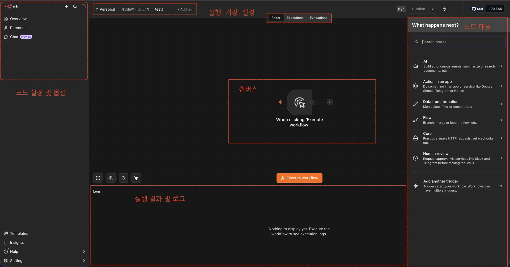
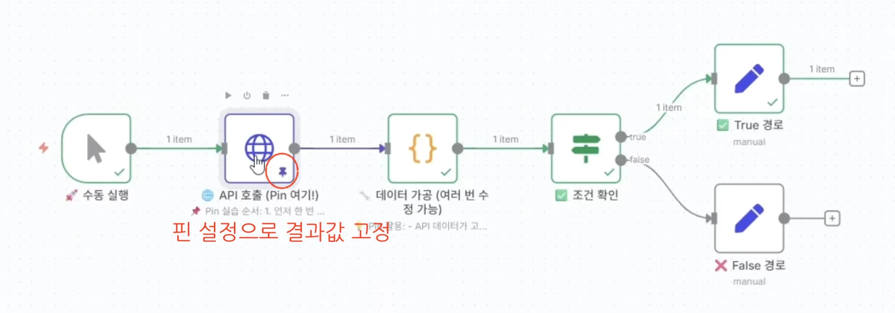

> 
> 
> <a id="371eda9b0fe1806aae5af3e15bf67fc8"></a>
> 
> <strong>목차</strong>
> 
> - [인터페이스 구성 요소](#371eda9b0fe180ddad51dcc02b54d813)
> - [ 메인 화면 레이아웃](#371eda9b0fe1807e8785e822ecad9080)
> - [캔버스 네비게이션](#371eda9b0fe18073af10dfe1f9af5092)
> - [ 기본 조작법](#371eda9b0fe18059ad99e31afec73843)
> - [노드 작업](#371eda9b0fe1801da692e206314a7ee8)
> - [ 노드 추가 방법 3가지 ](#371eda9b0fe180a5aebdd5c7976925a0)
> - [ 노드 연결](#371eda9b0fe180d2ab1adc3e88c65ca8)
> - [ 드래그 앤 드롭 데이터 공유](#371eda9b0fe1801196a5c8610886dfe3)
> - [핀(Pin) 기능](#371eda9b0fe18070a0e9df97a08c0df3)
> - [노드 실행 순서 및 제어](#371eda9b0fe1804c863ad76dea77950e)
> - [ 실행 순서 이해 ](#371eda9b0fe180e0965ee009fcc8a625)
> - [ 실행 순서 제어](#371eda9b0fe180f0995af4e16e5a733f)
> - [ 실행 모드 옵션](#371eda9b0fe1807186c3e7ef11c0c6a6)
> - [노드 Settings 상세 가이드](#371eda9b0fe18099b547dfbd5cdc0cdf)
> - [ Settings 탭 구성](#371eda9b0fe180e783f2f69641c1c5e6)
> - [ 고급 설정 활용](#371eda9b0fe180c19b3fd89b621d9176)
> - [실행 패널 활용법](#371eda9b0fe18058981cc71b524464ef)
> - [ Executions 탭 이해하기](#371eda9b0fe180bf9bd5c1a929270674)
> - [ 디버깅 도구 활용](#371eda9b0fe180999f51ebfcdd56df24)
> - [생산성 향상 팁](#371eda9b0fe180d2bba9dca216671e05)
> - [자주 사용하는 단축키 모음](#371eda9b0fe180ff98f8d5abe0e69d93)
> - [워크플로우 정리 팁](#371eda9b0fe180b591a9f471a5fde6f9)
> - [문제 해결 가이드](#371eda9b0fe18093bd12d7a5d1d517e0)
> - [인터페이스 커스터마이징](#371eda9b0fe18012b058ed24db16acf5)
> - [ 개인 설정 최적화](#371eda9b0fe180afbd6bceaf3a5c26e6)

<details>
<summary>reference</summary>

<a id="371eda9b0fe180cb9aa2f176e9f93082"></a>

<a href="https://beautiful-college-c84.notion.site/273ccaf841aa80069da0ef9810dc41a5">페이지</a>

<a id="371eda9b0fe180fe862ae51950faffce"></a>

‣

</details>

> ✏️ 
> 
> <a id="371eda9b0fe18053af1ed97d198b6d80"></a>
> 
> <strong>핵심 정리 </strong>
> 
> 1. <strong>핀 기능으로 개발 시간 단축</strong>
> 
> 1. <strong>드래그 앤 드롭으로 Expression 자동 생성</strong>
> 
> 1. <strong>단축키로 작업 속도 향상</strong>
> 
> 1. <strong>실행 패널로 효과적인 디버깅</strong>
> 
> 1. <strong>노드 Settings로 안정성 확보</strong>

<a id="371eda9b0fe180ddad51dcc02b54d813"></a>

## 인터페이스 구성 요소

<a id="371eda9b0fe1807e8785e822ecad9080"></a>

###  메인 화면 레이아웃



| 영역 | 위치 | 기능 | 단축키 |
| --- | --- | --- | --- |
| <strong>캔버스 (Canvas)</strong> | 중앙 | 워크플로우 작업 공간 | Space(손 도구) |
| <strong>노드 패널 (Node Panel)</strong> | 왼쪽 | 노드 추가 및 검색 | Tab |
| <strong>상단 툴바 (Toolbar)</strong> | 상단 | 실행, 저장, 설정 | Ctrl&#43;S (저장) |
| <strong>실행 패널 (Executions)</strong> | 하단 | 실행 결과 및 로그 | Ctrl&#43;O |
| <strong>사이드 메뉴 (Side Menu)</strong> | 우측 | 노드 설정 및 옵션 | 더블클릭 |

<a id="371eda9b0fe18073af10dfe1f9af5092"></a>

## 캔버스 네비게이션

<a id="371eda9b0fe18059ad99e31afec73843"></a>

###  기본 조작법

<details>
<summary>마우스 컨트롤</summary>

| 동작 | 기능 | 활용 팁 |
| --- | --- | --- |
| <strong>휠 스크롤</strong> | 확대/축소 | 전체 보기 ↔ 상세 편집 |
| <strong>휠 클릭 &#43; 드래그</strong> | 캔버스 이동 | Space &#43; 드래그도 가능 |
| <strong>Ctrl &#43; 휠</strong> | 정밀 확대/축소 | 10% 단위 조절 |
| <strong>더블클릭 (빈 공간)</strong> | 노드 추가 창 | 빠른 노드 추가 |

</details>

<details>
<summary>키보드 단축키</summary>

- Cmd &#43; A&#58; 전체 선택

- Cmd &#43; C/V&#58; 노드 복사/붙여넣기

- Delete&#58; 선택 노드 삭제

- Cmd &#43; Z/Y&#58; 실행 취소/다시 실행

- F2&#58; 노드 이름 변경

- Shift &#43; Enter&#58; 노드 실행

</details>

<a id="371eda9b0fe1801da692e206314a7ee8"></a>

## 노드 작업

<a id="371eda9b0fe180a5aebdd5c7976925a0"></a>

###  노드 추가 방법 3가지 

<details>
<summary><strong>1&#46;  노드 패널에서 드래그</strong></summary>

<a id="371eda9b0fe180ffb989fde6bbc0586d"></a>

```plaintext
장점: 카테고리별 탐색 가능
단점: 마우스 이동 거리 김
추천: 처음 사용하는 노드 탐색 시
```

</details>

<details>
<summary><strong>2&#46;  </strong><strong><code>&#43;</code></strong><strong> 버튼 클릭</strong></summary>

<a id="371eda9b0fe18098bf1aca4435f90403"></a>

```plaintext
장점: 연결과 동시에 추가
단점: 한 번에 하나씩만
추천: 순차적 워크플로우 구성 시
```

</details>

<details>
<summary><strong>3&#46; 캔버스 더블클릭</strong></summary>

<a id="371eda9b0fe18016b453c36b61384cfb"></a>

```plaintext
장점: 가장 빠른 추가
단점: 정확한 이름 알아야 함
추천: 자주 쓰는 노드 추가 시
```

</details>

<a id="371eda9b0fe180d2ab1adc3e88c65ca8"></a>

###  노드 연결

<details>
<summary><strong>기본 연결</strong></summary>

<a id="371eda9b0fe1803aae1dfffcbf3bcd86"></a>

```plaintext
출력 포트(오른쪽) → 입력 포트(왼쪽)
- 드래그로 연결
- 클릭 후 클릭으로도 연결 가능
```

</details>

<details>
<summary><strong> 다중 연결</strong></summary>

<a id="371eda9b0fe180f690dbff359ecda624"></a>

```plaintext
하나의 출력 → 여러 입력 (분기)
여러 출력 → 하나의 입력 (병합)
```

</details>

<details>
<summary><strong>연결 끊기</strong></summary>

| 방법 | 설명 | 사용 시기 |
| --- | --- | --- |
| <strong>연결선 선택 &#43; Delete</strong> | 개별 연결 삭제 | 특정 연결만 제거 |
| <strong>Shift &#43; 드래그</strong> | 연결선 잘라내기 | 빠른 연결 제거 |
| <strong>노드 우클릭 → Disconnect</strong> | 모든 연결 제거 | 노드 격리 시 |

</details>

<a id="371eda9b0fe1801196a5c8610886dfe3"></a>

###  드래그 앤 드롭 데이터 공유

> Expression Editor의 혁명적인 기능

<details>
<summary><strong>사용 방법</strong></summary>

1. Source 노드의 출력 데이터 확인

1. 필요한 필드를 드래그

1. Target 노드의 입력 필드에 드롭

1. 자동으로 Expression 생성

</details>

<details>
<summary><strong>자동 생성되는 Expression 예시</strong></summary>

<a id="371eda9b0fe180659792c7ee2a62317c"></a>

```json
// 드래그 앤 드롭 전
수동 입력: ???

// 드래그 앤 드롭 후
자동 생성: {{$node["HTTP Request"].json["data"]["email"]}}

```

</details>

<a id="371eda9b0fe18070a0e9df97a08c0df3"></a>

## 핀(Pin) 기능



> ✏️ 
> 
> <a id="371eda9b0fe180ca88c9dbee217884f8"></a>
> 
> <strong>핀 기능</strong>
> 
> - 테스트 데이터를 고정시켜 개발 속도를 10배 향상
> 
> <a id="371eda9b0fe180e2b90be01838a6fc1f"></a>
> 
> <strong>핀 기능의 장점</strong>
> 
> - 워크플로우 재실행 없이 테스트
> 
> - API 호출 횟수 절약
> 
> - 특정 구간만 반복 테스트
> 
> - 에러 상황 재현 용이

<details>
<summary>사용 시나리오</summary>

| 상황 | 활용법 | 효과 |
| --- | --- | --- |
| <strong>API 개발</strong> | API 응답 핀 고정 | 호출 제한 회피 |
| <strong>데이터 변환</strong> | 입력 데이터 고정 | 빠른 로직 테스트 |
| <strong>에러 디버깅</strong> | 에러 데이터 고정 | 문제 재현 및 수정 |
| <strong>성능 테스트</strong> | 대용량 데이터 고정 | 부하 테스트 |

</details>

<details>
<summary>활용 실전 팁</summary>

1. 개발 단계
    - 실제 데이터로 1회 실행

    - 결과 데이터 핀 고정

    - 이후 노드 개발 시 활용

1. 디버깅 단계
    - 에러 발생 지점 데이터 핀

    - 수정 후 같은 데이터로 테스트

1. 데모/교육 시
    - 안정적인 샘플 데이터 고정

    - 실시간 시연 실패 방지

</details>

<a id="371eda9b0fe1804c863ad76dea77950e"></a>

## 노드 실행 순서 및 제어

<a id="371eda9b0fe180e0965ee009fcc8a625"></a>

###  실행 순서 이해 

<a id="371eda9b0fe1802fa09dc06e674b720c"></a>

```json
1. 위에서 아래로
2. 왼쪽에서 오른쪽으로
3. 연결 순서 우선
4. 병렬 노드는 동시 실행
```

<a id="371eda9b0fe180f0995af4e16e5a733f"></a>

###  실행 순서 제어

| 제어 방법 | 사용 시기 | 구현 방법 |
| --- | --- | --- |
| <strong><code>Wait 노드</code></strong> | 시간 지연 필요 | 특정 시간 대기 |
| <strong><code>Merge 노드</code></strong> | 병렬 처리 후 통합 | 모든 입력 대기 |
| <strong><code>IF 노드</code></strong> | 조건부 실행 | true/false 분기 |
| <strong><code>Switch 노드</code></strong> | 다중 분기 | 여러 조건 처리 |

<a id="371eda9b0fe1807186c3e7ef11c0c6a6"></a>

###  실행 모드 옵션

<a id="371eda9b0fe1800695edfdbdc17fd60e"></a>

```json
노드별 실행 설정:
  - Execute Once: 입력 개수와 무관하게 1회만
  - Execute for Each Item: 각 아이템마다 실행
  - Custom: 사용자 정의 실행 로직
```

<a id="371eda9b0fe18099b547dfbd5cdc0cdf"></a>

## 노드 Settings 상세 가이드

<a id="371eda9b0fe180e783f2f69641c1c5e6"></a>

###  Settings 탭 구성

- <strong>Parameters (매개변수)</strong>
    - 노드별 고유 설정

    - 필수/선택 항목 구분

    - 동적 값 설정 가능 (Expression)

- <strong>Options (옵션)</strong>
    <a id="371eda9b0fe180429a89e9565d7b976d"></a>

    ```plaintext
    공통 옵션:
    - Continue On Fail: 에러 발생 시 계속 진행
    - Retry On Fail: 실패 시 재시도
    - Timeout: 실행 시간 제한
    - Notes: 노드 설명 추가
    ```

<a id="371eda9b0fe180c19b3fd89b621d9176"></a>

###  고급 설정 활용

| 설정 | 기본값 | 권장 설정 | 이유 |
| --- | --- | --- | --- |
| <strong>Max Tries</strong> | 3 | 5 | API 불안정 대응 |
| <strong>Wait Between Tries</strong> | 1000ms | 2000ms | Rate Limit 회피 |
| <strong>Always Output Data</strong> | false | true | 디버깅 용이 |
| <strong>Execute Once</strong> | false | 상황별 | 성능 최적화 |

<a id="371eda9b0fe18058981cc71b524464ef"></a>

## 실행 패널 활용법

<a id="371eda9b0fe180bf9bd5c1a929270674"></a>

###  Executions 탭 이해하기

- <strong>실행 상태 아이콘</strong>
    <a id="371eda9b0fe180a98f45ee4c05d4f210"></a>

    ```plaintext
    ✅ Success - 성공적 완료
    ⚠️ Warning - 경고와 함께 완료
    ❌ Error - 실행 실패
    🔄 Running - 실행 중
    ⏸️ Waiting - 대기 중
    ```

<a id="371eda9b0fe180999f51ebfcdd56df24"></a>

###  디버깅 도구 활용

<a id="371eda9b0fe180c4a8f9e1192df5f131"></a>

<strong>1&#46; Input/Output 데이터 확인</strong>

- 각 노드 클릭 시 데이터 표시

- JSON/Table/Schema 뷰 전환

- 데이터 복사 및 다운로드

<a id="371eda9b0fe180f9847dc8331421ec31"></a>

<strong>2&#46; 실행 히스토리</strong>

<a id="371eda9b0fe1802a99fde5b1d25a90ac"></a>

```plaintext
활용 팁:
- 과거 실행 재현 (Retry)
- 실패 지점 파악
- 성능 분석 (실행 시간)
- 데이터 추적
```

<a id="371eda9b0fe180d2bba9dca216671e05"></a>

## 생산성 향상 팁

<a id="371eda9b0fe180ff98f8d5abe0e69d93"></a>

### 자주 사용하는 단축키 모음

| 기능 | 단축키 | 설명 |
| --- | --- | --- |
| <strong>빠른 노드 추가</strong> | Tab | 노드 검색창 열기 |
| <strong>실행</strong> | Ctrl &#43; Enter | 전체 워크플로우 실행 |
| <strong>부분 실행</strong> | Shift &#43; Enter | 선택 노드만 실행 |
| <strong>복제</strong> | Ctrl &#43; D | 선택 노드 복제 |
| <strong>정렬</strong> | Ctrl &#43; Shift &#43; A | 노드 자동 정렬 |
| <strong>전체 화면</strong> | F11 | 전체 화면 전환 |

<a id="371eda9b0fe180b591a9f471a5fde6f9"></a>

### 워크플로우 정리 팁

1. <strong>노드 그룹화</strong>
    - 관련 노드들을 가까이 배치

    - 색상으로 카테고리 구분

    - Note 노드로 섹션 설명

1. <strong> 명명 규칙</strong>
    <a id="371eda9b0fe1802a8b47d18a4a7f63aa"></a>

    ```plaintext
    [타입] 설명
    예시:
    - [API] Shopify 주문 조회
    - [DB] 고객 정보 업데이트
    - [Alert] Slack 에러 알림

    ```

1. <strong> 주석 활용</strong>
    - Sticky Note로 전체 설명

    - 노드 Description으로 상세 설명

    - 복잡한 Expression은 주석 추가

<a id="371eda9b0fe18093bd12d7a5d1d517e0"></a>

## 문제 해결 가이드

| 문제 | 원인 | 해결 방법 |
| --- | --- | --- |
| <strong>노드가 실행 안 됨</strong> | 연결 누락 | 모든 연결 확인 |
| <strong>데이터가 없음</strong> | 이전 노드 실패 | 각 노드 출력 확인 |
| <strong>Expression 에러</strong> | 경로 오타 | 드래그 앤 드롭 사용 |
| <strong>느린 실행</strong> | 대용량 데이터 | 배치 처리 적용 |
| <strong>메모리 부족</strong> | 무한 루프 | Loop 제한 설정 |

<a id="371eda9b0fe18012b058ed24db16acf5"></a>

## 인터페이스 커스터마이징

<a id="371eda9b0fe180afbd6bceaf3a5c26e6"></a>

###  개인 설정 최적화

- <strong>View 설정</strong>
    <a id="371eda9b0fe180e19ce6ce9d47455457"></a>

    ```yaml
    권장 설정:
      Display Mode: Regular
      Grid Size: 20px
      Snap to Grid: Enabled
      Connection Style: Smooth
      Direction: LTR

    ```
