

reference

- <a href="https://beautiful-college-c84.notion.site/26bccaf841aa80c4975fd448e5f50c27">페이지</a> 

## N8N 핵심 노드

---

---

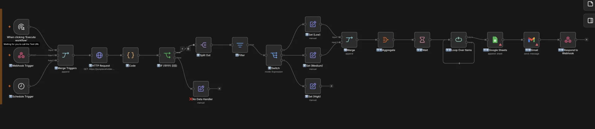

> ✏️ 
> 
> > 시나리오
> 
> 
> 
> 고객 데이터를 수집하여 분석하고, 결과를 이메일과 스프레드시트로 저장하는 완전한 자동화 워크플로우
> 
> > 데이터 흐름
> 
> 1. 트리거 (3가지 방법)
> 
> 1. 데이터 수집 (HTTP Request)
> 
> 1. 데이터 가공 (Code)
> 
> 1. 검증 (IF)
> 
> 1. 분할 (Split Out)
> 
> 1. 필터링 (Filter)
> 
> 1. 라우팅 (Switch)
> 
> 1. 변환 (Set)
> 
> 1. 집계 (Aggregate)
> 
> 1. 병합 (Merge)
> 
> 1. 대기 (Wait)
> 
> 1. 반복 (Loop)
> 
> 1. 저장 (Google Sheets)
> 
> 1. 알림 (Gmail)
> 
> 1. 응답 (Respond to Webhook)

### <code>트리거</code> 노드

1. Manual Trigger
    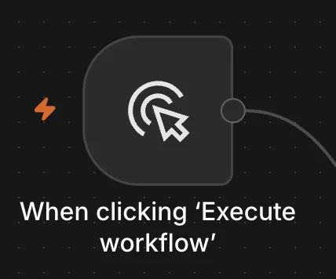

    - N8N UI 내 클릭 버튼으로 트리거

1. Webhook Trigger
    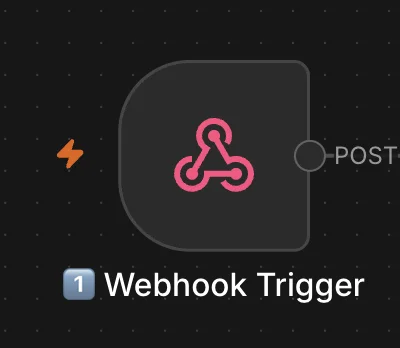

    - 외부 시스템 연동 시 필수

    - 마지막 <code>respond to webhook</code> 필수
        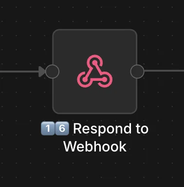

1. Schedule Trigger
    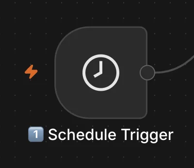

    - cron job

    - 특정 시간에 실행되도록 트리거 가능

1. Merge Triggers
    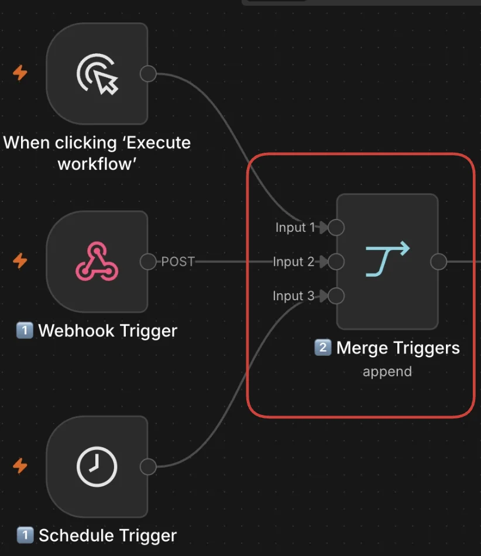

    - 여러 트리거를 묶는 중간 노드

    - 위 3개 중 옵션으로 트리거 가능

### <code>HTTP Request</code> 노드

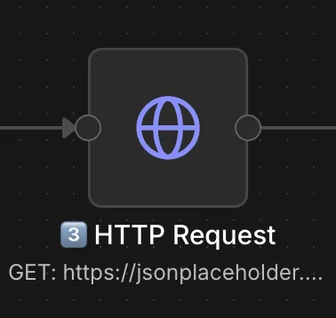

- 외부 API 콜 가능

### <code>Code</code> 노드

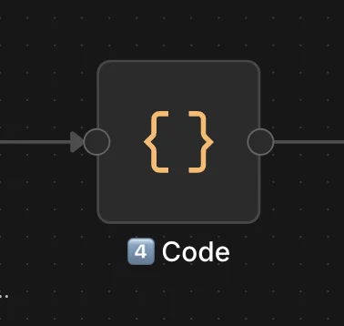

- output 정형화 가능

- input 값을 원하는 output 형태로 데이터 변형

### <code>IF</code> 노드 (분기, 조건문 실행)

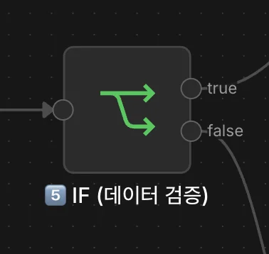

- 조건에 따라 분기 처리

### <code>Split Out</code> 노드

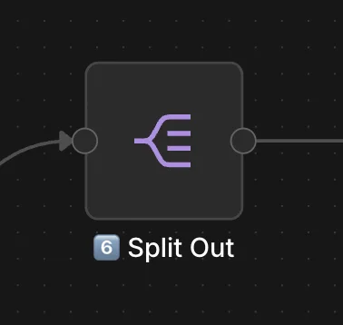

- 한 덩어리였던 데이터를 여러 조각으로 쪼갤 수 있음

### <code>Filter</code> 노드

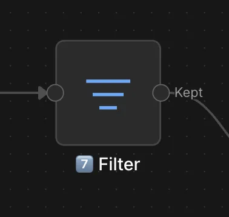

- 원하는 데이터만 필터링 가능

- ex) <code>userType = 비지니스, 일반</code> 구분해서 필터링

### <code>Switch</code> 노드

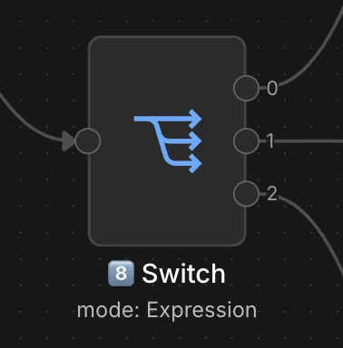

- 다중 분기

- <code>switch</code> 문 과 동일
    - 특정 조건들에 따라서 여러 분기처리

### <code>Set</code> 노드

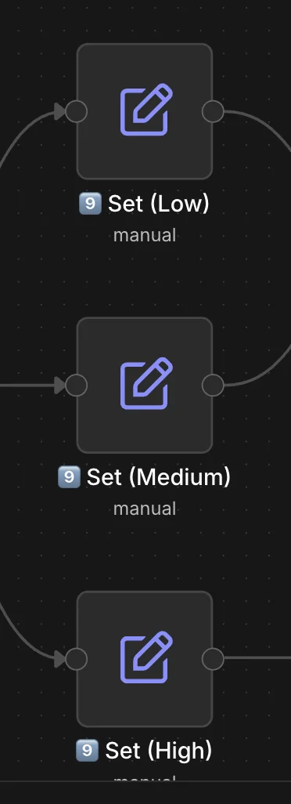

- 각 등급에 맞는 라벨링 부여 가능

### <code>Merge</code> 노드

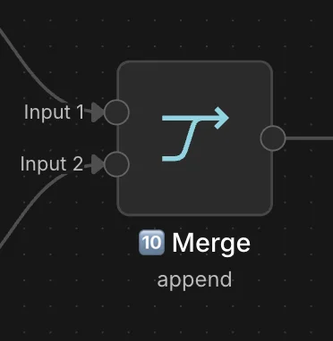

- 다양한 값들을 하나로 합칠 때 사용 

### <code>Aggregate</code> 노드

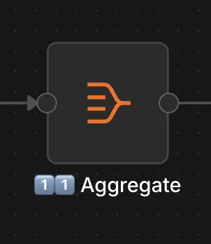

- merge를 통해 들어오는 다양한 값들을 input로 받아 하나로 합치는데 사용

- 데이터 분석
    - 합계, 평균, 그룹화

### <code>Wait</code> 노드

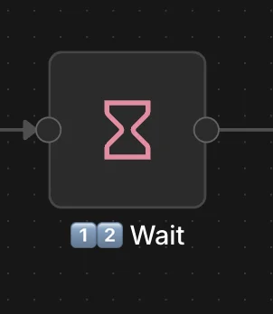

- 대기 처리

- sleep 처리
    - 동영상 등 오래 걸리는 작업을 만드는데 <code>중요</code>

### <code>Loop Over Items</code> 노드

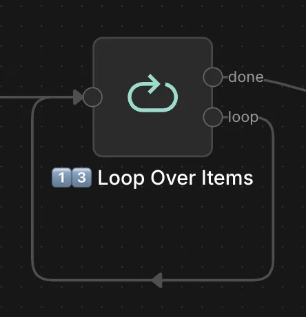

- 반복 처리 

- batch size를 설정하여 대용량 데이터를 나눠서 처리

- 엄청 많은 데이터를 한꺼번에 처리하면 워크플로우에서 오류가 발생됨 따라서 이를 쪼개면서 사용하면 오류없이 사용 가능

### <code>Google Sheets</code> 노드

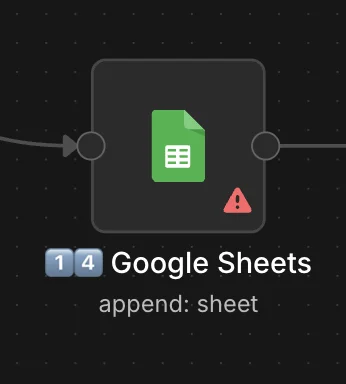

- db 대신 google sheets로 데이터 저장 및 조회 가능

### <code>Gmail</code> 노드

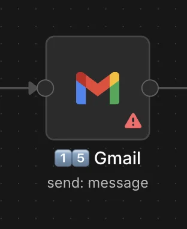

- gmail로 알림 보내기 가능

### <code>Response to Webhook</code> 노드

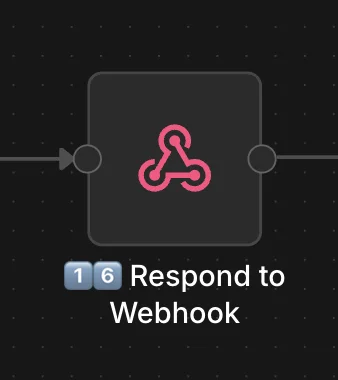

- webhook 트리거 시 꼭 <code>respond to webhook</code>으로 <strong><u>end 노드</u></strong> 설정을 해야한다&#46;
