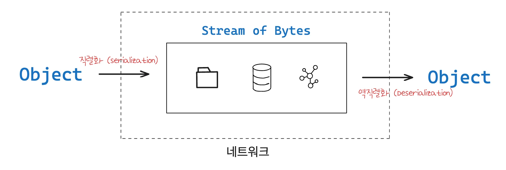
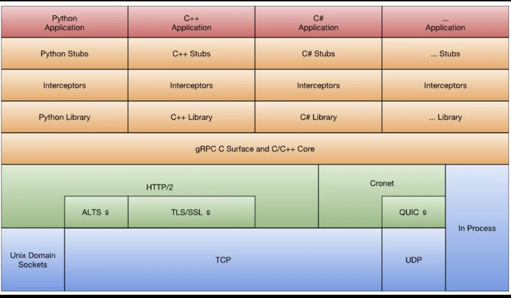
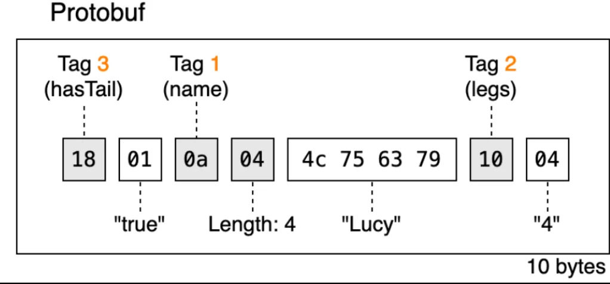
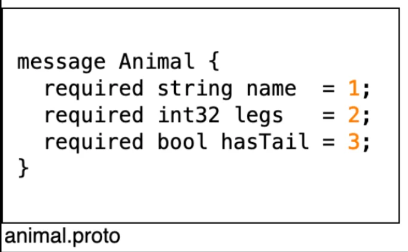
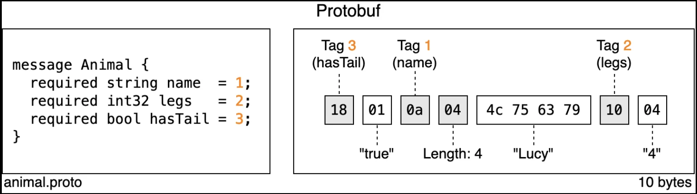
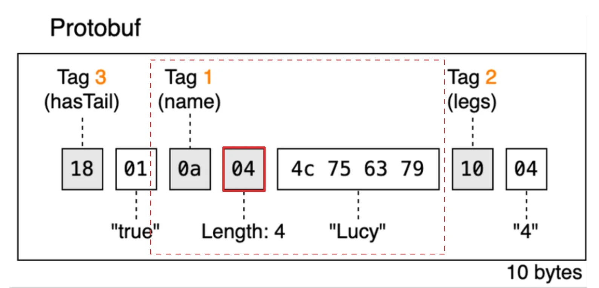
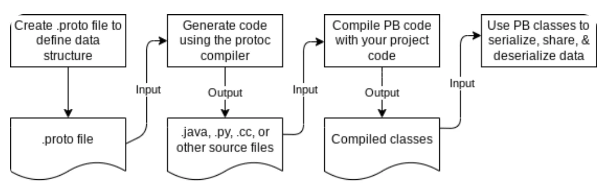
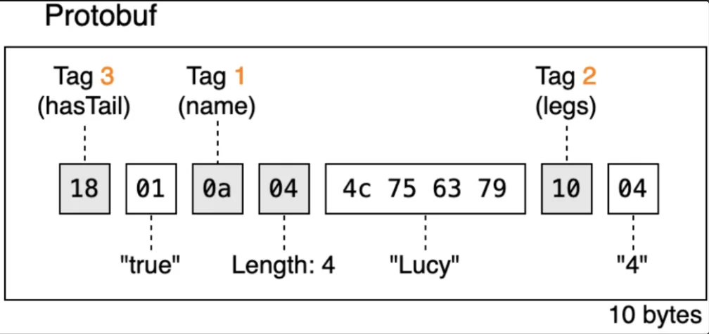

> <strong>목차 </strong>
> 
> - [Protocol Buffers](#3a1eda9b0fe18023800dd9cb0317309e)
> - [Protocol Buffers (ProtoBuf 파일) 구조 ](#3e7eda9b0fe180b29e22c9f029c21406)
> - [Protobuf 버전 관리 및 호환성 유지 전략](#3e7eda9b0fe180278e98ce99d146f884)

> 📝 
> 
> <a id="3ddeda9b0fe1808790fbcddc3726b2e4"></a>
> 
> 핵심 키워드
> 
> - <code>IDL</code>&#58; 인터페이스를 정의하는 &#34;개념/언어&#34;
> 
> - <code>Protocol Buffers</code>&#58; 그 IDL을 작성할 수 있는 구체적인 기술 중 하나
> 
> - <code>&#46;proto 파일</code>&#58; Protocol Buffers 문법으로 작성된 IDL 파일
> 
> - <code>Stub</code>&#58; &#46;proto를 기반으로 자동 생성되는 호출용 코드

<a id="3a1eda9b0fe18023800dd9cb0317309e"></a>

## Protocol Buffers

---

> 📖 
> 
> <a id="3a1eda9b0fe180e6916bd474a8fde1a8"></a>
> 
> <strong>Protocol Buffers (protobuf)</strong>
> 
> <a id="3a1eda9b0fe18035ababc69494dc8ecf"></a>
> 
> 구글에서 개발한 오픈소스 데이터 직렬화(Serialization) 메커니즘(포멧)
> 
> - 효율적인 데이터 저장 및 통신을 위해서 사용
> 
> -  <strong><u>데이터를 이진(Binary) 형태로 처리</u></strong>하여 <strong><u>속도가 훨씬 빠르고 데이터 크기가 작다</u></strong>는 장점이 있다&#46;

> ✏️ 
> 
> <a id="3a1eda9b0fe180d8a083ff98e0c69dfa"></a>
> 
> REST와 달리 gRPC는 <code>protobuf(프로토콜 버퍼)</code> 라는 데이터 포맷을 사용한다&#46; 
> 
> <a id="3a1eda9b0fe1806c936ee34bd22bf3ea"></a>
> 
> <code>프로토콜 버퍼(Protocoal Buffers, Protobuf)</code>는 gRPC와 독립적으로 <u>Google에서 개발한 직렬화 프레임워크</u>로 <strong>데이터를 바이너리 형식으로 변환하기 용이</strong>하도록 설계되었다&#46; 
> 
> <a id="3a1eda9b0fe1809ab3f3e9732ab5c12f"></a>
> 
> 따라서 Json이나 XML 에 비해 데이터 크기가 작고, <br><strong><u>(역)직렬화 속도가 빨라 네트워크 통신에 상당히 유리</u></strong>하다&#46; 
> 
> <a id="3a1eda9b0fe180278e2be4daf127d99d"></a>
> 
> 이런 특징으로 gRPC는 Protobuf 직렬화 포맷을 채택했다&#46; 

> ✏️ 
> 
> <a id="3e7eda9b0fe180cf9d99f2ceb17e7498"></a>
> 
> 주요 특징
> 
> - <code>경량화된 바이너리 포맷</code>
>     - Json이나 XML 과 같은 텍스트가 아닌 바이너리 데이터 
> 
> - <code>다양한 언어와 플랫폼 지원</code>
>     - Java, C&#43;&#43;, Python, Go 등 여러 언어 지원
> 
>     - protoc 를 통해 컴파일할 때 자동으로 언어에 맞는 코드 생성
> 
> - <code>효율적인 데이터 포현</code>
> 
> - <code>스키마 기반 메시지 구조</code>
>     - 스키마(&#46;proto 파일)를 사용해 메시지 구조와 필드 타입 명확하게 정의

<details>
<summary>reference</summary>

[REST에서 gRPC로&#58; 차세대 API 통신 방식 도입기]()

[gRPC의 내부 구조 파헤치기&#58; HTTP/2, Protobuf 그리고 스트리밍]()

[Language Guide (proto 2)]()

</details>

<details>
<summary>Protocol Buffers의 기본 개념&#58; <code>IDL (Interface Definition Language)</code></summary>

> ✏️ 
> 
> <a id="3ddeda9b0fe1801eba0bf2b8c216a963"></a>
> 
> 다양한 소프트웨어 시스템이나 컴포넌트 사이에서 정보가 어떻게 전달되어야 할지 정의하는 언어 

- IDL 목적
    - <code>타입 안정성 (Type Safety)</code>
        - 데이터 타입과 구조를 명확히 정의 함으로써 데이터가 시스템에 전송될 때 올바르게 해석되고 사용되도록 한다&#46; 

    - <code>언어 독립성 (Language Independence)</code>
        - 프로그래밍 언어에 독립적이기 때문에 다른 언어로 작성된 시스템 간에도 통신이 가능하다&#46; 

    - <code>명세화 (Specification)</code>
        - 시스템 간의 인터페이스를 형식적으로 정의하고 개발자들이 서비스의 동작을 명확하게 이해할 수 있도록 명세화 가능하다&#46;

    - <code>자동 코드 생성 (Automatic Code Generation)</code>
        - IDL로 정의된 인터페이스는 종종 다양한 프로그래밍 언어로 스켈레톤 코드를 자동 생성하는데 사용된다&#46; 

</details>

<details>
<summary>Protocol Buffers의 기본 개념&#58; <code>경량화된 바이너리(바이트) 포맷</code></summary>



- <code>직렬화 (Serialization)</code>
    > <code>Object(객체, 메모리에 올라가는 데이터)</code> → <code>바이트 스트림( 0, 1 형태의 데이터)</code>

    - 프로토콜 버퍼는 데이터 구조를 <strong><u>연속적인 </u></strong><strong><u>바이트 형태</u></strong><strong><u>로 변환</u></strong>하는 과정을 말한다&#46; 

    - 이 과정을 통해서 데이터 구조는 <strong><u>파일을 저장하거나 네트워크로 전송되기 용이한 형태로 변환</u></strong>된다&#46; 

- <code>역직렬화 (Deserialization)</code>
    > <code>바이트 스트림(0, 1 형태의 데이터)</code> → <code>Object(객체, 메모리에 올라가는 데이터) </code>

    - <strong><u>바이트 스트림</u></strong><strong><u>을 원래의 데이터 구조로 복원</u></strong>하는 것을 말한다&#46;

    - 이를 통해 다른 시스템이나 어플리케이션에서 원본 데이터 구조를 정확하게 재구성할 수 있다&#46; 

</details>

<details>
<summary>Protocol Buffers의 기본 개념&#58; <code>다양한 언어 및 플랫폼 지원</code></summary>



- 다양한 언어 지원
    - <code>python</code>, <code>c&#43;&#43;</code>, <code>c&#35;</code>, <code>go</code>, <code>ruby</code> 등 다양한 언어에 대한 지원이 현재까지 이뤄지고 있음

    - 만약 프로젝트의 언어가 변경되더라도, 동일한 데이터 구조를 유지가 가능하기 때문에 이로 인해 빠른 구현 가능하다&#46; 

- 플랫폼 독립적
    - OS, 하드웨어에 구애(拘碍) 받지않고 사용 가능하다&#46;<br>이는 크로스 플랫폼 호환성을 제공한다고 볼 수 있고 다양한 환경에서의 데이터 교환을 용이하게 한다&#46; 

</details>

<details>
<summary>Protocol Buffers의 기본 개념&#58; <code>효율적인 데이터 표현</code></summary>

- <code>데이터 크기의 최소화</code>
    

    <a id="3ddeda9b0fe180dd8829c8a886698dda"></a>

    Protocol Buffers는 데이터를 매우 효율적으로 압축한다&#46; 

    <a id="3ddeda9b0fe1803a8f68cc8eecbdb9d7"></a>

    <strong><u>필드 이름과 같은 </u></strong><strong><u>추가 메타데이터를 포함하지 않</u></strong>고 <strong><u>필드값만을 최소한의 byte로 표현</u></strong>한다&#46; 

    <a id="3ddeda9b0fe180eb9277e75ea9d87485"></a>

    이러한 특성은 <strong><u>네트워크 대역폭과 저장공간 절약</u></strong>하는데 유리하다&#46; 

    <a id="3ddeda9b0fe18081b03dfda0fff7e781"></a>

    반면, JSON 같은 경우 프로토콜에 필드 이름, 여러 메타데이터 등이 들어가 있기 때문에 매우 큰 프로토콜이라 할 수 있다&#46; 

    - 비용이 크고 느림

- <code>빠른 속도의 직렬화, 역직렬화 제공</code>
    <a id="3ddeda9b0fe18097a7e1f6e72a61a076"></a>

    데이터의 바이너리 형태로의 인해 처리 과정이 효율적이기 때문이다&#46; 

    <a id="3ddeda9b0fe180a381a8fe9568c41e93"></a>

    xml, json 과 같은 텍스트 기반 포멧보다 훨씬 적은 시간과 메모리를 요구한다&#46; 

- <code>데이터 정확성 과 무결성 제공</code>
    

    <a id="3ddeda9b0fe1809f8d3fc5ee035f44e2"></a>

    Proto buffer 는 엄격한 데이터 구조를 가지고 있기 때문에 데이터의 정합성과 무결성이 보장된다&#46; 

    <a id="3ddeda9b0fe18072ada3fbd619800a11"></a>

    <code>&#46;proto</code> 파일에 정의된 구조에 따라 엄격하게 검증되고 이로인해 데이터 오류의 가능성이 줄어든다고 말할 수 있다&#46; 

</details>

<details>
<summary>Protocol Buffers의 기본 개념&#58; <code>protocol buffers 특징</code></summary>



- <code>타입정보</code>
    - 각 필드의 타입 정보

    - 이를 통해 데이터의 무결성 및 정합성 보장

- <code>태그</code>
    - 각 필드는 고유한 번호, 즉 태그와 함께 타입 정보를 byte stream에 인코딩 한다&#46; 

    - 이러한 태그는 필드를 식별하는 데 사용하며 필드 이름을 저장할 필요가 없기 때문에 전송되는 데이터의 크기를 줄일 수 있다&#46;

    - ex) <code>name → tag 1</code>, <code>legs → tag 2</code>, <code>hasTail → tag 3</code>

- <code>가변길이 인코딩</code>
    - protocol buffer는 숫자 데이터를 표현 시, 가변길이 인코딩 방식을 사용한다&#46; 

    - 값의 크기의 따라 더 적은 바이트를 사용하는 방식으로 이를 통해 저장 공간을 절약한다&#46; 

- <code>문자열 </code>
    - 문자열 데이터는 길이와 함께 저장된다&#46;

    - 따라서 메타데이터의 오버헤드를 최소화할 수 있다&#46; 
        - 실제 문자열의 크기 데이터만 저장되기 때문에 실제 프로토콜 크기를 작게 유지할 수 있다&#46;

</details>

<details>
<summary>🧐 Protobuf 메시지 문자열(<code>string</code>) 길이 계산</summary>



<a id="3ddeda9b0fe180ee98bdfdaca7cdef31"></a>

Protobuf의 <code>string</code>은 기본적으로 <strong><u>UTF&#45;8 인코딩</u></strong><strong>을 사용한다&#46; </strong>

<details>
<summary>case 1) 영문 &#45; <code>Lucy</code></summary>

<a id="3ddeda9b0fe18024aad3ffd78a02b5ad"></a>

```markdown
"Lucy"

L = 1 byte
u = 1 byte
c = 1 byte
y = 1 byte

총 4 bytes
```

<a id="3ddeda9b0fe1801d833cdae71b3af794"></a>

Protobuf message

<a id="3ddeda9b0fe18052b535c9947375ad58"></a>

```markdown
0A 04 4C 75 63 79
   ^^
   문자열 길이 = 4 bytes
```

</details>

<details>
<summary>case 2) 한글 &#45; <code>루시</code></summary>

<a id="3ddeda9b0fe1800aa2ade9fe6b5d7f52"></a>

```markdown
"루시"

루 = 3 bytes
시 = 3 bytes

총 6 bytes
```

<a id="3ddeda9b0fe1806aafe4cf17fe205451"></a>

Protobuf message

<a id="3ddeda9b0fe180c0a697c2dbceccd195"></a>

```markdown
0A 06 EB A3 A8 EC 8B 9C
   ^^
   문자열 길이 = 6 bytes
```

</details>

</details>

<details>
<summary>Protocol Buffers 의 구조</summary>

> 📎 
> 
> <a id="3a1eda9b0fe180f192cbf0a5c95035a8"></a>
> 
> 자세한 내용은 아래 참조
> 
> -  <a href="https://beautiful-college-c84.notion.site/3a1eda9b0fe180ab93b8f1af0548756c">페이지</a> 

<a id="3deeda9b0fe180b5b243dd47e44156ae"></a>

```protobuf
syntax = "proto3";

message Animal {
	string name = 1; // 필드 이름은 'name', 타입은 'string', 고유 번호는 1
	int32 legs = 2; // 필드 이름은 'legs', 타입은 'int32', 고유 번호는 2
	bool hasTail = 3; // 필드 이름은 'hasTail', 타입은 'bool', 고유 번호는 3	
}
```

- <code>proto 파일</code>
    - 데이터 구조 정의

    - 해당 파일에 메시지 타입, 필드 타입, 명칭 및 고유번호(태그) 지정

- <code>메시지 타입</code>
    - 가장 기본적인 구성요소

    - 클래스 및 구조체와 유사

    - 하나 이상의 필드 포함힐 수 있으며 각 필드에는 고유할 태그 번호가 할당된다&#46; 

- <code>필드</code>
    - 각 필드에는 타입(int32, string, 사용자 정의 타입 등)을 지정할 수 있다&#46; 

    - 이 번호는 프로토콜 버전 및 호환성을 유지하는데 매우 중요하다&#46; 

- <code>호환성</code>
    - protocal buffers는 <code>역호환성</code>, <code>순호환성</code>을 지원한다&#46; 

    - 구조가 변경되더라도 이전 버전의 데이터를 새로운 버전의 프로토콜로 읽거나 그 반대로 수행할 수 있다&#46;

- <code>컴파일러</code>
    - &#46;proto 파일을 사용해 특정 언어에 맞는 소스코드를 생성할 수 있는 protocal buffer 컴파일러가 존재한다&#46; 

    - 이를 통해 각 언어에 맞는 스켈레톤 코드(데이터 접근 및 처리 코드)를 쉽게 생성할 수 있다&#46;

</details>

<details>
<summary>Protocol Buffers의 동작원리</summary>



1. 컴파일러를 통한 <code>&#46;proto</code> 파일 변환
    <a id="3a1eda9b0fe18048ae47d9365382098f"></a>

    <code>&#46;proto</code> 파일 → <code>각 언어에 맞는 코드</code>로 변환

    <details>
    <summary>protoc 설치</summary>

    <a id="3a1eda9b0fe180e0864cf34d5ca970d9"></a>

    ```bash

    #MacOS 
    brew install protobuf

    #Linux
    sudo apt-get install -y protobuf-compiler

    #Windows
    https://github.com/protocolbuffers/protobuf/releases
    ```

    </details>

1. 스키마 정의
    <a id="3a1eda9b0fe1806fa907cabee9f7d5d0"></a>

    ```bash
    syntax = "proto3";

    message Person {
    	int32 id = 1;
    	string name = 2;
    	string email = 3;
    }
    ```

1. 컴파일
    <a id="3a1eda9b0fe18019b9daf05d9234c2b3"></a>

    protoc 를 활용해 원하는 언어로 컴파일

    <a id="3a1eda9b0fe1803dbcadd9cdf6cd6d4c"></a>

    ```json
    protoc --java_out=.person.proto
    ```

1. 직렬화 및 데이터 전송
    <a id="3a1eda9b0fe18023b69bc9ffe3069750"></a>

    ```json
    Person person = Person.newBuilder().setId(1).setName
    ("Alice").build();
    byte[] data = person.toByteArrayO();
    // 바이너리 데이터 전송
    ```

1. 역직렬화
    <a id="3a1eda9b0fe180f3ac17e8c8a9500beb"></a>

    수신된 바이너리 객체를 원본 객체로 복원

    <a id="3a1eda9b0fe1803fbdb3c20884209120"></a>

    ```json
    Person receivedPerson = Person.parseFrom(data);
    ```

</details>

<a id="3e7eda9b0fe180b29e22c9f029c21406"></a>

## Protocol Buffers (ProtoBuf 파일) 구조 

---

> 📖 
> 
> <a id="3e7eda9b0fe18009a52ec65845da2ef1"></a>
> 
> <strong> </strong>Protocol Buffers 구조 (<strong>Protobuf IDL</strong>)
> 
> 1. <code>메시지 타입 (Message Types)</code>
> 
> 1. <code>필드 (Fields)</code>
> 
> 1. <code>필드 규칙 (Field Rules)</code>
> 
> 1. <code>연속 번호 (Tags)</code>
> 
> 1. <code>데이터 타입 (Data Types)</code>
> 
> 1. <code>옵션 (Options)</code>
> 
> 1. <code>서비스 정의 (Service Definitions)</code>
> 
> 1. <code>확장 (Extensions)</code>

<details>
<summary>Protocol Buffers 구조&#58; <code>메시지 타입 (Message Type)</code></summary>

> ✏️ 
> 
> - Proto 파일의 핵심 개념
> 
> - 객체지향언어에서 클래스와 비슷한 역할
> 
> - 하나 이상의 필드를 포함할 수 있고, 각 필드는 특정 타입과 값을 가짐

<a id="3e7eda9b0fe180888abddc9a4b9dc079"></a>

```protobuf
// 메시지 타입
message Animal {
	string name = 1; // 필드 이름은 'name', 타입은 'string', 고유 번호는 1
	int32 legs = 2; // 필드 이름은 'legs', 타입은 'int32', 고유 번호는 2
	bool hasTail = 3; // 필드 이름은 'hasTail', 타입은 'bool', 고유 번호는 3	
}
```

</details>

<details>
<summary>Protocol Buffers 구조&#58; <code>필드 (Fields)</code></summary>

> ✏️ 
> 
> - 각 필드는 이름, 타입, 고유 번호를 가짐
> 
> - 고유 번호는 각 필드를 식별하는 데 사용, 직렬화된 데이터에서 해당 필드를 찾는 데 필요
> 
> - <code>기본 타입(int32, float, double, bool, string 등)</code> 또는 <code>다른 메시지 타입</code>

<a id="3e7eda9b0fe180cb96b6d4767807550e"></a>

```protobuf
syntax = "proto3";

message Animal {
	// 필드 1
	string name = 1; // 필드 이름은 'name', 타입은 'string', 고유 번호는 1
	
	// 필드 2	
	int32 legs = 2; // 필드 이름은 'legs', 타입은 'int32', 고유 번호는 2
	
	// 필드 3	
	bool hasTail = 3; // 필드 이름은 'hasTail', 타입은 'bool', 고유 번호는 3	
}
```

</details>

<details>
<summary>Protocol Buffers 구조&#58; <code>필드 규칙 (Field Rules)</code></summary>

> ✏️ 
> 
> - <code>required</code>
>     - 해당 필드는 필수적인 값을 가진다&#46;
> 
> - <code>optional</code>
>     - 해당 필드는 선택적인 값을 가진다&#46;
> 
> - <code>repeated</code>
>     - 해당 필드는 여러 개의 값을 가질 수 있다&#46; 
> 
>     - 해당 필드가 배열, 리스트 형태로 반복될 수 있음을 나타낸다&#46; 

<a id="3e7eda9b0fe1807698d5f9c1791489aa"></a>

```protobuf
syntax = "proto3"

message Animal {
	// 여러 개 값 가능
	repeated string name = 1;   // 필드 이름: 'name', 타입: 'string', 고유번호: 1
	
	// 선택값
	optional int32 legs = 2;    // 필드 이름: 'legs', 타입: 'int32', 고유번호: 2
	
	// 필수값
	required bool hasTail = 3;  // 필드 이름: 'hasTail', 타입: 'bool', 고유번호: 3
}
```

</details>

<details>
<summary>Protocol Buffers 구조&#58; <code>연속번호 (Tags)</code></summary>

> ✏️ 
> 
> - 각 필드에는 1부터 시작하는 고유한 번호가 할당된다&#46;
> 
> - 해당 번호는 메시지 내에서 유일해야하며 같은 메시지 내에서 다른 필드와 중복될 수 없다&#46;
> 
> - 해당 번호는 데이터 직렬화 후 바이트 스트림에서 필드를 식별하는 고유한 식별값으로 사용된다&#46; 이를 통해 데이터를 효율적으로 저장 및 전송한다&#46; 
> 
> - 데이터 역직렬화 시 해당 번호(tags)를 사용하여 각 필드 값를 올바른 위치에 할당한다&#46; 이는 데이터 스트림 해석 시 필드의 순서나 구조가  변경되어도 올바르게 복원할 수 있도록 한다&#46; 
> 
> - 필드가 추가 및 제거되어도 기존의 태그 번호를 유지하면  새로운 버전의 프로토콜을 사용하는 시스템이 이전 버전의 데이터를 처리할 수 있다&#46; 이는 프로토콜의 호환성과 확장성을 보장하는데 중요하다&#46; 
> 
> - 태그 번호는 가변 길이 인코딩을 사용해 저장하기 때문에 작은 숫자는 적은 byte를 사용해 표현할 수 있거 전체 데이터 크기를 최소화 시켜 효율적으로 서빙 가능하다&#46; 

<a id="3e7eda9b0fe180e195d3c952d57b5462"></a>

```protobuf
message Animal {
	required string name = 1;
	required int32 legs = 2;
	required bool hasTail = 3;
}
```



</details>

<details>
<summary>Protocol Buffers 구조&#58; <code>데이터 타입 (Data Types)</code></summary>

> ✏️ 
> 
> <a id="3e7eda9b0fe180afa84be5914c2e7b04"></a>
> 
> 다양한 데이터 타입을 지원하며 대부분의 프로그래밍 언어에서 흔하게 볼 수 있는 기본적인 데이터 타입들로 구성되어 있다&#46; 
> 
> <a id="3e7eda9b0fe1804990d5f684ff61162f"></a>
> 
> 사용자 정의 타입도 지정이 가능해 복잡한 데이터 구조를 쉽게 표현 및 관리할 수 있다&#46; 
> 
> - 내장 데이터 타입
>     - 수치형 타입
>         - 정수형&#58; <code>int32</code>, <code>int64</code>, <code>uint32</code>, <code>uint64</code>
> 
>         - 부동 소수점&#58; <code>float</code>, <code>double</code>
> 
>     - 논리형 타입&#58; <code>bool</code>
> 
>     - 문자열 및 바이트 타입&#58; 
>         - <code>string</code>
>             - utf&#45;8 문자열로 나타냄
> 
>         - <code>bytes</code>
> 
> - 사용자 커스텀 메시지 타입
>     - <code>message</code>
> 
>     - <code>enum</code>

<a id="3e7eda9b0fe180ddb87dc7edccc43a08"></a>

```protobuf
syntax = "proto3";

// 사용자 정의 메시지 타입
message Person {
	string name = 1;     // 문자열 타입
	int32 age = 2;       // 정수형 타입
	bool is_student = 3; // 불리언 타입
}

// 열거형 타입
enum PhoneType {
	MOBILE = 0;
	HOME = 1;
	WORK = 2;
}

// 중첩된 사용자 정의 메시지 타입
message PhoneNumber {
	string number = 1;
	PhoneType type = 2; // 열거형 타입 사용
}

message Contact {
	Person person = 1; // 다른 사용자 정의 메시지 타입 사용
	repeated PhoneNumber phone_numbers = 2; 메시지 리스트
}
```

</details>

<details>
<summary>Protocol Buffers 구조&#58; <code>옵션 (Options)</code></summary>

> ✏️ 
> 
> <a id="3e7eda9b0fe180e7920cccf739ad4c26"></a>
> 
> 크게 사용할 일이 없음
> 
> - 파일 레벨 옵션
>     - 자바 패키지 (<code>java&#95;package</code>)
> 
>     - 자바 외부 클래스명 (<code>java&#95;outer&#95;classname</code>)
> 
>     - 자바 코드 생성에 사용될 패키지 이름과 외부 클래스 이름을 지정할 수 있다&#46;   
> 
> - 메시지 레벨 옵션
>     - 메시지 정의 내 옵션 지정
>         - 특정 언어에 대한 설정 및 사용자 정의 옵션을 지정할 수 있다&#46; 
> 
> - 필드 레벨 옵션
>     - 특정 필드에 대한 옵션을 대괄호(<code>&#91;&#93;</code>) 안에 지정해 해당 필드의 동작을 맞춤 설정할 수 있다&#46; 
> 
> - 사용자 정의 옵션
>     - <code>extends</code> 키워드를 사용해 사용자 정의 옵션도 지정 가능

<a id="3e7eda9b0fe180458690d0088e5e9f5f"></a>

```protobuf
syntax = "proto3"

import "google/protobuf/descriptor.proto";

// 파일 레벨 옵션
option java_package = "com.example.project";
option java_outer_classname = "ProtoPerson";

// 메시지 레벨 옵션
message Person {
	option (my_option).my_field = true; // 사용자 정의 옵션
	
	string name = 1;
	int32 id = 2 [(my_option).my_field = true]; // 필드 레벨 옵션
	bool has_verified_email = 3;
}

// 사용자 정의 옵션 지정
extend google.protobuf.FieldOptions {
	bool my_field = 51234; // 사용자 정의 옵션 필드 
}

// 사용자 정의 옵션을 위한 인스턴스 생성
option (my_option).my_field = true;
```

</details>

<details>
<summary>Protocol Buffers 구조&#58; <code>서비스 정의 (Service Definitions)</code></summary>

> ✏️ 
> 
> <a id="3e7eda9b0fe18065a87cc05313f44796"></a>
> 
> RPC 시스템에서 사용될 서비스의 인터페이스를 정의하는데 사용된다&#46; 클라이언와 서버 간 상호작용을 명확하게 정의하는 방법을 제공하며 네트워크를 통해 원격으로 호출되는 메서드를 지정한다&#46;
> 
> - 서비스 인터페이스 정의
>     - <code>service</code> 키워드를 통해 정의되며 하나 이상의 RPC 메서드를 포함할 수 있다&#46; 
> 
> - 메소드 시그니처
>     - 각 메서드는 이름, 입력 타입, 반환 타입을 가진다&#46;
> 
>     - 입력 타입과 반환 타입은 프로토콜 버퍼의 메시지 타입을  사용할 수 있다&#46; 
> 
> - 클라이언트 &#45; 서버 통신
>     - 정의된 서비스를 통해 클라이언트에서 원격으로 서버의 메서드를 호출하며 서버에서 처리 후 반환된 값을 응답한다&#46; 
> 
> - gRPC와의 통합
>     - Protocol Buffers는 gRPC와 통합되었다&#46; <br>따라서 gRPC가 Protocol Buffers를 기본 IDL로 사용하고 이를 통해 효율적인 클라이언&#45;서버 통신을 지원한다&#46;

<a id="3e7eda9b0fe1809c94ccf1cec330f785"></a>

```protobuf
syntax = "proto3";

package example;

// 간단한 메시지 타입 정의
message StringMessage {
	string value = 1;
}

// RPC 서비스 정의 
service StringService {
	// 문자열을 대문자로 변환하는 메서드 
	rpc ToUpperCase(StringMessage) returns (StringMessage);
	
	// 문자열을 거꾸로 뒤집는 메서드
	rpc Reverse(StringMessage) returns (StringMessage);
}
```

</details>

<a id="3e7eda9b0fe180278e98ce99d146f884"></a>

## Protobuf 버전 관리 및 호환성 유지 전략

---

> 📖 
> 
> 1. 필드 번호, 기본값 유의
> 
> 1. 필드 추가 및 제거 전략 수립
> 
> 1. 스키마 진화 고려

<details>
<summary>Protobuf 파일 예제&#58; <code>UserProfile</code> Message</summary>

<a id="3e7eda9b0fe180168944d1c6fa35dcb2"></a>

```protobuf
syntax = "proto3";

package userprofile;

message UserProfile {
	string user_id = 1;  // 필드 규칙 생략 시 기본 규칙 값은 optional 이다.
	string name = 2;
	string email = 3
	repeated string interests = 4; // repeated: 여러 개의 값 할당 가능
	optional string bio = 5 // optional: 선택적 값 할당
	
	// 옵션 - [deprecated=true]: 해당 필드가 더 이상 사용되지 않음을 나타낸다.
	optional string deprecated_field = 6 [deprecated=true];
	
	// 확장 - 다른 메시지에 의해 확장될 수 있도록 여지를 남긴다. 
	extensions 10 to 20;
}
```

</details>

<details>
<summary>Protobuf 버전 관리 및 호환성 유지 전략&#58; <code>필드 번호, 기본값</code></summary>

> ✏️ 
> 
> - 필드 번호, 기본값
> 
> <a id="3e7eda9b0fe180bd966fccb1f9a22634"></a>
> 
> <code>필드 번호</code>는 <strong><u>메시지의 호환성을 유지</u></strong>하는 핵심 요소이다&#46;
> 
> <a id="3e7eda9b0fe180d78fc6cb5ee7ad39d3"></a>
> 
> 따라서 <strong><code>제거</code></strong>할 때는 <strong><u>해당 번호를 재사용 하지 않도록 주의</u></strong>해야 한다&#46; 

<a id="3e7eda9b0fe180579b1adf622337c7a0"></a>

```protobuf
syntax = "proto3";

package userprofile;

message UserProfile {
	
	...
	
	// 옵션 - [deprecated=true]: 해당 필드가 더 이상 사용되지 않음을 나타낸다.
	optional string deprecated_field = 6 [deprecated=true];
}
```

</details>

<details>
<summary>Protobuf 버전 관리 및 호환성 유지 전략&#58; <code>필드 추가 및 제거 전략</code></summary>

> ✏️ 
> 
> <a id="3e7eda9b0fe180f68745dbeb455b3d95"></a>
> 
> 필드 추가 시 새로운 번호를 사용해야 한다&#46; 
> 
> - 이전 버전의 코드에서는 무시됨
> 
> <a id="3e7eda9b0fe18077a4e8dbc5e3ec34ce"></a>
> 
> <strong><u>필드를 제거</u></strong>할 경우, <strong><u>해당 필드의 번호를 </u></strong><strong><u><code>reserved </code></u></strong><strong><u>키워드로 표시</u></strong>해 재사용을 방지하여 메시지호환성을 맞춘다&#46; 

<a id="3e7eda9b0fe180bbb54cf661f4c89f11"></a>

```protobuf
syntax = "proto3";

package userprofile;

message UserProfile {
	
	reserved 6; // 이전 'deprecated_field'에 사용한 번호를 예약한다. 
	
	...
	
}
```

</details>

<details>
<summary>Protobuf 버전 관리 및 호환성 유지 전략&#58; <code>스키마 진화</code></summary>

> ✏️ 
> 
> <a id="3e7eda9b0fe180318ea5ede6fa527490"></a>
> 
> Protobuf 파일은 <strong><u>호환성을 유지</u></strong>하면서 <strong>스키마를 진화</strong>시켜야 한다&#46;

<a id="3e7eda9b0fe180f5b201dcb789f39bc8"></a>

```protobuf
// v0.1
message Userprofile {
	reserved 6;
}
```

<a id="3e7eda9b0fe18065b8c8c8cafa84a8a2"></a>

```protobuf
// v0.2 - 필드 추가
message Userprofile {
	reserved 6;
	int64 new_field = 21;
}
```

<a id="3e7eda9b0fe180948ce3e41b5bc9033d"></a>

```protobuf
// v0.3 - 필드 삭제됨
message Userprofile {
	reserved 6;
	// int64 new_field = 21; <- 삭제
	reserved 21;
	int64 new_new_field = 22;
}
```

</details>
