> <strong>목차 </strong>
> 
> - [RPC의 작동 원리 및 장단점](#3a1eda9b0fe1809495a0eef6de26e2a2)
> - [gRPC 서비스 요청 방식 이해](#3e7eda9b0fe180f9915efc625b5f1df5)
> - [핵심 비교](#3e7eda9b0fe18039a70aeac4b2bbe045)
> - [HTTP/1.1](#3e7eda9b0fe180379793d8d4356d013e)
> - [HTTP/2](#3e7eda9b0fe180a387cbdc5c1928bebc)
> - [HTTP/1.1,  HTTP/2 비교](#3e7eda9b0fe180669f64c349b0e56f80)
> - [양방향 스트리밍 시나리오 - Go 언어](#3e7eda9b0fe1807a8f3ad61c845c0938)
> - [간단한 gRPC 학습 예제 ](#3e7eda9b0fe180b2867cf55f941f251a)
> - [실습 예제](#3e7eda9b0fe18022a54ee94f79651bec)

<a id="3a1eda9b0fe1809495a0eef6de26e2a2"></a>

## RPC의 작동 원리 및 장단점

---

> 📖 
> 
> <a id="3a1eda9b0fe1809c828ec9210adabf01"></a>
> 
> <strong>RPC 의 작동원리</strong>
> 
> 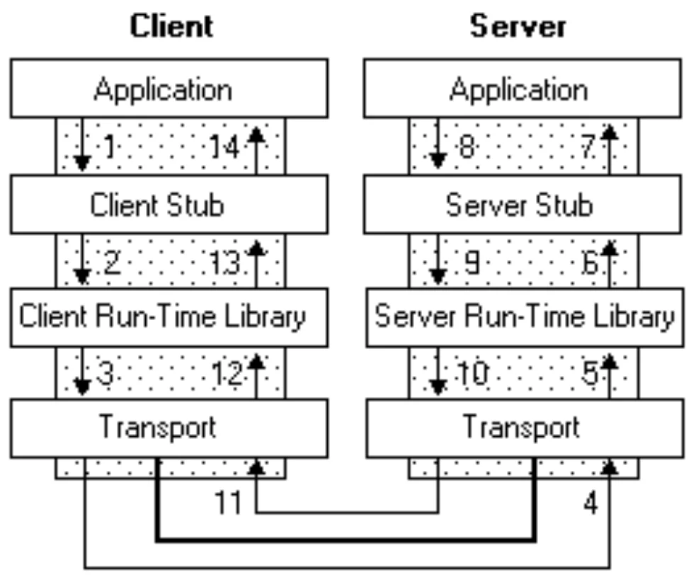
> 
> 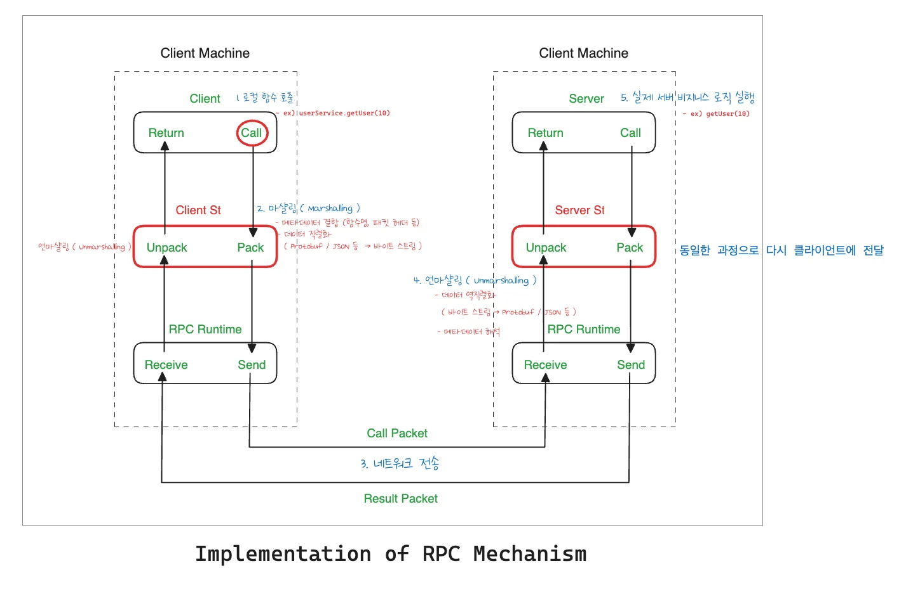
> 
> > 상세 내용 <a href="#/post/3ddeda9b-0fe1-80fc-a5ce-e4fe1d852d54">페이지</a>  참조
> 
> - <code>클라이언트 &#45; 서버 모델</code>
> 
> - <code>프로시저 호출</code>
> 
> - <code>스텁 (Stub)</code>
> 
> - <code>마샬링, 언마샬링</code> 

<details>
<summary><strong>RPC의 장점</strong></summary>

> ✏️ 
> 
> - 추상화
> 
> - 언어 독립성
> 
> - 분산 처리 용이성

<details>
<summary>RPC 의 장점&#58; <code>추상화</code></summary>

- 추상화의 중요성
    - 복잡성(Complexity) 감소 

    - 개발자 친화적

    - 오류 감소

- 추상화의 구현 예시
    - 인터페이스 정의 (AIDL, Protobuf 등)

    - 스텁 (Stub) 사용

    - 마샬링, 언마샬링

</details>

<details>
<summary>RPC 의 장점&#58; <code>언어 독립성</code></summary>

- 언어 독립성의 의미
    - 프로그래밍 언어의 다양성

    - 상호 운용성

- 언어 독립성의 구현 예시 
    - 표준화된 프로토콜

    - 데이터 직렬화

    - 언어에 독립적인 인터페이스

</details>

<details>
<summary>RPC 의 장점&#58; <code>분산 처리 용이성</code></summary>

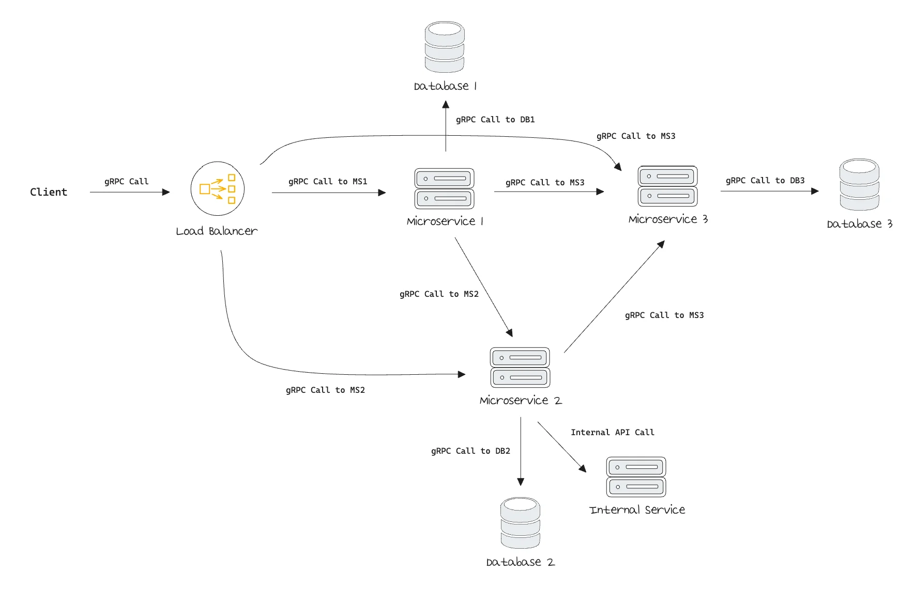

- <strong><u>‘분산 처리가 용이하다’</u></strong> 가 가지는 의미
    - 다양한 시스템의 통합

    - 통신의 간소화

- 분산 처리 구현 예시
    - 서비스 지향 아키텍처 (SOA)

    - 마이크로 서비스 아키텍처 (MSA)

    - 분산 컴퓨팅

</details>

</details>

<details>
<summary><strong>RPC의 단점</strong></summary>

> ✏️ 
> 
> - 네트워크 신뢰성
> 
> - 디버깅 어려움

<details>
<summary>RPC 의 단점&#58; <code>네트워크 신뢰성</code></summary>

- 네트워크 신뢰성 문제
    - 네트워크 의존성

    - 네트워크 문제와 RPC 실패

- 해결 방안 
    - 타임아웃 및 재시도 매커니즘

    - 로드 밸런싱 과 장애 조치 (failover)

    - 분산 시스템 설게 시 해당 부분 고려

</details>

<details>
<summary>RPC 의 단점&#58; <code>디버깅 어려움</code></summary>

- 원인
    - 원격 프로시저 호출의 복잡성

    - 네트워크 관련 문제

    - 서버와 클라이언트의 상태 불일치

    - 오류 메시지의 부족 또는 불명확성

- 디버깅을 위한 전략 및 도구
    - 로깅과 모니터링

    - 트레이싱 도구 사용

    - 환경 일관성 유지

    - 타임아웃 및 오류 처리 전략

</details>

</details>

<a id="3e7eda9b0fe180f9915efc625b5f1df5"></a>

## gRPC 서비스 요청 방식 이해

---

<details>
<summary>reference</summary>

- ‣

- ‣

- ‣

- ‣

</details>

<details>
<summary>gRPC 와 Protobuf의 상호 작용</summary>

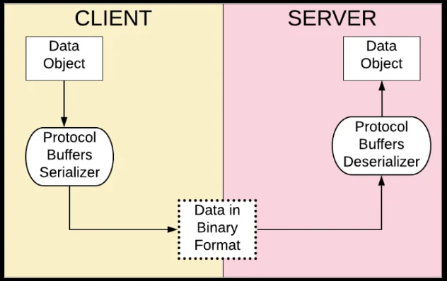

- gRPC에서 사용되는 주용 인터페이스 정의 언어 (IDL)

- 데이터 구조를 효율적으로 직렬화

- 작은 메시지 크기, 빠른 처리 속도로 네트워크 효율성을 높임

</details>

<details>
<summary>gRPC와 HTTP/2&#58; <code>HTTP/2 사용의 이점</code></summary>

> ✏️ 
> 
> 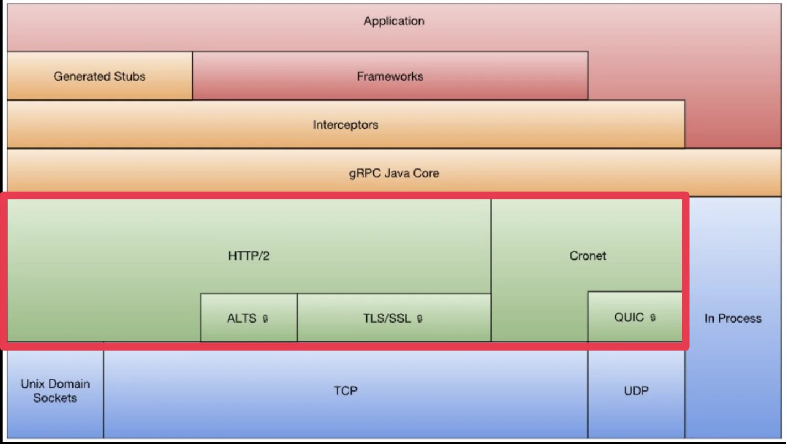
> 
> <a id="3e7eda9b0fe180ffacb1d66894be018a"></a>
> 
> <code>gRPC</code>가 <code>HTTP/2</code>를 사용하는 핵심 이유는 <strong><u>하나의 연결을 효율적으로 재사용</u></strong>하면서 <strong><u>여러 RPC를 동시에 처리</u></strong>하고, <strong><u>스트리밍까지 자연스럽게 지원</u></strong>하기 위해서 이다&#46; 
> 
> <a id="3e7eda9b0fe180cfb073f331487457f2"></a>
> 
> <code>HTTP/2</code>는 <code>HTTP/1&#46;1</code> 대비 <strong><u>헤더 압축과 다중 스트리밍 처리를 지원</u></strong>해 <strong><u>네트워크 지원 시간을 줄</u></strong>이도록 설계되었다&#46; 

<a id="3e7eda9b0fe18039a70aeac4b2bbe045"></a>

#### 핵심 비교

| 기능 | 의미 | gRPC에서 얻는 이점 |
| --- | --- | --- |
| <strong><code>Streaming</code></strong> | 하나의 Stream을 유지하며 지속적으로 데이터 전달 | 실시간/대용량/연속 데이터 처리 |
| <strong><code>Header Compression</code></strong> | 반복되는 HTTP Header를 HPACK으로 압축 | 네트워크 오버헤드 감소 |
| <strong><code>Multiplexing</code></strong> | 하나의 TCP 연결에서 여러 Stream을 동시 처리 | 연결 수 감소, 동시 RPC 효율 증가 |

<details>
<summary>HTTP/2 사용의 이점&#58; <code>스트리밍 (Streaming)</code></summary>

<a id="3e7eda9b0fe1801abb9be24007ef307b"></a>

하나의 TCP 연결 안에 여러 개의 독립적인 Stream을 만들 수 있다&#46;

<a id="3e7eda9b0fe180efaaf5cd9181658f34"></a>

```protobuf
TCP Connection
│
├── Stream 1 : GetUser RPC
├── Stream 3 : Chat RPC
├── Stream 5 : Upload RPC
└── Stream 7 : Notification RPC
```

<a id="3e7eda9b0fe1802ab93be71aa1722694"></a>

gRPC에서는 사실상 <strong>하나의 RPC 호출이 하나의 HTTP/2 Stream</strong>에 대응한다고 보면 된다&#46;

<a id="3e7eda9b0fe18012bf02d8f20071edb4"></a>

그리고 gRPC 메시지는 HTTP/2의 <code>DATA Frame</code>을 통해 전달된다&#46;

<a id="3e7eda9b0fe1807bb038ee5e1806fcc0"></a>

이 구조 덕분에 gRPC는 다음 4가지 통신 방식을 지원한다&#46;

> ✏️ 
> 
> 1. <code>Unary (기본 gRPC 통신)</code>
> 
> 1. <code>Server Streaming</code>
> 
> 1. <code>Client Streaming</code>
> 
> 1. <code>Bidirectional Streaming</code>

<a id="3e7eda9b0fe18015a12fd132ff99fa9f"></a>

```protobuf
service ChatService {

  // 1. Unary
  rpc GetUser(UserRequest)
      returns (UserResponse);

  // 2. Server Streaming
  rpc GetMessages(ChatRequest)
      returns (stream Message);

  // 3. Client Streaming
  rpc UploadMessages(stream Message)
      returns (UploadResult);

  // 4. Bidirectional Streaming
  rpc Chat(stream Message)
      returns (stream Message);
}
```

<a id="3e7eda9b0fe180b88c41e298a9febfc9"></a>

특히 Bidirectional Streaming은 아래와 같이 연결을 유지하면서 양쪽에서 계속 데이터를 보낼 수 있다&#46; (WebSocket 유사)

<a id="3e7eda9b0fe180fc965bee4b49b2a9d9"></a>

```protobuf
Client                      Server
  │                           │
  │──── Message A ───────────>│
  │<──── Message B ───────────│
  │──── Message C ───────────>│
  │<──── Message D ───────────│
  │                           │
```

<a id="3e7eda9b0fe1800897f8e7f50bec4084"></a>

따라서 채팅, 실시간 이벤트, 로그 스트리밍, 게임 서버, 디바이스 상태 스트리밍 같은 장시간 지속되는 데이터 흐름에 유용하다&#46;

> ‣

- gRPC 공식 성능 가이드에서도 장기적인 데이터 흐름에서 streaming RPC가 반복적으로 새로 시작하는 RPC 비용을 피할 수 있다고 설명한다&#46;

</details>

<details>
<summary>HTTP/2 사용의 이점&#58; <code>헤더 압축 (Header Compression)</code></summary>

<a id="3e7eda9b0fe18004a01cf74da67e516b"></a>

HTTP 요청에는 매번 헤더가 포함된다&#46; 

<a id="3e7eda9b0fe180379793d8d4356d013e"></a>

#### <code>HTTP/1&#46;1</code>

<a id="3e7eda9b0fe18033bfd0fe7e10a90ccc"></a>

예를 들어 HTTP/1&#46;1에서는 아래 같은 헤더 정보가 요청마다 반복된다&#46;

<a id="3e7eda9b0fe180f3b1a2d2ad949573fe"></a>

```protobuf
POST /user HTTP/1.1
Host: api.example.com
Content-Type: application/grpc
Authorization: Bearer abcdef...
User-Agent: grpc-go 
```

<a id="3e7eda9b0fe180278a6dcf7fc52d7458"></a>

여기서 문제는 대부분의 헤더가 거의 동일하기 때문에 불필요한 데이터 중복 전송 비용이 발생된다는 것이다&#46; 

<a id="3e7eda9b0fe180a387cbdc5c1928bebc"></a>

#### <code>HTTP/2</code>

> ‣

<a id="3e7eda9b0fe180f8b8bef32b10d112e2"></a>

<code>HTTP/2</code>는 이를 줄이기 위해 <code>HPACK Header Compression</code>을 사용한다&#46;

<a id="3e7eda9b0fe180138d9edfb619374147"></a>

<strong><u>HTTP/2 연결 단위로 compression context를 유지</u></strong>해서 <strong>반복되는 헤더를 더 효율적으로 인코딩</strong>한다&#46; 

<details>
<summary>ex)</summary>

- 첫 요청
    <a id="3e7eda9b0fe18009895feda51228ffaa"></a>

    ```protobuf
    :method = POST
    :path = /UserService/GetUser
    content-type = application/grpc
    authorization = Bearer xxx
    ```

- 이후 요청 &#45; 기존 테이블의 값 참조
    <a id="3e7eda9b0fe180db8fa3c68bc7ca5ac2"></a>

    ```protobuf
    [1] POST
    [5] application/grpc
    [8] Bearer xxx
    ```

    - 이후 요청에서는 동일한 값을 계속 보내는 것이 아닌 첫 요청시의 헤더를 압축해서 저장한 뒤, 이를 재사용한다&#46;

</details>

<a id="3e7eda9b0fe180669f64c349b0e56f80"></a>

#### <code>HTTP/1&#46;1</code>,  <code>HTTP/2</code> 비교

<a id="3e7eda9b0fe180b9885fe4db681c48e0"></a>

```protobuf
HTTP/1.1
[큰 Header][작은 Body]
[큰 Header][작은 Body]
[큰 Header][작은 Body]
```

<a id="3e7eda9b0fe1805e9807e69aed9a6ff2"></a>

```protobuf
HTTP/2
[압축 Header][Body]
[작은 Header][Body]
[작은 Header][Body]
```

<a id="3e7eda9b0fe180449d25fa7df2002e54"></a>

HTTP/2 는 압축된 Header는 담아 메시지를 보내기 때문에 더 효율적인 비용으로 통신을 할 수 있다&#46; 

<a id="3e7eda9b0fe180a5a995ccdbddab799c"></a>

특히 작은 protobuf 메시지를 매우 자주 호출하는 MSA 환경에서는 상대적으로 헤더의 비중이 커질 수있기 때문에 이러한 최적화가 더 의미가 있다&#46; 

</details>

<details>
<summary>🧐 <code>HTTP/2 &#45; Header Compression</code> vs <code>gRPC &#45; Message Compression</code></summary>

> ‣

- HTTP/2
    <a id="3e7eda9b0fe180c5ac86f0cef76cb27c"></a>

    ```protobuf
    Header → HPACK 압축
    ```

- gRPC
    <a id="3e7eda9b0fe18062abe4fa4084972535"></a>

    ```protobuf
    Message Body → gzip 등의 별도 압축 가능
    ```

    - gRPC 자체도 메시지 단위 압축 기능을 별도로 제공한다&#46;

</details>

<details>
<summary>HTTP/2 사용의 이점&#58; <code>멀티 플렉싱 (Multiplexing)</code></summary>

<a id="3e7eda9b0fe1807e9a14ef248431c840"></a>

<code>멀티 플렉싱 (Multiplexing)</code>은 HTTP/2 에서 가장 중요한 장점 중 하나이다&#46; 

- <strong><u>하나의 TCP Connection에서 여러 요청/응답을 동시에 처리</u></strong>한다&#46;
    <a id="3e7eda9b0fe18014b46ed80345c25b64"></a>

    ```protobuf
    // HTTP/2
    Client ───── TCP Connection ───── Server
                  │
                  ├── Stream 1 : RPC A
                  ├── Stream 3 : RPC B
                  ├── Stream 5 : RPC C
                  └── Stream 7 : RPC D
    ```

    - 하나의 TCP 연결 안에서 여러 Stream을 동시에 처리할 수 있다&#46; 

> ☝🏻 
> 
> <a id="3e7eda9b0fe180d88b09dde4befbed1a"></a>
> 
> <code>HTTP/1&#46;1</code>에서는<strong><u> 여러 요청을 병렬로 처리</u></strong>하려면 <strong>보통 여러 TCP Connection을 사용</strong>했다&#46; 
> 
> <a id="3e7eda9b0fe180f68e99ec58e12b09af"></a>
> 
> ```protobuf
> // HTTP/1.1
> Client
>  ├── TCP Connection 1 ─── Request A
>  ├── TCP Connection 2 ─── Request B
>  ├── TCP Connection 3 ─── Request C
>  └── TCP Connection 4 ─── Request D
> ```

- 또한 HTTP/2는 Frame 단위로 데이터를 섞어서 전달할 수 있다&#46; 
    <a id="3e7eda9b0fe1802f96feeeb9a726dd1d"></a>

    ```protobuf
    TCP Connection

    [A1][B1][A2][C1][B2][C2][A3]
    ```

    <a id="3e7eda9b0fe18015af00cb2518c8ff04"></a>

    수신 측에서는 Stream ID가 있기 때문에 다시 아래와 같이 구분할 수 있다&#46;

    <a id="3e7eda9b0fe18047abaecf7e083409aa"></a>

    ```protobuf
    Stream A → A1 A2 A3
    Stream B → B1 B2
    Stream C → C1 C2
    ```

<a id="3e7eda9b0fe180b4967ac871bac42b0b"></a>

HTTP/2 명세에서도 <strong><u>하나의 연결 안에 여러 Stream을 동시에 열</u></strong>고, <strong><u>서로 다른 Stream의 Frame들을 interleave할 수 있도록 정의</u></strong>한다&#46;

<a id="3e7eda9b0fe18054893edf9da5ab9fec"></a>

이러한 성질이 <code>MSA &#43; gRPC</code>에서 특히 중요하다&#46;

<a id="3e7eda9b0fe1801aa7a7ef97935d83f5"></a>

```protobuf
API Gateway
     │
     │ HTTP/2 Connection
     ▼
User Service

동시에
 ├── GetUser()
 ├── GetProfile()
 ├── GetPermission()
 ├── UpdateUser()
 └── GetUserHistory()
```

- 이런 RPC 호출들이 있어도 매번 새로운 TCP 연결을 만드는 것이 아니라 <strong><u>기존 HTTP/2 Connection을 재사용</u></strong>하면서 <strong><u>여러 Stream으로 RPC를 처리</u></strong>할 수 있다&#46;

</details>

</details>

<details>
<summary>gRPC 서비스 요청 방식&#58; <code>HTTP/2 와의 상호작용 예시</code></summary>

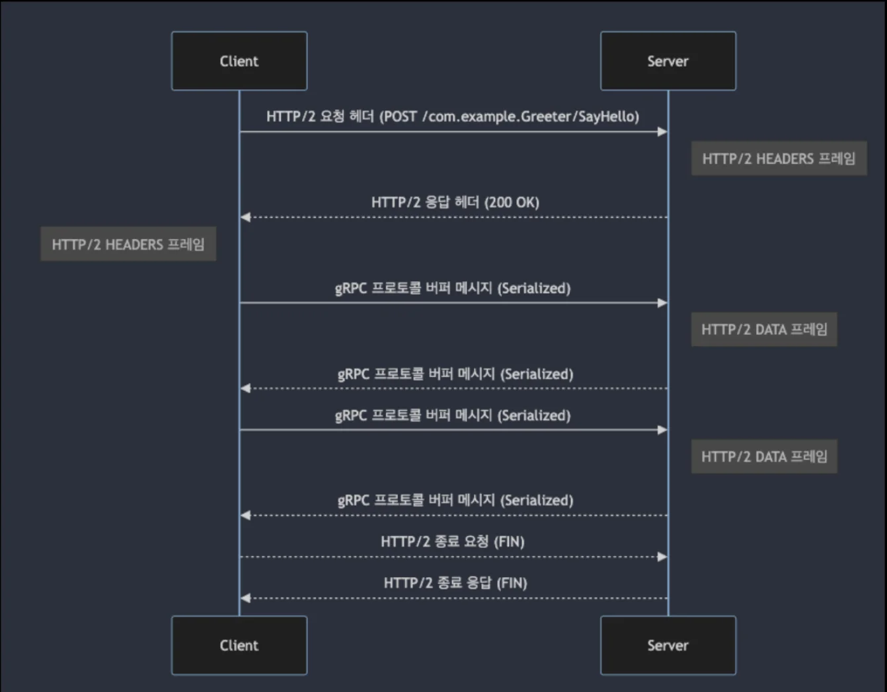

<a id="3e7eda9b0fe1807a8f3ad61c845c0938"></a>

#### <strong>양방향 스트리밍 시나리오 &#45; </strong><strong><code>Go 언어</code></strong>

<details>
<summary> <code>hello&#46;proto</code> 계약</summary>

<a id="3e7eda9b0fe1805ab34ae3a5f3d17256"></a>

```protobuf
syntax = "proto3"

message HelloRequest {
	string name = 1;
}

message HelloResponse {
	string message = 1;
}

service Greeter {
	rpc SayHelloStream(stream HelloRequest) return (stream HelloResponse);
}
```

- 요청, 응답 모두 stream으로 선언했으므로 양방향 스트리밍이 가능하다&#46;

<a id="3e7eda9b0fe18020b0e9cbc8d5e32b2a"></a>

```protobuf

```

</details>

<details>
<summary>HTTP/2 &#43; gRPC</summary>


</details>

</details>

<details>
<summary>gRPC 서비스 요청 방식&#58; <code>실제 요청&#45;응답 프로토콜 분석</code></summary>

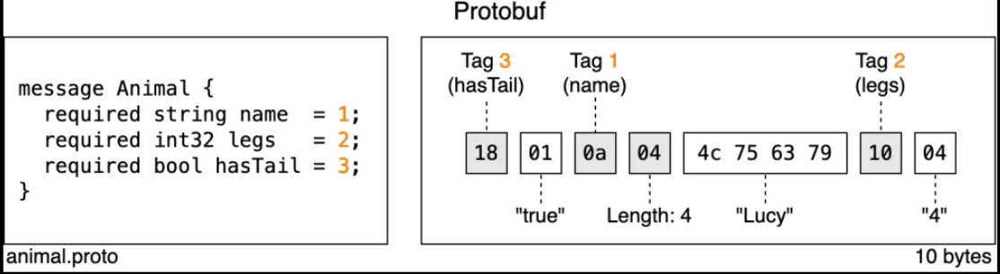

1. gRPC &#43; HTTP/2 요청/응답 헤더
    <a id="3e7eda9b0fe180bc947ee23e704c6574"></a>

    <strong>요청 헤더 </strong>

    <a id="3e7eda9b0fe1809d8d39fb2799c30971"></a>

    ```plaintext
    POST /com.example.Greeter/SayHello HTTP/2
    HOST: www.example.com
    Content-Type: application/grpc
    :method: POST
    :path: /com.example.Greeter/SayHello
    ```

    <a id="3e7eda9b0fe1808eaf95dba00ffc8114"></a>

    <strong>응답 헤더</strong>

    <a id="3e7eda9b0fe1802cb65bd7441c71762d"></a>

    ```plaintext
    HTTP/2 200 K
    Content-Type: application/grpc
    :status: 200

    ```

1. gRPC 프로토콜 버퍼 요청/응답 메시지
    <a id="3e7eda9b0fe180feb7dbfb71302f54d7"></a>

    <strong>요청 메시지</strong>

    <a id="3e7eda9b0fe180e9b7b7d66e585870e8"></a>

    ```plaintext
    Message Length: 20 bytes

    [Serialized Protocol Buffer Message Data]
    ```

    <a id="3e7eda9b0fe180619ceccab27aa6a0d6"></a>

    <strong>응답 메시지</strong>

    <a id="3e7eda9b0fe180a7b207d1959e2a1f51"></a>

    ```plaintext
    Message Length: 18 bytes

    [Serialized Protocol Buffer Message Data]
    ```

</details>

<details>
<summary>gRPC 서비스 요청 방식&#58; <code>양방향 스트리밍 예시</code></summary>

> ✏️ 
> 
> <a id="3e7eda9b0fe180859e3bf80430d078d5"></a>
> 
> <strong>양방향 스트리밍</strong>
> 
> - <code>스트리밍 시작 요청 및 응답</code>
> 
> - <code>헤더 프레임 전송</code>
> 
> - <code>데어터 프레임 전송 (스트리밍 동안)</code>
> 
> - <code>추가 헤더 전송 (옵션)</code>
> 
> - <code>스트리밍 종료 요청 및 응답</code>

<a id="3e7eda9b0fe180279884f9db5d24d72e"></a>

<code>&#46;proto</code> 파일

<a id="3e7eda9b0fe180f993a6d23191e55f14"></a>

```protobuf
synstax = "proto3";

message HelloRequest {
	string name = 1;
}

message HelloResponse {
	string message. = 1;
}

service Greeter {
	rpc SayHelloStream(stream HelloRequest) returns (stream HelloResponse);
}
```

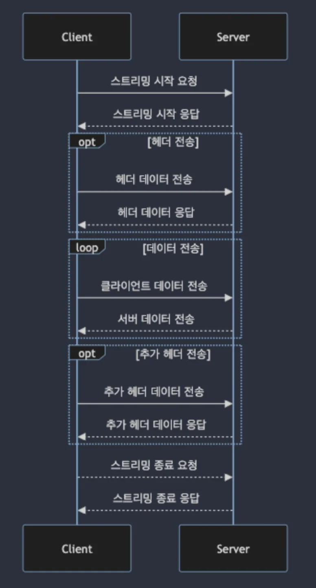

</details>

<details>
<summary>🧐 gRPC 스트리밍(stream) 방식 3가지</summary>

> ✏️ 
> 
> 1. Unary (기본 gRPC 통신)
> 
> 1. <code>Server Streaming</code>
> 
> 1. <code>Client Streaming</code>
> 
> 1. <code>Bidirectional Streaming</code>

<details>
<summary>1&#46; 일반적인 Unary RPC</summary>

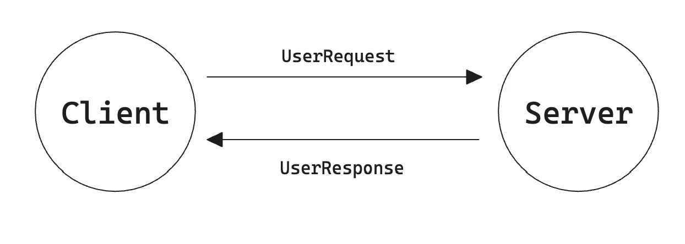

<a id="3e7eda9b0fe18024bd84c8313377c242"></a>

<code>&#46;proto</code> 파일 (ProtoBuf IDL)

<a id="3e7eda9b0fe180dabe3dd914cdccaa0a"></a>

```protobuf
...

service UserService {
	rpc GetUser(UserRequest) returns (UserResponse);
}
```

</details>

<details>
<summary>2&#46; <code>Server Streaming</code></summary>

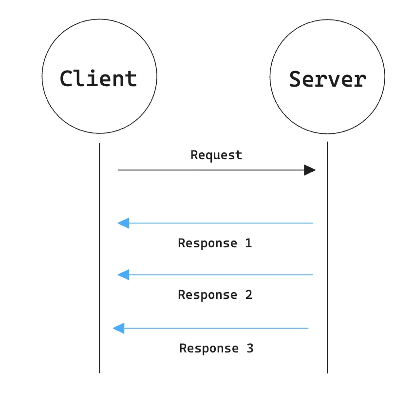

- <code>&#46;proto</code> 파일 (ProtoBuf IDL)
    <a id="3e7eda9b0fe180ec9b40cd9d4e16b312"></a>

    ```protobuf
    ...

    service UserService {
    	rpc GetUsers(UserRequest) returns (stream UserResponse);
    }
    ```

- 사용 용도
    - 로그 스트리밍

    - 대규모 검색 결과

    - 파일 다운로드 

    - AI 토큰 스트리밍

    - 실시간 이벤트 전달

</details>

<details>
<summary>3&#46; <code>Client Streaming</code></summary>

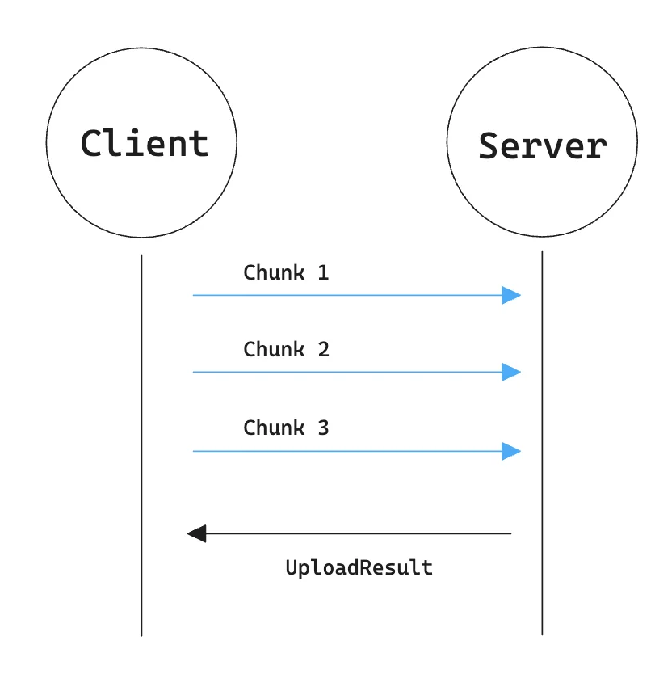

- <code>&#46;proto</code> 파일 (ProtoBuf IDL)
    <a id="3e7eda9b0fe1804b991fce601428713d"></a>

    ```protobuf
    ...

    service UserService {
    	rpc GetUsers(stream UserRequest) returns (UserResponse);
    }
    ```

- 사용 용도
    - 대용량 파일 업로드

    - 센서 데이터 업로드

    - 로그 batch 업로드

</details>

<details>
<summary>4&#46; <code>Bidirectional Streaming</code></summary>

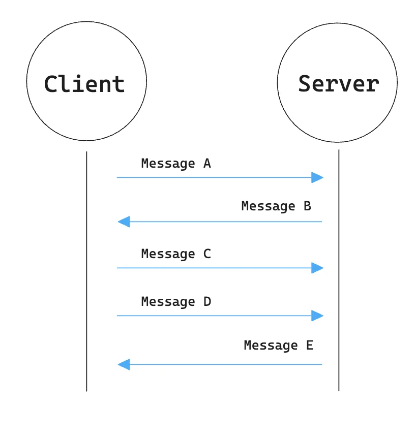

- <code>&#46;proto</code> 파일 (ProtoBuf IDL)
    <a id="3e7eda9b0fe180eb893df574b62821da"></a>

    ```protobuf
    ...

    service UserService {
    	rpc Chat(stream ChatMessage) 
    		returns (stream ChatMessage);
    }
    ```

    - 양쪽 모두 streaming

    - 두 방향 스트림은 독립적으로 동작함

</details>

</details>

<details>
<summary>🧐 <code>gRPC &#45; Bidirectional Streaming</code>  vs <code>WebSoket</code> 비교</summary>

<a id="3e7eda9b0fe180258276da5742524fce"></a>

개념적으로는 비슷하나, gRPC는 <strong><u>protobuf 기반으로 RPC 메서드와 메시지 타입이 명확하게 정의</u></strong>된다&#46; 

<a id="3e7eda9b0fe1803cb15bc6e10a05a58f"></a>

⇒ <code>protobuf</code> &#43; <code>IDL</code> 기반 계약이 강제되기 때문에 잘못된 메시지 형식을 사전에 줄일 수 있다&#46;

- <code>&#46;proto</code> 파일 자체가 API 계약이다&#46; 이를 통해서 프로토콜 안정성을 높인다&#46; 

- ex) 
    <a id="3e7eda9b0fe18097b47fc9bf21f40a41"></a>

    ```protobuf
    Client
       │
       │ PlayerAction
       │  - move
       │  - attack
       │  - skill
       ▼
    Server
       │
       │ GameEvent
       │  - damage
       │  - state update
       │  - enemy action
       ▼
    Client
    ```

</details>

<details>
<summary>🧐 <code>gRPC</code> vs <code>Message Queue</code></summary>

- <code>gRPC</code>는 보통 <strong>동기적 요청/응답 RPC</strong>에 잘 맞다&#46;
    - gRPC도 비동기 API나 Streaming 지원한다&#46;

    <details>
    <summary>ex) gRPC</summary>

    <a id="3e7eda9b0fe18075aa46c65bf941ef35"></a>

    ```protobuf
    Service A
       │
       │ GetUser(1)
       ▼
    Service B
       │
       │ UserResponse
       ▼
    Service A

    "결과를 받아야 다음 작업 진행"
    ```

    </details>

- <code>Message Queue</code>는 보통 <strong>비동기 이벤트/메시지 처리</strong>에 잘 맞다&#46;
    <details>
    <summary>ex) MQ</summary>

    <a id="3e7eda9b0fe18017bff3db378e0cf496"></a>

    ```protobuf
    Service A
       │
       │ MessageCreated
       ▼
     Kafka
       │
       ├──→ Notification Service
       ├──→ Analytics Service
       └──→ Search Service

    "일단 메시지를 발행하고 다음 작업 진행"
    ```

    </details>

<a id="3e7eda9b0fe180bb8b2de43d6a831c48"></a>

<strong>정리</strong>

| 구분 | gRPC | Message Queue |
| --- | --- | --- |
| 대표 모델 | Request / Response | Publish / Consume |
| 호출 대상 | 명확함 | Producer는 Consumer를 몰라도 됨 |
| 결과 | 즉시 필요 | 나중에 처리 가능 |
| 결합도 | 상대적으로 높음 | 낮음 |
| 장애 | 상대 서비스 장애 영향 큼 | Broker가 버퍼 역할 가능 |
| 예 | 사용자 조회, 권한 확인 | 알림, 로그, 통계, 후속 처리 |

</details>

<details>
<summary>gRPC 서비스 요청 방식&#58; <code>Stream과 Repeated의 차이</code></summary>

> ✏️ 
> 
> - <code>repeated</code>
>     - 하나의 Protobuf <strong><u>메시지 안에 여러 값</u></strong>을 담는 <strong>필드 구조</strong>
> 
>     - <code>repeated</code> → <code>&#91;A, B, C&#93;</code>를 <strong>한 번에 전송</strong>
> 
> - <code>stream</code>
>     - 여러 Protobuf <strong><u>메시지를 시간 순서대로 계속 전송</u></strong>하는 <strong>gRPC 통신 방식</strong>
> 
>     - <code>stream</code> → <code>A → B → C</code>를 <strong>순차적으로 전송</strong>

- <strong>Stream</strong>
    <a id="3e7eda9b0fe180909cb1c9ae9e3afdf1"></a>

    ```protobuf
    synstax = "proto3";

    message HelloRequest {
    	string name = 1;
    }

    message HelloResponse {
    	string message. = 1;
    }

    service Greeter {
    	rpc SayHelloStream(stream HelloRequest) returns (stream HelloResponse);
    }
    ```

- <strong>Repeated</strong>
    <a id="3e7eda9b0fe1805f8911d455685680f2"></a>

    ```protobuf
    synstax = "proto3";

    message HelloRequest {
    	string name = 1;
    }

    message HelloResponse {
    	repeated string message. = 1;
    }

    service Greeter {
    	rpc SayHelloStream(stream HelloRequest) returns (HelloResponse);
    }
    ```

</details>

<a id="3e7eda9b0fe180b2867cf55f941f251a"></a>

## 간단한 gRPC 학습 예제 

---

> 📖 
> 
> <a id="3e7eda9b0fe180439b9ddf7e93cb063c"></a>
> 
> gRPC 사용으로 인한 장점
> 
> - protoc를 이용한 관련 코드 자동 생성
> 
> - 커넥션 관리 불필요
> 
> - 비지니스 로직에 집중 가능
> 
> - HTTP/2 기반의 이점을 누릴 수 있음

<a id="3e7eda9b0fe18022a54ee94f79651bec"></a>

#### 실습 예제

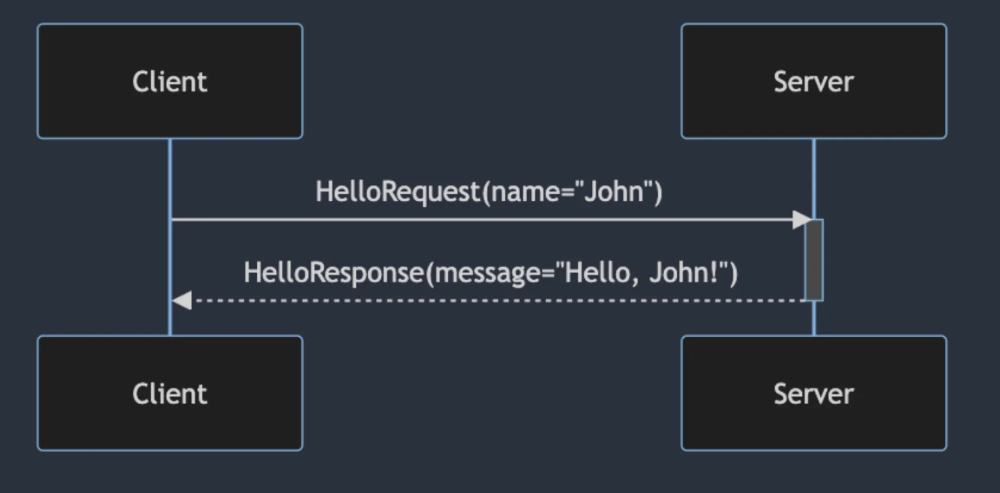

<details>
<summary>1&#46; <code>&#46;proto</code> 파일 정의</summary>

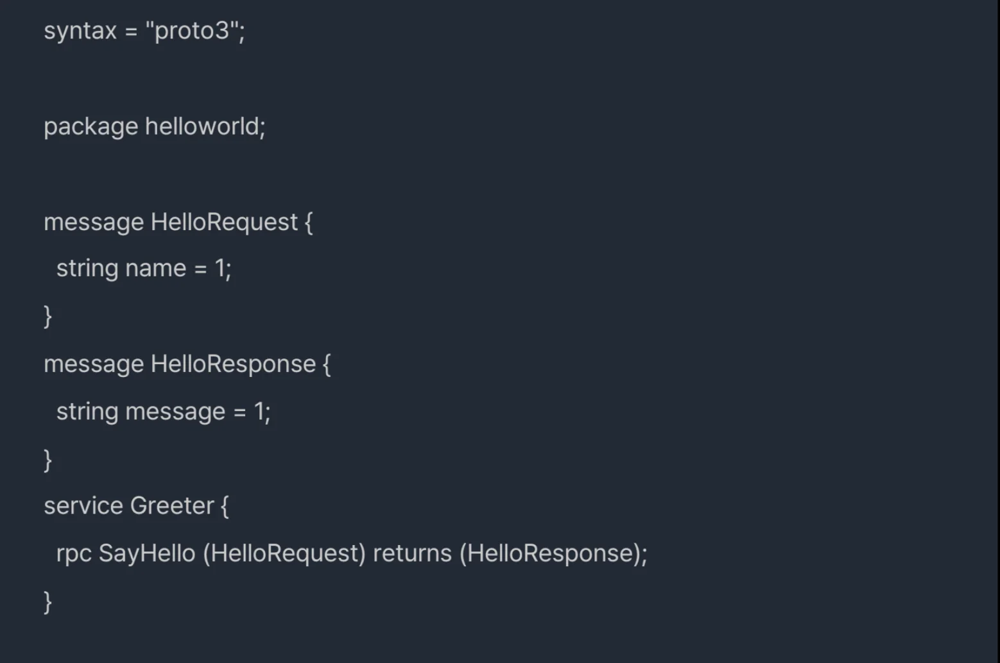

</details>

<details>
<summary>2&#46; <code>&#46;proto</code> 컴파일</summary>

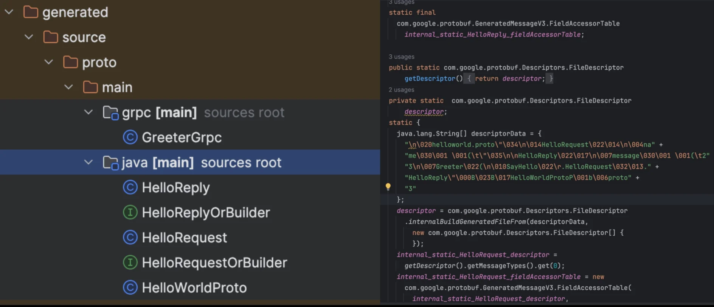

</details>

<details>
<summary>3&#46; 서버 구현</summary>

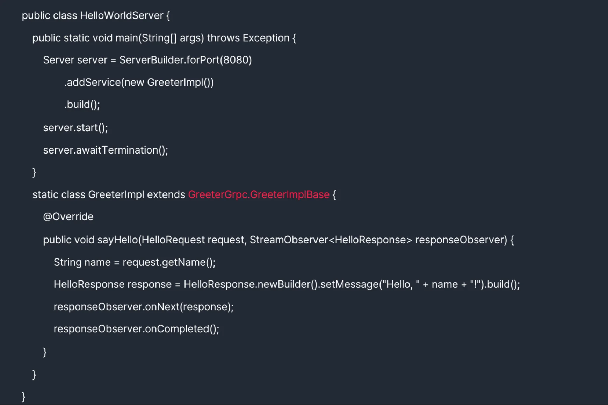

</details>

<details>
<summary>4&#46; 클라이언트구현</summary>

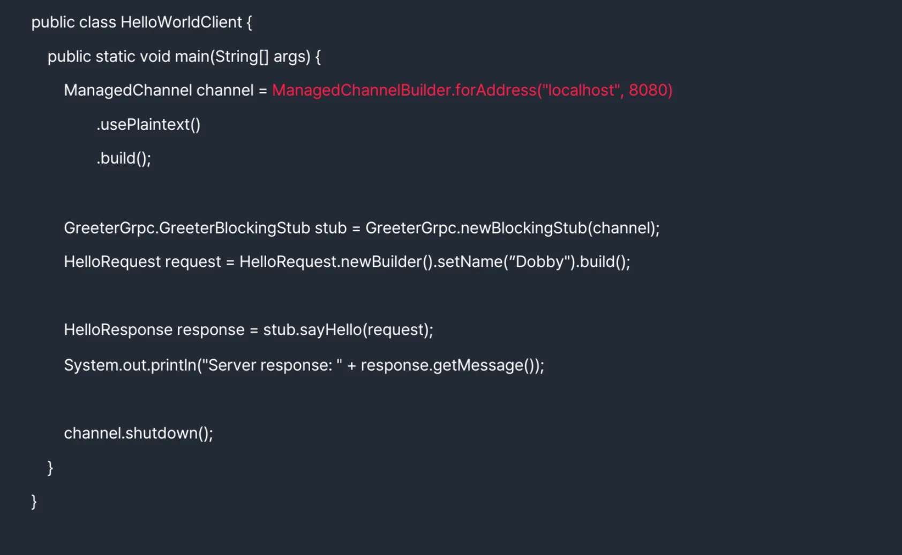

</details>

<details>
<summary>5&#46; 응답 결과</summary>

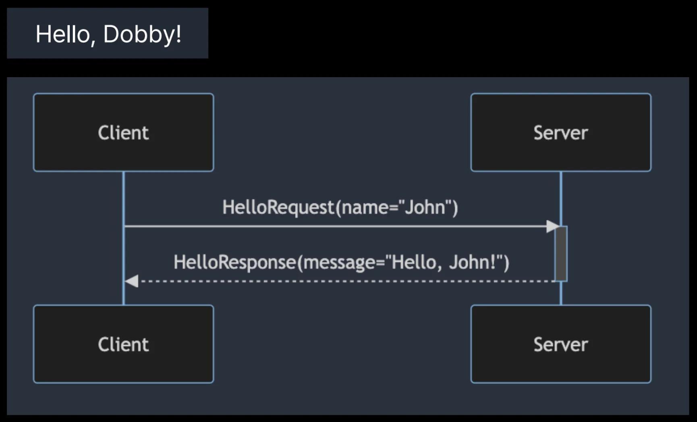

</details>
