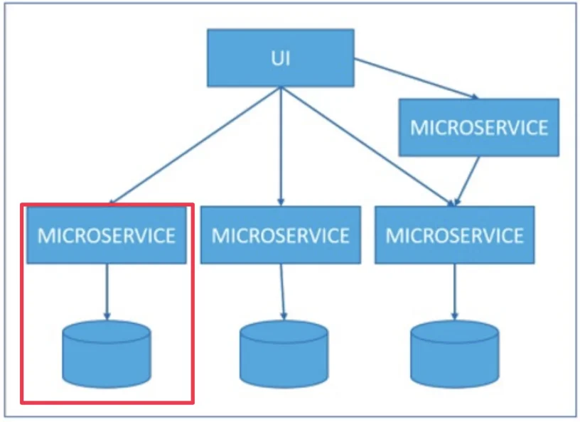
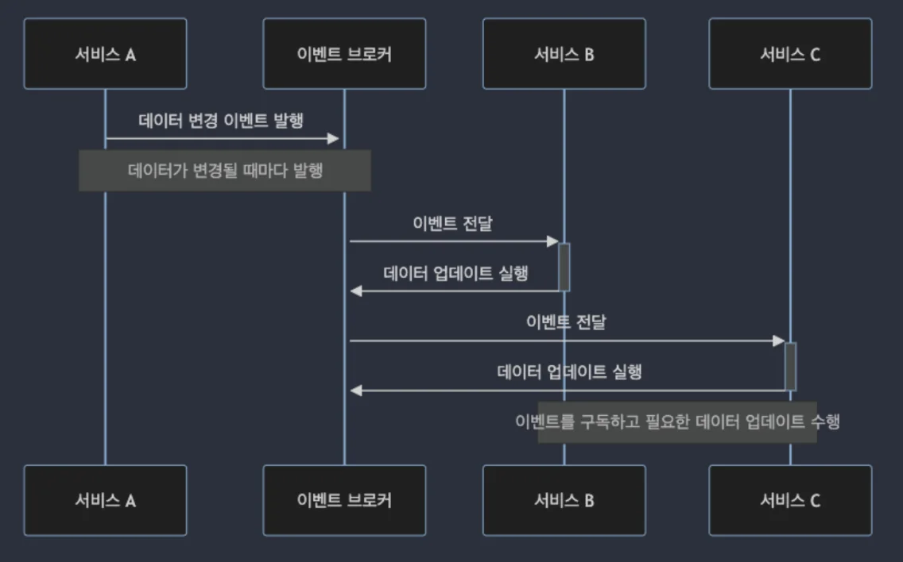
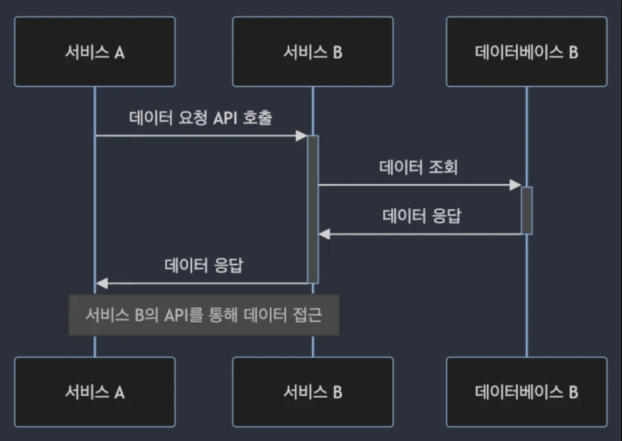
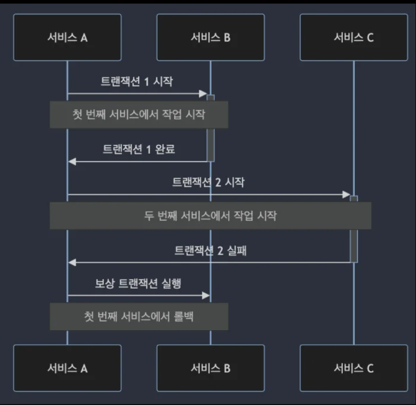
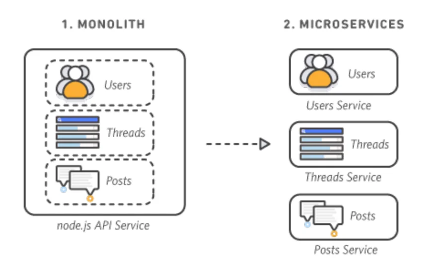
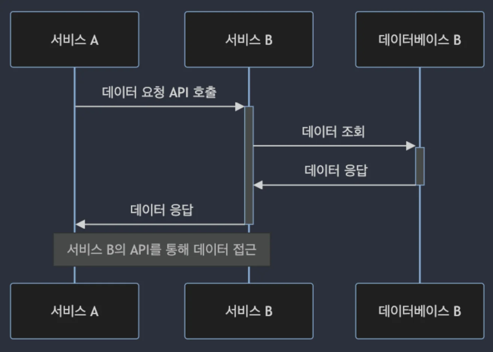
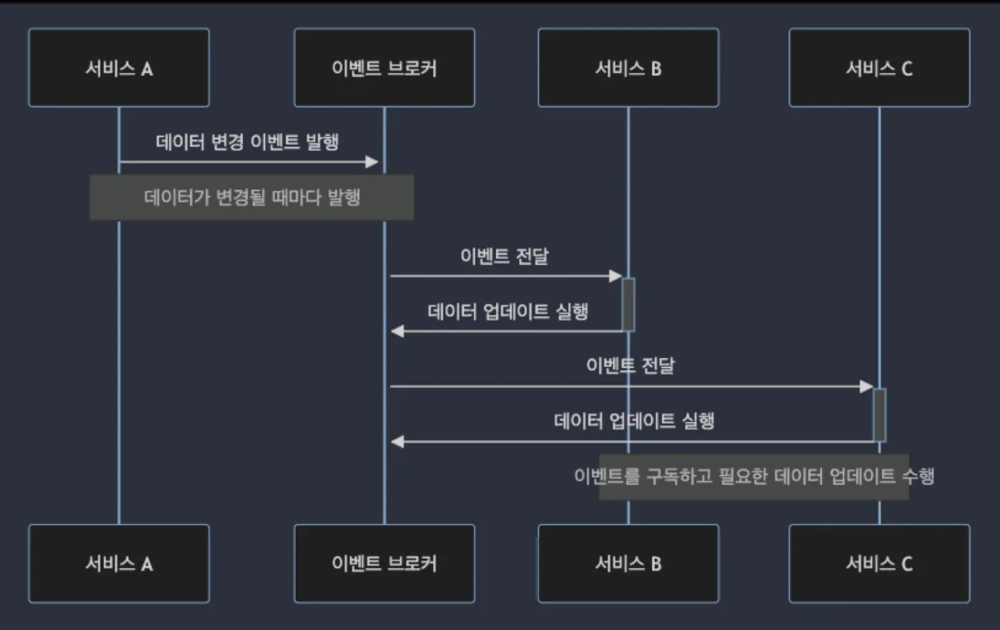
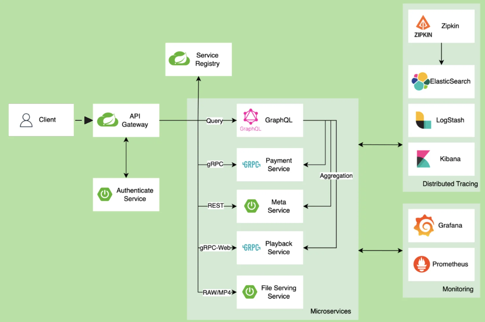

## 마이크로서비스 아키텍처 개요

---

> 📖 
> 
> 
> 
> <strong>Micro Service, 마이크로서비스</strong> 
> 
> - 소프트웨어 개발에서 사용되는 아키텍처 스타일
> 
> - 작고 독립적으로 배포 가능한 서비스의 집합으로 구성

> 🤔 
> 
> 
> 
> 전통적인 모놀리식 아키텍처 와의 비교
> 
> - <code>모놀리식 (Monolithic) 아키텍처</code>
>     - 전통적인 모놀리식 아키텍처는 소프트웨어를 단일 모듈로 분리 없이 개발
> 
>     - 모든 기능이 하나의 코드베이스에 통합되어 있으며, 변경이나 업데이트 시 전체 어플리케이션을 재배포 해야함
> 
> - <code>마이크로 서비스 아키텍처</code>
>     - 서비스를 작고 관리가 용이한 단위로 분리
> 
>     - 더 빠른 배포, 더 나은 확장성, 그리고 서비스 간의 느슨한 결합을 가능하게 함

### 마이크로 서비스의 핵심 원칙

> ✏️ 
> 
> - <code>분산된 데이터 관리</code>
> 
> - <code>서비스별 독립적 배포</code>
> 
> - <code>결합도와 응집도</code>
> 
> - <code>서비스 간 통신</code>

마이크로 서비스의 핵심 원칙&#58; <code>분산된 데이터 관리</code>

- <code>독립적인 데이터 저장소</code>
    - 각 마이크로 서비스는 고유한 데이터베이스 또는 데이터 저장소를 소유

- <code>데이터 일관성</code>
    - 분산된 데이터 관리 원칙에 따라, 각 서비스는 독립적으로 데이터를 관리하면서도 전체 시스템 내에서의 데이터 일관성 유지

####  데이터 일관성 유지 방법 

이벤트 기반 데이터 동기화

API를 통한 데이터 접근

트랜잭션 관리 (Saga 패턴)

> 🤔 
> 
> 
> 
> 분산된 데이터 관리의 장점
> 
> 
> 
> - 서비스의 독립적인 확장성
> 
> - 유연성 및 장애 격리

마이크로 서비스의 핵심 원칙&#58; <code>서비스별 독립적 배포</code>

- <code>속도와 유연성</code>
    - 각 팀은 다른 서비스의 개발 일정에 영향을 받지 않고 자신의 서비스를 자유롭게 업데이트하고 배포

- <code>리스크 최소화</code>
    - 하나의 서비스에 문제가 발생하더라도, 시스템 전체에 영향을 미치지 않고 해당 서비스만을 신속하게 롤백하거나 수정

- <code>기술적 유연성</code>
    - 각각의 서비스가 독립적으로 배포될 수 있기 때문에, 개별 서비스는 그 서비스의 요구사항에 가장 적합한 기술 스택을 자유롭게 선택

마이크로 서비스의 핵심 원칙&#58; <code>결합도(Coupling)와 응집도(Cohesion)</code>

- <strong><code>개별 마이크로 서비스 간의 낮은 결합도</code></strong>
    - 서비스 간의 의존성을 최소화하는 것을 목표

    - 각 서비스가 독립적으로 개발, 배포, 수정될 수 있게 하여 시스템 전체의 유연성과 확장성 향상

- <strong><code>마이크로 서비스 내부의 높은 응집도</code></strong>
    - 모듈 내부의 요소들이 하나의 잘 정의된 작업이나 목적에 초점

    - 한 서비스 내에서만 관련된 기능들을 그룹화하고, 서로 다른 책임을 가진 기능들은 별도의 서비스로 분리하여 응집도를 높일 수 있음

마이크로 서비스의 핵심 원칙&#58; <code>서비스 간 통신</code>

####  동기식 API 통신

> ✏️ 
> 
> 
> 
> <strong>동기식 API 통신</strong>
> 
> 
> 
> 한 서비스가 다른 서비스를 호출하고, 호출된 서비스가 응답할 때까지 기다림

- <code>장점</code>
    - 응답을 즉시 받기 때문에, 요청 처리의 결과를 바로 알 수 있음

    - 구현이 비교적 간단하며, 많은 프로그래밍 언어와 프레임워크에서 널리 지원

- <code>단점</code>
    - 요청 처리하는 동안 클라이언트는 블로킹 되어 다른 작업을 수행할 수 없음

    - 특정 서비스에 장애가 발생하면, 이는 의존하는 다른 서비스에도 영향을 미칠 수 있음

####  비동기식 API 통신

> ✏️ 
> 
> 
> 
> 한 서비스가 이벤트(데이터 변경, 사용자 액션 등)를 발생시키고, 다른 서비스가 이를 구독하여 빌요한 동작을 수행

- <code>장점</code>
    - 서비스 간의 결합도가 낮아져, 각 서비스가 독립적으로 개발 및 확장 가능

    - 시스템 전체의 탄력성이 향상되며, 한 부분에 장애가 발생해도 전체 시스템에 미치는 영향이 줄어듦

    - 이벤트를 기반으로 하기 때문에, 시스템의 상태 변화를 쉽게 추적 가능

- <code>단점</code>
    - 이벤트의 순서와 일관성을 관리하는 것이 복잡함

    - 비동기 통신을 위한 추가적인 인프라(ex&#46; 메시지 브로커)가 필요

## API 게이트웨이와 마이크로서비스 아키텍처의 상호작용

---

> ✏️ 
> 
> 
> 
> API 게이트웨이가 제공하는 가치 
> 
> - <code>커플링(Coupling) 감소 </code>
>     - 직접적인 통신 제거
> 
>     - 모든 외부 요청을 받아 적절한 서비스로 라우팅
> 
> - <code>확장성 향상</code>
>     - 트래픽과 부하 분산
> 
>     - 유연한 확장과 축소
> 
> - <code>유연성 증대</code>
>     - 다양한 클라이언트 지원
> 
>     - 요구사항에 유연한 대응

API 게이트웨이를 통한 마이크로서비스 간 통신

- <code>통신 프로토콜</code>
    - REST

    - gRPC

    - GraphQL 등

- <code>보안</code>
    - 마이크로서비스 아키텍처의 보안 게이트키퍼 역할

    - SSL/TLS를 통한 데이터 암호화는 통신의 안정성 보장

- <code>에러 처리</code>
    - 에러를 일관된 형식으로 변환

    - 에러 처리 복잡성을 줄여줌

API 게이트웨이 및 마이크로서비스 배포 및 관리

- <code>베포 방식</code>
    - 컨테이너화를 통한 배포&#58; <code>Docker</code> 또는 <code>K8S</code> 사용

    - 클라우드 기반 서비스 사용&#58; <code>AWS API Gateway</code>, <code>Azure API Management</code>, <code>Google Cloud Endpoints</code> 와 같은 클라우드 기반의 API 게이트웨이 서비스 활용

- <code>자동화 도구</code>
    - <code>Terraform</code>&#58; 클라우드 서비스 및 온프레미스 환경에서 인프라를 코드 형태로 관리
        - <code>Ansible</code>&#58; 구성 관리와 애플리케이션 배포를 자동화하는 도구

- <code>CI/CD 파이프라인</code>
    - 지속적인 통합 및 배포

