<a id="3e7eda9b0fe180009f56c20b504ff16a"></a>

## gRPC 보안 계층 소개

---

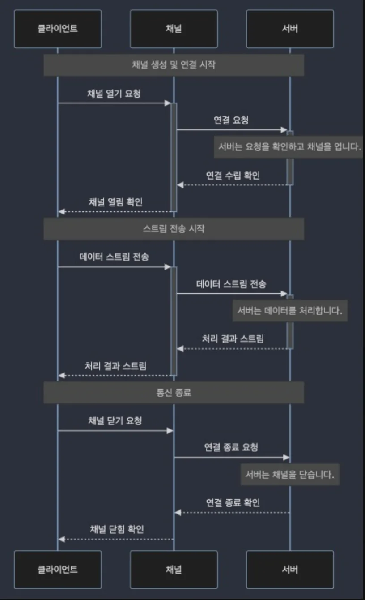

> 📖 
> 
> <a id="3e7eda9b0fe180a9a8d9f96c841f8bba"></a>
> 
> <strong>gRPC 채널과 스트림의 이해</strong>
> 
> - <code>채널</code>은 gRPC의 핵심 개념이자 <strong><u>논리적</u></strong>인 개념
> 
> - <strong>클라이언트와 서버 사이</strong>의 <strong><u>통신 연결(TCP Connection)을 설정하고 관리</u></strong>하는 방법
> 
> - <strong><u>물리적인 연결은 추상화</u></strong> 되어있음

<details>
<summary>gRPC의 보안 계층&#58; <code>TLS의 이해</code></summary>

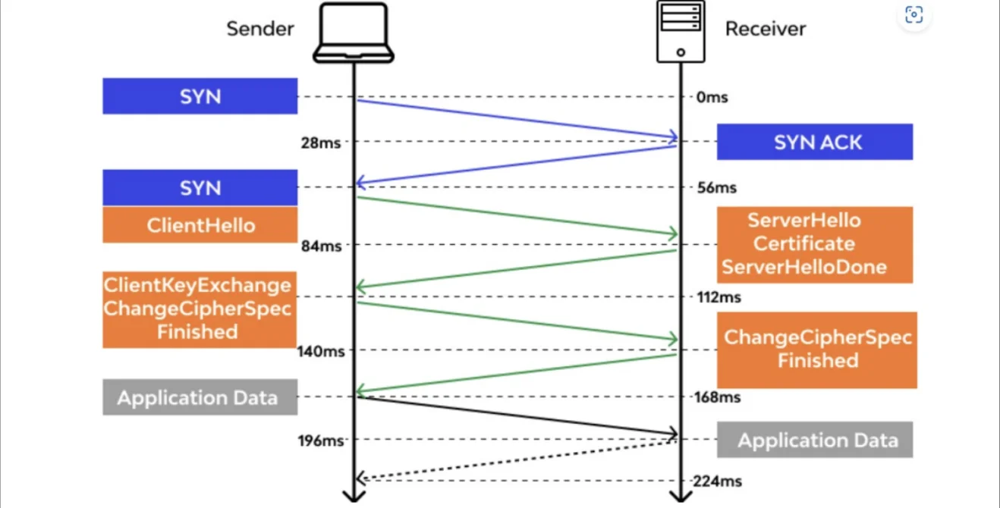

- <code>TLS</code>&#58; Trasport Layer Security

- <code>암호화</code>&#58; 클라이언트와 서버 간에 전송되는 모든 데이터 암호화

- <code>무결성 보조</code>&#58; 전송된 데이터가 변경되지 않았음을 확인, 데이터 무결성 보장

- <code>인증</code>&#58; 서버(클라이언트)의 인증서를 사용하여 통신하는 양측의 신원을 인증

</details>

<details>
<summary>gRPC의 보안 계층&#58; <code>스트림 암호화</code></summary>

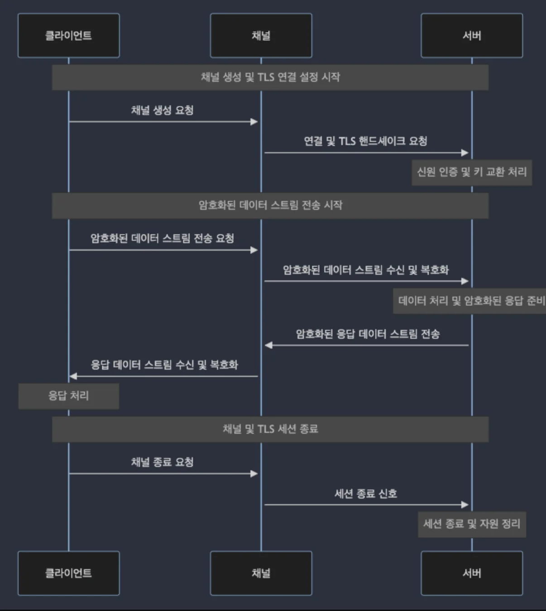

- 상호 인증은 TLS 프로토콜을 통해 구현 

- 인증서 교환

- 신원 인증 및 키 교환

</details>

<a id="3e7eda9b0fe180578f33cca75a890a51"></a>

## SSL/TLS 기반의 보안 설정

---

> 📖 
> 
> <a id="3e7eda9b0fe180d08057e7de34d041e5"></a>
> 
> <strong>SSL/TLS 개요</strong>
> 
> - <code>SSL (Secure Sockets Layer)</code> 과 <code>TLS (Transport Layer Security)</code>는 인터넷 상에서 데이터를 안전하게 전송하기 위한 암호화 프로토콜
> 
> - <code>TLS</code>는 <code>SSL</code>의 <strong><u>후속 버전</u></strong>으로, 두 용어가 종종 교차 사용
>     - <strong>SSL은 보안 이슈로 인해 대부분 TLS로 대체</strong>
> 
> - 이 프로토콜들은 데이터 전송 중 암호화를 제공하여 데이터 기밀성을 보장하고 , 서버 및 클라이언트 인증을 통해 서로의 정체성 확인

<a id="3e7eda9b0fe180b986d2d176a0cb30ae"></a>

### gRPC에서 SSL/TLS 설정&#58; <code>서버 설정</code>

> ✏️ 
> 
> - 서버 TLS 인증서와 키의 준비
> 
> - 인증서 생성 (self&#45;signed certification) 또는 CA로 바급 받은 인증서 준비
> 
> - gRPC TlsServerCredentials 사용하여 인증서, 키 로드

<a id="3e7eda9b0fe180d6ade7d25eb57b8c1c"></a>

####  예시

<details>
<summary>1&#46; 인증서 생성 (self&#45;signed certificate)</summary>

> ⚠️ 
> 
> <a id="3e7eda9b0fe180598747e0e2d55045ac"></a>
> 
> <strong>주의사항</strong>
> 
> <a id="3e7eda9b0fe180bab027c3ec01abf438"></a>
> 
> <strong>자체 서명 인증서</strong>는 <strong><u>테스트 목적</u></strong>이나 <strong><u>내부 네트워크 사용</u></strong>에 적합

<a id="3e7eda9b0fe180e7aa61d09845fadf2b"></a>

```bash
openssl genrsa -out mykey.pem 2048 # 개인 키 생성
openssl req -new -key mykey.pem -out mycsr.csr # 인증서 서명  요청 (CSR)
openssl x509 -req -days 365 -in mycsr.csr -signkey mykey.pem -out mycert.pem
```

</details>

<details>
<summary>2&#46; 서버 적용</summary>

> ✏️ 
> 
> <a id="3e7eda9b0fe1800fbc87c2c6e1f2770c"></a>
> 
> RPC TlsServerCredentials API 사용하여 인증서, 키 로드

<a id="3e7eda9b0fe180f080abce5337d32fce"></a>

```java
public class SecureGrpcServer {
	public static void main(String[] args) throws Exception {
		// SSL/TLS 인증서, 개인키 파일 경로 설정
		File certFile = new File("path/mycert.pem");
		File privateKeyFile = new File("path/to/mykey.pem");
		
		// TlsServerCredentials 생성
		TlsServerCredentials credentials = TlsServerCredentials.newBuilder()
				.keyManager(certFile, privateKeyFile)
				.build();
		
		// 보안 gRPC 서버 구성
		Server server = ServerBuilder.forPort(8443) // SSL/TLS를 사용할 포트 지정
				.userTransportSecurity(certFile, privateKeyFile) // SSL/TLS 설정 적용
				.addService(new YourServiceImpl()) // gRPC 서비스 구현체 추가		
				.build();
				
		// 서버 시작
		server.start();
		System.out.println("Secure gRPC server started on prot" + server.getPort());
		server.awaitTermination();
	}
}
```

</details>

<details>
<summary>3&#46; 클라이언트 설정</summary>

> ✏️ 
> 
> <a id="3e7eda9b0fe18032b9c0f17760819d1e"></a>
> 
> RPC TlsServerCredentials API 사용하여 인증서, 키 로드

<a id="3e7eda9b0fe1807eb435c6505cff7456"></a>

```java
public class SecureGrpcServer {
	public static void main(String[] args) throws Exception {
		// 서버의 공개 인증서 파일 경로
		File trustCerCollectionFile = new File("path/to/mycert.pem");
		
		// SSL 컨텍스트 구성
		SslContext sslContext = GrpcContexts.forClient()
				.trustManager(trustCertCollectionFile)
				.build();
		
		// 보안 gRPC 채널 구성
		ManagedChannel channel = NettyChannelBuilder.forAddress("localhost", 8443)
				.sslContext(sslContext)
				.build();
		
		// gRPC 서비스 Stub 사용
		YourServiceGrpc.YourServiceBlockingStub stub = YourServiceGrpc.newBlockingStub(channel);
		
		// 서버에 요청
		...
		
	}
}
		
```

</details>

<a id="3e7eda9b0fe180228058ed0b7906fd51"></a>

## 사용자 인증 및 권한 부여 방법

---

> 📖 
> 
> <a id="3e7eda9b0fe180a09a3dc08bf2bfd62c"></a>
> 
> gRPC 사용자 인증 종류
> 
> - <code>기본 인증 (Basic Authentication)</code>
> 
> - <code>토큰 기반 인증 (Token&#45;based Authentication)</code>
> 
> - <code>mTLS (Mutual TLS Authentication)</code>

<a id="3e7eda9b0fe180d6b2c7dcc47bc54e84"></a>

### gRPC 사용자 인증을 구현하기 위한 방법&#58; <code>gRPC Interceptor</code>

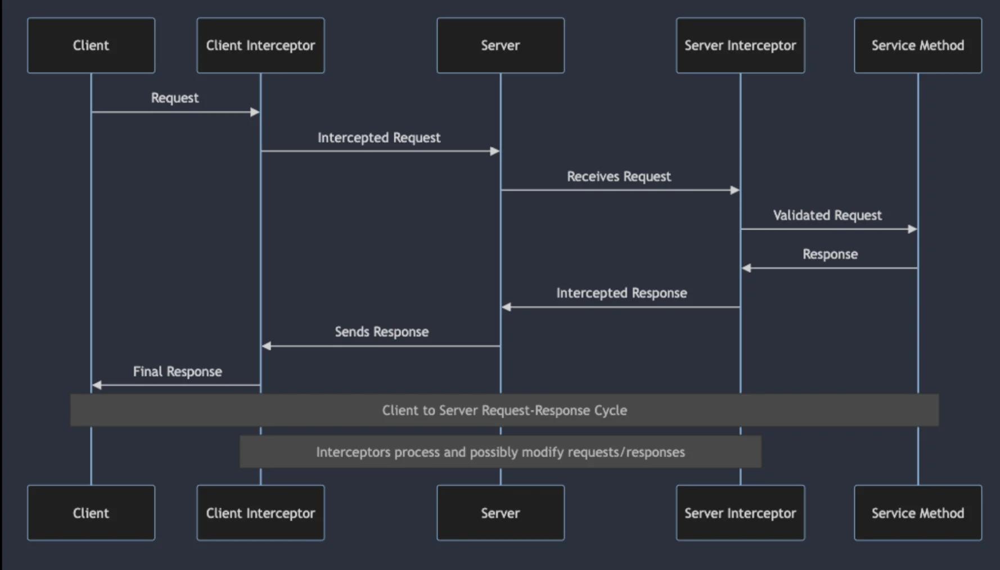

> ✏️ 
> 
> - 인터셉터의 기능
>     - 인증 처리
> 
>     - 로깅 및 모니터링
> 
>     - 메시지 변환
> 
>     - 오류 처리
> 
> - 인터셉터의 유형
>     - 서버 인터셉터
> 
>     - 클라이언트 인터셉터

<a id="3e7eda9b0fe18057846ee6dd0ce94e9d"></a>

####  예시

<details>
<summary>1&#46; Server Interceptor Interface</summary>

<a id="3e7eda9b0fe1806d9cebcbe38b37e165"></a>

```java
public class LogInterceptor implements ServerInterceptor {
	@Override
	public <ReqT, RespT> ServerCall.Listener<ReqT> interceptCall {
		ServerCall<ReqT, RespT> call, Metadata headers, ServerCallHandler<ReqT, RespT> next) {
			
		}
		
		System.println("Received a call to method: " + call.getMethodDescriptor().getFullMethodName();
		// 다음 인터셉터, 서비스 메소드로 요청 전달
		return next.startCall(call, headers);
	}
}

```

</details>

<details>
<summary>2&#46; Client Interceptor</summary>

> ✏️ 
> 
> <a id="3e7eda9b0fe180b2bcc3d7661650d6dd"></a>
> 
> RPC TlsServerCredentials API 사용하여 인증서, 키 로드

<a id="3e7eda9b0fe1802ba179e22d1c00ef69"></a>

```java
public class ExampleCientInterceptor implements ClientInterceptor {
	
	@Override
	public <ReqT, RespT> ClientCall<ReqT, RespT> interceptCall(
			MethodDescriptor<ReqT, RespT> method, CallOptions callOptions, Channel next) {
		return new ForwardingClientCall.SimpleForwardingClientCall<ReqT, RespT>(next.newCall(method, callOptions)) {
			@Override
			public void start(Listener<RespT> responseListener, Metadata headers) {
					// 클라이언트 인터셉터
			}
		};
	}
}
```

</details>

<a id="3e7eda9b0fe180079c6ada9f9f6de9fc"></a>

### gRPC 사용자 인증 종류1&#58; <code>기본 인증 (Basic Authentication)</code> 

> ✏️ 
> 
> <a id="3e7eda9b0fe18076b2c6e92dc11da61f"></a>
> 
> <strong>기본 인증 (Basic Authentication) </strong>
> 
> - 가장 기본적인 HTTP 인증 방식
> 
> - 사용자 이름과 비밀번호를 조합해 생성된 인코딩시킨 문자열을 HTTP 헤더에 포함시켜 서버에 전송

<a id="3e7eda9b0fe18002b71ad06838a89421"></a>

####  예시

<details>
<summary>1&#46; 기본 인증 서버 구현</summary>

> ✏️ 
> 
> <a id="3e7eda9b0fe1803392d5c0e82174b002"></a>
> 
> Interceptor를 구현하여 요청의 메타데이터에서 Authorization 헤더를 추출하고 이를 검증

<a id="3e7eda9b0fe180eeb1cec8b81cf97de7"></a>

```java

```

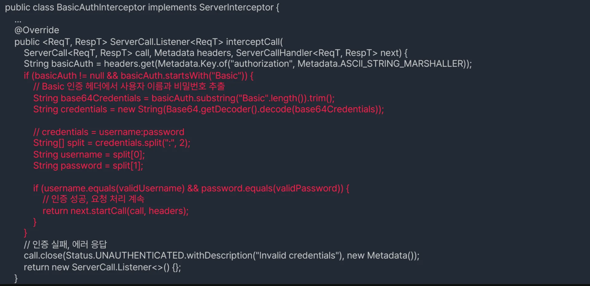

> ✏️ 
> 
> <a id="3e7eda9b0fe180b7b576c9095638456b"></a>
> 
> 서버 생성시 구현한 Interceptor 추가

<a id="3e7eda9b0fe18002b68cf1e72b9c92d0"></a>

```java

```

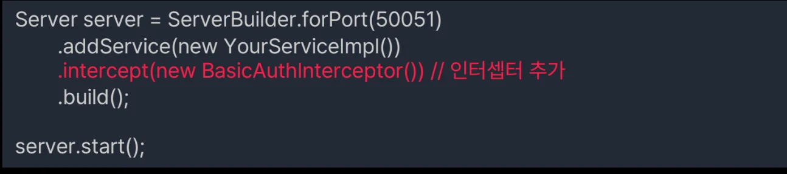

</details>

<details>
<summary>2&#46; 기본 인증 클라이언트 구현</summary>

> ✏️ 
> 
> <a id="3e7eda9b0fe180cfb43bd6ea694f3aa7"></a>
> 
> 클라이언트 Interceptor를 구현하여 Authorization 헤더에 기본 인증 정보 추가

<a id="3e7eda9b0fe180239b42f1808d99a058"></a>

```java

```

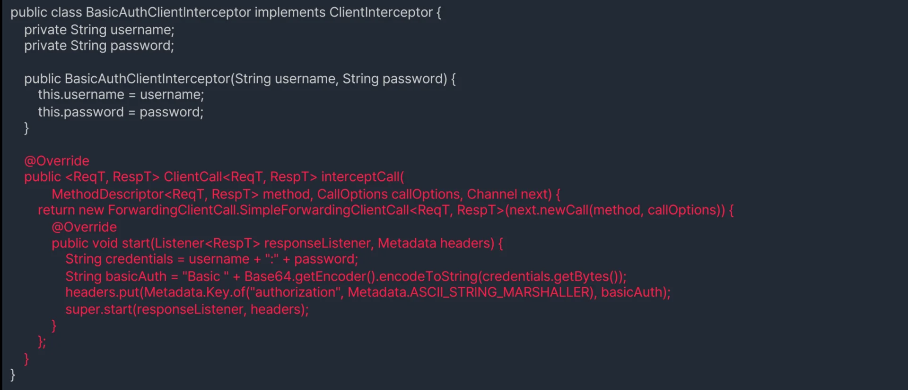

> ✏️ 
> 
> <a id="3e7eda9b0fe1806fa375e8251f9a7c24"></a>
> 
> 클라이언트 측에서 서비스를 호출할 때 이 인터셉터를 사용하도록 설정

<a id="3e7eda9b0fe1806da36fd334a699919c"></a>

```java

```

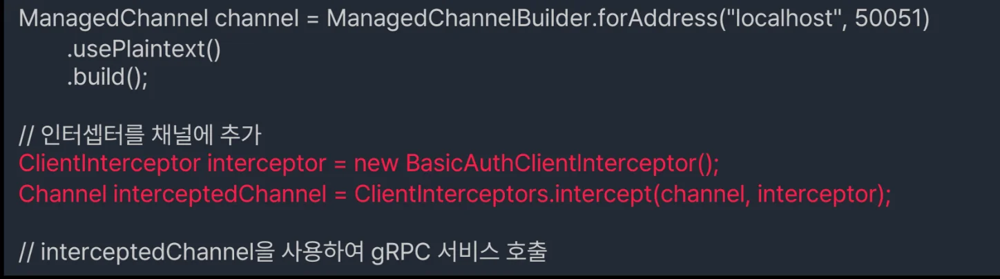

</details>

<a id="3e7eda9b0fe180d997f0f62aff7203de"></a>

### gRPC 사용자 인증 종류2&#58; <code>JWT 기반 인증 (JWT Authentication)</code>

> ✏️ 
> 
> <a id="3e7eda9b0fe180d082ead16deabc6504"></a>
> 
> <strong>JWT 기반 인증 (JWT Authentication)</strong>
> 
> - 보안 토큰을 사용하여 사용자 인증을 수행하는 방식
> 
> - OAuth2, JWT PPMJSON Web TokenPR 등이 해당

<a id="3e7eda9b0fe18049bfbce7d97272f205"></a>

####  예시

<details>
<summary>1&#46; JWT 기반 인증 서버 구현</summary>

> ✏️ 
> 
> <a id="3e7eda9b0fe1804fb52df54c73b3b8a7"></a>
> 
> ServerInterceptor를 구현하여 들어오는 요청의 메타데이터에서 Authorization 헤더를 통해 전송된 JWT를 추출하고 검증

<a id="3e7eda9b0fe18010b97bc3dcdaa4e3c6"></a>

```java

```

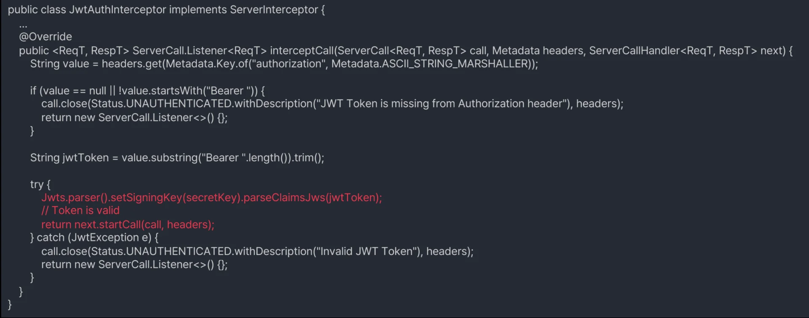

> ✏️ 
> 
> <a id="3e7eda9b0fe180d2a254c20f38a460a9"></a>
> 
> 서버에 JWT Interceptor 추가

<a id="3e7eda9b0fe180f8ae57d80996c3f426"></a>

```java

```

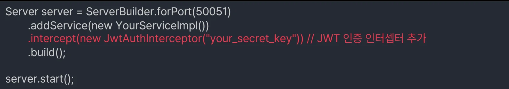

</details>

<details>
<summary>2&#46; JWT 기반 인증 클라이언트 구현</summary>

> ✏️ 
> 
> <a id="3e7eda9b0fe18085bb4aef59ae75d754"></a>
> 
> 클라이언트 JWT Interceptor 구현

<a id="3e7eda9b0fe18011bb58da8997596ef4"></a>

```java

```

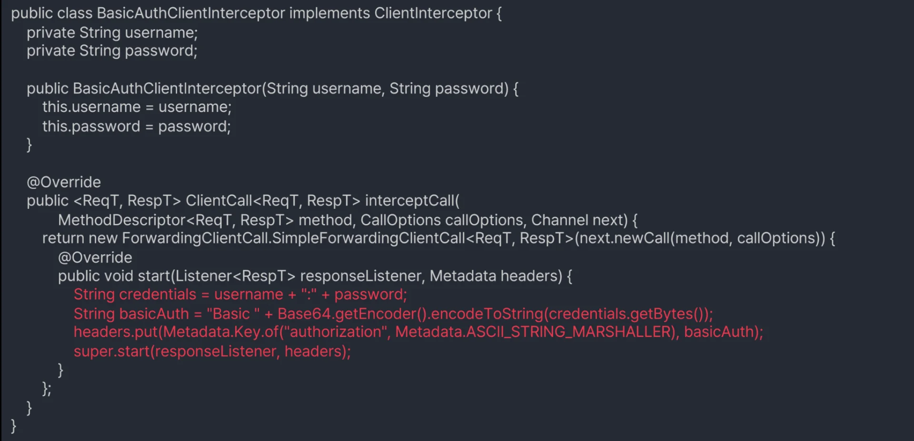

> ✏️ 
> 
> <a id="3e7eda9b0fe180daa765e0be6687f9c9"></a>
> 
> 클라이언트 측에서 서비스를 호출할 때 이 인터셉터를 사용하도록 설정

<a id="3e7eda9b0fe18003a4d0f4641d552e4e"></a>

```java

```

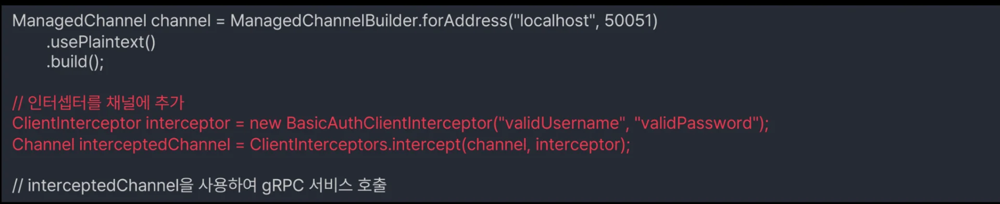

</details>

<a id="3e7eda9b0fe1807c8017ceaad9c0f987"></a>

### gRPC 사용자 인증 종류3&#58; <code>mTLS (Mutual TLS Authentication)</code>

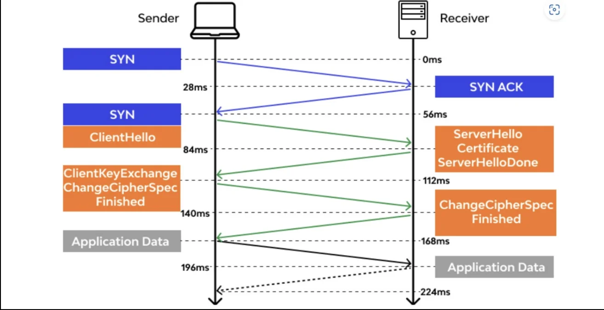

> ✏️ 
> 
> - 상호 TLS 인증은 클라이언트와 서버가 서로의 인증서를 검증하는 과정을 통해 양방향으로 인증을 수행하는 방식
> 
> - 높은 보안 수준 제공
> 
> - 서버와 클라이언트가 서로를 인증하기 때문에, 양방향 인증에 대한 보안 요구사항이 있는 환경에 적합
> 
> - 구현과 관리가 복잡하며, 인증서의 발급, 갱신, 폐기 등에 대한 추가적인 관리 작업이 필요
> 
> - 또한, 인증서 기반 인증 구조를 구축해야 하므로 초기 설정 비용이 발생
