<details>
<summary>reference</summary>

- ‣

- ‣

- <a href="https://grpc.io/docs/guides/status-codes/">https&#58;//grpc&#46;io/docs/guides/status&#45;codes/</a>

</details>

<a id="3e1eda9b0fe18062baabf2d22a8b68c5"></a>

## gRPC 상태 코드

---

> ✏️ 
> 
> <a id="3eaeda9b0fe18074a1d8f857afa401d6"></a>
> 
> <code>gRPC 상태 코드</code>란 gRPC에서 사용하는 통신 결과를 나타내는 코드이다&#46; 클라이언트&#45;서버 간의 통신 및 데이터 교환 과정에서 발생하는 다양한 상황을 파악하고 정확하게 처리할 수 있도록 도와준다&#46; 

<a id="3e5eda9b0fe18049aa1ae9dc7037b8d8"></a>

### gRPC 상태코드

<details>
<summary><strong>gRPC 상태코드</strong></summary>

[GRPC Core&#58; Status codes and their use in gRPC]()

[Status Codes]()

> ✏️ 
> 
> <a id="3e3eda9b0fe180929d3bfa285a4ac516"></a>
> 
> gRPC에서 발생하는 통신 결과를 나타내는 코드

- <code>OK</code>&#58;  요처잉 성공적으로 처리되었음

- <code>CANCELLED</code>&#58; 요청이 취소되었거나 타임아웃 되었음

- <code>UNKNOWN</code>&#58; 요청 처리 중 예상치 못한 오류가 발생했음

- <code>INVALID&#95;ARGUMENT</code>&#58; 요청이 잘못된 인수를 포함하고 있음

- <code>DEADLINE&#95;EXCEEDED</code>&#58; 요청이 주어진 타임아웃을 초과하여 처리되지 않았음

- <code>UNIMPLEMENTED</code>&#58; 요청이 서버에서 지원되지  않는 메서드를 호출했음

- <code>UNAVAILABLE</code>&#58; 서버가 현재 요청을 처리할 수 없는 상태

</details>

<details>
<summary><strong><code>gRPC 상태코드</code></strong><strong> vs </strong><strong><code>HTTP 상태코드</code></strong></summary>

- <code>프로토콜이 차이</code>
    - HTTP/2 기반으로 동작하지만, 직접적으로 HTTP 프로토콜은 아니다&#46;  ( gRPC ≠ HTTP )

- <code>상태 코드의 범위</code>
    - gRPC 상태코드 &#45; 7개의 카테고리

    - HTTP 상태코드 &#45; 1xx &#45; 5xx

- <code>의미의 구체성</code>
    - gRPC는 특정한 상황을 좀 더 구체적으로 설명하기 위해 설계 됨

    <details>
    <summary>ex) </summary>

    <a id="3eaeda9b0fe180889ffffe17800ec8b5"></a>

    HTTP 상태코드는 더 일반적인 경우를 나타냄

    - gRPC &#45; <code>CANCELLED</code>&#58; 요청이 취소되거나 타임아웃된 경우 사용

    - HTTP &#45; <code>404 Not Found</code>&#58; 리소스를 찾을 수 없음

    </details>

- <code>진화 및 확장성</code>
    - gRCP는 구조화된 데이터(Protobuf)를 사용하기 때문에 좀더 진화와 확장에 유리한 구조

    - HTTP 상태코드는 통신의 성격의 따라 제한적일 수 있음ㄴ

</details>

<a id="3e5eda9b0fe1802988e4cb57fa940d6d"></a>

### gRPC 메타데이터

<details>
<summary><strong>gRPC Metadata</strong></summary>

> ✏️ 
> 
> <a id="3eaeda9b0fe18063a7bef973e97a6753"></a>
> 
> 통신의 맥락에서 메타데이터는 전송되는 메시지 본문과 분리되어 처리되고  메시지의 전송과 해석에 필요한 추가적인 정보를 제공한다&#46;
> 
> <a id="3eaeda9b0fe180fd8c49d71d87162e1d"></a>
> 
> HTTP 통신에서의 메타데이터는 요청과 응답의 헤더에 포함되어 브라우저와 서버가 어떻게 통신해야할 지 알려준다&#46; 
> 
> <a id="3eaeda9b0fe180d0a333c81b71be8369"></a>
> 
> 이는 인코딩, 캐싱, 정책, 인증 정보 등을 포함할 수 있다&#46; 
> 
> <a id="3eaeda9b0fe180d0be13cd050c76fa5a"></a>
> 
> 마찬가지로 gRPC에서의 메타데이터는 이와 유사한 역할을 한다&#46; 
> 
> <a id="3eaeda9b0fe180bf99c8df45177f662f"></a>
> 
> <code>gRPC 메타데이터</code>는 <strong><u>2가지(헤더&#45;트레일러)</u></strong>의 중요한 형태로 나타낸다&#46; 

- gRPC Metadata는 <strong><u>데이터에 대한 데이터 </u></strong>
    - 주 데이터에 대한 설명 및 추가 정보 제공

    - ex) 사진 파일 메타데이터&#58; <code>촬영 날짜</code>, <code>위치</code>, <code>카메라 모델</code> 등

- 통신에서 메시지 자체와는 별개로 전송되는 정보

- 클라이언트&#45;서버 간의 통신에 필요한 추가적인 정보를 담고 있음

- <strong><u>헤더&#45;트레이러 두 부분으로 구성됨</u></strong>

</details>

<details>
<summary><strong>헤더 메타데이터 (Header Metadata)</strong></summary>

> ✏️ 
> 
> <a id="3eaeda9b0fe1804abc18cf64857b3e7c"></a>
> 
> <strong>헤더 메타데이터 </strong>
> 
> - HTTP/2 헤더 프레임에 전송
> 
> - <strong><u>gRPC 통신 세션을 </u></strong><strong><u>시작</u></strong>할 때 전송되는 메타데이터
> 
> - 클라이언트가 서버에 요청을 보내 때
>     - 초기 설정 정보  포함 
> 
>     - 클라이언트의 인증 토큰, Credentail 과 같은 보안 관련 정보 포함
> 
>     - 요청, 응답 메시지에 관한 정보 
>         - ex) 어떤 타입의 protobuf 를 사용하는 지 등
> 
>     - 클라이언트, 서버 네트워크 관련 설정 포함 
>         - ex) 클라이언트 authorization 헤더에 aws 토큰 포함하여 인가 요청 

<a id="3e5eda9b0fe180e790dcd11be21f75ae"></a>

```bash
[name=':method' value='POST']
[name=':scheme' value='http']
[name=':path' value='/greet.Greeter/SayHello'] 
[name=':authority' value='localhost:50051'] 
[name='content-type' value='application/grpc'] 
[name='user-agent' value='grpc-go/1.43.0'] 
[name='te' value='trailers']
[name='grpc-timeout' value='9933133n']
```

</details>

<details>
<summary><strong>트레일러 메타데이터 (Trailer Metadata)</strong></summary>

> ✏️ 
> 
> <a id="3eaeda9b0fe1805e97cfd8b243908212"></a>
> 
> <strong>트레일러 메타데이터 (Trailer Metadata)</strong>
> 
> - <strong><u>통신 </u></strong><strong><u>마지막 부분</u></strong>에서 HTTP/2 헤더 프레임으로 전송
> 
> - 헤더 메타데이터와 달리, 응답 메시지의 끝에 위치
> 
> - 주로 상태 코드와 에러 메시지 등을 포함<br>이는 요청의 성공 여부, 오류 여부 확인
>     - 클라이언트가 오류 발생 시 오류의 정보를 정확히 이해하고 처리할 수 있도록 도와줌 
> 
>     - 요청 처리 중 발생한 오류에 대한 상세한 설명과 함께 <br><code>grpc&#45;status</code> 와 <code>grpc&#45;message</code> 트레일러가 포함

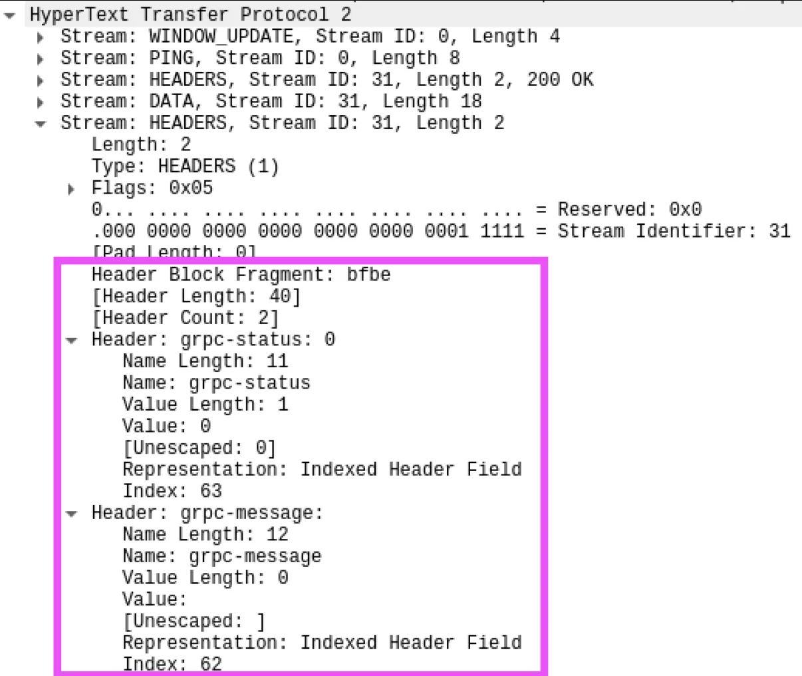

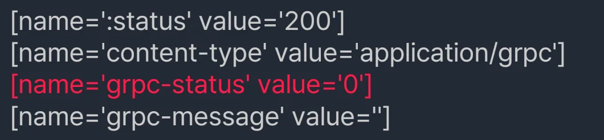

</details>

<a id="3e1eda9b0fe180d798bddf97eaef7876"></a>

## gRPC 예외 처리 및 에러 헨들링

---

> ✏️ 
> 
> <a id="3eaeda9b0fe180d496d8d39b05ab34e6"></a>
> 
> gRPC 에러 유형
> 
> > 
> > 
> > <a id="3eaeda9b0fe1807380c3c88c01bbc50e"></a>
> > 
> > 통신 중 발생할 수 있는 다양한 에러 상황을 처리하기 위해서 제공, gRPC 상태코드로 에러 정의
> 
> - <code>CANCELLED</code>&#58; 작업이 클라이언트에 의해 취소됨
> 
> - <code>CUNKNOWN</code>&#58; 알 수 없는 에레 발생 (예상치 못한 조건이 발생했음)
> 
> - <code>CINVALID&#95;ARGUMENT</code>&#58; 클라이언트가 잘못된 인수 제공
> 
> - <code>DEADLINE&#95;EXCEEDED</code>&#58; 작업의 지정된 마감 시간 초과
> 
> - <code>NOT&#95;FOUND</code>&#58; 지정된 리소스를 찾을 수 없음
> 
> - <code>ALREADY&#95;EXISTS</code>&#58; 생성하려는 리소스가 이미 존재
> 
> - <code>&#95;PERMISSION&#95;DENIED</code>&#58; 리소스에 대한 액세스 권한이 없음
> 
> - <code>RESOURCE&#95;EXHAUSTED</code>&#58; 리소스 할당량이 소진됨
> 
> - <code>OFAILED&#95;PRECONDITION</code>&#58; 시스템의 상태가 작업을 실행하기에 적합하지 않음
> 
> - <code>CABORTED</code>&#58; 동시성 충돌 등으로 인해 작업이 중단됨
> 
> - <code>&#95;OUT&#95;OF&#95;RANGE</code>&#58; 작업이 허용된 범위를 벗어남
> 
> - <code>SUNIMPLEMENTED</code>&#58; 요청된 작업이 서버에서 구현되지 않았음
> 
> - <code>CINTERNAL</code>&#58; 내부 에러 발생
> 
> - <code>CUNAVAILABLE</code>&#58; 서비스 현재 사용 불가능
> 
> - <code>DATA&#95;LOSS</code>&#58; 데이터 손실 발생
> 
> - <code>SUNAUTHENTICATED</code>&#58; 요청이 인증되지 않음

<a id="3e5eda9b0fe18069bf28f03b5c225e25"></a>

### gRPC 에러 핸들링

<a id="3e1eda9b0fe1808e8ba1db5e5dbd4897"></a>

####  서버 에러 헨들링

<details>
<summary>전략 1 &#45; 에러 메시지</summary>

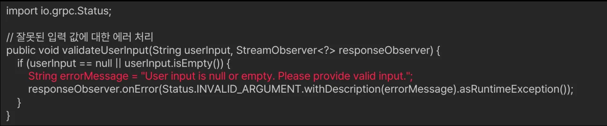

- 명확하고 유의미한 에러 메시지 제공
    - 에러 메시지는 클라이언 개발자, 최종 사용자가 문제를 쉽게 이해하고 해결할 수 있도록 충분히 상세 해야함

</details>

<details>
<summary>전략 2 &#45; 에러 코드</summary>

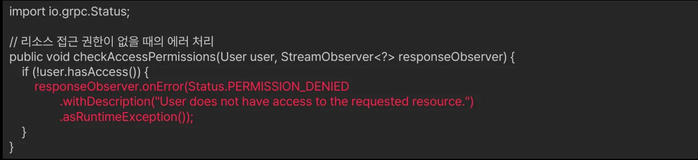

- 적절한 gRPC 에러 코드 사용
    - 에러 처리의 일관성 및 예측 가능성을 올릴 수 있음

</details>

<details>
<summary>전략 3 &#45; 추가 에러 정보 제공</summary>

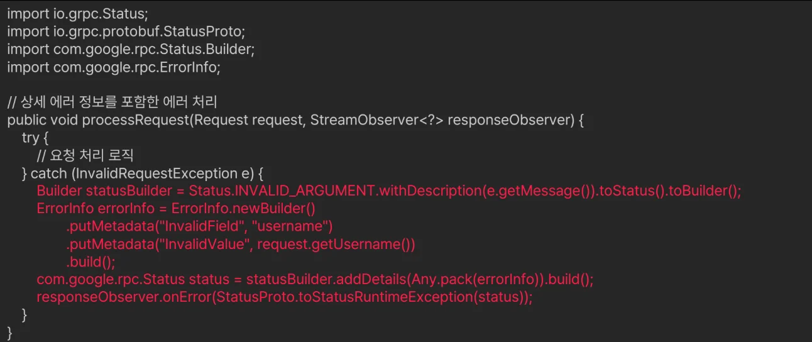

- 추가 정보 제공
    <a id="3eaeda9b0fe180ffb41fe00c824772a1"></a>

    클라이언트에서 추가로 필요한 정보를 정의하며 클라이언트가 에러의 원인을 더 잘 이해하고 적절하게 대응할 수 있도록 함

</details>

<details>
<summary>전략 4 &#45; 문서화</summary>

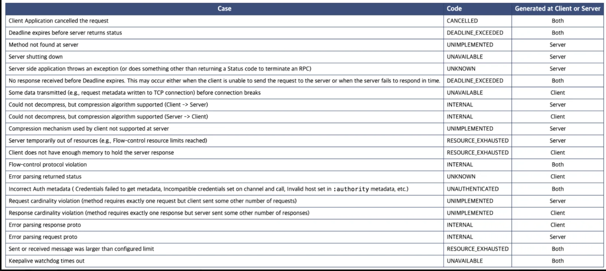

- <code>사용하는 에러코드</code>와 <code>예상되는 에러 상황</code>, <code>클라이언트가 받게 될 에러 메시지</code>에 대한 <strong><u>문서화</u></strong>하여 API 사용성을 향상 시킴

- 각 RPC 메서드가 발생시킬 수 있는 에러코드와 상황, 예상되는 에러 메시지 내용을 포함시키는 것이 좋다&#46;  

- API 사용성 증가, 사용자 대응 용이

</details>

<details>
<summary>전략 5 &#45; 사용자 정의 에러, 메타데이터를 통한 추가 정보 제공</summary>

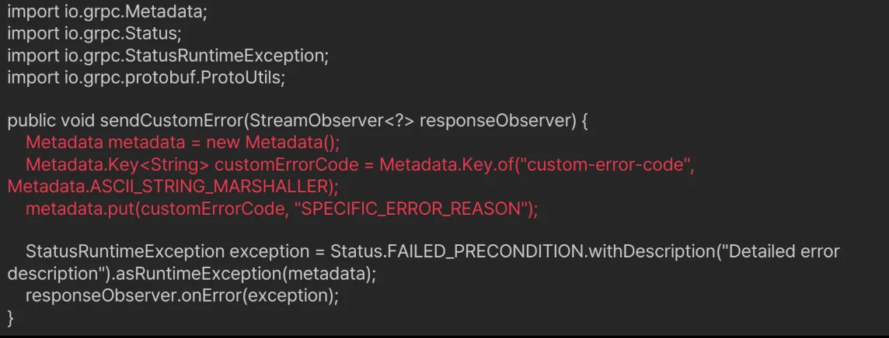

- 표현하고자 하는 에러를 사용자 정의로 구성해야 하는 경우

- 메타데이터를 사용해 추가 정보를 제공하여 맥락 부여

- gRPC가 제공하는 표준 상태코드로 에러 상황을 충분히 표현하기 어려운 경우, 추가적으로 메타데이터를 제공
    - <code>사용자 정의 메타데이터(트레일러)</code>를 사용하거나 

    - 기존 상태코드에 추가적인 정보를 더함

- gRPC 표준 상태코드를 변경하지 않으면서 추가적인 context 부여 간으

</details>

<details>
<summary>전략 6 &#45; 사용자 정의 에러, 상태 세부 정보를 사용한 복합 에러 메시지</summary>

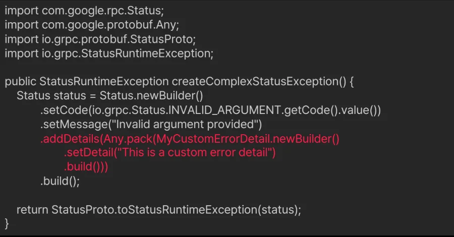

- 표현하고자 하는 에러를 사용자 정의(커스텀)로 구성해야 하는 경우

- 상태 세부 정보를 사용한 복합 에러 메시지로 정의

</details>

<a id="3e5eda9b0fe180b9895dca1be3b60049"></a>

####  클라이언트 에러 헨들링

<details>
<summary>전략 1 &#45; 재시도 로직 및 백오프 전략</summary>

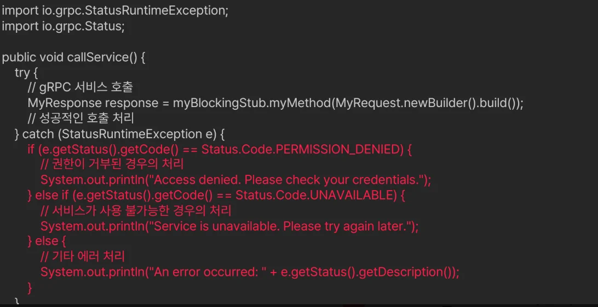

- 재시도 로직 및 백오프 전략

</details>

[공개 접근 불가 블록](https://beautiful-college-c84.notion.site/3e5eda9b0fe1803e8804e8c0f5d11949)

<a id="3e1eda9b0fe18062943bcd23fed2149f"></a>

## gRPC 상태 코드 사용 예제

---

<a id="3e1eda9b0fe18051bfe8f07bfbf045b0"></a>

### &#91;예제&#93; 사용자 인증 서비스

> 
> 
> <a id="3e5eda9b0fe18070bcb7c589f990458b"></a>
> 
> 사용자 로그인 요청 처리 및 다양한 에러 상황에 대응

1. protobuf 파일 
    <a id="3e5eda9b0fe1804c9fe3c7c2573f6c2a"></a>

    ```protobuf
    syntax = "proto3"

    package = auth;

    service AuthenticationService {
    	rpc Login(LoginRequest) returns LoginsResponse);
    }

    message LoginRequest {
    	string username = 1;
    	string password = 2;
    }

    message LoginResponse {
    	string token = 1;
    }
    ```

<a id="3e5eda9b0fe18012b1dac4a65b6cc595"></a>

### 에러 헨들링 방법 

<details>
<summary>방법 1 &#45; 기본</summary>

<a id="3e1eda9b0fe1805d8538c2bf69de01b7"></a>

1&#46;1&#46; 서버 에러 핸들링

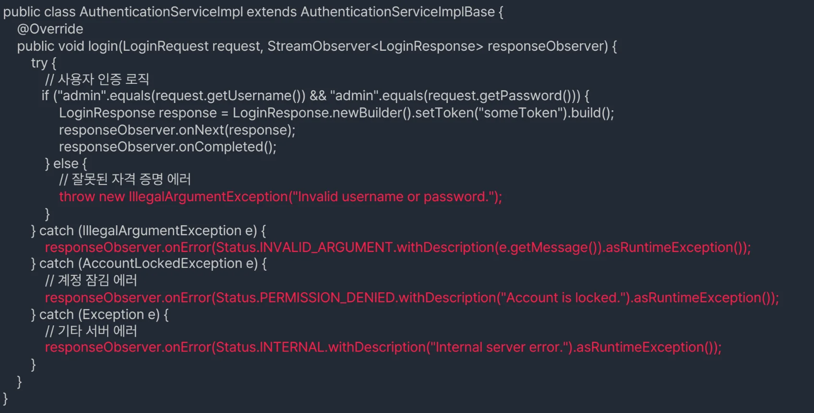

<a id="3e5eda9b0fe1801aa911ce5e55770606"></a>

```java
public class AuthenticationServiceImpl extends AuthenticationServiceImplBase {
	@Override
	public void login(LoginRequest request, StreamObserver<LoginResponse> responseObserver) {
		try {
			// 사용자 인증 로직
			if ("admin", equals(request.getUsername()) && "admin".equals(request.getPassword()) {
				LoginResponse response = LoginResponse.newBuilder().setToken("someToken").build();
				responseObserver.onNext(response);
				responseObserver.onCompleted();
			} else {
				// 잘못된 자격 증명 에러
				throw new illegalArgumentException("Invalid username or password.");
			}
		}	catch (IllegalArgumetException e) {
			responseObserver.onError(Status.INVALID_ARGUMENT.withDescription(e.getMessage()).asRuntimeException());			
		} catch (AccountLaockedException e) {
			// 게정 잠김 에러
			responseObserver.onError(Status.PERMISSION_DENIED.withDescription("Account is locked").asRuntimeException());			
		} catch (Exception e) {
			// 기타 서버 에러
			responseObserver.onError(Status.INTERNAL.withDescription("internal server error.").asRuntimeException()); cxv
		}
	} 
}
```

<a id="3e5eda9b0fe1808e80b4f49d9a9122fe"></a>

1&#46;2&#46; 클라이언트 에러 핸들링

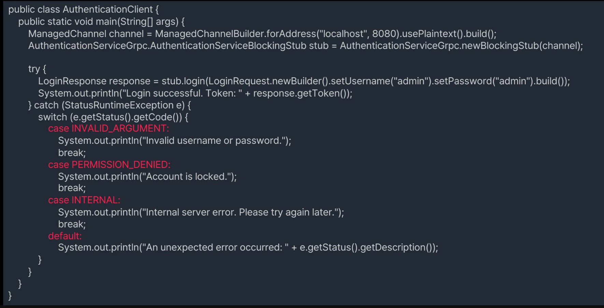

<a id="3e5eda9b0fe180148b90cb30203951c1"></a>

```java

```

</details>

<details>
<summary>방법 2 &#45; 메타데이터 활용</summary>

<a id="3e5eda9b0fe180c29e5fc45ec9ce74d7"></a>

2&#46;1&#46; 서버 에러 핸들링

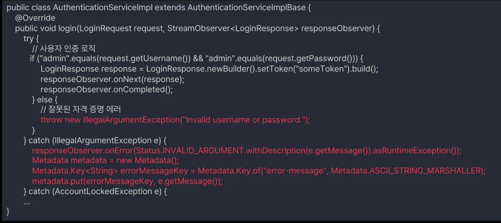

<a id="3e5eda9b0fe18001b163e7933098f194"></a>

```java

```

<a id="3e5eda9b0fe1800db8c4d878e1033406"></a>

2&#46;2&#46; 클라이언트 에러 핸들링

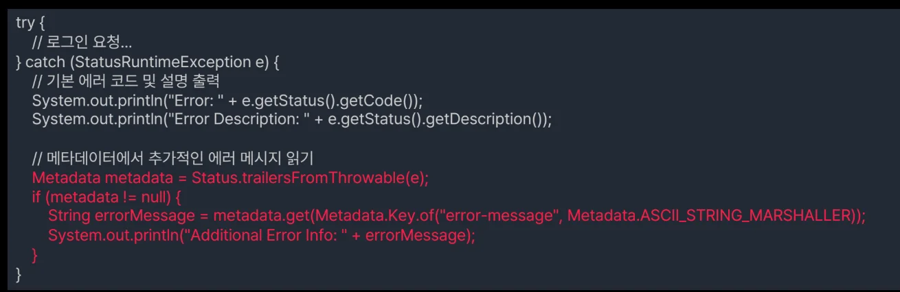

<a id="3e5eda9b0fe18020b586c19e297ccd96"></a>

```java

```

</details>

<details>
<summary>방법 3 &#45; Backoff 처리 </summary>

<a id="3e5eda9b0fe1801a9278d549089a41ab"></a>

3&#46;1&#46;  클라이언트 에러 핸들링 &#45; (Backoff 처리)

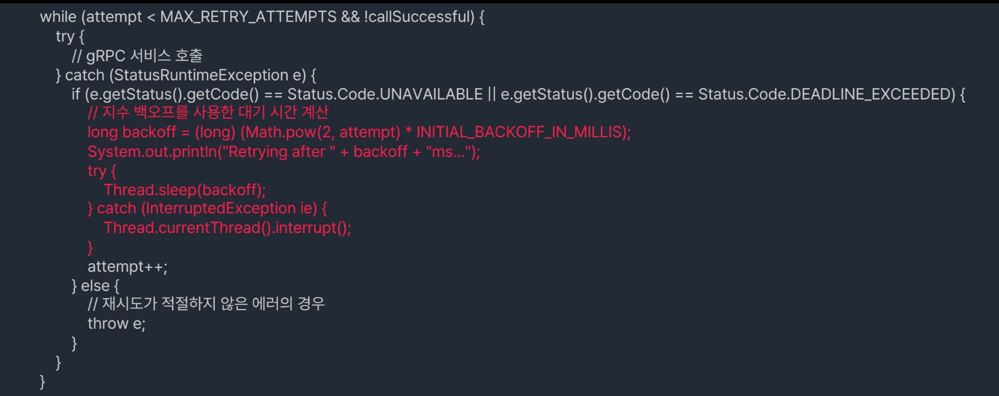

<a id="3e5eda9b0fe180c3944bdd9d6d899024"></a>

```java

```

<a id="3e5eda9b0fe180928b1aee5e637b42f8"></a>

3&#46;2&#46; 클라이언트 에러 핸들링 &#45; (Backoff 처리 &#43; Jitter)

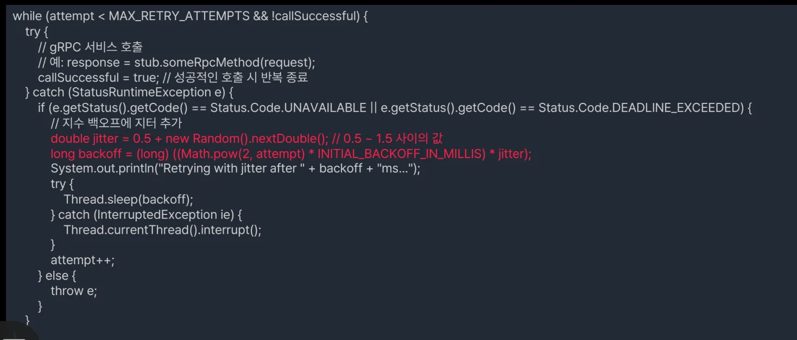

<a id="3e5eda9b0fe1802f8183d13e8709ab3b"></a>

```java

```

</details>
