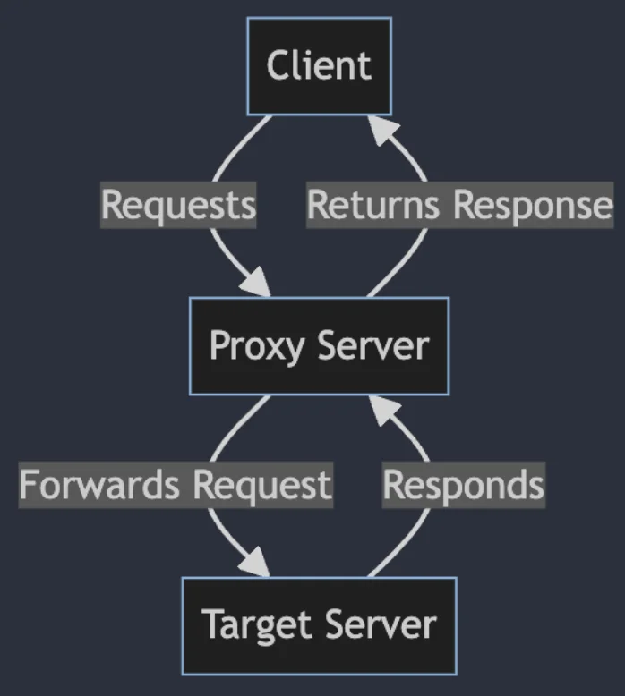
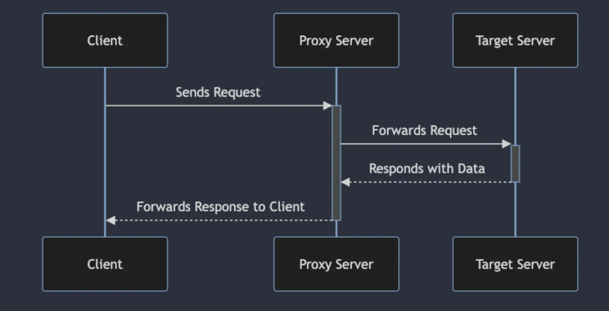
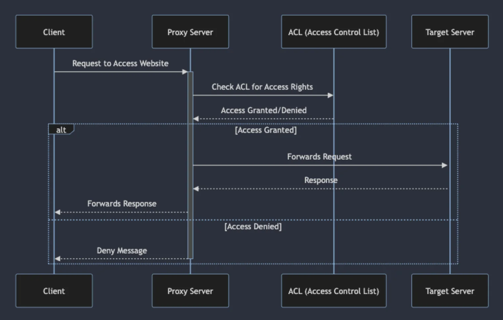
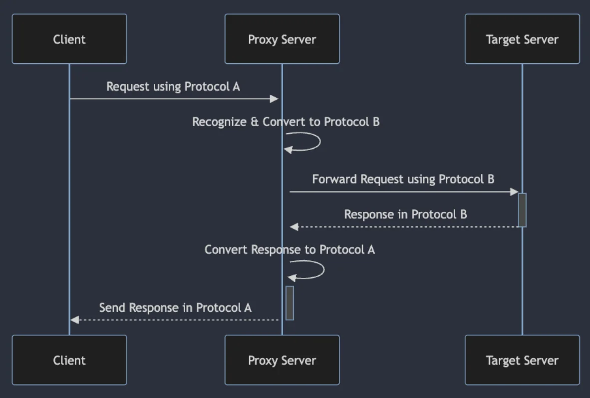
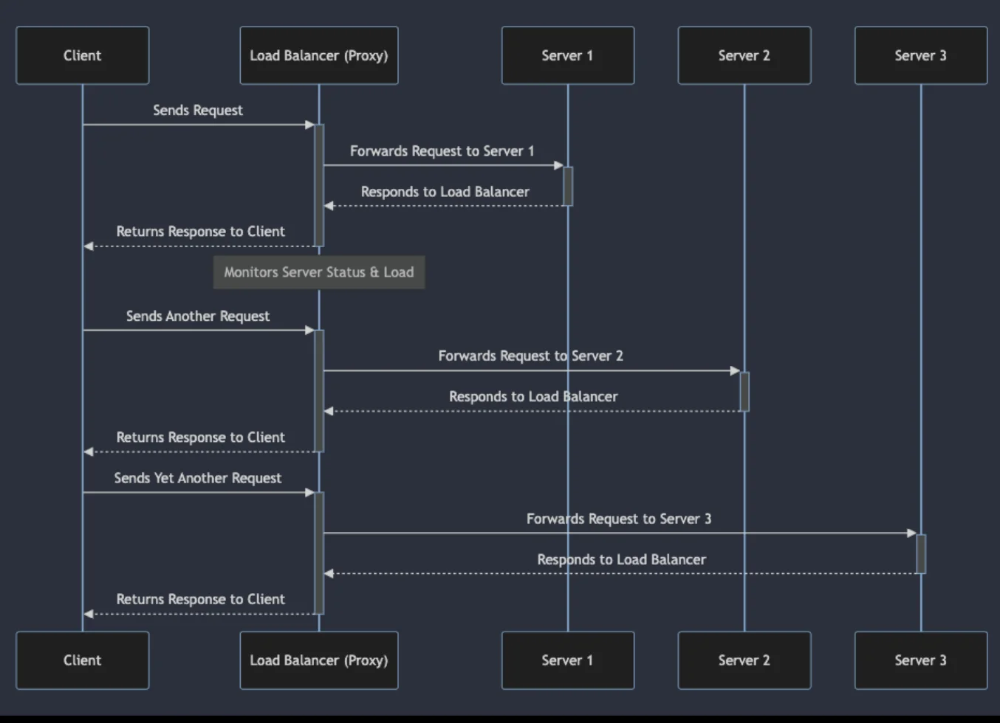
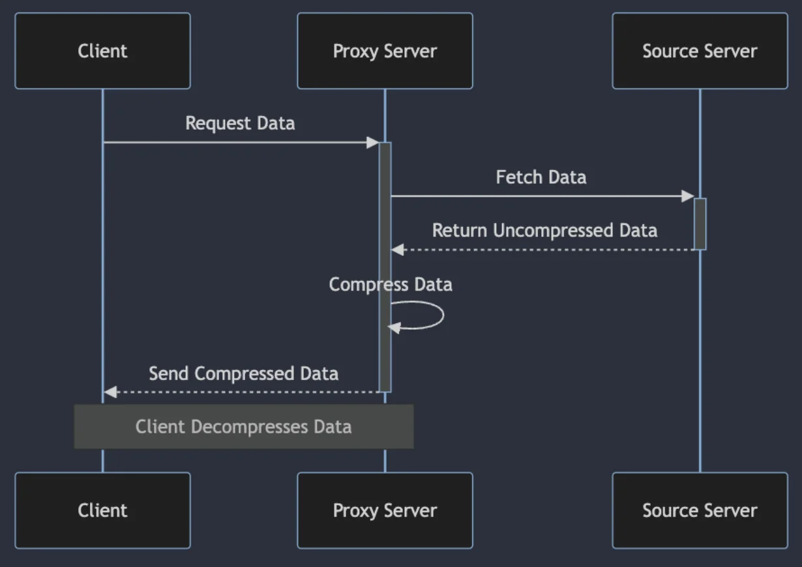
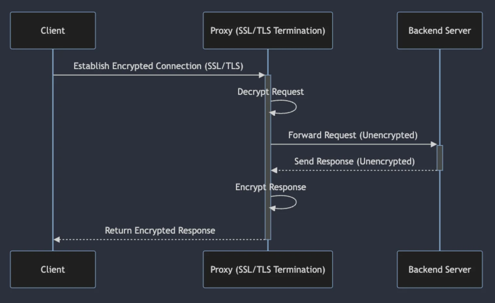
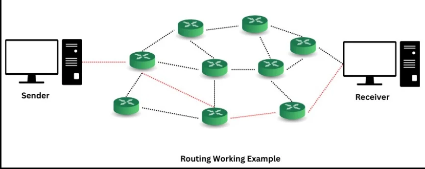
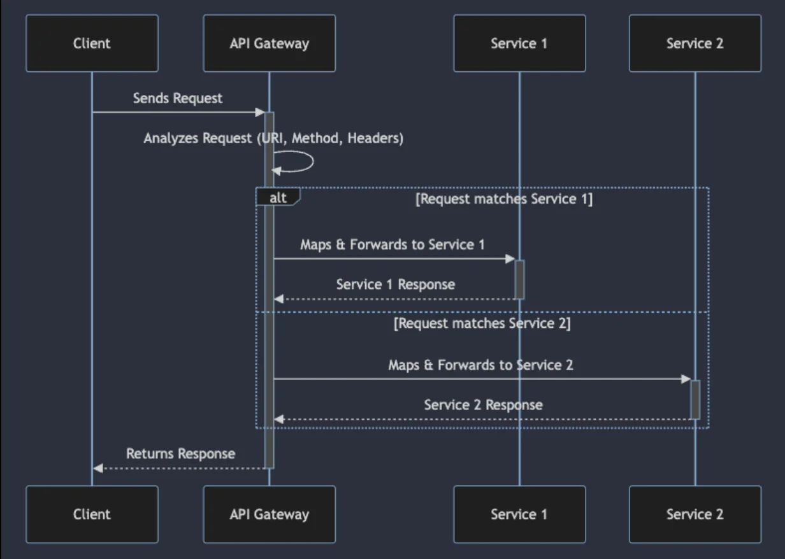
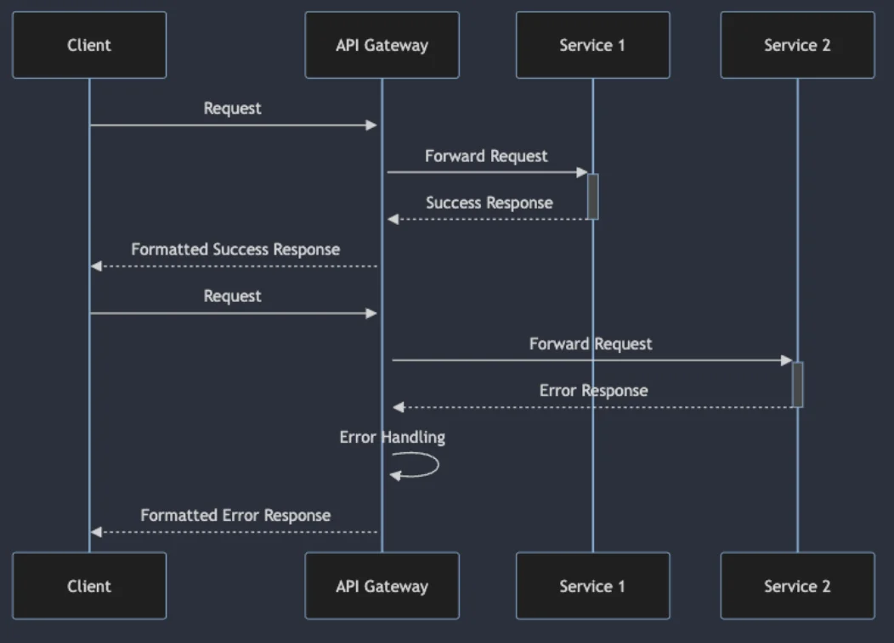

<a id="3ebeda9b0fe180f197f4ea05d7c1131c"></a>

## 프록시 서버 개념과 역할

---

> 📖 
> 
> <a id="3ebeda9b0fe18004b24bc63bcbb1cb75"></a>
> 
> 프록시 서버 개념
> 
> 
> 
> - 클라이언트와 타겟 서버 간의 중간 계층
> 
> - 서버 앞 단계 층에서 트래픽을 필터링하고 중계하는 역할을 함

<a id="3ebeda9b0fe180eaac84f249e9725a3b"></a>

### 프록시 서버의 주요 역할 및 기능

> ✏️ 
> 
> <a id="3ebeda9b0fe180d2aa96fbfa39b4aed7"></a>
> 
> 프록시 서버의 주요 역할 및 기능
> 
> - <code>중계</code> (Forwarding)
> 
> - <code>보안</code> (Security)
> 
> - <code>캐싱</code> (Caching)
> 
> - <code>프로토콜 변환</code> (Protocol Conversion)
> 
> - <code>로드 밸런싱</code> (Load Balancing)
> 
> - <code>압축</code> (Compression)
> 
> - <code>SSL/TLS 처리</code> (SSL/TLS)

<details>
<summary>프록시 서버의 주요 역할 및 기능&#58; <code>중계 (Forwarding)</code></summary>



- 요청 수신

- 요청 전달

- 응답 수신

- 응답 전송

</details>

<details>
<summary>프록시 서버의 주요 역할 및 기능&#58; <code>보안 (Security)</code></summary>



- 요청 검사 및 필터링

- 엑서스 제어

- 사용자 인증

- SSL/TLS 암호화 처리

- 콘텐츠 캐싱 과 보안

</details>

<details>
<summary>프록시 서버의 주요 역할 및 기능&#58; <code>캐싱 (Caching)</code></summary>

- 캐시 저장소 관리

- 데이터의 캐싱

- 만료 정책 실행

- 성능 최적화 

- 네트워크 트래픽 감소

</details>

<details>
<summary>프록시 서버의 주요 역할 및 기능&#58; <code>프로토콜 변환 (Protocol Conversion)</code></summary>



- 다양한 프로토콜을 사용하는 클라이언트와 서버 간의 호환성 문제 해결

- 통신 범위 확장

- 시스템 통합 용이성

</details>

<details>
<summary>프록시 서버의 주요 역할 및 기능&#58; <code>로드 밸런싱 (Load Balancing)</code></summary>



- 가용성 향상

- 부하 분산

- 확장성

- 유연성

</details>

<details>
<summary>프록시 서버의 주요 역할 및 기능&#58; <code>압축 (Compression)</code></summary>



- 효율적 대역폭 사용

- 응답 시간 단축

- 서버 및 네트워크 부하 감소

</details>

<details>
<summary>프록시 서버의 주요 역할 및 기능&#58; <code>SSL/TLS 처리 (SSL/TLS)</code></summary>



- 성능 최적화

- 보안 강화

- 우연한 콘텐츠 처리

</details>

<a id="3ebeda9b0fe1802fb861ef9db8c164fd"></a>

## 라우팅의 중요성

---

> 📖 
> 
> <a id="3ebeda9b0fe1808ab965f69f92e0bc9d"></a>
> 
> <strong>라우팅(Routing) 개념</strong>
> 
> 
> 
> - <strong>사전적인 정의</strong>
>     - 네트워크에서 경로를 선택하는 프로세스
> 
> - API Gateway에서의 역할
>     - 클라이언트로 부터 오는 요청을 적절한 백엔드 서비스나 마이크로 서비스로 전달
> 
>     - 개별 서비스의 위치, 구현 세부사항, 변경사항 등을 클라이언트로부터 추상화
> 
>     - 서비스 간의 결합도를 낮추고 시스템의 전체적인 유연성과 확장성을 향상

<a id="3ebeda9b0fe18083a1a7dbd2aac4db44"></a>

### API Gateway에서 라우팅의 주요 역할 및 기능

> ✏️ 
> 
> - API 요청 분석 및 매핑
> 
> - API 동적 라우팅
> 
> - API 버전 관리 및 단계적 배포
> 
> - 에러 처리 및 통합 응답 포맷팅

<details>
<summary>API Gateway에서 라우팅의 주요 역할 및 기능&#58; <code>API 요청 분석 및 매핑</code></summary>



<a id="3ebeda9b0fe180f6b679e71aff2fcb2f"></a>

```yaml
srping:
	cloud:
		gateway:
			routes:
				- id: example_route
					url: http://example.com
					predicates:
						- Path = /example/**
					filters:
						- AddRequestHeader=X-Example-Header, ExampleValue
```

</details>

<details>
<summary>API Gateway에서 라우팅의 주요 역할 및 기능&#58; <code>API 동적 라우팅</code></summary>

- <code>서비스 디스커버리 연동</code>
    - API Gateway는 서비스 디스커버리 시스템과 통신하여, 실행 중인 서비스 인스턴스의 위치와 상태를 실시간으로 파악

- <code>요청의 정확한 라우팅</code>
    - 서비스 인스턴스에 대한 최신 정보를 바탕으로, API Gateway는 들어오는 요청을 가장 적합하고 가용성이 높은 서버로 라우팅

- <code>로드 밸런싱</code>
    - 단일 서비스 인스턴스에 과부하가 집중되는 것을 방지하고, 전체 시스템의 안정성과 처리량을 최적화

</details>

<details>
<summary>API Gateway에서 라우팅의 주요 역할 및 기능&#58; <code>API 버전 관리 및 단계적 배포</code></summary>

- <code>버전 관리</code>
    - <strong><code>API 버전 정의</code></strong>&#58; API의 여러 버전을 명확하게 정의하고 관리 

    - <strong><code>요청 라우팅</code></strong>&#58; 클라이언트의 요청에 포함된 버전 정보(예&#58; URL 정로, 헤더)를 기반으로, API Gateway는 해당 요청을 올바른 버전의 API로 자동 라우팅

- <code>단계적 배포</code>
    - <strong><code>트래픽 분할</code></strong>&#58; 새로운 API 버전을 배포할 때,API Gateway를 사용하여 전체 트래픽 중 일부만 새 버전으로 리디렉션

    - <strong><code>위험 최소화</code></strong>&#58; 새 버전에서 예상치 못한 문제가 발생했을 때, 전체 시스템에 미치는 영향을 최소화

</details>

<details>
<summary>API Gateway에서 라우팅의 주요 역할 및 기능&#58; &#58; <code>에러 처리 및 통합 응답 포맷팅</code></summary>



- 다양한 백엔드 서비스로부터의 응답을 통합적으로 처리

- 일관된 응답 포맷으로 클라이언트에게 반환

- 서비스 실패나 에러 발생 시, 적절한 에러 응답을 생서앟여 시스템의 견고성을 유지

</details>
