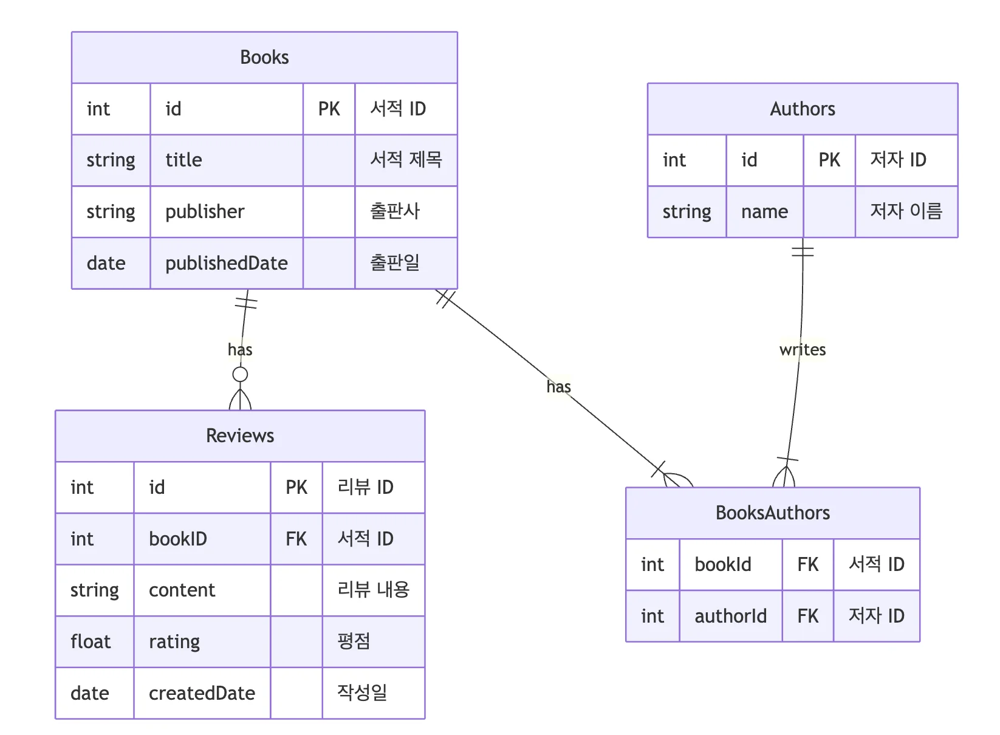

<a id="3e7eda9b0fe1802cb610ca9e5dfde167"></a>

## &#91;실습&#93; gRPC 서버, 클라이언트 구현

---

[fastcampus-top-3](https://github.com/dobby-teacher/fastcampus-top-3)

<a id="3e7eda9b0fe180168beff9f2ff7bba99"></a>

###  서버

[fastcampus&#45;top&#45;3/part02&#45;grpc&#45;server at main · dobby&#45;teacher/fastcampus&#45;top&#45;3]()

<details>
<summary>1&#46; protobuf 파일</summary>

> ‣

<a id="3e7eda9b0fe18046b61dd2490f8b9545"></a>

```protobuf
syntax = "proto3";

import "google/protobuf/timestamp.proto";

package bookstore;

// Book 정보를 담는 메시지
message Book {
  int64 id = 1;
  string title = 2;
  string publisher = 3;
  google.protobuf.Timestamp published_date = 4;
}

// Author 정보를 담는 메시지
message Author {
  int64 id = 1;
  string name = 2;
}

// 리뷰 정보를 담는 메시지
message Review {
  int64 id = 1;
  int64 book_id = 2;
  string content = 3;
  float rating = 4;
  google.protobuf.Timestamp created_date = 5;
}

// 책서비스
service BookService {
  rpc AddBook(AddBookRequest) returns (Book) {}
  rpc GetBookDetails(GetBookDetailsRequest) returns (Book) {}
  rpc ListBooks(ListBooksRequest) returns (stream Book) {}
  rpc SearchBooksByAuthor(SearchBooksByAuthorRequest) returns (stream Book) {}
}

// 리뷰 서비스
service ReviewService {
  rpc GetReviews(GetReviewsRequest) returns (stream Review) {}
}

// 리뷰 조회 요청 메시지
message GetReviewsRequest {
  int64 book_id = 1;
}

// 책 추가 요청 메시지
message AddBookRequest {
  string title = 1;
  string publisher = 2;
  google.protobuf.Timestamp published_date = 3;
}

// 특정 책 조회 요청 메시지
message GetBookDetailsRequest {
  int64 book_id = 1;
}

// 특정 저자의 책 검색 요청 메시지
message SearchBooksByAuthorRequest {
  string author_name = 1;
}

// 책 목록 조회 요청 메시지
message ListBooksRequest {}
```

</details>

<details>
<summary>2&#46; Interceptor 정의</summary>

<details>
<summary>로깅 인터셉터</summary>

> ‣

<a id="3e7eda9b0fe180f0999de681b1374144"></a>

```java
package com.fastcampus.demogrpc.global.interceptor;

import io.grpc.*;
import lombok.extern.slf4j.Slf4j;
import org.springframework.stereotype.Component;

import java.time.Duration;
import java.time.Instant;

@Component
@Slf4j
public class AccessLoggingInterceptor implements ServerInterceptor {
    @Override
    public <ReqT, RespT> ServerCall.Listener<ReqT> interceptCall(
            ServerCall<ReqT, RespT> call,
            Metadata headers,
            ServerCallHandler<ReqT, RespT> next) {

        Instant startTime = Instant.now();
        String clientIP = headers.get(Metadata.Key.of("X-Forwarded-For", Metadata.ASCII_STRING_MARSHALLER));

        log.info("{} - - [{}] \"{}\" {}", clientIP, startTime, call.getMethodDescriptor().getFullMethodName(), headers);

        ServerCall.Listener<ReqT> listener = next.startCall(call, headers);
        return new ForwardingServerCallListener.SimpleForwardingServerCallListener<ReqT>(listener) {
            @Override
            public void onComplete() {
                Duration duration = Duration.between(startTime, Instant.now());
                String clientIP = headers.get(Metadata.Key.of("X-Forwarded-For", Metadata.ASCII_STRING_MARSHALLER));

                log.info("{} - - [{}] \"{}\" {} {}ms",
                        clientIP != null ? clientIP : "-", Instant.now(), call.getMethodDescriptor().getFullMethodName(),
                        headers, duration.toMillis());

                super.onComplete();
            }
        };
    }
}
```

</details>

<details>
<summary>기본 인증 인터셉터</summary>

> ‣

<a id="3e7eda9b0fe180b8b82bef2e94e9e72f"></a>

```java
package com.fastcampus.demogrpc.global.interceptor;


import io.grpc.*;
import lombok.extern.slf4j.Slf4j;
import org.springframework.stereotype.Component;

import java.util.Base64;

@Component
@Slf4j
public class BasicAuthInterceptor implements ServerInterceptor {
    @Override
    public <ReqT, RespT> ServerCall.Listener<ReqT> interceptCall(ServerCall<ReqT, RespT> call, Metadata headers, ServerCallHandler<ReqT, RespT> next) {
        log.info("## BasicAuthInterceptor");
        String username = "fast";
        String password = "campus";

        String authorization = headers.get(Metadata.Key.of("authorization", Metadata.ASCII_STRING_MARSHALLER));
        if (authorization == null || !authorization.startsWith("Basic ")) {
            call.close(Status.UNAUTHENTICATED.withDescription("Missing or invalid Authorization header"), new Metadata());
            return new ServerCall.Listener<>() {};
        }

        String credentials = authorization.substring(6);
        // fast:campus -> base64
        String[] usernameAndPassword = new String(Base64.getDecoder().decode(credentials)).split(":");
        String providedUsername = usernameAndPassword[0];
        String providedPassword = usernameAndPassword[1];

        if (!providedUsername.equals(username) || !providedPassword.equals(password)) {
            call.close(Status.PERMISSION_DENIED.withDescription("Invalid username or password"), new Metadata());
            return new ServerCall.Listener<>() {};
        }

        return next.startCall(call, headers);
    }
}
```

</details>

</details>

<details>
<summary>3&#46; Entity 정의</summary>



<details>
<summary>Author (authors)</summary>

> ‣

<a id="3e7eda9b0fe180b190e0e96a31f7c7b2"></a>

```java
package com.fastcampus.demogrpc.domain.authors.entity;

import com.fastcampus.demogrpc.domain.books.entity.Book;
import jakarta.persistence.*;
import lombok.Getter;
import lombok.NoArgsConstructor;
import lombok.Setter;

import java.util.HashSet;
import java.util.Set;

@Getter
@Setter
@NoArgsConstructor
@Entity
@Table(name = "authors")
public class Author {
    @Id
    @GeneratedValue(strategy = GenerationType.IDENTITY)
    private Long id;

    @Column(nullable = false)
    private String name;

    @ManyToMany(mappedBy = "authors")
    private Set<Book> books = new HashSet<>();
}
```

</details>

<details>
<summary>Book (books)</summary>

> ‣

<a id="3e7eda9b0fe1802dae67d94b4fb4452b"></a>

```java
package com.fastcampus.demogrpc.domain.books.entity;

import com.fastcampus.demogrpc.domain.authors.entity.Author;
import com.fastcampus.demogrpc.domain.reviews.entity.Review;
import jakarta.persistence.*;
import lombok.Getter;
import lombok.NoArgsConstructor;
import lombok.Setter;

import java.util.Date;
import java.util.HashSet;
import java.util.Set;

@Getter
@Setter
@NoArgsConstructor
@Entity
@Table(name = "books")
public class Book {
    @Id
    @GeneratedValue(strategy = GenerationType.IDENTITY)
    private Long id;

    @Column(nullable = false)
    private String title;

    private String publisher;

    @Column(name = "published_date")
    @Temporal(TemporalType.DATE)
    private Date publishedDate;

    @ManyToMany
    @JoinTable(
            name = "books_authors",
            joinColumns = @JoinColumn(name = "book_id"),
            inverseJoinColumns = @JoinColumn(name = "author_id")
    )
    private Set<Author> authors = new HashSet<>();

    @OneToMany(mappedBy = "book", cascade = CascadeType.ALL, orphanRemoval = true)
    private Set<Review> reviews = new HashSet<>();
}
```

</details>

<details>
<summary>Review (reviews)</summary>

> ‣

<a id="3e7eda9b0fe18072b839d2474c0f58e3"></a>

```java
package com.fastcampus.demogrpc.domain.reviews.entity;

import com.fastcampus.demogrpc.domain.books.entity.Book;
import jakarta.persistence.*;
import lombok.Getter;
import lombok.NoArgsConstructor;
import lombok.Setter;

import java.util.Date;

@Getter
@Setter
@NoArgsConstructor
@Entity
@Table(name = "reviews")
public class Review {
    @Id
    @GeneratedValue(strategy = GenerationType.IDENTITY)
    private Long id;

    @ManyToOne
    @JoinColumn(name = "book_id", nullable = false)
    private Book book;

    @Column(nullable = false)
    private String content;

    private float rating;

    @Column(name = "created_date")
    @Temporal(TemporalType.TIMESTAMP)
    private Date createdDate;
}
```

</details>

</details>

<details>
<summary>4&#46; repository 레이어 정의</summary>

<details>
<summary>AuthorRepository</summary>

> ‣

<a id="3e7eda9b0fe18049b12df42b2c646522"></a>

```java
package com.fastcampus.demogrpc.domain.authors.repository;

import com.fastcampus.demogrpc.domain.authors.entity.Author;
import org.springframework.data.jpa.repository.JpaRepository;
import org.springframework.stereotype.Repository;

@Repository
public interface AuthorRepository extends JpaRepository<Author, Long> {

}
```

</details>

<details>
<summary>BookRepository</summary>

> ‣

<a id="3e7eda9b0fe180319c3ae9f6be817e2c"></a>

```java
package com.fastcampus.demogrpc.domain.books.repository;

import com.fastcampus.demogrpc.domain.books.entity.Book;
import org.springframework.data.jpa.repository.JpaRepository;
import org.springframework.stereotype.Repository;

import java.util.List;

@Repository
public interface BookRepository extends JpaRepository<Book, Long> {
    List<Book> findByAuthorsName(String name);

    List<Book> findByTitleContaining(String keyword);
}
```

</details>

<details>
<summary>ReviewRepository</summary>

> ‣

<a id="3e7eda9b0fe180be8bb1ed24579e6663"></a>

```java
package com.fastcampus.demogrpc.domain.reviews.repository;


import com.fastcampus.demogrpc.domain.reviews.entity.Review;
import org.springframework.data.jpa.repository.JpaRepository;

import java.util.List;

public interface ReviewRepository extends JpaRepository<Review, Long> {
    List<Review> findByBookIdOrderByCreatedDateDesc(Long bookId);
}
```

</details>

</details>

<details>
<summary>5&#46; service 레이어 정의</summary>

<details>
<summary>AuthorService</summary>

> ‣

<a id="3e7eda9b0fe1801c80a5fd61d50cc5eb"></a>

```java
package com.fastcampus.demogrpc.domain.authors.service;

import com.fastcampus.demogrpc.domain.authors.entity.Author;
import com.fastcampus.demogrpc.domain.authors.repository.AuthorRepository;
import org.springframework.beans.factory.annotation.Autowired;
import org.springframework.stereotype.Service;

import java.util.List;
import java.util.Optional;

@Service
public class AuthorService {
    private final AuthorRepository authorRepository;

    @Autowired
    public AuthorService(AuthorRepository authorRepository) {
        this.authorRepository = authorRepository;
    }

    public Author saveAuthor(Author author) {
        return authorRepository.save(author);
    }

    public Optional<Author> findById(Long id) {
        return authorRepository.findById(id);
    }

    public List<Author> findAll() {
        return authorRepository.findAll();
    }
}
```

</details>

<details>
<summary>BookService</summary>

> ‣

<a id="3e7eda9b0fe180bd824cd6490f32e002"></a>

```java
package com.fastcampus.demogrpc.domain.books.service;

import com.fastcampus.demogrpc.domain.books.entity.Book;
import com.fastcampus.demogrpc.domain.books.repository.BookRepository;
import org.springframework.beans.factory.annotation.Autowired;
import org.springframework.stereotype.Service;

import java.util.List;
import java.util.Optional;

@Service
public class BookService {
    private final BookRepository bookRepository;

    @Autowired
    public BookService(BookRepository bookRepository) {
        this.bookRepository = bookRepository;
    }

    public Book saveBook(Book book) {
        return bookRepository.save(book);
    }

    public Optional<Book> findById(Long id) {
        return bookRepository.findById(id);
    }

    public List<Book> findAll() {
        return bookRepository.findAll();
    }

    public List<Book> findByAuthorName(String authorName) {
        return bookRepository.findByAuthorsName(authorName);
    }

    public void deleteById(Long id) {
        bookRepository.deleteById(id);
    }
}
```

</details>

<details>
<summary>ReviewService</summary>

> ‣

<a id="3e7eda9b0fe18050b658c3838ec35d4e"></a>

```java
package com.fastcampus.demogrpc.domain.reviews.service;

import com.fastcampus.demogrpc.domain.reviews.entity.Review;
import com.fastcampus.demogrpc.domain.reviews.repository.ReviewRepository;
import org.springframework.beans.factory.annotation.Autowired;
import org.springframework.stereotype.Service;

import java.util.List;
import java.util.Optional;

@Service
public class ReviewService {
    private final ReviewRepository reviewRepository;

    @Autowired
    public ReviewService(ReviewRepository reviewRepository) {
        this.reviewRepository = reviewRepository;
    }

    public Review saveReview(Review review) {
        return reviewRepository.save(review);
    }


    public Optional<Review> findById(Long id) {
        return reviewRepository.findById(id);
    }

    public List<Review> findByBookId(Long bookId) {
        return reviewRepository.findByBookIdOrderByCreatedDateDesc(bookId);
    }


    public void deleteById(Long id) {
        reviewRepository.deleteById(id);
    }
}
```

</details>

</details>

<details>
<summary>6&#46; gRPC Service 레이어 정의 </summary>

<details>
<summary>BookGrpcService</summary>

> ‣

<a id="3e7eda9b0fe180c5a569fba0de531cf8"></a>

```java
package com.fastcampus.demogrpc.domain.books.service;

import bookstore.BookServiceGrpc;
import bookstore.Bookstore;
import com.fastcampus.demogrpc.domain.books.entity.Book;
import com.fastcampus.demogrpc.global.interceptor.AccessLoggingInterceptor;
import com.fastcampus.demogrpc.global.interceptor.BasicAuthInterceptor;
import com.fastcampus.demogrpc.global.utils.TimestampConverter;
import io.grpc.stub.StreamObserver;
import net.devh.boot.grpc.server.service.GrpcService;
import org.springframework.beans.factory.annotation.Autowired;

import java.util.List;

@GrpcService(interceptors = { AccessLoggingInterceptor.class,BasicAuthInterceptor.class })
public class BookGrpcService extends BookServiceGrpc.BookServiceImplBase {

    private final BookService bookService;

    @Autowired
    public BookGrpcService(BookService bookService) {
        this.bookService = bookService;
    }

    @Override
    public void addBook(Bookstore.AddBookRequest request, StreamObserver<Bookstore.Book> responseObserver) {
        Book newBook = new Book();
        newBook.setTitle(request.getTitle());
        newBook.setPublisher(request.getPublisher());
        newBook.setPublishedDate(TimestampConverter.fromProto(request.getPublishedDate()));

        Book savedBook = bookService.saveBook(newBook);
        responseObserver.onNext(Bookstore.Book.newBuilder()
                .setTitle(newBook.getTitle())
                .setPublishedDate(TimestampConverter.toProto(savedBook.getPublishedDate()))
                .setPublisher(savedBook.getPublisher())
                .build());
        responseObserver.onCompleted();
    }

    @Override
    public void getBookDetails(Bookstore.GetBookDetailsRequest request, StreamObserver<Bookstore.Book> responseObserver) {
        Bookstore.Book bookDetail = bookService.findById(request.getBookId())
                .map(book -> Bookstore.Book.newBuilder()
                        .setTitle(book.getTitle())
                        .setPublishedDate(TimestampConverter.toProto(book.getPublishedDate()))
                        .setPublisher(book.getPublisher())
                        .build())
                .orElseThrow();

        responseObserver.onNext(bookDetail);
        responseObserver.onCompleted();
    }

    @Override
    public void listBooks(Bookstore.ListBooksRequest request, StreamObserver<Bookstore.Book> responseObserver) {
        List<Book> books = bookService.findAll();

        for (Book book : books) {
            responseObserver.onNext(
                    Bookstore.Book.newBuilder()
                            .setTitle(book.getTitle())
                            .setPublishedDate(TimestampConverter.toProto(book.getPublishedDate()))
                            .setPublisher(book.getPublisher())
                            .build()
            );
        }

        responseObserver.onCompleted();
    }

    @Override
    public void searchBooksByAuthor(Bookstore.SearchBooksByAuthorRequest request, StreamObserver<Bookstore.Book> responseObserver) {
        List<Book> books = bookService.findByAuthorName(request.getAuthorName());

        for (Book book : books) {
            responseObserver.onNext(
			            Bookstore.Book.newBuilder()
			                    .setTitle(book.getTitle())
			                    .setPublishedDate(TimestampConverter.toProto(book.getPublishedDate()))
			                    .setPublisher(book.getPublisher())
			                    .build()
            );
        }

        responseObserver.onCompleted();
    }
}
```

</details>

<details>
<summary>ReviewGrpcService</summary>

> ‣

<a id="3e7eda9b0fe1804db47fef3b98d57c7e"></a>

```java
package com.fastcampus.demogrpc.domain.reviews.service;

import bookstore.Bookstore;
import bookstore.ReviewServiceGrpc;
import com.fastcampus.demogrpc.domain.reviews.entity.Review;
import com.fastcampus.demogrpc.global.interceptor.AccessLoggingInterceptor;
import com.fastcampus.demogrpc.global.interceptor.BasicAuthInterceptor;
import com.fastcampus.demogrpc.global.utils.TimestampConverter;
import io.grpc.stub.StreamObserver;
import net.devh.boot.grpc.server.service.GrpcService;
import org.springframework.beans.factory.annotation.Autowired;

import java.util.List;

@GrpcService(interceptors = { AccessLoggingInterceptor.class, BasicAuthInterceptor.class })
public class ReviewGrpcService extends ReviewServiceGrpc.ReviewServiceImplBase {
    private final ReviewService reviewService;

    @Autowired
    public ReviewGrpcService(ReviewService reviewService) {
        this.reviewService = reviewService;
    }

    @Override
    public void getReviews(Bookstore.GetReviewsRequest request, StreamObserver<Bookstore.Review> responseObserver) {
        List<Review> reviews = reviewService.findByBookId(request.getBookId());

        for (Review review : reviews) {
            responseObserver.onNext(
                    Bookstore.Review.newBuilder()
                            .setId(review.getId())
                            .setBookId(review.getBook().getId())
                            .setRating(review.getRating())
                            .setCreatedDate(TimestampConverter.toProto(review.getCreatedDate()))
                            .setContent(review.getContent())
                            .build()
            );
        }

        responseObserver.onCompleted();
    }
}
```

</details>

</details>

<a id="3e7eda9b0fe1800a817df14536983415"></a>

###  클라이언트

[fastcampus&#45;top&#45;3/part02&#45;grpc&#45;client at main · dobby&#45;teacher/fastcampus&#45;top&#45;3]()

<details>
<summary>1&#46; protobuf 파일</summary>

> ‣

<a id="3e7eda9b0fe18047b63be1747d1ab106"></a>

```protobuf
syntax = "proto3";

import "google/protobuf/timestamp.proto";

package bookstore;


// Book 정보를 담는 메시지
message Book {
  int64 id = 1;
  string title = 2;
  string publisher = 3;
  google.protobuf.Timestamp published_date = 4;
}

// Author 정보를 담는 메시지
message Author {
  int64 id = 1;
  string name = 2;
}

// 리뷰 정보를 담는 메시지
message Review {
  int64 id = 1;
  int64 book_id = 2;
  string content = 3;
  float rating = 4;
  google.protobuf.Timestamp created_date = 5;
}

// 책 서비스
service BookService {
  rpc AddBook(AddBookRequest) returns (Book) {}
  rpc GetBookDetails(GetBookDetailsRequest) returns (Book) {}
  rpc ListBooks(ListBooksRequest) returns (stream Book) {}
  rpc SearchBooksByAuthor(SearchBooksByAuthorRequest) returns (stream Book) {}
}

// 리뷰 서비스
service ReviewService {
  rpc GetReviews(GetReviewsRequest) returns (stream Review) {}
}

// 책 추가 요청 메시지
message AddBookRequest {
  string title = 1;
  string publisher = 2;
  google.protobuf.Timestamp published_date = 3;
}

// 책 목록 조회 요청 메시지
message ListBooksRequest {}

// 특정 저자의 책 검색 요청 메시지
message SearchBooksByAuthorRequest {
  string author_name = 1;
}

// 리뷰 조회 요청 메시지
message GetReviewsRequest {
  int64 book_id = 1;
}

// 특정 책 조회 요청 메시지
message GetBookDetailsRequest {
  int64 book_id = 1;
}
```

</details>

<details>
<summary>2&#46; Interceptor 정의</summary>

<details>
<summary>AuthenticationInterceptor</summary>

> ‣

<a id="3e7eda9b0fe1806bb9caefeaa12c2341"></a>

```java
package com.fastcampus.demogrpcclient.interceptor;

import io.grpc.*;
import lombok.extern.slf4j.Slf4j;

import java.util.Base64;

@Slf4j
public class AuthenticationInterceptor implements ClientInterceptor {
    private static final String ID = "fast";
    private static final String PASSWORD = "campus";
    @Override
    public <ReqT, RespT> ClientCall<ReqT, RespT> interceptCall(
            MethodDescriptor<ReqT, RespT> method, CallOptions callOptions, Channel next) {
        return new ForwardingClientCall.SimpleForwardingClientCall<ReqT, RespT>(next.newCall(method, callOptions)) {
            @Override
            public void start(Listener<RespT> responseListener, Metadata headers) {
                // authentication
                log.info("## Authentication Interceptor");
                String credentials = ID + ":" + PASSWORD;
                String basicAuth = "Basic " + Base64.getEncoder().encodeToString(credentials.getBytes());
                headers.put(Metadata.Key.of("authorization", Metadata.ASCII_STRING_MARSHALLER), basicAuth);
                super.start(responseListener, headers);
            }
        };
    }
}
```

</details>

<details>
<summary>GlobalClientInterceptorConfiguration</summary>

> ‣

<a id="3e7eda9b0fe180f39c99ee02d54454f1"></a>

```java
package com.fastcampus.demogrpcclient.interceptor;

import net.devh.boot.grpc.client.interceptor.GrpcGlobalClientInterceptor;
import org.springframework.context.annotation.Configuration;

@Configuration
public class GlobalClientInterceptorConfiguration {

    @GrpcGlobalClientInterceptor
    AuthenticationInterceptor authenticationInterceptor() {
        return new AuthenticationInterceptor();
    }

    @GrpcGlobalClientInterceptor
    LoggingGrpcInterceptor loggingGrpcInterceptor() {
        return new LoggingGrpcInterceptor();
    }
}
```

</details>

<details>
<summary>LoggingGrpcInterceptor</summary>

> ‣

<a id="3e7eda9b0fe180369120f65cf209effe"></a>

```java
package com.fastcampus.demogrpcclient.interceptor;

import io.grpc.*;
import lombok.extern.slf4j.Slf4j;


@Slf4j
public class LoggingGrpcInterceptor implements ClientInterceptor {

    @Override
    public <ReqT, RespT> ClientCall<ReqT, RespT> interceptCall(
            MethodDescriptor<ReqT, RespT> method,
            CallOptions callOptions,
            Channel next) {

        log.info("Received call to {}", method.getFullMethodName());
        return new ForwardingClientCall.SimpleForwardingClientCall<ReqT, RespT>(next.newCall(method, callOptions)) {

            @Override
            public void sendMessage(ReqT message) {
                log.debug("Request message: {}", message);
                super.sendMessage(message);
            }

            @Override
            public void start(Listener<RespT> responseListener, Metadata headers) {
                super.start(
                        new ForwardingClientCallListener.SimpleForwardingClientCallListener<RespT>(responseListener) {
                            @Override
                            public void onMessage(RespT message) {
                                log.info("Response message: {}", message);
                                super.onMessage(message);
                            }

                            @Override
                            public void onHeaders(Metadata headers) {
                                log.info("gRPC headers: {}", headers);
                                super.onHeaders(headers);
                            }

                            @Override
                            public void onClose(Status status, Metadata trailers) {
                                log.info("Interaction ends with status: {}", status);
                                log.info("Trailers: {}", trailers.toString());
                                super.onClose(status, trailers);
                            }
                        }, headers);
            }
        };
    }
}
```

</details>

</details>

<details>
<summary>3&#46; BookController ( HTTP → gRPC )</summary>

> ‣

<a id="3e7eda9b0fe180298483cdec73a02a33"></a>

```java
package com.fastcampus.demogrpcclient;

import bookstore.Bookstore;
import org.springframework.beans.factory.annotation.Autowired;
import org.springframework.http.ResponseEntity;
import org.springframework.web.bind.annotation.GetMapping;
import org.springframework.web.bind.annotation.PathVariable;
import org.springframework.web.bind.annotation.RequestMapping;
import org.springframework.web.bind.annotation.RestController;

import java.io.IOException;

@RestController
@RequestMapping("/books")
public class BookController {
    private final BookGrpcClient bookGrpcClient;

    @Autowired
    public BookController(BookGrpcClient bookGrpcClient) {
        this.bookGrpcClient = bookGrpcClient;
    }

    @GetMapping
    public ResponseEntity getBookList() throws IOException {
        return ResponseEntity.ok().body(JsonConverter.toJsonList(bookGrpcClient.findAll()));
    }

    @GetMapping("/{id}")
    public ResponseEntity getBookById(@PathVariable Long id) throws IOException {
        Bookstore.Book book = bookGrpcClient.findById(id);
        return ResponseEntity.ok().body(JsonConverter.toJson(book));
    }
}
```

</details>

<details>
<summary>4&#46; BookGrpcClient</summary>

> ‣

<a id="3e7eda9b0fe1801fae2aef522ca965f3"></a>

```java
package com.fastcampus.demogrpcclient;

import bookstore.BookServiceGrpc;
import bookstore.Bookstore;
import net.devh.boot.grpc.client.inject.GrpcClient;
import org.springframework.stereotype.Service;

import java.util.ArrayList;
import java.util.Iterator;
import java.util.List;

@Service
public class BookGrpcClient {
    @GrpcClient("local-grpc-server")
    private BookServiceGrpc.BookServiceBlockingStub bookServiceBlockingStub;

    public Bookstore.Book findById(final long bookId) {
        return this.bookServiceBlockingStub.getBookDetails(
                Bookstore.GetBookDetailsRequest
                        .newBuilder()
                        .setBookId(bookId)
                        .build()
        );
    }

    public List<Bookstore.Book> findAll() {
        Iterator<Bookstore.Book> bookIterator = this.bookServiceBlockingStub.listBooks(
                Bookstore.ListBooksRequest
                        .newBuilder()
                        .build()
        );

        List<Bookstore.Book> bookList = new ArrayList<>();
        while(bookIterator.hasNext()) {
            bookList.add(bookIterator.next());
        }

        return bookList;
    }
}
```

</details>

<details>
<summary>5&#46; Json Converter</summary>

> ‣

<a id="3e7eda9b0fe180b0a011fdb1688a2d03"></a>

```java
package com.fastcampus.demogrpcclient;

import com.google.protobuf.InvalidProtocolBufferException;
import com.google.protobuf.Message;
import com.google.protobuf.MessageOrBuilder;
import com.google.protobuf.Struct;
import com.google.protobuf.util.JsonFormat;

import java.io.IOException;
import java.util.ArrayList;
import java.util.List;

public class JsonConverter {
    public static String toJson(MessageOrBuilder messageOrBuilder) throws IOException {
        return JsonFormat.printer().print(messageOrBuilder);
    }

    public static <T extends Message> String toJsonList(List<T> responseList) throws InvalidProtocolBufferException {
        List<String> jsonList = new ArrayList<>();

        for (MessageOrBuilder response : responseList) {
            String json = JsonFormat.printer().print(response);
            jsonList.add(json);
        }

        return "[" + String.join(",", jsonList) + "]";
    }

    public static Message fromJson(String json) throws IOException {
        Message.Builder structBuilder = Struct.newBuilder();
        JsonFormat.parser().ignoringUnknownFields().merge(json, structBuilder);
        return structBuilder.build();
    }
}
```

</details>

<details>
<summary>6&#46; GlobalExceptionHandler</summary>

> ‣

<a id="3e7eda9b0fe180bc910dfdf27a9dffc8"></a>

```java
package com.fastcampus.demogrpcclient;

import io.grpc.StatusRuntimeException;
import org.springframework.http.HttpStatus;
import org.springframework.http.ResponseEntity;
import org.springframework.web.bind.annotation.ControllerAdvice;
import org.springframework.web.bind.annotation.ExceptionHandler;

@ControllerAdvice
public class GlobalExceptionHandler {
    @ExceptionHandler(StatusRuntimeException.class)
    public ResponseEntity<String> handleGrpcException(StatusRuntimeException ex) {
        return ResponseEntity.status(HttpStatus.INTERNAL_SERVER_ERROR)
                .body("gRPC error occurred: " + ex.getMessage());
    }
}
```

</details>
