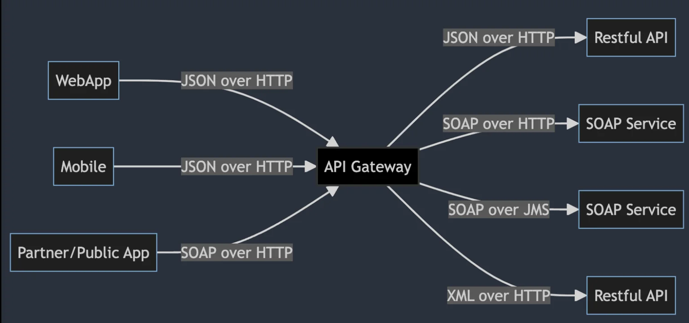
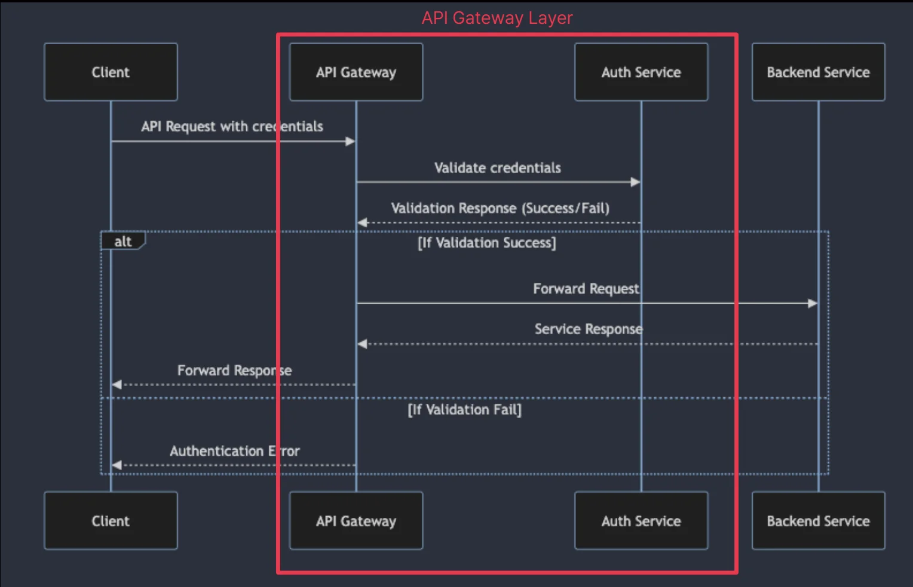
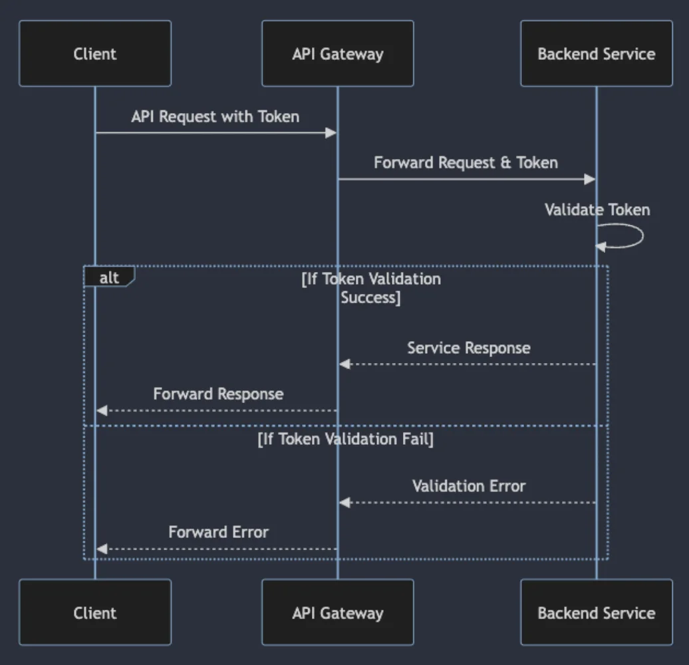
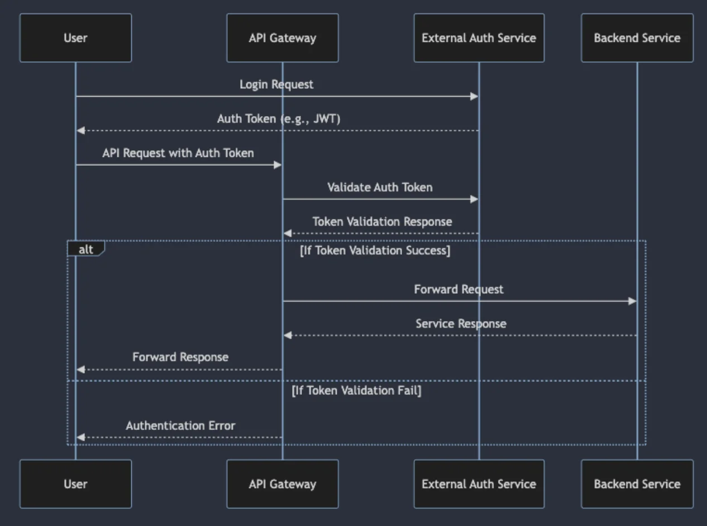
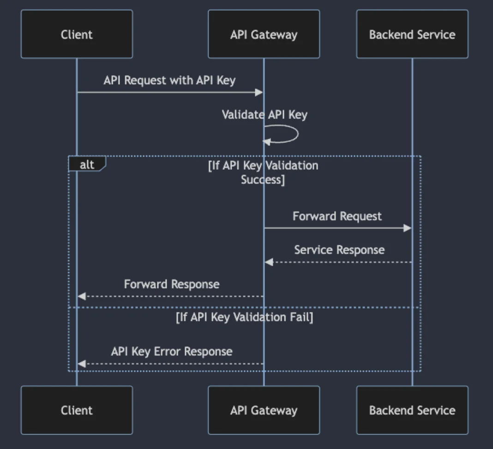

## API Gateway에서 인증 및 인가 처리 방법

---

###  API Gateway에서의 인증, 인가 

> ✏️ 
> 
> 
> 
> API Gateway에서 인증 및 인가 처리의 중요성
> 
> - <code>보안 강화</code>
> 
> - <code>확장성 및 유연성 제공</code>
> 
> - <code>효율적인 관리 및 유지보수</code>
> 
> - <code>사용자 경험 개선</code>
> 
> - <code>규정 준수 및 표준화 지원</code>

API Gateway의 역할

- 어플리케이션과 백엔드 서비스 간의 통신을 중개하는 역할

API Gateway에서 인증 (Authentication)

- <code>인증의 종류</code>
    - 기본 인증 (Basic Authentication)

    - 토큰 기반 인증 (Token&#45;based Authentication)
        - ex) JWT (JSON Web Tokens)

    - OAuth, OpenID Connect 같은 제 3자 인증 방법론

- <code>API Gateway에서의 역할</code>
    - API 요청을 받을 때마다 요청자의 신원을 확인

    - 올바른 자격 증명 없이는 접근 불가능하도록 제한

API Gateway에서 인가 (Authorization)

- 인가의 종류
    - 역할 기반 접근 제어 (<code>RBAC&#58; Role&#45;Based Access Control</code>)

    - 속성 기반 접근 제어 (<code>ABAC&#58; Attribute&#45;Based Access Control</code>)

    - 정책 기반 접근 제어 (<code>PBAC&#58; Policy&#45;Based Access Control</code>)

- API Gateway에서의 역할
    - 인증된 사용자 요청에 대해 허용된 작업만 수행하도록 관리

    - 사용자의 역할과 권한에 따라 자원 접근을 제어

###  API Gateway에서 인증 및 인가 구현을 위한 여러가지 패턴

> ✏️ 
> 
> - 직접 인증
> 
> - 백엔드로 토큰 전달
> 
> - 외부 인증 서비스 
> 
> - API 키 관리

API Gateway에서 인증 및 인가 구현을 위한 여러가지 패턴&#58; <code>직접 인증</code>

API Gateway에서 인증 및 인가 구현을 위한 여러가지 패턴&#58; <code>백엔드로 토큰 전달</code>

API Gateway에서 인증 및 인가 구현을 위한 여러가지 패턴&#58; <code>외부 인증 서비스</code>

API Gateway에서 인증 및 인가 구현을 위한 여러가지 패턴&#58; <code>API 키 관리</code>

