<a id="3ebeda9b0fe180fa8eebc8f4358999bb"></a>

## 로깅과 모니터링의 중요성

---

> 📖 
> 
> <details>
> <summary>API Gateway에서 <strong><u>로깅</u></strong>의 중요성</summary>
> 
> - <code>트랜잭션 추적</code>
>     - API 호출의 전체 경로 추적<br>문제 해결과 성능 최적화에 필요한 데이터 제공
>         - 서비스 간의 호출, 제한시간, 오류 발생 등 기록
> 
>     - ex) 특정 api 호출에서 예상보다 높은 지연이 발생하면 로그 분석해 병목 현상 발생 위치 파악
> 
>     - ex) 예기치 않은 오류도 로그 분석을 통해 해결 가능
> 
> - <code>보안 감사</code>
>     - 불법적인 접근 시도 및 잠재적 보안 취약점 감지
>         - 시스템을 보다 안전하게 관리 
> 
>     - 보안 위반사항 감지 시 관련 로그를 분석해 <code>공격의 출처</code>, <code>시도된 공격의 유형</code>, <code>영향을 받은 시스템 범위</code> 등을 쉽게 파악 가능
> 
> - <code>정책 위반 감지</code>
>     - API 사용 정책 정의 및 로깅 통한 위반 사항 기록
> 
>     - 요청 빈도 제한, 데이터 접근 권한 등에 대한 정책 포함
> 
>     - 정책 위반 로그만을 따로 분석하여 잘못된 클라이언트 어플리케이션, 악의적인 사용자, 문제가 되는 시스템 식별 가능
> 
>     - 이를 통해 시스템의 운영 정책 개선 및 잠재적인 위험 사전 방지
> 
> - <code>사용 패턴 분석</code>
>     - API 사용 로그를 분석하여 사용 패턴 &#45; 가장 많이 사용된 엔드포인트(API), 요청이 많이 발생된 시간 등의 정보 추출 가능
> 
>     - 서비스 개선 및 비지니스 인사이트 도출에 중요
>         - 사용자의 활동 패턴을 이해함으로써 더 나은 사용자 경험을 제공하고 비지니스 전략을 수립하는 데 도움이 된다&#46; 
> 
>     - ex) 특정 API의 사용 빈도가 예상보다 높다면 해당 기능의 성능최적화나 확장을 고려할 수 있다&#46; 
> 
> </details>
> 
> <details>
> <summary>API Gateway에서 <strong><u>모니터링</u></strong>의 중요성</summary>
> 
> - <code>성능 모니터링</code>
>     - 응답시간 최적화
> 
>     - 부하 분산 효율성
> 
> - <code>가용성 모니터링</code>
>     - 서비스 다운타임 최소화
> 
>     -  헬스 체크
> 
> - <code>트래픽 모니터링</code> 
>     - 트래픽 패턴 분석
> 
>     - 비정상 트래픽 감지
> 
> - <code>보안 모니터링</code>
>     - 보안 위협 감지
> 
>     - 정책 위반 모니터링
> 
> </details>

<a id="3ebeda9b0fe180dc90e5eed7263f2fb4"></a>

### API Gateway에서 로깅 방법

> ✏️ 
> 
> - <code>액세스 로그</code>&#58; 모든 인바운드 요청과 아웃바운드 응답에 대한 정보 기록
> 
> - <code>에러로그</code>&#58; 시스템 에러, 경고, 예외 상황을 기록
> 
> - <code>트랜잭션 추적</code>&#58; 분산 시스템에서 서비스 간의 호출 체인 추적

<details>
<summary>API Gateway에서 로깅 방법&#58; <code>액세스 로그</code></summary>

<a id="3ebeda9b0fe180a9a2abfbe8aaf072b1"></a>

#### <strong> 엑세스 로그 주요 정보</strong>

- <code>Timestamp</code>&#58; 요청이 처리된 날짜와 시간

- <code>Client</code>&#58; 요청을 보낸 클라이언트의 IP 주소

- <code>HTTP Method</code>&#58; 요청의 HTTP 메소드 (GET, POST, PUT, DELETE 등)

- <code>HTTP Resposne Code</code>&#58; 요청에 대한 응답 코드(ex&#46; 200, 404, 500 등)

- <code>Response Time</code>&#58; 서버가 요청을 처리하 고 응답을 완료하는데 걸린 시간

- <code>User&#45;Agent</code>&#58; 요청을 보낸 클라이언트의 유저 에이전트 정보 (브라우저, 운영체제 등)

<a id="3ebeda9b0fe180fd81daeb192a00cb3e"></a>

#### <strong> 엑세스 로그 예시</strong>

<a id="3ebeda9b0fe18055b5a8fcd04e65c28f"></a>

```java
192.168.1.1 - - [22/Mar/2024:15:59:43 +0000] 
"GET /api/products HTTP/1.1" 200 
532 
"-" 
"Mozilla/5.0 (Windows NT 10.0; Win64; x64) 
 AppleWebKit/537.36 (KHTML, like Gecko) 
 Chrome/58.0.3029.110 Safari/537.3"
```

<a id="3ebeda9b0fe180c1a987d238de4338cc"></a>

####  로그 수집 및 분석 도구

- <code>Nginx, Apache HTTP Server</code>
    - 웹 서버는 기본적으로 액세스 로그를 생성

    - 로그 포맷을 사용자가 정의 

- <code>Amazon API Gateaway</code>
    - AWS의 API Gateway는 CloudWatch 와 통합되어 액세스 로그를 수집하고 분석

- <code>Kong, Tyk</code>
    - 오픈소스 API Gateway도 로깅 플러그인을 제공하여 액세스 로그를 기록하고, 필요에 따라 외부 로그 분석 시스템으로 전송

</details>

<details>
<summary>API Gateway에서 로깅 방법&#58; <code>에러 로그</code></summary>

<a id="3ebeda9b0fe18063b6d6cb203266f13c"></a>

#### <strong> 에러 로그 주요 정보</strong>

- <code>Timestamp</code>&#58; 에러가 발생한 날짜와 시간

- <code>Error Level</code>&#58; 에러의 심각도를 나타내는 레벨(ex&#46; ERROR, WARN, FATAL)

- <code>Error Mesage</code>&#58; 에러 설명 또는 메시지

- <code>Stack Trace</code>&#58; 에러가 발생한 시점의 호출 스택, 에러의 원인을 파악하는 데 유용

- <code>Service Name/ID</code>&#58; 에러가 발생한 서비스 또는 컴포넌트의 이름 또는 식별자

- <code>Additional Information</code>&#58; 요청 ID, 사용자 ID 등 에러 상황을 이해하는데 도움이 되는 추가 정보

<a id="3ebeda9b0fe180e090caf64fee369b06"></a>

#### <strong> 에러 로그 예시</strong>

<a id="3ebeda9b0fe180e4b75dfb4830422299"></a>

```java
2024-03-22T16:03:27+00:00 
ERROR [product-service] "Failed to retrieve product details"
exception="java.lang.NullPointerException" 
at="ProductService.getProductDetails:55" 
requestId="abc123"
userId="user456"
```

<a id="3ebeda9b0fe18094bcd5fed34dcbb6cc"></a>

####  에러 로그 수집 도구

- <code>내장 로깅 기능</code>&#58; 대부분의 API Gateway 와 웹 서버는 기본적으로 에러 로깅 기능을 제공

- <code>Sentry</code>&#58; 
    - 어플리케이션 모니터링 및 에러 추적을 위한 도구, 

    - 실시간으로 에러 수집 및 분석

- <code>Logstash</code>&#58; 
    - <code>Elasticsearch</code>, <code>Logstash</code>, <code>Kibaba(ELK)</code> 스택의 일부로, 로그 데이터를 수집, 변환, 저장하고 분석할 수 있는 도구

    - <code>Logstash</code>를 사용하여 <strong><u>에러 로그를 중앙화</u></strong>하고, <code>Kibana</code>를 통해 <strong><u>시각화</u></strong>

</details>

<details>
<summary>API Gateway에서 로깅 방법&#58; <code>트랜잭션 추적 로그</code></summary>

<a id="3ebeda9b0fe18079a517fec38517174d"></a>

#### <strong> 트랜잭션 추적 로그 주요 정보</strong>

- <code>Trace ID</code>&#58; 
    - 전체 트랜잭션을 식별하는 유니크한 식별자

    - 하나의 요청 경로를 따라가며 발생하는 모든 이벤트는 동일한 Trace ID 공유

- <code>Span ID</code>&#58;  
    - 특정 서비스 호출 또는 작업 단위를 식별하는 식별자

- <code>Operation Name</code>&#58;  
    - 수행된 작업 또는 호출된 서비스의 이름

- <code>Start Time / End Time</code>&#58;  
    - 각 Span의 시작 시간과 종료 시간

- <code>Tags / Annotations</code>&#58;  
    - 요청 메타데이터, HTTP 상태 코드, 에러 메시지 등 추가적인 정보 제공

<a id="3ebeda9b0fe180178ce9d9bdf421467e"></a>

#### <strong> 트랜잭션 추적 로그 주요 예시</strong>

<a id="3ebeda9b0fe18080ab6ccf606e6bd838"></a>

```java
{
	"traceId": "ac1d8f5e2a6e3a0b",
	"id": "b3d9f24251d89a26",
	"parentId": "ac1d8f5e2a6e3a0b",
	"name": "get /api/product/details",
	"timestamp": 1617700457000000,
	"duration": 250000,
	"annotations": [
		{"value": "sr", "timestamp": 1617700457000000, "endpoint": {"serviceName": "product-service", "ipv4": "192.168.1.2"}},
		{"value": "sr", "timestamp": 1617700457250000, "endpoint": {"serviceName": "product-service", "ipv4": "192.168.1.2"}},		
		"tags": [ ... ]
	]
}
```

<a id="3ebeda9b0fe18070a8e2cae81197a7ce"></a>

#### <strong> 트랜잭션 추적 로그 수집 도구</strong>

- <code>Zipkin</code>
    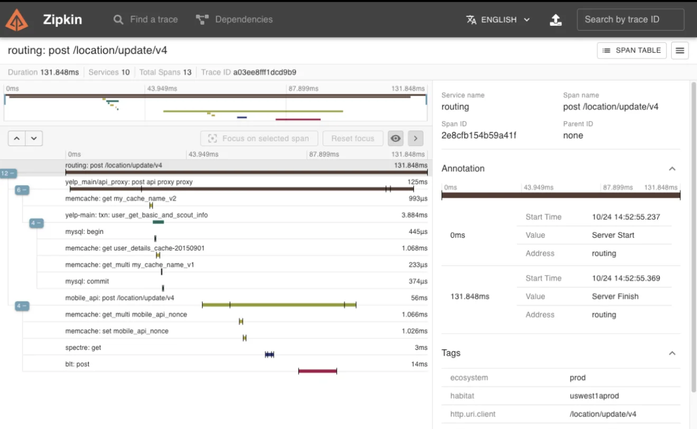

    - Twitter에 의해 개발된 분산 추적 시스템으로, <strong><u>서비스 간의 요청 흐름을 시각적으로 추적</u></strong>하고, <strong><u>지연 시간을 분석</u></strong>할 수 있는 기능 제공

- <code>Jaeger</code>
    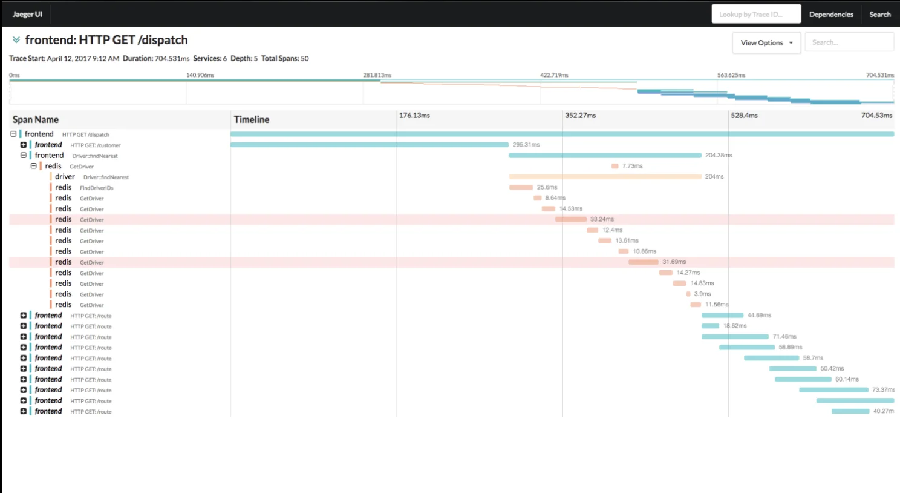

    - Uber에 의해 개발된 Jaeger는 분산 추적을 위한 오픈 소스 도구로 <strong><u>트랜잭션과 서비스 간의 의존성을 시각화</u></strong> 하며, <br>성능과 모니터링을 위한 <strong><u>다양한 매트릭 제공</u></strong>

</details>

<a id="3ebeda9b0fe18046a93fce5dc592b12e"></a>

### API Gateway에서 모니터링 방법

> ✏️ 
> 
> - <code>Health Check</code>&#58; API Gateway 및 백엔드 서비스의 가용성과 정상 작동 여부 확인
> 
> - <code>트래픽 모니터링</code>&#58; 들어오는 요청의 양, 처리량, 응답 시간 등을 추적하여 시스템의 부하 상태 이해
> 
> - <code>성능 모니터링</code>&#58; API 응답 시간, 데이터베이스 쿼리 성능 등을 모니터링하여 시스템의 성능 병목을 식별하고 개선
> 
> - <code>경보 및 알람 설정</code>&#58; 장애, 성능 저하, 보안 위협 등의 문제가 발생했을 때 즉시 알림을 받아 대응할 수 있도록 설계 

<details>
<summary>API Gateway에서 모니터링 방법&#58; <code>Health Check</code></summary>

<a id="3ebeda9b0fe1803b8520d001ab1ddb23"></a>

####  Health Check 의 목적

- 가용성 확인

- 정상 작동 여부 검증

- 자동 복구 지원

<a id="3ebeda9b0fe180ed8282f747dc4e44d3"></a>

####  방법

- <code>엔드포인트 호출</code>&#58; <code>/health</code>, <code>/status</code> 와 같은 특정 엔드포인트에 HTTP 요청

- <code>정기적 점검</code>&#58; 일반적으로 몇 초에서 몇 분 간격으로 설정될 수 있으며, 시스템의 중요도에 따라 조정

<a id="3ebeda9b0fe180fab2c1d6e9f9e36cef"></a>

####   Health Check 을 위한 도구

- Spring Boot Actuator

- Consul

- Kubernetes Liveness/Readiness Probes

</details>

<details>
<summary>API Gateway에서 모니터링 방법&#58; <code>트래픽 모니터링</code></summary>

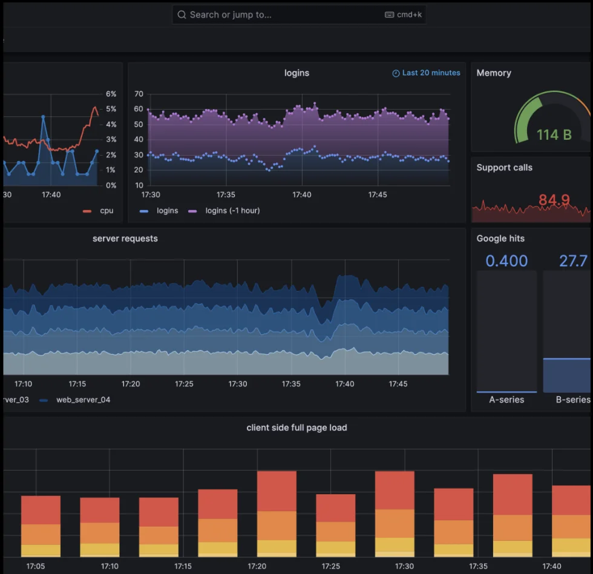

<a id="3ebeda9b0fe180b1a6f5c038b23673bf"></a>

####  트래픽 모니터링 의 목적

- 성능 분석

- 부하 상태 파악, 성능 문제 식별

- 최적화 기회 발견

<a id="3ebeda9b0fe180c3a440f4d9f83c0af4"></a>

####  방법

- 지표 수집

- 실시간 모니터링

- 데이터 분석 및 시각화

<a id="3ebeda9b0fe180d0868dddefece78324"></a>

####  트래픽 모니터링 을 위한 도구

- <code>Prometheus</code>

- <code>Grafana</code>

- <code>Amazon CloudWatch</code>

</details>

<details>
<summary>API Gateway에서 모니터링 방법&#58; <code>성능 모니터링</code></summary>

<a id="3ebeda9b0fe18068894fea6d781b5c9e"></a>

####  성능 모니터링 의 목적

- 응답 시간 최적화

- 성능 병목 식별

- 시스템 최적화

<a id="3ebeda9b0fe180d785f0f52170bcb9f3"></a>

####  방법

- 실시간 모니터링

- 데이터 분석 및 시각화

- 문제 해결

<a id="3ebeda9b0fe180e6998ed49819442e2f"></a>

####  성능 모니터링 을 위한 도구

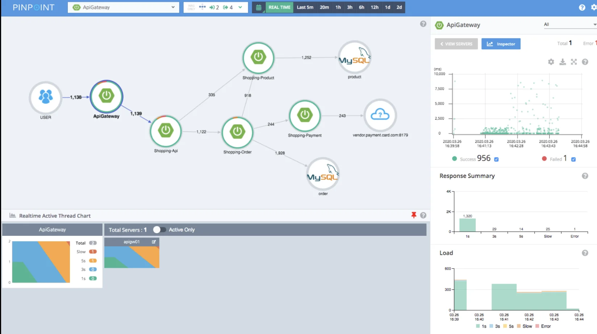

- 오픈 소스&#58; <code>Pinpoint</code>, <code>Scouter</code>

- 유료&#58; <code>New Relic</code>, <code>Datadog</code> 등

</details>

<a id="3ebeda9b0fe1806abfafd4ab9059deaf"></a>

## 분산 로깅 및 추적

---

> 🤔 
> 
> <a id="3ebeda9b0fe18024a265e64e5728f185"></a>
> 
> 분산 시스템에서 발생할 수 있는 일반적인 문제 유형
> 
> - <code>지연 시간 증가</code>&#58; 네트워크 지연, 서비스 오버로드, 비효율적인 데이터베이스 쿼리 등으로 인해 응답 시간이 증가할 수 있음
> 
> - <code>서비스 가용성 문제</code>&#58; 하드웨어 장애, 소프트웨어 버그, 네트워크 문제 등으로 특정 서비스가 실패하거나 접근 불가능해질 수 있음
> 
> - <code>잘못된 서비스 통신</code>&#58; 서비스 간의 의존성 오류, 잘못된 API 호출, 데이터 형식 불일치 등으로 인해 시스템이 예상대로 동작하지 않을 수 있음

> 📖 
> 
> <a id="3eceda9b0fe18078bb1cc560bd741ea4"></a>
> 
> 분산 로깅 및 추적 개념
> 
> 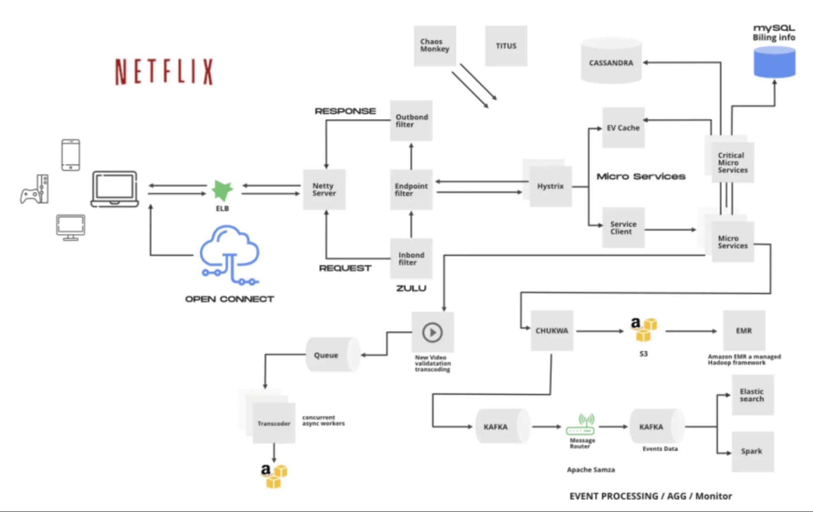
> 
> - 분산 시스템 속에서 로깅 및 추적이 가능하도록 설계

<a id="3eceda9b0fe180a79400da8fb1698c27"></a>

### Spring 생태계에서 분산 추적 방법

> ✏️ 
> 
> <a id="3eceda9b0fe180f084fefd9c55542b25"></a>
> 
> <strong>Spring 생태계에서 분산 추적 방법</strong>
> 
> 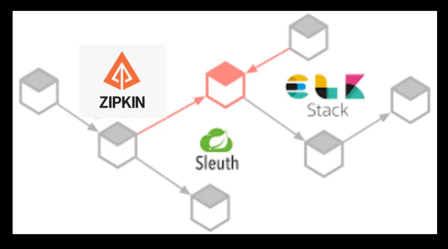
> 
> - <code>Spring Cloud Sleuth</code>
> 
> - <code>Zipkin</code>

<details>
<summary><strong>Spring Cloud Sleuth</strong></summary>

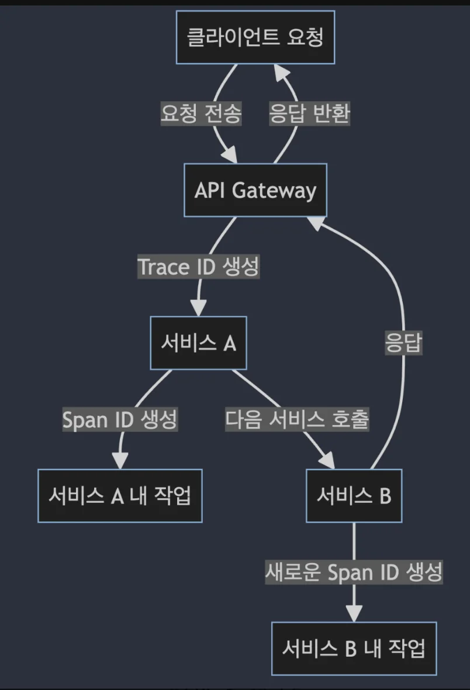

> ✏️ 
> 
> - <code>Spring Cloud Sleuth</code>는 <strong><u>분산 추적 정보를 자동으로 추가</u></strong>하여, 개발자가 분산 시스템 내에서 요청의 흐름을 쉽게 파악할 수 있도록 지원
> 
> - 요청이 <strong><u>서비스를 거칠 때만다 고유한 Trace ID를 생성</u></strong>하고, 각 서비스 호출(또는 작업 단위)에 대해 <strong><u>Span ID 부여</u></strong>

<details>
<summary><code>Trace ID</code> 와 <code>Span ID</code> 의 개념</summary>

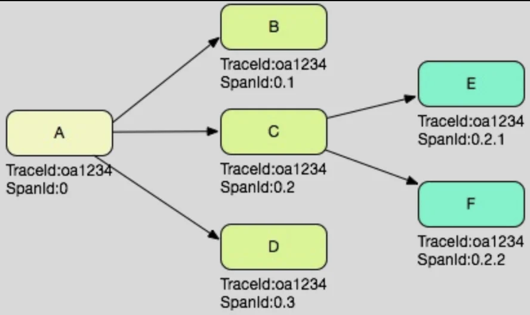

- <code>Trace ID</code>
    - 분산 시스템 내에서 단일 비지니스 트랜잭션을 식별하는 데 사용도는 고유 식별자

    - 하나의 요청이 여러 서비스를 통과할 때, 이 요청을 추적하기 위해 동일한 Trace ID가 사용

- <code>Span ID</code>
    - 특정 서비스 호출 또는 작업 단위를 식별하는 데 사용되는 고유 식별자

    - Span은 부모 Span의 자식이 될 수 있으며, 이를 통해 서비스 간 호출의 계층 구조를 나타냄

</details>

<details>
<summary>사용 방법</summary>

- Sleuth 의존성 추가
    <a id="3eceda9b0fe180a99194d9f49f5bdbfc"></a>

    ```java
    org.springframework.cloud:spring-cloud-starter-sleuth
    ```

- 기본 설정을 통한 Trace ID와 Span ID의 로깅
    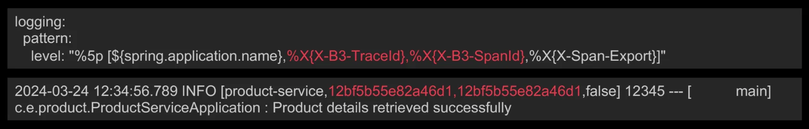

</details>

</details>

<details>
<summary><strong>Zipkin</strong></summary>

> ✏️ 
> 
> - <code>Zipkin</code>은 분산 시스템에서 서비스 간의 요청 추적을 위한 분산 추적 시스템
> 
> - 개발자가 마이크로서비스 아키텍처 내에서 요청의 흐름을 시각적으로 이해하고, 성능 문제를 진달할 수 있도록 설계

<details>
<summary>아키텍처와 구성요소</summary>

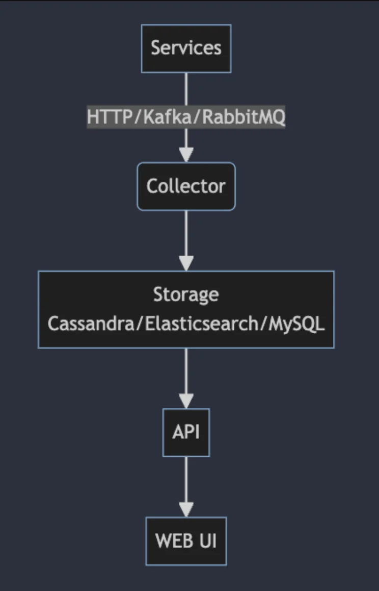

- <code>컬렉터 (Collector)</code>
    - 서비스로부터 추적 데이터를 수집하는 컴포넌트 

    - HTTP, Kafka, RabbitMQ 등 다양한 방식으로 데이터 수집

- <code>데이터베이스 (Storage)</code>
    - 수집된 추적 데이터를 저장하는 컴포넌트

    - Zipkin은 Cassandra, Elasticsearch, MySQL 등 여러 스토리지 옵션을 지원

- <code>API</code>
    - 저장된 추적 데이터에 접근하기 위한 RESTful API를 제공

    - 이 API를 통해 사용자는 특정 Trace ID를 조회하거나 서비스 간 호출 관계를 분석

- <code>UI</code>
    - 추적 데이터를 시각적으로 표현하는 웹 인터페이스

</details>

</details>

<details>
<summary><strong>Sleuth와 Zipkin 통합</strong></summary>

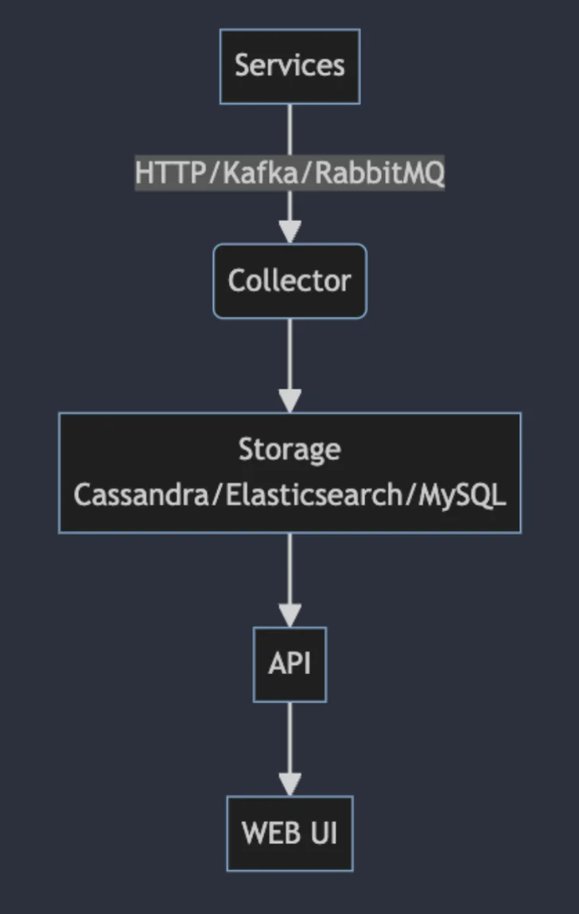

- Sleuth 는 애플리케이션에 <strong><u>추적 기능을 자동으로 추가</u></strong> (SpnaID, TraceID)

- Zipkin은 이 추적 정보를 저장하고 시각화하여 분석

- 통합 방법
    <a id="3eceda9b0fe18050a8c7da89c497c64f"></a>

    ```java
    org.springframework.cloud:spring-cloud-starter-sleuth
    org.springframework.cloud:spring-cloud-starter-sleuth-zipkin
    ```

    <a id="3eceda9b0fe180a38b4ef80245fa829b"></a>

    ```java
    spring:
    	zipkin:
    		base-url: http://localhost:9411/
    	sleuth:
    		sampler:
    			probability: 1.0
    ```

</details>

<details>
<summary><strong>Zipkin UI를 통한 추적 데이터 시각화</strong></summary>

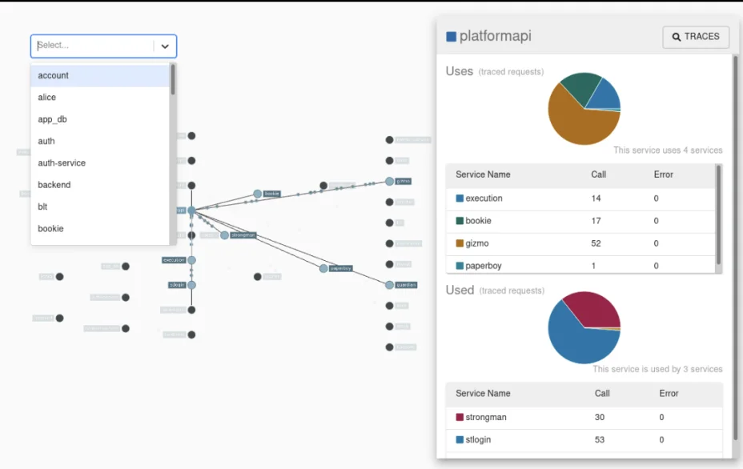

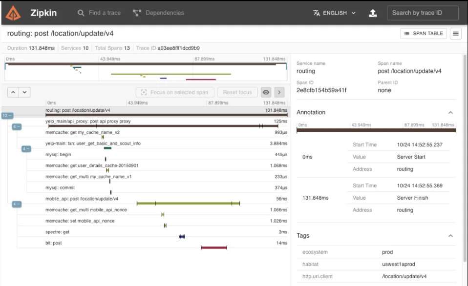

</details>

> 📝 
> 
> <a id="3eceda9b0fe180249c15f81886225c03"></a>
> 
> <code>Sleuth</code> 와 <code>Zipkin</code>을 사용한 문제 해결 방법
> 
> - <code>요청 흐름 추적</code>
>     - Sleuth는 각 요청에 Trace ID 와 Span ID를 부여하여, 분산 시스템을 통과하는 요청의 경로 추적
> 
>     - Zipkin은 이 추적 정보를 시각화하여, 어느 서비스에서 지연이 발생했는지, 어느 경로를 통해 데이터가 흐르는 지 쉽게 파악
> 
> - <code>성능 병목 진단</code>
>     - Zipkin UI를 통해 서비스 간의 호출 시간과 지연 시간을 분석함으로써 성능 병목 식별
> 
> - <code>에러 추적</code>
>     - 에러 로그와 함께 추적 정보를 분석하여, 오류가 발생한 서비스와 그 원인을 정확하게 식별
> 
> - <code>응답 시간 모니터링</code>
>     - Sleuth 와 Zipkin을 지속적으로 사용하여 응답 시간을 모니터링하고, 성능 저하를 조기에 감지하여 대응

<a id="3ebeda9b0fe180aab8e2eafe9e4ef70f"></a>

## 모니터링 도구 Prometheus와 Grafana 연동

---

<details>
<summary>Prometheus 소개</summary>

> ✏️ 
> 
> <a id="3eceda9b0fe180ed9689edca04c383d8"></a>
> 
> 시계열 데이터 모니터링에 최적화된 오픈소스 시스템

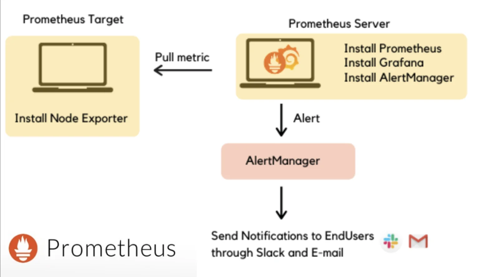

- 주요 기능
    - 멀티 차원 데이터 모델

    - 유연한 쿼리 언어 (PromQL)

    - 자체 서비스 발견 또는 정적 구성을 통한 시계열 수집

- Prometheus 구성 요소
    - <code>Exporters</code>
        - 특정 시스템의 Metric을 Prometheus가 이해할 수 있는 형태로 변환해 주는 도구

    - <code>Prometheus 서버</code>
        - 수집된 Metric을 저장하고 처리하는 핵심 컴포넌트

    - <code>Alert Manager</code>
        - Prometheus 시스템의 알람을 관리 <br>(Slack 등 다양한 알람 채널로 알람 전송)

</details>

<details>
<summary>Grafana 소개</summary>

> ✏️ 
> 
> <a id="3eceda9b0fe18063a8bbcae3d190280e"></a>
> 
> 수집한 메트릭, 로그, 추적 데이터를 시각화하고 분석하는 데 사용되는 오픈소스 플랫폼

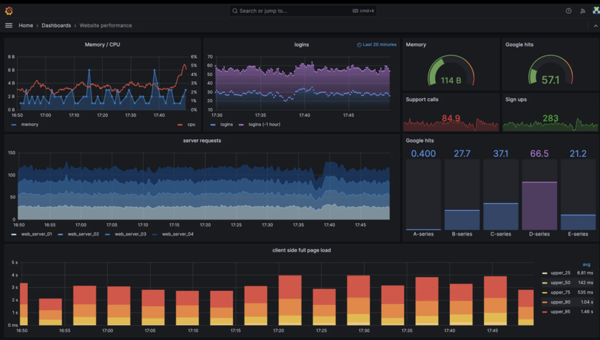

- 주요 기능
    - 다양한 데이터 소스 지원

    - 대시보드를 통한 데이터 시각화 및 분석

    - 알림 채널을 통한 알림 설정

- Grafana 주요 구성 요소
    - <code>Data Sources</code>
        - Grafana는 Prometheus, InfluxDB, Elasticsearch, CloudWatch, MySQL, PostgreSQL 등 다양한 데이터 소스 지원

    - <code>Dashboards</code>, <code>Panels</code>
        - 대시보드는 시각화 패널(차트, 그래프, 테이블 등)을 통해 데이터를 시각적으로 표현

    - <code>Query</code>
        - Grafana 에서는 패널별로 쿼리를 설정하여, 원하는 데이터를 시각화

</details>

<details>
<summary>Spring, Prometheus, Grafana 연동</summary>

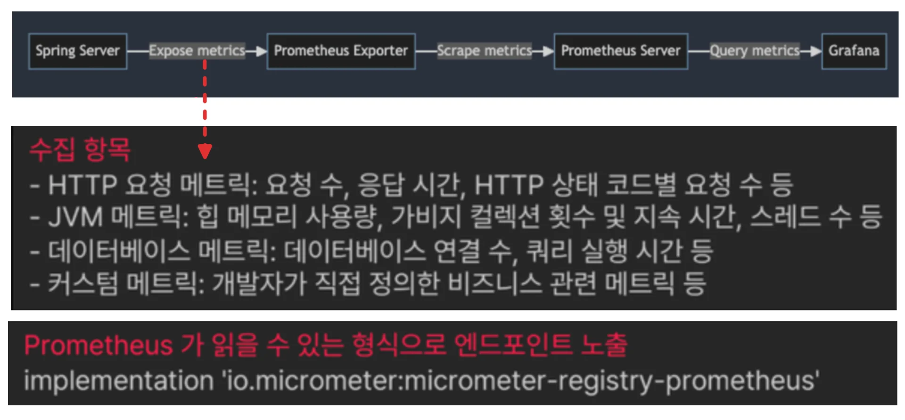

<a id="3eceda9b0fe180e396e5fee95c7b4c85"></a>

```yaml
management:
	endpoint:
		web:
			exposure:
				include: "prometheus"
```

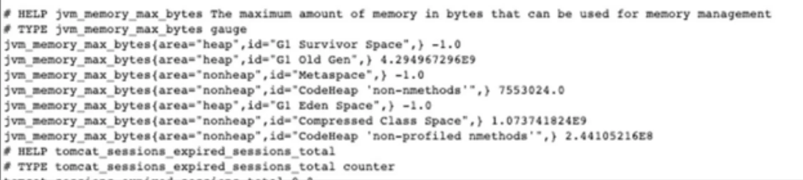

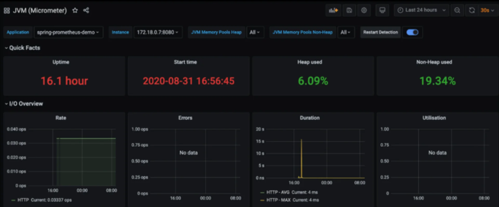

</details>
