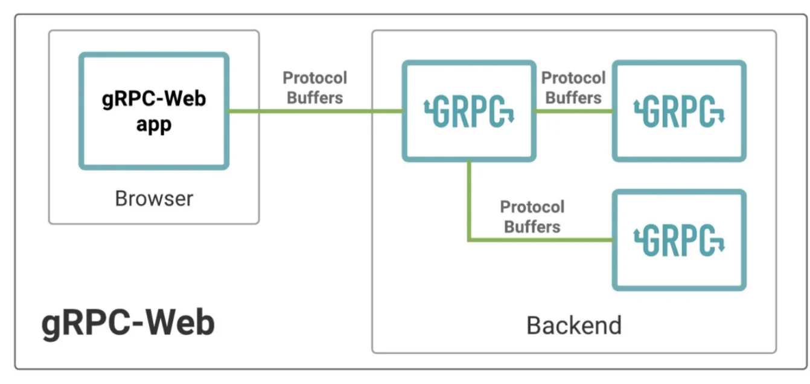
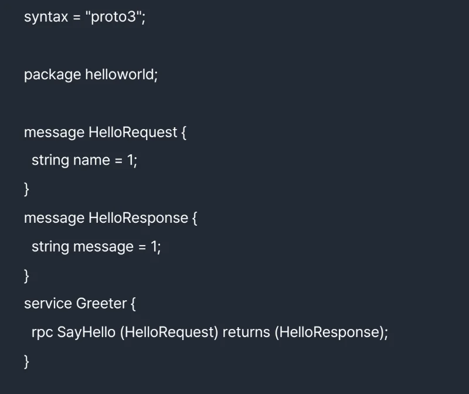
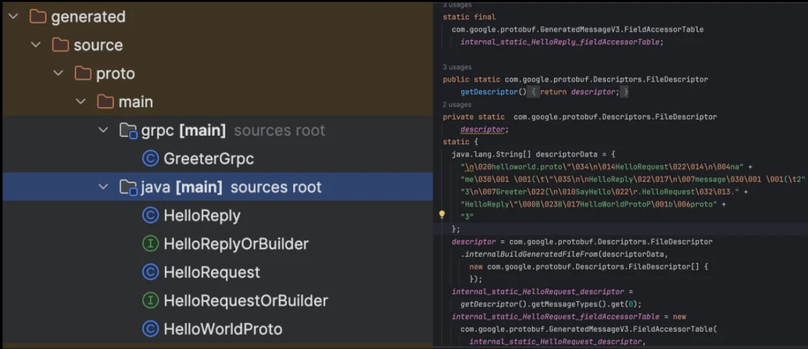
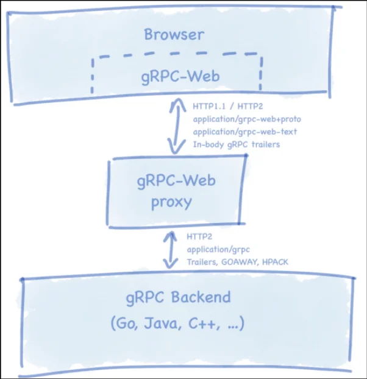

<a id="3deeda9b0fe180ac9508d0428798789c"></a>

## gRPC &#45; Web 서비스 소개

---

> 📖 
> 
> <a id="3deeda9b0fe180ed9835e17b83a88410"></a>
> 
> <code>gRPC&#45;Web</code>
> 
> - <code>gRPC&#45;Web</code>은 웹 클라이언트에서 gRPC 서비스를 직접 호출 할 수 있게 해주는 Javascript 기반 라이브러리
>     - <code>gRPC&#45;Web</code>을 이용하면 브라우저에서 바로 gRPC 요청 가능
> 
> - gRPC를 통해 <strong><u>복잡한 REST API를 사용하지 않</u></strong>고 효율적인 &#91;클라이언트&#45;서버&#93; 통신이 가능해진다&#46;
> 
> - protobuf 기반 명확한 타입 기반 통신이 가능해지기 때문에 <br>강력한 타입 검사가 가능해지며 이를 통해 오류를 줄일 수 있다&#46;
> 
> - 클라이언트 및 서버의 인터페이스가 명확하기 때문에 일관된 형태로 정의 되어 개발 과정이 단순화되고 오류 가능성이 줄어 든다&#46; 
>     - 웹 개발에서 통신을 단순화하고, 서버 리소스를 효율적으로 사용 가능

<details>
<summary><code>gRPC&#45;Web</code>의 주요 특징</summary>



- <code>직접적인 gRPC 서비스 호출</code>
    - 웹 클라이언트에서 <code>gRPC&#45;web</code>을 통해 <strong><u>백엔드 gRPC 서비스를 직접 호출</u></strong> 가능하다&#46; 

    - 이전 웹 클라이언트가 gRPC 서버를 이용하기 위해서 REST API를 사용하는 별도 프록시 서버가 필요했다&#46; <br>이를 <code>gRPC&#45;web</code>을 사용해 별로 프록시 구성없이 통신 가능하다&#46; 

- <code>브라우저 호환성</code>
    - <code>gRPC&#45;web</code>은 모던 웹브라우저에서 사용할 수 있도록 설계되었다&#46; 

    - 클라이언트 측에서는 JS, TS를 사용하여 구현 가능하다&#46; 

- <code>프로토콜 버퍼 사용</code>
    - 마찬가지로 gRPC&#45;web 도 프로토콜 버퍼를 사용해 데이터 직렬화 및 구조화한다&#46; 이는 데이터 전송을 효율적으로 만들고 작은 용량으로 복잡한 데이터 구조를 전송할 수 있게 해준다&#46; 

- <code>HTTP/2 기반의 효율적인 통신</code>
    - gRPC&#45;web은 HTTP/2의 여러 기능을 활용하여 네트워크 통신의 효율성을 높인다&#46; 
        - <strong><u>헤더 압축, 멀티 플렉싱 </u></strong>기능을 통해 <strong><u>네트워크 지연 시간을 줄</u></strong>이고 <strong><u>대역폭 사양을 최적화</u></strong>한다&#46; 

</details>

<a id="3deeda9b0fe180f9b81ac9f88e5580b7"></a>

### 간단한 gRPC &#45; Web 클라이언트&#45;서버 예시 

<details>
<summary>1&#46; <code>클라이언트</code>, <code>서버</code>&#58; <code>&#46;proto</code> 정의</summary>



</details>

<details>
<summary>2&#46; <code>클라이언트</code>&#58; <code>&#46;proto</code> 컴파일</summary>

<a id="3deeda9b0fe1804dbf4edc78125e0180"></a>

```protobuf
protoc -I=$DIR helloworld.proto \
--js_out=import_style=commonjs:$OUT_DIR \
--grpc-web_out=import_style=commonjs,mode=grpcwebtext:$OUT_DIR
```

> ✏️ 
> 
> - <code>&#45;&#45;js&#95;out</code>&#58; proto 메시지를 다루는데 필요한 옵션
> 
> - <code>&#45;&#45;grpc&#45;web&#95;out</code>&#58;  gRPC 서비스를 호출하는데 필요한 코드

1. mode=<strong><code>grpcwebtext</code></strong>&#58; 바이너리가 아닌 텍스트 형식으로 전달
    - Context&#45;type&#58; <code>application/grpc&#45;web&#45;text</code>

    - 페이로드는 base64로 인코딩

    - 단방향, 스트리밍 모두 지원

1. mode=<strong><code>grpcweb</code></strong>&#58; 바이너리 protobuf 형식도 지원
    - Context&#45;type&#58; <code>application/grpc&#45;web&#43;proto</code>

    - 페이로드는 바이너리 protobuf 형식

    - 단방향 호출만 지원

<a id="3e0eda9b0fe180c79571c37efedceeaa"></a>

컴파일(<code>protobuf → js</code>) 완료 시 main 자바스크립트 코드에서 사용 가능해짐

</details>

<details>
<summary>3&#46; <code>클라이언트</code>&#58; JS 클라이언트 구현</summary>

> ✏️ 
> 
> <a id="3e0eda9b0fe18031ba29c3321f74e9ab"></a>
> 
> 컴파일된 JavaSript 코드 기반 요청 예시 코드, <br>요청을 보내고 응답을 받아옴

<a id="3deeda9b0fe180c8a49eebd52fb480ee"></a>

```javascript
// .proto -> js 로 
var metadata = {'custom-header-1': 'value1'};

var request = new proto.helloworld.HelloRequest();
request.setMessage(msg);

var SERVER_URL = "http://localhost:8080"

var helloService = new proto.helloworld.GreeterServiceClient(SERVER_URL);

helloService.SayHello(request, metadata, function(err, response) {
	if (err) {
		console.log(err.code);
		console.log(err.message);
	} else {
		console.log(response.getMessage());
	}
});
```

- 서버 ip, port를 통해 매니징 채널 생성 시 자동으로 커넥션이 생성된다&#46; 

- 이후 stub을 생성해 서버의 메서드를 호출한다&#46;

</details>

<details>
<summary>4&#46; <code>서버</code>&#58; <code>&#46;proto</code> 컴파일</summary>

<a id="3deeda9b0fe180e9ae42c78aeda0483c"></a>

```javascript
protoc --java_out=generated src/main/proto/helloworld.proto
```

> ✏️ 
> 
> - <code>—java&#95;out</code>&#58; <code>&#46;proto</code> → <code>java</code>로 컴파일 
>     - 아래와 같이 java 소스코드로 컴파일됨



</details>

<details>
<summary>5&#46; <code>서버</code>&#58; 서버 구현</summary>

> ✏️ 
> 
> <a id="3e0eda9b0fe1804b83a1da73e1c3ba96"></a>
> 
> 컴파일된 자바 코드 기반 요청을 받고 응답을 송출하는 예시 코드

<a id="3deeda9b0fe18044b852d78f386eba3a"></a>

```java
public clas HelloWorldServer {
	public static void main(String[] args) throws Exception {
		Server server = ServerBuilder.forPort(8080)
				.addService(new GreeterImpl())
				.build();
		
		server.start();	
		server.awaitTermination();
	}
	
	static class GreeterImpl extends GreeterGrpc.GreeterImplBase {
		@Override
		public void sayHello(HelloRequest request, StreamObserver<HelloResponse> responseObserver) {
			String name = request.getName();
			HelloResponse response = HelloResponse.Builder().setMessage("Hello, " + name + "!").build();
			responseObserver.onNext(response);
			responseObserver.onCompleted();			
		}
	}
}
```

</details>

<details>
<summary>6&#46; <code>프록시 서버</code>&#58; 프록시 서버 추가</summary>

<a id="3deeda9b0fe18090b2bde88b6b92eb7b"></a>

```java
docker-compose up -d node-server envoy commonjs-clinet
```



- <code>Envoy Proxy</code>를 사용하는 이유
    - gRPC&#45;Web 클라이언트와 gRPC 서버 간의 중개자 역할을 함

    - gRPC&#45;Web은 클라이언트 측 프로토콜로 웹 브라우저와 호환되도록 설계되었으며 <code>HTTP/1&#46;1</code> 통해 gRPC 호출을 가능하게 한다&#46; 
        <a id="3e0eda9b0fe1800f8ee9f9bd5cf57518"></a>

        그러나 gRPC 서버는 <code>HTTP/2</code>를 통해서 통신하고, 표준 gRPC 프로토콜 메시지를 이해한다&#46; 

        <a id="3e0eda9b0fe1804d872ec32e9f920ad2"></a>

        따라서 gRPC&#45;web 클라이언트와 표준 gRPC를 사용하는 gRPC 서버간의 통신을 가능하기 위해서는  gRPC&#45;web 요청을 표준 gRPC로 변환해주는 프록시 계층이 필요하다&#46; 

        <a id="3e0eda9b0fe1808b9250c56000d9a995"></a>

        envoy와 같은 프록시는 이러한 통신 변환을 처리해주며 추가적으로 CORS 정책, 인증, 로깅 등과 같은 웹 관련 기능을 간편하게 처리하도록 지원한다&#46; 

        - 🧐 HTTP 브릿지와 동일한거 아닌가? 

    - gRPC&#45;Web 클라이언트가 보낸 <code>HTTP/1&#46;1</code> 요청을 gRPC가 이해할 수 있는 <code>HTTP/2</code> gRPC 요청으로 변환

    - 일반적인 Java gRPC 서버는 gRPC&#45;Web 프로토콜을 지원하지 않기 때문에, Envoy 프록시를 사용하거나, Armeria(JVM) 기반의 서비를 사용하는 것도 방법 중 하나

</details>

<a id="3deeda9b0fe180298436f10d06f26272"></a>

## RESTful API와 gRPC 간의 변환 방법 소개

---

> 📖 
> 
> <a id="3deeda9b0fe1806cbc75edbecad41c91"></a>
> 
> <code>gRPC&#45;Web</code>
> 
> - 웹 클라이언트에서 gRPC 서비스를 직접 호출 할 수 있게 해주는 Javascript 기반 라이브러리
> 
> - <code>gRPC&#45;Web</code>을 이용하면 브라우저에서 바로 gRPC 요청 가능
> 
> - 웹 개발에서 통신을 단순화하고, 서버 리소스를 효율적으로 사용 가능

<details>
<summary><code>gRPC → RESTful</code> API 변환의 장점</summary>


- 기존 REST 클라리언트 지원
    - 많은 웹, 모바일 앱이 이미 RESTful API 기반으로 구현되어 있다&#46; 

    - 따라서 gRPC를 REST 기반으로 변경 시 많은 클라이언트가 기존 서비스의 새로운 변경없이 gRPC 서비스의 통합이 가능해진다&#46; 

- 플랫폼 및 언어 독립성
    - RESTful API는 HTTP, JSON을 사용하기 떄문에 거의 모든 프로그래밍 언어에 지원되며 쉬운 사용성을 가짐

    - 이를 통해 rRPC 서비스를 다양한 클라이언트 환경에서 접근 가능하도록 함

- 방화벽 및 인터넷 친화적
    - 일부 환경에서는 <code>gR=HTTP/2</code> 트래픽이 차단될 수 있음

    - <code>HTTP/2</code>가 지원되지 않는 환경인 경우, <code>HTTP/1&#46;1</code> 서빙 가능

- 간단한 디버깅과 모니터링
    - HTTP는 기존 많은 디버깅 툴들로 쉽게 디버깅 가능함

</details>

<details>
<summary>RESTful API와 gRPC 간의 변환 방법&#58; <code>google&#46;api&#46;http</code></summary>

<a id="3e1eda9b0fe18071b672eba222369ff8"></a>

#### &#91;개념&#93; <code>google&#46;api&#46;http</code> option

> ✏️ 
> 
> <a id="3e1eda9b0fe180ed8b32d5512a5f7de6"></a>
> 
> <code>google&#46;api&#46;http</code> option
> 
> - gRPC 요청과 HTTP 요청의 매핑을 정의함
> 
> - HTTP GET 요청을 gRPC 메서드에 바인딩
> 
> - gRPC 본문에 있는 데이터를 메시지 필드에 매핑 가능
> 
> - 이후 서버 측에서는 gRPC 서버, gRPC&#45;HTTP 프록시 서버를 구성하여 <code>&#91;gRPC 메서드 호출 ↔ RESTful 호출&#93;</code> 변환한다&#46; <br>이때, envoy 나 gRPC Gateway를 사용하게 된다&#46;

<a id="3e1eda9b0fe18044ae05cce6a0d176c0"></a>

```protobuf
syntax = "proto3";

import "google/api/annotations.proto";

service MyService {
	rpc GetItem(GetItemRequest) returns (GetItemResponse) {
		option (google.api.http) = {
			get: "/v1/items/{id}"
		}
	}
}

message GetItemRequest {
	string id = 1;
}

message GetItemResponse {
	string name = 1;
	string description = 2;
}
```

> ⚠️ 
> 
> <a id="3e1eda9b0fe18049bb3af6ed311c3578"></a>
> 
> 주의점
> 
> 1. <code>&#91;gRPC 메서드 ↔ RESTful&#93;</code> 호환성 문제
>     - 모든 API 요청 gRPC에서 REST 형태로 변환되었을 때 완벽하게 매핑되지는 않는다&#46; 
> 
>     - 예를 들어, rRPC의 Stream은 REST 형태로 매핑할 수 없다&#46;
> 
> 1. <code>&#91;HTTP/2 → HTTP/1&#46;1&#93;</code> 통신 지연 발생
>     - 또한 gRPC는 HTTP/2를 기반으로 통신하기 때문에 HTTP/1&#46;1을 사용하는 REST 보다 통신 효율이 더 높다 
> 
>     - 따라서 <code>&#91;gRPC → RESTful&#93;</code> 변환 시 그 과정에서 추가적인 지연이 발생될 수 있따&#46;
> 
> 1. <code>Java 서버</code>는 option을 처리하지 못한다&#46;
>     - <strong><u>Go gRPC Gateway를 사용</u></strong>해야 함

<a id="3e1eda9b0fe1801ab598f62a93136da7"></a>

#### &#91;예시&#93; 구성 요소 및 변환 흐름 (시퀀스 다이어그램)

<a id="3e1eda9b0fe180dc8d93ca0e8def0d75"></a>

####  구성 요소 및 생성

<a id="3e1eda9b0fe1802abb86e26d1cf49aac"></a>

```bash
# java gRPC 서버 생성
protoc --java_out=<output_path> \
		--grpc_java_out=<output_path> \
		--proto_path=<proto_file_path> \
		your_service.proto
		
# gRPC gateway 생성
protoc --go_out=<output_path> \
		--go_grpc_java_out=<output_path> \
		--grpc_gateway_out=<output_path> \
		--proto_path=<proto_file_path> \
		your_service.proto
```

1. <code>gRPC 서비스 정의</code>
    - proto 파일을 사용해 gRPC 서비스를 정의한다&#46;

    - 해당 파일에는 서비스의 <code>RPC 메서드</code>, <code>메시지 형식</code>, <code>google&#46;api&#46;http 옵션</code>을 통한 매핑 정보가 포함된다&#46; 

1. <code>gRPC 서버 구현  (Java)</code>
    - 이후 proto 파일 기반으로 java gRPC 서버 코드를 작성하고 빌드한다&#46; 
        - gRPC 프로토콜을 사용하여 클라이언트 요청을 처리

1. <code>gRPC&#45;Gateway 빌드 (Go)</code>
    > 🤔 
    > 
    > <a id="3e1eda9b0fe18002844cee4d91040c54"></a>
    > 
    > <code>google&#46;api&#46;http</code>가 포함된 <code>&#46;proto</code>도 <strong>Java 코드로 생성하고 컴파일할 수 있다&#46; </strong>
    > 
    > <a id="3e1eda9b0fe1803aa285ebed62b75be1"></a>
    > 
    > 다만, 기본 gRPC Java 코드 생성기는 그 옵션을 이용해 HTTP/JSON 엔드포인트까지 만들어주지는 않는다&#46; 
    > 
    > <a id="3e1eda9b0fe180cb8f54eb06f73d7356"></a>
    > 
    > 따라서  gRPC Gateway를 추가로 구성해야 하며, gRPC Gateway가 제공하는 Go 사용하여 구성한다&#46;

    - proto 파일에서 정의한 HTTP 매핑을 사용해 gRPC Gateway 프록시 서버를 생성한다&#46; 

    - gRPC Gateway는 주로 Go 언어로 작성되어 있고 RESTful API 요청을 받아서 gRPC 요청으로 변환하고 자바 gRPC 서버로 전달한다&#46;

1. <code>서버 실행</code>
    - gPRC Gateway에서 받은 RPC 메서스 call을 처리한 뒤 다시 gRPC Gateway로 응답하고 gRPC Gateway가 이를 다시 RESTful 형식으로 변환시켜 클라이언트로 전달한다&#46; 

<a id="3deeda9b0fe180bbbf21ea5d05accc97"></a>

####  시퀀스 다이어그램


1. <strong><code>&#91;클라이언트 → gRPC Gateway&#93;</code></strong>
    - HTTP/JSON 형식으로 요청 보냄

    - ex) <code>GET /item/123</code>

1. <strong><code>&#91;gRPC Gateway → Java gRPC 서버&#93;</code></strong>
    - gRPC 요청 형식으로 변환되어 요청 보냄

    - ex) <code>GetItem(id&#45;123)</code>

1. <strong><code>Java gRPC 서버에서 요청 처리</code></strong>
    - 받아온 gRPC 메서드를 실행하여 응답 생성

1. <strong><code>&#91;Java gRPC 서버 → gRPC Gateway&#93;</code></strong>
    - gRPC 메서드가 실행된 응답을 프록시 서버로 보냄

    - ex) <code>Item 정보</code>

1. <strong><code>&#91;gRPC Gateway → 클라이언트&#93;</code></strong>
    - gRPC 응답을 HTTP/JSON 응답으로 변환시켜 클라이언트로 보냄

    - ex) <code>{”id”&#58; 123, “name”&#58; “아이템”}</code>

</details>

<details>
<summary>RESTful API와 gRPC 간의 변환 방법 소개&#58; <code>Spring으로 Gateway 직접 구현</code></summary>

> 
> 
> <a id="3e1eda9b0fe1804e8f1de46bb70a43ab"></a>
> 
> gRPC&#45;Gateway 즉, Go를 사용하며 많이 구현하지만, Go라는 언어를 새로 학습해야 하는 진입 장벽이 존재한다&#46; 
> 
> <a id="3e1eda9b0fe18004818ed687b4941c2f"></a>
> 
> 아래와 같이 간단하게 Spring을 통해서도 Gateway 직접 구현이 가능하다&#46; 

<a id="3e1eda9b0fe180bf9a29c8f648c16325"></a>

#### &#91;예제&#93; 스프링으로 구현한 gRPC Gateway

> ✏️ 
> 
> <a id="3e1eda9b0fe1801bb758eff5da0913ed"></a>
> 
> <code>클라이언트 서버(스프링으로 구현된 gRPC&#45;Gateway 서버)</code>는 <code>gRPC 서버</code>로부터 응답을 받아 이를 JSON 형식으로 변환한 후 REST API 방식으로  <code>클라이언트</code>와 소통한다&#46; 
> 
> <a id="3e1eda9b0fe18046a85ae7f96207047f"></a>
> 
> 이를 통해 gRPC 메서드를 REST API 형태로 클라이언트에 노출 가능하다&#46;

<a id="3deeda9b0fe180419089f9e9c2534204"></a>

```java
// Cofig 구성 - gRPC 서버와 연동
@Configuration
public class GrpcClientConfig {
	
	@Bean
	public ItemServiceGrpc.ItemServiceBlockingStub itemServiceStub() {
		ManagedChannel channel = ManagedChannelBuilder.forAddress("localhost", 9090)
				.usePlaintext()
				.build();
		
		return ItemServiceGrpc.newBlockingStub(channel);
	}
}
```

- 스프링을 사용해 RESTful 엔드포인트를 생성하고 이 엔드포인트는 내부적으로 gRCP 클라이언트를 통해 gRPC 서버와 통신하게 된다&#46; 

<a id="3deeda9b0fe180c3bf3fe7b68f6e32dd"></a>

```java
// gRPC 메서드 엔드포인트 형식으로 노출
@RestController
@RequestMapping("/api/items")
public class ItemController {
	
	private final ItemServiceGrpc.ItemServiceBlockingStub itemServiceStub;
	
	public ItemController(ItemServiceGrpc.ItemServiceBlockingStub itemServiceStub) {
		this.itemServiceStub = itemServiceStub;
	}
	
	@GetMapping("/{id}")
	public ResponseEntity<?> getItem(@PathVariable String id) {
		GetItemRequest request = GetItemRequest.newBuilder()
				.setId(id)
				.build();
		
		try {
			GetItemResponse response = itemServiceStub.getItem(request);
			return ResponseEntity.ok(Map.of("name", response.getName(), "description", response.getDescription()))
		} catch (StatusRuntimeException e) {
			return ResponseEntity.status(HttpStatus.INTERNAL_SERVER_ERROR).body(e.getStatus().getDescription());
		}
	}	
}
```

- 엔드포인트 호출 메서드로 래핑하여 gRPC 메서드를 call 한다&#46; 

</details>

<details>
<summary>RESTful API와 gRPC 간의 변환 방법 소개&#58; <code>Armeria Framework</code></summary>

<a id="3e1eda9b0fe180839b80ea0d1971024f"></a>

<a href="#/post/3e1eda9b-0fe1-8038-9980-d12435b46db5">페이지</a> 

</details>
