> ✏️ 
> 
> 
> 
> <a href="#/post/1c3eda9b-0fe1-81c8-b57f-fa069abfcbbf">페이지</a> 
> 
> - 이미 한번 정리한 내용으로 간략하게 복습용으로만 진행

## 1&#46; REST API

---

> 📖 
> 
> 
> 
> <code>REST API</code>란?
> 
> 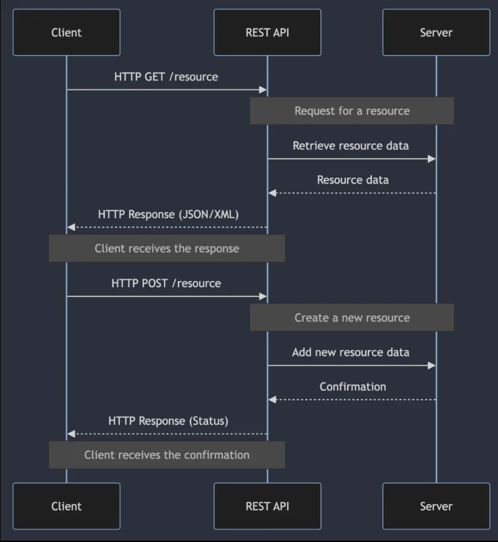
> 
> - <code>Representational State Transfer API</code>
> 
> - <strong><u>웹</u></strong> 기반 응용프로그램 간 데이터 교환을 위한 표준 인터페이스
> 
> - <strong><u>REST 제약 조건을 잘 준수</u></strong>함을 <code>RESTful</code> 하다고 표현

> 🤔 
> 
> 
> 
> <code>API (Application Programming Interface)</code>
> 
> 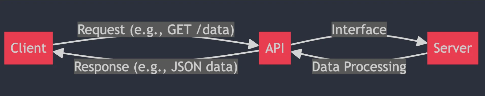
> 
> - 소프트웨어 간의 상호작용을 가능하게 하는 규칙 및 도구 모음
> 
> - 프로그램이나 애플리케이션을 구축할때, 다른 시스템과의 연결 및 통신을 용이하게 하는 중개자 역할

REST API 탄생

> ✏️ 
> 
> 
> 
> REST는 2000년 <a href="http://ics.uci.edu/~fielding/pubs/dissertation/top.htm">Roy Fielding 의 박사 학위 논문</a>에서 처음 소개되었다&#46; 
> 
> - HTTP 프로토콜의 주요 설계자 중 한 명으로, 웹의 기본 원칙을 설명하고자 했다&#46; 

- <code>클라이언트 &#45; 서버</code> 구조

- <code>계층화 된 시스템</code>

- <code>무상태성 (stateless)</code>

- <code>코드 온 디맨드</code>

- <code>캐시 가능성 (cacheable)</code>

- <code>균일한 인터페이스 </code>

RESTful 아키텍처&#58; <code>자원(Resource) &#43; 행위(Verb)</code>

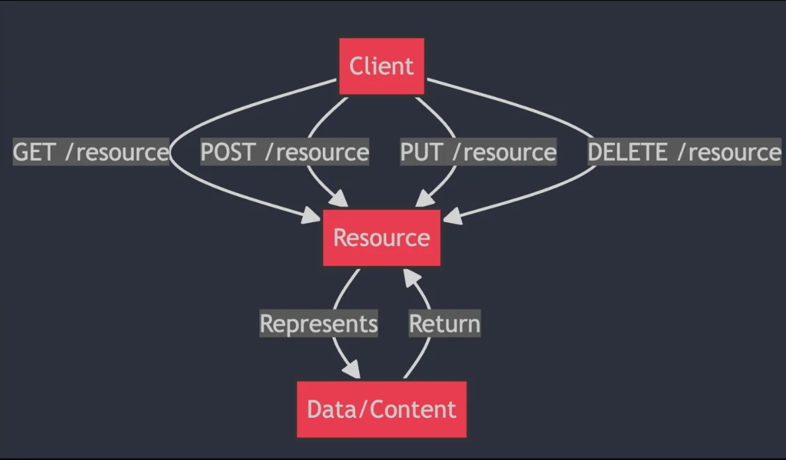

- ex)
    

    <code>Resource (/resoure)</code> &#43; <code>Verb (GET)</code>

    

    → <code>GET /resource</code>&#58;  리소스 조회 엔드포인트 

RESTful 아키텍처&#58; <code>HTTP 메서드 활용</code>

- <code>GET</code>&#58; 조회

- <code>POST</code>&#58; 생성, 수정

- <code>PUT</code>&#58; 수정

- <code>PATCH</code>&#58; 수정

- <code>DELETE</code>&#58; 삭제

RESTful 아키텍처&#58; <code>Stateless (상태 관리 X)</code>

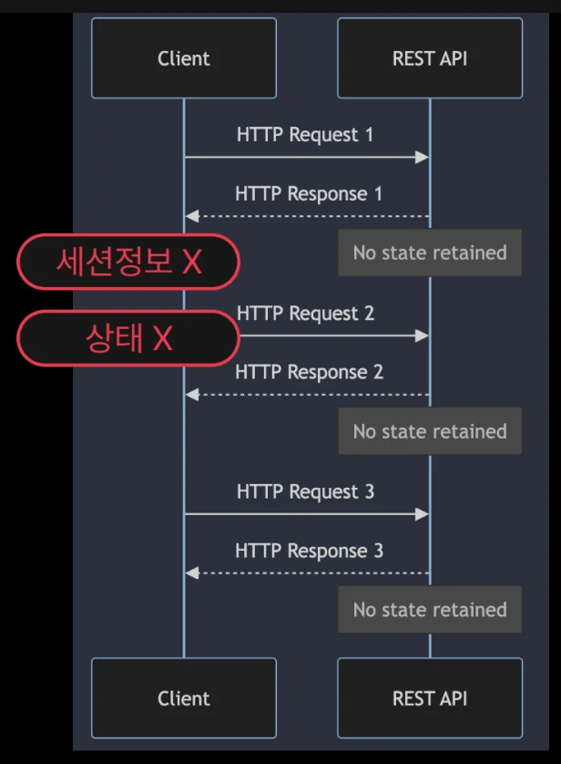

- 서버는 이전 요청과  관련된 정보를 기억하지 않음
    

    즉, <code>stateless</code> 하게 처리 가능

- 이를 통해 확장성 있는 시스템 설계가 가능함

RESTful 아키텍처&#58; <code>URI 설계 원칙 (Uniform Interface)</code>

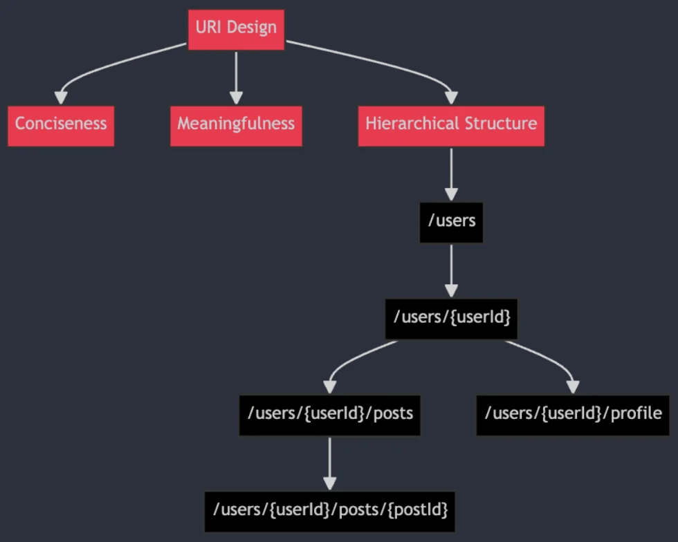

- <code>간결</code>

- <code>의미</code>

- <code>계층형 구조</code>

RESTful 아키텍처&#58; <code>캐시 가능성 (Cacheable)</code>

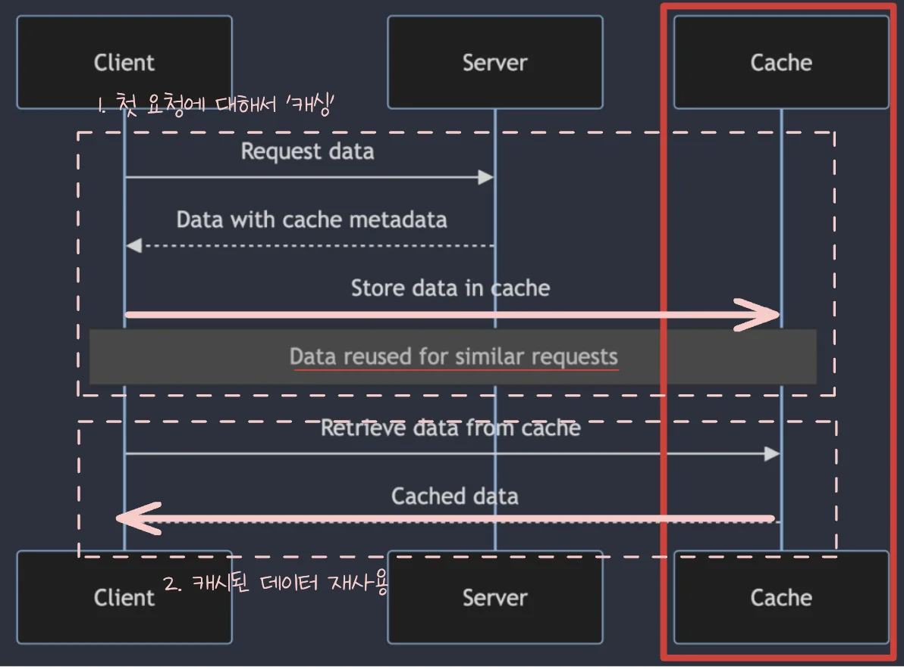

- 첫 요청에 대해서 캐싱 처리, 이후 동일한 요청에 대해서 캐시된 데이터 재사용
    

    → <strong>서버 부하 감소</strong>, <strong>응답 시간 단축</strong>

> 📄 
> 
> 
> 
> 정리&#58; <code>REST API</code> 의 장점, 이점
> 
> ---
> 
> 1. <code>간결성, 유연성</code>
>     - HTTP 프로토콜에 기반하여 다양한 종류의 클라이언트와의 호환성 제공
> 
> 1. <code>확장성, 분산 시스템에 적합</code>
>     - <code>Stateless</code> ( 상태 저장 X )
> 
>     - 시스템 확장성 향상 및 요청 분산 처리(로드벨런싱) 가능
> 
> 1. <code>캐시 지원</code>
>     - 서버 부하 ↓, 응답 속도 ↑
> 
> 1. <code>플랫폼 및 언어 독립성</code>
>     - JSON, XML 등의 표준 데이터 포맷을 사용하여 데이터를 교환
> 
>     - 다양한 언어와 플랫폼에서 쉽게 통합 가능

## 2&#46; RESTful 아키텍쳐 특징

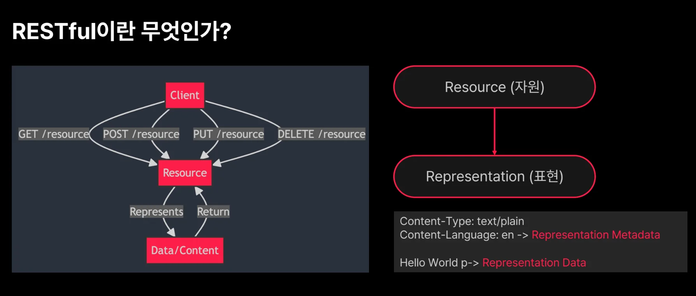

> ✏️ 
> 
> 
> 
> <code>RESTful</code> 정의
> 
> > <code>REST</code> &#43; <code>ful</code>
> 
> - <u>“REST 스타일을 따르는”</u> 형용사
> 
> - <strong>REST 아키텍처 원칙을 따르는 웹 서비스나 API를 나타내기 위해 사용</strong>

### RESTful의 6가지 제약 조건

<code>클라이언트 &#45; 서버 (Client &#45; Server)</code> 구조 

- 관심사 분리
    - <code>클라이언트</code>&#58; 사용자 인터페이스

    - <code>서버</code>&#58; 데이터 저장 및 처리

<code>계층화 된 시스템 (Layered System)</code>

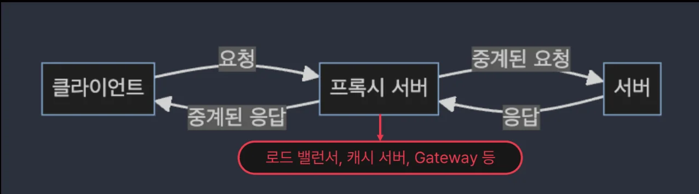

- 클라이언트는 끝 서버(End server)에 직접 연결되는지 여부를 알 수 없음

- 시스템 구조의 유연성, 보안 및 확장성 강화

<code>무상태성 (Stateless)</code>

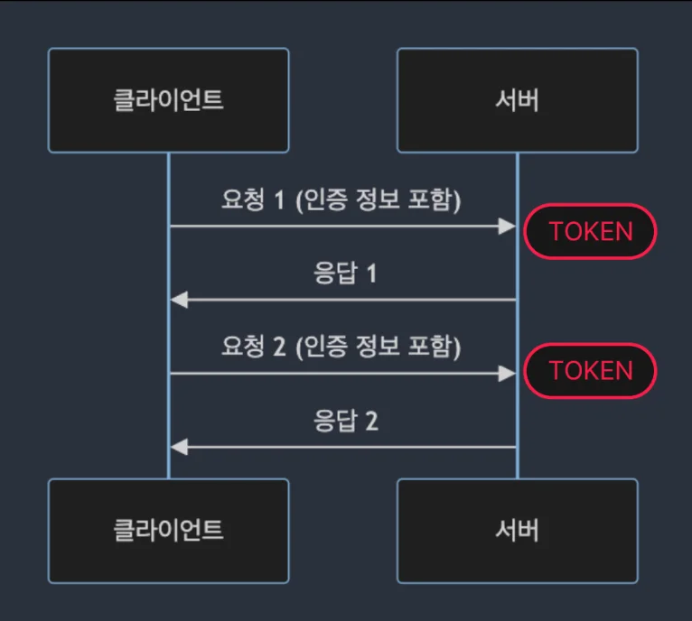

- 각 요청이 독립적이고, 이전 상태를 기반으로 하지 않음

- 시스템의 복잡성 감소, 서버 부하 경감

- 장/단점
    - 서버 확장성 향상

    - 반복된 데이터 전송의 필요성

<code>캐시 가능성 (Cacheable)</code>

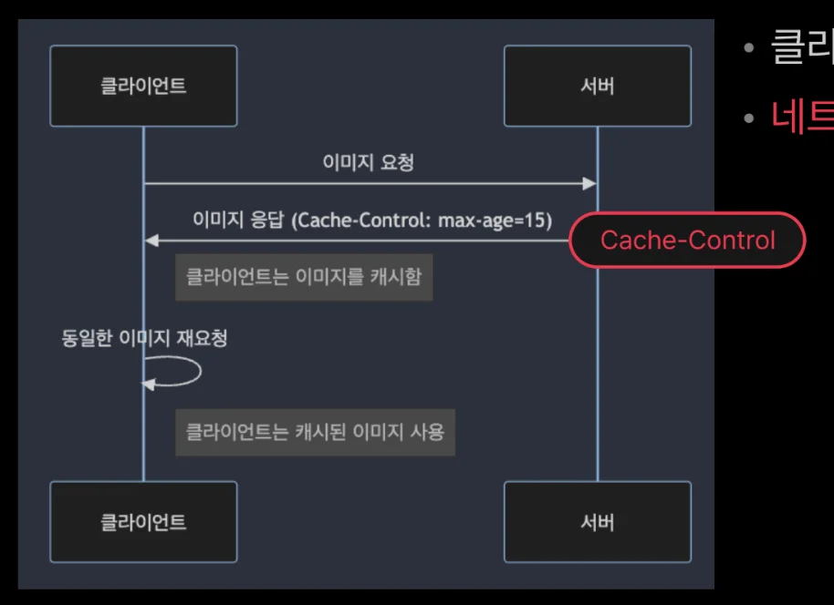

- 클라이언트가 응답을 캐시(임시 저장) 할 수 있어야 함

- 네트워크 대역폭 사용 감소, 성능 향상

> ETag (Entity Tag)

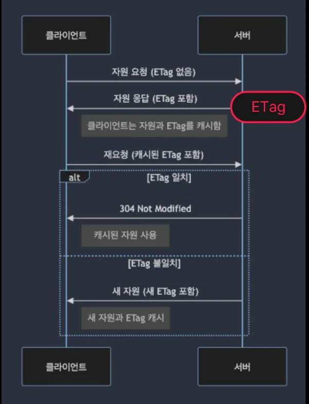

- ETag(Entity Tag)는 웹 서버가 자원(예&#58; 웹 페이지, 이미지)의 특정 버전을 식별하는 데 사용하는 메커니즘

- 자원의 내용이 변경될 때마다 갱신되는 고유한 식별자

<code>코드 온 디맨드 (Code on Demand)</code> (선택)

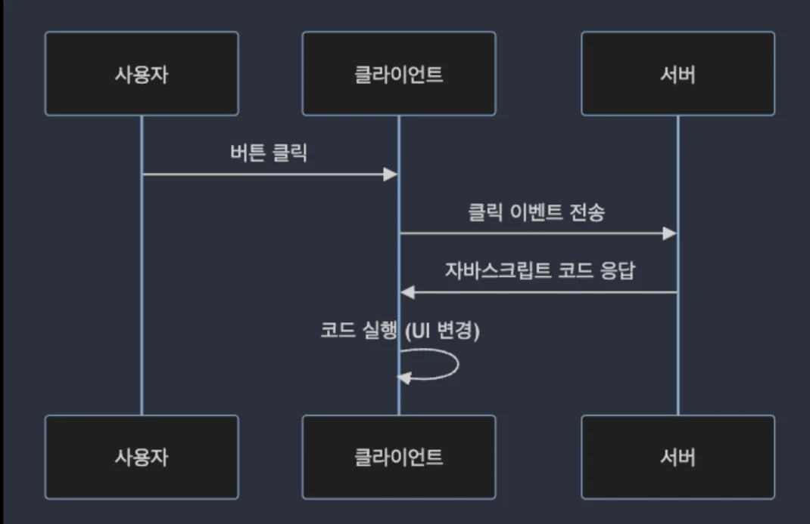

- 서버가 코드를 클라이언트에 전송하고, 클라이언트가 그 코드를 실행

- 클라이언트 기능의 확장성

<code>일관된 인터페이스 (Uniform Interface)</code>

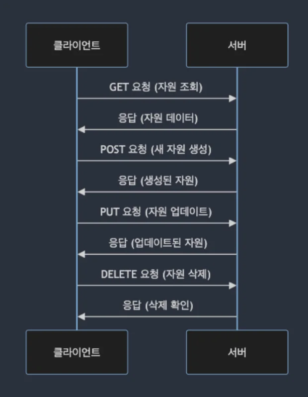

> API 구성과 동작 방식을 일관되게 유지하고, 사용자가 예측 가능하도록 함

- <code>자원의 식별</code>
    - 웹 리소스는 <strong><u>고유한 URI (Uniform Resource Identifier)</u></strong>를 통해 식별

- <code>자원에 대한 표현 (Presentation)을 통한 상호작용</code>
    - JSON, XML 등의 형식으로 표현된 자원을 통해 서버와 상호작용

- 자기 기술적 메시지 (self&#45;descriptive message)
    - 요청과 응답은 충분한 정보를 포함하여 자체적으로 이해될 수 있어야 함

- <code>애플리케이션 상태의 하이퍼미디어 엔진(HATEOAS)</code>
    - 클라이언트는 응답에 포함된 하이퍼링크를 통해 다른 상태로 전이 가능

## 3&#46; REST API의 장점 및 활용 사례

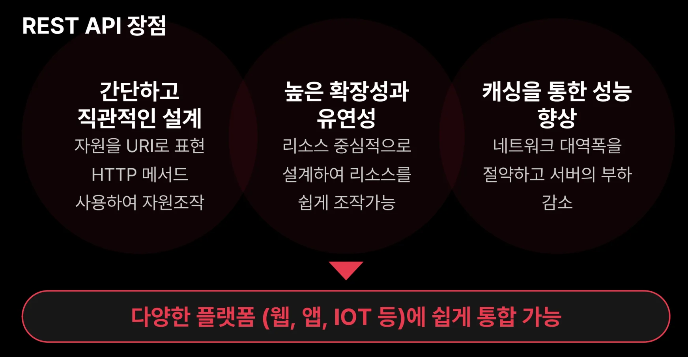

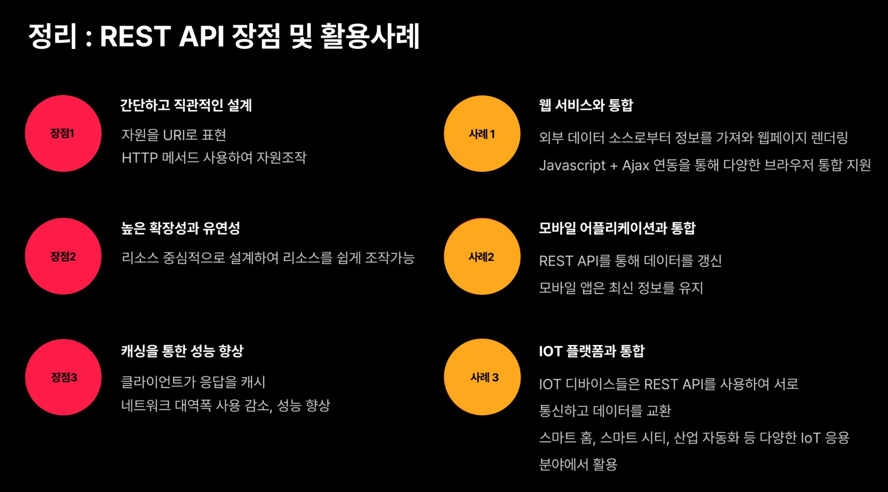

REST API 활용 사례 1&#58; <code>모바일 앱</code>

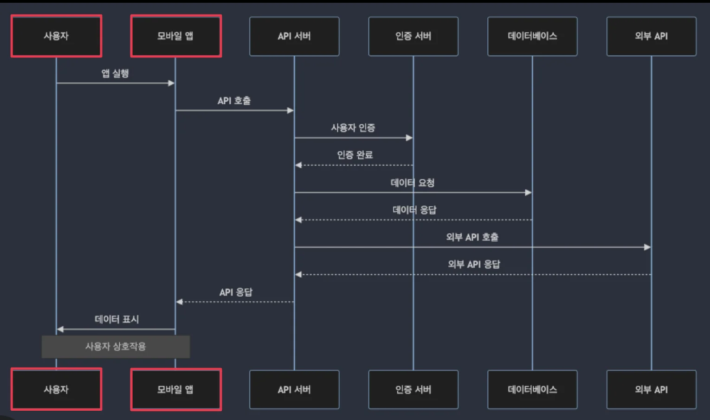

REST API 활용 사례 2&#58; <code>IoT 디바이스</code>

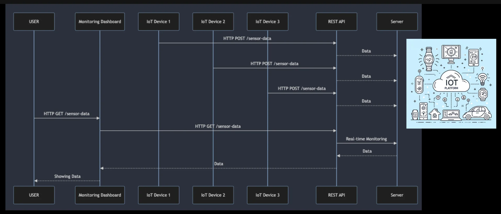

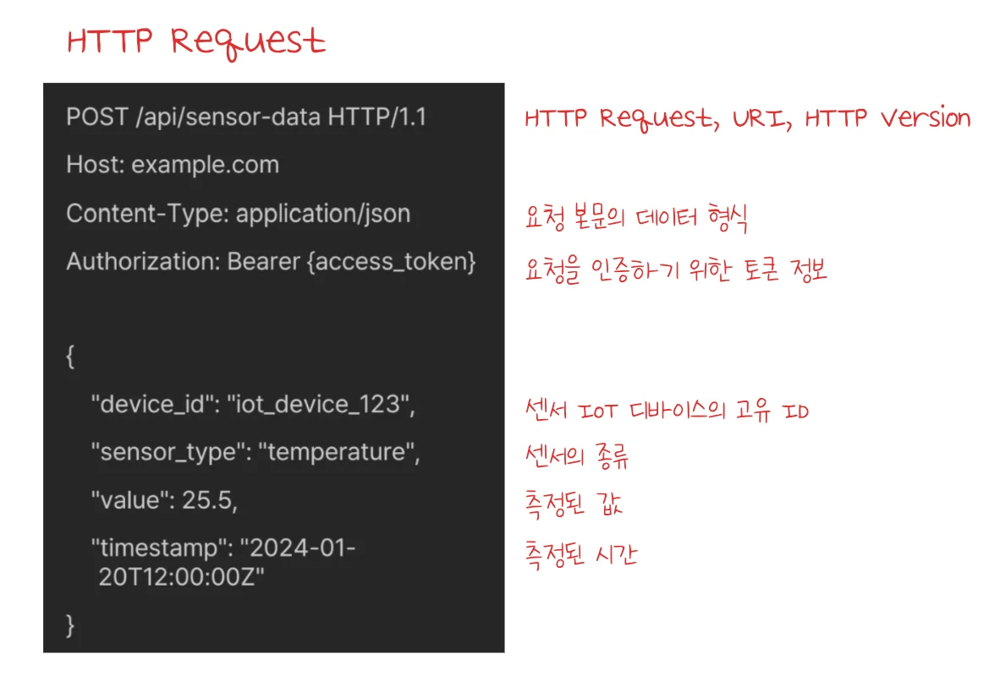

REST API 활용 사례 3&#58; <code>클라우드 서비스</code>

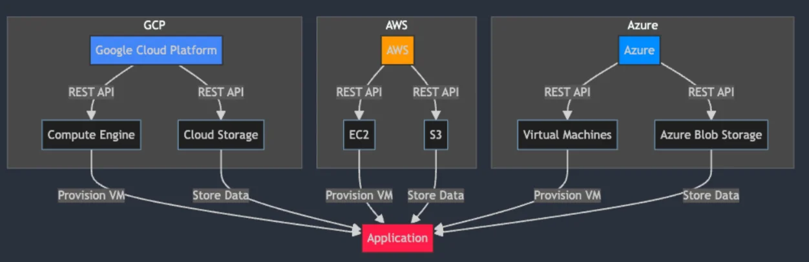

적용 사례

> ✏️ 
> 
> - 글로벌 국내 대기업들은 REST API를 활용하여 서비스를 제공하고 플랫폼을 확장
> 
> - REST API 외에도 GraphQL과 같은 새로운 API 기술이 등장하고 있으며, 선택적으로 채택

- Meta Open API
    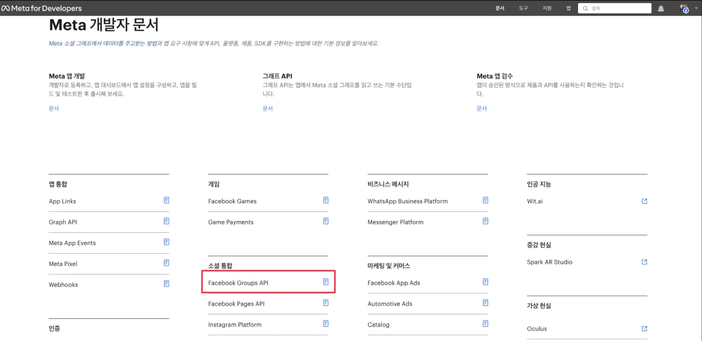

    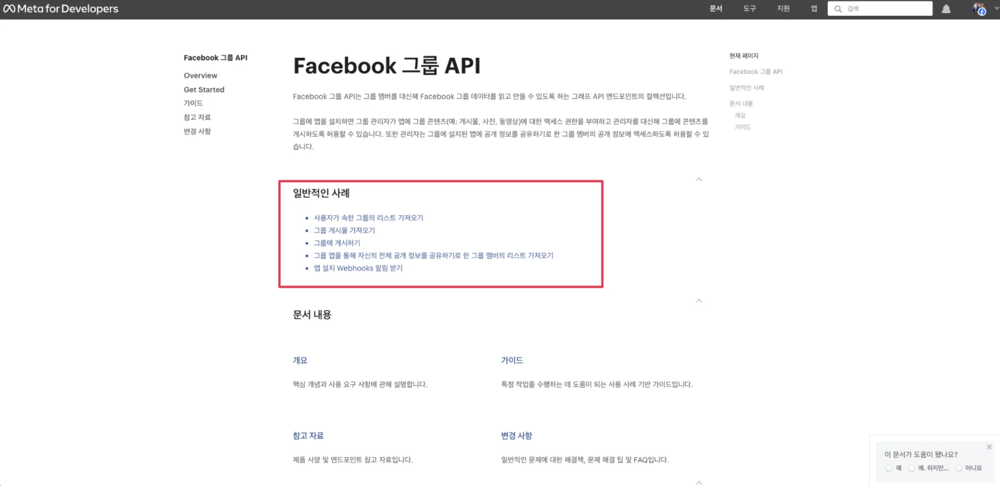

- Facebook OpenAPI
    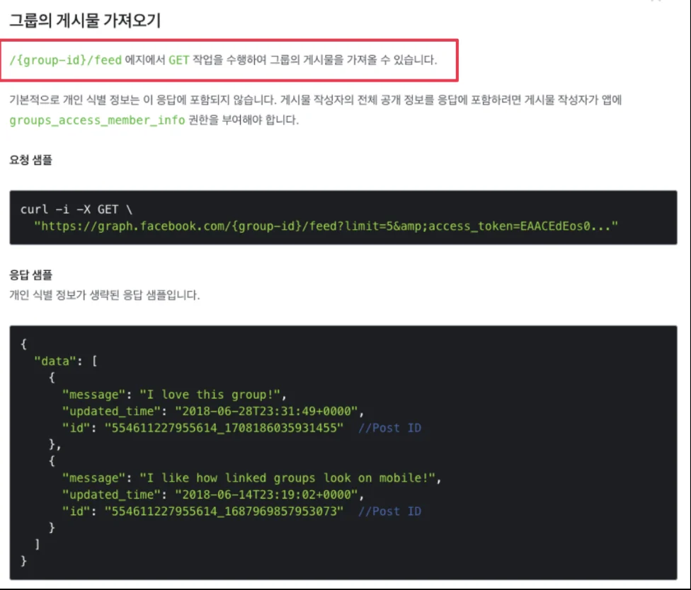

    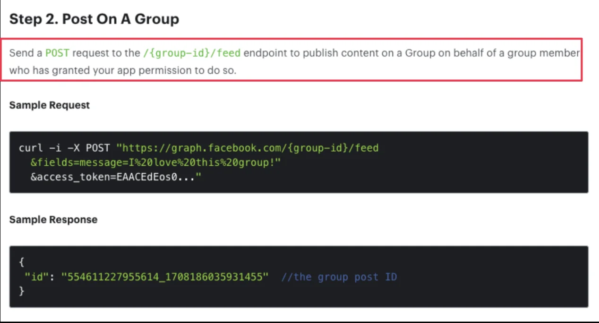

