

## API Gateway 개요 및 도입

---

> 📖 
> 
> 
> 
> <strong>API Gateway 개요</strong>
> 
> 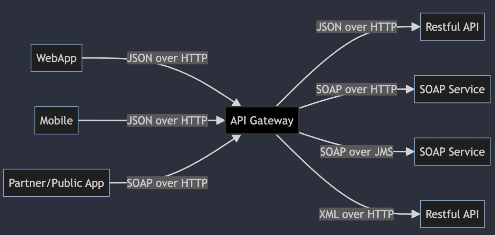
> 
> - 다양한 클라이언트와 백엔드 서버 간의 통신 중계
> 
> - API Gateway를 통해 여러 서비스와 복잡한 통신을 한 곳에 관리
>     - 하나의 통합 인터페이스로 구성하여 개발 용이
> 
>     - 보안, 사용량 제한, 인증 과 같은 중요한 기능들은 gateway에서 처리하여 각각의 서비스에서 개별적으로 다루는 것보다 효율적

API Gateway 패턴이 생기게 된 배경

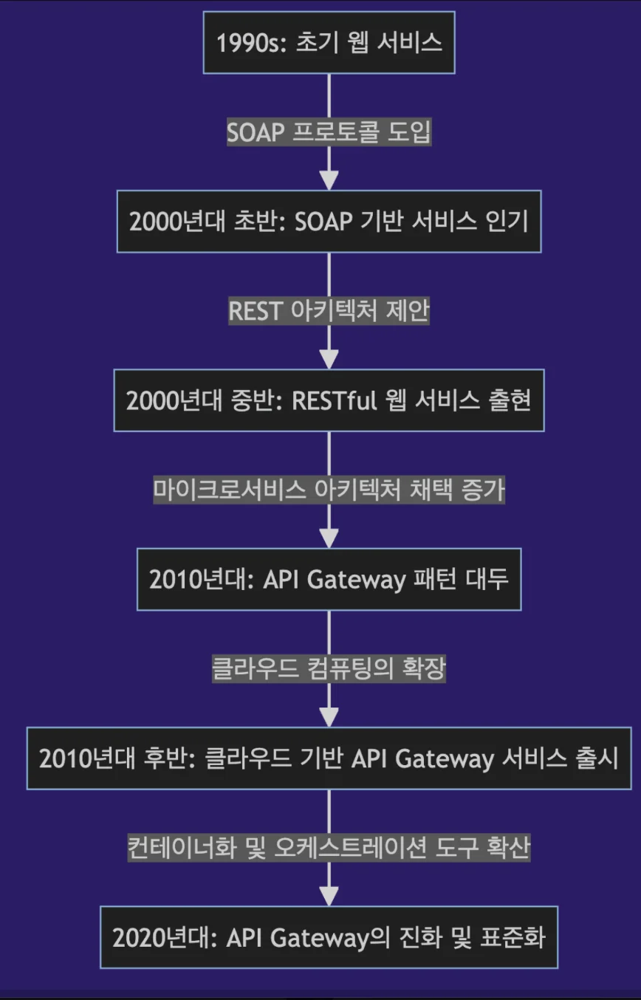

- <code>API Gateway 패턴</code>은 <strong><u>모놀리식 아키텍처의 한계를 극복</u></strong>하고 <strong><u>SOA 및 마이크로서비스의 발전을 수용</u></strong>하여 <strong><u>복잡한 서비스 간 통신</u></strong>을 <strong><u>단순화</u></strong>하고 <strong><u>중앙화</u></strong>

- RESTful API의 등장은 효율적인 HTTP 통신을 가능하게 하며, 마이크로서비스 아키텍처로 전환을 가속화시켜 서비스 분리 촉진

- 클라우드 컴퓨팅의 성장과 함께 API Gateway는 인증, 로드 벨런싱 등의 기능을 통합하며 마이크로서비스 애플리케이션에 필수적인 구성요소 

API Gateway의 주요 특징

- 애플리케이션의 개발과 운영 간편화

- 서비스 간의 통합을 단순화 하고 중복을 방지

- 보안 및 모니터링을 통해 안전한 통신 환경 제공

## API Gateway 역할 및 특징

---

> 📖 
> 
> 
> 
> API Gateway의 주요 역할(특징)
> 
> - 애플리케이션의 개발과 운영 간편화
> 
> - 서비스 간의 통합을 단순화 하고 중복을 방지
> 
> - 보안 및 모니터링을 통해 안전한 통신 환경 제공

### API Gateway 의 다양한 특징

> ✏️ 
> 
> - Backend For Frontend(BFF)
> 
> - 다양한 서비스 등록, 탐색 (Service Registry and Discovery)
> 
> - 외부 구성 저장소  (External Configuration Store)
> 
> - 마이크로서비스 인증/인가 (Authentication and Authoriztion)
> 
> - 장애 및 실패 처리를 위한 서킷 브레이커 (Circuit Breaker)
> 
> - 모니터링, 추적 (Monitoring and Tracing)
> 
> - 중앙화된 로그 집계 (Centralized Log Aggregation)

API Gateway 의 다양한 특징&#58; <code>BFF</code>

- 일반적인 API Gateway
    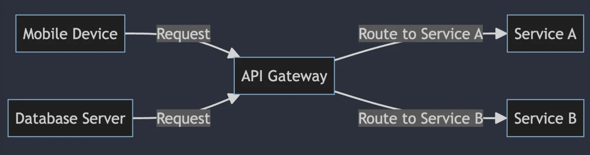

- 웹, 모바일 등에 맞는 API 제공
    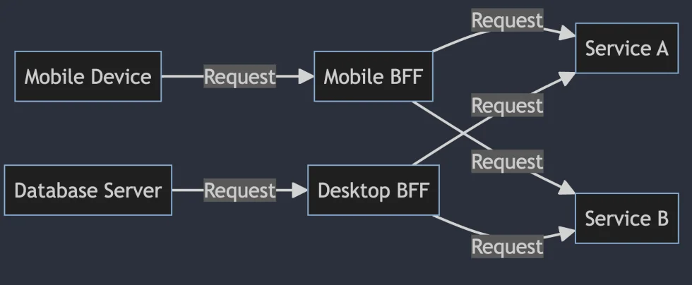

API Gateway 의 다양한 특징&#58; <code>Service Registry and Discovery</code>

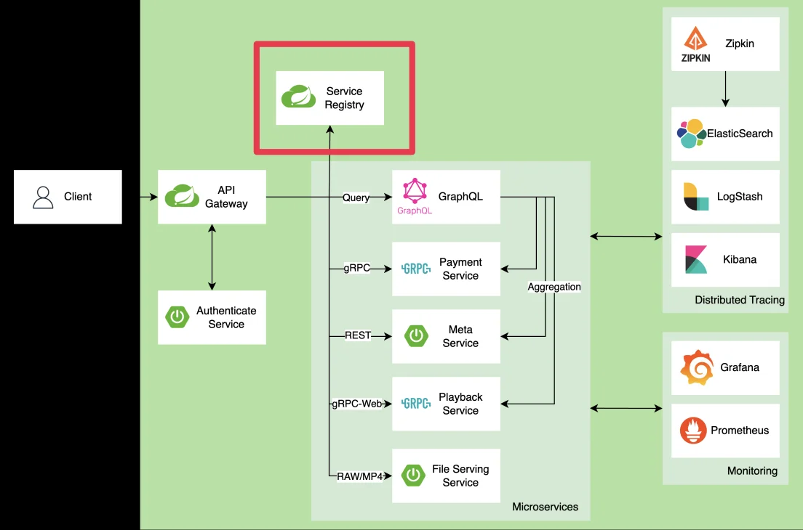

- <code>레지스트리</code>
    - 서비스의 주소, 상태 정보를 중앙 관리하는 시스템

- <code>디스커버리</code>
    - 클라이언트가 레지스트리에서 서비스 정보를 조회하여 동적으로 서비스를 찾을 수 있는 메커니즘

API Gateway 의 다양한 특징&#58; <code>External Configuration Store</code>

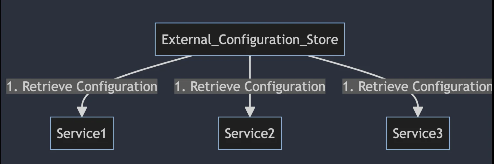

- <strong>구성 설정을 외부 시스템에서 관리</strong>

- 서비스 코드와 구성을 분리함으로써 구성 변경이 서비스 재배포 없이 이루어질 수 있게 함

API Gateway 의 다양한 특징&#58; <code>Authentication and Authorization</code>

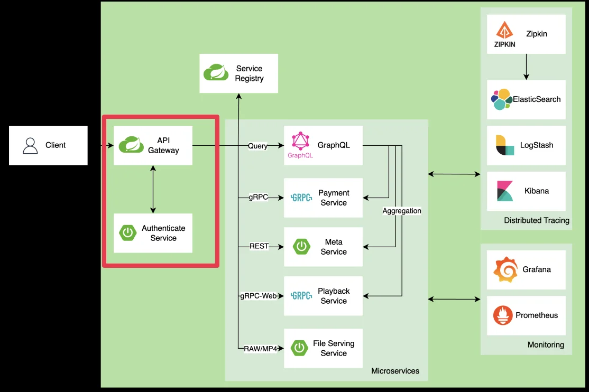

- 마이크로서비스 아키텍처에서 보안을 관리하는데 사용

- 사용자의 신원 확인과 권한 부여를 처리하여 시스템의 보안 강화

- 주로 <code>JWT</code>, <code>OAuth</code> 와 같은 표준 프로토콜을 사용하여 구현

API Gateway 의 다양한 특징&#58; <code>Circuit Breaker</code>

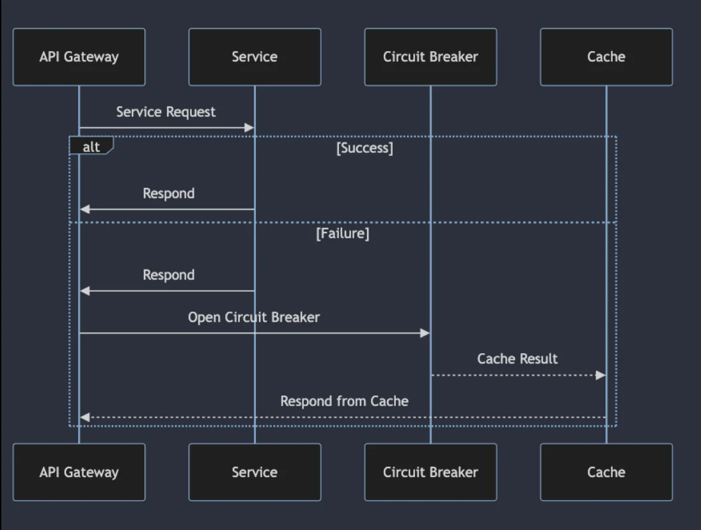

- 마이크로서비스 아키텍처에서 사용되며, 원격 서비스 호출의 장애 관리

- 실패가 발생하면 장애가 확산되는 것을 방지하기 위해 서비스 호출 호출을 중단하고, 다운스트림 서비스에 더 큰 영향을 방지

API Gateway 의 다양한 특징&#58; <code>Monitoring and Tracing</code>

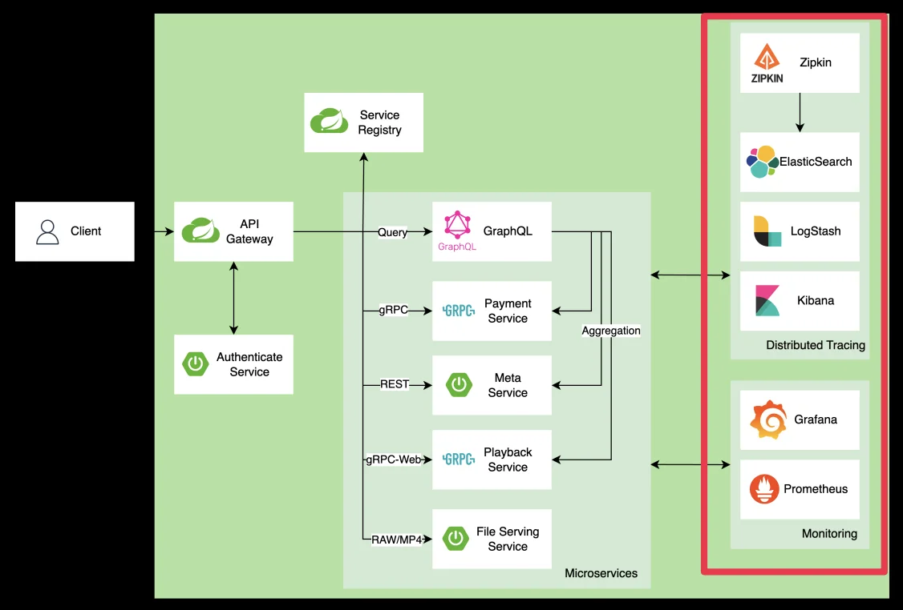

- <strong><u>시스템의 상태를 모니터링</u></strong>하고<strong> </strong><u>문제를 추적</u>하기 위해 <strong><u>로그 데이터와 메트릭을 수집하고 분석</u></strong>

- 시스템의 실시간 상태 파악과 문제 발생 시 빠른 대응을 가능하게 함

API Gateway 의 다양한 특징&#58; <code>Centralized Log Aggregation</code>

- <strong><u>시스템에서 발생하는 로그</u></strong>를 <strong>중앙 위치에서 수집하여 저장</strong>하는 패턴

- 여러 서비스에서 발생한 로그를 통합하여 효율적으로 분석하고, 문제 해결과 성능 최적화에 활용

## API Gateway 여러가지 사례

---

> 📖 
> 
> - <code>Netflix</code>&#58; Zuul
> 
> - <code>Airbnb</code>&#58; Envoy Proxy (Service Mesh)
> 
> - <code>Amazon</code>&#58; Amazon API Gateway
> 
> - <code>Spring</code>&#58; Spring API Gateway

<code>Netflix</code>&#58; Zuul

[Announcing Zuul&#58; Edge Service in the Cloud]()

####  Netflix &#45;  Zuul

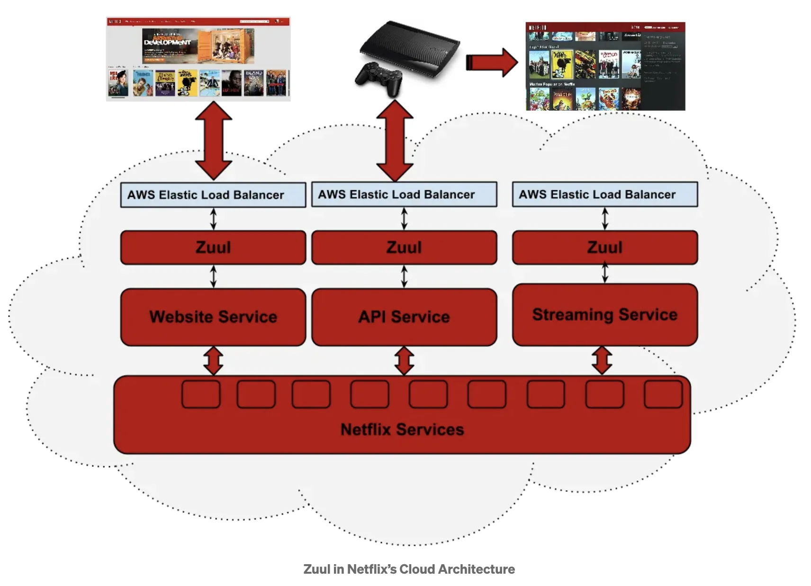

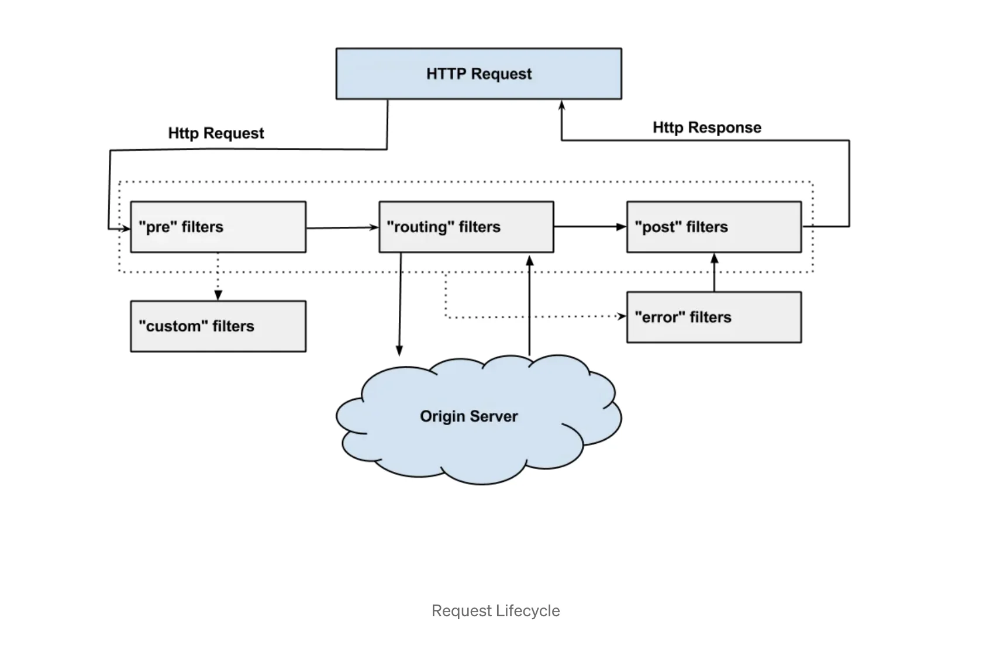

####  Netflix &#45;  Zuul의 대체제  

> ✏️ 
> 
> - 2018년 12월에  Maintenance Mode로 전환되어 신규 기능 개발 중단
> 
> - <code>Zuul2</code>, <code>Spring Cloud Gateway</code>로 전환

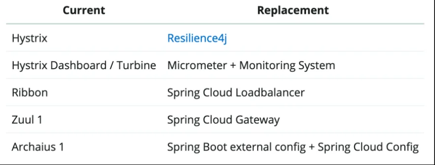

<code>Airbnb</code>&#58; Envoy

[Welcome to Envoy Gateway]()

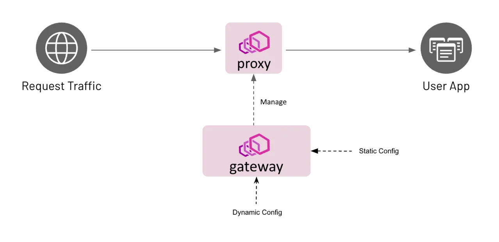

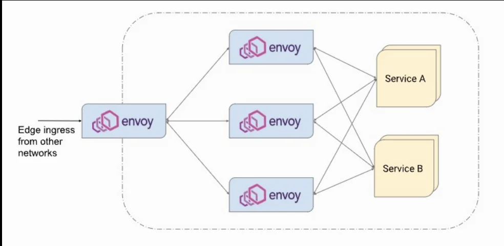

- 동적 Service Discovery

- Load Balancing

- 풍부한 Observerbility

- 고성능

- 프로그래밍 가능

<code>Amazon</code>&#58; Amazon API Gateway

[API 관리 — 아마존 API 게이트웨이 — AWS]()

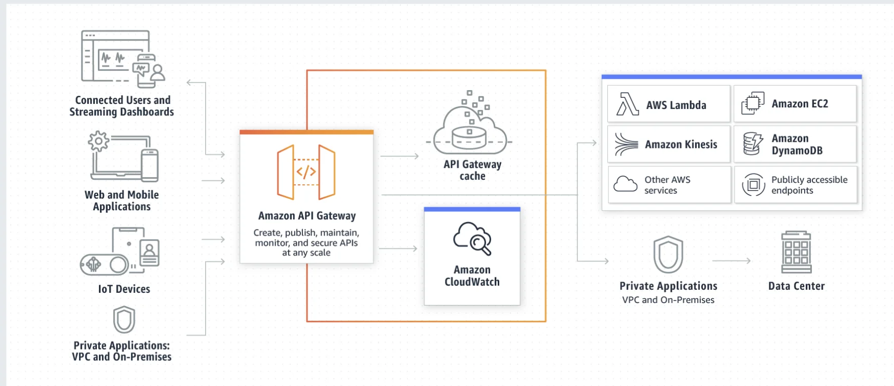

<code>Spring</code>&#58; Spring API Gateway

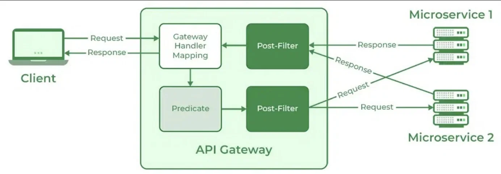

- 비동기 I/O

- 리액티브 프로그래밍

- 다양한 라우팅 규칙

- 필터

- 통합 모니터링과 추적

- 쉬운 확장성

