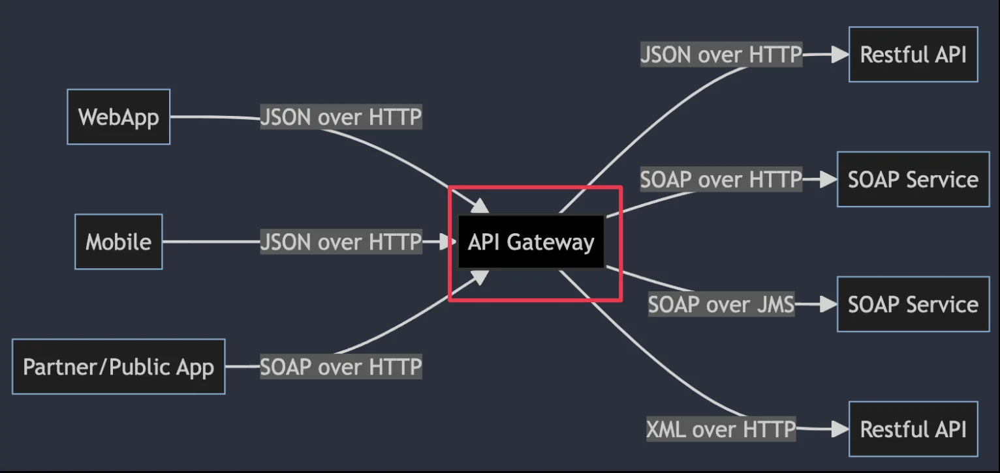
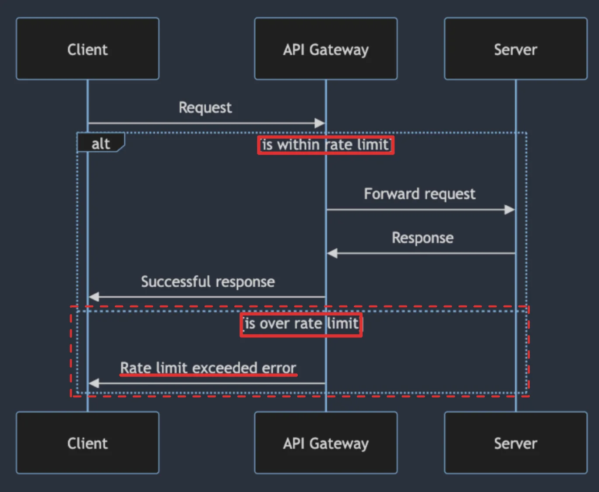
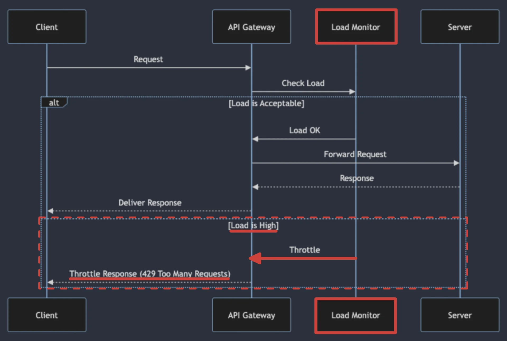
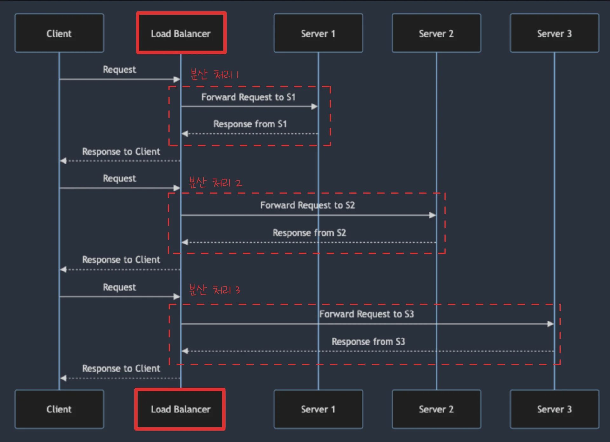
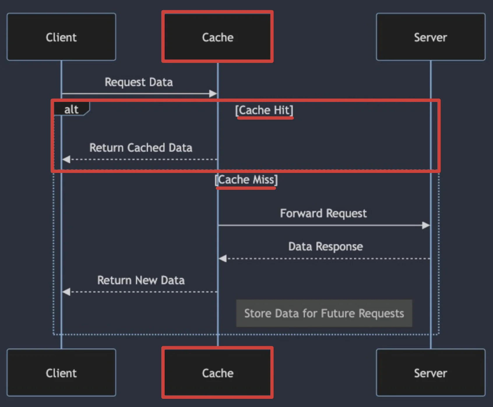

<a id="3ebeda9b0fe180778b71ecfbf5e43c7e"></a>

## 트래픽 제어의 중요성

---

> 🤔 
> 
> <a id="3ebeda9b0fe180869f7df63c13bc2fcf"></a>
> 
> <code>트래픽 제어</code>란?
> 
> 
> 
> - 클라이언트로부터 오는 요청을 관리, 조절, 그리고 최적화하는 과정을 의미
> 
> - 서버 오버로드 방지, 서비스의 안정적인 운영, 그리고 사용자 요청에 대한 효율적인 처리 가능

> 📖 
> 
> <a id="3ebeda9b0fe180cb9c0be862dbdd9295"></a>
> 
> <strong>트래픽 제어의 중요성</strong>
> 
> - <code>서비스 가용성 유지</code>&#58; 과도한 트래픽으로 인한 서버 다운을 방지하여 서비스의 안정성 보장
> 
> - <code>성능 최적화</code>&#58; 서비스의 응답 시간을 개선하여 최종 사용자에게 더 나은 경험 제공
> 
> - <code>바용 최적화</code>&#58; 리소스 사용을 최적화하여 클라우드 인프라 비용 관리
> 
> - <code>보안 강화</code>&#58; 악의적인 트래픽을 차단하여 시스템 보호 

<a id="3ebeda9b0fe1805d8fe6e5ed35dd15d0"></a>

### 트래픽 제어 여러가지 방법

> ✏️ 
> 
> - <code>Rate Limiting</code>&#58; 특정 시간 동안 허용되는 요청의 수를 제한하여 과도한 요청 방지
> 
> - <code>Throttling</code>&#58; 서버의 부하가 증가할 때 요청 처리 속도를 자동으로 조절하여 서버가 과부하 상태에 이르는 것을 방지
> 
> - <code>Load Balancing</code>&#58; 들어오는 트래픽을 여러 서버에 분산시켜 처리 능력을 극대화하고 단일 실패지점 제거
> 
> - <code>Caching</code>&#58; 자주 요청되는 데이터를 임시로 저장하여 빠르게 응답할 수 있게 함

> 🤔 
> 
> <a id="3ebeda9b0fe180578918c6893be26144"></a>
> 
> <code>Rate Limiting</code> vs <code>Throttling</code>
> 
> - <code>Rate Limiting</code>은 주로 고정된 시간 동안 <strong><u>특정 사용자 또는 클라이언트로</u></strong><strong>부터 </strong><strong>허용되는 요청의 최대 수를 제한</strong>하는 데 초점
> 
> - <code>Throttling</code>은 <strong><u>시스템의 부하를 동적으로 관리</u></strong>하기 위해 <strong>요청의 처리 속도 조절</strong>

<details>
<summary>트래픽 제어 여러가지 방법&#58; <code>Rate Limiting</code></summary>



- <strong>일정 기간 동안에 서버로 들어오는 요청 수 제한</strong>

- API Gateway는 사용자의 IP 주소, 사용자 계정, 토큰, API 엔드포인트 등 다양한 기준으로 요청을 구분하고, 이들 각각에 대해 허용할 수 있는 요청의 최대 수 설정

</details>

<details>
<summary>트래픽 제어 여러가지 방법&#58; <code>Throttling</code></summary>



- <strong>서버 부하에 따라 요청 처리 속도를 동적으로 조절</strong>
    - 부하 감지

    - 부하에 따른 조절

    - 정상 상태 복구

</details>

<details>
<summary>트래픽 제어 여러가지 방법&#58; <code>Load Balancing</code></summary>



- 최대화하고 서버에 고르게 부하를 분산시켜 각 서버가 최적의 성능을 유지할 수 있도록 하는 것
    - 트래픽 분산

    - 알고리즘 적용

    - 상태 확인

    - 유연한 확장성

</details>

<details>
<summary>트래픽 제어 여러가지 방법&#58; <code>Caching</code></summary>



- 요청에 대한 응답을 메모리 또는 파일 시스템에 저장

- 동일한 요청이 발생했을 때 빠르게 응답 제공

- 서버의 처리 부하를 줄이고 사용자에게 더 나은 경험을 제공
    - <code>초기 요청 처리</code>

    - <code>캐시 저장</code>

    - <code>캐시 히트와 미스</code>

</details>

<a id="3ebeda9b0fe1808a96d9f0642c95f8d4"></a>

## 트래픽 제어 구현 사례

---

<a id="3ebeda9b0fe180dab8f6c7eeaa92bb41"></a>

### 트래픽 제어 구현 사례&#58; <code>Rate Limiting</code>

> 💬 
> 
> <a id="3ebeda9b0fe18088b0d6efdb8d9b8d48"></a>
> 
> <strong>다양한 Rate Limiting 알고리즘</strong>
> 
> - <code>고정 윈도우 알고리즘 (Fixed Window Algorithm)</code>
>     - 가장 단순한 Rate Limit 알고리즘
> 
> - <code>슬라이딩 로그 알고리즘 (Sliding Log Algorithm)</code>
>     - 윈도우 내에 있는 로그의 수를 계산하여 요청이 제한을 초과하는 지 판단
> 
> - <code>슬라이딩 윈도우 카운터 알고리즘 (Sliding Window Counter Algorithm)</code>
>     - 고정 윈도우와 슬라이딩 로그의 장점 결합
> 
> - <code>토큰 버킷 알고리즘 (Token Bucket Algorithm)</code>
>     - 일정한 속도로 토큰을 버킷에 추가, 버킷이 가득찬 경우 API 요청 버림
> 
> - <code>럭키 버킷 알고리즘 (Leaky Bucket Algorithm)</code>
>     - 토큰 버킷과 비슷하지만, 고정 큐로 FIFO로 구현

> ✏️ 
> 
> - Spring에서는 주로 <code>인터셉터</code>나 <code>필터</code>를 사용하여 <strong><u>Rate Limiting 구현</u></strong>
> 
> - 요청 IP 주소나 사용자 ID를 기반으로 요청 수를 카운팅하고, 설정된 한계를 초과하는 경우 요청을 거부
> 
> - 관련 라이브러리
>     - <code>Bucket4j</code>
> 
>     - <code>Spring Cloud Gateway</code>

<details>
<summary>ex) Rate Limiting&#58; <code>Bucket4j</code></summary>

<a id="3ebeda9b0fe18030b051fa926f518b39"></a>

```java
@Component
public class RateLimitInterceptor implements HandlerInterceptor {
	private final Map<String, Bucket> buckets = new ConcurrentHashMap<>();
	
	@Override
	public boolean preHandle(HttpServletRequest request, HttpServletResponse response, Object handler) throws Exception {
		String ip = request.getRemoteAddr();
		Bucket bucket = buckets.computeIfAbsent(ip, this::createBucket);
		
		// 요청이 성공적으로 처리됨
		if (bucket.tryConsume(1)) { 
			return true;
		} else { 
		// rate limit 에 도달햇을 경우, HTTP 429 오류를 반환
			response.setContentType("text/plain");
			response.setStatus(HttpServletResponse.SC_TOO_MANY_REQUESTS);
			response.getWriter().append("Too many requests");
			return false;		
		}
	}
	
	private Bucket createBucket() {
		// 시간 당 100개의 요청을 허용하는 rate limit 정책
		Bandwidth limit = Bandwidth.classic(100, Refill,greedy(100, Duration.ofHours(1)));
		return Bucket4j.builder().addLimit(limit).build();
	}
}
```

</details>

<details>
<summary>ex) Rate Limiting&#58; <code>Spring Cloud Gateway</code></summary>

- 스프링 클라우드 config 설정
    <a id="3ebeda9b0fe180d3895ae1d2d4861e95"></a>

    ```yaml
    spring:
    	cloud:
    		gateway:
    			routes:
    				- id: example-route
    					uri: http://example.com
    					predicates:
    						- Path=/example/**
    					filters:
    						- name: RequestRateLimiter
    							args:
    								redis-rate-limiter.replenishRate: 5
    								redis-rate-limiter.burstCapacity: 10
    								key-resolver: "#{@ipKeyResolver}"

    redis:
    	host: localhost
    	port: 6379
    ```

- 빈 등록
    <a id="3ebeda9b0fe180e1b6bfe37868d63a08"></a>

    ```java
    import org.springframework.cloud.gateway.filter.ratelimit.KeyResolver;
    import org.springframework.context.annotation.Bean;
    import org.springframework.context.annotation.Configuration;
    import reactor.core.publisher.Mono;


    @Configuration
    public class RateLimiterConfig {

    	@Bean
    	KeyResolver ipKeyResolver() {
    		return exchange -> Mono.just(exchange.getReqeust().getRemoteAddress().getHostName());
    	}
    }
    ```

</details>

<a id="3ebeda9b0fe18072b177f5a40ee8bc80"></a>

### 트래픽 제어 구현 사례&#58; <code>Throttling</code>

> ✏️ 
> 
> - 서버 부하를 조절하여 과부하를 방지하고, 시스템의 안정성을 보장하기 위함
> 
> - Spring 에서 Throttling은 주로 서비스 또는 컨트롤러 레벨에서 구현되며, 요청의 처리량을 조절
> 
> - 관련 라이브러리
>     - <code>Resilience4j</code>

<details>
<summary>ex) Throttling&#58; <code>Resilience4j</code></summary>

- Resilience4j Config 설정
    <a id="3ebeda9b0fe18078b5b6e1c47ee5108d"></a>

    ```yaml
    resilience4j.ratelimiter:
    	instances:
    		backendA:
    			limitForPeriod: 10
    			limitRefreshPeriod: 1s
    			timeoutDuration: Oms
    ```

- Spring
    <a id="3ebeda9b0fe1806195f7f3affbc34e9b"></a>

    ```java
    import io.github.resilience4j.ratelimiter.annotation.RateLimiter;
    import org.springframework.stereotype.Service;

    @Service
    public class RateLimitedService {
    	
    	@RateLimiter(name = "backendA")
    	public String rateLimitedMethod() {
    		return "This is a rate limited response";
    	}
    }
    ```

</details>

<a id="3ebeda9b0fe180e2965dc09cbccce739"></a>

### 트래픽 제어 구현 사례&#58; <code>Load Balancing</code>

> ✏️ 
> 
> - 들어오는 트래픽을 여러 서버에 분산시켜 전체 시스템의 처리 능력을 향상시키기 위함
> 
> - Spring Cloud에서는 <code>서비스 레지스트리(ex&#46; Eureka)</code>와 함께 <code>Ribbon</code> 이나 <code>Spring Cloud LoadBalancer</code>를 사용하여 클라이언트 측 로드 벨런싱 구현
> 
> - 관련 라이브러리
>     - <code>Spring Cloud LoadBalancer</code>

<details>
<summary>ex) LoadBalancer&#58; <code>Spring Cloud LoadBalancer</code></summary>

- LoadBalancer Config 설정
    <a id="3ebeda9b0fe18052b8d1e3f2cf926657"></a>

    ```java
    @Configuration
    public class AppConfig {
    	
    	@Bean
    	@LoadBalanced
    	public RestTemplate loadBalancedRestTemplate() {
    		return new RestTemplate();
    	}
    }
    ```

- 서비스 레이어 정의
    <a id="3ebeda9b0fe180db9473d1b1aafe7d1b"></a>

    ```java
    import org.springframework.bean.factory.annotation.Autowired;
    import org.springframework.stereotype.Service;
    import org.springframework.web.client.RestTemplate;

    @Service
    public class ExampleService {
    	
    	@Autowired
    	private RestTemplate restTemplate;
    	
    	public String callService(String serviceName) {
    		String url = "http://" + serviceName + "/some-endpoint";
    		return restTemplate.getForObject(url, Spring.class);
    	}
    }
    ```

</details>
