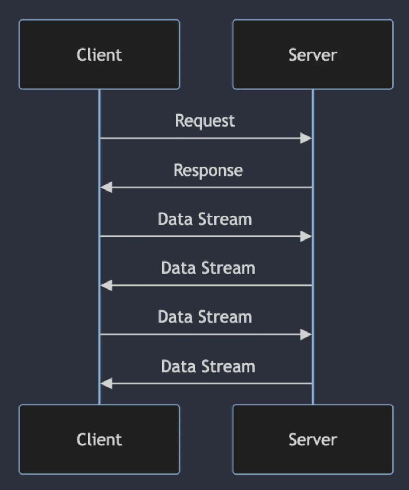
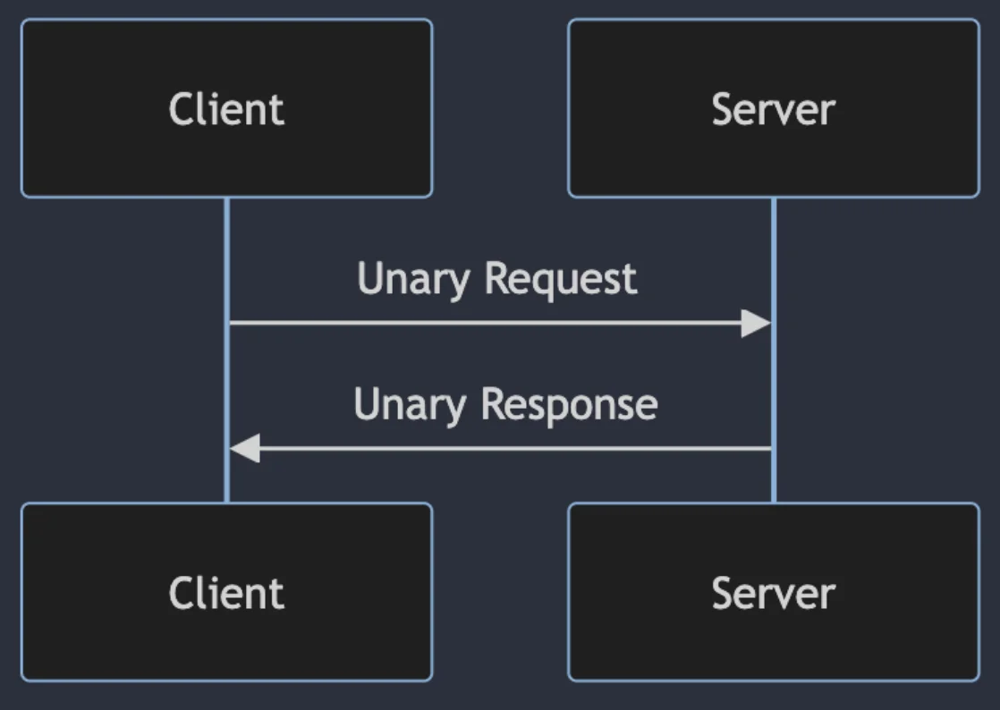
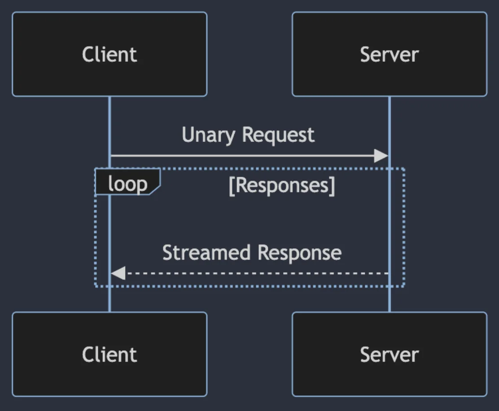
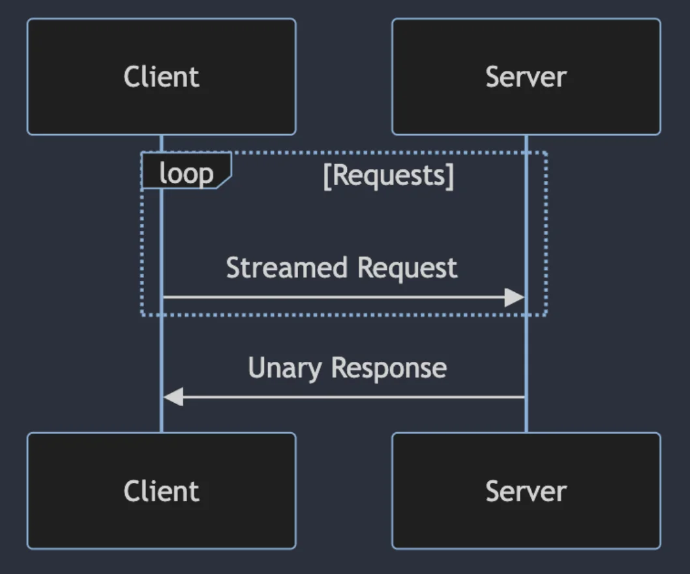
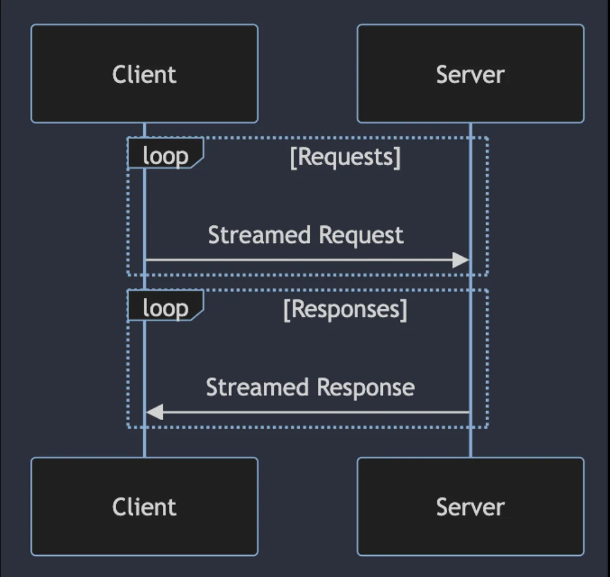
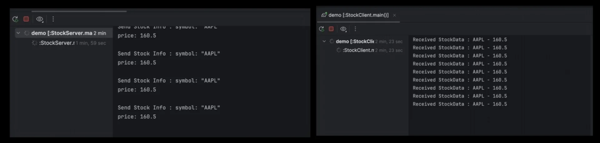
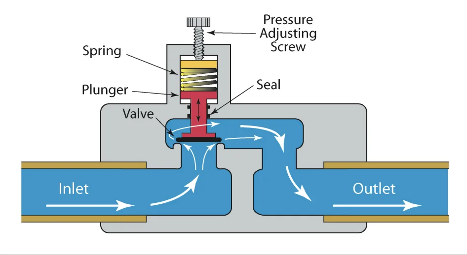
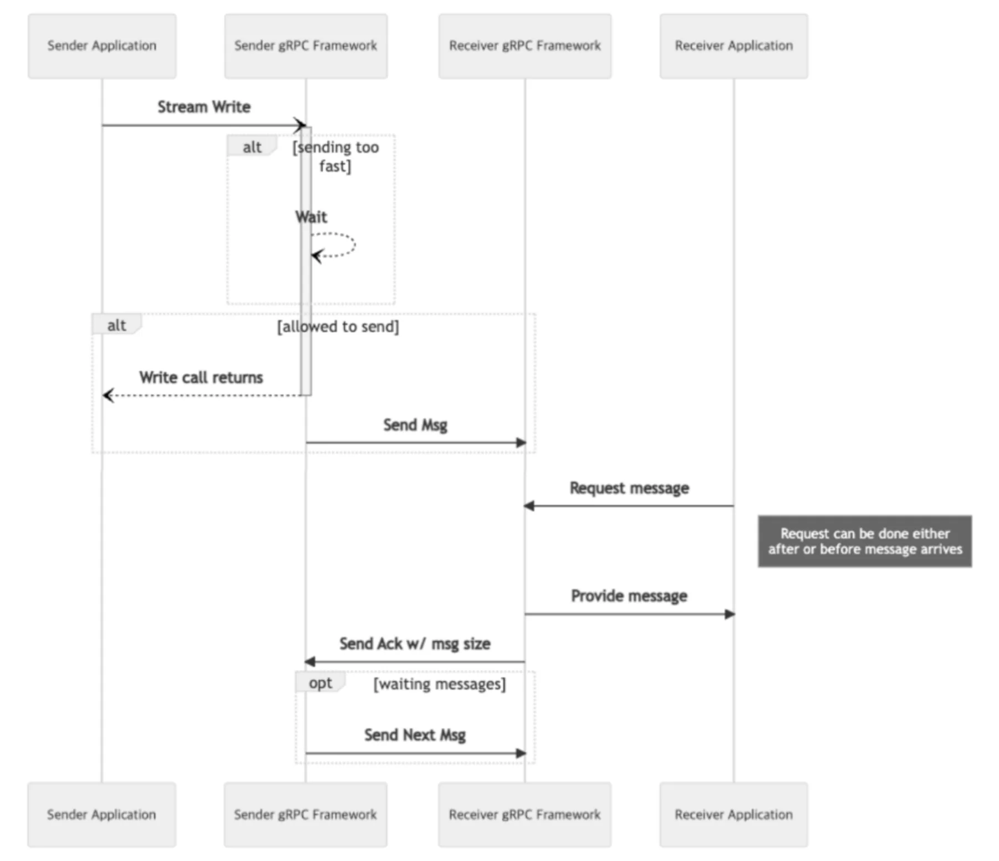

<a id="3deeda9b0fe18020b614e07206515662"></a>

## gRPC 스트리밍 이해

---

> 📖 
> 
> <a id="3e1eda9b0fe1807ca368fc0bb5448e9b"></a>
> 
> <strong><code>gRPC 스트리밍</code></strong>
> 
> 
> 
> <a id="3e1eda9b0fe180ce9999f025f694f7a0"></a>
> 
> <code>gRPC 프로토콜</code>을 사용하여 <br><strong><u>클라이언트와 서버 간</u></strong>에 <strong><u>지속적인 데이터 스트림을 주고 받</u></strong>는 방법

<a id="3deeda9b0fe180809479d9e87952347e"></a>

### &#91;개념&#93; gRPC 통신 방식

<details>
<summary>1&#46; 단일 요청/단일 응답 (Unary RPC)</summary>



- 가장 기본적인 gRPC 통신 방식

- 클라이언트가 서버에 단일 요청

- 서버가 단일 응답 반환

</details>

<details>
<summary>2&#46; 서버 스트리밍 RPC (Server Streaming RPC)</summary>



- 클라이언트가 서버에 단일 요청

- 서버가 스트림 응답 반환

</details>

<details>
<summary>3&#46; 클라이언트 스트리밍 RPC (Client Streaming RPC)</summary>



- 클라이언트가 서버에 스트림 전송

- 서버가 단일 응답 반환

</details>

<details>
<summary>4&#46; 양방향 스트리밍 RPC (Bidirectional Streaming RPC)</summary>



- 클라이언트&#45;서버가 데이터 스트림을 양방향으로 전송

- 실시간 상호작용 해야 할 떄 유용

</details>

<a id="3e1eda9b0fe18010b4b7e5268c320ddd"></a>

### &#91;예제&#93; gRPC 스트리밍 구현

<details>
<summary>1&#46; protobuf 정의</summary>

<a id="3e1eda9b0fe180019898e74fb3debdd6"></a>

```protobuf
syntax = "proto3";

option java_multiple_files = true;
option java_package = "com.example.grpc";
option java_outer_classnme = "StreamingProto";

service StreamingService {
	// 서버 스트리밍
	rpc ServerStreaming(Request) returns (stream Response);
	
	// 클라이언트 스트리밍
	rpc ClientStreaming(stream Request) returns (Response);
	
	// 양방향 스트리밍
	rpc BidirectionalStreaming(stream Request) returns (stream Response);
}
```

</details>

<details>
<summary>2&#46; 서버 스트리밍 구현</summary>

<a id="3e1eda9b0fe180faa210d1d18aa4151f"></a>

```java
import io.grpc.stub.StreamObserver;

public class StreamingServiceImpl extends StreamingServiceGrpc.StreamingServiceImplBase {
	@Override
	public void serverStreaming(Request request, StreamObserver<Response> responseObserver) {
			// 서버 스트리밍 로직 구현
			// 예를 들어, dataSource 에서 데이터를 가져와서 스트림으로 응답 전송
			for (Data data : dataSources) {
				Response response = Response.newBuilder().setData(data).build);
				reponseObserver.onNext(response);
			}
			
			responseObserver.onCompleted();
	}
}
```

</details>

<details>
<summary>3&#46; 클라이언트 스트리밍 구현</summary>

<a id="3e1eda9b0fe180ee8f45d4c96e74b091"></a>

```java
import io.grpc.stub.StreamObserver;

public class ClientStreamingClient {
	public void clientStreaming(StreamingServiceStub stub) {
		StreamObserver<Resposne> responseObserver = new StreamObserver<Response>() {

			@Override
			public void onNext(Response reponse) { // 서버로붵의 응답 처리 }

			@Override
			public void onError(Throwable t} { // 에러 처리 }

			@Override
			public void onCompleted() { // 완료처리 }
		};
		
		StreamOnserver<Request> requestObserver = stub.clientStreaming(responseObserver);
		
		for(Request request : requests) {
			requestObserver.onNext(request); // 클라이언트 스트리밍 요청
		}
		// 클라이언트 스트리밍 완료 안람 전송
		requestObserver.onCompleted();
		
	}
}
```

</details>

<details>
<summary>4&#46; 양방향 스트리밍 구현 (클라이언트)</summary>

<a id="3e1eda9b0fe180948e9bc53ac94e1fdb"></a>

```java
import io.grpc.stub.StreamObsever;

public void BidirectionalStreamingClient {
	public void bidirectionalStreaming(StreamingServiceStub stub) {
		StreamingObserver<Response> responseObserver = new StreamObserver<Response>() {

			@Override
			public void onNext(Response reponse) { // 서버로붵의 응답 처리 }

			@Override
			public void onError(Throwable t} { // 에러 처리 }

			@Override
			public void onCompleted() { // 완료처리 }
		};
		
		StreamOnserver<Request> requestObserver = stub.bidirectionalStreaming(responseObserver);
		
		for(Request request : requests) {
			requestObserver.onNext(request); // 클라이언트 스트리밍 요청
		}
		// 클라이언트 스트리밍 완료 안람 전송
		requestObserver.onCompleted();
	}
}
```

</details>

<details>
<summary>gRPC 스트리밍의 장점</summary>

- <code>효율성</code>
    - 대용량 데이터 처리

    - 실시간 통신

- <code>유연성</code>
    - 다양한 통신 패턴 지원

    - 복잡한 상호작용 가능 

</details>

<details>
<summary>주의사항</summary>

- 리소스 관리에 유의

- 다양한 오류 처리 필요성

- Backpressure 관리의 필요성

</details>

<details>
<summary>gRPC 스트리밍 모범 사례</summary>

- <code>스트림 관리 전략 수립</code>&#58; 타임아웃, 하트비트 또는 기타 커넥션 관리 구현 필요

- <code>메시지 크기 최적화</code>&#58; 메시지 정의를 최적화하여 필드를 효율적으로 사용

- <code>스트림 처리 로직 분리</code>&#58; 스트림 처리를 위한 별도의 서비스 또는 모듈 구성

- <code>동시성과 병렬 처리 활용</code>&#58; 양방향 스트리밍에서는 서버가 동시에 여러 클라이언트로 부터 스트림을 처리 해야함

- <code>오류 및 상태 모니터링</code>&#58; 스트리밍 서비스의 상태와 성능을 지속적으로 모니터링하고, 오류 발생 시 알람을 받을 수 있는 로깅 및 모니터링 시스템 구축

</details>

<a id="3deeda9b0fe18070a6f7c923a8209879"></a>

## gRPC 스트리밍 사용 예제

---

<a id="3deeda9b0fe180daa827e889b8675b86"></a>

### ex) 주식 시장

> ✏️ 
> 
> <a id="3e1eda9b0fe1802aa581fc983e187b85"></a>
> 
> &#91;예제&#93; 실시간 주식 시장 데이터를 클라이언트에게 스트리밍 하는 gRPC서버
> 
> 

<details>
<summary>1&#46; protobuf 정의</summary>

<a id="3e1eda9b0fe1807198dbf0d0a20b9153"></a>

```protobuf
syntax = "proto3";

package stock;

service StockService {
	// 서버 스트리밍
	rpc StreamStockData (StreamRequest) returns (stream StockData);
}

message StreamRequest {
	string clientId = 1;
}

message StockData {
	string symbol = 1;
	double price = 2;
}
```

</details>

<details>
<summary>2&#46; 서버 구현</summary>

<a id="3e1eda9b0fe180d79660dd23dccb03a5"></a>

```java
static class StockServiceImpl extends StockServiceGrpc.StockServiceImplBase {
	@Override
	public void streamStockData(
	        StreamRequest request,
	        StreamObserver<StockData> responseObserver
	) {
	    ServerCallStreamObserver<StockData> observer = (ServerCallStreamObserver<StockData>) responseObserver;
	
	    try {
	        while (!observer.isCancelled()) {  // 종료 조건: 클라이언트 연결 종료
	
	            StockData stockData = StockData.newBuilder()
	                    .setSymbol("AAPL")
	                    .setPrice(160.50)
	                    .build();
	
	            observer.onNext(stockData); // 스트림 형태로 데이터 전송 (서버 -> 클라이언트)
	
	            Thread.sleep(1000);
	        }
	    } catch (InterruptedException e) {
	        Thread.currentThread().interrupt();
	    }
	}
}
```

- <code>Thread&#46;sleep(1000)</code>
    <details>
    <summary>실무에서는 보통 <strong>스케줄러나 이벤트 기반으로 데이터를 push한다&#46;</strong></summary>

    <a id="3e1eda9b0fe1803198c9fd7eab4f4a79"></a>

    ```java
    Client
      │
      │ subscribe
      ▼
    gRPC Server
      │
      │ scheduler
      ├──── 1초 ────▶ onNext()
      ├──── 1초 ────▶ onNext()
      ├──── 1초 ────▶ onNext()
      │
    Client disconnect
      │
      ▼
    setOnCancelHandler()
      │
      ▼
    scheduled task cancel
    ```

    <a id="3e1eda9b0fe1802b974eeb24ee8a8576"></a>

    <strong>&#91; 코드 &#93;</strong>

    <a id="3e1eda9b0fe180b98036fffbe190ce1d"></a>

    ```java
    private final ScheduledExecutorService scheduler = Executors.newScheduledThreadPool(4);

    @Override
    public void streamStockData(
            StreamRequest request,
            StreamObserver<StockData> responseObserver
    ) {
        ServerCallStreamObserver<StockData> observer = (ServerCallStreamObserver<StockData>) responseObserver;

        ScheduledFuture<?> task = scheduler.scheduleAtFixedRate(() -> {
            if (observer.isCancelled()) {
                return;
            }

            StockData data = StockData.newBuilder()
                    .setSymbol("AAPL")
                    .setPrice(160.50)
                    .build();

            observer.onNext(data);

        }, 0, 1, TimeUnit.SECONDS);

        observer.setOnCancelHandler(() -> {
            task.cancel(false);
        });
    }
    ```

    </details>

</details>

<details>
<summary>3&#46; 클라이언트 구현</summary>

<a id="3e1eda9b0fe1801899e2fa2befa45cdb"></a>

```java
public class StockClient {
	public static void main(String[] args) {
		// 서버 채널 생성
		ManagedChannel channel = ManagedChannelBuilder.forAddress("localhost", 9090)
			.usePlaintext()
			.build();
		
		// stub 생성
		StockServiceGrpc.StockServiceStub stub = StockServiceGrpc.newStub(channel);
		
		
		StreamRequest request = StreamRequset.newBuilder.build();
		
		// stub을 통한 gRPC Call
		stub.streamStockData(request, new StreamObserver<StockData>() {

			@Override
			public void onNext(StockData value) {
				System.out.println("Received StockData: " + value.getSymbol() + "-" + value.getPrice());				
			}
			
			@Override
			public void onError(Throwable t) {
				System.out.println("Error: " + t.getMessage());
			}
			
			@Override
			public void onCompleted() {
				System.out.println("Stream completed");
			}
		}
	}
}
```

</details>

<details>
<summary>4&#46; 예제 실행 결과</summary>



- 스트림 형태로 실시간으로 받아오는 것을 확인 가능

</details>

<a id="3deeda9b0fe18009a69acdfb591a103d"></a>

### backpressure 구현 

> 📖 
> 
> <a id="3e1eda9b0fe180dab44ee1ecb5230f4f"></a>
> 
> <strong>Backpressure</strong>
> 
> 
> 
> <a id="3e5eda9b0fe180348ecfecb5ef72e90b"></a>
> 
> 데이터를 보내는 쪽이 너무 빠를 때, 받는 쪽의 처리 속도에 맞춰 전송 속도를 조절하는 메커니즘이다&#46;<strong> </strong>
> 
> <details>
> <summary>ex)</summary>
> 
> <a id="3e5eda9b0fe1800fbd6bdb7c890bfc71"></a>
> 
> 예를 들어, 서버 스트리밍에서 서버가 초당 10,000개의 메시지를 보내는데 클라이언트가 초당 1,000개 밖에 처리하지 못한다면, 아무 제어가 없을 경우 클라이언트 메모리나 네트워크 버퍼에 데이터가 계속 쌓인다&#46;
> 
> <a id="3e5eda9b0fe18001b652ddf550ad8dc9"></a>
> 
> ```plaintext
> [Producer]               [Consumer]
> 
> Server                     Client
>   │                          │
>   │──────── message 1 ──────>│
>   │──────── message 2 ──────>│
>   │──────── message 3 ──────>│
>   │                          │ 처리 중...
>   │       전송 속도 제한        │
>   │<───── flow control ──────│
>   │                          │
>   │──────── message 4 ──────>│
> ```
> 
> <a id="3e5eda9b0fe180d397d1d6a8b84c9ed7"></a>
> 
> Backpressure는 이 상황에서 위과 같이 동작하게 만드는 개념이다&#46;
> 
> - <code>Producer 속도</code> &#62; <code>Consumer 속도</code>
>     <a id="3e5eda9b0fe180e7a449dcc20591c820"></a>
> 
>     ⇒  <code>Producer 속도</code> → <code>Consumer가 감당 가능한 속도</code>
> 
> </details>
> 
> <a id="3e5eda9b0fe18046b796ce5783e0aa13"></a>
> 
> 특히 gRPC의 Streaming에서 중요하다&#46;
> 
> <details>
> <summary>gRPC에서의 Backpressure</summary>
> 
> <a id="3e5eda9b0fe1806b9579dffcb527ce48"></a>
> 
> gRPC는 기본적으로 HTTP/2 Flow Control의 영향을 받는다&#46; 
> 
> <a id="3e5eda9b0fe1803c98d6fa97f8b2f689"></a>
> 
> HTTP/2에는 스트림별, connection 별로 Flow Window가 존재한다&#46; 
> 
> <a id="3e5eda9b0fe1801b8709e2c29775eee3"></a>
> 
> ex)
> 
> <a id="3e5eda9b0fe1803eac05cc0d0352d14a"></a>
> 
> ```plaintext
> Server
>    │
>    │ DATA frame
>    ▼
> ┌─────────────────────┐
> │ HTTP/2 Flow Control │
> │ Window: 65KB        │
> └─────────────────────┘
>    │
>    ▼
> Client
> ```
> 
> <a id="3e5eda9b0fe1800c8d5ff06039073a26"></a>
> 
> 서버가 데이터를 보내면 window가 감소한다&#46;
> 
> - <code>초기 window</code>&#58; 64KB
> 
> - 클라이언트에서 40KB 전송
>     - 남은 window&#58; <code>65KB &#45; 40KB = 25KB</code>
> 
> <a id="3e5eda9b0fe180e2ae72d5e5f79b50ab"></a>
> 
> 남은 window가 부족하면 서버는 추가 데이터를 무한정 보내지 못한다&#46; 
> 
> <a id="3e5eda9b0fe180558729ee103778040f"></a>
> 
> ```plaintext
> Client
>    │
>    │ WINDOW_UPDATE
>    ▼
> Server
> 
> "추가로 40KB 보내도 됨"
> ```
> 
> <a id="3e5eda9b0fe1801fa664f9327bc5027c"></a>
> 
> 클라이언트가 데이터를 소비하면 <code>WINDOW&#95;UPDATE</code>를 보내 다시 전송 크기를 늘ㄹ린다&#46; 
> 
> <a id="3e5eda9b0fe1808daa11e7bd06ff1c4b"></a>
> 
> 따라서 gRPC는 HTTP/2의 흐름 제어를 기반으로 어느 정도 자연스럽게 backpressure가 적용된다&#46; 
> 
> <a id="3e5eda9b0fe180319802ea5360718128"></a>
> 
> 그러나 <code>HTTP/2 Flow Control</code>은 애플리케이션 레벨 Backpressure가 아니다&#46; 
> 
> - 주로 HTTP/2 바이트 단위 네트워크 흐름을 제어한다&#46; 
> 
> <a id="3e5eda9b0fe180e6812fcd378911ea33"></a>
> 
> 따라서 HTTP/2 flow control만으로는 애플리케이션 메모리 사용 문제를 완전히 해결하지 못하기 때문에 추가적인 처리가 필요하다&#46; 
> 
> </details>

> ✏️ 
> 
> <a id="3e5eda9b0fe180b3ab9cc66fc6e5cd5f"></a>
> 
> 애플리케이션 레벨의 backpressure
> 
> - <code>메시지 처리 속도</code>
> 
> - <code>Queue 크기</code>
> 
> - <code>동시 작업 수 </code>
> 
> - <code>DB Connection 수</code>
> 
> - <code>CPU 작업량</code>
> 
> - <code>메모리 사용량</code>

<a id="3e5eda9b0fe180089647eb62a7416c7e"></a>

#### Backpressure 사용 이유

> ✏️ 
> 
> <a id="3e5eda9b0fe180c6b5ccf176c579a19c"></a>
> 
> gRPC의 Backpressure는 특히 Streaming에서 수신자가 처리 가능한 속도에 맞춰 송신량을 조절하기 위한 개념이며, HTTP/2 Flow Control이 기본 기반이 된다&#46; 
> 
> <a id="3e5eda9b0fe180f9accffc54805ee9be"></a>
> 
> 하지만 실무에서는 <code>bounded queue</code>, <code>isReady()</code>, <code>동시성 제한</code>, <code>rate limiting</code> 등을 함께 사용해 애플리케이션 레벨까지 제어하는 것이 중요하다&#46;

<a id="3e5eda9b0fe18000b563d1e4fd9f8c5c"></a>

```plaintext
              Producer
                 │
                 │ 빠른 데이터 생산
                 ▼
        ┌─────────────────┐
        │  Backpressure   │
        └─────────────────┘
                 │
      ┌──────────┼──────────┐
      │          │          │
      ▼          ▼          ▼
 Network      Memory     Threads
Bandwidth      Queue     DB Pool
Control       Control    Control
      │          │          │
      └──────────┼──────────┘
                 ▼
              Consumer
```

| 목적 | 의미 |
| --- | --- |
| 부하 관리 | Producer와 Consumer의 처리 속도 차이 완화 |
| 자원 소비 제어 | 메모리, Queue, Thread, Connection 등의 무한 증가 방지 |
| 네트워크 대역폭 관리 | Consumer가 처리할 수 있는 만큼만 데이터 전송 |
| 서버 부하 방지 | DB/CPU/Thread Pool 과부하 및 연쇄 장애 방지 |

<details>
<summary><strong>부하 관리</strong></summary>

> 생산 속도와 소비 속도의 차이로 인한 부하 누적 방지

<a id="3e5eda9b0fe1804bae56fa5552199b12"></a>

예를 들어, <strong><u>gRPC Client Streaming 상황</u></strong>에서<strong> </strong><strong><u>클라이언트가 초당 10,000건을 보내</u></strong><strong>는데 </strong><strong><u>서버가 초당 2,000건밖에 처리하지 못</u></strong>한다면 서버 내부에는 처리가 밀리게 된다&#46;

<a id="3e5eda9b0fe18093a59fc4073ec390c7"></a>

```plaintext
수신 속도       10,000 req/s
처리 속도        2,000 req/s
---------------------------
누적            8,000 req/s
```

<a id="3e5eda9b0fe1803cb5caec66b0c8141e"></a>

```plaintext
[Client]: 10000 msg/s
      │
      ▼
[Backpressure]
      │
      ▼
[Server]: 2000 msg/s
```

<a id="3e5eda9b0fe180678d04cc29521f0397"></a>

이때&#46; Backpressure를 적용해, <strong>서버가 감당 가능한 만큼만 데이터를 받</strong>아들이도록 제어한다&#46;

</details>

<details>
<summary><strong>자원 소비 제어</strong></summary>

> ✏️ 
> 
> <a id="3e5eda9b0fe180e2b3a3ddce394836cf"></a>
> 
> Backpressure가 없으면 가장 먼저 문제가 되는 것이 <strong><code>메모리</code></strong><strong>이다&#46;</strong>

<details>
<summary>ex) </summary>

<a id="3e5eda9b0fe1808c9359dc7a34df8a4b"></a>

```plaintext
message size      = 100KB
pending message   = 10,000개
------------------------------
=> 100KB × 10,000 = 약 1GB
```

<a id="3e5eda9b0fe18002b1c6c1a1b9ab5cb2"></a>

만약 메시지 크기가 100KB, pending 중인 개수가 10000개 이면 <code>약 1GB의 메모리</code>를 사용한다&#46;

<a id="3e5eda9b0fe180ed96fdf69b04a7a32b"></a>

이뿐만 아니라 <strong><u>객체 변환, protobuf 객체, queue, GC overhead</u></strong>까지 추가된다&#46;

<a id="3e5eda9b0fe180c5820be99598a0929d"></a>

```plaintext
Incoming messages
       │
       ▼
┌────────────────┐
│ Memory Queue   │
│                │
│ msg            │
│ msg            │
│ msg            │
│ msg            │
│ msg            │
│ ....           │
└────────────────┘
       │
       ▼
Business Logic
```

<a id="3e5eda9b0fe18094820fec9ab93b88e4"></a>

이때, 처리보다 수신이 빠르면 queue가 계속 증가한다&#46;

<a id="3e5eda9b0fe1807fa832feb4fd0dc03d"></a>

결국 아래와 같은 장애 상황으로 이어질 수 있다&#46; 

<a id="3e5eda9b0fe180588711f6455838b44e"></a>

```plaintext
Memory 증가
   ↓
GC 증가
   ↓
CPU 증가
   ↓
Latency 증가
   ↓
OOM 가능성
```

<a id="3e5eda9b0fe180b5be9fc1bdd1c342c0"></a>

Backpressure는 queue가 무한히 커지는 것을 방지한다&#46;

<a id="3e5eda9b0fe18099b25de85d360537e3"></a>

<code>queue 최대 크기 = 1000</code>처럼 <strong><u>bounded queue</u></strong>를 사용하고, 가득 차면 생산자가 기다리도록 처리한다&#46;

<a id="3e5eda9b0fe18021a911f2e154eeac24"></a>

```plaintext
Producer
   │
   ▼
┌──────────────────┐
│  Queue 1000 FULL │
└──────────────────┘
   │
   ▼
X 생산 중지 / 대기
```

<a id="3e5eda9b0fe18030aa1cd806bd9893aa"></a>

이것도 전형적인 backpressure 전략이다&#46;

- 실무에서는 흔히 아래과 같이 제한한다&#46;
    <a id="3e5eda9b0fe180a4877dd49d7d426aef"></a>

    ```java
    BlockingQueue<Message> queue = new ArrayBlockingQueue<>(1000);
    ```

</details>

</details>

<details>
<summary><strong>네트워크 대역폭 관리</strong></summary>

> ✏️ 
> 
> <a id="3e5eda9b0fe1808e9779d2fa7f9b4ebb"></a>
> 
> Backpressure를 통한 처리량 제한으로 네트워크 대역폭을 효율적으로 처리할 수 있다&#46; 

> 
> 
> <a id="3e5eda9b0fe180fcb545e5b3ea4c01d4"></a>
> 
> 아래와 같은 환경에서 중요
> 
> - <code>Mobile Network</code>
> 
> - <code>Cloud Traffic</code>
>     - <code>AWS/GCP</code> 같은 클라우드 환경에서는 네트워크 사용량 자체가 비용으로 이어질 수 있기 때문에 중요하다&#46; 
> 
> - <code>IoT Device</code>
> 
> - <code>Streaming</code>
> 
> - <code>Large Payload</code>
> 
> - <code>Cross&#45;region communication</code>

<details>
<summary>ex)</summary>

<a id="3e5eda9b0fe180249373f2070eac6fbc"></a>

예를 들어, 실시간 주가 데이터를 서버 스트리밍 한다고 하자

<a id="3e5eda9b0fe1800bb4d5e5df074e0ecb"></a>

```plaintext
Server

AAPL 160.1
AAPL 160.2
AAPL 160.3
AAPL 160.4
...
```

<a id="3e5eda9b0fe18046ae27c8f959e3033e"></a>

클라이언트가 초당 10개만 필요하지만 서버가 초당 100,000개를 보내면 불필요한 네트워크 비용이 발생된다&#46; 

<a id="3e5eda9b0fe18073aa99d6d095e11d59"></a>

```plaintext
Server
   │ 100MB/s
   ▼
Network
   │
   ▼
Client - 실제로 필요한 처리량: 5MB/s
```

<a id="3e5eda9b0fe18071bf94def385cc4d44"></a>

이때, Backpressure를 이용하면 실제 소비량에 맞춰 전송량을 조절할 수 있다&#46;

<a id="3e5eda9b0fe180db8b72c3df8433078d"></a>

```plaintext
Server
   │
   │ 5MB/s
   ▼
Client
```

</details>

</details>

<details>
<summary><strong>서버 부하 방지</strong></summary>

> ✏️ 
> 
> <a id="3e5eda9b0fe180c183f4fefcd4511833"></a>
> 
> Backpressure는 서버를 단순히 느리게 만드는 것뿐만 아니라 서버 장애를 예방하는 안정성 장치이기도 한다&#46; 
> 
> <a id="3e5eda9b0fe18083bee7ef5435f12489"></a>
> 
> 서버가 처리할 수 있는 처리량 이상으로 요청이 내부 시스템에 들어오는 것을 막는다&#46; 이로 인해 운영이 안정성을 가져간다&#46;

<a id="3e5eda9b0fe1805680d2c3c3e1a729bb"></a>

예를 들어, gRPC 서버 내부에서 메시지 마다 DB query를 수행하는 로직이 있을 시 아래와 같이 처리된다&#46;

<a id="3e5eda9b0fe1803dbf01d4d5bc44ee5c"></a>

```plaintext
gRPC Request
    │
    ▼
Business Logic
    │
    ▼
DB Query
```

<a id="3e5eda9b0fe1809e9c86ef0033033da6"></a>

이때, 1000개의 클라이언트에서 초당 100번씩 요청을 한다고 한다면 초당 10만번의 요청이 소비된다&#46; 

<a id="3e5eda9b0fe180cdba3ee73159a902af"></a>

```plaintext
100 × 1000 = 100,000 req/s
```

<a id="3e5eda9b0fe180f893d9fbd09d544531"></a>

만약 DB connection pool 내 50개의 쓰레드를 할당하고 관리한다면 아래와 같은 흐름을 가진다&#46;

<a id="3e5eda9b0fe180deb600fcbb92d6cc04"></a>

```plaintext
초당 100,000 request
     │
     ▼
Application Queue
     │
     ▼
DB Connection Pool: 50
```

<a id="3e5eda9b0fe18030b43ae625194a44f1"></a>

따라서 이로 인해 연쇄 장애(cascading failure)가 발생될 수 있다&#46;

<a id="3e5eda9b0fe180b29a7fd922fa1b4b9d"></a>

```plaintext
Request 증가
    ↓
Thread 대기
    ↓
Connection Pool 고갈
    ↓
Latency 증가
    ↓
Timeout 증가
    ↓
Retry 증가
    ↓
더 많은 부하
```

<a id="3e5eda9b0fe180c993e8efaab4b2e45b"></a>

이를 Backpressure 도입을 통해 처리량을 제한시켜 이를 방지한다&#46;

<a id="3e5eda9b0fe180b38ce4cecb9e295502"></a>

```plaintext
[ Client ]
  │
  │ 100,000 req/s
  ▼
[ Backpressure ]
  │
  │ 2,000 req/s
  ▼
[ Server ]
  │
  ▼
[ DB ]
```

</details>

<details>
<summary>🧐 <code>Backpressure</code> vs <code>Rate Limiting</code></summary>

> ✏️ 
> 
> - <code>Rate Limiting</code>&#58; 고정된 속도 제한
> 
> - <code>Backpressure</code>&#58; 소비자의 처리 능력에 따라 속도 조절

<a id="3e5eda9b0fe180a69a8ac87a0db407b3"></a>

#### Rate Limiting

<a id="3e5eda9b0fe1804682c8efac5215fae4"></a>

```plaintext
Client
   │
   │ 1000 req/s
   ▼
Rate Limiter
   │
   │ 100 req/s
   ▼
Server
```

- <code>초당 최대 100 요청</code> 처럼 미리 정한 제한 값이다&#46; 

<a id="3e5eda9b0fe1808ca44bed7c4fd53cf6"></a>

#### Backpressure

<a id="3e5eda9b0fe1806687c2ef86eed97532"></a>

```plaintext
Server 여유 있음
→ 빠르게 처리

Server 느려짐
→ 생산 속도 감소
```

- 현재 소비자의 상태에 따라 동적으로 조절한다&#46;ㄴ

</details>

<a id="3e5eda9b0fe180a1ba9cd9bd84b99916"></a>

#### 구현

<details>
<summary>구현 1 &#45; <code>CountDownLatch</code></summary>

<a id="3e1eda9b0fe1803697c0deca20ef4847"></a>

```java
CountDownLatch latch = new CountDownLatch(10); // 버퍼 용량을 10으로 설정

stub.streamStockData(request, new StreamObserver<StockData>() {
	@Override
	public void onNext(StockData value) {
		// 데이터를 받을 때마다 CountDownLatch 감소
		latch.countDown();
		// 데이터를 처리
		System.out.println("Received StockData: " + value.getSymbol() + "-" + value.getPrice();
	}
	// onError() 메서드 구현 생략
	// onCompleted() 메서드 구현 생략
});

try {
	// 버퍼의 용량이 0이 될 때까지 기다림
	latch.await();
	// 다시 데이터 요청
	requestStream.request(1);
} catch (InterruptedException e) {
	e.printStackTrace();
}
```

</details>

<details>
<summary>구현 2 &#45; <code>FlowControlWindow</code></summary>



<a id="3deeda9b0fe1806c9819c10f4b98a2b7"></a>

```java
stub.streamStockData(request, new ClientResponseObserver<StreamRequest, StockData>) {
	private StreamObserver<StockData> RequestSteam;
	private int BufferSize = 10; // 버퍼의 크기 설정
	private int receivedCount = 0; // 받은 데이터 개수
	private CountDownLatch latch = new CountDownLatch(bufferSzie); // CountDownLatch 초기화
	
	@Override
	public void beforeStart(ClientCallStreamObserver<StreamReqeust> reqeustStream) {
		this.requestStream = requstStream;
		requestStream.disableAutoInboundFlowControl();
		requestStream.setOnReadyHandler(() -> {
			while (requestStream.isReady() && receivedCount < bufferSize) {
				// 버퍼의 크기만큼 데이터 요청
				requestStream.request(1);
				receiveCount++;
			}
		});
	}
	
	@Override
	public void onNext(StockData value) {
		System.out.println("Received StockData: " + value.getSymbol() + "-" + value.getPrice());
		latch.countDown(); // 데이터를 받을 때마다 CountDownLatch 감소
		// 받은 데이터가 버퍼 크기에 도달하면 다시 요청
		if (receivedCount == bufferSize) {
			reuqestStream.pause(); /// 버퍼가 가득 찼을 때 일시 중지
		}
	}
}


```

</details>
