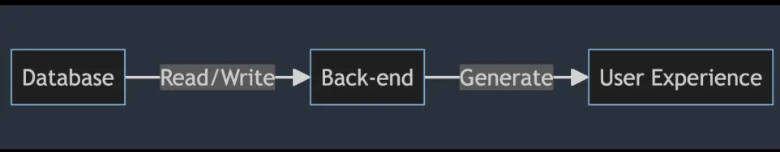
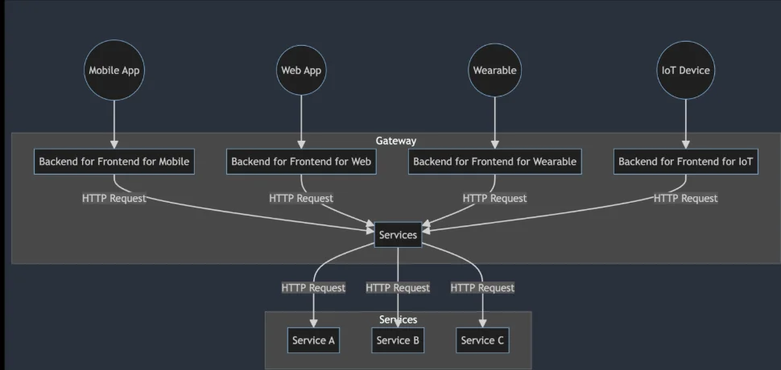
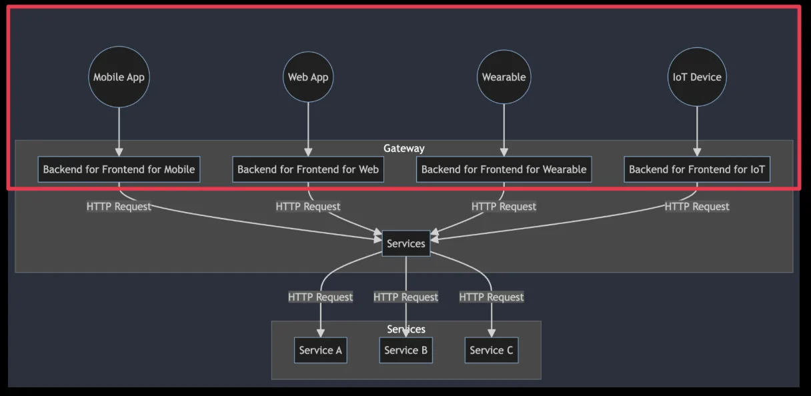
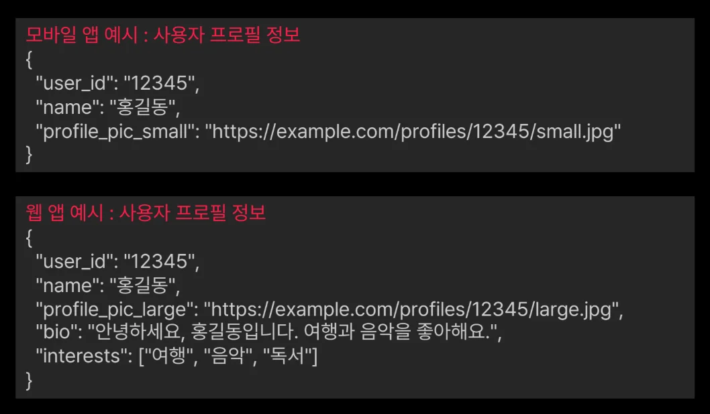
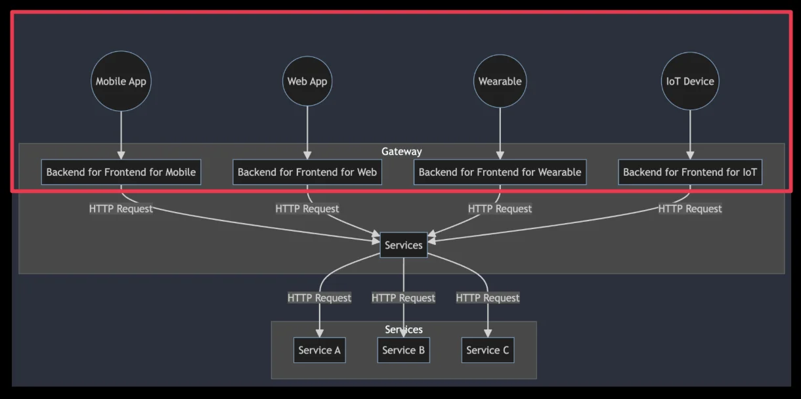
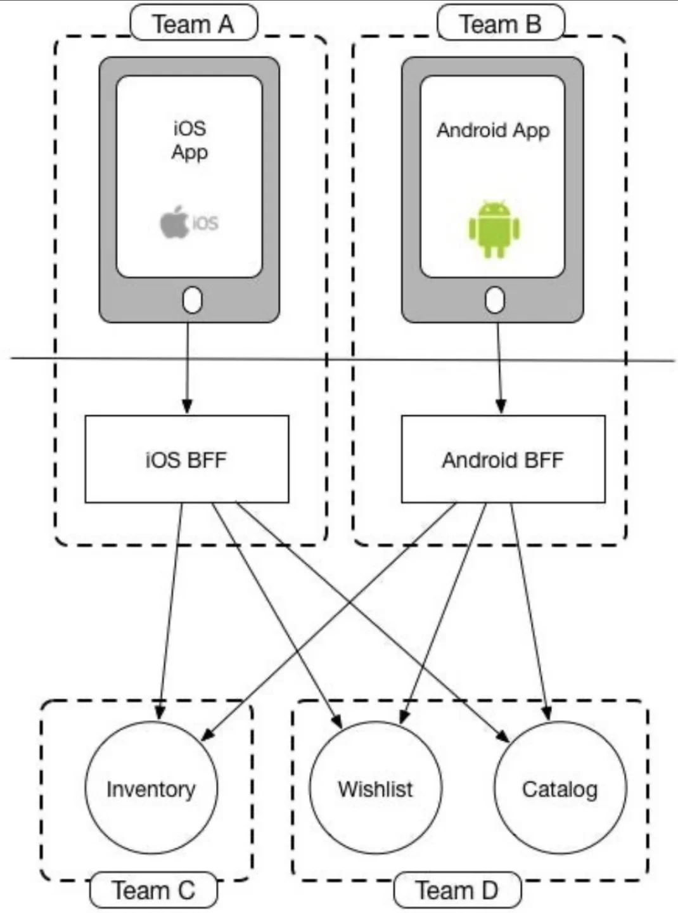

## BFF 패턴 소개 및 특징

---

> 📖 
> 
> 
> 
> <strong>BFF (Backend For Frontend) 패턴</strong>
> 
> 
> 
> 클라이언트 (웹, 모바일, 웨어러블 등)에 최적화된 백엔드 서비스를 제공하는 아키텍처 패턴

> 💬 
> 
> 
> 
> BFF 패턴의 등장 배경
> 
> - <strong><code>다양한 클라이언트 요구사항</code></strong>
>     
> 
>     - 다양한 클라이언트의 등장
> 
>     - 맞춤형 API의 필요성
> 
> - <strong><code>마이크로서비스 아키텍처에서의 다양한 요구사항</code></strong>
>     
> 
>     - 서비스 간 통신의 복잡성
> 
>     - 다양한 클라이언트 요구사항에 대응

### <strong>BFF 패턴의 필요성</strong>

> ✏️ 
> 
> 
> 
> <strong>BFF 패턴의 필요성</strong>
> 
> - <code>클라이언트별 최적화된 사용자 경험 제공</code>
> 
> - <code>네트워크 호출 최소화</code>
> 
> - <code>마이크로서비스 아키텍처와의 효율적인 통합</code>

클라이언트 별 최적화된 사용자 경험 제공

- 클라이언트별 특성과 제약 조건
    - <code>모바일</code>

    - <code>웹</code>

    - <code>웨어러블 및 IOT</code>

네트워크 호출 최소화

- 어플리케이션 성능 향상

- 데이터 전송 시간 단축

- 네트워크 대역폭 절약

- 서버 부하 감소

마이크로서비스 아키텍처와의 효율적인 통합

- 시스템 유연성 증가

- 마이크로서비스 변경 최소화

## BFF 패턴의 장점과 단점

---

### BFF 패턴의 장점

> ✏️ 
> 
> - 프런트 요구사항과 백엔드 요구사항 분리
> 
> - 프런트엔드에서 더 나은 오류 처리
> 
> - 백엔드 서비스 공유하여 개발
> 
> - 보안 강화
> 
> - 구성 요소의 팀 소유권 공유

프론트 요구사항과 백엔드 요구사항 분리

- 프론트엔드의 요구사항과 백엔드의 복잡성이 분리됨

- 각각의 계층이 독립적으로 진화할 수 있어 유지보수가 용이해짐

- 웹 애플리케이션에서 복잡한 데이터 가공이 필요할 때, 이 로직을 BFF에 구현함으로써 프론트엔드 개발자는 데이터 표시에 집중할 수 있고, 백엔드 개발자는 데이터 처리와 관리에 초점을 맞출 수 있음

다 쉬워진 API 유지 관리 및 수정

- 클라이언트 애플리케이션은 BFF를 통해 API 호출

- API 구조의 변경이 클라이언트에 미치는 영향(의존성)이 줄어들며, API 수정이 용이해짐

프론트엔드에서 더 나은 오류 처리

- BFF는 서버로부터의 오류 메시지를 사용자에게 보다 명확하고 이해하기 쉬운 형태로 변환하여 제공

- 사용자가 API 요청 시 발생하는 서버 오류를 BFF에서 감지하고, 사용자가 이해하기 쉬운 언어로 변환하여 표시

백엔드 서비스 공유

- 동일한 백엔드 서비스를 여러 프론트엔드에서 동시에 활용하여 서비스의 응답 시간을 단축시키는 데 도움

- 모바일 앱과 웹 사이트가 동일한 주문 처리 BFF를 사용하여 사용자의 주문 요청을 처리하고, 각기 다른 사용자 인터페이스 요구사항에 맞춰 데이터를 최적화하여 제공

보안 강화

- BFF를 통해 민감한 정보를 숨기거나, 프론트엔드에 전송되지 않아야 하는 불필요한 데이터를 제거

- 민감한 데이터는 BFF에서만 처리하고, 사용자의 디바이스로는 전송되지 않도록 처리

구성 요소의 팀 소유권 공유

- 프론트엔드 팀과 백엔드 팀이 각자의 계층에 대한 소유권을 명확히 가지면서도 협업이 용이

- 프론트엔드 팀은 사용자 인터페이스 와 BFF의 개발을 담당하고, 백엔드 팀은 비지니스 로직과 데이터 관리를 처리

- 이는 두 팀 간의 의사소통을 원할하게 하고, 전체 개발 프로세스 효율성을 높임

### BFF 패턴의 단점

- 코드 중복

- 운영 복잡성 증가

- 개발 및 유지보수 증가

- 리소스 사용량 증가

- API 게이트웨이와의 경계 모호

- 성능 오버헤드 발생 가능성
