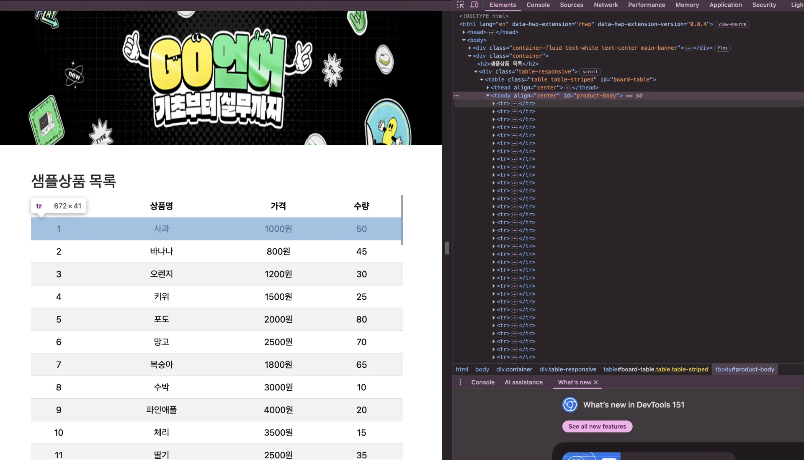

> ✏️ 
> 
> <a id="3cdeda9b0fe180d696c3de8416bc0ef0"></a>
> 
> <strong>스크래핑</strong>
> 
> - 웹사이트에서 데이터를 자동으로 추출하는 과정
> 
> - 주로 HTML 구조를 분석하여 필요한 정보 수집
> 
> - 데이터 수집, 웹 크롤링, 자동화 등에 활용
> 
> - 일반적으로 Beautiful, Scapy, Selenium 등의 라이브러리 활용

> 🤔 
> 
> <a id="3cdeda9b0fe1802f9b36c88ad4a3f5b1"></a>
> 
> <code>웹크롤링</code> vs <code>스크래핑</code>
> 
> - <code>웹크롤링</code>
>     - 여러 사이트의 데이터 수집
> 
> - <code>스크래핑</code>
>     - 특정 사이트의 데이터 추출

<a id="3cdeda9b0fe1800396f2c9bfb78f3d89"></a>

## 실습

> ✏️ 
> 
> <a id="3cdeda9b0fe1804bbfd0d383c3a43419"></a>
> 
> <code>Go언어</code>와 <code>스크래핑</code>
> 
> - Go 언어는 빠른 실행 속도와 병렬 처리 지원 덕분에 대량 데이터 스크래핑에 적합함
> 
> - 강력한 HTTP 요청 및 HTML 파싱 기능을 제공하며 안정적인 코드 작성을 위한 장작 타입 특성을 가지고 있음

> ☝🏻 
> 
> <a id="3cdeda9b0fe18028b482eb54c3a75d20"></a>
> 
> 대부분의 스크래핑은 불법이 될 수 있다&#46;
> 
> - 해당 서버에 들어가 트래픽을 발생시킨다&#46; 
> 
> <a id="3cdeda9b0fe180a196e6c02bc9ef11f6"></a>
> 
> url 끝에 <code>robot&#46;txt</code> 로 스크래핑 허용 범위가 명시 되어 있다&#46; 
> 
> - 어떤 양식으로 스크래핑을 해야하는지, 어느 것은 스크래핑하면 안되는지 그 방식들이<br> 명시되어 있다&#46;

<details>
<summary>스크래핑 실습을 진행할 예제 사이트 </summary>

[my&#95;board]()



</details>

<details>
<summary>패키지 추가&#58; <strong><a href="https://github.com/PuerkitoBio/goquery"><code>goquery</code></a></strong></summary>

[goquery](https://github.com/puerkitobio/goquery)

<a id="3cdeda9b0fe1800ca907f90840a05466"></a>

```go
go get github.com/PuerkitoBio/goquery
```

</details>

<a id="3cdeda9b0fe1804aaa57e57480079b78"></a>

```go
package main

import (
	"fmt"
	"log"
	"net/http"
	"strconv"
	"strings"

	"github.com/PuerkitoBio/goquery"
)

func main() {
	res, err := http.Get("https://alwaysjone.github.io/scraping_sample/")
	if err != nil {
		log.Fatal(err)
	}
	defer res.Body.Close()

	if res.StatusCode != 200 {
		log.Fatal("요청 실패 ")
	}

	doc, err := goquery.NewDocumentFromReader(res.Body)
	if err != nil {
		log.Fatal(err)
	}

	// 상품 정보를 저장할 구조체 슬라이스 선언 (products로 이름 수정)
	var products []struct {
		name  string
		price int
		count int
	}

	// HTML 요소를 파싱하여 products 슬라이스에 추가
	doc.Find("#product-body tr").Each(func(i int, s *goquery.Selection) {
		name := s.Find(".product-name").Text()
		priceStr := s.Find(".product-price").Text()
		countStr := s.Find(".product-count").Text()

		// 가격과 수량을 정수로 변환
		priceStr = strings.ReplaceAll(priceStr, "원", "") // 원 제거
		priceStr = strings.TrimSpace(priceStr)           // 공백 제거
		price, err := strconv.Atoi(priceStr)
		if err != nil {
			log.Fatal("가격 변환 오류")
		}

		count, err := strconv.Atoi(countStr)
		if err != nil {
			log.Fatal("수량 변환 오류")
		}

		// 슬라이스에 구조체 데이터 추가
		products = append(products, struct {
			name  string
			price int
			count int
		}{name, price, count})

		fmt.Printf("상품명 %s, 가격: %d원, 수량: %d\n", name, price, count)
	})

	// 총 상품 갯수, 총 가격, 평균가격 계산 및 출력
	totalCount := len(products)
	totalPrice := 0

	for _, p := range products {
		totalPrice += p.price
	}

	averagePrice := 0
	if totalCount > 0 {
		averagePrice = totalPrice / totalCount
	}

	fmt.Printf("총 상품 갯수 : %d\n", totalCount)
	fmt.Printf("총 가격 : %d원\n", totalPrice)
	fmt.Printf("평균 가격 : %d원\n", averagePrice)
}
```

<details>
<summary>출력 확인 </summary>

<a id="3cdeda9b0fe18016b878d4b178f9cdd4"></a>

```go
// go run ./main.go
상품명 사과, 가격: 1000원, 수량: 50
상품명 바나나, 가격: 800원, 수량: 45
상품명 오렌지, 가격: 1200원, 수량: 30
상품명 키위, 가격: 1500원, 수량: 25
상품명 포도, 가격: 2000원, 수량: 80
상품명 망고, 가격: 2500원, 수량: 70
상품명 복숭아, 가격: 1800원, 수량: 65
상품명 수박, 가격: 3000원, 수량: 10
상품명 파인애플, 가격: 4000원, 수량: 20
상품명 체리, 가격: 3500원, 수량: 15
상품명 딸기, 가격: 2500원, 수량: 35
상품명 레몬, 가격: 600원, 수량: 40
상품명 자두, 가격: 1200원, 수량: 33
상품명 귤, 가격: 1500원, 수량: 55
상품명 무화과, 가격: 1800원, 수량: 48
상품명 블루베리, 가격: 3000원, 수량: 45
상품명 석류, 가격: 2500원, 수량: 60
상품명 살구, 가격: 2200원, 수량: 75
상품명 라임, 가격: 700원, 수량: 43
상품명 파파야, 가격: 2800원, 수량: 50
상품명 코코넛, 가격: 3500원, 수량: 36
상품명 감, 가격: 1200원, 수량: 32
상품명 배, 가격: 1500원, 수량: 40
상품명 호두, 가격: 4000원, 수량: 55
상품명 밤, 가격: 2000원, 수량: 37
상품명 대추, 가격: 1500원, 수량: 42
상품명 참외, 가격: 1000원, 수량: 28
상품명 청포도, 가격: 2500원, 수량: 54
상품명 적포도, 가격: 2000원, 수량: 39
상품명 망고스틴, 가격: 3000원, 수량: 61
상품명 두리안, 가격: 6000원, 수량: 23
상품명 카카오, 가격: 3500원, 수량: 40
상품명 신선한 민트, 가격: 800원, 수량: 78
상품명 로즈메리, 가격: 700원, 수량: 62
상품명 바질, 가격: 600원, 수량: 50
상품명 타임, 가격: 700원, 수량: 67
상품명 세이지, 가격: 800원, 수량: 80
상품명 미니 파인애플, 가격: 1800원, 수량: 90
상품명 스위트 레드, 가격: 1500원, 수량: 35
상품명 천혜향, 가격: 2000원, 수량: 55
상품명 레드빈, 가격: 1200원, 수량: 44
상품명 흰콩, 가격: 800원, 수량: 78
상품명 검정콩, 가격: 900원, 수량: 32
상품명 팥, 가격: 1100원, 수량: 30
상품명 완두콩, 가격: 1000원, 수량: 40
상품명 강낭콩, 가격: 1200원, 수량: 45
상품명 녹두, 가격: 900원, 수량: 22
상품명 햇콩, 가격: 1000원, 수량: 33
상품명 홍고추, 가격: 1200원, 수량: 55
상품명 청고추, 가격: 1100원, 수량: 37
상품명 노란파프리카, 가격: 1500원, 수량: 28
상품명 주황파프리카, 가격: 1600원, 수량: 45
상품명 빨강파프리카, 가격: 1700원, 수량: 53
상품명 연두피망, 가격: 1800원, 수량: 39
상품명 청피망, 가격: 1200원, 수량: 40
상품명 황금호박, 가격: 2500원, 수량: 25
상품명 메론, 가격: 3500원, 수량: 33
상품명 참외, 가격: 2000원, 수량: 50
상품명 복숭아, 가격: 1800원, 수량: 45
상품명 귤, 가격: 1500원, 수량: 55
총 상품 갯수 : 60
총 가격 : 110200원
평균 가격 : 1836원
```

</details>
