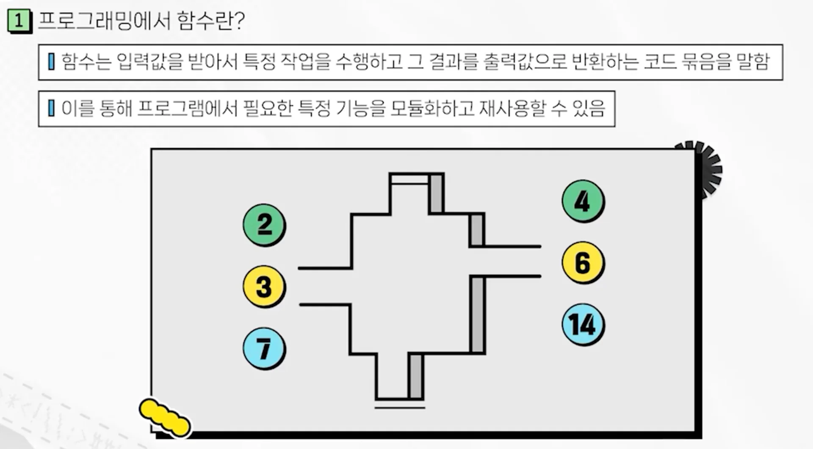

<a id="3b8eda9b0fe180c89047cd65abb3b382"></a>

### 함수란



> 
> 
> <a id="3b8eda9b0fe180b6b808e6a815734421"></a>
> 
> go 함수 언어의 특징
> 
> - 여러 개의 값을 반환할 수 있음
> 
> - <code>익명함수</code>를 지원해 <strong><u>함수를 변수에 할당</u></strong>하거나 <u>인자로 전달</u> 가능
>     - 1급 시민
> 
> - <code>클로저</code>를 지원하여 <strong><u>함수 외부의 변수를 함수 내에서 사용</u></strong> 가능
> 
> - <code>defer</code> 키워드를 사용하여 함수가 <strong><u>반환되기 직전에 실행되는 코드 블록 정의</u></strong>할 수 있음
> 
> - <code>…</code> 키워드를 사용하여 <code>가변 인자 함수</code> 생성

<a id="3b8eda9b0fe180609fbbf26147c6c317"></a>

```go
// 문법
func 함수명 (매개변수) (반환) {
	실행할 코드
}

// ex)
func doubleNum(num int) (int) {
	return num * 2
}
```

<details>
<summary>ex 1) 기본 함수</summary>

<a id="3b8eda9b0fe180e8bef6e9a91d96822a"></a>

```go
// func.go
package main

import "fmt"

func multiple(num int) int	{
	return num * 2
}

func main() {
	res := multiple(5)
	fmt.Println("결과 : ", res)
}
```

- 출력
    <a id="3b8eda9b0fe180e7aa5ff1b61e9225a2"></a>

    ```bash
    go run ./func.go
    # 결과: 10
    ```

</details>

<details>
<summary>ex 2) 여러 개의 결과 반환</summary>

<a id="3b8eda9b0fe18099bc60d17458ea9ebb"></a>

```go
// func.go
package main

import "fmt"

func multipleResult(n1, n2 int) (int, int) {
	return n1 * 2, n2 * 2
}

func main() {
	res1, res2 := multipleResult(4, 5)
	
	fmt.Println("결과: ", res1, res2)
	
	_, res3 := multipleResult(5, 100)
	
		fmt.Println("결과: ", res1, res2, re3)
}
```

- 출력
    <a id="3b8eda9b0fe1804d8e91feec879d9d2e"></a>

    ```bash
    go run ./func.go
    # 결과: 8 10
    # 결과: 8 10 200
    ```

</details>

<details>
<summary>ex 3) 가변인자(<code>…</code>) 사용 (스프레드 문법)</summary>

<a id="3b8eda9b0fe1804f9b2ccdd0d0f23dc4"></a>

```go
// func.go
package main

import "fmt"

func totalCal(num ...int) int {
	total := 0
	for i, n := range num {
		fmt.Println(i, "번쨰 값: ", n)
		total += n
	}
	return total
}

func main() {
	total := totalCal(1, 3, 5, 7, 9)
	
	fmt.Println("모두 더한 결과: ", total)
}
```

- 출력
    <a id="3b8eda9b0fe180149e91c684c6be1056"></a>

    ```bash
    go run ./func.go
    # 결과: 8 10
    # 결과: 8 10 200
    ```

</details>

<details>
<summary>ex 4&#46;1) 함수 인자 할당 (1급 시민, 값으로 사용 가능)</summary>

<a id="3b8eda9b0fe1809281e6dc9929ae80dc"></a>

```go
// func.go
package main

import "fmt"

func multipleResult(num int, cal func(int) int) {
	res := cal[num]
	fmt.Println(res)
}

func main() {
	printMultiple(50, multiple) // 호출 X -> () 제거
}
```

- 출력
    <a id="3b8eda9b0fe18011abc4c795535f3da3"></a>

    ```bash
    go run ./func.go
    # 결과: 8 10
    # 결과: 8 10 200
    ```

</details>

<details>
<summary>ex 4&#46;2) 함수 변수 할당 (1급 시민, 값으로 사용 가능)</summary>

<a id="3b8eda9b0fe1804e94b1ca92812a4efa"></a>

```go
// func.go
package main

import "fmt"

func main() {
	// 방법 1 - 변수할당
	showMyInfo := func(name string, age int) {
		fmt.Println("제 이름은", name, "입니다.")
		fmt.Println("나이는", age, "입니다.")
	}
	
	showMyInfo("이경섭", 30)
}
```

- 출력
    <a id="3b8eda9b0fe180d89359f081132c3344"></a>

    ```bash
    go run ./func.go                   1 ✘ 
    # 제 이름은 이경섭 입니다.
    # 나이는 30 입니다.
    ```

</details>

<details>
<summary>ex 4&#46;3) 익명함수 (1급 시민, 값으로 사용 가능)</summary>

<a id="3b8eda9b0fe180109357efadf83d53a0"></a>

```go
// func.go
package main

import "fmt"

func main() {
	// 방법 1 - 변수할당
	func(name string, age int) {
		fmt.Println("제 이름은", name, "입니다.")
		fmt.Println("나이는", age, "입니다.")
	}("이경섭", 30)
}
```

- 출력
    <a id="3b8eda9b0fe180d49fcbca6f7d68276f"></a>

    ```bash
    go run ./func.go                   1 ✘ 
    # 제 이름은 이경섭 입니다.
    # 나이는 30 입니다.
    ```

</details>

<details>
<summary>ex 5) <code>defer</code>, 함수 나중 실행</summary>

<a id="3b8eda9b0fe1800cb107d6d1e34bf533"></a>

```go
package main

import "fmt"

func deferTest1() {
	defer deferTest2()
	fmt.Println("Test1 함수 시작")
}

func deferTest2() {
	fmt.Println("Test2 함수 시작")
}

func main() {
	// defer 함수 마지막에 실행시킴
	// 리소스 반환 시 사용 
	deferTest1()
}
```

- 출력
    <a id="3b8eda9b0fe180c09f2dd10c82796bf9"></a>

    ```bash
    go run ./defer.go                   1 ✘ 
    # "Test1 함수 시작"
    # "Test2 함수 시작"
    ```

<a id="3b8eda9b0fe1807386afd58f7f44ac1c"></a>

```go
package main

import "fmt"

func deferTest3() {
	defer func() {
		fmt.Println("Test3 함수 종료")
	}()
	fmt.Println("Test3 함수 시작")
}

func main() {
	// defer 함수 마지막에 실행시킴
	// 리소스 반환 시 사용 
	deferTest3()
}
```

- 출력
    <a id="3b8eda9b0fe1806ba411ddc1033c2045"></a>

    ```bash
    go run ./defer.go
    # "Test3 함수 시작"
    # "Test3 함수 종료"
    ```

</details>

<details>
<summary>ex 6) <code>클로저</code></summary>

<a id="3b8eda9b0fe1802e9dc0fea525f2eba2"></a>

```go
package main

import "fmt"

func makeCounter() func() int {
	count := 0
	
	return func() int {	
		count++
		return count
	}
}

func main() {
	// 클로저 함수: 함수 안에서 함수를 정의하고, 그 함수가 외부 함수의 변수를 참조할 수 있는 기능
	// 자신이 만들어질 떄 변수의 상태를 기억한다. 

	countRes := makeCounter()
	
	fmt.Println(countRes())
	fmt.Println(countRes())
	fmt.Println(countRes())
	fmt.Println(countRes())
	fmt.Println(countRes())
	fmt.Println(countRes())
}
```

- 출력
    <a id="3b8eda9b0fe180239063cac302f1632f"></a>

    ```bash
    go run ./closure.go
    # 1
    # 2 
    # 3
    # 4
    # 5
    # 6
    ```

</details>
