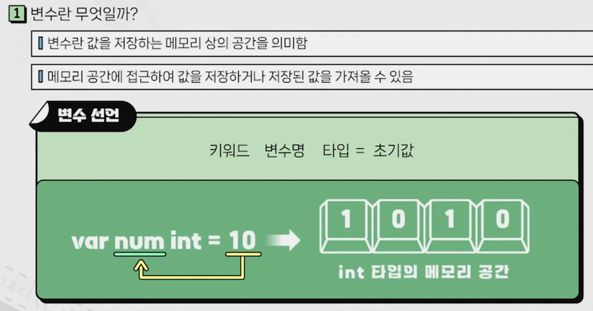
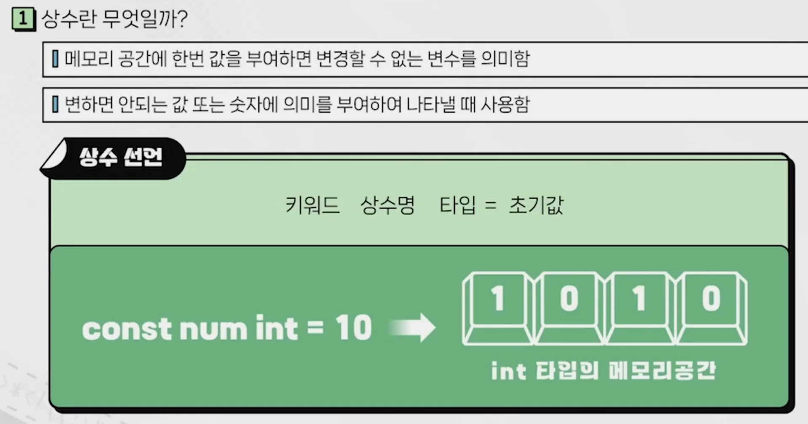
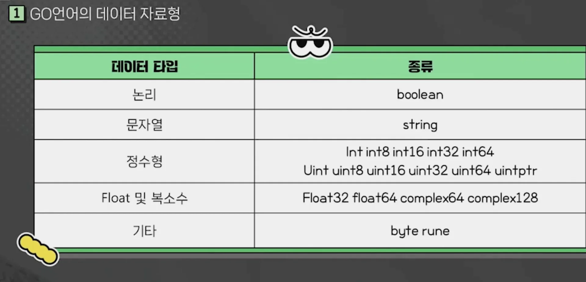

<a id="3b7eda9b0fe180998efdebae96cd9258"></a>

## 변수

---

> ✏️ 
> 
> <a id="3b7eda9b0fe180628211e285247428a2"></a>
> 
> <code>var</code> 키워드를 사용해 선언, 값 재할당 가능



<a id="3b7eda9b0fe1803d8a8cf5e745601823"></a>

### 변수 선언

> ✏️ 
> 
> <a id="3b7eda9b0fe1801e9087eafb58b7b8c3"></a>
> 
> <code>var</code> 키워드를 사용해 선언하며 값 변경 가능

<a id="3b7eda9b0fe180b5a2a5f8ff9988d36e"></a>

```go
// 바로 초기화
var num int = 20
```

<a id="3b7eda9b0fe1802bb1c4ff94f924e596"></a>

```go
// 선언 후 초기화
var num2 int 
num2 = 10
```

<a id="3b7eda9b0fe1803dbca4d8945ead6d1d"></a>

```go
// 축약 (var -> :)
num3 := 30 
```

<a id="3b7eda9b0fe18027bab0ee1bba711e29"></a>

```go
// 한번에 선언
var (
	num4 int
	num5 int = 50
)

num4 = 40
fmt.Println(num4, num5) // 40, 50 
```

<a id="3b7eda9b0fe180d4a989c58d0760308d"></a>

### <strong>&#91;실습&#93;</strong> 변수 

<a id="3b7eda9b0fe180cfaa29f47d5c2de6a4"></a>

```go
package main

import "fmt"

func main() {
	var num int
	num = 10

	var num2 int = 20

	fmt.Println("숫자1: ", num)
	fmt.Println("숫자2: ", num2)
}
```

- 출력
    <a id="3b7eda9b0fe180ecb22cd006151dafc2"></a>

    ```bash
    go run main.go 
    # 숫자1:  10
    # 숫자2:  20
    ```

<details>
<summary><strong>&#91;실습2&#93;</strong> 변수 할당 및 출력</summary>

<a id="3b7eda9b0fe18003a4e3f80fd018bebe"></a>

```go
package main

import "fmt"

func main() {
	var num int
	num = 10

	var num2 int = 20

	fmt.Println("숫자1: ", num)
	fmt.Println("숫자2: ", num2)
}
```

- 출력
    <a id="3b7eda9b0fe180baacb1dc77af9eb4d0"></a>

    ```bash
    go run main.go 
    # 숫자1:  10
    # 숫자2:  20
    ```

</details>

<a id="3b7eda9b0fe18040b201edb588a76f50"></a>

## 상수

---

> ✏️ 
> 
> <a id="3b7eda9b0fe180c58ff7e11fa01b875d"></a>
> 
> 변하지 않는 값에 사용, <code>const</code> 키워드를 사용해 선언



<a id="3b7eda9b0fe1809ca138cb3a8ff498b2"></a>

### 상수 선언

> ✏️ 
> 
> <a id="3b7eda9b0fe180c5b9a4e4441746d586"></a>
> 
> <code>const</code> 키워드를 사용해 선언하며 값 변경 불가능

- 기본 생성
    <a id="3b7eda9b0fe180a79589e5b7e5575ed3"></a>

    ```go
    const num int = 10

    fmt.Println(num) // 출력값: 10
    ```

- 여러 개 동시 생성
    <a id="3b7eda9b0fe18017b0a1c777aabafd48"></a>

    ```go
    const (
    	num2 int = 20
    	num3 int = 30	
    )
    ```

-  <code>iota</code>&#58; 열거형, 규칙적 증가
    <a id="3b7eda9b0fe180dc8fcfec262b668c8f"></a>

    ```go
    const (
    	n1 = iota
    	n2
    	n3
    	n4
    )

    fmt.Println(n1, n2, n3, n4)
    // 출력: 0, 1, 2, 3
    ```

    <a id="3b7eda9b0fe18090b05cff6d0c9948f0"></a>

    ```go
    // 위와 동일한 결과값
    const (
    	n1 = iota
    	n2 = iota
    	n3 = iota
    	n4 = iota
    )

    fmt.Println(n1, n2, n3, n4)
    // 출력: 0, 1, 2, 3
    ```

<a id="3b7eda9b0fe180ed9090e0352e92beb9"></a>

### <strong>&#91;실습&#93;</strong> 상수

<a id="3b7eda9b0fe180d9925ad751d65105c5"></a>

```go
package main

import "fmt"

func main() {
	const num int
	num = 20

	const num2 int = 20

	fmt.Println("숫자1: ", num)
	fmt.Println("숫자2: ", num2)
}
```

- 출력
    <a id="3b7eda9b0fe180bdac22f9d0e1db7700"></a>

    ```bash
    go run main.go 
    # 숫자1:  10
    # 숫자2:  20
    ```

<details>
<summary><strong>&#91;실습2&#93;</strong> 변수 할당 및 출력</summary>

<a id="3b7eda9b0fe180c6a8d5f77c3fd8717d"></a>

```go
package main

import "fmt"

func main() {
	var num int
	num = 10

	var num2 int = 20

	fmt.Println("숫자1: ", num)
	fmt.Println("숫자2: ", num2)
}
```

- 출력
    <a id="3b7eda9b0fe180cbbe0aefb66b612e63"></a>

    ```bash
    go run main.go 
    # 숫자1:  10
    # 숫자2:  20
    ```

</details>

<a id="3b7eda9b0fe18064868cfae3fef2b194"></a>

## 데이터 타입

---

> ✏️ 
> 
> <a id="3b7eda9b0fe1808ba479dbaf2ec17147"></a>
> 
> 타 언어들과 동일



<a id="3b7eda9b0fe180c89a70dc9761913384"></a>

### 실습

<details>
<summary>🤔 <code>int</code> 에 할당되는 bit 값</summary>

- 컴퓨터의 기본 연산을 따라간다&#46;

- 즉, 64 비트를 가지면 <code>int64</code> 와 같다&#46;

- 요즘 대부분의 컴퓨터는 <code>64비트</code>를 가진다&#46; 

<a id="3b7eda9b0fe1806a84f9d49f61391ba9"></a>

 

</details>

<a id="3b7eda9b0fe180248fb2e92ace045663"></a>

```go
package main

import "fmt"

func main() {
	// 부호 있는 정수형: int
	var num1 int = 10
	num1 = -10
	fmt.Println(num1)
	
	// 부호 없는 정수형: uint
	var num2 uint = 10
	num2 = 50
	fmt.Println(num2)
	
	// 다양한 정수형
	var num3 int8 = 120
	var num4 int16
	var num4 int32
	var num4 int64
	
	fmt.Println(num3, num4, num5, num6)
	
	// 실수형
	var f1 float32 = 1.5
	fmt.Println(f1)
	
	// 복소수
	var com1 complex64 = 1 + 21
	fmt.Println(com1)
	
	// 논리형
	var b1 bool = true
	var b1 bool = false
	fmt.Println("논리 자료형: ",  b1, b2)
	
	// byte - 아스키코드 변환 (자바 char 와 동일)
	var byte1 byte = 'a'
	fmt.Printf("%c", byte1)
}
```
