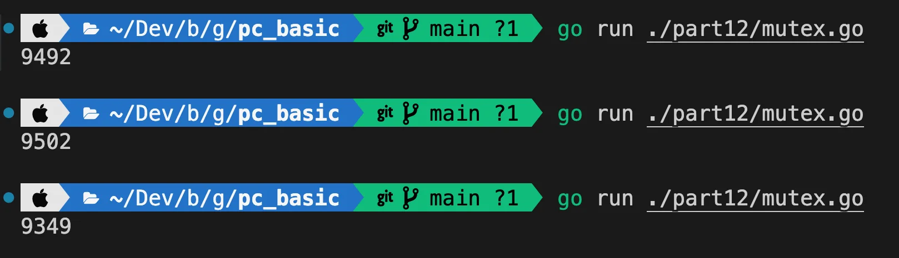

> ✏️ 
> 
> <a id="3caeda9b0fe180fab9a1ecac60782ea5"></a>
> 
> 동기화
> 
> <a id="3caeda9b0fe1800289c3cdcad225a4b4"></a>
> 
> 여러 고루틴이 <strong><u>공유 자원에 안전하게 접근</u></strong>할 수 있도록 <strong>실행 순서를 제어</strong>하는 과정
> 
> - <strong><u>동기화를 제대로 하지 않</u></strong>으면 <strong>고루틴 간 경쟁 상태</strong>가 되거나 <strong>데이터 불일치 </strong>같은 문제가 발생할 수 있음
> 
> - 따라서 공유 데이터에 대한 싱크를 지속적으로 맞추는 동기화 작업을 진행해야함


- <code>경쟁 상태</code>
    - 두 고루틴(그 이상)이 동시에 공유자원에 접근하여 발생하는 문제

    - 고루틴들의 실행 순서에 따라 결과가 달라질 수 있는 상태 

- <code>데이터 불일치</code>
    - 여러 고루틴이 동시에 데이터에 접근하면서 그 데이터가 일관성 없는 상태로 남게 되는 상황

    - 데이터 불일치는 경쟁 조건과 유사하지만, 주로 한 고루틴이 데이터를 읽거나 사용할 때, 다른 고루틴이 그 데이터를 변경하는 상황에서 발생함

<a id="3caeda9b0fe180928fcfc5d52a9d7114"></a>

### GO루틴 동기화

> ✏️ 
> 
> <a id="3caeda9b0fe1806185d4ef761a288eb3"></a>
> 
> 안정적인 GO루틴 동기화를 도와주는 키워드
> 
> - <code>WaitGroup</code>
>     - 여러 고루틴이 끌날 때까지만 메인 고루틴이 대기할 수 있게 함
> 
> - <code>Mutex</code>
>     - 여러 고루틴이 동일한 자원에 동시에 접근하지 못하도록 보호하는 장치
> 
>     - 경쟁 상태가 되었을 때, 공유 데이터를 안전하게 처리
> 
>     - 락
> 
> - <code>Once</code>
>     - 특정 작업을 한 번만 실행되도록 보장하는 기능 제공

<a id="3caeda9b0fe180788cc7ea16dad8c49d"></a>

### 실습

<a id="3caeda9b0fe18019991ff8d8e863eea9"></a>

#### <code>WaitGroup</code>

<a id="3caeda9b0fe1801d986ae84de9c5a17f"></a>

```go
package main

import (
	"fmt"
	"sync"
	"time"
)

func task(id int, wg *sync.WaitGroup) {
	defer wg.Done()  // 작업이 완료되었다는 알림

	fmt.Printf("작업자 %d 시작\n", id)
	time.Sleep(time.Second)
	fmt.Printf("작업자 %d 시작\n", id)
}

func main() {
	/* WaitGroup
	고루틴들이 모두 완료할 때까지 대기하는데 사용하는 동기화 도구
		- add: 고루틴 추가, 
		- done: 고루틴 완료 알림, 
		- wait: 고루틴 종료시 까지 대기
	*/
	var wg sync.WaitGroup

	for i := 1; i <= 10; i++ {
		wg.Add(1) // 고루틴을 실행하기 전 1추가
		go task(i, &wg)
	}

	wg.Wait() // 모든 고루틴이 완료될 때까지 대기

	fmt.Println("모든 작업 종료")
}
```

<details>
<summary>출력</summary>

<a id="3caeda9b0fe1808b8b26d528c211bcda"></a>

```go
작업자 1 시작
작업자 2 시작
작업자 10 시작
작업자 4 시작
작업자 5 시작
작업자 6 시작
작업자 7 시작
작업자 8 시작
작업자 9 시작
작업자 3 시작
작업자 3 시작
작업자 6 시작
작업자 10 시작
작업자 4 시작
작업자 5 시작
작업자 1 시작
작업자 8 시작
작업자 7 시작
작업자 9 시작
작업자 2 시작
모든 작업 종료
```

</details>

<a id="3caeda9b0fe18008bd21c176214a95d2"></a>

#### <code>Once</code>

<a id="3caeda9b0fe180e3871ec2524fe3a221"></a>

```go
package main

import (
	"fmt"
	"sync"
)

func justOnce() {
	fmt.Println("한번만 실행하고 싶은 함수")
}

func main() {
	/* Once 
		- 한번만 실행 (주로 초기화 작업) 
	*/
	var once sync.Once

	var wg sync.WaitGroup

	for i:=1; i<5; i++ {
		wg.Add(1)
		go func (id int) {
			defer wg.Done()

			fmt.Printf("고루틴 %d 함수\n", id)

			once.Do(justOnce)
		}(i)
	}

	wg.Wait()
}
```

<details>
<summary>출력</summary>

<a id="3caeda9b0fe18012ab1ac90f18734d4a"></a>

```go
// go run ./part12/once.go
고루틴 2 함수
한번만 실행하고 싶은 함수 // 처음 한번만 실행되고 이후 for 문 진행 시 생략됨
고루틴 3 함수
고루틴 1 함수
고루틴 4 함수
```

</details>

<a id="3caeda9b0fe18097b2e3e30ae78ae000"></a>

#### <code>Mutex</code>

> ☝🏻 
> 
> <a id="3caeda9b0fe180599606f5b1b61c1453"></a>
> 
> 비동기 처리에서 무분별하게 사용 시 락을 걸기 떄문에 동기적으로 칠될 수 있다&#46;<br> 즉, 성능 저하가 발생될 수 있다&#46; 

<details>
<summary>경쟁 조건 발생  &#45; 카운팅 생략</summary>

<a id="3caeda9b0fe180abbf4af2f62a9c0154"></a>

```go
package main

import (
	"fmt"
	"sync"
)

func increment(count *int) {
	*count += 1
}

func main() {

	count := 0

	var wg sync.WaitGroup

	for i := 1; i < 10000; i++ {
		wg.Add(1)

		go func () {
			defer wg.Done()
			increment(&count)
		}()
	}

	wg.Wait()
	fmt.Println(count)
}
```



- 10000번을 카운팅 하지만 경쟁 조건이 발생되어 실제 카운팅이 매번 달라지는 것을 확인할 수 있다&#46; 
    - 고루틴이 동시에 카운팅 함수에 접근해 카운팅이 생략된다&#46; 

</details>

<details>
<summary>mutex틑 통한 동시성 제어 (경쟁 조건 락 제어)</summary>

<a id="3caeda9b0fe180f9b2cddfb989d9288e"></a>

```go
package main

import (
	"fmt"
	"sync"
)

func increment(count *int, mutex *sync.Mutex) {
	mutex.Lock()  // 락 (다른 고루틴 접근 금지)
	*count += 1
	mutex.Unlock() // 락 해제 (다른 고루틴 접근 허용)
}

func main() {
	/* 경쟁 조건
		- 여러 고루틴이 동시에 같은 메모리 공간에 접근해 수정라혀고 할 때, 
		  예기 치 않은 결과가 발생하는 문제
	*/

	count := 0

	var mutex sync.Mutex
	var wg sync.WaitGroup

	for i := 1; i <= 10000; i++ {
		wg.Add(1)

		go func () {
			defer wg.Done()
			increment(&count, &mutex)
		}()
	}

	wg.Wait()
	fmt.Println(count)
}
```

</details>

<a id="3caeda9b0fe18020b575ee1537faa30a"></a>

#### <code>종합</code> &#45; 안전한 동시성 제어 

<a id="3caeda9b0fe18085ae24e657fc973e46"></a>

```go
package main

import (
	"fmt"
	"sync"
	"time"
)

var (
	// 공유자원
	counter int
	// 뮤텍스
	mutex sync.Mutex
	// 원스
	once sync.Once
)

func initialize() {
	counter = 0
	fmt.Println("공유자원 초기화")
}

func worker(id int, wg * sync.WaitGroup) {
	defer mutex.Unlock() // 함수 종료 시 락 해제
 	defer wg.Done()      // 함수 종료 시 wait group 해제
	
	// 딱 한번만 실행(초기화)
	once.Do(initialize)  // 공유 자원 초기화

	mutex.Lock())        // 락, 경쟁 조건 차단
	counter++
	fmt.Printf("작업 %d : counter = %d\n", id, counter)
	time.Sleep(time.Microsecond * 100)
}

func main() {
	var wg sync.WaitGroup

	for i := 0; i <= 10; i++ {
		wg.Add(1)          // wait group에 고루틴 작업 카운팅 추가
		go worker(i, &wg);
	}

	wg.Wait()            // 모든 고루틴 실행 종료까지 기다림
	fmt.Println("모든 작업 완료. 최종 counter : ", counter)
}
```

<a id="3caeda9b0fe1806f9cd8d9cd96c926c1"></a>

출력

<a id="3caeda9b0fe18037a71cdce7000ed8fa"></a>

```go
공유자원 초기화
작업 4 : counter = 1
작업 10 : counter = 2
작업 8 : counter = 3
작업 9 : counter = 4
작업 2 : counter = 5
작업 0 : counter = 6
작업 3 : counter = 7
작업 5 : counter = 8
작업 6 : counter = 9
작업 7 : counter = 10
작업 1 : counter = 11
모든 작업 완료. 최종 counter :  11
```
